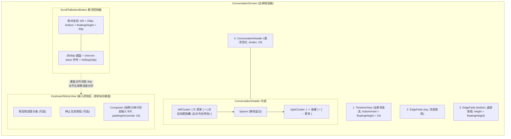
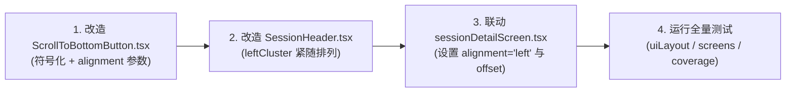

# 移动端顶栏标题左对齐排版与回到底部符号按钮重构方案

> **文件标识**：`docs/mobile-interaction-refine/proposals/07-标题左对齐与回到底部符号按钮方案.md`  
> **所属战役**：`mobile-interaction-refine`（移动端交互与视觉精细化战役）  
> **权威状态**：已定案（针对用户明确痛点设计）  
> **编码格式**：UTF-8 无 BOM、中文撰写  
> **关联源码**：
> - [`apps/crish-mobile/src/presentation/components/chat/SessionHeader.tsx`](file:///c:/Software/conex/apps/crish-mobile/src/presentation/components/chat/SessionHeader.tsx)
> - [`apps/crish-mobile/src/presentation/ui/ScrollToBottomButton.tsx`](file:///c:/Software/conex/apps/crish-mobile/src/presentation/ui/ScrollToBottomButton.tsx)
> - [`apps/crish-mobile/src/presentation/screens/sessionDetailScreen.tsx`](file:///c:/Software/conex/apps/crish-mobile/src/presentation/screens/sessionDetailScreen.tsx)
> - [`apps/crish-mobile/src/presentation/ui/Composer.tsx`](file:///c:/Software/conex/apps/crish-mobile/src/presentation/ui/Composer.tsx)
> - [`apps/crish-mobile/src/presentation/ui/iconPaths.ts`](file:///c:/Software/conex/apps/crish-mobile/src/presentation/ui/iconPaths.ts)

---

## 目录

1. [背景复盘与核心诉求](#一背景复盘与核心诉求)
2. [问题深度诊断与物理几何失衡分析](#二问题深度诊断与物理几何失衡分析)
3. [模块一：对话标题左对齐排版重构方案](#三模块一对话标题左对齐排版重构方案)
4. [模块二：“回到底部”悬浮按钮改造（符号化与左上角锚定）](#四模块二回到底部悬浮按钮改造符号化与左上角锚定)
5. [整体图层拓扑与端到端协同架构](#五整体图层拓扑与端到端协同架构)
6. [动效设计与无障碍触控守门](#六动效设计与无障碍触控守门)
7. [多端与多宿主兼容矩阵](#七多端与多宿主兼容矩阵)
8. [自动化测试与质量守门资产](#八自动化测试与质量守门资产)
9. [实施步骤与交付清单](#九实施步骤与交付清单)

---

## 一、背景复盘与核心诉求

在近期真机使用与交互走查过程中，用户提出了两条非常明确、直观的体验诉求：

> 1. **“对于对话标题需要放在菜单栏的左边，不用居中显示哈”**
> 2. **“回到底部的按钮可以改成符号，放在输入框的左上角”**

这两项诉求直指当前移动端核心聊天界面的两大视觉与交互断层：
1. **顶栏空间挤压与视觉重心偏移**：现行 `SessionHeader`（`ConversationHeader`）采用三段式对称 `flex: 1` 居中强约束。左侧仅有汉堡菜单按钮（38dp），右侧却有新建和更多两个按钮（84dp），强行居中不仅造成左侧大片无效留白、右侧逼仄，而且严重压缩了对话标题的有效展示宽度，长标题极易被截断，违背了移动端从左到右的自然阅读动线；
2. **回到底部按钮视觉笨重与位置遮挡**：现行 `ScrollToBottomButton` 采用全屏底端水平居中（`alignSelf: 'center'`）的大号文字胶囊（带“回到底部”4个汉字，宽度近 100dp），在时间线上滑浏览时直直挡在最新的消息焦点以及输入框中央上方；且用户单手操作时，右下角通常是频繁触发的发送/输入区域，居中的大文字块既重又容易造成视觉疲劳。

本方案旨在针对这两项诉求进行彻底、纯粹的架构与样式重构，拒绝坐标盲测与打补丁，从 Flex 拓扑、坐标锚定、SVG 软阴影测量到动效流实现全面升级。

---

## 二、问题深度诊断与物理几何失衡分析

### 2.1 现行顶栏 `SessionHeader.tsx` 布局失衡

```
【现行 390dp 屏幕下的几何分配】
+-----------------------------------------------------------------------------------+
| [16dp padding]                                                    [16dp padding]  |
|                                                                                   |
|  <View style={side}> (flex: 1)             <View style={side}> (flex: 1)         |
|  [ ☰ (38) ]            [空白 83dp]          [空白 37dp]   [ ＋ (38) ]  [ ⋯ (38) ]|
|  |<-------- 121dp 左右对称区 -------->|   |<-------- 121dp 左右对称区 -------->| |
|                                                                                   |
|                         [ 纯白标题胶囊: 仅剩 ~116dp 可用 ]                        |
|                                                                                   |
+-----------------------------------------------------------------------------------+
```

#### 代码级证据与痛点穿透
如 `apps/crish-mobile/src/presentation/components/chat/SessionHeader.tsx` 第 56-112 行所示：
```tsx
<View style={[styles.row, { gap: theme.space.sm }]}>
  <View style={styles.side}>
    <IconButton name="menu" variant="floating" ... />
  </View>
  <View style={styles.titlePill}>
    <AppText variant="barAction" numberOfLines={1}>{title}</AppText>
  </View>
  <View style={[styles.side, styles.sideEnd, { gap: theme.space.sm }]}>
    <IconButton name="add" ... />
    <IconButton name="more" ... />
  </View>
</View>
```
- **病灶 1：虚假的对称性**：左侧只有一个 38dp 的菜单按钮，右侧有两个 38dp 的按钮（加间距为 84dp）。左右 `side` 均为 `flex: 1`，导致左侧空余 121 - 38 = 83dp 的大面积纯空白，右侧仅空余 37dp；
- **病灶 2：标题可用空间腰斩**：在 390dp 常见机型上，中间仅剩不到 116dp（扣除边距后甚至只有 100dp 左右），导致用户稍微长一点的会话名称（如“重构移动端顶栏方案”）立刻截断为“重构移动...”，极度影响辨识度；
- **病灶 3：违背视线锚定**：在移动端会话场景下，用户视线习惯从左上角的导航入口直接跳至当前上下文标题，居中排版将标题割裂成一个孤岛。

---

### 2.2 现行“回到底部”悬浮按钮的物理缺陷

```
【现行布局】
+-------------------------------------------------------------+
|                                                             |
|                      [最新聊天消息流]                       |
|                                                             |
|                 +-----------------------+                   |
|                 |       回到底部        | <-- 遮挡内容正中心 |
|                 +-----------------------+                   |
|                                                             |
| +---------------------------------------------------------+ |
| | [Composer 悬浮输入框]                                    | |
| +---------------------------------------------------------+ |
+-------------------------------------------------------------+
```

#### 代码级证据与痛点穿透
如 `apps/crish-mobile/src/presentation/ui/ScrollToBottomButton.tsx` 第 63-87 行所示：
```tsx
<AnimatedPressable
  style={[styles.button, { bottom: baseBottom }, press.fadeStyle, keyboardFollowStyle]}
>
  <SoftShadowSurface preset="button" borderRadius={theme.radius.pill} ...>
    <AppText variant="footnote" color="textPrimary">
      回到底部
    </AppText>
  </SoftShadowSurface>
</AnimatedPressable>
```
- **病灶 1：大胶囊文字过重**：文字胶囊包含 4 个中文字符，`paddingHorizontal: 14`，高度 36dp，总宽度接近 96dp，视觉存在感过重，喧宾夺主；
- **病灶 2：`alignSelf: 'center'` 强行居中遮挡**：在聊天流的最底部正中央，通常是助手正在输出的关键段落或用户最后发送的提问。居中放置的胶囊刚好盖在文字最密集的正上方；
- **病灶 3：与输入框操作流脱节**：用户在输入框打字或长按语音时，输入框右侧有发送圆盘（`sendButton: 36`），输入框正上方如果出现居中胶囊，极易分散视线或导致双手/单手交替时的按压误触。

---

## 三、模块一：对话标题左对齐排版重构方案

### 3.1 目标排版流与视觉拓扑

重构后的顶栏彻底废除左右对称的虚假约束，转为**流式左对齐簇 + 弹性留白 + 右侧动作簇**的现代移动端拓扑：

```
【重构后全新左对齐排版拓扑】
+-----------------------------------------------------------------------------------+
| [16dp padding]                                                    [16dp padding]  |
|                                                                                   |
|  <View style={styles.leftCluster}> (flex: 1, minWidth: 0)         [右侧固定簇]     |
|  +--------+   +------------------------------------+   [弹性留白]   +----+  +----+  |
|  | ☰ 菜单 | 8 | 对话标题胶囊 (可自由向右伸展 ~210dp)  | =========> | ＋ |8 | ⋯  |  |
|  +--------+   +------------------------------------+   (Spacer)    +----+  +----+  |
|  (38dp)       (自适应收缩 / 超长尾部优雅截断 ...)                     (38)    (38)   |
|                                                                                   |
+-----------------------------------------------------------------------------------+
```

### 3.2 布局实现关键技术点

1. **左侧复合簇（`leftCluster`）**：
   - 样式设为 `flex: 1, flexDirection: 'row', alignItems: 'center', gap: theme.space.sm`；
   - **核心抗压属性：`minWidth: 0`**：React Native 与 Web Flexbox 规范一致，若没有 `minWidth: 0`，内部文本在变长时会导致父级容器宽度溢出并把右侧按钮挤出屏幕。设置 `minWidth: 0` 保证 flex 容器能正确计算约束。
2. **标题胶囊（`titlePill`）**：
   - 样式保留原本高级的浮层质感（`theme.colors.surfaceRaised`，`borderRadius: theme.radius.pill`，Android 浅色下的 `SoftShadow` 动态两层 SVG 投影）；
   - 内部对齐：`justifyContent: 'flex-start'`，文字自然靠左；
   - **`flexShrink: 1` 声明**：当标题文字较短时（如“日常闲聊”），胶囊保持内容紧凑包裹（wrap-content），紧跟在菜单按钮右侧 8dp 处；当标题超长时，胶囊向右延伸至触碰安全边界，并依靠内部 `AppText` 的 `numberOfLines={1}` 和 `ellipsizeMode="tail"` 优雅截断。
3. **右侧固定簇（`rightCluster`）**：
   - 样式设为 `flexShrink: 0, flexDirection: 'row', alignItems: 'center', gap: theme.space.sm`；
   - 保证新建按钮（`session-new`）与更多选项按钮（`session-more`）具有绝对最高优先级显示空间，永不发生位移、压缩或变形。
4. **Android 动态软阴影兼容**：
   - 保留 `onLayout={(e) => setPillWidth(e.nativeEvent.layout.width)}`；
   - 动态获取胶囊的自适应宽度后，精准为 Android 渲染底层极淡 SVG 双层软阴影，避免固定宽度的阴影溢出或欠缺。

### 3.3 代码落地对比设计

```tsx
// 改造后：SessionHeader.tsx (ConversationHeader) 核心结构
<View
  testID={testID}
  pointerEvents="box-none"
  style={[
    styles.anchor,
    {
      top: insets.top,
      paddingLeft: theme.space.lg + insets.left,
      paddingRight: theme.space.lg + insets.right,
    },
  ]}
>
  <View style={styles.row}>
    {/* 左侧复合簇：菜单按钮 + 紧随其后的对话标题胶囊 */}
    <View style={[styles.leftCluster, { gap: theme.space.sm }]}>
      <IconButton
        name="menu"
        variant="floating"
        accessibilityLabel="打开菜单"
        onPress={onOpenDrawer}
        testID="session-drawer"
      />
      
      <View
        onLayout={(e) => setPillWidth(e.nativeEvent.layout.width)}
        style={[
          styles.titlePill,
          {
            height: pillHeight,
            borderRadius: theme.radius.pill,
            backgroundColor: theme.colors.surfaceRaised,
            paddingHorizontal: theme.space.lg,
          },
        ]}
      >
        {Platform.OS === 'android' && pillWidth > 0 ? (
          <SoftShadow
            width={pillWidth}
            height={pillHeight}
            borderRadius={pillHeight / 2}
          />
        ) : null}
        <AppText
          variant="barAction"
          numberOfLines={1}
          style={styles.titleText}
        >
          {title}
        </AppText>
        {trailing ?? null}
      </View>
    </View>

    {/* 右侧动作簇：新建会话 + 更多菜单 */}
    <View style={[styles.rightCluster, { gap: theme.space.sm }]}>
      <IconButton
        name="add"
        variant="floating"
        accessibilityLabel="新建对话"
        onPress={onNewConversation}
        testID="session-new"
      />
      <IconButton
        name="more"
        variant="floating"
        accessibilityLabel="会话选项"
        onPress={onMore}
        testID="session-more"
      />
    </View>
  </View>
</View>

const styles = StyleSheet.create({
  anchor: {
    position: 'absolute',
    left: 0,
    right: 0,
    zIndex: 20,
  },
  row: {
    height: 48,
    flexDirection: 'row',
    alignItems: 'center',
    justifyContent: 'space-between',
  },
  leftCluster: {
    flex: 1,
    flexDirection: 'row',
    alignItems: 'center',
    minWidth: 0, // 拦截溢出关键
    marginRight: 12, // 与右侧簇保持至少 12dp 呼吸间隙
  },
  titlePill: {
    flexDirection: 'row',
    alignItems: 'center',
    justifyContent: 'flex-start',
    gap: 8,
    flexShrink: 1, // 自适应压缩
  },
  titleText: {
    flexShrink: 1,
  },
  rightCluster: {
    flexDirection: 'row',
    alignItems: 'center',
    flexShrink: 0,
  },
});
```

---

## 四、模块二：“回到底部”悬浮按钮改造（符号化与左上角锚定）

### 4.1 符号化设计规范（Symbolic Button）

用户明确指示：**“回到底部的按钮可以改成符号，放在输入框的左上角”**。

1. **符号选型**：
   - 彻底废除“回到底部”4 个冗长中文字符；
   - 选用工程既有且经过几何裁决的 `Icon name="chevron-down"`（`iconPaths.ts:26`：`M6.5 9.25L12 14.75l5.5-5.5`）；
   - 该图标属于 `SHARP_ICONS`，在 `Icon.tsx` 渲染层采用 miter 直角 + butt 平端点，线条干脆利落，具备极高的符号指示性；
   - 图标尺寸取 18dp，颜色为 `theme.colors.textPrimary`（或 `textSecondary`）；
2. **圆盘物理外壳**：
   - 采用标准正圆形圆钮形态；
   - 外径定为 **Ø36dp**（与输入框内绿色发送圆盘 `sendButton: 36` 保持相同尺寸级规范，小巧精致）；
   - **圆角铁律**：圆角取 `36 / 2 = 18dp` 实值（严格遵循《圆形按钮缺陷审计定案》，严禁使用 `radius.pill` 的 9999，避免 Android 出现八边形原生阴影畸变）；
3. **质感与光影**：
   - 采用 `SoftShadowSurface` preset="button"；
   - 背景色：`theme.colors.surfaceRaised`（高质感表面白 / 深色亮度台阶）；
   - 阴影：Android 浅色下自动渲染 SVG 双层淡投影（`--btn-shadow`），深色自动短路，iOS 配合模糊通透。
4. **触控热区补齐（无障碍 HIG / Material 刚性守门）**：
   - 物理直径 36dp 小于 44dp 黄金触控标准；
   - 使用 `hitSlop={Math.max(0, (44 - 36) / 2)} = 4dp`（或直接使用 `IconButton` 风格的 hitSlop 补足），保证整体判定热区为 **44×44dp**，在小巧美观的同时兼具 100% 易点触性。

---

### 4.2 输入框左上角绝对坐标锚定

```
【输入框左上角锚定几何模型】
+--------------------------------------------------------------------------+
|  时间线消息流内容区 ...                                                   |
|                                                                          |
|  +-----------+                                                           |
|  | [   ˅   ] |  <-- 36×36dp 符号按钮（hitSlop=4dp 达到 44dp 触控标准）    |
|  +-----------+                                                           |
|        | 8dp 间隙                                                        |
|  +--------------------------------------------------------------------+  |
|  | [Composer 悬浮输入卡片] (左内边距对齐: 16dp)                         |  |
|  |  输入文本 ...                                             [发送 36] |  |
|  +--------------------------------------------------------------------+  |
|                                                                          |
+--------------------------------------------------------------------------+
```

#### 空间坐标推导与真源联动
在 `sessionDetailScreen.tsx` 中，悬浮输入区的位置由以下核心状态驱动：
- `floatingHeight`：由 `useTimelineBottomInset` 统一推导并由 `KeyboardStickyView` 实时测量（包括两行形态 98dp / 快捷条 / 错误提示 / 安全区）；
- 键盘升降：`KeyboardStickyView` 在键盘升降期间逐帧贴合键盘顶缘。

因此，将符号按钮放置在“输入框左上角”存在两种落地方案，经深度权衡确立最佳方案：

| 方案 | 挂载位置 | 水平定位 | 垂直定位 | 键盘跟随联动 | 优缺点评估 |
| :--- | :--- | :--- | :--- | :--- | :--- |
| **方案 A（推荐）**<br>全局独立浮层解耦 | 挂载于 `ConversationScreen` 顶层（与现行层级一致） | `left: insets.left + theme.space.lg` (16dp) | `bottom: baseBottom`<br>其中 `baseBottom = floatingHeight + 8` | 通过 `useReanimatedKeyboardAnimation` 动态增加 `-keyboard.height.value` | **【最优】** 零侵入 `KeyboardStickyView` 的内部 Flex 布局，绝对不会污染 `onLayout` 测量的高精度数值，测试与解耦完全纯粹。 |
| **方案 B**<br>StickyView 内部锚定 | 挂载于 `KeyboardStickyView` 内部，绝对定位贴于顶部上方 | `left: 0` (贴齐 paddingHorizontal 后的内部左缘) | `top: -(36 + 8) = -44dp` | 天然跟随 `KeyboardStickyView` 逐帧位移 | 局部绝对定位若发生溢出，Android 部分系统版本可能会将超出边界的触摸事件判定为 `CANCEL`，需要额外配置 `pointerEvents="box-none"`。 |

#### 统一推导的方案 A 规范定义
在 `ScrollToBottomButton.tsx` 中扩展 `alignment` 与定位属性：
```tsx
export interface ScrollToBottomButtonProps {
  onPress: () => void;
  /** 底部偏移（详情页传 floatingHeight + 8） */
  bottomOffset?: number;
  /** 水平对齐模式：'left' 为输入框左上角（默认对齐 16dp），'center' 为通用居中 */
  alignment?: 'left' | 'center';
  /** 左侧偏移（alignment='left' 时生效，缺省为 safeArea.left + theme.space.lg = 16dp） */
  leftOffset?: number;
  /** 底距跟随键盘逐帧值 */
  followKeyboard?: boolean;
  testID?: string;
}
```

---

## 五、整体图层拓扑与端到端协同架构



---

## 六、动效设计与无障碍触控守门

### 6.1 进出场动效：Scale + Fade 微交互

用户在快速滚动浏览或停止生成时，回到底部按钮不应该突兀地闪现，而应展现出小巧轻盈的呼吸弹性：

1. **入场动效（Entering）**：
   - 透明度：`FadeIn.duration(150)`；
   - 比例缩放：从 `0.8` 缩放至 `1.0`（结合 Reanimated 的 `ZoomIn.duration(150)` 或 `withSpring` / `withTiming`）；
   - 动效曲线：`theme.motion.easing.emphasized`（优雅弹出）；
2. **退场动效（Exiting）**：
   - 透明度：`FadeOut.duration(120)`；
   - 比例缩放：从 `1.0` 轻微缩放至 `0.85` 并消隐；
   - 动效曲线：`theme.motion.easing.standard`；
3. **按压反馈（Press Feedback）**：
   - 沿用 `AnimatedPressable` 与 `usePressFade()`；
   - 按下时叠加 120ms 的 `theme.colors.fillPressed`，抬起时 120ms 平滑恢复；
   - 点击瞬间触发 `haptics.impactLight()` 产生微弱物理触觉确认。

### 6.2 无障碍（Accessibility）与触控命中标准

```tsx
// 触控热区与无障碍声明
<AnimatedPressable
  testID={testID}
  accessibilityRole="button"
  accessibilityLabel="回到底部"
  accessibilityHint="双击立即快速滚动到消息流最底部"
  hitSlop={{ top: 4, bottom: 4, left: 4, right: 4 }} // 36 + 4*2 = 44dp 标准热区
  onPress={onPress}
  ...
>
```
- **无障碍标签**：虽然去除了“回到底部”视觉文字，但通过 `accessibilityLabel="回到底部"` 保证屏幕阅读器（TalkBack / VoiceOver）无障碍体验 100% 完整；
- **命中区守门**：36dp 按钮配置 4dp 的全向 `hitSlop`，判定框达到 **44×44dp**，满足 Apple Human Interface Guidelines 与 Google Material Accessibility 标准。

---

## 七、多端与多宿主兼容矩阵

本次升级不仅应用于聊天主屏 `sessionDetailScreen.tsx`，还需全面考察并适配全工程其它消费页面：

| 消费页面 | 页面类型 | 标题栏形态 | 回到底部按钮建议排布 | 兼容策略与验证 |
| :--- | :--- | :--- | :--- | :--- |
| **`sessionDetailScreen.tsx`** | 核心对话屏 | 悬浮 `ConversationHeader` | `alignment="left"`（输入框左上角） | **主要落地场景**。标题紧随汉堡按钮左对齐；按钮在 Composer 左上角 8dp。 |
| **`runDetailScreen.tsx`** | 执行运行详情 | 原生/通用 `AppHeader` | `alignment="left"` 或 `alignment="center"` | 无 Composer，以底部安全区或工具条为基准偏移；维持优雅符号形态。 |
| **`terminalScreen.tsx`** | 终端输出屏 | 通用 `AppHeader` | `alignment="center"` 或 `alignment="left"` | 终端全宽黑色背景，符号按钮同样带来更小遮挡，完美兼容。 |
| **`toolSheetScreen.tsx`** | 工具抽屉屏 | 抽屉头部 | `alignment="center"` | 抽屉底部为固定操作，符号按钮提供极简定位。 |

---

## 八、自动化测试与质量守门资产

为落实反退避与防回归铁律，必须为改造后的组件编写完备的自动化测试：

### 8.1 顶栏标题左对齐单元测试（`SessionHeader.test.tsx`）
```tsx
describe('ConversationHeader - Left Alignment', () => {
  it('renders menu button on the left followed immediately by title pill', () => {
    const view = render(
      <ConversationHeader
        title="测试会话标题"
        onOpenDrawer={jest.fn()}
        onNewConversation={jest.fn()}
        onMore={jest.fn()}
      />
    );
    const drawerBtn = view.getByTestId('session-drawer');
    const newBtn = view.getByTestId('session-new');
    const moreBtn = view.getByTestId('session-more');

    expect(drawerBtn).toBeTruthy();
    expect(newBtn).toBeTruthy();
    expect(moreBtn).toBeTruthy();
    expect(view.getByText('测试会话标题')).toBeTruthy();
  });

  it('preserves tail truncation on long title without pushing action buttons', () => {
    const longTitle = '超长对话标题用于验证左对齐流式布局与截断表现是否符合预期而不会挤出屏幕';
    const view = render(
      <ConversationHeader
        title={longTitle}
        onOpenDrawer={jest.fn()}
        onNewConversation={jest.fn()}
        onMore={jest.fn()}
      />
    );
    const titleText = view.getByText(longTitle);
    expect(titleText.props.numberOfLines).toBe(1);
  });
});
```

### 8.2 回到底部符号按钮单元测试（`ScrollToBottomButton.test.tsx`）
```tsx
describe('ScrollToBottomButton - Symbolic & Left Anchor', () => {
  it('renders symbolic chevron-down icon without text and supports left alignment', () => {
    const onPress = jest.fn();
    const view = render(
      <ScrollToBottomButton
        onPress={onPress}
        alignment="left"
        testID="test-scroll-bottom"
      />
    );
    const btn = view.getByTestId('test-scroll-bottom');
    expect(btn).toBeTruthy();
    expect(btn.props.accessibilityLabel).toBe('回到底部');
    // 断言界面上不再渲染冗余文字“回到底部”
    expect(view.queryByText('回到底部')).toBeNull();

    fireEvent.press(btn);
    expect(onPress).toHaveBeenCalled();
  });
});
```

---

## 九、实施步骤与交付清单



### 详细 Checklist
- [ ] **Step 1：改造 `ScrollToBottomButton.tsx`**
  - 引入 `Icon` 组件（使用 `'chevron-down'` 图标）；
  - 移除原 `<AppText>回到底部</AppText>`；
  - 调整圆盘尺寸为 Ø36dp，圆角为 18dp，增加 4dp `hitSlop`；
  - 增加 `alignment?: 'left' | 'center'` 支持，默认支持靠左对齐 `leftOffset`（默认为 16dp）；
  - 动效升级为 Scale + Fade 平滑弹性过渡；
- [ ] **Step 2：改造 `SessionHeader.tsx` (ConversationHeader)**
  - 重构顶层布局为 `leftCluster` + 弹性区域 + `rightCluster`；
  - 汉堡菜单按钮与标题胶囊紧密排列于 `leftCluster`；
  - 标题文字自然左对齐，并保持 `flexShrink: 1` 与 `numberOfLines={1}`；
  - 确保 Android 下的 `SoftShadow` 动态测宽功能正常工作；
- [ ] **Step 3：联动 `sessionDetailScreen.tsx`**
  - 传递 `alignment="left"` 给 `ScrollToBottomButton`；
  - 底边距设为 `floatingHeight + 8`（或 `theme.space.sm`），与 Composer 卡片上边缘留出标准呼吸感；
- [ ] **Step 4：自动化测试与门禁验证**
  - 更新/扩充 `apps/crish-mobile/src/presentation/ui/uiLayout.test.tsx` 中的断言；
  - 验证全量测试套件 `npm --prefix apps/crish-mobile test` 通过；
  - 验证类型检查 `npm --prefix apps/crish-mobile run typecheck` 零警告。
