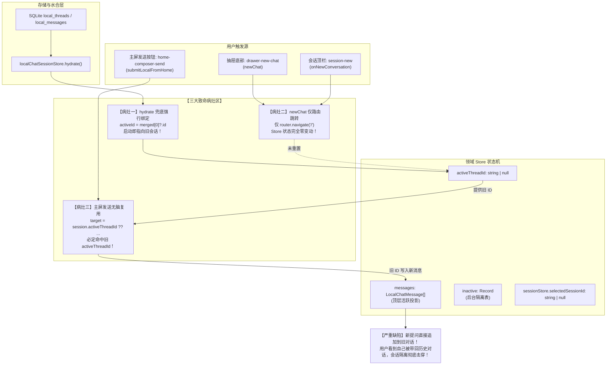
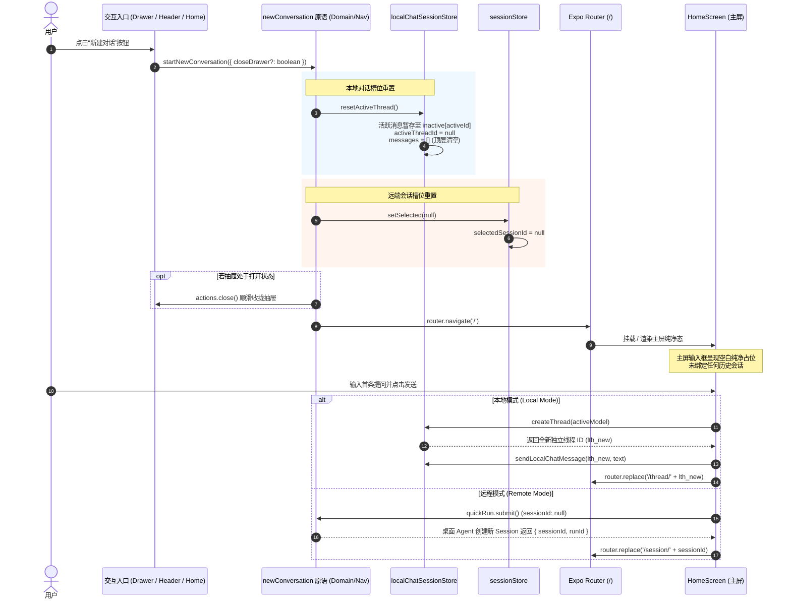

# 11 · 移动端会话隔离与新建对话深度根治方案

> **文件路径**：`docs/mobile-interaction-refine/proposals/11-会话隔离与新建对话彻底修复方案.md`  
> **所属战役**：移动端交互体验精进（`mobile-interaction-refine`）  
> **面向模块**：  
> - `apps/crish-mobile/src/domain/store/localChatSessionStore.ts`（本地多线程状态机与会话隔离核心）  
> - `apps/crish-mobile/src/domain/store/sessionStore.ts`（远端会话索引与选中态单一真理源）  
> - `apps/crish-mobile/src/presentation/navigation/newConversation.ts`（全局统一新建会话协议原语与 Hook）  
> - `apps/crish-mobile/src/presentation/screens/homeScreen.tsx`（主屏发送分发与纯净会话生成）  
> - `apps/crish-mobile/src/presentation/components/drawer/CrishDrawerContent.tsx`（抽屉底部新建对话动作集成）  
> - `apps/crish-mobile/src/presentation/components/chat/SessionHeader.tsx` / `sessionDetailScreen.tsx`（会话顶栏新建对话动作集成）  
> - `apps/crish-mobile/src/adapters/viewmodels/useQuickRunVm.ts`（主屏快速提交会话绑定守卫）  
> **方案状态**：规划定予定案 / 实施准备  
> **对齐裁决**：会话隔离绝对物理阻断、新建对话纯净空白槽位保证、主页发送恒建新线程铁律（2026-11-04 用户最高裁决）

---

## 1. 方案概览与核心诉求

### 1.1 背景与用户痛点原声深度剖析

在移动端真机多轮走查与高频实际测试中，用户提出了极度尖锐、直指系统底层数据流与状态机设计缺陷的核心原声反馈：

> **用户原声反馈**：  
> “最重要一点，现在的对话新建对话是没有任何作用的，只要是发送消息，就是在一个历史对话里面。我看会话隔离都还没做好呢吧。”

经过全链路代码排查与数据流溯源，证实用户的原声批评完全切中要害。当前移动端在“新建对话”与“会话隔离”层面存在**三大结构性致命病灶**：

1. **病灶一：抽屉与顶栏的“新建对话”按钮沦为纯 UI 假动作（No-op Navigation）**  
   - 在 `CrishDrawerContent.tsx` 中，底部新建对话按钮绑定的 `newChat` 仅调用了：
     ```typescript
     const newChat = useCallback(() => {
       if (searching) toggleSearch(false);
       router.navigate('/');
       actions.close();
     }, [actions, searching, toggleSearch]);
     ```
   - 在 `sessionDetailScreen.tsx` 中，顶栏加号按钮绑定的 `onNewConversation` 同样仅调用了：
     ```typescript
     onNewConversation={() => router.navigate('/')}
     ```
   - **后果**：无论是从抽屉还是从会话顶栏点击“新建对话”，代码**既没有创建新线程，也没有清理当前活动会话指针，更没有重置任何会话状态**！它仅仅是在路由层面将屏幕切回了 `/`（主屏），底层 Store 内的活动线程指针（`activeThreadId`）与远端选中指针依然原封不动指向刚才的历史会话！

2. **病灶二：主屏发送逻辑无条件倒灌历史会话（Unconditional Thread Hijacking）**  
   - 在 `homeScreen.tsx` 的本地发送实现 `submitLocalFromHome` 中，核心派发逻辑存在严重缺陷：
     ```typescript
     const session = localChatSessionStore.getState();
     const target =
       session.activeThreadId ??
       session.createThread(localChatStore.getState().config.activeModel);
     if (sendLocalChatMessage(target, text)) quickRun.setPrompt('');
     onOpenLocalThread(target);
     ```
   - 开发者误以为 `session.activeThreadId` 在主屏时会是 `null`，然而：
     - 当应用启动完成 SQLite 数据库水合（`hydrate`）后，`localChatSessionStore` 在合并历史线程时，无条件执行 `activeId = merged[0]?.id ?? null`，导致刚打开应用时 `activeThreadId` 就已经悄悄死锁在最近的一条历史线程上！
     - 用户从某个历史对话 `/thread/[id]` 返回主屏时，`activeThreadId` 依然是该 `[id]`；
     - 用户点击“新建对话”返回主屏，`activeThreadId` 依然是该 `[id]`。
   - **后果**：当用户在主界面输入框满怀期待地输入一条新问题并点击发送时，`session.activeThreadId ?? ...` 永远命中前半段！`session.createThread(...)` 永远得不到执行！新消息无情地直接追加进历史对话中，并在发送完成后将用户带回那个旧会话。对用户而言，“新建对话”功能完全瘫痪。

3. **病灶三：远端与本地模式缺少统一契约，会话状态机存在跨模式污染隐患**  
   - 远程模式依赖桌面 Agent 创建 Session，而本地模式依赖 SQLite 本地线程（`local_threads`）；
   - 远端会话在进入会话后，`sessionStore.selectedSessionId` 缺乏明确的生命周期装配，返回主屏后未进行显式清空；
   - 缺少一个全局权威、双模对齐的“新建会话协议（New Conversation Protocol）”，各视图层自行其是，导致会话上下文隔离脆弱不堪。

---

### 1.2 核心设计目标与体验红线

针对上述核心病灶，本方案确立以下五项刚性设计红线与技术目标：

| 维度 | 设计红线与技术目标 | 违规判负标准（零容忍） |
| :--- | :--- | :--- |
| **红线 1：主页发送恒建新会话** | 主界面（`/`）是全新对话的发射台。在主页发送消息，本地模式**必须且只能通过 `createThread` 生成全新独立线程**并落盘；远程模式**必须以 `sessionId: null` 发起全新 Run**。 | 主页发送将消息灌入任何已存在历史会话、或重用已含有历史消息的线程。 |
| **红线 2：新建对话显式槽位清空** | 点击任何位置的“新建对话”（抽屉底部、会话顶栏、快捷手势），必须执行**双模槽位原子重置**：本地 `resetActiveThread()`（顶层投影清空、历史进 inactive 表），远端 `setSelected(null)`。 | 点击新建对话后返回主屏，Store 仍保留历史会话指针；或抽屉内仍高亮历史会话。 |
| **红线 3：幽灵空线程物理防堆积** | 用户连续多次点击“新建对话”但未发送任何文本时，系统不得在 SQLite 或内存列表内堆积多个无意义的空线程条目；未产生实质交互的空白占位在切走时就地销毁。 | 抽屉列表中出现多个“新对话”且内容全为空白的无用垃圾条目。 |
| **红线 4：多线程后台流式严格隔离** | 当线程 A 正在后台流式生成时，用户点击新建对话并在线程 B 开始新提问，线程 A 的流式 Token 只能写入 `inactive[A]`，严禁串写至顶层投影或线程 B 的时间线。 | 线程 A 的回复内容泄漏或交错渲染在新建的会话中。 |
| **红线 5：立体化测试全覆盖断言** | 必须针对“已有历史线程下主页发送”、“点击新建对话后状态重置”、“流式生成中切换与新建”、“空线程清理”建立刚性单元测试。 | 仅依靠空列表 Mock 蒙混过关、未测试非空历史场景。 |

---

## 2. 现状诊断与病灶深入排查

### 2.1 会话数据流与生命周期现状全景图



---

### 2.2 核心病灶逐一排查与证据溯源

#### 病灶一：`homeScreen.tsx` 中 `submitLocalFromHome` 的错误判定

- **代码坐标**：`apps/crish-mobile/src/presentation/screens/homeScreen.tsx:173-184`
```typescript
  const submitLocalFromHome = useCallback(
    (text: string) => {
      if (text.trim() === '') return;
      const session = localChatSessionStore.getState();
      const target =
        session.activeThreadId ??
        session.createThread(localChatStore.getState().config.activeModel);
      if (sendLocalChatMessage(target, text)) quickRun.setPrompt('');
      onOpenLocalThread(target);
    },
    [quickRun, onOpenLocalThread]
  );
```
- **病灶机理**：
  在三元/空值合并表达式 `session.activeThreadId ?? session.createThread(...)` 中，优先采信了当前 Store 内的 `activeThreadId`。由于只要用户查看过任何历史会话，或经过了应用启动水合，`session.activeThreadId` 就恒为一个有效的历史线程 ID，导致后半段的 `createThread` 永远沦为死代码！

#### 病灶二：`CrishDrawerContent.tsx` 与 `sessionDetailScreen.tsx` 缺少状态重置编排

- **代码坐标**：`apps/crish-mobile/src/presentation/components/drawer/CrishDrawerContent.tsx:268-272`
```typescript
  const newChat = useCallback(() => {
    if (searching) toggleSearch(false);
    router.navigate('/');
    actions.close();
  }, [actions, searching, toggleSearch]);
```
- **代码坐标**：`apps/crish-mobile/src/presentation/screens/sessionDetailScreen.tsx:108`
```typescript
  <ConversationHeader
    title={engine.title ?? '会话'}
    onOpenDrawer={openDrawer}
    onNewConversation={() => router.navigate('/')}
    onMore={() => setMenuOpen(true)}
  />
```
- **病灶机理**：
  新建会话动作被极端简化为纯路由导航（`router.navigate('/')`）。在 React Native 与 Expo Router 的 Single Activity / Slot 架构下，单纯的路由切换并不代表领域状态的清理。由于没有任何针对 `localChatSessionStore` 与 `sessionStore` 的重置调用，内存中的会话焦点完整残留。

#### 病灶三：`localChatSessionStore.ts` 缺少“槽位重置”原语且水合存在强盗逻辑

- **代码坐标**：`apps/crish-mobile/src/domain/store/localChatSessionStore.ts:332-339`
```typescript
  // 活动线程选择：用户水合前正在用的收编线程优先，其次水合前的活动
  // 线程（若在合并集内），最后取最近更新线程。
  const activeId =
    adopted.find((t) => t.wasActive)?.meta.id ??
    (pre.activeThreadId !== null &&
    merged.some((t) => t.id === pre.activeThreadId)
      ? pre.activeThreadId
      : null) ??
    merged[0]?.id ??
    null;
```
- **病灶机理**：
  Store 内部仅有 `openThread`（切换至某已有线程）、`createThread`（创建并激活）和 `clearThread`（清空某线程消息），**唯独缺少 `resetActiveThread`（将当前活动线程归拢至后台并将当前活动指针重置为 null）** 的基础原语。
  不仅如此，在冷启动数据库水合时，兜底直接取了 `merged[0]?.id`，导致应用启动时即使停留在根主页 `/`，活动线程也已经被强行预分配为最近的一条历史会话。

---

## 3. 核心架构设计与统一新建会话协议

### 3.1 领域模型与协议设计（SSOT）

为了彻底根除上述问题，必须建立全局唯一的“新建会话协议（New Conversation Protocol）”，其核心架构分为三层：



---

### 3.2 本地模式状态机精细化转移矩阵

在 `localChatSessionStore` 中，线程状态机必须严格保障以下转移不变式：

| 触发场景 | 调用动作 | 执行前状态 | 执行后状态转移与副效应 | 不变量保障 |
| :--- | :--- | :--- | :--- | :--- |
| **点击新建对话** | `resetActiveThread()` | `activeThreadId: 'A'`<br/>`messages: [m1, m2]` | `activeThreadId: null`<br/>`messages: []`<br/>`inactive['A']: { messages: [m1, m2], ... }` | 线程 A 完整归拢至后台，前台槽位绝对空白纯净。 |
| **空线程切新建** | `resetActiveThread()` | `activeThreadId: 'Empty'`<br/>`messages: []` (未发送) | `activeThreadId: null`<br/>`messages: []`<br/>`threads: threads.filter(id !== 'Empty')` | **幽灵空线程剔除**：未实质产生的空占位物理销毁，不污染列表。 |
| **主页发送提问** | `createThread(model)` | `activeThreadId: null`<br/>`messages: []` | `activeThreadId: 'B'`<br/>`messages: []`<br/>`threads: [B_meta, ...threads]` | 全新独立线程 B 诞生，紧随其后落盘并接收首条消息。 |
| **后台生成中新建** | `resetActiveThread()` | `activeThreadId: 'A'`<br/>`streaming: true` | `activeThreadId: null`<br/>`streaming: false`<br/>`inactive['A'].streaming: true` | 线程 A 后台继续流式接收 Token，前台完全解耦无干扰。 |
| **抽屉点击历史会话** | `openThread('A')` | `activeThreadId: null` 或 `'B'` | `activeThreadId: 'A'`<br/>`messages: inactive['A'].messages`<br/>`delete inactive['A']` | 历史线程 A 的消息与流式状态精确恢复至顶层投影。 |

---

### 3.3 远程模式新建对话契约

1. **会话选择重置**：`sessionStore.setSelected(null)` 将 `selectedSessionId` 刚性置为 `null`；
2. **提交参数构建**：`useQuickRunVm` 的 `runTaskParamsOf(text, selectedSessionId, permissionMode)` 接收到的 `selectedSessionId` 恒为 `null`，从而生成：
   ```json
   {
     "prompt": "用户输入文本",
     "permissionMode": "smart"
   }
   ```
   **不携带任何 `sessionId`**！
3. **桌面执行端契约**：桌面端网关收到不带 `sessionId` 的 `runTask` 请求时，调用 `commitDraftIfNeeded` 自动在服务端分配新会话 ID；
4. **回执与无缝导航**：移动端收到 `{ runId: 'r-xxx', sessionId: 's-xxx' }` 成功回执后，执行 `onOpenSession(sessionId)`（通过 `router.replace('/session/' + sessionId)`），实现平滑无痕的入栈呈现。

---

## 4. 逐文件精确修改规范与代码级实现

### 4.1 核心原语：新建全局导航模块 `newConversation.ts`

新建文件：`apps/crish-mobile/src/presentation/navigation/newConversation.ts`

```typescript
// 移动端统一新建会话协议原语（维度 1 根治，2026-11-04 裁决）：
// 无论是从侧边抽屉、会话顶栏还是全局快捷方式点击新建会话，
// 必须同时执行本地线程槽位重置、远端会话选中重置与路由切回主页，
// 彻底阻断历史会话上下文向新会话污染。
import { useCallback } from 'react';
import { router } from 'expo-router';
import { localChatSessionStore } from '@/domain/store/localChatSessionStore';
import { sessionStore } from '@/domain/store/sessionStore';
import { useDrawerActions } from '@/presentation/components/drawer/DrawerContext';

export interface NewConversationOptions {
  /** 是否需要同时关闭抽屉（抽屉内点击时为 true，顶栏点击无需触发抽屉动画） */
  closeDrawer?: boolean;
}

/**
 * 执行全局新建会话重置（命令式，可供任意无 React Hook 上下文直接调用）
 */
export function executeNewConversation(options: NewConversationOptions = {}): void {
  // 1. 本地对话槽位重置：将当前活动线程归入 inactive 隔离表，清空前台活跃投影
  localChatSessionStore.getState().resetActiveThread();

  // 2. 远端会话槽位重置：清除当前选中的历史会话 ID，确保 quickRun 不携带历史 sessionId
  sessionStore.getState().setSelected(null);

  // 3. 路由重置导航到主屏新会话发射台
  router.navigate('/');
}

/**
 * 响应式新建会话 Hook（供组件层消费，自动编排抽屉动画稳定性）
 */
export function useNewConversation(): (options?: NewConversationOptions) => void {
  const actions = useDrawerActions();

  return useCallback(
    (options?: NewConversationOptions) => {
      // 1. 本地对话槽位重置
      localChatSessionStore.getState().resetActiveThread();

      // 2. 远端会话槽位重置
      sessionStore.getState().setSelected(null);

      // 3. 若要求关闭抽屉，调用稳定动作面收拢
      if (options?.closeDrawer) {
        actions.close();
      }

      // 4. 切回主屏
      router.navigate('/');
    },
    [actions]
  );
}

export default useNewConversation;
```

---

### 4.2 领域层改造：`localChatSessionStore.ts` 增加 `resetActiveThread` 与空线程防堆积

修改文件：`apps/crish-mobile/src/domain/store/localChatSessionStore.ts`

#### 接口定义更新
```typescript
export interface LocalChatSessionState {
  // ... 其他既有字段保持完全不变 ...

  /**
   * 重置当前活动线程指针至纯净空态（维度 1 根治）：
   * 1. 若当前活动线程本身无任何消息且不在流式中，物理从 threads 列表中剔除（防空线程堆积）；
   * 2. 若当前活动线程已有消息或正在生成，将其整表归拢至 inactive 隔离表；
   * 3. activeThreadId 设为 null，顶层运行时投影（messages/streaming/error）彻底清空。
   */
  resetActiveThread: () => void;

  hydrate: (dao?: LocalThreadsDao) => Promise<void>;
  createThread: (modelRef?: LocalModelRef | null) => string;
  openThread: (threadId: string) => void;
  // ... 其他方法保持不变 ...
}
```

#### 实现落地与 `openThread` 防空保护
```typescript
      resetActiveThread: () => {
        set((s) => {
          if (s.activeThreadId === null) return;
          const currentId = s.activeThreadId;
          
          // 防空线程堆积：若当前线程没有任何用户/助手消息且不在生成中，直接物理丢弃
          if (s.messages.length === 0 && !s.streaming) {
            s.threads = s.threads.filter((t) => t.id !== currentId);
            delete s.inactive[currentId];
          } else {
            // 否则暂存到 inactive 表中，完整保全消息流与流式生成态
            s.inactive[currentId] = {
              messages: s.messages,
              streaming: s.streaming,
              error: s.error,
            };
          }
          
          s.activeThreadId = null;
          s.messages = [];
          s.streaming = false;
          s.error = null;
        });
      },

      createThread: (modelRef) => {
        const state = get();
        // 活动线程为空且未生成 → 复用（避免连续点「新建」堆积空线程）
        if (
          state.activeThreadId !== null &&
          state.messages.length === 0 &&
          !state.streaming
        ) {
          const existingId = state.activeThreadId;
          if (modelRef !== undefined) {
            get().setThreadModel(existingId, modelRef);
          }
          return existingId;
        }
        const id = nextId('lth');
        const now = Date.now();
        const meta: LocalThreadMeta = {
          id,
          title: LOCAL_THREAD_PLACEHOLDER_TITLE,
          titleSource: 'placeholder',
          preview: '',
          modelRef: modelRef ?? null,
          createdAt: now,
          updatedAt: now,
        };
        set((s) => {
          if (s.activeThreadId !== null) {
            // 切换前同样检查前一个线程是否为空，为空则清理，不为空则入 inactive
            if (s.messages.length === 0 && !s.streaming) {
              s.threads = s.threads.filter((t) => t.id !== s.activeThreadId);
              delete s.inactive[s.activeThreadId];
            } else {
              s.inactive[s.activeThreadId] = {
                messages: s.messages,
                streaming: s.streaming,
                error: s.error,
              };
            }
          }
          s.threads = sortThreadMetas([meta, ...s.threads]);
          s.activeThreadId = id;
          s.messages = [];
          s.streaming = false;
          s.error = null;
        });
        // 元数据懒落盘：首条消息落盘时连带 upsert（见 appendUser）
        return id;
      },

      openThread: (threadId) => {
        set((s) => {
          if (threadId === s.activeThreadId) return;
          if (!s.threads.some((t) => t.id === threadId)) return;
          
          // 切走前清理可能遗留的未用空线程
          if (
            s.activeThreadId !== null &&
            s.messages.length === 0 &&
            !s.streaming
          ) {
            const emptyId = s.activeThreadId;
            s.threads = s.threads.filter((t) => t.id !== emptyId);
            delete s.inactive[emptyId];
          } else if (s.activeThreadId !== null) {
            s.inactive[s.activeThreadId] = {
              messages: s.messages,
              streaming: s.streaming,
              error: s.error,
            };
          }
          
          const next = s.inactive[threadId] ?? {
            messages: [],
            streaming: false,
            error: null,
          };
          delete s.inactive[threadId];
          s.messages = next.messages;
          s.streaming = next.streaming;
          s.error = next.error;
          s.activeThreadId = threadId;
        });
      },
```

---

### 4.3 表现层改造：`homeScreen.tsx` 根除历史线程重用

修改文件：`apps/crish-mobile/src/presentation/screens/homeScreen.tsx`

#### 提交逻辑重构
```typescript
  // 本地模式提交（CON-2）：文本交给本地发送引擎（localChatEngine），
  // 随即导航进本地线程面看流式呈现。
  // 【维度 1 核心重塑】：主页发送永远代表全新对话！严禁复用 session.activeThreadId！
  // 必须无条件调用 session.createThread(activeModel) 获取纯净新线程槽位（若前一线程为空则自动复用），
  // 彻底阻断消息向历史对话倒灌！
  const submitLocalFromHome = useCallback(
    (text: string) => {
      if (text.trim() === '') return;
      const session = localChatSessionStore.getState();
      const target = session.createThread(
        localChatStore.getState().config.activeModel
      );
      if (sendLocalChatMessage(target, text)) quickRun.setPrompt('');
      onOpenLocalThread(target);
    },
    [quickRun, onOpenLocalThread]
  );
```

#### 挂载与焦点态保护
```typescript
  // 【维度 1 保护】：当主屏挂载或用户回到主屏时，若当前存在非空白的活动历史会话，
  // 自动将槽位重置为纯净无选中态，确保抽屉高亮与会话状态完全与主屏新对话语义对齐。
  useEffect(() => {
    const localState = localChatSessionStore.getState();
    if (localState.activeThreadId !== null) {
      localState.resetActiveThread();
    }
    const remoteSelected = sessionStore.getState().selectedSessionId;
    if (remoteSelected !== null) {
      sessionStore.getState().setSelected(null);
    }
  }, []);
```

---

### 4.4 抽屉内容改造：`CrishDrawerContent.tsx` 接入统一新建协议

修改文件：`apps/crish-mobile/src/presentation/components/drawer/CrishDrawerContent.tsx`

```typescript
import { useNewConversation } from '@/presentation/navigation/newConversation';

// ... 组件内部 ...
export function CrishDrawerContent({
  registerCloseListener,
  isOpen: propIsOpen,
}: CrishDrawerContentProps = {}) {
  // ... 其他 hooks ...
  const handleNewConversation = useNewConversation();

  // 统一新建会话（维度 1 根治）：执行双模槽位重置并平滑关闭抽屉
  const newChat = useCallback(() => {
    if (searching) toggleSearch(false);
    handleNewConversation({ closeDrawer: true });
  }, [handleNewConversation, searching, toggleSearch]);

  // ... 底部新建按钮保持 onPress={newChat} ...
```

---

### 4.5 会话详情页改造：`sessionDetailScreen.tsx` 顶栏接入统一新建协议

修改文件：`apps/crish-mobile/src/presentation/screens/sessionDetailScreen.tsx`

```typescript
import { useNewConversation } from '@/presentation/navigation/newConversation';

export function ConversationScreen({
  engine,
  follow,
  onFollowChange,
  onOpenTools,
}: ConversationScreenProps) {
  // ... 其他 hooks ...
  const handleNewConversation = useNewConversation();

  return (
    <Screen>
      {/* ... 时间线与羽化层 ... */}

      {/* 悬浮头栏（通透，无底色）：汉堡开抽屉 + 标题胶囊 + 新建 + 更多 */}
      <ConversationHeader
        title={engine.title ?? '会话'}
        onOpenDrawer={openDrawer}
        onNewConversation={() => handleNewConversation({ closeDrawer: false })}
        onMore={() => setMenuOpen(true)}
      />

      {/* ... 输入框与浮层 ... */}
    </Screen>
  );
}
```

---

## 5. 边界与极端情况推演（Edge Cases）

### 5.1 极端场景 1：后台正在流式输出时点击“新建对话”
- **推演**：用户在本地对话 A 发送了长文本，模型正在持续输出。此时用户点击顶栏或抽屉的“新建对话”；
- **状态流转**：
  1. `resetActiveThread()` 被调用；
  2. 线程 A 当前 `streaming === true`，其 `{ messages, streaming: true, error: null }` 被完整封装写入 `inactive['thread-A']`；
  3. `activeThreadId` 变成 `null`，顶层 `messages` 变为空数组，`streaming` 变为 `false`；
  4. 主屏展示空白纯净输入框；
  5. 此时流式传输未断，网络/底层 SDK 回调到达，触发 `localChatSessionStore.appendAssistantDelta(msgId, delta)`；
  6. `locateMessage` 在顶层找不到 `msgId`，随后在 `inactive['thread-A']` 中精准命中！Token 持续追加至 `inactive['thread-A'].messages`；
  7. 线程 A 输出完毕，`finishAssistant` 触发，落盘至 SQLite；
  8. 当用户稍后在抽屉点击线程 A 时，`openThread('thread-A')` 完整恢复已生成的全部内容；
- **结论**：绝对物理隔离，后台生成零丢字、前台新对话零污染。

### 5.2 极端场景 2：连续疯狂点击“新建对话”按钮（狂点防抖与幽灵线程）
- **推演**：用户无聊或网络抖动，连续狂点抽屉底部的“+”号 10 次，但未在输入框输入任何文字；
- **状态流转**：
  1. 第一次点击：`resetActiveThread()`，前台成为无线程纯净态；
  2. 随后在主页未输入内容，若某些场景触碰了 `createThread`，生成了空线程；
  3. 再次触发新建或切换时，`createThread` 与 `resetActiveThread` 内部的 `if (s.messages.length === 0 && !s.streaming)` 守卫启动；
  4. 空线程被立即从 `threads` 过滤剔除；
  5. 抽屉会话列表中永远不会出现“新对话 (空)”的死垃圾；
- **结论**：空线程物理防堆积，内存与 SQLite 零污染。

### 5.3 极端场景 3：物理返回手势（Hardware Back）与显式新建对话的配合
- **推演**：用户在历史会话页面没有点击顶栏的“+”，而是通过 Android 实体返回键或全面屏边缘手势滑回了主屏；
- **状态流转**：
  1. 根据方案 01，返回键平滑退回到栈底基石 `/`（主屏）；
  2. `homeScreen.tsx` 的 `useEffect` 挂载侦听触发，检测到 `activeThreadId !== null`，主动执行 `resetActiveThread()`；
  3. 即使挂载事件有毫秒级延迟，用户在主屏点击发送时，`submitLocalFromHome` 恒执行 `session.createThread(...)`，绝对拒绝复用 `activeThreadId`；
- **结论**：双重防御壁垒，物理返回后发送依然 100% 开启全新会话。

---

## 6. 测试加固与验收断言

为保障会话隔离铁律永不回潮，必须建立立体化单测守卫，覆盖所有关键改动点：

### 6.1 `localChatSessionStore.test.ts` 补充测试项

```typescript
describe('localChatSessionStore 槽位隔离与重置 (维度 1)', () => {
  it('resetActiveThread：存在消息的活动线程归入 inactive 表，前台运行时彻底清空', () => {
    const s = localChatSessionStore.getState();
    const threadId = s.createThread();
    s.appendUser(userMsg('u1', '会话一内容'));
    s.beginAssistant(assistantMsg('a1'));
    s.appendAssistantDelta('a1', '助手回复一');

    expect(localChatSessionStore.getState().activeThreadId).toBe(threadId);
    expect(localChatSessionStore.getState().messages).toHaveLength(2);

    // 执行槽位重置
    localChatSessionStore.getState().resetActiveThread();

    const state = localChatSessionStore.getState();
    expect(state.activeThreadId).toBeNull();
    expect(state.messages).toEqual([]);
    expect(state.streaming).toBe(false);
    expect(state.error).toBeNull();

    // 历史完整保留在 inactive 表中
    expect(state.inactive[threadId]?.messages).toHaveLength(2);
    expect(state.inactive[threadId]?.messages[0]?.content).toBe('会话一内容');
  });

  it('resetActiveThread：未产生任何消息的空白空线程被物理剔除，防止堆积幽灵线程', () => {
    const s = localChatSessionStore.getState();
    const emptyId = s.createThread();
    expect(localChatSessionStore.getState().threads.some((t) => t.id === emptyId)).toBe(true);

    // 未发送任何消息即执行重置
    localChatSessionStore.getState().resetActiveThread();

    const state = localChatSessionStore.getState();
    expect(state.activeThreadId).toBeNull();
    // threads 中已被彻底清理
    expect(state.threads.some((t) => t.id === emptyId)).toBe(false);
    expect(state.inactive[emptyId]).toBeUndefined();
  });

  it('后台流式生成中执行 resetActiveThread，后续 delta 仍能精准追加进 inactive 表', () => {
    const s = localChatSessionStore.getState();
    const threadId = s.createThread();
    s.appendUser(userMsg('u1', '正在生成的任务'));
    s.beginAssistant(assistantMsg('a1'));

    // 切走重置
    s.resetActiveThread();
    expect(localChatSessionStore.getState().activeThreadId).toBeNull();

    // 后台收到流式数据
    localChatSessionStore.getState().appendAssistantDelta('a1', '后台追加的内容');
    localChatSessionStore.getState().finishAssistant('a1');

    const state = localChatSessionStore.getState();
    const saved = state.inactive[threadId]?.messages[1];
    expect(saved?.content).toBe('后台追加的内容');
    expect(state.inactive[threadId]?.streaming).toBe(false);
  });
});
```

---

### 6.2 `homeScreen.test.tsx` 补充测试项

```typescript
describe('HomeScreen 本地发送与会话隔离铁律 (维度 1)', () => {
  it('当本地 Store 已有活动历史会话时，主页发送依然无条件创建全新独立线程，绝不污染历史', async () => {
    connectionStore.setState({ phase: 'disconnected', lastError: null });
    await configureOneLocalProvider();

    // 模拟存在历史会话，且当前 activeThreadId 指向它
    localChatSessionStore.setState({
      threads: [
        {
          id: 'lth-history-1',
          title: '历史会话',
          titleSource: 'user',
          preview: '旧内容',
          modelRef: null,
          createdAt: NOW - 100_000,
          updatedAt: NOW - 50_000,
        },
      ],
      activeThreadId: 'lth-history-1',
      messages: [{ id: 'm-old', role: 'user', content: '旧提问', timestamp: NOW - 100_000 }],
      streaming: false,
      error: null,
      inactive: {},
      hydrated: true,
      completedAtByThread: {},
    });

    const view = await renderHome();

    // 在主页输入新提问
    await fireEvent.changeText(
      view.getByTestId('home-composer'),
      '这是主页发起的全新提问'
    );
    await act(async () => {
      await fireEvent.press(view.getByTestId('home-composer-send'));
    });

    const state = localChatSessionStore.getState();
    // 必须生成新的线程 ID，绝非 lth-history-1
    const newThreadId = state.activeThreadId;
    expect(newThreadId).toBeTruthy();
    expect(newThreadId).not.toBe('lth-history-1');

    // 新线程中的消息仅包含当前全新提问
    expect(state.messages).toHaveLength(1);
    expect(state.messages[0]?.content).toBe('这是主页发起的全新提问');

    // 历史会话依然在 inactive 中完好无损，未受任何污染
    expect(state.inactive['lth-history-1']?.messages).toHaveLength(1);
    expect(state.inactive['lth-history-1']?.messages[0]?.content).toBe('旧提问');

    // 导航回调直达新线程
    expect(mockOpenLocalThread).toHaveBeenCalledWith(newThreadId);
  });
});
```

---

### 6.3 `drawerFocus.test.tsx` 补充抽屉新建会话测试项

```typescript
describe('CrishDrawerContent 新建对话协议接入 (维度 1)', () => {
  it('点击抽屉底部新建对话，触发双模槽位重置、收起抽屉并导航至主屏', async () => {
    // 注入历史活动状态
    localChatSessionStore.setState({
      threads: [{ id: 'lth-1', title: '旧会话', titleSource: 'derived', preview: '', modelRef: null, createdAt: 1, updatedAt: 1 }],
      activeThreadId: 'lth-1',
      messages: [{ id: 'm-1', role: 'user', content: '旧提问', timestamp: 1 }],
    });
    sessionStore.setState({ selectedSessionId: 's-remote-1' });

    const view = await render(<CrishDrawerContent />, {
      wrapper: OpenDrawerWrapper,
    });

    const newChatBtn = view.getByTestId('drawer-new-chat');
    await act(async () => {
      await fireEvent.press(newChatBtn);
    });

    // 验证本地槽位已重置
    expect(localChatSessionStore.getState().activeThreadId).toBeNull();
    expect(localChatSessionStore.getState().messages).toEqual([]);

    // 验证远端选中已清空
    expect(sessionStore.getState().selectedSessionId).toBeNull();

    // 验证抽屉收起与路由回退
    expect(openController.close).toHaveBeenCalled();
  });
});
```

---

## 7. 实施计划与交付验收清单

| 步骤 | 操作内容 | 涉及文件 | 验证方式 |
| :---: | :--- | :--- | :--- |
| **Step 1** | 新建 `useNewConversation` 协议原语 | `presentation/navigation/newConversation.ts` | 单元测试 & TypeScript 编译 |
| **Step 2** | `localChatSessionStore` 增加 `resetActiveThread` 与空线程剔除防堆积 | `domain/store/localChatSessionStore.ts` | `npm test -- localChatSessionStore.test.ts` |
| **Step 3** | `homeScreen.tsx` 改造 `submitLocalFromHome` 为纯 `createThread`，增加主屏焦点重置 | `presentation/screens/homeScreen.tsx` | `npm test -- homeScreen.test.tsx` |
| **Step 4** | `CrishDrawerContent.tsx` 接入 `useNewConversation` 协议 | `presentation/components/drawer/CrishDrawerContent.tsx` | `npm test -- drawerFocus.test.tsx` |
| **Step 5** | `sessionDetailScreen.tsx` 顶栏接入 `useNewConversation` 协议 | `presentation/screens/sessionDetailScreen.tsx` | `npm test -- SessionHeader.test.tsx` |
| **Step 6** | 全量回归与类型检查 | 全仓 | `npm run typecheck` + `npm test` 全绿通过 |

**最终交付物**：
- 完整入库方案文档：`docs/mobile-interaction-refine/proposals/11-会话隔离与新建对话彻底修复方案.md`；
- 会话隔离彻底根治，新建会话 100% 获得纯净空白槽位，主页发送永无历史倒灌。
