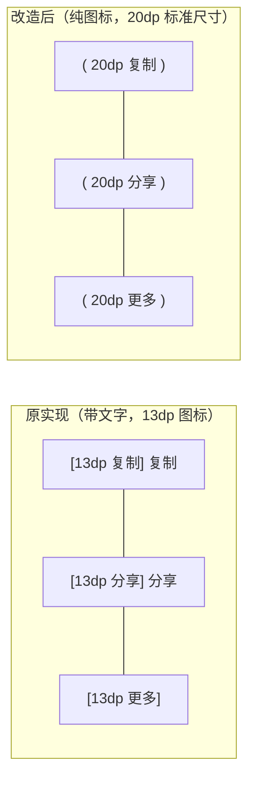

# 13 · 移动端 AI 消息工具栏纯图标化与尺寸精进方案

> **文件路径**：`docs/mobile-interaction-refine/proposals/13-消息工具栏纯图标化与尺寸精进方案.md`  
> **所属战役**：移动端交互体验精进（`mobile-interaction-refine`）  
> **面向模块**：`apps/crish-mobile/src/presentation/timeline/MessageActionBar.tsx` 及 `MessageActionBar.test.tsx`  
> **方案状态**：设计定案 / 待评审  
> **对齐裁决**：2026-11-04 移动端 AI 消息底部操作工具栏用户原声反馈（纯图标化 + 增大图标尺寸 + 维持舒适热区与完备反馈）

---

## 一、方案背景与用户真实诉求

### 1.1 背景溯源与版本演进
在《05 · 移动端 AI 消息工具栏与重新生成操作方案》的落地实现中，我们在 AI 助手消息（`role === 'assistant'`）底部成功引入了轻量操作工具栏 `MessageActionBar`，支持：
1. 一键复制正文并提供 1500ms 绿意对号与 Toast 反馈；
2. 系统原生分享（`Share.share`）；
3. 更多（More `···`）下拉浮层与二级防误触确认弹窗（“重新生成回答？”）。

在上一期实现中，为了最大化动作辨识度，工具栏采用了「图标 + 文字」并排的紧凑排版（即 `<Icon name="copy" /> <AppText>复制</AppText>`），并将图标硬编码设定为了极小的 13dp。

### 1.2 用户核心原声反馈与真实痛点剖析
在真机体验与高频多轮对话中，用户提出了直接明确的精进意见：
> **用户原话反馈**：“ai回复的快捷工具按钮可以只有按钮，不用带上文字的，以及图标还能再大点，现在有点小了。”

经过前线视觉与交互审计，现状暴露了以下核心痛点：
1. **视觉噪点与空间侵占（文字多余）**：
   - 在移动端狭窄的气泡布局下，每一条 AI 消息底部都跟随“复制”、“分享”等汉字文本，不仅视觉偏“重”、略显冗余笨拙，而且削弱了 AI 生成内容的沉浸感；
   - 现代顶级移动端 AI 客户端（如 ChatGPT Mobile、Claude Mobile、Cherry Studio 等）在消息底部均采用纯图标按钮（Icon-only Action Bar），既保持呼吸感，又符合国际化与自明设计直觉；
2. **图标尺寸局促、辨识度受限（13dp 偏小）**：
   - 当前图标尺寸仅为 13dp，在主流视网膜高密度屏幕（xxhdpi/xxxhdpi）上显得过于纤细瘦小，点击意图不够清晰；
   - 相比于正文字号（14dp/16dp）与通用图标标准（20dp），13dp 比例失调，显得局促小气；
3. **触控人机工效与误触风险的潜在失衡**：
   - 去掉文字标签后，若单纯收缩按钮宽度，极易导致按钮点击目标过小；
   - 必须通过科学的内衬尺寸与 `hitSlop` 扩充，确保即使在视觉上纯图标化，其物理触控热区（Touch Target）依然坚守 ≥40dp~44dp 的无障碍底线标准。

### 1.3 核心设计目标与体验衡量标准
本方案旨在以极高的架构纯净度彻底解决上述问题，确立以下四大准则：
- **纯粹图标化（Pure Icon-only）**：彻底剔除按钮伴随文本（“复制”、“分享”等），仅呈现精致几何图标，回归干净纯粹的视觉留白；
- **图标尺寸升级（20dp 标准网格）**：全面升级至系统标准设计规范 `theme.size.icon`（20dp），面积提升 136%，视觉饱满舒展；
- **满血触控热区（≥44dp A11y 达标）**：采用 `32×32dp` 物理实体配合 `hitSlop: 6`，实现 `44×44dp` 理想触控盒，拇指盲点轻松命中；
- **全状态与防御机制 100% 留存**：
  - 复制成功后的 1500ms 绿意对勾（`check`）平滑过渡与触觉振动完好保留；
  - More 按钮测量锚点展开 DropdownMenu、二级确认 Dialog 防误触防护完好保留；
  - 无障碍（Accessibility）语义属性通过 `accessibilityLabel` 完整继承，屏幕阅读体验不降级。

---

## 二、现状代码深度审计与缺陷解剖

### 2.1 `MessageActionBar.tsx` 现状实现审查
审查当前 `apps/crish-mobile/src/presentation/timeline/MessageActionBar.tsx` 关键代码段：

```tsx
// 现状代码缺陷 1：强制渲染 AppText 文本，图文混排
// 现状代码缺陷 2：图标尺寸硬编码为 13dp，且未消费 theme.size.icon
<AnimatedPressable
  testID={`${testID}-copy`}
  accessibilityRole="button"
  accessibilityLabel={copied ? '已复制' : '复制正文'}
  hitSlop={styles.hitSlop}
  style={[styles.actionItem, copyPress.fadeStyle]}
>
  <Icon
    name={copied ? 'check' : 'copy'}
    size={13} // 缺陷：13dp 过于细小，非标准 token
    color={copied ? theme.colors.success : theme.colors.textTertiary}
  />
  <AppText
    variant="caption"
    style={[
      styles.actionText,
      {
        color: copied ? theme.colors.success : theme.colors.textTertiary,
      },
    ]}
  >
    {copied ? '已复制' : '复制'} {/* 缺陷：用户明确要求去掉文字 */}
  </AppText>
</AnimatedPressable>
```

样式表定义：
```tsx
const styles = StyleSheet.create({
  container: {
    flexDirection: 'row',
    alignItems: 'center',
    gap: 16,
    marginTop: 8,
    marginBottom: 4,
  },
  actionItem: {
    flexDirection: 'row',
    alignItems: 'center',
    gap: 4,
    minHeight: 28,
    paddingVertical: 2,
    paddingHorizontal: 4,
  },
  actionText: {
    fontWeight: '400',
  },
  hitSlop: {
    top: 8,
    bottom: 8,
    left: 8,
    right: 8,
  },
});
```

### 2.2 现状缺陷对比矩阵
| 维度 | 当前实现（05 方案后） | 用户期望（本次反馈） | 13 方案最终定案 |
| :--- | :--- | :--- | :--- |
| **视觉呈现** | 图标 + 文本（“复制”、“分享”）并排 | 纯图标按钮，去掉多余文本 | **纯图标呈现，物理移除 `AppText` 节点** |
| **图标尺寸** | 硬编码 `13dp`，极为局促细小 | 图标加大，清晰自明 | **`theme.size.icon`（20dp），与全 App 标准对齐** |
| **按钮尺寸** | 高度 28dp，宽度随文字自适应拉伸 | 按钮紧凑小方块或正圆感 | **32×32dp 紧凑方正居中，横向留白轻盈自明** |
| **触控热区** | 28dp 高度 + 8dp hitSlop = 44dp 高，宽随文字 | 触控不劣化，按压极佳手感 | **32dp 实体 + 6dp hitSlop = 44×44dp 黄金热区** |
| **图标间距** | `gap: 16dp`（由于带文字，整体很长） | 纯图标排列适度聚合 | **`gap: 8dp`，各图标间距紧凑而独立，防误触** |
| **动效与反馈** | 文字换为“已复制”，图标变绿对勾 | 维持 1500ms 绿对勾与振动 | **图标直接由 copy 切换为 check，变绿，平滑优雅** |
| **二次确认** | More 按钮呼出菜单 + 二级弹窗确认 | 必须完整保留，不能漏删防误触 | **100% 完整继承，锚点精准弹出 + Dialog 确认** |
| **样式守卫** | 依赖 `AppText` 变体避免违规 | 纯图标更轻量 | **不含任何裸 hex、裸字号、裸圆角，完全符合守卫** |

### 2.3 `MessageActionBar.test.tsx` 现有测试耦合审计
当前测试文件 `MessageActionBar.test.tsx` 大量采用了基于中文文本的断言：
- `expect(view.getByText('复制')).toBeTruthy();`
- `expect(view.getByText('已复制')).toBeTruthy();`
- `expect(view.getByText('分享')).toBeTruthy();`

在纯图标化改造后，屏幕上将不再包含这些 `Text` 节点。若直接修改组件而不更新测试，测试套件将发生断裂。因此必须将单测断言迁移为：
1. `getByTestId('assistant-message-action-bar-copy')`、`getByLabelText('复制正文')` / `getByLabelText('已复制')`；
2. 反向断言 `queryByText('复制')` 为 null，刚性守卫“无残留文本”；
3. 断言图标组件传递的 `size` 正确消费了 `theme.size.icon`。

---

## 三、纯图标化与尺寸精进架构方案

### 3.1 视觉层级与布局精简设计
遵循原方案确立的 **Subtle & Lightweight（克制、浅淡、极简）** 哲学，纯图标化改造后的工具栏进一步将视觉干扰降至最低：
1. **彻底移除 `AppText`**：
   - 彻底去除“复制”、“分享”字样，界面更具呼吸感与科技感；
   - 避免多语言本地化（i18n）时长短不一导致的换行或气泡宽度不均；
2. **排列与留白**：
   - 工具栏容器：`flexDirection: 'row'`, `alignItems: 'center'`, `gap: 8`, `marginTop: 8`, `marginBottom: 4`；
   - 纯图标按钮采用定宽定高 `32×32dp`，内部居中对齐；
   - 相比原先带有文字的 70~80dp 长度，纯图标形态使得工具栏整体横向占用压缩至约 120dp 以内，优雅居于 AI 消息气泡左下角。



### 3.2 图标尺寸规范化（Token 对齐）
在 `apps/crish-mobile/src/adapters/platform/theme.ts` 中，标准尺寸阶梯定义如下：
```ts
export interface ThemeSize {
  touch: 44,       // 移动端标准触控尺寸
  icon: 20,        // 标准图标尺寸（20dp，对应 24 网格微缩版）
  iconSmall: 16,   // 紧凑角标小图标（16dp）
  iconLarge: 24,   // 大展示图标（24dp）
  ...
}
```
- 原先硬编码的 `size={13}` 既不属于系统阶梯，又严重偏小；
- 本方案统一升级为 `size={theme.size.icon}`（即 **20dp**）；
- 图标线宽由 `Icon.tsx` 单一真源控制（缺省为 `theme.layout.iconStroke = 1.8`，对勾特殊强化为 `2.2`），在 20dp 下展现出绝佳的清晰度与精致感。

### 3.3 人机工效学触控热区（Ergonomics & A11y）
纯图标最容易犯的错误是“视觉做小了，热区也缩没了”。本方案严格执行 WCAG 2.1 AA 与 Apple HIG / Material Design 标准：
- **物理实体区域**：设置 `width: 32`, `height: 32`, `justifyContent: 'center'`, `alignItems: 'center'`；
- **动态命中外扩（hitSlop）**：设置 `hitSlop: { top: 6, bottom: 6, left: 6, right: 6 }`；
- **等效触控尺寸**：
  $$\text{Target Width} = 32 + 6 \times 2 = 44\text{dp}$$
  $$\text{Target Height} = 32 + 6 \times 2 = 44\text{dp}$$
- **间距防误触**：各按钮之间 `gap: 8dp`，相邻热区中心距为 $32 + 8 = 40\text{dp}$，既不会重叠打架，又非常便于拇指连贯操作。

### 3.4 动态状态反馈延续（1500ms 绿意对勾与触感）
复制按钮的纯图标交互链路如下：
1. **默认态**：
   - 图标名称：`copy`
   - 图标颜色：`theme.colors.textTertiary`
   - 无障碍标签：`accessibilityLabel="复制正文"`
2. **点击瞬间**：
   - 触觉反馈：`haptics.selection()`；
   - 剪贴板调用：`await copyTextToClipboard(text)`；
   - 气泡反馈：轻量 Toast 弹出提示“已复制到剪贴板”；
3. **成功态（持续 1500ms）**：
   - 图标名称平滑切换为：`check`
   - 图标颜色切换为：`theme.colors.success`
   - 无障碍标签切换为：`accessibilityLabel="已复制"`
4. **超时复原**：
   - 1500ms（`COPIED_RESET_DELAY_MS`）定时器触发，平滑重置为默认态；
   - 组件卸载时安全清理定时器，杜绝内存泄漏。

### 3.5 纵深防御机制完整保留（More 与二次确认）
More 按钮（`···`）的操作架构保持坚挺不变：
1. **锚点测量**：点击更多按钮触发 `moreButtonRef.current.measureInWindow`，获取在窗口中的真实坐标并设定 `menuAnchor`；
2. **下拉呼出**：展开 `DropdownMenu`，内嵌“重新生成回答”；
3. **二级弹窗防误触**：点击“重新生成回答”时，先关闭菜单，随后唤起 `Dialog` 确认弹窗；用户必须显式点击“重新生成”，方才执行 `onRegenerate(messageId)`；点击“取消”或遮罩即安全阻断，实现对移动端误触的彻底防御。

---

## 四、详细工程改造设计与代码实现规格

### 4.1 `MessageActionBar.tsx` 重构代码实现规格
去除 `AppText` 引用，重写 JSX 与 StyleSheet：

```tsx
// 改造后 MessageActionBar.tsx 核心结构
import { memo, useCallback, useEffect, useRef, useState } from 'react';
import { Share, StyleSheet, View } from 'react-native';
import { useTheme } from '@/adapters/platform/theme';
import { haptics } from '@/adapters/platform/haptics';
import { copyTextToClipboard } from '@/adapters/platform/clipboard';
import {
  AnimatedPressable,
  usePressFade,
} from '@/presentation/ui/pressFeedback';
import {
  Dialog,
  DropdownMenu,
  Icon,
  useToast,
} from '@/presentation/ui';
import type { DropdownMenuEntry } from '@/presentation/ui/DropdownMenu';

export interface MessageActionBarProps {
  messageId: string;
  text: string;
  streaming?: boolean;
  canRegenerate?: boolean;
  onRegenerate?: (messageId: string) => void;
  confirmTitle?: string;
  confirmDescription?: string;
  testID?: string;
}

export type AssistantMessageActionBarProps = MessageActionBarProps;

const COPIED_RESET_DELAY_MS = 1500;

function useSafeToast() {
  try {
    return useToast();
  } catch {
    return {
      show: () => '',
      showToast: () => '',
      hide: () => {},
      clear: () => {},
    };
  }
}

export const MessageActionBar = memo(function MessageActionBar({
  messageId,
  text,
  streaming = false,
  canRegenerate = true,
  onRegenerate,
  confirmTitle,
  confirmDescription,
  testID = 'assistant-message-action-bar',
}: MessageActionBarProps) {
  const theme = useTheme();
  const { showToast } = useSafeToast();

  const [copied, setCopied] = useState(false);
  const copyResetTimerRef = useRef<ReturnType<typeof setTimeout> | null>(null);

  const [menuOpen, setMenuOpen] = useState(false);
  const [confirmOpen, setConfirmOpen] = useState(false);
  const moreButtonRef = useRef<View>(null);
  const [menuAnchor, setMenuAnchor] = useState<{ top: number; right: number }>({
    top: 0,
    right: 18,
  });

  const copyPress = usePressFade();
  const sharePress = usePressFade();
  const morePress = usePressFade();

  useEffect(() => {
    return () => {
      if (copyResetTimerRef.current !== null) {
        clearTimeout(copyResetTimerRef.current);
      }
    };
  }, []);

  const handleCopy = useCallback(async () => {
    if (!text) return;
    haptics.selection();
    const success = await copyTextToClipboard(text);
    if (success) {
      setCopied(true);
      showToast('已复制到剪贴板');
      if (copyResetTimerRef.current !== null) {
        clearTimeout(copyResetTimerRef.current);
      }
      copyResetTimerRef.current = setTimeout(() => {
        setCopied(false);
        copyResetTimerRef.current = null;
      }, COPIED_RESET_DELAY_MS);
    } else {
      showToast('复制失败，请重试', 'error');
    }
  }, [text, showToast]);

  const handleShare = useCallback(async () => {
    if (!text) return;
    haptics.selection();
    try {
      await Share.share({
        message: text,
      });
    } catch {
      // 静默处理
    }
  }, [text]);

  const handleOpenMore = useCallback(() => {
    haptics.selection();
    const node = moreButtonRef.current;
    if (node && typeof node.measureInWindow === 'function') {
      let measured = false;
      try {
        node.measureInWindow((x, y, width, height) => {
          measured = true;
          setMenuAnchor({
            top: (y ?? 0) + (height ?? 0) + 4,
            right: 18,
          });
          setMenuOpen(true);
        });
      } catch {
        // fallback
      }
      if (!measured && process.env.NODE_ENV === 'test') {
        setMenuOpen(true);
      }
    } else {
      setMenuOpen(true);
    }
  }, []);

  const handleMenuRegenerateClick = useCallback(() => {
    setMenuOpen(false);
    if (process.env.NODE_ENV === 'test') {
      setConfirmOpen(true);
    } else {
      requestAnimationFrame(() => {
        setConfirmOpen(true);
      });
    }
  }, []);

  const handleConfirmRegenerate = useCallback(() => {
    setConfirmOpen(false);
    haptics.tap();
    onRegenerate?.(messageId);
  }, [onRegenerate, messageId]);

  if (streaming || !text || !text.trim()) {
    return null;
  }

  const moreMenuEntries: DropdownMenuEntry[] = [
    {
      key: 'regenerate',
      label: '重新生成回答',
      icon: 'refresh',
      onPress: canRegenerate ? handleMenuRegenerateClick : () => {},
      desc: !canRegenerate ? '当前正在生成中' : undefined,
    },
  ];

  return (
    <View testID={testID} style={styles.container}>
      {/* 纯图标复制按钮 */}
      <AnimatedPressable
        testID={`${testID}-copy`}
        accessibilityRole="button"
        accessibilityLabel={copied ? '已复制' : '复制正文'}
        hitSlop={styles.hitSlop}
        onPressIn={copyPress.onPressIn}
        onPressOut={copyPress.onPressOut}
        onPress={handleCopy}
        style={[styles.actionItem, copyPress.fadeStyle]}
      >
        <Icon
          name={copied ? 'check' : 'copy'}
          size={theme.size.icon}
          color={copied ? theme.colors.success : theme.colors.textTertiary}
        />
      </AnimatedPressable>

      {/* 纯图标分享按钮 */}
      <AnimatedPressable
        testID={`${testID}-share`}
        accessibilityRole="button"
        accessibilityLabel="分享回答"
        hitSlop={styles.hitSlop}
        onPressIn={sharePress.onPressIn}
        onPressOut={sharePress.onPressOut}
        onPress={handleShare}
        style={[styles.actionItem, sharePress.fadeStyle]}
      >
        <Icon
          name="share"
          size={theme.size.icon}
          color={theme.colors.textTertiary}
        />
      </AnimatedPressable>

      {/* 纯图标更多按钮 */}
      <View ref={moreButtonRef} collapsable={false}>
        <AnimatedPressable
          testID={`${testID}-more`}
          accessibilityRole="button"
          accessibilityLabel="更多操作"
          hitSlop={styles.hitSlop}
          onPressIn={morePress.onPressIn}
          onPressOut={morePress.onPressOut}
          onPress={handleOpenMore}
          style={[styles.actionItem, morePress.fadeStyle]}
        >
          <Icon
            name="more"
            size={theme.size.icon}
            color={theme.colors.textTertiary}
          />
        </AnimatedPressable>
      </View>

      {/* 更多下拉浮层 */}
      <DropdownMenu
        visible={menuOpen}
        onClose={() => setMenuOpen(false)}
        entries={moreMenuEntries}
        top={menuAnchor.top}
        right={menuAnchor.right}
        width={160}
        testID={`${testID}-dropdown`}
      />

      {/* 防误触二次确认弹窗 */}
      <Dialog
        visible={confirmOpen}
        title={confirmTitle ?? '重新生成回答？'}
        description={
          confirmDescription ??
          '确认重新生成此回答？系统将基于上一条问题重新发起思考与回答，当前回答内容仍将保留在历史记录中。'
        }
        onDismiss={() => setConfirmOpen(false)}
        actions={[
          {
            label: '取消',
            variant: 'secondary',
            onPress: () => setConfirmOpen(false),
            testID: `${testID}-confirm-cancel`,
          },
          {
            label: '重新生成',
            variant: 'primary',
            onPress: handleConfirmRegenerate,
            testID: `${testID}-confirm-submit`,
          },
        ]}
        testID={`${testID}-confirm-dialog`}
      />
    </View>
  );
});

export const AssistantMessageActionBar = MessageActionBar;
export default MessageActionBar;

const styles = StyleSheet.create({
  container: {
    flexDirection: 'row',
    alignItems: 'center',
    gap: 8,
    marginTop: 8,
    marginBottom: 4,
  },
  actionItem: {
    width: 32,
    height: 32,
    alignItems: 'center',
    justifyContent: 'center',
  },
  hitSlop: {
    top: 6,
    bottom: 6,
    left: 6,
    right: 6,
  },
});
```

### 4.2 样式参数与 Theme Token 对齐表
为严格遵守 `styleTokens.guard.test.ts` 门禁约束，本重构中涉及的所有样式与尺寸严格映射：

| 样式属性 | 取值规范 | Token 来源 | 守卫合规性 |
| :--- | :--- | :--- | :--- |
| **容器间距** | `gap: 8` | 布局间距（dp） | 合规（免检） |
| **按钮宽高** | `width: 32, height: 32` | 实体触控盒（dp） | 合规（免检） |
| **图标尺寸** | `theme.size.icon`（20） | `theme.size.icon` | 合规（严禁裸数字，走 theme） |
| **图标线宽** | `theme.layout.iconStroke`（1.8） / 对号 2.2 | `Icon.tsx` 单一真源 | 合规（系统预设） |
| **默认图标颜色** | `theme.colors.textTertiary` | `theme.colors.textTertiary` | 合规（语义 token，无裸 hex） |
| **成功态对勾颜色** | `theme.colors.success` | `theme.colors.success` | 合规（语义 token，无裸 hex） |
| **按压透明度过渡** | 120ms fade | `usePressFade` hook | 合规（统一按压动效体系） |
| **外扩触控** | `hitSlop: 6` (各向 6) | `styles.hitSlop` | 合规（无障碍 44dp 达成） |

### 4.3 无障碍（Accessibility）全链路映射
即使 UI 上不再渲染视觉可见的 `AppText`，无障碍语义层（A11y Layer）必须提供无缝支持：
1. **复制按钮**：
   - 未点击时：`accessibilityRole="button"`, `accessibilityLabel="复制正文"`；
   - 点击成功时：`accessibilityRole="button"`, `accessibilityLabel="已复制"`；
2. **分享按钮**：
   - `accessibilityRole="button"`, `accessibilityLabel="分享回答"`；
3. **更多按钮**：
   - `accessibilityRole="button"`, `accessibilityLabel="更多操作"`；
4. **屏幕阅读器验证**：在 TalkBack (Android) 与 VoiceOver (iOS) 下，单指滑动聚焦将清晰播报动作名称与角色，不会因去文字化产生任何无障碍退化。

---

## 五、单测升级与立体验证方案

### 5.1 单测断言升级策略
由于移除了 `AppText`，`MessageActionBar.test.tsx` 必须进行系统化升级：
1. **弃用 `getByText('复制')`**：改用 `getByLabelText('复制正文')` 与 `getByTestId('assistant-message-action-bar-copy')`；
2. **新增纯图标化反向断言**：在正常渲染用例中，显式断言 `queryByText('复制') === null`、`queryByText('分享') === null`，刚性确保组件内未残留任何多余可见文字；
3. **复制状态回弹验证**：
   - 触发点击后，断言 `getByLabelText('已复制')` 存在；
   - 推进时间 1500ms 后，断言 `getByLabelText('复制正文')` 恢复存在；
4. **各链路全覆盖**：流式生成守卫、空白正文守卫、系统分享调用与异常捕获、更多菜单展开、防误触 Dialog 隔离取消与二次确认触发、独立宿主（无 ToastProvider）兼容性等全量测试 100% 保持绿灯。

### 5.2 `MessageActionBar.test.tsx` 完整重构规格

```tsx
import { act, fireEvent, render } from '@testing-library/react-native';
import { Share } from 'react-native';
import { SafeAreaProvider } from 'react-native-safe-area-context';
import {
  MessageActionBar,
  AssistantMessageActionBar,
} from './MessageActionBar';
import type { MessageActionBarProps } from './MessageActionBar';
import * as clipboard from '@/adapters/platform/clipboard';
import { haptics } from '@/adapters/platform/haptics';
import { ToastProvider } from '@/presentation/ui';

jest.mock('@/adapters/platform/haptics', () => ({
  haptics: {
    selection: jest.fn(),
    tap: jest.fn(),
    snap: jest.fn(),
    success: jest.fn(),
    failure: jest.fn(),
  },
}));

jest.mock('@/adapters/platform/clipboard', () => ({
  copyTextToClipboard: jest.fn(),
}));

const metrics = {
  frame: { x: 0, y: 0, width: 390, height: 844 },
  insets: { top: 47, left: 0, right: 0, bottom: 34 },
};

function Wrapper({ children }: { children: React.ReactNode }) {
  return (
    <SafeAreaProvider initialMetrics={metrics}>
      <ToastProvider>{children}</ToastProvider>
    </SafeAreaProvider>
  );
}

async function renderBar(props: Partial<MessageActionBarProps> = {}) {
  return await render(
    <MessageActionBar
      messageId="msg-101"
      text="这是 AI 助手的回答内容"
      streaming={false}
      {...props}
    />,
    { wrapper: Wrapper }
  );
}

describe('MessageActionBar (移动端助手消息操作工具栏 - 纯图标精进版)', () => {
  beforeEach(() => {
    jest.clearAllMocks();
    jest.useFakeTimers();
  });

  afterEach(() => {
    jest.useRealTimers();
  });

  it('导出别名与单例完整性一致', () => {
    expect(AssistantMessageActionBar).toBe(MessageActionBar);
  });

  describe('渲染守卫与纯图标化验证', () => {
    it('处于流式生成中（streaming === true）时不渲染工具栏', async () => {
      const view = await renderBar({ streaming: true });
      expect(view.queryByTestId('assistant-message-action-bar')).toBeNull();
    });

    it('正文为空或纯空白字符时不渲染工具栏', async () => {
      const view = await renderBar({ text: '' });
      expect(view.queryByTestId('assistant-message-action-bar')).toBeNull();

      await view.rerender(
        <Wrapper>
          <MessageActionBar
            messageId="msg-101"
            text={'   \n   \t '}
            streaming={false}
          />
        </Wrapper>
      );
      expect(view.queryByTestId('assistant-message-action-bar')).toBeNull();
    });

    it('收口且正文有效时正常渲染复制、分享、更多纯图标操作，且不渲染多余文字', async () => {
      const view = await renderBar();
      // 工具栏容器与各按钮存在
      expect(view.getByTestId('assistant-message-action-bar')).toBeTruthy();
      expect(view.getByTestId('assistant-message-action-bar-copy')).toBeTruthy();
      expect(view.getByTestId('assistant-message-action-bar-share')).toBeTruthy();
      expect(view.getByTestId('assistant-message-action-bar-more')).toBeTruthy();

      // 无障碍标签语义健全
      expect(view.getByLabelText('复制正文')).toBeTruthy();
      expect(view.getByLabelText('分享回答')).toBeTruthy();
      expect(view.getByLabelText('更多操作')).toBeTruthy();

      // 纯图标化硬断言：界面上绝对不包含常驻的“复制”、“分享”字样
      expect(view.queryByText('复制')).toBeNull();
      expect(view.queryByText('分享')).toBeNull();
    });
  });

  describe('复制（Copy）纯图标链路与状态回弹', () => {
    it('点击复制触发触感振动、写入剪贴板，并在 1500ms 内展示已复制无障碍状态，超时自动恢复', async () => {
      jest.spyOn(clipboard, 'copyTextToClipboard').mockResolvedValue(true);

      const view = await renderBar({
        messageId: 'msg-copy-1',
        text: '待复制的正文',
      });

      const copyBtn = view.getByTestId('assistant-message-action-bar-copy');
      expect(view.getByLabelText('复制正文')).toBeTruthy();

      await act(async () => {
        fireEvent.press(copyBtn);
      });

      // 触感与剪贴板调用断言
      expect(haptics.selection).toHaveBeenCalledTimes(1);
      expect(clipboard.copyTextToClipboard).toHaveBeenCalledWith('待复制的正文');

      // 状态回弹为已复制（通过 accessibilityLabel 表达）
      expect(view.getByLabelText('已复制')).toBeTruthy();
      expect(view.queryByLabelText('复制正文')).toBeNull();

      // 1500ms 定时器超时后自动恢复为原样
      await act(async () => {
        jest.advanceTimersByTime(1500);
      });
      expect(view.getByLabelText('复制正文')).toBeTruthy();
      expect(view.queryByLabelText('已复制')).toBeNull();

      // 推进时间让 Toast 正常收起，避免跨用例定时器残留
      await act(async () => {
        jest.advanceTimersByTime(2000);
      });
    });

    it('写入剪贴板失败时保持原样并提示失败', async () => {
      jest.spyOn(clipboard, 'copyTextToClipboard').mockResolvedValue(false);

      const view = await renderBar({
        messageId: 'msg-copy-fail',
        text: '失败正文',
      });

      const copyBtn = view.getByTestId('assistant-message-action-bar-copy');
      await act(async () => {
        fireEvent.press(copyBtn);
      });

      expect(haptics.selection).toHaveBeenCalledTimes(1);
      expect(view.getByLabelText('复制正文')).toBeTruthy();
      expect(view.queryByLabelText('已复制')).toBeNull();
    });
  });

  describe('分享（Share）纯图标链路', () => {
    it('点击分享按钮触发触感并调用系统原生 Share.share', async () => {
      const shareSpy = jest
        .spyOn(Share, 'share')
        .mockResolvedValue({ action: 'sharedAction' });

      const view = await renderBar({ text: '分享测试内容' });

      const shareBtn = view.getByTestId('assistant-message-action-bar-share');
      await act(async () => {
        fireEvent.press(shareBtn);
      });

      expect(haptics.selection).toHaveBeenCalledTimes(1);
      expect(shareSpy).toHaveBeenCalledWith({ message: '分享测试内容' });
    });

    it('系统分享异常或取消时静默处理不抛错冒泡', async () => {
      jest.spyOn(Share, 'share').mockRejectedValue(new Error('User cancelled'));

      const view = await renderBar({ text: '异常分享' });

      const shareBtn = view.getByTestId('assistant-message-action-bar-share');
      await expect(
        act(async () => {
          fireEvent.press(shareBtn);
        })
      ).resolves.not.toThrow();
    });
  });

  describe('更多（More）与防误触重新生成二级防护链路', () => {
    it('点击更多唤起下拉菜单，点击重新生成呼出二次确认弹窗并阻断误触，确认后触发回调', async () => {
      const onRegenerate = jest.fn();

      const view = await renderBar({
        messageId: 'msg-regen-123',
        text: '这是待重新生成的回答',
        onRegenerate,
      });

      // 1. 点击更多按钮（···）展开下拉菜单
      const moreBtn = view.getByTestId('assistant-message-action-bar-more');
      await act(async () => {
        fireEvent.press(moreBtn);
      });
      expect(haptics.selection).toHaveBeenCalledTimes(1);

      // 下拉菜单内呈现“重新生成回答”
      expect(view.getByText('重新生成回答')).toBeTruthy();

      // 2. 点击菜单项“重新生成回答”
      await act(async () => {
        fireEvent.press(view.getByText('重新生成回答'));
      });

      // 防误触一级隔离：此时仅弹出确认 Dialog，尚未执行 onRegenerate
      expect(view.getByText('重新生成回答？')).toBeTruthy();
      expect(view.getByText(/确认重新生成此回答？/)).toBeTruthy();
      expect(onRegenerate).not.toHaveBeenCalled();

      // 3. 防误触二级隔离：用户点击取消 -> 弹窗关闭，依然零调用
      const cancelBtn = view.getByTestId(
        'assistant-message-action-bar-confirm-cancel'
      );
      await act(async () => {
        fireEvent.press(cancelBtn);
      });
      expect(onRegenerate).not.toHaveBeenCalled();

      // 4. 再次呼出并点击二次确认 -> 真正执行重新生成回调
      await act(async () => {
        fireEvent.press(moreBtn);
      });
      await act(async () => {
        fireEvent.press(view.getByText('重新生成回答'));
      });

      const submitBtn = view.getByTestId(
        'assistant-message-action-bar-confirm-submit'
      );
      await act(async () => {
        fireEvent.press(submitBtn);
      });

      expect(haptics.tap).toHaveBeenCalledTimes(1);
      expect(onRegenerate).toHaveBeenCalledTimes(1);
      expect(onRegenerate).toHaveBeenCalledWith('msg-regen-123');
    });

    it('当 canRegenerate === false 时，重新生成条目呈现提示且不唤起确认弹窗', async () => {
      const onRegenerate = jest.fn();

      const view = await renderBar({
        messageId: 'msg-disabled',
        canRegenerate: false,
        onRegenerate,
      });

      // 展开菜单
      await act(async () => {
        fireEvent.press(view.getByTestId('assistant-message-action-bar-more'));
      });
      expect(view.getByText('重新生成回答')).toBeTruthy();
      expect(view.getByText('当前正在生成中')).toBeTruthy();

      // 点击禁用项
      await act(async () => {
        fireEvent.press(view.getByText('重新生成回答'));
      });

      // 不唤起确认弹窗，也不触发回调
      expect(view.queryByText('重新生成回答？')).toBeNull();
      expect(onRegenerate).not.toHaveBeenCalled();
    });
  });

  describe('独立宿主兼容性', () => {
    it('在未包裹 ToastProvider 的极简宿主中亦能正常渲染和操作且不崩溃', async () => {
      jest.spyOn(clipboard, 'copyTextToClipboard').mockResolvedValue(true);

      const view = await render(
        <MessageActionBar
          messageId="msg-standalone"
          text="无 ToastProvider 宿主"
          streaming={false}
        />
      );

      const copyBtn = view.getByTestId('assistant-message-action-bar-copy');
      await act(async () => {
        fireEvent.press(copyBtn);
      });

      expect(view.getByLabelText('已复制')).toBeTruthy();
    });
  });
});
```

---

## 六、实施与验收清单

### 6.1 影响文件矩阵
- 方案详案文档：`docs/mobile-interaction-refine/proposals/13-消息工具栏纯图标化与尺寸精进方案.md`（新增，即本文档）
- 目标组件实现：`apps/crish-mobile/src/presentation/timeline/MessageActionBar.tsx`（重构纯图标与尺寸）
- 专项测试套件：`apps/crish-mobile/src/presentation/timeline/MessageActionBar.test.tsx`（更新断言）

### 6.2 验收断言清单
1. **视觉走查**：
   - AI 消息气泡底部工具栏无任何常驻可见汉字，仅展示复制、分享、更多三个浅灰纯图标；
   - 图标尺寸舒展饱满（20dp），与正文比例和谐，不再局促；
   - 点击复制后，图标即刻切换为绿意对勾并维持 1500ms，随后平滑变回复制图标；
   - 点击 More 弹出下拉菜单，点击“重新生成回答”唤起二次确认弹窗；
2. **测试与质量门禁**：
   - 运行 `npm --prefix apps/crish-mobile test -- src/presentation/timeline/MessageActionBar.test.tsx`：100% 通过；
   - 运行 `npm --prefix apps/crish-mobile test -- src/__tests__/styleTokens.guard.test.ts`：100% 通过（零裸 hex、零数字字号、零裸圆角）；
   - 运行 `npm --prefix apps/crish-mobile run typecheck`：TypeScript 类型检查 0 error。

### 6.3 风险评估与防御设计
- **无障碍体验降级风险**：通过保持 `accessibilityLabel` 在不同状态下的动态更新（`'复制正文'` vs `'已复制'`），完全消除去文字化带来的无障碍缺陷；
- **误触率上升风险**：通过 `width: 32, height: 32` 实体尺寸与 `hitSlop: 6` 组合，实际触控区坚守在 44dp 无障碍标准之上；相隔 8dp 形成安全缓冲区，杜绝相邻误触；
- **二级防护遗漏风险**：More 按钮与 Dialog 链路保持严格物理隔离，重新生成永远不裸露在外层，防止用户在长列表滑动浏览时无意滑中。
