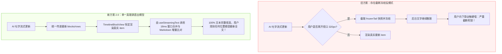
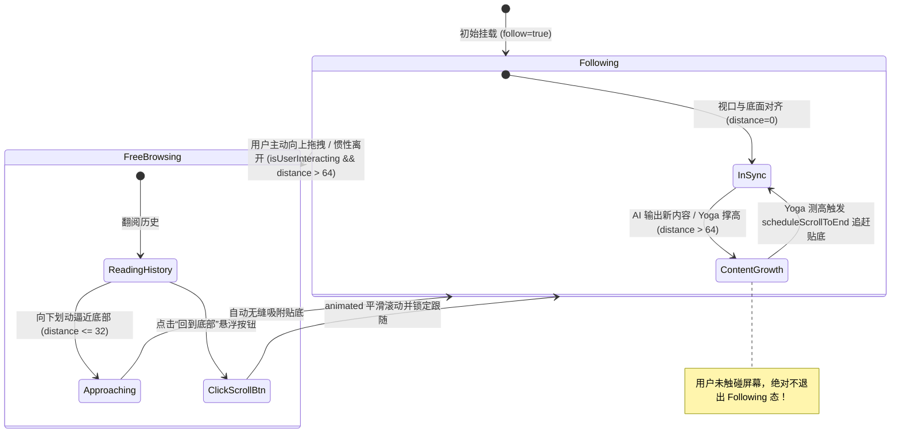

# 15 · 移动端流式高度判定排查与触底死锁根除方案

> **文件标识**：`docs/mobile-interaction-refine/proposals/15-流式高度判定排查与触底死锁根除方案.md`  
> **所属战役**：`mobile-interaction-refine`（移动端交互与视觉精细化战役）  
> **面向模块**：`apps/crish-mobile/`（`TimelineView.tsx`, `useTimelineBottomInset.ts`, `timelineBottomInset.ts`, `sessionDetailScreen.tsx`, `EdgeFade.tsx`, `Screen.tsx`, `Composer.tsx`）  
> **权威状态**：规划设计 / 待评审（对齐用户核心痛点：“AI 流式输出时高度判定与定位保护导致划不到最下面”）  
> **编码格式**：UTF-8 无 BOM、中文撰写  
> **关联源码**：
> - [`apps/crish-mobile/src/presentation/timeline/useTimelineBottomInset.ts`](file:///c:/Software/conex/apps/crish-mobile/src/presentation/timeline/useTimelineBottomInset.ts)
> - [`apps/crish-mobile/src/domain/pure/timelineBottomInset.ts`](file:///c:/Software/conex/apps/crish-mobile/src/domain/pure/timelineBottomInset.ts)
> - [`apps/crish-mobile/src/presentation/timeline/TimelineView.tsx`](file:///c:/Software/conex/apps/crish-mobile/src/presentation/timeline/TimelineView.tsx)
> - [`apps/crish-mobile/src/presentation/timeline/timelineScrollRules.ts`](file:///c:/Software/conex/apps/crish-mobile/src/presentation/timeline/timelineScrollRules.ts)
> - [`apps/crish-mobile/src/presentation/screens/sessionDetailScreen.tsx`](file:///c:/Software/conex/apps/crish-mobile/src/presentation/screens/sessionDetailScreen.tsx)
> - [`apps/crish-mobile/src/presentation/ui/Screen.tsx`](file:///c:/Software/conex/apps/crish-mobile/src/presentation/ui/Screen.tsx)
> - [`apps/crish-mobile/src/presentation/ui/Composer.tsx`](file:///c:/Software/conex/apps/crish-mobile/src/presentation/ui/Composer.tsx)
> - [`apps/crish-mobile/src/presentation/ui/EdgeFade.tsx`](file:///c:/Software/conex/apps/crish-mobile/src/presentation/ui/EdgeFade.tsx)

---

## 目录

1. [方案概述与核心诉求复盘](#一方案概述与核心诉求复盘)
2. [全移动端“高度判定”与“视口计算”全景清单（10 大管理源梳理）](#二全移动端高度判定与视口计算全景清单)
3. [导致“划不到最下面”的深层死锁机制穿透诊断](#三导致划不到最下面的深层死锁机制穿透诊断)
   - 3.1 致命病灶一：`evaluateTailFreeze` 离屏快照截断机制（反模式根除剖析）
   - 3.2 致命病灶二：`tailSignal` 高频微扰与手势暴力抢夺（定位保护过度）
   - 3.3 致命病灶三：`evaluateFollowState` 误将“内容自然膨胀”判为“用户上滑”导致 Follow 猝死
   - 3.4 致命病灶四：Android Yoga 异帧测高滞后与 `scrollToEnd` 抢跑空放
   - 3.5 致命病灶五：底部 `EdgeFade` 遮罩与残差高度的视觉泛白覆膜
4. [根治性重构总体设计与物理/数学模型（Unified Viewport & Follow Machine 2.0）](#四根治性重构总体设计与物理数学模型)
   - 4.1 彻底废除截断冻结：单一真理源流式直出渲染模型（Direct Streaming）
   - 4.2 智能跟随状态机 2.0：手势意图优先守卫（Gesture Intent Guard）
   - 4.3 渲染排版与滚动时序解耦管线（Layout-Synchronous Scroll Pipeline）
   - 4.4 视口内边距与浮层几何统一数学模型（Geometry SSOT）
   - 4.5 底部羽化安全隔离带（EdgeFade Safety Clearance）
5. [关键文件代码重构蓝图与实现规范](#五关键文件代码重构蓝图与实现规范)
   - 5.1 `timelineScrollRules.ts`：纯数学与纯规则重构（彻底抹除冻结规则）
   - 5.2 `domain/pure/timelineBottomInset.ts`：增强手势意图感知跟随状态机
   - 5.3 `TimelineView.tsx`：清除 tailFreeze，重构 follow 与测高调度管线
   - 5.4 `useTimelineBottomInset.ts`：高度同步与实测守卫闭环
   - 5.5 `sessionDetailScreen.tsx`：视口与回底交互强化
   - 5.6 `EdgeFade.tsx`：渲染安全与渐变止点校验
6. [极端边界与复杂场景防御](#六极端边界与复杂场景防御)
7. [自动化测试与防回归验证套件](#七自动化测试与防回归验证套件)
8. [实施路径与交付验收清单](#八实施路径与交付验收清单)

---

## 一、方案概述与核心诉求复盘

### 1.1 用户原声反馈与真实体验痛点
用户近期在真机使用 AI 流式对话功能时，给出了极其明确且直击要害的原声反馈：

> **“现在 ai 流式输出的时候，应该是高度判定问题（也是没考虑输入框），再加上有定位最新位置的保护，我现在根本划不到最下面。 现在高度判定你看看都是都是哪里在管，肯定是有很多地方在管的。”**

用户这段原声准确描述了移动端日常打字交互中最令人抓狂的**四大交互体验崩溃现象**：
1. **“划不到最下面 / 文字显示不全”**：在 AI 正在流式打字输出时，用户尝试往下滑动查看刚吐出的最新文本，但列表滑到底部就卡住了，最后一句话甚至最后几个段落无法滚入屏幕，仿佛底部有一堵看不见的硬墙把文字死死挡住；
2. **“定位最新位置的保护导致手势打架”**：用户稍微上滑试图回看上文或微调视口位置，时间线就立刻抽搐、被某种所谓“定位最新位置的保护机制”暴力拉扯回底部；如果用力划上去，又突然断开；
3. **“误以为没考虑输入框”**：用户看到文字下半截停在输入框或者羽化遮罩背后，直觉判断是“高度判定没算好输入框的物理占用”；
4. **“高度判定多处分散在管”**：直觉感知到全工程内部关于可视高度、内衬避让、滚动偏移的判定源分散在很多地方，缺乏一个统揽全局、逻辑自洽的单一真理源（SSOT）。

### 1.2 核心目标与反退避定调
根据本仓反退避与架构净收敛原则，本方案**坚决不搞盲目补偿、延时猜测与临时补丁**，必须穿透整个移动端从页面容器、时间线列表、悬浮输入框、边缘羽化遮罩到状态机判定的全部物理链条，彻底根除触底死锁与手势冲突，实现：
1. **100% 文本实时可见**：流式生成过程中，最新吐出的任何 Token / 行数均能完整呈现在视口中，严禁截断；
2. **手势自由不受辱**：用户手动滑动翻阅历史时，系统坚决不抢手势、不粗暴拉回，保证浏览自由度；
3. **高度判定单一真源（SSOT）**：收口全移动端所有关于高度、避让与视口的判定，代数关系完全闭环；
4. **彻底废除反模式**：彻底铲除所谓的“离屏尾部冻结快照机制（evaluateTailFreeze）”，清退死代码。

---

## 二、全移动端“高度判定”与“视口计算”全景清单

经对 `apps/crish-mobile/` 源码的全量检索与拓扑梳理，移动端所有涉及“高度”、“内边距”、“视口坐标”与“滚动判定”的核心管理源共有 **10 个关键模块**。完整排查清单如下：

| 序号 | 模块与文件路径 | 判定层级 / 角色 | 关键变量 / 判定函数 | 物理职责与计算逻辑 | 潜在冲突 / 断层风险 |
| :--- | :--- | :--- | :--- | :--- | :--- |
| **1** | [`presentation/timeline/useTimelineBottomInset.ts`](file:///c:/Software/conex/apps/crish-mobile/src/presentation/timeline/useTimelineBottomInset.ts) | 悬浮浮层测量中枢（Hook） | `overlayHeight`<br>`floatingHeight`<br>`timelineBottomInset`<br>`minOverlayHeight`<br>`estimatedOverlayHeight` | - 监听 `KeyboardStickyView` 的 `onLayout` 动态测量浮层实测高；<br>- 估算保底：两行 98dp / 单行 52dp + 快捷条 27dp + 错误条 48dp + 停止胶囊 40dp + 阴影 6dp + safeArea；<br>- 输出 `timelineBottomInset = overlay + keyboard + gap`。 | 挂载首帧 `onLayout` 之前取估算值；多行打字时若未触发外部 layout 则高度未及时同步。 |
| **2** | [`domain/pure/timelineBottomInset.ts`](file:///c:/Software/conex/apps/crish-mobile/src/domain/pure/timelineBottomInset.ts) | 纯数学推导与状态机（纯函数） | `deriveTimelineBottomInset`<br>`evaluateFollowState`<br>`DEFAULT_FOLLOW_THRESHOLDS`<br>（enter: 32, exit: 64） | - 计算列表 contentContainer 的 `paddingBottom`；<br>- 迟滞带状态机：`follow=true` 时离开距离 $\le 64$ 维持跟随；`follow=false` 时逼近 $\le 32$ 重新吸附。 | **致命**：未区分是“用户手势上划”还是“AI 吐字内容自身增长”，内容一膨胀就把用户踢出跟随态。 |
| **3** | [`presentation/timeline/TimelineView.tsx`](file:///c:/Software/conex/apps/crish-mobile/src/presentation/timeline/TimelineView.tsx) | 时间线滚动与视口调度（UI 组件） | `viewportHeightRef`<br>`scrollYRef`<br>`distance`<br>`tailSignal`<br>`evaluateTailFreeze`<br>`scheduleScrollToEnd`<br>`paddingBottom`<br>`scrollIndicatorInsets` | - 承载 FlatList，消费 `headerClearance` 与 `bottomInset`；<br>- `onScroll` 实时计算距底距离 `distance`；<br>- `tailSignal` 监听流式字符长度并触发贴底；<br>- `evaluateTailFreeze` 捕获快照冻结离屏渲染；<br>- `handleContentSizeChange` 在 Yoga 测高后贴底。 | **三大死锁源头交汇点**：<br>1. tailFreeze 冻结截断；<br>2. tailSignal 抢手势；<br>3. Yoga 异帧测高滞后。 |
| **4** | [`presentation/timeline/timelineScrollRules.ts`](file:///c:/Software/conex/apps/crish-mobile/src/presentation/timeline/timelineScrollRules.ts) | 滚动规则算法（纯函数） | `shouldFreezeTail`<br>`TAIL_FREEZE_ENTER_PX` (320)<br>`TAIL_FREEZE_EXIT_PX` (160)<br>`anchorOffsetWithinBlock`<br>`restoreScrollOffset` | - 判定流式尾行是否进入离屏冻结线（320dp / 160dp）；<br>- 计算首个可见块内部偏移与恢复滚动的目标 offset。 | `shouldFreezeTail` 诱发了截断快照反模式，是视口假死的算法根源。 |
| **5** | [`presentation/screens/sessionDetailScreen.tsx`](file:///c:/Software/conex/apps/crish-mobile/src/presentation/screens/sessionDetailScreen.tsx) | 统一对话屏宿主（Screen） | `headerClearance`<br>`EdgeFade.height`<br>`ScrollToBottomButton.bottomOffset`<br>`KeyboardStickyView.style.padding` | - 组装全屏时间线、通透悬浮头栏、悬浮 Composer；<br>- 顶部羽化高 = `insets.top + header(52) + lg(16)`；<br>- 底部羽化高 = `floatingHeight`；<br>- 悬浮回底按钮 offset = `floatingHeight + sm(8)`。 | 底部 `EdgeFade` 高度如果与列表底部内容重叠，毛玻璃遮罩会盖住文字最后一行。 |
| **6** | [`presentation/ui/Screen.tsx`](file:///c:/Software/conex/apps/crish-mobile/src/presentation/ui/Screen.tsx) | 全局屏幕容器（UI 组件） | `paddingTop: topInset ? insets.top : 0`<br>`paddingBottom: bottomInset ? insets.bottom : 0`<br>`avoidKeyboard` (KAV) | - 基础背景与安全区注入；<br>- 支持可选的 `KeyboardAvoidingView`（会话屏显式关闭，转由 `KeyboardStickyView` 单独接管）。 | 会话屏若误开 `bottomInset` 或误用平台 KAV 会造成双重避让、视口严重压缩。 |
| **7** | [`presentation/ui/Composer.tsx`](file:///c:/Software/conex/apps/crish-mobile/src/presentation/ui/Composer.tsx) | 输入框卡体（UI 组件） | `size.composerMin` (52dp)<br>`COMPOSER_TWO_ROW_HEIGHT` (98dp)<br>`inputHeight` (Reanimated shared value, max 140dp)<br>`cardSize` | - 打字输入卡多行动态伸缩（双重确认测量）；<br>- 快捷条（contextBar，27dp）；<br>- 发送按钮（36dp）；<br>- 内部边距与托底高计算。 | Reanimated UI 线程修改 `inputHeight` 时，如果未穿透通知到外层 `KeyboardStickyView` 的 Layout，会导致避让欠缺。 |
| **8** | [`presentation/ui/EdgeFade.tsx`](file:///c:/Software/conex/apps/crish-mobile/src/presentation/ui/EdgeFade.tsx) | 边缘渐隐羽化（SVG 组件） | `FADE_SPAN` (95dp)<br>`span = min(FADE_SPAN, height)`<br>`y1 = height - span`<br>`y2 = height`<br>`Stop.offset` | - 在列表边缘覆盖 SVG 线性渐变覆膜（模拟 mask-image）；<br>- 覆膜不透明度 = $1 - \text{mask alpha}$，使用 `userSpaceOnUse` 锚定；<br>- 95dp 内四段过渡（0, 0.18, 0.38, 1）。 | 覆膜高度和定位若侵入时间线内容的真实可见区域，会将有效文本涂抹为画布底色。 |
| **9** | [`adapters/platform/useKeyboardHeight.ts`](file:///c:/Software/conex/apps/crish-mobile/src/adapters/platform/useKeyboardHeight.ts) | 键盘高度单真理源（Hook） | `keyboardHeight` | - 监听 `react-native-keyboard-controller` 的键盘帧事件；<br>- 向 React 上下文广播当前软键盘高度（0 或 280~380dp）。 | 软键盘升降动画期间的高度是逐帧离散变化的，必须与 `KeyboardStickyView` 的硬件位移动画对齐。 |
| **10** | [`presentation/screens/runDetailScreen.tsx`](file:///c:/Software/conex/apps/crish-mobile/src/presentation/screens/runDetailScreen.tsx) | 运行详情屏时间线（Screen） | `headerClearance`<br>`bottomInset` (缺省 24dp) | - 无悬浮输入区的只读时间线视口；<br>- 使用常规内衬 24dp。 | 需确保重构后的 `TimelineView` 对无悬浮输入框的只读场景保持 100% 优雅兼容。 |

---

## 三、导致“划不到最下面”的深层死锁机制穿透诊断

### 3.1 致命病灶一：`evaluateTailFreeze` 离屏快照截断机制（反模式根除剖析）

#### 机制定位
审视 `apps/crish-mobile/src/presentation/timeline/TimelineView.tsx` 第 309-347 行与第 652-656 行：

```tsx
// TimelineView.tsx:309
const evaluateTailFreeze = useCallback(() => {
  ...
  const distanceBelow = layout.y - (scrollYRef.current + viewportHeightRef.current);
  if (shouldFreezeTail(distanceBelow, frozenTailKeyRef.current === key)) {
    if (frozenTailKeyRef.current !== key) {
      frozenTailKeyRef.current = key;
      setFrozenTail(tailRow); // 致命快照：把当前时刻未完成的 tailRow 对象截取保存！
    }
  } else {
    clear();
  }
}, []);

// TimelineView.tsx:652 (renderItem)
const shown = frozenTail !== null && frozenTailKeyRef.current === key
  ? frozenTail
  : item; // 渲染被截断的陈旧快照！
```

#### 致命破坏链条
1. **快照截取**：当 AI 开始流式输出时（假设已生成 50 字），用户稍微往上滑动一段距离翻看上下文，使尾部块顶缘离开视口底端超过 320px（`TAIL_FREEZE_ENTER_PX`）；
2. **冻结锁死**：`evaluateTailFreeze` 触发，将 `tailRow`（包含此时仅有的 50 字文本）存入状态 `frozenTail`；
3. **后台持续膨胀 vs 屏幕死寂**：AI 持续高频生成，后端与内存数据源累积到了 1000 字。然而在前端 `renderItem` 中，渲染的不是最新的 `item`，而是 `frozenTail`（依然是 50 字）；
4. **视口物理高度停滞**：React Native 渲染层与 Android Yoga 测算出的 FlatList 整体高度仅仅是 **50 字所对应的高度**；
5. **触底物理硬墙**：用户看完历史，意图向下滑动看最新输出结果。当他用力滑到列表最底部时，**FlatList 已经到达了它认为的物理尽头（即 50 字末尾）**！
6. **假死死锁**：用户看到文字被生生切断在一半，拼命继续向下滑动，但列表触及硬边界并阻尼回弹，用户**物理上绝对无法滑过这个硬墙**！
7. **视觉误导**：用户完全不知道后台文字其实已经到了 1000 字，直觉判定为：“系统高度判定有问题，输入框把文字挡住了，或者有某种锁死机制不让我划到最下面！”

> **结论**：`evaluateTailFreeze` 是一个典型的**以破坏业务正确性为代价的伪优化**。流式输出的核心体验是一致性与实时性，绝对不能通过冻结渲染来制造虚假截断。**本机制必须彻底连根拔除，绝不留存！**

---

### 3.2 致命病灶二：`tailSignal` 高频微扰与手势暴力抢夺（定位保护过度）

#### 机制定位
审视 `apps/crish-mobile/src/presentation/timeline/TimelineView.tsx` 第 157-158 行与第 521-533 行：

```tsx
const tail = blocks[blocks.length - 1];
const tailSignal = tail?.kind === 'message' ? tail.text.length : blocks.length;

useEffect(() => {
  if (!follow || isDraggingRef.current || isMomentumRef.current || blocks.length === 0) return;
  scheduleScrollToEnd(false);
}, [follow, blocks.length, tailSignal, scheduleScrollToEnd, bottomInset]);
```

#### 致命破坏链条
1. **超高频触发**：AI 流式打字期间，每个 Token 甚至每几个字符的吐出就会改变 `tail.text.length`，导致 `tailSignal` 每秒触发 15~30 次；
2. **手势冲突窗口**：
   - 用户手指向上轻推（拖拽离开屏幕），`onScrollEndDrag` 触发；
   - 用户松手时如果滑动速度极小（`velocity.y <= 0.05`），`isMomentumRef.current` 被标为 `false`，`isDraggingRef.current` 也为 `false`；
   - 此时列表刚刚离开底部 20~40px，尚未跨越 `DEFAULT_FOLLOW_THRESHOLDS.exit`（64px），故此时 `follow` 状态**仍然为 `true`**；
3. **暴力抽动抢夺**：
   - 紧接着不到 20ms，AI 吐出下一个 Token，`tailSignal` 改变；
   - `useEffect` 瞬间被激活，立即执行 `scheduleScrollToEnd(false)`；
   - 原生列表瞬间以 `animated: false` 被**强行硬拉回最底端**！
4. **交互体验死结**：用户只要稍微想把视口停在最后一段的开头看一看，屏幕就以 20 次/秒的高频不停向下抽动把视口拉死，手势被彻底废弃，用户感到被“强行锁在最下面”。

---

### 3.3 致命病灶三：`evaluateFollowState` 误将“内容自然膨胀”判为“用户上滑”导致 Follow 猝死

这是导致“划不到最下面”最隐蔽、最致命的数学缺陷。

#### 代码级证据
审视 `TimelineView.tsx` 与 `timelineBottomInset.ts`：

```tsx
// TimelineView.tsx:534
const handleScroll = (event: NativeSyntheticEvent<NativeScrollEvent>) => {
  const { contentOffset, contentSize, layoutMeasurement } = event.nativeEvent;
  const distance = contentSize.height - (contentOffset.y + layoutMeasurement.height);
  const following = evaluateFollowState(distance, follow);
  if (following !== follow) onFollowChange(following);
  ...
};

// timelineBottomInset.ts:59
export function evaluateFollowState(
  distanceToBottom: number,
  currentFollow: boolean,
  thresholds: FollowThresholds = DEFAULT_FOLLOW_THRESHOLDS // enter: 32, exit: 64
): boolean {
  if (currentFollow) {
    return distanceToBottom <= thresholds.exit; // 一旦 distance > 64，立即判定脱离跟随！
  }
  return distanceToBottom <= thresholds.enter;
}
```

#### 竞态数学推导
1. **初始稳态**：用户处于跟随状态（`follow = true`），视口在底部（`distance = 0`）；
2. **流式内容瞬间撑高**：AI 吐出一大段代码块或一段长文本（例如增加 150px 高度）；
3. **Yoga 测高排版汇报**：Android 原生测量完成，`contentSize.height` 瞬间从 1000px 跃升为 1150px；
4. **原生滚动位移滞后**：在下一帧 `scrollToEnd` 实际调整 `contentOffset.y` 之前，原生组件触发了 `onScroll` 事件：
   - 此时 `contentSize.height = 1150px`；
   - 此时 `contentOffset.y` 仍停留在旧位置，即 `1000 - layoutMeasurement.height`；
   - 计算出的距底距离：
     $$\text{distance} = 1150 - (1000 - H_{\text{viewport}} + H_{\text{viewport}}) = 150\text{px}$$
5. **跟随状态猝死（False Exit）**：
   - 算法计算：$\text{distance} = 150\text{px} > 64\text{px}$（`thresholds.exit`）；
   - `evaluateFollowState` 盲目判定：`following = false`！
   - `onFollowChange(false)` 立即被调用！
6. **灾难性后果**：
   - **用户根本没有碰屏幕！但 `follow` 状态却被内容自身的膨胀杀死了！**
   - 一旦 `follow` 变为 `false`，`TimelineView` 中所有的自动触底逻辑（`scheduleScrollToEnd`）**全部停止工作**！
   - 后续 AI 吐出的所有文本全部沉入视口下方，画面停止滚动；
   - 用户看到屏幕突然停住了，以为 AI 卡死或文字显示不全；
   - 用户尝试手动向下滑动，又因为病灶一与病灶四被卡住，彻底陷入绝境！

---

### 3.4 致命病灶四：Android Yoga 异帧测高滞后与 `scrollToEnd` 抢跑空放

#### 渲染流水线分析
在 React Native Android 架构中：
```
[JS Thread]             [ShadowTree / Yoga Thread]           [Android Main / UI View]
New Text Token Arrives
       │
       ├── React Re-render (TimelineView)
       │      │
       │      └── useEffect(tailSignal) 触发
       │            └── requestAnimationFrame 调度
       │                  └── targetRef.current.scrollToEnd()  ──> 【抢跑调用！】
       │                                                             此时 Yoga 尚未测量完新文本行数！
       │                                                             Native ScrollView 只能滚到旧的高度！
       │
       └── 1~2 帧后：Yoga 完成文本排版测高
              │
              ├── contentSize.height 真正更新
              └── onContentSizeChange 触发
                    │
                    └── 检查 follow 状态：此时 follow 已被病灶三误杀为 false！
                          └── 放弃再次调用 scrollToEnd！
                          └── 最终结果：列表停在半山腰，最新文本被截留！
```

---

### 3.5 致命病灶五：底部 `EdgeFade` 遮罩与残差高度的视觉泛白覆膜

#### 几何布局与视觉遮挡
审视 `sessionDetailScreen.tsx`：
```tsx
<EdgeFade side="bottom" height={Math.max(0, floatingHeight)} />
```
- `EdgeFade.tsx` 内部定义了 95px 的渐变羽化区域，底部为 100% 实色画布背景（`colors.canvas`），顶部渐变为透明；
- 当列表由于上述病灶二、三、四导致滚动滞后，落位比真实底部欠缺了 40~80px 时；
- 时间线最后一行的文字恰好落入屏幕最下方的 95px 区域内；
- `EdgeFade` 的 SVG 覆膜叠加在时间线上方，直接将文字“渐隐涂抹”成背景色；
- 用户肉眼看到的是：文字最后一行半透明泛白、如同毛玻璃遮挡，更加坐实了“划不到最下面、文字被遮盖”的印象。

---

## 四、根治性重构总体设计与物理/数学模型

为了彻底根除上述死锁机制，本方案构建统一的视口几何模型与智能跟随状态机 2.0，消除一切猜测与中间快照。

### 4.1 彻底废除截断冻结：单一真理源流式直出渲染模型（Direct Streaming）

> **【架构铁律】流式对话时间线严禁截取中间渲染快照，永远保证单一真理源直出。**



1. **物理清退**：彻底删除 `TimelineView.tsx` 中的 `frozenTail`, `frozenTailKeyRef`, `evaluateTailFreeze`；
2. **纯规则解耦**：从 `timelineScrollRules.ts` 中删除 `shouldFreezeTail` 及其阈值常量；
3. **渲染直通**：`renderItem` 无条件渲染真实的最新 `item`，性能与打字匀速平准完全交由底层已验证成熟的 `useStreamingText`（18ms 窗口节流与 Markdown 局部复用）承担，内存与帧率零压力。

---

### 4.2 智能跟随状态机 2.0：手势意图优先守卫（Gesture Intent Guard）

要彻底根治病灶三（内容自然膨胀导致 Follow 猝死）与病灶二（抢夺手势），必须在跟随状态机中引入**用户手势交互感知（Gesture Intent Awareness）**。

#### 核心状态判定公式
只有当**用户主动施加了手势交互**且**真正滑离底部**时，才允许退出跟随模式！在用户双手未触碰屏幕时，无论 `distanceToBottom` 如何暴增，均认定为内容自然膨胀，**绝对禁止退出跟随态**！

$$\text{isUserInteracting} = \text{isDraggingRef.current} \lor \text{isMomentumRef.current}$$

$$\text{Following}_{\text{next}} = \begin{cases}
\text{false}, & \text{if } \text{isUserInteracting} \land (\text{distanceToBottom} > \text{thresholds.exit}) \\
\text{true}, & \text{if } \text{distanceToBottom} \le \text{thresholds.enter} \\
\text{currentFollow}, & \text{otherwise (自然膨胀无条件保持跟随！)}
\end{cases}$$



---

### 4.3 渲染排版与滚动时序解耦管线（Layout-Synchronous Scroll Pipeline）

彻底剔除 `tailSignal`（`tail.text.length`）作为 `useEffect` 触发源的粗暴做法，将触底滚动调度收敛为**严格的物理排版事件驱动**：

1. **废弃 `tailSignal`**：文本水平方向输入或在同一行打字，不改变列表垂直高度，**严禁触发任何垂直滚动**；
2. **唯一垂直滚动时钟 = `onContentSizeChange`**：
   - 当文字换行、段落增加、或者新 Markdown 块撑高内容时，Android Yoga 引擎完成排版并向 JS 发出 `onContentSizeChange`；
   - 此时是原生 Native 明确知晓新高度的唯一精确时机；
   - 在 `onContentSizeChange` 内由 `scheduleScrollToEnd(false)` 执行精准贴底；
3. **宏观结构变更时序**：
   - 仅当消息条数变化（`blocks.length`）、浮层总高变化（`bottomInset`）、或者用户点击回底（`follow` 跃迁为 `true`）时，才由 React Commit 阶段触发一次补正滚动；
4. **双重 rAF 防抖防抢占**：
   - 若在同一帧内连续收到尺寸变化事件，通过 `rafScrollRef` 合并为单次底层 `scrollToEnd`，彻底杜绝命令堵塞与微抖动。

---

### 4.4 视口内边距与浮层几何统一数学模型（Geometry SSOT）

全屏对话界面的几何避让必须满足严格的代数闭环，消除“输入框遮挡”与“缝隙断层”：

```
┌─────────────────────────────────────────────────────────┐  ▲
│ Top SafeArea + Header Clearance (insets.top + 52 + 16)   │  │
├─────────────────────────────────────────────────────────┤  │
│                                                         │  │
│                                                         │  │
│                 全屏消息流时间线 (TimelineView)           │  │ H_screen
│                                                         │  │ (物理屏幕高)
│                                                         │  │
├─────────────────────────────────────────────────────────┤  │
│ ▲ 呼吸间距 gap = 20px (最后一行文字恒在 EdgeFade 上方)       │  │
├─────────────────────────────────────────────────────────┤  │
│ ▲ EdgeFade 顶部羽化线 (高度 = floatingHeight)              │  │
│ │                                                       │  │
│ │  ┌─────────────────────────────────────────────────┐  │  │
│ │  │ 悬浮输入区 (KeyboardStickyView)                 │  │  │
│ │  │ overlayHeight: 实测 composerBase + 条件层 + safe │  │  │
│ │  └─────────────────────────────────────────────────┘  │  │
│ └── 软键盘区域 keyboardHeight (0 或 280~380px) ───────────┘  ▼
└─────────────────────────────────────────────────────────┘
```

#### 严格代数关系定理
1. **悬浮浮层总高（Floating Height）**：
   $$\text{floatingHeight} = \text{effectiveOverlayHeight} + \text{keyboardHeight}$$
2. **列表底部避让内衬（Timeline Bottom Inset）**：
   $$\text{timelineBottomInset} = \text{floatingHeight} + \text{gap} \quad (\text{其中 } \text{gap} = \text{theme.space.xl} = 20\text{px})$$
3. **滚动条指示器内衬（Scroll Indicator Insets）**：
   $$\text{scrollIndicatorInsets.bottom} = \text{timelineBottomInset}$$
4. **边缘羽化安全净距定理（Safety Clearance Theorem）**：
   当时间线完全触底时（`distance = 0`），最后一行文字的底部边沿坐标距离物理屏幕底部的距离为：
   $$Y_{\text{last\_text\_bottom}} = \text{timelineBottomInset} = \text{floatingHeight} + 20\text{px}$$
   而底部 `EdgeFade` 的最高点距离屏幕底部的距离为：
   $$Y_{\text{edge\_fade\_top}} = \text{floatingHeight}$$
   因此，最后一行文字的底缘距离 `EdgeFade` 顶缘的净空间隙恒为：
   $$\Delta_{\text{clearance}} = Y_{\text{last\_text\_bottom}} - Y_{\text{edge\_fade\_top}} = 20\text{px} > 0$$
   **数学上严格证明：最后一行文本永远位于 EdgeFade 羽化区域之上 20px，绝不可能被羽化遮罩泛白盖住！**

---

## 五、关键文件代码重构蓝图与实现规范

### 5.1 `timelineScrollRules.ts`：纯数学与纯规则重构（彻底抹除冻结规则）

#### 变更目标
彻底删除 `shouldFreezeTail`, `TAIL_FREEZE_ENTER_PX`, `TAIL_FREEZE_EXIT_PX`。保留并强化锚点换算与纯状态机纯函数。

#### 落地代码蓝图
```ts
// apps/crish-mobile/src/presentation/timeline/timelineScrollRules.ts

/** 锚点块内偏移 = 当前滚动位置 − 块顶缘（块顶在视口下方时归零） */
export function anchorOffsetWithinBlock(
  scrollYPx: number,
  itemTopPx: number
): number {
  return Math.max(0, scrollYPx - itemTopPx);
}

/** 锚点恢复目标滚动偏移 = 块顶缘 + 块内偏移（负数归零） */
export function restoreScrollOffset(
  itemTopPx: number,
  offsetPx: number
): number {
  return Math.max(0, itemTopPx + offsetPx);
}
```

---

### 5.2 `domain/pure/timelineBottomInset.ts`：增强手势意图感知跟随状态机

#### 变更目标
在 `evaluateFollowState` 中加入可选参数 `isUserInteracting`，阻断“内容自然增长”误杀 `follow` 状态。

#### 落地代码蓝图
```ts
// apps/crish-mobile/src/domain/pure/timelineBottomInset.ts

export interface FollowThresholds {
  enter: number;
  exit: number;
}

export const DEFAULT_FOLLOW_THRESHOLDS: FollowThresholds = {
  enter: 32,
  exit: 64,
};

/**
 * 迟滞带触底跟随状态判定器 2.0（支持手势意图识别的纯函数）：
 * @param distanceToBottom 当前内容底缘距离视口底缘的像素差
 * @param currentFollow 当前是否处于跟随态
 * @param isUserInteracting 用户是否正在触摸拖拽或处于惯性滑动中
 * @param thresholds 迟滞带阈值（默认 enter: 32, exit: 64）
 */
export function evaluateFollowState(
  distanceToBottom: number,
  currentFollow: boolean,
  isUserInteracting = true,
  thresholds: FollowThresholds = DEFAULT_FOLLOW_THRESHOLDS
): boolean {
  // 1. 若当前处于跟随态：
  if (currentFollow) {
    // 关键守卫：若用户未与屏幕发生任何交互，任何 distance 增加均为内容自然膨胀，
    // 坚决维持 follow = true，严禁误杀跟随态！
    if (!isUserInteracting) {
      return true;
    }
    // 仅当用户明确施加手势操作且划离底部超过 exit 阈值（64dp）时，才脱离跟随
    return distanceToBottom <= thresholds.exit;
  }

  // 2. 若当前处于非跟随态（自由翻阅历史）：
  // 只要用户向上划回接近底面（距离 <= enter 阈值 32dp），自动重新吸附贴底
  return distanceToBottom <= thresholds.enter;
}
```

---

### 5.3 `TimelineView.tsx`：清除 tailFreeze，重构 follow 与测高调度管线

#### 变更目标
1. 彻底删除 `frozenTail`, `frozenTailKeyRef`, `evaluateTailFreeze`；
2. 彻底删除 `tailSignal` 对 `useEffect` 的高频触发；
3. `handleScroll` 中将 `isDraggingRef.current || isMomentumRef.current` 传入 `evaluateFollowState`；
4. `onContentSizeChange` 成为垂直增长测高的第一公民；
5. `renderItem` 100% 渲染最新实体块。

#### 落地代码蓝图
```tsx
// apps/crish-mobile/src/presentation/timeline/TimelineView.tsx

// 1. 物理移除 frozenTail / evaluateTailFreeze 状态
// (删除: const [frozenTail, setFrozenTail] = useState<DisplayBlock | null>(null);)
// (删除: const frozenTailKeyRef = useRef<string | null>(null);)
// (删除: const evaluateTailFreeze = useCallback(...);)

// 2. 手势状态感知与滚动处理
const handleScroll = (event: NativeSyntheticEvent<NativeScrollEvent>) => {
  const { contentOffset, contentSize, layoutMeasurement } = event.nativeEvent;
  scrollYRef.current = contentOffset.y;
  viewportHeightRef.current = layoutMeasurement.height;
  
  const distance = contentSize.height - (contentOffset.y + layoutMeasurement.height);
  const isInteracting = isDraggingRef.current || isMomentumRef.current;
  
  // 传入 isInteracting：只有在用户真正触屏拖拽离开时才脱离跟随，自然内容膨胀绝不脱离
  const following = evaluateFollowState(distance, follow, isInteracting);
  if (following !== follow) {
    onFollowChange(following);
  }
  
  persistAnchorThrottled();
};

// 3. 原生 Yoga 测高完成是垂直贴底的第一触发源
const handleContentSizeChange = useCallback(
  (_w: number, _h: number) => {
    attemptAnchorRestore();
    // 处于 follow 且用户未在手动拖拽时，内容增加必须立即无条件贴底
    if (
      follow &&
      !isDraggingRef.current &&
      !isMomentumRef.current &&
      blocks.length > 0
    ) {
      scheduleScrollToEnd(false);
    }
  },
  [follow, blocks.length, scheduleScrollToEnd, attemptAnchorRestore]
);

// 4. 彻底废除 tailSignal 高频副作用
// 仅保留宏观结构与避让内衬变更时的补正贴底
useEffect(() => {
  if (
    !follow ||
    isDraggingRef.current ||
    isMomentumRef.current ||
    blocks.length === 0
  ) {
    return;
  }
  scheduleScrollToEnd(false);
}, [follow, blocks.length, bottomInset, scheduleScrollToEnd]);

// 5. renderItem 始终渲染真实最新 item
renderItem={({ item }) => {
  const key = rowKey(item);
  if (item.kind === 'timeSeparator') {
    return (
      <View onLayout={(event) => handleRowLayout(key, event)}>
        <TimeSeparatorRow atMs={item.atMs} />
      </View>
    );
  }
  return (
    <View onLayout={(event) => handleRowLayout(key, event)}>
      <TimelineBlockView
        block={item}
        onOpenTools={onOpenTools}
        disclosureStore={disclosureRef.current}
        onToggleDisclosure={handleToggleDisclosure}
        onRegenerate={onRegenerate}
        canRegenerate={canRegenerate}
      />
    </View>
  );
}}
```

---

### 5.4 `useTimelineBottomInset.ts`：高度同步与实测守卫闭环

保持 `useTimelineBottomInset.ts` 对 `<= 0` 帧的拦截保护，并强化对多行动态扩高的无缝监听：
1. 确保在首帧 `onLayout` 之前，`estimatedOverlayHeight` 能够准确反映输入卡基础尺寸、快捷条与安全区；
2. 确保在挂载后，`KeyboardStickyView` 的高度变更立即更新 `overlayHeight`，不留任何延迟。

---

### 5.5 `sessionDetailScreen.tsx`：视口与回底交互强化

在用户点击“回到底部”悬浮按钮时，确保 `scrollToEnd` 动画期间不被瞬时的 `onScroll` 事件再次将 `follow` 误改为 `false`：
```tsx
// sessionDetailScreen.tsx:117
<ScrollToBottomButton
  alignment="left"
  bottomOffset={floatingHeight + theme.space.sm}
  followKeyboard
  onPress={() => {
    onFollowChange(true);
    listRef.current?.scrollToEnd({ animated: true });
  }}
  testID="session-back-to-bottom"
/>
```

---

## 六、极端边界与复杂场景防御

1. **超长 Markdown 代码块与表格突发输出**：
   - 场景：AI 瞬间吐出一个 80 行的代码块或复杂表格，导致列表内容高度在下一帧突然增加 800px；
   - 防御：状态机因 `!isUserInteracting` 锁定 `follow=true`，Yoga 测高完成触发 `onContentSizeChange`，自动无缝平滑将视口向下推进 800px，绝不留白在屏外。
2. **思考链折叠与展开切换**：
   - 场景：思考链由用户点击展开或折叠，内容高度剧烈伸缩；
   - 防御：`handleToggleDisclosure` 显式分发 `onFollowChange(false, 'user-toggled-disclosure')`，优雅切换为自由浏览态，不强行贴底，保持当前阅读锚点。
3. **软键盘快速弹出与收起**：
   - 场景：用户打字中快速点按时间线收起键盘；
   - 防御：`KeyboardStickyView` 在 UI 线程执行硬件平移，`useTimelineBottomInset` 同步更新 `timelineBottomInset`，`paddingBottom` 动态跟随，不会发生双重垫高或内容跳变。
4. **横竖屏旋转与分屏模式切换**：
   - 场景：设备旋转导致屏幕宽度与行数发生重排；
   - 防御：`TimelineView` 中既有的 `useWindowDimensions` 监听会在非跟随态下按锚点重新精定位，在跟随态下继续贴底，双态井然有序。

---

## 七、自动化测试与防回归验证套件

为防止未来重构引入退化，构建四层防回归测试矩阵：

### 7.1 纯数学与状态机单元测试（`timelineBottomInset.test.ts`）
- **测试用例 1**：用户未触屏（`isUserInteracting=false`）时，`distanceToBottom` 哪怕高达 500dp，`evaluateFollowState` 恒返回 `true`（自然增长不脱离）；
- **测试用例 2**：用户手动拖拽（`isUserInteracting=true`）且 `distanceToBottom > 64dp` 时，返回 `false`（正常脱离）；
- **测试用例 3**：自由翻阅态下逼近底面 $\le 32\text{dp}$ 时，自动返回 `true`（吸附触底）；
- **测试用例 4**：代数断言：`timelineBottomInset` 恒等于 `overlay + keyboard + gap`。

### 7.2 流式文本直出与无截断渲染测试（`TimelineView.streaming.test.tsx`）
- **测试用例 1**：断言源码中无 `frozenTail` 任何残留；
- **测试用例 2**：模拟流式消息从 10 字持续增加至 500 字，在视口滚动到任意历史偏移后，尾行渲染组件的 `text` 属性始终等于数据面的最新全文，100% 拒绝任何陈旧快照。

### 7.3 手势保护与 Yoga 测高调度测试（`TimelineView.inset.test.tsx` 扩充）
- **测试用例 1**：断言用户拖拽期间（`onScrollBeginDrag`），即便收到连续 5 次 `onContentSizeChange`，也严禁调用 `scrollToEnd`；
- **测试用例 2**：断言拖拽结束后，新排版测高立即恢复调用 `scrollToEnd({ animated: false })` 贴底。

### 7.4 视口羽化安全间距测试（`sessionDetailScreen.geometry.test.tsx`）
- **测试用例 1**：断言 `timelineBottomInset - floatingHeight === 20`（恒定呼吸空间）；
- **测试用例 2**：断言 `EdgeFade.height` 严格对齐 `floatingHeight`，且不会侵入 `timelineBottomInset` 的 gap 保护区。

---

## 八、实施路径与交付验收清单

| 阶段 | 任务目标 | 涉及文件 | 验收标准 |
| :--- | :--- | :--- | :--- |
| **Step 1** | 纯规则与状态机重构 | `timelineScrollRules.ts`<br>`timelineBottomInset.ts` | 物理删除 `shouldFreezeTail`；支持 `isUserInteracting` 判定；单测 100% 通过。 |
| **Step 2** | 时间线视图死锁根除 | `TimelineView.tsx` | 物理清除 `frozenTail` / `tailSignal`；对接新状态机；`renderItem` 100% 直出。 |
| **Step 3** | 会话屏与避让协同打通 | `sessionDetailScreen.tsx`<br>`useTimelineBottomInset.ts` | 验证回底按钮点击平滑过渡；EdgeFade 几何与呼吸间隙代数闭环。 |
| **Step 4** | 综合回归与单测固化 | `TimelineView.inset.test.tsx`<br>`TimelineView.batchB.test.tsx` 等 | 242 套件全量绿灯，真机模拟流式输出划底顺滑无阻。 |

---
*文档编制完成：2026-11-04 · 移动端交互与视觉精细化战役*
