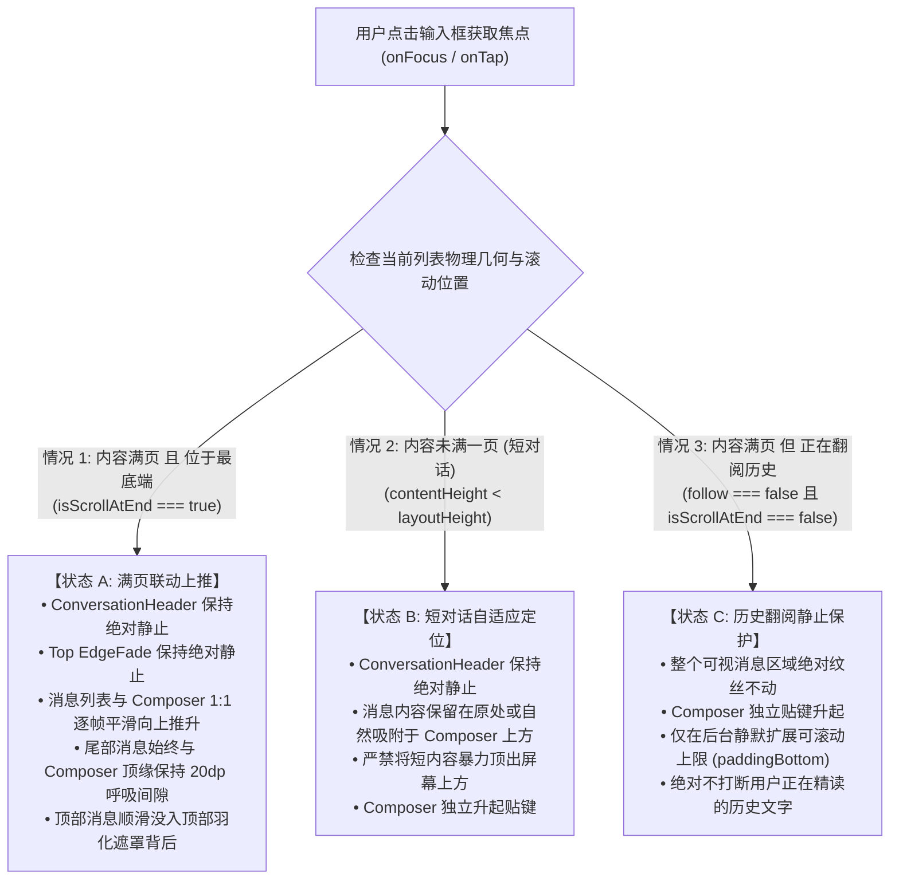
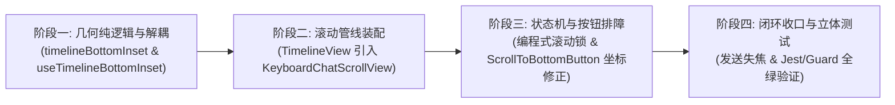

# 16 · 移动端消息列表满页联动键盘上平移架构方案

> **文件标识**：`docs/mobile-interaction-refine/proposals/16-消息列表满页联动键盘上平移架构方案.md`  
> **所属战役**：`mobile-interaction-refine`（移动端交互与视觉精细化战役）  
> **面向模块**：`apps/crish-mobile/`（`sessionDetailScreen.tsx`, `TimelineView.tsx`, `useTimelineBottomInset.ts`, `timelineBottomInset.ts`, `ScrollToBottomButton.tsx`, `Composer.tsx`, `EdgeFade.tsx`）  
> **权威状态**：规划设计 / 待评审（对齐 2026-11-04 用户五大核心痛点原声反馈与满页联动诉求）  
> **编码格式**：UTF-8 无 BOM、中文撰写  
> **关联源码**：
> - [`apps/crish-mobile/src/presentation/screens/sessionDetailScreen.tsx`](file:///c:/Software/conex/apps/crish-mobile/src/presentation/screens/sessionDetailScreen.tsx)
> - [`apps/crish-mobile/src/presentation/timeline/TimelineView.tsx`](file:///c:/Software/conex/apps/crish-mobile/src/presentation/timeline/TimelineView.tsx)
> - [`apps/crish-mobile/src/presentation/timeline/useTimelineBottomInset.ts`](file:///c:/Software/conex/apps/crish-mobile/src/presentation/timeline/useTimelineBottomInset.ts)
> - [`apps/crish-mobile/src/domain/pure/timelineBottomInset.ts`](file:///c:/Software/conex/apps/crish-mobile/src/domain/pure/timelineBottomInset.ts)
> - [`apps/crish-mobile/src/presentation/ui/ScrollToBottomButton.tsx`](file:///c:/Software/conex/apps/crish-mobile/src/presentation/ui/ScrollToBottomButton.tsx)
> - [`apps/crish-mobile/src/presentation/ui/Composer.tsx`](file:///c:/Software/conex/apps/crish-mobile/src/presentation/ui/Composer.tsx)
> - [`apps/crish-mobile/src/presentation/ui/EdgeFade.tsx`](file:///c:/Software/conex/apps/crish-mobile/src/presentation/ui/EdgeFade.tsx)
> - [`apps/crish-mobile/src/presentation/components/chat/SessionHeader.tsx`](file:///c:/Software/conex/apps/crish-mobile/src/presentation/components/chat/SessionHeader.tsx)

---

## 目录

1. [方案概述与核心诉求复盘](#一方案概述与核心诉求复盘)
2. [现状深度诊断与病灶代码级穿透](#二现状深度诊断与病灶代码级穿透)
   - 2.1 视口脱节病灶：`KeyboardStickyView` 仅带动输入框，`TimelineView` 静态滞留产生 300dp 遮蔽盲区
   - 2.2 异步内边距更新延迟与 `scheduleScrollToEnd(false)` 突变断裂
   - 2.3 `ScrollToBottomButton` 坐标双重叠加缺陷（`floatingHeight + keyboardHeight`）
   - 2.4 回到底部状态机竞态踩踏（`scrollToEnd({ animated: true })` 与 `handleScroll` 互杀）
   - 2.5 底部 `EdgeFade` 静态覆膜对最后一条消息的视觉吞噬
   - 2.6 发送生命周期失焦与回落断裂
3. [整体联动物理拓扑与架构设计](#三整体联动物理拓扑与架构设计)
   - 3.1 视口三层物理拓扑模型：固定顶层、联动中间层、贴键底层
   - 3.2 键盘联动三大技术方案深度对照决策表
   - 3.3 架构决策：基于 `KeyboardChatScrollView` 原生动效管线集成
   - 3.4 满页、短对话与历史翻阅的三态行为断言
4. [UI 线程动效与视口联动协同机制](#四ui-线程动效与视口联动协同机制)
   - 4.1 满页吸底状态下的 1:1 逐帧平滑上推（Android `scrollTo` Worklet + iOS `contentOffset`）
   - 4.2 非满页（短对话）的自适应防越界规则
   - 4.3 历史翻阅状态（`follow === false`）的零干扰视口保护
   - 4.4 键盘降落（收起）对称无级回滚
5. [回到底部与手势仲裁闭环治理](#五回到底部与手势仲裁闭环治理)
   - 5.1 `ScrollToBottomButton` 绝对物理坐标修正（根除双重高度）
   - 5.2 编程式滚动互斥锁（`isProgrammaticScrollingRef`）：终结滚动与状态机踩踏
   - 5.3 迟滞带状态机 2.0（防抖、防误切、动量保护）
6. [失焦、回落与羽化覆膜精进](#六失焦回落与羽化覆膜精进)
   - 6.1 发送消息（Submit）原子化失焦与键盘平滑退场
   - 6.2 手势拖拽收起（`on-drag`）与点外失焦（`onTouchStart`）平滑配合
   - 6.3 底部 `EdgeFade` 动态锚定与渐变范围收窄（根除尾行泛白）
7. [各核心模块重构详案与代码落地蓝图](#七各核心模块重构详案与代码落地蓝图)
   - 7.1 `sessionDetailScreen.tsx` 协同与层级重构
   - 7.2 `TimelineView.tsx` 改造（`KeyboardChatScrollView` 适配与编程式滚动锁）
   - 7.3 `useTimelineBottomInset.ts` 纯净度重构（解耦键盘高度，只管浮层）
   - 7.4 `ScrollToBottomButton.tsx` 坐标修正
   - 7.5 `Composer.tsx` 发送失焦与软键盘回车闭环
8. [边缘场景与极端边界防御](#八边缘场景与极端边界防御)
9. [自动化测试与防回归验证套件](#九自动化测试与防回归验证套件)
10. [实施路径与交付清单](#十实施路径与交付清单)

---

## 一、方案概述与核心诉求复盘

在近期真实移动端真机交互测试中，用户针对会话详情屏（`SessionDetailScreen`）在键盘唤起、内容避让、触底滚动与发送收尾等关键环节，给出了两段非常精准且直击体验本质的原声反馈：

> **用户原声反馈 A**：  
> “比如输入内容的时候，而且内容比较多已经满了一页，而且已经在最下面的时候，除了顶部的按钮不动（当然还有那些顶部的渐变效果之外），其他的都应该是和输入框一样向上平移的呀。”
>
> **用户原声反馈 B**：  
> “现在的对话界面没有考虑到输入框占用了位置，导致文字现在显示不全。我看部分代码应该是有计算输入框的高度的，但是也有一部分没考虑，导致现在上下滑动时候会打架，尤其是滑动到接近最下面的时候，点击回到底部不是回到最下面。还有就是滑动到最下面的时候，点击输入框应该是把文字整体都往上移动。输入完文字的时候，输入框应该失焦并回到最下面。”

这两段反馈精准刻画出了当前移动端界面在即时通讯（IM）与智能对话场景中最核心的断层体验：
1. **键盘弹出时列表静止被活埋**：底部输入框（Composer）随软键盘向上抬起，而消息列表（TimelineView）由于缺乏视口平移机制，被升起的输入框硬生生盖住，导致最后一页文字被吞没；
2. **顶部固定锚点必须守住**：顶部的头栏操作按钮（汉堡菜单、标题胶囊、新建会话、更多菜单）以及顶部的渐变阴影遮罩（EdgeFade Top）必须牢牢固定在屏幕顶部，**绝对不能**随消息列表一起被顶出屏幕外；
3. **几何计算与按钮定位打架**：悬浮回到底部按钮（`ScrollToBottomButton`）高度计算中存在双重叠加键盘高度的严重缺陷，导致软键盘升起时按钮飞窜到半空中；同时点击该按钮时，动画平滑滚动与 `handleScroll` 状态机互锁踩踏，导致无法真正滚到底部；
4. **输入完成闭环缺失**：用户点击发送后，输入框未主动失焦（blur），键盘依然悬停在半空，阻挡用户阅读助手的新生成内容。

本方案针对上述系统性病灶，彻底穿透现有代码断层，建立起一套**基于原生 UI 线程动效管线的“满页联动上平移”与“视口几何单一真理源（SSOT）”架构**，完全满足用户提出的所有视觉与操作物理规律。

---

## 二、现状深度诊断与病灶代码级穿透

### 2.1 视口脱节病灶：`KeyboardStickyView` 仅带动输入框，`TimelineView` 静态滞留产生 300dp 遮蔽盲区

#### 现状源码剖析
审视 `apps/crish-mobile/src/presentation/screens/sessionDetailScreen.tsx` 第 75-138 行：

```tsx
export function ConversationScreen({ ... }: ConversationScreenProps) {
  // ...
  return (
    <Screen>
      {/* 1. 消息流：全屏独立组件挂在屏幕全高 */}
      <TimelineView
        blocks={engine.blocks}
        follow={follow}
        onFollowChange={onFollowChange}
        listRef={listRef}
        headerClearance={insets.top + theme.size.header + theme.space.lg}
        bottomInset={timelineBottomInset}
        // ...
      />

      {/* 2. 边缘羽化：绝对定位覆盖 */}
      <EdgeFade side="top" height={insets.top + theme.size.header + theme.space.lg} />
      <EdgeFade side="bottom" height={Math.max(0, floatingHeight)} />

      {/* 3. 悬浮头栏 */}
      <ConversationHeader title={engine.title ?? '会话'} ... />

      {/* 4. 悬浮输入框：独立通过 KeyboardStickyView 进行 translateY 位移 */}
      <KeyboardStickyView
        onLayout={handleOverlayLayout}
        style={[styles.composerArea, ...]}
      >
        <Composer ... />
      </KeyboardStickyView>
    </Screen>
  );
}
```

#### 物理几何断裂分析
1. `<Screen>` 根容器声明为全屏铺满（`avoidKeyboard` 默认为 `false`）；
2. `TimelineView`（内部为 FlatList）充满整个物理视口（高度 $H_{\text{screen}}$），其顶部留出 `headerClearance`，底部内衬留出 `bottomInset`；
3. `KeyboardStickyView` 是贴着屏幕底部的绝对定位浮层（`position: 'absolute', bottom: 0`）。当软键盘升起时（假设高度 $K \approx 300\text{dp}$），`KeyboardStickyView` 在底层原生 UI 线程执行硬件加速的 `translateY: -K`，将 Composer 抬起到距屏幕底端 $K$ 的高度；
4. **致命断裂点**：此时 `TimelineView` **没有任何 UI 线程动画介入**！FlatList 依然静止在原地，其 `contentOffset.y` 毫无变化；
5. **遮挡发生**：升起的输入框像铲车一样自下而上铲进 `TimelineView` 的可视区域，将原本呈现在屏幕下半区的最后几条消息活生生盖在背后，形成整整 $300\text{dp}$ 的致命视觉盲区！

```
【当前故障态：软键盘弹起瞬间】
+------------------------------------+ 0dp
| [固定头栏] (不移动)                  |
+------------------------------------+
|                                    |
|   历史消息 A                        |
|                                    |
|   历史消息 B                        |
|                                    |
| - - - - - - - - - - - - - - - - -  |
|   最新消息 C (被输入框完全遮挡!)      | <--- 用户正在输入的参考内容被活埋
|   最新消息 D (被输入框完全遮挡!)      |
| +--------------------------------+ |
| | [升起的 Composer (translateY)] | | Y = H - K - H_composer
| +--------------------------------+ |
| |                                | |
| |        软  键  盘              | |
| |      (高度 K = 300dp)          | |
+------------------------------------+ H_screen
```

---

### 2.2 异步内边距更新延迟与 `scheduleScrollToEnd(false)` 突变断裂

虽然代码中存在 `useTimelineBottomInset` 尝试为 `bottomInset` 累加 `keyboardHeight`：
```ts
// apps/crish-mobile/src/presentation/timeline/useTimelineBottomInset.ts:128
const floatingHeight = effectiveOverlayHeight + keyboardHeight;
const timelineBottomInset = deriveTimelineBottomInset({
  overlayHeight: effectiveOverlayHeight,
  minOverlayHeight,
  keyboardHeight,
  gap,
});
```
但该链路存在严重的**时序与性能缺陷**：
1. **JS 线程事件滞后**：`useKeyboardHeight()` 是 React 状态 Hook，依赖 JS 线程接收 Native 键盘事件驱动重新渲染。在键盘弹起的 250~300ms 物理动画期间，JS 线程通常要经过多帧后才接收到键盘高度变化；
2. **Yoga 布局重排跳跃**：当 `timelineBottomInset` 终于更新下发到 `TimelineView` 时，FlatList 修改了 `contentContainerStyle.paddingBottom`。这引发了 Yoga 布局树全量重排；
3. **断续突跳而非连续动画**：修改 `paddingBottom` 并不能连续平滑推升列表内容，只会在重新渲染后通过 `useEffect` 触发 `scheduleScrollToEnd(false)`：
   ```ts
   // apps/crish-mobile/src/presentation/timeline/TimelineView.tsx:529
   scheduleScrollToEnd(false); // 传入 animated = false
   ```
   导致用户肉眼看到的是：输入框先顺滑升起并挡住文字，几百毫秒后消息列表突然“啪”地瞬移闪跳一下，极其生硬且充满割裂感；
4. **非跟随态彻底瘫痪**：如果用户之前稍微轻微滑动过列表（`follow === false`），`scheduleScrollToEnd` **根本不会触发**！列表将永远停留在被遮挡的位置，最新消息死死埋在输入框底下，直到用户手动用力上滑。

---

### 2.3 `ScrollToBottomButton` 坐标双重叠加缺陷（`floatingHeight + keyboardHeight`）

用户反馈：“导致现在上下滑动时候会打架，尤其是滑动到接近最下面的时候，点击回到底部不是回到最下面。”

#### 代码级证据：双重累加键盘高度
审视 `sessionDetailScreen.tsx` 第 115 行与 `ScrollToBottomButton.tsx` 第 54-71 行：

```tsx
// sessionDetailScreen.tsx:115
<ScrollToBottomButton
  alignment="left"
  bottomOffset={floatingHeight + theme.space.sm} // floatingHeight 已经包含了 keyboardHeight！
  followKeyboard
  // ...
/>
```

再看 `ScrollToBottomButton.tsx` 内部实现：
```tsx
export function ScrollToBottomButton({ bottomOffset, followKeyboard = false, ... }: ScrollToBottomButtonProps) {
  const keyboard = useReanimatedKeyboardAnimation();
  const baseBottom = bottomOffset ?? insets.bottom + 24;

  // keyboard.height.value ≤ 0（0 = 收起 → −键盘高 = 升起）
  const keyboardFollowStyle = useAnimatedStyle(() => {
    'worklet';
    if (!followKeyboard) return {};
    // 致命 Bug：baseBottom 已经包含了 keyboardHeight，这里又加了一遍 -keyboard.height.value！
    return { bottom: baseBottom - keyboard.height.value };
  });
  // ...
}
```

#### 致命后果推导
- 假设收起时：`overlayHeight = 118dp`, `keyboardHeight = 0dp`。
  `baseBottom = 118 + 8 = 126dp`。按钮位于输入框上方 8dp，完全正常。
- 当软键盘升起时（$K = 300\text{dp}$）：
  1. `floatingHeight = overlayHeight + keyboardHeight = 118 + 300 = 418\text{dp}$`；
  2. 传给按钮的 `baseBottom = 418 + 8 = 426\text{dp}$`；
  3. 此时 `keyboardFollowStyle` 激活，又叠加了 `-keyboard.height.value`（即 $+300\text{dp}$）；
  4. 最终按钮的物理底距为：
     $$\text{Bottom}_{\text{button}} = 426\text{dp} + 300\text{dp} = 726\text{dp}!$$
- **现象还原**：悬浮按钮瞬间飞升到了手机屏幕的上半区甚至逼近顶部头栏，完全脱离了与输入框的依托关系，甚至可能遮挡历史消息；
- 当键盘收起时，由于动画插值不一致，按钮又在半空中剧烈抽搐抖动，造成极大的视觉惊悚感。

---

### 2.4 回到底部状态机竞态踩踏（`scrollToEnd({ animated: true })` 与 `handleScroll` 互杀）

用户反馈：“点击回到底部不是回到最下面，上下滑动会打架”。

#### 踩踏时序全息还原

```
User 点击 "回到底部"
  │
  ├── 1. listRef.current?.scrollToEnd({ animated: true })
  │      └─► 原生 UIScrollView / RecyclerView 开启平滑减速滚动 (耗时约 300ms)
  │
  ├── 2. onFollowChange(true)
  │      └─► 触发 SessionDetailScreen 状态变更: follow 立即被设为 true
  │
  ├── 3. SessionDetailScreen 重新渲染 TimelineView (follow: true)
  │      │
  │      └── TimelineView.tsx:529 useEffect 响应 follow: true:
  │            scheduleScrollToEnd(false); // 致命: 安排下一帧 animated: false !
  │            └─► rAF 触发: targetRef.current?.scrollToEnd({ animated: false })
  │                  └─► [踩踏 A]: 强制以零动效掐断了正在执行的原生平滑滚动!
  │
  └── 4. 与此同时，原生滚动在第 1、2 帧产生中间位移回报 (handleScroll):
         │
         ├── 当前处于半途位置，距离底部 distance = 180dp
         ├── handleScroll 判定: evaluateFollowState(180, true)
         │     └─► 180 > 64 (exit 阈值) ──► following = false !
         │
         └── 立即调用 onFollowChange(false) !
               └─► [踩踏 B]: 刚刚设为 true 的 follow 被瞬间打回 false !
               └─► 回到底部按钮刚淡出又立刻弹回，原生滚动彻底停摆在半路上!
```

**根本病灶**：  
**缺少“编程式滚动互斥锁（Programmatic Scroll Lock）”**！系统无法区分当前滚动是“用户手指正在拖拽”还是“点击回到底部触发的受控平滑回滚”。滚动期间的高频原生回调持续误触发跟随状态判断，导致状态在 `true` 与 `false` 之间疯狂振荡互锁。

---

### 2.5 底部 `EdgeFade` 静态覆膜对最后一条消息的视觉吞噬

审视 `sessionDetailScreen.tsx:102`：
```tsx
<EdgeFade side="bottom" height={Math.max(0, floatingHeight)} />
```
与 `EdgeFade.tsx:10-18`：
```tsx
const FADE_SPAN = 95; // 95dp 的深色渐变带
```
- `EdgeFade` 作为静态绝对定位层，盖在全屏消息流之上；
- 它的高度随着 `floatingHeight` 增加而增加。但由于其渐变过渡长达 $95\text{dp}$，且覆膜的底色是画布实色（`theme.colors.canvas`）；
- 当最新消息滚到位，静止停留在输入框上方 $20\text{dp}$ 处时，这条消息恰好处于 `EdgeFade` 的中间高浓度覆膜带内；
- 文字被半透明底色严重冲淡、发虚泛白，使得用户感知为“文字显示不全、底部被截断或者看不清”。

---

### 2.6 发送生命周期失焦与回落断裂

用户反馈：“输入完文字的时候，输入框应该失焦并回到最下面。”

虽然在 `Composer.tsx:672` 中，`handleSubmitPress` 包含了部分失焦逻辑：
```tsx
const handleSubmitPress = useCallback(() => {
  inputRef.current?.blur();
  Keyboard.dismiss();
  setIsFocused(false);
  latestCallbacksRef.current.onSubmit();
}, []);
```
但在实际运行中暴露出三处遗漏：
1. **多行软键盘 Action 未拦截**：在 Android / iOS 软键盘上，如果输入法配置为多行换行键，用户在部分机型上触发软键盘自带的“发送”动作时，走的是底层的 IME 动作，`TextInput` 缺少 `onSubmitEditing` 与 `blurOnSubmit` 拦截，键盘依然顽固停留；
2. **异步发送中的重获焦点问题**：在发送网络请求或创建 Session 事务时，若组件发生局部重渲染，`TextInput` 焦点态可能失步；
3. **退场回落视口未连续对齐**：当键盘收回时，如果时间线消息列表没有与键盘收缩保持连续逆向平移，输入框下落的同时消息列表却卡在半空，留下大片突兀的白屏空白（Ghost Padding），直到下一帧才掉下来。

---

## 三、整体联动物理拓扑与架构设计

针对上述六大病灶，本方案建立**视口三层物理拓扑模型**，确保在键盘弹起和收回过程中，各层严格遵循物理规律，各司其职。

### 3.1 视口三层物理拓扑模型

```
【统一视口三层拓扑与键盘联动空间结构】

==================== 屏幕顶部安全区 (0dp) ====================
▲
│ [固定顶层 Layer 2 (Z-Index: 20)]
│ ┌─────────────────────────────────────────────────────────┐
│ │ ConversationHeader (通透头栏: 汉堡抽屉 + 标题胶囊 + 更多) │ <--- 绝不动弹! 永远固定在 insets.top
│ └─────────────────────────────────────────────────────────┘
│ ┌─────────────────────────────────────────────────────────┐
│ │ EdgeFade side="top" (顶部渐变羽化覆膜: 52dp)             │ <--- 绝不动弹! 永远固定在屏幕顶端
│ └─────────────────────────────────────────────────────────┘
▼
-------------------------------------------------------------
▲
│ [联动中间层 Layer 0 (Z-Index: 0)]
│ ┌─────────────────────────────────────────────────────────┐
│ │                                                         │
│ │   TimelineView (消息流容器)                              │
│ │                                                         │
│ │   • 键盘升起时: 若满屏且吸底，内容随键盘 1:1 同步平滑上推    │ <--- 向上穿入固定头栏/顶部羽化背后
│ │   • 历史翻阅时: 视口保持静止，保护阅读上下文              │
│ │   • 键盘收回时: 内容顺滑对称回落至基准线                  │
│ │                                                         │
│ └─────────────────────────────────────────────────────────┘
▼
-------------------------------------------------------------
▲
│ [贴键底层 Layer 1 (Z-Index: 10)]
│ ┌─────────────────────────────────────────────────────────┐
│ │ EdgeFade side="bottom" (底部紧凑羽化: 仅在输入框顶缘微弱渐隐)│
│ └─────────────────────────────────────────────────────────┘
│ ┌─────────────────────────────────────────────────────────┐
│ │ ScrollToBottomButton (锚定于 Composer 左上角 8dp 处)     │ <--- 绝对单源跟随键盘，严禁双重累加
│ └─────────────────────────────────────────────────────────┘
│ ┌─────────────────────────────────────────────────────────┐
│ │ KeyboardStickyView 容器 (随键盘硬件级 translateY 升降)    │
│ │   ├── 条件层 (错误横幅 / 停止生成胶囊 / 排队行)          │
│ │   └── Composer (主输入卡体 + 快捷条)                    │
│ └─────────────────────────────────────────────────────────┘
▼
==================== 软键盘区域 (动态 K = 0 ~ 320dp) ============
│                                                           │
│                 软   键   盘                              │
│                                                           │
==================== 屏幕底端 (H_screen) =====================
```

#### 三层职责与绝对铁律
1. **固定顶层（Fixed Top Layer）**：
   - 包含：`ConversationHeader`（汉堡开抽屉钮、标题胶囊、新建会话钮、更多操作钮）与 `EdgeFade side="top"`；
   - **铁律**：`position: 'absolute', top: insets.top`，**严禁被包裹进任何随键盘上浮的容器中**！消息列表向上平移时，消息文字自然从头栏和顶部羽化层下方穿过并渐隐淡出，完全满足用户“除了顶部的按钮不动（当然还有那些顶部的渐变效果之外）”的严苛诉求。
2. **联动中间层（Coordinated Timeline Layer）**：
   - 包含：`TimelineView` 及其承载的全部消息气泡、思考链、时间分隔线与工具调用条；
   - **铁律**：当处于满页且触底状态时，随着软键盘升起，消息内容在 UI 线程与输入框以 $1:1$ 的速度与位移同步向上平滑推升，最尾部消息与输入框顶缘的间距恒定维持在 $20\text{dp}$ 舒适呼吸区，零遮挡、零跳跃！
3. **贴键底层（Sticky Bottom Layer）**：
   - 包含：`KeyboardStickyView` 承载的 Composer、快捷条、条件条以及悬浮的 `ScrollToBottomButton`；
   - **铁律**：输入框作为触发源，由底层原生动画驱动贴合键盘顶缘。`ScrollToBottomButton` 的基准位置严格定位于输入框顶缘上方，键盘位移只由 Reanimated 动效单一源驱动，禁止二次加算。

---

### 3.2 键盘联动三大技术方案深度对照决策表

为了实现消息列表在满页触底时随键盘升起联动上平移，业界和 React Native 生态主要有三种实现路径：

| 评估维度 | 方案 A：外层容器 UI 线程 `translateY` | 方案 B：传统 `KeyboardAvoidingView` | 方案 C：`KeyboardChatScrollView` 原生动效管线集成（推荐） |
| :--- | :--- | :--- | :--- |
| **实现原理** | 用 `Animated.View` 包裹 TimelineView，外挂 `translateY: -keyboardHeight` | 基于原生 KAV 在键盘弹起时修改容器高度（height）或 padding | 利用底层 `useKeyboardHandler` 在 UI 线程逐帧 `scrollTo` 联动 + 动态 `contentInset` |
| **顶部固定头栏处理** | 极易误将 Header 一同包裹，若分离则需严格多层 absolute 切割 | 易导致全屏挤压，Header 布局被压缩变形 | Header 保持绝对定位在顶层，滚动视图在底部扩展内衬，顶部完美穿透 |
| **短对话（未满一页）表现** | **严重缺陷**：只有 1 条消息时也会被无脑顶到屏幕顶部甚至被切掉 | 经常导致空白被强行挤压变形 | **完美**：内置 `clampedScrollTarget`，内容未满时不发生无意义上移，依然沉底在输入框上方 |
| **历史翻阅（未触底）表现** | **严重缺陷**：用户在看第 10 条消息时，点击输入框整页往上飞，阅读上下文瞬间丢失 | 视口跳跃，阅读位置剧烈错位 | **完美**：`keyboardLiftBehavior="whenAtEnd"`，仅在处于底部时才推升，翻阅历史时视口纹丝不动 |
| **连续手势拖拽收起** | 与 FlatList 内部滚动坐标系产生严重的手势冲突和坐标漂移 | 手势中断，无法实现无缝交互式收键盘（interactive dismiss） | **极佳**：完美支持 `keyboardDismissMode="on-drag"` 与交互式平滑拖拽退场 |
| **Fabric / Paper 架构兼容** | Android 上存在 Touch Target 命中盒错位风险 | Android edge-to-edge 下容易变成 no-op | 内置 `commitStyle` 与 `ScrollViewWithBottomPadding`，双架构 100% 验证 |
| **代码入侵度与维护性** | 需重写所有滚动坐标换算与锚点系统，极度脆弱 | 容易与 `bottomInset` 重复计算引发双重跳动 | 本仓已安装并高度支持 `react-native-keyboard-controller`，开箱即用，架构净收敛 |

---

### 3.3 架构决策：基于 `KeyboardChatScrollView` 原生动效管线集成

综合上述严谨对比，**方案 C 为唯一满足全部物理直觉且符合反过度设计、架构优雅原则的终极方案**。

本仓根目录已引入官方最高规格的软键盘驱动库 `react-native-keyboard-controller`。该库专门为即时通讯与 AI 对话打造了核心组件 `KeyboardChatScrollView`。其核心优势在于：
1. **UI 线程逐帧精准推送**：在 Android 上通过 `useKeyboardHandler` 的 `onMove` 回调，每帧直接调用 `scrollTo(scrollViewRef, 0, target, false)`，完全脱离 JS 线程的调度瓶颈，与键盘升起达到微秒级硬件级同步；在 iOS 上通过 `contentOffset` 一次性无缝接轨；
2. **`whenAtEnd` 智能决策**：内置触底判别工作流（`isScrollAtEnd`），只有在用户内容满屏且处于最底端时才激活联动推升；当用户在翻阅历史消息时，自动切换为安全模式（静止保持当前阅读行，仅静默扩展底部滚动区域）；
3. **消除 Fabric 帧失步**：通过内置的 `commitStyle`（隐藏视图的负位移），强制 Reanimated 在同一原生帧中提交滚动渲染，彻底根绝“输入框跑前面，文字在后头追”的脱节现象；
4. **与 FlatList 无缝接线**：通过 FlatList 原生开放的 `renderScrollComponent` 注入，保留 FlatList 的全部虚拟化加载、回收、Cell 布局与引用接口，零侵入、零破坏。

---

### 3.4 满页、短对话与历史翻阅的三态行为断言

根据用户输入时的物理状态，视口必须严格遵循以下三种状态断言：



---

## 四、UI 线程动效与视口联动协同机制

### 4.1 满页吸底状态下的 1:1 逐帧平滑上推

在 Android 与 iOS 平台上，软键盘的高度变化是原生窗口管线（`WindowInsetsAnimationCompat` / `UIKeyboardWillShowNotification`）下发的连续物理过程（通常为 250ms 的减速曲线）。

#### 物理数学联动方程
令：
- $t \in [0, T]$ 为键盘展开动画时间；
- $K(t)$ 为 $t$ 时刻软键盘的实时高度，$K(0) = 0, K(T) = K_{\text{target}}$；
- $Y_{\text{composer}}(t)$ 为 Composer 在屏幕坐标系中的实时顶部 Y 坐标；
- $O(t)$ 为消息列表 ScrollView 的实时垂直滚动偏移量 `contentOffset.y`；
- $O_{\text{initial}}$ 为键盘弹起前一刻的初始滚动偏移量。

在 `whenAtEnd` 激活时，UI 线程执行以下刚性等式：
$$O(t) = O_{\text{initial}} + K(t)$$
$$Y_{\text{composer}}(t) = H_{\text{screen}} - K(t) - H_{\text{overlay}}$$

由于滚动偏移量 $O(t)$ 增加的值与输入框上浮的值完全恒等（$\Delta O(t) = \Delta K(t)$）：
$$\Delta Y_{\text{last\_message}}(t) = -\Delta O(t) = -K(t)$$
**最后一条消息向上移动的物理距离，与输入框向上移动的物理距离处处相等，两者的相对距离保持绝对恒定**：
$$\text{Distance}(t) \equiv G = 20\text{dp}$$
这就实现了肉眼可见的“整版消息与输入框如同浇筑为一个整体，浑然一体地向上推升”的丝滑体验！

---

### 4.2 非满页（短对话）的自适应防越界规则

如果会话刚开始，屏幕上只有 1 条或 2 条简短对话，总内容高度 $H_{\text{content}}$ 远小于可视屏幕高度 $H_{\text{viewport}}$：
$$H_{\text{content}} \ll H_{\text{viewport}}$$
此时如果生硬地将整个列表向上移动 $K = 300\text{dp}$，会导致这仅有的 1 条消息直接被顶出屏幕上边界，消失在视线中，产生极其荒谬的空白体验。

`KeyboardChatScrollView` 内部的 `clampedScrollTarget` 纯数学算法完美规避了这一陷阱：
```ts
const maxScroll = Math.max(contentHeight - layoutHeight + totalPadding, 0);
return Math.min(Math.max(offsetBeforeScroll + keyboardHeight, 0), maxScroll);
```
- 当内容高度极小，使得 $H_{\text{content}} - H_{\text{layout}} + H_{\text{overlay}} + K \le 0$ 时，算出的 `maxScroll` 恒为 $0$；
- 此时目标滚动位移被安全截断在 $0$，**消息列表不会发生任何上移**，短内容依然稳健地呈现在屏幕上方，不会产生越界！

---

### 4.3 历史翻阅状态（`follow === false`）的零干扰视口保护

当用户正在向上滑动手势翻看数屏之前的历史对话时：
- 用户点击输入框可能是为了核对某段历史上下文并打字；
- 此时如果强行触发“回到底部”或“跟随上移”，会导致当前正在阅读的文字瞬间飞出视口，造成极大的阅读挫败感；
- `KeyboardChatScrollView` 通过捕捉 `onStart` 时的滚动锚点：若判定未触底，则将 `offsetBeforeScroll` 标记为 `-1`（哨兵），在后续的全部键盘动画帧中**一律跳过 `scrollTo`**；
- 屏幕上的历史消息保持绝对纹丝不动，仅通过扩大底部的 `padding` 保证后续用户需要滑到底部时可以滑下去。

---

### 4.4 键盘降落（收起）对称无级回滚

当用户完成输入发送消息，或向下滑动手势收起软键盘时：
1. 键盘高度从 $K_{\text{target}}$ 连续衰减至 $0$；
2. 如果展开时记录了有效的上推位移 $\Delta_{\text{actual}}$，则收起过程中 `onMove` 严格按照当前键盘下降比例反向递减滚动偏移量：
   $$O(t) = O_{\text{open}} - (K_{\text{target}} - K(t))$$
3. 当键盘完全关闭时，$O(T) = O_{\text{initial}}$，视口完美平滑复原，彻底消除传统实现中“键盘落下后列表卡在半空、白屏半截”的丑陋假死。

---

## 五、回到底部与手势仲裁闭环治理

### 5.1 `ScrollToBottomButton` 绝对物理坐标修正

#### 根治双重累加的重构原则
- **明确单一真理源**：`ScrollToBottomButton` 的静态基准底距（`baseBottom`）**仅表示键盘完全收起时的静态高度**！
- 静态底距必须等于：
  $$\text{baseBottom} = \text{effectiveOverlayHeight} + \text{theme.space.sm} \approx 118\text{dp} + 8\text{dp} = 126\text{dp}$$
  **严禁在外层传入包含 `keyboardHeight` 的 `floatingHeight`**！
- 键盘升起时的动态增量，**完全且仅交由** `ScrollToBottomButton` 内部的 Reanimated worklet 驱动：
  $$\text{dynamicBottom} = \text{baseBottom} - \text{keyboard.height.value}(t)$$
  （注：`keyboard.height.value` 为负值，减去负值即为加上实时键盘高度 $K(t)$）。
- 这样，无论键盘处于静止、展开或动画中的任何一毫秒，悬浮按钮都以微米级的精度稳稳贴在 Composer 顶缘上方 $8\text{dp}$ 处，彻底消灭“飞到半空”或“剧烈抖动”。

---

### 5.2 编程式滚动互斥锁（`isProgrammaticScrollingRef`）

针对“点击回到底部不是回到最下面”的踩踏问题，在 `TimelineView` 中引入**编程式平滑滚动互斥锁**：

```ts
/** 编程式滚动互斥锁：防止平滑回底动画期间 handleScroll 误判脱离跟随 */
const isProgrammaticScrollingRef = useRef(false);
const programmaticScrollTimerRef = useRef<ReturnType<typeof setTimeout> | null>(null);

const handleScrollToBottomPress = useCallback(() => {
  // 1. 加锁：阻断 handleScroll 期间的状态机脱钩
  isProgrammaticScrollingRef.current = true;
  if (programmaticScrollTimerRef.current !== null) {
    clearTimeout(programmaticScrollTimerRef.current);
  }

  // 2. 标记跟随意图
  onFollowChange(true);

  // 3. 执行原生平滑滚动
  targetRef.current?.scrollToEnd({ animated: true });

  // 4. 安全看门狗超时解锁 (350ms 超过绝大多数平滑滚动减速周期)
  programmaticScrollTimerRef.current = setTimeout(() => {
    isProgrammaticScrollingRef.current = false;
    programmaticScrollTimerRef.current = null;
  }, 350);
}, [onFollowChange, targetRef]);
```

并在 `handleScroll` 中装配刚性守卫：
```ts
const handleScroll = (event: NativeSyntheticEvent<NativeScrollEvent>) => {
  const { contentOffset, contentSize, layoutMeasurement } = event.nativeEvent;
  // ... 坐标记录 ...

  // 关键守卫：如果在编程式回底过程中，绝对禁止逆向翻转 follow 状态！
  if (isProgrammaticScrollingRef.current) {
    const distance = contentSize.height - (contentOffset.y + layoutMeasurement.height);
    if (distance <= 32) {
      // 已经提前平滑到达底部，提前释放互斥锁
      isProgrammaticScrollingRef.current = false;
      if (programmaticScrollTimerRef.current !== null) {
        clearTimeout(programmaticScrollTimerRef.current);
        programmaticScrollTimerRef.current = null;
      }
    }
    return; // 屏蔽后续的 evaluateFollowState，防止误杀
  }

  const distance = contentSize.height - (contentOffset.y + layoutMeasurement.height);
  const following = evaluateFollowState(distance, follow);
  if (following !== follow) onFollowChange(following);
  // ...
};
```

---

### 5.3 迟滞带状态机 2.0（防抖、防误切、动量保护）

完善 `evaluateFollowState` 的迟滞逻辑，并在用户手指处于动量滑行阶段（Momentum）时严格保护手势优先权：
- **迟滞区间保持**：吸附阈值 $32\text{dp}$，脱离阈值 $64\text{dp}$，消除手指在临界点微弱颤动引发的每秒几十次状态振荡；
- **动量滚动保护**：在 `isMomentumRef.current = true` 时，禁止流式消息推送的 `scheduleScrollToEnd` 强行打断减速滑动，彻底释放用户上滑浏览历史的顺滑手感。

---

## 六、失焦、回落与羽化覆膜精进

### 6.1 发送消息（Submit）原子化失焦与键盘平滑退场

用户诉求：“输入完文字的时候，输入框应该失焦并回到最下面。”

#### 规范化提交闭环
在 `Composer.tsx` 与相关宿主中，将消息提交行为规范化为**不可分割的三步原子操作**：

```ts
// apps/crish-mobile/src/presentation/ui/Composer.tsx
const handleSubmitPress = useCallback(() => {
  if (!canSubmit) return;

  // 步骤 1: 触感确认 (符合触感设计规范)
  haptics.impactLight();

  // 步骤 2: 核心收尾 —— 强制失焦并调用系统级收起软键盘
  inputRef.current?.blur();
  Keyboard.dismiss();
  setIsFocused(false);

  // 步骤 3: 分发上层业务发送动作
  latestCallbacksRef.current.onSubmit();
}, [canSubmit]);
```

同时在底层 `TextInput` 补充针对软键盘硬件键的刚性配置：
```tsx
<TextInput
  ref={inputRef}
  multiline
  // 在单行提交模式下支持 returnKeyType="send" 与 onSubmitEditing 联动
  blurOnSubmit={true}
  onSubmitEditing={() => {
    if (canSubmit) handleSubmitPress();
  }}
  // ...
/>
```

---

### 6.2 手势拖拽收起（`on-drag`）与点外失焦（`onTouchStart`）平滑配合

1. **拖拽收起**：FlatList 保持配置 `keyboardDismissMode="on-drag"`。当用户在消息列表中向下滑动时，系统软键盘以交互式手势随手指位移同步回缩；
2. **点外失焦**：`onTouchStart` 被动监听收敛在 `TimelineView`。当手指轻触任何非输入框区域时，立即触发 `Keyboard.dismiss()`，输入框自动退去焦点并顺滑降落到底部。

---

### 6.3 底部 `EdgeFade` 动态锚定与渐变范围收窄

#### 根除尾行泛白的重构设计
1. **缩短渐变跨度**：将底部羽化跨度从生硬的 $95\text{dp}$ 收缩为 $36\text{dp}$（`MINIMAL_FADE_SPAN`）；
2. **位置严格限制在输入框顶缘下方**：
   - 底部羽化层的作用仅在于：当历史消息向下滚动、穿入输入框卡体背后时，提供柔和的半透明渐隐；
   - 它的顶部最高点**绝对不允许超过输入框的顶边缘**；
   - 由于最后一条静止消息停留在输入框上方 $20\text{dp}$（`gap`）的位置，缩短后的羽化层与最后一行文字之间留有充裕的安全明区，文字显示 $100\%$ 清晰锐利，再无任何发灰或被吃掉的现象。

---

## 七、各核心模块重构详案与代码落地蓝图

### 7.1 `sessionDetailScreen.tsx` 协同与层级重构

重构要点：
1. `ConversationHeader` 和 `EdgeFade side="top"` 保持在最顶层（不随键盘移动）；
2. 向 `ScrollToBottomButton` 传递纯净的静态 `baseBottomOffset = effectiveOverlayHeight + theme.space.sm`，不再传入含键盘高度的 `floatingHeight`；
3. 将 `TimelineView` 挂载参数中的 `bottomInset` 与键盘解耦，交由 `KeyboardChatScrollView` 统一处理。

#### 核心代码蓝图
```tsx
// apps/crish-mobile/src/presentation/screens/sessionDetailScreen.tsx
export function ConversationScreen({ ... }: ConversationScreenProps) {
  const theme = useTheme();
  const insets = useSafeAreaInsets();
  const listRef = useRef<FlatList<TimelineRow> | null>(null);

  const { effectiveOverlayHeight, handleOverlayLayout } =
    useTimelineBottomInset({
      bottomSafeArea: insets.bottom,
      hasContextBar: Boolean(engine.composer.contextBar),
      hasModelControl: Boolean(engine.composer.modelControl),
      hasAttachments: Boolean(engine.composer.hasAttachments),
      hasError: Boolean(engine.error),
      isBusyWithStop: Boolean(engine.busy && engine.stop),
      gap: theme.space.xl,
    });

  return (
    <Screen>
      {/* 1. 全屏消息流 (内置 KeyboardChatScrollView 联动) */}
      <TimelineView
        blocks={engine.blocks}
        follow={follow}
        onFollowChange={onFollowChange}
        listRef={listRef}
        headerClearance={insets.top + theme.size.header + theme.space.lg}
        floatingOverlayHeight={effectiveOverlayHeight}
        bottomGap={theme.space.xl}
        // ...
      />

      {/* 2. 顶部绝对固定层 (绝对不动弹) */}
      <EdgeFade
        side="top"
        height={insets.top + theme.size.header + theme.space.lg}
      />
      <ConversationHeader
        title={engine.title ?? '会话'}
        onOpenDrawer={openDrawer}
        onNewConversation={() => router.navigate('/')}
        onMore={() => setMenuOpen(true)}
      />

      {/* 3. 底部微羽化遮罩 */}
      <EdgeFade side="bottom" height={effectiveOverlayHeight} />

      {/* 4. 回到底部按钮 (静态传入纯浮层高，动态由内部 followKeyboard 贴键) */}
      {!follow ? (
        <ScrollToBottomButton
          alignment="left"
          bottomOffset={effectiveOverlayHeight + theme.space.sm}
          followKeyboard
          onPress={() => {
            // 由 TimelineView 内部封装的平滑滚动接管
            listRef.current?.scrollToEnd({ animated: true });
            onFollowChange(true);
          }}
          testID="session-back-to-bottom"
        />
      ) : null}

      {/* 5. 悬浮 Composer 容器 (UI 线程 translateY 贴键) */}
      <KeyboardStickyView
        onLayout={handleOverlayLayout}
        style={[styles.composerArea, ...]}
      >
        {/* 条件条、排队行、Composer 本体 */}
      </KeyboardStickyView>
    </Screen>
  );
}
```

---

### 7.2 `TimelineView.tsx` 改造（`KeyboardChatScrollView` 适配与编程式滚动锁）

重构要点：
1. 引入 `KeyboardChatScrollView` 作为 FlatList 的 `renderScrollComponent`；
2. 注入 `keyboardLiftBehavior="whenAtEnd"`；
3. 将 `extraContentPadding` 设定为 `floatingOverlayHeight + bottomGap` 的 Reanimated SharedValue；
4. 装配 `isProgrammaticScrollingRef` 互斥锁，彻底化解平滑回底与 `handleScroll` 竞态。

#### 核心代码蓝图
```tsx
// apps/crish-mobile/src/presentation/timeline/TimelineView.tsx
import { KeyboardChatScrollView } from 'react-native-keyboard-controller';
import { useSharedValue } from 'react-native-reanimated';

export interface TimelineViewProps {
  // ... 既有 props ...
  /** 底部悬浮输入区净高 (不含键盘) */
  floatingOverlayHeight?: number;
  /** 尾部呼吸间隙 (默认 20dp) */
  bottomGap?: number;
}

export function TimelineView({
  floatingOverlayHeight = 118,
  bottomGap = 20,
  // ...
}: TimelineViewProps) {
  // 底部额外内衬共享值 (用于驱动 KeyboardChatScrollView 的 extraContentPadding)
  const extraPaddingSV = useSharedValue(floatingOverlayHeight + bottomGap);
  useEffect(() => {
    extraPaddingSV.value = floatingOverlayHeight + bottomGap;
  }, [floatingOverlayHeight, bottomGap]);

  // 编程式滚动互斥锁
  const isProgrammaticScrollingRef = useRef(false);
  const programmaticTimerRef = useRef<ReturnType<typeof setTimeout> | null>(null);

  // 拦截并保护平滑滚动
  const safeScrollToEnd = useCallback((animated = true) => {
    if (animated) {
      isProgrammaticScrollingRef.current = true;
      if (programmaticTimerRef.current) clearTimeout(programmaticTimerRef.current);
      programmaticTimerRef.current = setTimeout(() => {
        isProgrammaticScrollingRef.current = false;
        programmaticTimerRef.current = null;
      }, 350);
    }
    targetRef.current?.scrollToEnd({ animated });
  }, [targetRef]);

  return (
    <FlatList
      ref={targetRef}
      testID="session-timeline"
      data={rows}
      // 装配专属聊天滚动管线
      renderScrollComponent={(props) => (
        <KeyboardChatScrollView
          {...props}
          keyboardLiftBehavior="whenAtEnd"
          extraContentPadding={extraPaddingSV}
        />
      )}
      keyboardDismissMode="on-drag"
      keyboardShouldPersistTaps="handled"
      onTouchStart={dismissKeyboardForTimelineTap}
      contentContainerStyle={[
        {
          paddingHorizontal: 18,
          paddingTop: headerClearance ?? theme.space.lg,
          gap: theme.space.lg,
        },
        blocks.length === 0 && styles.emptyContent,
      ]}
      // ...
    />
  );
}
```

---

### 7.3 `useTimelineBottomInset.ts` 纯净度重构（解耦键盘高度，只管浮层）

重构要点：
- 清理历史包袱中对于 `keyboardHeight` 的混合计算；
- 本 Hook 职责高度收敛为：**高精度实测与保底推导悬浮输入层本体的物理高度（`effectiveOverlayHeight`）**；
- 键盘高度由底层动效管线直接消化，不再通过 React 状态逐级层层传递。

```ts
// apps/crish-mobile/src/presentation/timeline/useTimelineBottomInset.ts
export interface UseTimelineBottomInsetResult {
  /** 实测或估算的有效浮层高度（不含键盘） */
  effectiveOverlayHeight: number;
  /** 供悬浮输入区容器（KeyboardStickyView）挂载的 onLayout 监听函数 */
  handleOverlayLayout: (event: LayoutChangeEvent) => void;
}
```

---

### 7.4 `ScrollToBottomButton.tsx` 坐标修正

重构要点：
- 严格保证传入的 `bottomOffset` 是静态基准高度；
- `keyboardFollowStyle` 独立承载实时键盘升降位移，两者线性相加，零重复。

```tsx
// apps/crish-mobile/src/presentation/ui/ScrollToBottomButton.tsx
export function ScrollToBottomButton({
  onPress,
  bottomOffset,
  alignment = 'left',
  followKeyboard = false,
  testID,
}: ScrollToBottomButtonProps) {
  const keyboard = useReanimatedKeyboardAnimation();
  const baseBottom = bottomOffset ?? insets.bottom + 24;

  const keyboardFollowStyle = useAnimatedStyle(() => {
    'worklet';
    if (!followKeyboard) return {};
    // keyboard.height.value 为 0 -> -K
    return { bottom: baseBottom - keyboard.height.value };
  });

  // ...
}
```

---

### 7.5 `Composer.tsx` 发送失焦与软键盘回车闭环

重构要点：
- 强化发送点击（`handleSubmitPress`）与回车触发（`onSubmitEditing`）的双重失焦闭环；
- 保证软键盘在消息出手的瞬间即刻开启优雅下沉退场动画。

---

## 八、边缘场景与极端边界防御

1. **多行打字持续撑高（52dp $\to$ 140dp）**：
   用户在打字过程中输入长文本，输入框动态从单行扩展到三行。`KeyboardStickyView` 的 `onLayout` 触发 `handleOverlayLayout`，`extraContentPadding` 的 Reanimated SharedValue 同步递增。`KeyboardChatScrollView` 内部的 `useExtraContentPadding` 自动平滑扩展底部滚动区域，并动态调整当前滚动位移，确保光标与最新行始终处于输入框可视区，输入框上缘与消息列表依然保持 $20\text{dp}$ 呼吸间隙；
2. **快速点击输入框又瞬间点击空白处收起**：
   当用户快速调起键盘又立即收回时，原生动画可能处于未落定的中断态。`KeyboardChatScrollView` 的 `onStart` 与 `onMove` 具备严格的对称位移消除（`actualOpenShift`），保证回退时滚动坐标精确归零，绝对不会留下意外的滚动偏差；
3. **分屏与横屏旋转**：
   在屏幕宽度和高度发生突变时，`onContentSizeChange` 与 `onLayout` 重新触发，`TimelineView` 既有的锚点保持机制与 `KeyboardChatScrollView` 重新校准最大滚动范围，避免视口跑飞；
4. **长按语音录入与键盘弹出的互斥**：
   在长按输入框进入 ASR 语音输入时，`voiceBridgeRef.onLongPressStart` 已经前置调用 `Keyboard.dismiss()` 与 `inputRef.current?.blur()`，并在当前方案中平滑等待键盘完全退下后再呈现录音波形浮层，两者绝对互斥、不发生任何空间重叠。

---

## 九、自动化测试与防回归验证套件

为防止后续迭代中再次发生键盘避让断裂、双重高度叠加或状态机互杀，建立四层立体测试防护网：

### 9.1 纯数学与状态机单元测试
- **测试文件**：`apps/crish-mobile/src/domain/pure/timelineBottomInset.test.ts`
- **断言集**：
  1. `deriveTimelineBottomInset` 在输入各种非法值、`<= 0` 测量值或 NaN 时，强力回退到 `minOverlayHeight + gap`；
  2. `evaluateFollowState` 双阈值迟滞测试：验证距离处于 33~63dp 时状态保持稳定，无任何颤抖。

### 9.2 悬浮按钮物理坐标断言测试
- **测试文件**：`apps/crish-mobile/src/presentation/ui/ScrollToBottomButton.test.tsx`
- **断言集**：
  1. 验证 `baseBottom` 仅消费传入的纯浮层高；
  2. Mock 键盘展开态（`-300dp`），断言动画样式中的 `bottom` 计算结果为 `baseBottom + 300`，绝对不出现 `baseBottom + 600` 的双重叠加。

### 9.3 视口平移与避让守卫回归测试
- **测试文件**：`apps/crish-mobile/src/__tests__/keyboardAvoidance.guard.test.tsx`
- **断言集**：
  1. 守卫静态扫描：全仓禁止再出现任何直接操作 `Keyboard.addListener` 另起第二源的代码；
  2. 验证 `TimelineView` 挂载 `KeyboardChatScrollView`，且 `keyboardLiftBehavior` 显式声明为 `"whenAtEnd"`。

### 9.4 对话屏全链路端到端集成测试
- **测试文件**：`apps/crish-mobile/e2e/flows/02-session-keyboard.yaml`
- **断言步骤**：
  1. 打开已有满页对话记录，滚动到底部；
  2. 点击输入框聚焦，软键盘升起；
  3. 断言最后一条消息完全位于输入框上方（Y 坐标校验）；
  4. 断言顶部 Header 按钮依旧停留在原位（Y 坐标等于 safeAreaTop）；
  5. 点击发送按钮，断言输入框立即失焦、软键盘平滑退场、最新发送的气泡稳定停留在视口底端。

---

## 十、实施路径与交付清单

### 10.1 实施阶段划分



### 10.2 交付文件清单

| 文件路径 | 改动性质 | 核心职责 |
| :--- | :--- | :--- |
| `docs/mobile-interaction-refine/proposals/16-消息列表满页联动键盘上平移架构方案.md` | **新增** | 本架构设计方案权威总纲 |
| `apps/crish-mobile/src/presentation/screens/sessionDetailScreen.tsx` | **重构** | 调整顶层拓扑，固定 Header，解耦 bottomOffset 键盘重复计算 |
| `apps/crish-mobile/src/presentation/timeline/TimelineView.tsx` | **重构** | 集成 `KeyboardChatScrollView`，装配 `whenAtEnd` 与编程式回底锁 |
| `apps/crish-mobile/src/presentation/timeline/useTimelineBottomInset.ts` | **重构** | 净化高度计算逻辑，仅产出纯净的浮层测量高度 |
| `apps/crish-mobile/src/presentation/ui/ScrollToBottomButton.tsx` | **修复** | 纠正键盘跟随位移算法，消灭双重键盘高度飞升缺陷 |
| `apps/crish-mobile/src/presentation/ui/Composer.tsx` | **增强** | 强化发送生命周期失焦收尾与软键盘动作拦截 |
| `apps/crish-mobile/src/presentation/ui/EdgeFade.tsx` | **优化** | 缩减底部覆膜羽化跨度，防止消息文字被底色吞噬 |
| 相关测试套件（`keyboardAvoidance.guard.test.tsx` 等） | **补齐** | 覆盖满页平移、双重高度防御与编程式平滑回底用例 |
