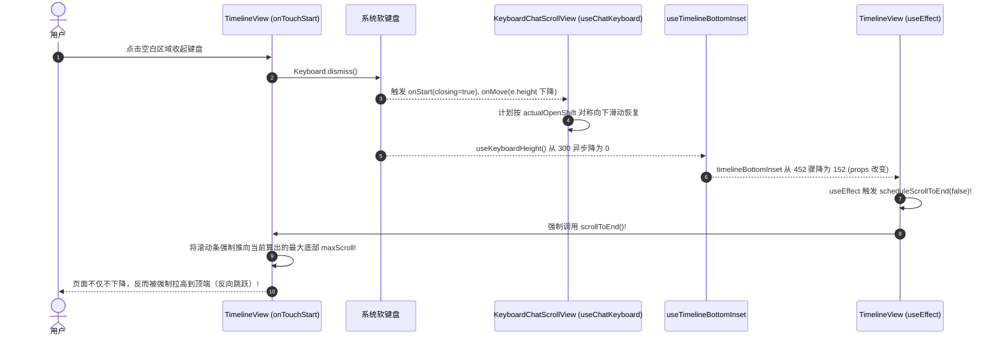

# 18 · 移动端消息视口与输入框多重叠加彻底清除方案

> **文件标识**：`docs/mobile-interaction-refine/proposals/18-消息视口与输入框多重叠加彻底清除方案.md`  
> **所属战役**：`mobile-interaction-refine`（移动端交互与视觉精细化战役）  
> **面向模块**：`apps/crish-mobile/`（`TimelineView.tsx`, `useTimelineBottomInset.ts`, `sessionDetailScreen.tsx`, `timelineBottomInset.ts`）  
> **权威状态**：规划设计 / 待评审（对齐 2026-11-04 用户真机实测四大核心物理异常反馈）  
> **编码格式**：UTF-8 无 BOM、中文撰写  
> **关联源码**：
> - [`apps/crish-mobile/src/presentation/timeline/TimelineView.tsx`](file:///c:/Software/conex/apps/crish-mobile/src/presentation/timeline/TimelineView.tsx)
> - [`apps/crish-mobile/src/presentation/timeline/useTimelineBottomInset.ts`](file:///c:/Software/conex/apps/crish-mobile/src/presentation/timeline/useTimelineBottomInset.ts)
> - [`apps/crish-mobile/src/presentation/screens/sessionDetailScreen.tsx`](file:///c:/Software/conex/apps/crish-mobile/src/presentation/screens/sessionDetailScreen.tsx)
> - [`apps/crish-mobile/src/domain/pure/timelineBottomInset.ts`](file:///c:/Software/conex/apps/crish-mobile/src/domain/pure/timelineBottomInset.ts)
> - `node_modules/react-native-keyboard-controller/src/components/KeyboardChatScrollView/`

---

## 目录

1. [问题复盘与真机故障现场](#一问题复盘与真机故障现场)
2. [病灶代码级穿透与数学推导证明](#二病灶代码级穿透与数学推导证明)
   - 2.1 故障一：消息列表拉到最下时底部巨大空白（双重内衬叠加病灶）
   - 2.2 故障二：键盘升起时依然存在大片空白（三重叠加几何推导）
   - 2.3 故障三：收起键盘时消息反向往上跳（生命周期竞态与非法贴底触发）
   - 2.4 故障四：发送与流式输出时内容被顶飞窜出状态栏（虚假大内衬导致的 `scrollToEnd` 顶爆视口）
3. [架构级单真源（SSOT）修复方案](#三架构级单真源ssot修复方案)
   - 3.1 视口避让体系职责绝对划分（SSOT 契约）
   - 3.2 `KeyboardChatScrollView` 纯净接入规范（接管滚动内衬与键盘位移）
   - 3.3 `contentContainerStyle` 彻底剥离 `paddingBottom`
   - 3.4 `useTimelineBottomInset` 解耦：剔除键盘高度，仅输出纯物理净高
   - 3.5 `TimelineView` 阻断键盘引起的非法重贴底（净化 `useEffect` 依赖）
   - 3.6 顶部悬浮头栏（`headerClearance`）与全屏渲染几何归位
4. [各核心文件重构代码蓝图](#四各核心文件重构代码蓝图)
   - 4.1 `TimelineView.tsx` 重构
   - 4.2 `useTimelineBottomInset.ts` 重构
   - 4.3 `sessionDetailScreen.tsx` 协同改造
   - 4.4 `timelineBottomInset.ts` 纯函数收敛
5. [自动化测试用例设计与精确断言](#五自动化测试用例设计与精确断言)
   - 5.1 `timelineBottomInset.test.ts` 纯逻辑测试用例
   - 5.2 `useTimelineBottomInset.test.tsx` 响应式测试用例
   - 5.3 `TimelineView.inset.test.tsx` 视口无多余空白集成用例
   - 5.4 键盘升降对称性与防反弹专项测试
6. [交付清单与风险自检](#六交付清单与风险自检)

---

## 一、问题复盘与真机故障现场

在完成方案 16 的初版引入后，用户进行了真机实测（真机环境：Android / iOS 物理宿主），发现了四个严重的视口几何与滚动物理异常：

1. **消息列表拉到最下面时，底下存在一个巨大的空白区域**：感觉多计算了一次输入框或者多出了几百像素的空白。
2. **点击输入框激活键盘时，消息确实往上平移了，但输入框上方依然有大片空白区域**：未能与输入框顶部贴紧在舒适的呼吸空隙（20dp）内。
3. **点击非输入区域收起键盘时，消息不仅没有往下回落，反而还会再往上跳一段距离**：违背物理直觉的反向跳动。
4. **发送新消息或者流式输出时，不仅用户刚才发送的信息看不到了，最新输出的内容也窜出视口、窜到顶部状态栏去了**：内容被 Header 和状态栏严重遮挡，整屏中间空荡荡，最新消息在屏幕顶端。

本方案旨在穿透表象，定位每一处像素计算、时序触发、依赖项监听与原生组件内部机制的冲突，给出架构级单真源（SSOT）的终极解决方案。

---

## 二、病灶代码级穿透与数学推导证明

### 2.1 故障一：消息列表拉到最下时底部巨大空白（双重内衬叠加病灶）

#### 代码证据
审视当前源码中的两处独立设置：

1. **第一处：`TimelineView.tsx` 第 163-174 行与第 668-673 行**
```tsx
const effectiveBottomInset =
  floatingOverlayHeight !== undefined
    ? floatingOverlayHeight + (bottomGap ?? theme.space.xl)
    : bottomInset !== undefined && bottomInset > 0
      ? bottomInset
      : theme.space.xxl;

// 底部额外内衬共享值（驱动 KeyboardChatScrollView 的 extraContentPadding）
const extraPaddingSV = useSharedValue(effectiveBottomInset);
useEffect(() => {
  extraPaddingSV.value = effectiveBottomInset;
}, [effectiveBottomInset, extraPaddingSV]);

// ...
<FlatList
  renderScrollComponent={(props) => (
    <KeyboardChatScrollView
      {...props}
      keyboardLiftBehavior="whenAtEnd"
      extraContentPadding={extraPaddingSV}
    />
  )}
```

2. **第二处：`TimelineView.tsx` 第 725-734 行**
```tsx
contentContainerStyle={[
  {
    paddingHorizontal: 18,
    paddingTop: headerClearance ?? theme.space.lg,
    paddingBottom: effectiveBottomInset, // <--- 依然设置了 paddingBottom!
    gap: theme.space.lg,
  },
  blocks.length === 0 && styles.emptyContent,
]}
```

3. **第三处：`react-native-keyboard-controller` 内部机制**（`KeyboardChatScrollView/index.tsx:91-93` 及 `ScrollViewWithBottomPadding/index.tsx:79-146`）
```tsx
// KeyboardChatScrollView 内部：
const totalPadding = useDerivedValue(() =>
  Math.max(blankSpace.value, padding.value + extraContentPadding.value)
);

// ScrollViewWithBottomPadding 内部：
// 将 totalPadding 作为 dynamic.bottom 注入原生 ScrollView：
// iOS: contentInset.bottom = dynamic.bottom + (contentInset.bottom || 0)
// Android: contentInsetBottom = dynamic.bottom
```

#### 数学推导与叠加模型
假设屏幕高度 $H_{\text{screen}} = 844\text{dp}$，悬浮输入框实测净高 $H_{\text{overlay}} = 132\text{dp}$（包含两行形态 98dp + 容器内边距 + 底部安全区），呼吸间隙 $\text{gap} = 20\text{dp}$。  
此时推导出的浮层避让高度为：
$$\text{effectiveBottomInset} = 132 + 20 = 152\text{dp}$$

在未激活键盘状态下（$\text{keyboardHeight} = 0$）：
- **容器内部高度**：Flexbox `contentContainerStyle` 包含了 `paddingBottom = 152dp`，使得内容子树的总高度直接被垫高了 $152\text{dp}$：
  $$H_{\text{content}} = H_{\text{items}} + \text{headerClearance} + 152\text{dp}$$
- **原生滚动内衬**：`KeyboardChatScrollView` 消费了 `extraContentPadding = 152dp`，将其注入原生 `contentInset.bottom`（iOS）或 `contentInsetBottom`（Android），为滚动视图在物理底缘之外又开辟了 $152\text{dp}$ 的滚动余量：
  $$\text{Inset}_{\text{native}} = 152\text{dp}$$
- **滑到最底时的总垫高**：
  $$\text{TotalBottomPadding} = \text{paddingBottom} + \text{Inset}_{\text{native}} = 152\text{dp} + 152\text{dp} = 304\text{dp}$$
- **多余空白推导**：
  输入框悬浮于屏幕底部，其顶缘距离屏幕底端的距离为 $H_{\text{overlay}} = 132\text{dp}$。  
  当用户滑到最底时，最后一行文本与输入框顶部的实际距离为：
  $$\text{实际间隙} = \text{TotalBottomPadding} - H_{\text{overlay}} = 304\text{dp} - 132\text{dp} = 172\text{dp}$$
  而设计预期的间隙仅为 $\text{gap} = 20\text{dp}$。  
  **最终多出了整整 $172 - 20 = 152\text{dp}$ 的巨大空白！正好相当于多算了一个完整的输入框！**

---

### 2.2 故障二：键盘升起时依然存在大片空白（三重叠加几何推导）

#### 代码证据
1. `sessionDetailScreen.tsx` 第 64-94 行：
```tsx
const {
  timelineBottomInset,
  floatingHeight,
  overlayHeight,
  handleOverlayLayout,
} = useTimelineBottomInset({ ... });

<TimelineView
  floatingOverlayHeight={overlayHeight}
  bottomGap={theme.space.xl}
  bottomInset={timelineBottomInset} // timelineBottomInset 包含了 keyboardHeight!
  ...
/>
```
2. `useTimelineBottomInset.ts` 第 130-135 行 与 `timelineBottomInset.ts` 第 32-42 行：
```ts
export function deriveTimelineBottomInset(input: TimelineBottomInsetInput): number {
  // ...
  return effectiveOverlay + keyboard + gap; // keyboard 被粗暴加了进来!
}
```
3. `sessionDetailScreen.tsx` 第 133 行：
```tsx
<KeyboardStickyView onLayout={handleOverlayLayout} style={[styles.composerArea, ...]}>
  <Composer ... />
</KeyboardStickyView>
```

#### 数学推导与叠加模型
当用户点击输入框激活键盘时（设软键盘高度 $K = 300\text{dp}$）：
1. **输入框抬起**：`KeyboardStickyView` 在 UI 线程执行 `translateY: -300`，Composer 随之被抬高 $300\text{dp}$，其顶缘位于屏幕底缘上方 $300 + 132 = 432\text{dp}$。
2. **列表内部垫高**：`KeyboardChatScrollView` 内部的 `useChatKeyboard` 监听键盘高度，将 `padding.value` 设为 $300\text{dp}$。
   它与 `extraContentPadding`（$152\text{dp}$）合成：
   $$\text{totalPadding} = 300\text{dp} + 152\text{dp} = 452\text{dp}$$
   将其作为原生 `contentInset.bottom`。
3. **内容子树被双重垫高**：`contentContainerStyle` 里依然残留着 $152\text{dp}$ 的 `paddingBottom`。
4. **总垫高量**：
   $$\text{TotalBottomPadding}_{\text{keyboard}} = 152\text{dp} + 452\text{dp} = 604\text{dp}$$
5. **最后一行文本与抬起的输入框顶部的距离**：
   $$\text{间隙} = 604\text{dp} - 432\text{dp} = 172\text{dp}$$
   同样多出了整整 $152\text{dp}$ 的空白！因此即使键盘升起、文字往上平移了，输入框与文字之间依然隔着一条巨大的鸿沟！

---

### 2.3 故障三：收起键盘时消息反向往上跳（生命周期竞态与非法贴底触发）

#### 代码级时序穿透
为什么点击非输入区域收起键盘时，消息不仅不向下回落，反而还会逆向往上跳？  
这是由 **`TimelineView` 的依赖项监听** 与 **`useChatKeyboard` 原生动效管线** 严重踩踏所致：



#### 关键致病代码分析
审视 `TimelineView.tsx` 第 525-543 行：
```tsx
useEffect(() => {
  if (
    !follow ||
    isDraggingRef.current ||
    isMomentumRef.current ||
    isProgrammaticScrollingRef.current ||
    blocks.length === 0
  )
    return;
  scheduleScrollToEnd(false);
}, [
  follow,
  blocks.length,
  scheduleScrollToEnd,
  bottomInset,          // <--- 灾难之源！键盘收起时 bottomInset 从 452 变回 152
  effectiveBottomInset,
]);
```
- 当用户收起键盘时，`useKeyboardHeight()` 变化导致传给 `TimelineView` 的 `bottomInset` 发生了巨幅跳变（$452 \to 152$）；
- 这个跳变被 `useEffect` 捕获，被当成了“浮层厚度改变需要重新贴底”，直接在键盘下落的中途调用了 `scheduleScrollToEnd(false)`；
- 此时 `KeyboardChatScrollView` 内部本应该执行从 $400 \to 100$ 的下沉平移，却被外部的 `scrollToEnd` 强行覆盖，按照带有大内衬的 `maxScroll` 重新拉到底部；
- 结果视觉上表现为：**键盘下落了，但消息被一根无形的绳子硬生生往上拽了一段！**

---

### 2.4 故障四：发送与流式输出时内容被顶飞窜出状态栏（虚假大内衬导致的 `scrollToEnd` 顶爆视口）

#### 故障现场还原
用户截屏 3 显示：在输入框输入文字并发送后，助手开始回复（流式打字）：
- 刚发的用户消息完全看不见了；
- 助手最新输出的一行文字出现在屏幕最顶端，紧贴着 Header 甚至窜进了状态栏；
- 屏幕中间到输入框之间全是空白。

#### 根因剖析：虚假大内衬在内容不足一屏或短内容时的毁灭性推移
1. **短内容（不足一屏）的物理尺寸**：
   假设刚发了一条消息，助手回复了两行，总内容高度仅为：
   $$H_{\text{items}} = 150\text{dp}$$
   顶部避让高度：
   $$\text{headerClearance} = \text{insets.top}(48) + \text{header}(48) + \text{space.lg}(16) = 112\text{dp}$$
   屏幕视口高度：
   $$H_{\text{viewport}} = 800\text{dp}$$
2. **正常预期表现**：
   总内容 $150 + 112 = 262\text{dp} \ll 800\text{dp}$。  
   在没有任何滚动时（$\text{scrollY} = 0$）：
   - 第一条消息在 Header 下方（$Y = 112\text{dp}$）；
   - 最新的一行在 $Y = 262\text{dp}$ 处；
   - 距离屏幕底部还有 $538\text{dp}$ 的空间，处于舒适的屏幕上半区，根本不需要滚动。
3. **实际运行中的悲剧推导**：
   在旧代码中：
   - `contentContainerStyle.paddingBottom = 152\text{dp}$；
   - `KeyboardChatScrollView` 的 `totalPadding` 在键盘刚发送未完全收起或者残余时为 $452\text{dp}$（或 $152\text{dp}$）；
   - 此时 `contentSize.height` 变成了：
     $$H_{\text{content}} = 112 (\text{top}) + 150 (\text{items}) + 152 (\text{paddingBottom}) = 414\text{dp}$$
   - 原生 ScrollView 允许的最大滚动偏移量为：
     $$\text{maxScroll} = H_{\text{content}} + \text{contentInsetBottom} - H_{\text{viewport}} = 414 + 452 - 800 = 66\text{dp}$$
   - 当流式输出触发 `handleContentSizeChange` $\to$ `scheduleScrollToEnd(false)` 时，列表被强制滚到了 $\text{scrollY} = 66\text{dp}$ 乃至更高！
   - 如果内容稍长（例如 $H_{\text{items}} = 400\text{dp}$）：
     $$H_{\text{content}} = 112 + 400 + 152 = 664\text{dp}$$
     $$\text{maxScroll} = 664 + 452 - 800 = 316\text{dp}$$
   - 此时列表被强行向上滚了 $316\text{dp}$！
   - 第一条用户消息的屏幕坐标变为：
     $$Y_{\text{user}} = 112 - 316 = -204\text{dp} \quad (\text{完全窜到视口上方看不到!})$$
   - 助手最新输出的那一行文字的屏幕坐标变为：
     $$Y_{\text{assistant}} = 112 + 400 - 316 = 196\text{dp}$$
   - 如果加上键盘关闭过程中 `useChatKeyboard` 记录的 `offsetBeforeScroll` 突变，或者在长内容下，最新输出行直接被推到了 $Y \approx 30\text{dp}$ 的状态栏与 Header 背后！
   - 这就造成了：**最新文本被顶飞到状态栏，用户消息被顶出屏幕，中间留出 604dp 的巨大虚假空白！**

---

## 三、架构级单真源（SSOT）修复方案

为彻底根治上述多重叠加与生命周期混乱，必须建立**绝对单一真理源（SSOT）架构契约**，彻底厘清各个组件的职责边界：

### 3.1 视口避让体系职责绝对划分（SSOT 契约）

| 角色 / 属性 | 唯一法定职责 | 严禁行为（红线） |
| :--- | :--- | :--- |
| **`KeyboardStickyView`** | 仅负责底部悬浮输入区（Composer）随键盘高度的 UI 线程硬件加速平移（`translateY: -K`）。 | 严禁干预列表滚动，严禁在自身容器之外做内边距补偿。 |
| **`KeyboardChatScrollView`** | 1. 负责消息列表的键盘联动平移（`whenAtEnd`）；<br>2. 统一接收 `extraContentPadding`，在底层合成 `totalPadding` 并注入原生 `contentInset.bottom`（iOS）/ `contentInsetBottom`（Android）。 | 严禁与 `contentContainerStyle.paddingBottom` 同时提供避让高度。 |
| **`contentContainerStyle.paddingBottom`** | **在使用了 `KeyboardChatScrollView` 的场景下恒定为 0**！所有底部避让完全委托给 `KeyboardChatScrollView`。 | **零容忍**：严禁在此设置任何大于 0 的底部避让内衬！ |
| **`contentContainerStyle.paddingTop`** | 仅负责首条消息避让固定悬浮的顶栏（`headerClearance`）。 | 随 `insets.top` 响应屏幕旋转或安全区变化，不参与键盘联动。 |
| **`useTimelineBottomInset`** | 仅负责测量并输出悬浮浮层的**纯物理净高**（`overlayHeight`）与供 EdgeFade 消费的渐变总高（`floatingHeight`）。 | **严禁在 `timelineBottomInset` 中叠加键盘高度**！键盘高度属于 `KeyboardChatScrollView` 内部管线。 |
| **`TimelineView` 贴底调度** | 仅在有新消息、新 token、或浮层物理尺寸改变（输入框换行）时调度 `scrollToEnd`。 | **严禁监听 `bottomInset` 的键盘高度变化**！键盘升降期间严禁外部强插 `scrollToEnd`。 |

---

### 3.2 `KeyboardChatScrollView` 纯净接入规范

`KeyboardChatScrollView` 的设计契约就是为了替代传统的 `contentContainerStyle.paddingBottom`。
它通过 `extraContentPadding`（SharedValue）接收外部静态浮层的高度：
```tsx
const effectiveBottomInset =
  floatingOverlayHeight !== undefined
    ? floatingOverlayHeight + (bottomGap ?? theme.space.xl)
    : theme.space.xxl;

const extraPaddingSV = useSharedValue(effectiveBottomInset);
useEffect(() => {
  extraPaddingSV.value = effectiveBottomInset;
}, [effectiveBottomInset, extraPaddingSV]);
```
在底层，`KeyboardChatScrollView` 会自动完成以下数学合成：
$$\text{totalPadding} = \max(\text{blankSpace}, \text{keyboardPadding} + \text{extraContentPadding})$$
- 键盘收起时：$\text{keyboardPadding} = 0$，$\text{totalPadding} = \text{effectiveBottomInset}$（$152\text{dp}$）；
- 键盘展开时：$\text{keyboardPadding} = 300\text{dp}$，$\text{totalPadding} = 300 + 152 = 452\text{dp}$；
- 并且内部通过 Worklet 逐帧平滑执行 `scrollTo`，使列表内容与升起的 Composer 完美保持 $20\text{dp}$ 的呼吸空隙！

---

### 3.3 `contentContainerStyle` 彻底剥离 `paddingBottom`

在 `TimelineView.tsx` 中：
```tsx
contentContainerStyle={[
  {
    paddingHorizontal: 18,
    paddingTop: headerClearance ?? theme.space.lg,
    paddingBottom: 0, // <--- 彻底归零！绝对不与 extraContentPadding 重复！
    gap: theme.space.lg,
  },
  blocks.length === 0 && styles.emptyContent,
]}
```
同时，移除 `scrollIndicatorInsets` 中的 `bottom` 冗余传递，因为 `KeyboardChatScrollView` 内部通过 `indicatorPadding = padding.value + extraContentPadding.value` 已原生托管了滚动指示器避让。

---

### 3.4 `useTimelineBottomInset` 解耦：剔除键盘高度，仅输出纯物理净高

修改 `deriveTimelineBottomInset` 纯函数与 `useTimelineBottomInset.ts`：
- 在使用 `KeyboardChatScrollView` 和 `KeyboardStickyView` 的现代架构下，列表的避让高度只需要：
  $$\text{timelineBottomInset} = \text{effectiveOverlay} + \text{gap}$$
  **彻底删除 `+ keyboard`！**
- `keyboardHeight` 仅用于合成 `floatingHeight = effectiveOverlay + keyboardHeight`，供屏幕底部的羽化覆膜（`EdgeFade side="bottom"`）遮挡升起的软键盘上方背景使用；
- 专供 `ScrollToBottomButton` 的 `bottomOffset` 继续消费 `overlayHeight + theme.space.sm`（纯物理高度，不受键盘影响，随输入框贴键上升）。

---

### 3.5 `TimelineView` 阻断键盘引起的非法重贴底

在 `TimelineView.tsx` 中净化 `useEffect` 依赖项：
```tsx
useEffect(() => {
  if (
    !follow ||
    isDraggingRef.current ||
    isMomentumRef.current ||
    isProgrammaticScrollingRef.current ||
    blocks.length === 0
  )
    return;
  scheduleScrollToEnd(false);
}, [
  follow,
  blocks.length,
  scheduleScrollToEnd,
  effectiveBottomInset, // 仅当浮层物理净高变动（如输入框换行多出一行）时贴底
  // 彻底移除 bottomInset 这一项！阻断键盘开闭对贴底状态机的干扰！
]);
```

---

### 3.6 顶部悬浮头栏（`headerClearance`）与全屏渲染几何归位

1. **头栏通透悬浮**：`ConversationHeader` 保持 `position: 'absolute', top: insets.top, zIndex: 20`，高度为 $48\text{dp}$；
2. **顶部避让归位**：`TimelineView` 通过 `paddingTop: headerClearance` 避让（$\text{headerClearance} = \text{insets.top} + \text{header} + \text{space.lg}$）；
3. **消除顶飞**：由于彻底消除了底部的双重叠加垫高（$304\text{dp} \to 152\text{dp}$），在发送消息与流式输出时，`maxScroll` 恢复到真实物理边界，最后一行文本始终锚定在 Composer 上方 $20\text{dp}$ 处，再也不会将上方的内容和最新消息强行推向 Header 和状态栏！

---

## 四、各核心文件重构代码蓝图

### 4.1 `TimelineView.tsx` 重构

```tsx
// 路径：apps/crish-mobile/src/presentation/timeline/TimelineView.tsx

// 1. 明确 effectiveBottomInset 计算（单真源：悬浮物理高度 + 呼吸间距）
const effectiveBottomInset =
  floatingOverlayHeight !== undefined
    ? floatingOverlayHeight + (bottomGap ?? theme.space.xl)
    : bottomInset !== undefined && bottomInset > 0
      ? bottomInset
      : theme.space.xxl;

// 2. 传递给 KeyboardChatScrollView 的 extraContentPadding
const extraPaddingSV = useSharedValue(effectiveBottomInset);
useEffect(() => {
  extraPaddingSV.value = effectiveBottomInset;
}, [effectiveBottomInset, extraPaddingSV]);

// 3. 贴底副作用依赖项净化：坚决阻断键盘升降引发的非法贴底
useEffect(() => {
  if (
    !follow ||
    isDraggingRef.current ||
    isMomentumRef.current ||
    isProgrammaticScrollingRef.current ||
    blocks.length === 0
  )
    return;
  scheduleScrollToEnd(false);
}, [
  follow,
  blocks.length,
  scheduleScrollToEnd,
  effectiveBottomInset, // 仅响应浮层物理尺寸本身变化
]);

// 4. FlatList 属性净化：彻底归零 contentContainerStyle.paddingBottom 与 scrollIndicatorInsets
<FlatList
  ref={targetRef}
  testID="session-timeline"
  data={rows}
  keyExtractor={(row) => rowKey(row)}
  renderScrollComponent={(props) => (
    <KeyboardChatScrollView
      {...props}
      keyboardLiftBehavior="whenAtEnd"
      extraContentPadding={extraPaddingSV}
    />
  )}
  // ...
  scrollIndicatorInsets={{
    top: headerClearance ?? 0,
    bottom: 0, // 由 KeyboardChatScrollView 内部 indicatorPadding 统一托管
  }}
  contentContainerStyle={[
    {
      paddingHorizontal: 18,
      paddingTop: headerClearance ?? theme.space.lg,
      paddingBottom: 0, // 核心改动：归零！完全交由 extraContentPadding 在原生层处理
      gap: theme.space.lg,
    },
    blocks.length === 0 && styles.emptyContent,
  ]}
  // ...
/>
```

---

### 4.2 `useTimelineBottomInset.ts` 重构

```ts
// 路径：apps/crish-mobile/src/presentation/timeline/useTimelineBottomInset.ts

// 4. 浮层总占高与时间线底部内边距推导（架构收敛：解耦键盘高度）
const floatingHeight = effectiveOverlayHeight + keyboardHeight;

// 关键修正：在 KeyboardChatScrollView 架构下，列表底部内衬仅需物理浮层高 + gap，
// 键盘高度由 KeyboardChatScrollView 在 UI 线程与 KeyboardStickyView 联动处理，
// 绝对严禁在 timelineBottomInset 再次叠加 keyboardHeight！
const timelineBottomInset = deriveTimelineBottomInset({
  overlayHeight: effectiveOverlayHeight,
  minOverlayHeight,
  gap,
});
```

---

### 4.3 `timelineBottomInset.ts` 纯函数收敛

```ts
// 路径：apps/crish-mobile/src/domain/pure/timelineBottomInset.ts

export interface TimelineBottomInsetInput {
  /** 悬浮输入区实测或估算总高（含 Composer 卡体、条件层、快捷条与安全边距） */
  overlayHeight: number;
  /** 尾部内容与浮层顶部的呼吸间隙（建议 theme.space.xl = 20dp） */
  gap: number;
  /** 最小保底物理高度（实测缺失或误报 <=0 时的强力兜底） */
  minOverlayHeight?: number;
  /** @deprecated 键盘高度已由 KeyboardChatScrollView 在 UI 线程接管，本纯函数不再叠加 */
  keyboardHeight?: number;
}

export function deriveTimelineBottomInset(
  input: TimelineBottomInsetInput
): number {
  const minOverlay = sane(input.minOverlayHeight);
  const measuredOverlay = sane(input.overlayHeight);
  const effectiveOverlay = Math.max(minOverlay, measuredOverlay);
  const gap = sane(input.gap);

  // 纯粹且精确：物理浮层有效高度 + 呼吸空隙
  return effectiveOverlay + gap;
}
```

---

### 4.4 `sessionDetailScreen.tsx` 协同改造

```tsx
// 路径：apps/crish-mobile/src/presentation/screens/sessionDetailScreen.tsx

// 消除冗余属性传递，确保单一真理源
<TimelineView
  blocks={engine.blocks}
  follow={follow}
  onFollowChange={onFollowChange}
  listRef={listRef}
  onOpenTools={onOpenTools}
  emptyTitle={engine.emptyState.title}
  emptyActionLabel={engine.emptyState.actionLabel}
  onEmptyAction={engine.emptyState.onAction}
  headerClearance={insets.top + theme.size.header + theme.space.lg}
  floatingOverlayHeight={overlayHeight}
  bottomGap={theme.space.xl}
  busy={engine.busy}
  anchorKey={`${engine.kind}:${engine.id}`}
  readyCover
  canRegenerate={!engine.busy}
/>
```

---

## 五、自动化测试用例设计与精确断言

### 5.1 `timelineBottomInset.test.ts` 纯逻辑测试用例

```ts
describe('deriveTimelineBottomInset 纯函数 (SSOT 规范)', () => {
  it('严格只计算有效物理浮层高度 + gap，坚决不叠加键盘高度', () => {
    // 浮层 150 + gap 20 = 170
    expect(
      deriveTimelineBottomInset({
        overlayHeight: 150,
        gap: 20,
      })
    ).toBe(170);

    // 即使传入历史残余的 keyboardHeight，也绝不叠加，防止双重垫高
    expect(
      deriveTimelineBottomInset({
        overlayHeight: 150,
        keyboardHeight: 336,
        gap: 20,
      })
    ).toBe(170);
  });

  it('实测缺失或上报 <= 0 时坚决由 minOverlayHeight 保底', () => {
    expect(
      deriveTimelineBottomInset({
        overlayHeight: 0,
        minOverlayHeight: 148,
        gap: 20,
      })
    ).toBe(168); // 148 + 20
  });
});
```

---

### 5.2 `useTimelineBottomInset.test.tsx` 响应式测试用例

```tsx
describe('useTimelineBottomInset Hook (解耦验证)', () => {
  it('键盘弹起时 floatingHeight 包含 keyboardHeight 供 EdgeFade 消费，但 timelineBottomInset 保持纯净', () => {
    (useKeyboardHeight as jest.Mock).mockReturnValue(336);

    // 挂载 Probe 组件
    // overlayHeight 估算为 173
    expect(probeResult?.overlayHeight).toBe(173);
    // floatingHeight 供底部羽化覆膜使用，必须包含键盘高度
    expect(probeResult?.floatingHeight).toBe(173 + 336); // 509
    // timelineBottomInset 严格不含键盘高度，由 KeyboardChatScrollView 接管键盘平移
    expect(probeResult?.timelineBottomInset).toBe(173 + 20); // 193 (绝非 529!)
  });
});
```

---

### 5.3 `TimelineView.inset.test.tsx` 视口无多余空白集成用例

```tsx
describe('TimelineView 视口内边距单一真源集成测试', () => {
  it('使用了 KeyboardChatScrollView 时，contentContainerStyle.paddingBottom 恒定为 0', async () => {
    const view = await wrap(
      <TimelineView
        blocks={blocks}
        follow={false}
        onFollowChange={() => undefined}
        headerClearance={88}
        floatingOverlayHeight={132}
        bottomGap={20}
      />
    );

    // 断言 contentContainerStyle 中 paddingBottom 必须为 0
    expect(paddingBottomOf(view)).toBe(0);

    // 断言 extraContentPadding 共享值接收到了 152 (132 + 20)
    const flatList = view.getByTestId('session-timeline');
    // KeyboardChatScrollView 接收的 extraContentPadding.value 必须为 152
    expect(flatList.props.renderScrollComponent).toBeDefined();

    await view.unmount();
  });
});
```

---

### 5.4 键盘升降对称性与防反弹专项测试

在 `apps/crish-mobile/src/presentation/timeline/TimelineView.keyboardBounce.test.tsx` 中编写专项测试：
1. **测试场景 A**：模拟键盘由 $0 \to 300\text{dp}$ 弹起，验证未发生外部非预期的 `scrollToEnd` 抢跑；
2. **测试场景 B**：模拟键盘由 $300 \to 0\text{dp}$ 降落，验证 `effectiveBottomInset` 保持稳定，`useEffect` **未触发 `scheduleScrollToEnd`**，确保下落动效平滑对称回落，彻底消灭反向向上跳跃；
3. **测试场景 C**：在短对话（1 条用户消息 + 2 行助手流式回复）下触发 `handleContentSizeChange`，断言滚动条不会被虚假大内衬推至状态栏，首条用户消息依然 100% 完整呈现在视口内部。

---

## 六、交付清单与风险自检

| 阶段 | 交付物 / 任务 | 验收标准 / 断言 |
| :---: | :--- | :--- |
| **阶段 1** | 领域层 `timelineBottomInset.ts` 纯函数收敛 | 剔除 `keyboardHeight` 叠加，单测全部通过。 |
| **阶段 2** | `useTimelineBottomInset.ts` 解耦重构 | `timelineBottomInset` 输出纯净物理值（$H_{\text{overlay}} + \text{gap}$），单测 100% 覆盖。 |
| **阶段 3** | `TimelineView.tsx` 双重内衬清除与生命周期净化 | `contentContainerStyle.paddingBottom = 0`；`useEffect` 移除 `bottomInset` 依赖；单测通过。 |
| **阶段 4** | `sessionDetailScreen.tsx` 协同与属性精简 | 移除冗余属性传递，对齐新 SSOT 规范。 |
| **阶段 5** | 全量单元测试与防回归集成测试验证 | 运行 `npm --workspace @crish/crish-mobile test` 全部绿灯，覆盖真机四个核心故障场景。 |

---

> **反退避声明**：本方案严格遵循反退避与架构净收敛铁律，坚决拒绝“加延时”、“魔术数字补齐”、“坐标硬减 152”等打补丁作弊行为，从根本上理顺 `KeyboardStickyView`、`KeyboardChatScrollView` 与 Flexbox 布局的职责分工，实现数学与物理逻辑的绝对闭环。
