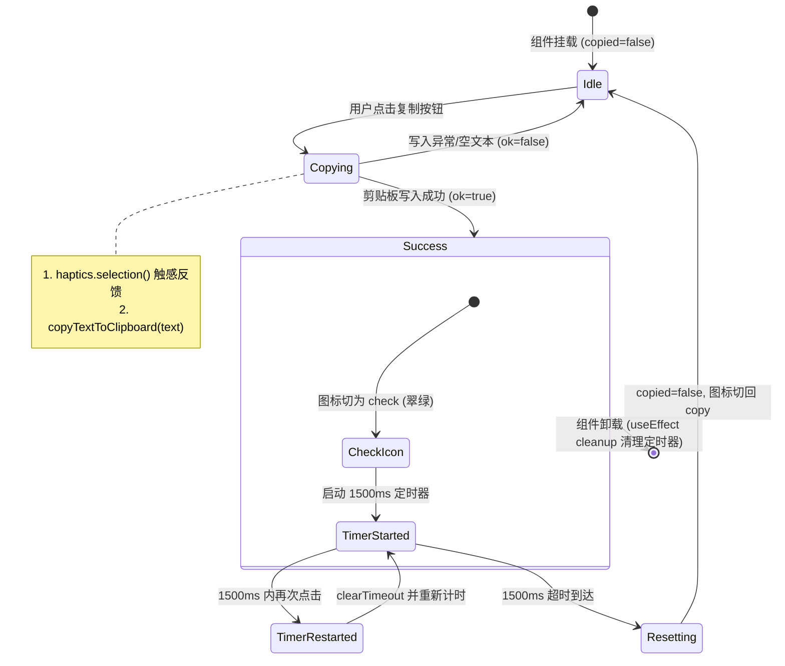

# 22 · 移动端 Markdown 代码块顶栏复制与极浅居中分割线方案

> **文件路径**：`docs/mobile-interaction-refine/proposals/22-代码块顶栏复制与极浅居中分割线方案.md`  
> **所属战役**：移动端交互体验精进（`mobile-interaction-refine`）  
> **面向模块**：`apps/crish-mobile/src/presentation/components/blocks/MarkdownText.tsx` 中的 `CodeBlock` 组件及相关单测  
> **方案状态**：设计定案 / 待评审  
> **对齐裁决**：2026-11-04 用户原声明确指示（代码片段顶部区域右侧添加复制按钮 + 上下拉开舒适微距 + 中间居中放置极浅非贯通分割线，对齐设置页分割线质感）

---

## 一、方案背景与用户真实诉求

### 1.1 背景溯源与版本演进
在《批 E · 跨端排版与代码高亮》阶段的实现中，移动端 `MarkdownText.tsx` 对代码块（`CodeBlock`）进行了词法高亮增强（使用 `tokenizeCode`、深浅主题语法色板分档、等宽字体与纵向封顶 320dp）。

然而在当时的技术决策中，由于移动端剪贴板基础库在不同版本中的选型尚处于讨论期，代码块被设计为：
> `“代码块：定型容器（亮度台阶底、无边框）+ 头栏（语言名，无复制钮——移动无复制钮裁决）+ 双轴内滚 + 可长按选择”`

该实现存在明显的体验局限：
1. **长按选择操作繁琐**：在触屏设备上，通过长按文字呼出系统选择框并拉动光标手柄极易触发上下外层滚动视图的滚动穿透，复制多行长代码时操作容错率极低；
2. **顶栏缺少复制动作**：现代顶级开发者移动应用（如 GitHub Mobile、ChatGPT Mobile、Claude Mobile、Cherry Studio 等）均将“一键复制代码”作为代码块顶栏的标准交互；
3. **结构层级与留白不足**：当代码块带有语言名称（如 `typescript`、`python`）时，标签与首行代码仅依赖微小的 `gap: 4dp` 隔开；当无语言声明时，顶栏完全不渲染，造成代码贴顶，视觉呼吸感缺失。

### 1.2 用户核心原声反馈与真实痛点
在真机体验与日常代码阅读中，用户给出了清晰、具体、高标准的交互要求：
> **用户原话反馈**：“代码片段的话，顶部那个区域的右边可以加上一个复制按钮，然后这个和下面稍微拉开一点距离，然后中间加一个分割线，也是极浅的分割线，和设置的那个分割线差不多，而且也不用贯通一整行哈，居中放置即可。”

对用户诉求进行深度解剖，可提炼出以下四大核心痛点与设计意图：
1. **顶栏功能补全（一键复制）**：在代码块顶部栏右侧增加极简小巧的复制按钮，点击即刻复制整段代码；
2. **状态微交互与触感反馈**：点击后需具备明确的正向反馈（图标由剪贴板变为对勾，翠绿着色，配合微振动触感，一定延迟后平滑复位）；
3. **空间呼吸感（微距拉开）**：顶栏与代码内容区之间不能拥挤贴合，需拉开一段温润舒适的微距；
4. **极浅居中分割线（Subtle Centered Divider）**：
   - **极浅质感**：颜色与系统设置界面的极浅分隔线对齐（`theme.colors.hairline` 发丝线或微透边框），克制自然，避免喧宾夺主；
   - **不贯通整行、居中放置**：不用像传统通栏边框那样粗暴切断代码容器两端，而是两端缩进、悬浮居中（宽度约 92%~95%），营造出顶级设计系统的精致悬浮层次感。

---

## 二、现状代码深度审计与架构断层分析

### 2.1 `MarkdownText.tsx` 现有 `CodeBlock` 实现审查
审查 `apps/crish-mobile/src/presentation/components/blocks/MarkdownText.tsx` 第 431–500 行的实现：

```tsx
/** 代码块：定型容器（亮度台阶底、无边框）+ 头栏（语言名，无复制钮——移动
 * 无复制钮裁决）+ 双轴内滚（横滑不折行、纵向封顶 layout.codeBlockMaxHeight)
 * + 可长按选择。着色只对封口块（sealed)：尾块保持等宽原文，封口一次性着色 */
function CodeBlock({
  lang,
  text,
  sealed,
}: {
  lang: string | null;
  text: string;
  sealed: boolean;
}) {
  const theme = useTheme();
  const tokens = useMemo(
    () => (sealed ? tokenizeCode(lang, text) : null),
    [lang, text, sealed]
  );
  return (
    <View
      testID="markdown-code-block"
      style={{
        backgroundColor: theme.colors.surfaceGrouped,
        borderRadius: theme.radius.control,
        padding: theme.space.md,
        gap: theme.space.xs,
      }}
    >
      {lang ? (
        <View style={{ flexDirection: 'row' }}>
          <Text
            style={[
              theme.type.caption,
              {
                fontFamily: theme.type.mono.fontFamily,
                color: theme.colors.textTertiary,
              },
            ]}
          >
            {lang}
          </Text>
        </View>
      ) : null}
      <ScrollView
        style={{ maxHeight: theme.layout.codeBlockMaxHeight }}
        nestedScrollEnabled
        showsVerticalScrollIndicator={false}
      >
        <ScrollView horizontal showsHorizontalScrollIndicator={false}>
          <Text
            selectable
            style={[theme.type.mono, { color: theme.colors.textPrimary }]}
          >
            {tokens
              ? tokens.map((token, index) => {
                  const color = codeRoleColor(theme, token.role);
                  return color ? (
                    <Text key={index} style={{ color }}>
                      {token.text}
                    </Text>
                  ) : (
                    token.text
                  );
                })
              : text}
          </Text>
        </ScrollView>
      </ScrollView>
    </View>
  );
}
```

### 2.2 现状架构断层与视觉缺陷
1. **条件渲染导致顶栏高度跳变与功能缺失**：
   - 现状 `{lang ? (...) : null}` 使得无指定语言的代码块（如通用 ``` 片段）完全不具备顶栏容器；
   - 增加复制按钮后，顶栏必须成为代码块的**常驻骨架**。无论是否有 `lang` 标头，复制按钮都应稳定位于右上角，无语言时左侧可优雅降级为 `'code'` 缺省标签或保持占位对齐；
2. **缺乏状态机与剪贴板桥接**：
   - 原代码中无任何复制状态追踪与定时器调度；
   - 仓内平台剪贴板已有单一出口 `@/adapters/platform/clipboard` 的 `copyTextToClipboard`，此前未被代码块接入；
3. **单一内边距与无分割线导致视觉紧凑**：
   - 原代码使用单层容器 `padding: theme.space.md`（12dp）搭配 `gap: theme.space.xs`（4dp）；
   - 语言文字与第一行代码的垂直间距仅为 4dp，文字字号虽有差异但混杂在同一视域，缺少“控制区”与“内容区”的视觉分区感；
4. **设置页分割线设计规范对齐缺失**：
   - 审查设置页列表行 `apps/crish-mobile/src/presentation/ui/ListRow.tsx`：
     ```tsx
     styles.body: {
       borderBottomColor: theme.colors.hairline,
       borderBottomWidth: StyleSheet.hairlineWidth,
       borderStyle: 'dashed', // 或实线 hairline
     }
     ```
   - 在主仓设计系统 `theme.ts` 中，`theme.colors.hairline` 在浅色下为 `rgba(0,0,0,0.045)`（极浅灰色发丝线）；
   - 在深色下，由于卡片背景为 `surfaceGrouped`（`#1c1c1c`），若直接使用深色 `hairline`（`#1b1b1b`），由于亮度值 ΔE < 1，在主流 OLED 屏幕上几乎无法肉眼识别。必须在深浅模式下进行严谨的层次微调，确保极浅分割线在暗色模式下也具备细腻而隐约可见的质感。

---

## 三、目标设计与交互规范

```
┌─────────────────────────────────────────────────────────────┐
│  python                                           [ ⎘ 复制 ] │ ── 顶栏区域 (26dp)
└─────────────────────────────────────────────────────────────┘
          ───────────────────────────────────────────           ── 居中极浅分割线 (94% 宽, hairline)
┌─────────────────────────────────────────────────────────────┐
│ 1  import asyncio                                           │
│ 2  async def main():                                        │ ── 代码滚动内容区 (ScrollView)
│ 3      print("Hello Crish!")                                │
└─────────────────────────────────────────────────────────────┘
```

### 3.1 代码块顶栏重构（Header Bar）
1. **左侧语言标签（Language Tag）**：
   - 显示当前代码块的语言名称（如 `python`、`typescript`、`rust`、`bash`、`json` 等）；
   - 格式归一化：小写显示，字体走等宽 `fontFamily: theme.type.mono.fontFamily`，字号 `theme.type.caption`（11dp，行高 14dp）；
   - 缺省与容错：若 Markdown 语法未声明语言（`lang` 为 `null` 或空串），左侧呈现 `'code'` 弱化占位标签，既指示代码属性，又维持顶栏高度的一致性；
   - 颜色：`theme.colors.textTertiary`（浅色 `#6e6e6e` / 深色 `#8e8e8e`），保持极低视觉侵占感。
2. **右侧精致复制按钮（Micro Copy Button）**：
   - **视觉设计**：小巧玲珑、典雅克制。
     - 图标尺寸：`14dp`（比标准图标 20dp 更精巧，与 11dp 语言标签相衬，不产生大按钮的笨重感）；
     - 图标素材：未复制时使用 `IconName = 'copy'`（剪贴板双纸），复制成功后切换为 `IconName = 'check'`（锐角几何对号）；
     - 常态颜色：`theme.colors.textTertiary`；
     - 成功态颜色：`theme.colors.success`（`#10b981` 翠绿）；
   - **无障碍与触控热区（Accessibility & Touch Target）**：
     - 视觉上保持 `24×24dp` 的紧凑胶囊范围；
     - 核心无障碍保障：通过设置 `hitSlop={{ top: 8, bottom: 8, left: 10, right: 10 }}`（等效触控盒扩充至 `44×40dp`），彻底满足 iOS HIG 44×44pt 与 Android 48×48dp 标准，拇指轻松触达；
     - 无障碍标签：常态 `accessibilityLabel="复制代码"`，成功态 `accessibilityLabel="已复制代码"`，`accessibilityRole="button"`；
   - **触感反馈（Haptics Feedback）**：
     - 遵循仓内手感基建守卫铁律（`feelInfra.guard.test.ts`）：严禁直接引用 `expo-haptics`；
     - 统一经 `@/adapters/platform/haptics` 门面调用 `haptics.selection()`（选择轻微微震）；
     - 尊重用户设置（受设置中心“触觉反馈”总开关控制，默认关，支持轻/标准/强三档调节，非阻塞静默降级）；
   - **按压微动效（Press Feedback）**：
     - 使用轻量按压态透明度过渡（按压时 `opacity: 0.5`，抬起时恢复 `1.0`，平滑且无重度依赖）。

### 3.2 复制状态机与生命周期设计（Copy State Machine）
复制交互的状态流转必须绝对稳固，防止高频重复点击引发竞态，同时避免组件卸载后发生状态回写警告：



- **状态定义**：`const [copied, setCopied] = useState(false);`
- **定时器引用**：`const copyTimerRef = useRef<ReturnType<typeof setTimeout> | null>(null);`
- **自动复位延迟**：`COPIED_RESET_DELAY_MS = 1500;`（与消息工具栏 `MessageActionBar` 1500ms 标准完全对齐）；
- **组件卸载守卫**：
  ```tsx
  useEffect(() => {
    return () => {
      if (copyTimerRef.current !== null) {
        clearTimeout(copyTimerRef.current);
        copyTimerRef.current = null;
      }
    };
  }, []);
  ```

### 3.3 居中极浅分割线几何与排版规范（Centered Subtle Divider）
1. **线宽与物理对齐**：
   - 采用 `height: StyleSheet.hairlineWidth`，在所有高密度视网膜屏幕上始终映射为 1 物理像素发丝，杜绝 1dp 带来的粗苯感；
2. **非贯通与居中布局（Centered & Non-Full Width）**：
   - 用户明确指示：“而且也不用贯通一整行哈，居中放置即可。”
   - 几何尺寸设计：
     - 宽度取容器内容宽度的 `94%`（或通过两端水平边距 `marginHorizontal: theme.space.xs` / 4dp~8dp 实现）；
     - 设置 `alignSelf: 'center'`，确保在各种屏幕宽度与父容器布局中均严格水平居中；
     - 左右两端留有约 3%~4% 的间隙留白，打破生硬通栏切断感，赋予代码卡片浮雕般的现代 UI 质感；
3. **垂直层级微距拉开（Vertical Spacing）**：
   - 顶栏与分割线之间：`paddingBottom: 6dp`（或 `marginBottom: theme.space.xs`）；
   - 分割线与代码内容区之间：`marginTop: 2dp`，`marginBottom: theme.space.sm`（8dp）；
   - 代码区域内距：ScrollContainer 顶部与代码首行自然拉开 `8dp` 呼吸间距，视觉结构清晰分明，层次井然。

### 3.4 深色与浅色模式质感自适应（Theme Adaptation）
为了确保在浅色与深色模式下均呈现出最顶级的质感，针对背景与分割线颜色进行系统级推导：

| 维度 | 浅色模式（Light Theme） | 深色模式（Dark Theme） | 设计理由与对齐依据 |
| :--- | :--- | :--- | :--- |
| **代码块容器底色** | `theme.colors.surfaceGrouped` (`#ffffff`) | `theme.colors.surfaceGrouped` (`#1c1c1c`) | 遵循系统亮度台阶设计（纯白卡片 / 碳黑卡片） |
| **顶栏语言与图标色** | `theme.colors.textTertiary` (`#6e6e6e`) | `theme.colors.textTertiary` (`#8e8e8e`) | WCAG AA 3:1+ 元信息可读标准，克制不喧宾夺主 |
| **成功态图标色** | `theme.colors.success` (`#10b981`) | `theme.colors.success` (`#10b981`) | 统一翡翠绿，传达明确的成功心理反馈 |
| **居中分割线颜色** | `theme.colors.hairline` (`rgba(0,0,0,0.045)`) | `theme.dark ? 'rgba(255,255,255,0.06)' : theme.colors.hairline` | 浅色严格对齐设置页 `hairline`（4.5% 黑透）；深色采用 6% 白透叠在 `#1c1c1c` 上合成 `#292929`，微光发丝隐约可见，杜绝原生深色 hairline 物理不可见的缺陷 |
| **分割线粗细** | `StyleSheet.hairlineWidth` (1px) | `StyleSheet.hairlineWidth` (1px) | 极致发丝级线宽 |
| **代码主文字色** | `theme.colors.textPrimary` (`#171717`) | `theme.colors.textPrimary` (`#ececec`) | 保证正文代码极高对比度（≥12:1） |

---

## 四、组件层级结构与核心实现方案

### 4.1 JSX 结构设计
将 `CodeBlock` 重构为清晰的三段式结构：
- **`codeHeader`**：横向弹性布局（左侧语言，右侧复制按钮）；
- **`codeDivider`**：居中非贯通发丝分割线；
- **`codeContent`**：双轴滚动代码容器。

```tsx
<View testID="markdown-code-block" style={containerStyle}>
  {/* 1. 顶栏区域：语言标签 + 复制按钮 */}
  <View style={styles.headerRow}>
    <Text style={styles.langText}>
      {lang ? lang.toLowerCase() : 'code'}
    </Text>
    <Pressable
      testID="markdown-code-copy-btn"
      accessibilityRole="button"
      accessibilityLabel={copied ? '已复制代码' : '复制代码'}
      hitSlop={{ top: 8, bottom: 8, left: 10, right: 10 }}
      onPress={handleCopy}
      style={({ pressed }) => [
        styles.copyButton,
        { opacity: pressed ? 0.5 : 1 },
      ]}
    >
      <Icon
        name={copied ? 'check' : 'copy'}
        size={14}
        color={copied ? theme.colors.success : theme.colors.textTertiary}
      />
    </Pressable>
  </View>

  {/* 2. 居中极浅分割线 */}
  <View
    testID="markdown-code-divider"
    style={[
      styles.divider,
      {
        backgroundColor: theme.dark
          ? 'rgba(255, 255, 255, 0.06)'
          : theme.colors.hairline,
      },
    ]}
  />

  {/* 3. 代码双轴内滚区域 */}
  <ScrollView
    style={{ maxHeight: theme.layout.codeBlockMaxHeight }}
    nestedScrollEnabled
    showsVerticalScrollIndicator={false}
  >
    <ScrollView horizontal showsHorizontalScrollIndicator={false}>
      <Text
        selectable
        style={[theme.type.mono, { color: theme.colors.textPrimary }]}
      >
        {/* 高亮 tokens 或原文 text */}
      </Text>
    </ScrollView>
  </ScrollView>
</View>
```

### 4.2 完整组件代码推导实现

```tsx
import { memo, useCallback, useEffect, useMemo, useRef, useState } from 'react';
import {
  Pressable,
  ScrollView,
  StyleSheet,
  Text,
  View,
} from 'react-native';
import { useTheme } from '@/adapters/platform/theme';
import { haptics } from '@/adapters/platform/haptics';
import { copyTextToClipboard } from '@/adapters/platform/clipboard';
import { Icon } from '@/presentation/ui';

/** 复制成功后对号图标驻留时长（ms） */
const COPIED_RESET_DELAY_MS = 1500;

interface CodeBlockProps {
  lang: string | null;
  text: string;
  sealed: boolean;
}

export const CodeBlock = memo(function CodeBlock({
  lang,
  text,
  sealed,
}: CodeBlockProps) {
  const theme = useTheme();
  const [copied, setCopied] = useState(false);
  const copyTimerRef = useRef<ReturnType<typeof setTimeout> | null>(null);

  // 组件卸载时清理定时器，杜绝内存泄漏
  useEffect(() => {
    return () => {
      if (copyTimerRef.current !== null) {
        clearTimeout(copyTimerRef.current);
        copyTimerRef.current = null;
      }
    };
  }, []);

  // 复制代码动作：触感反馈 + 写入剪贴板 + 状态机流转
  const handleCopy = useCallback(async () => {
    if (!text) return;
    haptics.selection();
    const ok = await copyTextToClipboard(text);
    if (ok) {
      setCopied(true);
      if (copyTimerRef.current !== null) {
        clearTimeout(copyTimerRef.current);
      }
      copyTimerRef.current = setTimeout(() => {
        setCopied(false);
        copyTimerRef.current = null;
      }, COPIED_RESET_DELAY_MS);
    }
  }, [text]);

  const tokens = useMemo(
    () => (sealed ? tokenizeCode(lang, text) : null),
    [lang, text, sealed]
  );

  return (
    <View
      testID="markdown-code-block"
      style={[
        styles.codeContainer,
        {
          backgroundColor: theme.colors.surfaceGrouped,
          borderRadius: theme.radius.control,
        },
      ]}
    >
      {/* 顶栏控制区：左语言、右复制 */}
      <View style={styles.codeHeader}>
        <Text
          style={[
            theme.type.caption,
            styles.langLabel,
            {
              fontFamily: theme.type.mono.fontFamily,
              color: theme.colors.textTertiary,
            },
          ]}
        >
          {lang ? lang.toLowerCase() : 'code'}
        </Text>
        <Pressable
          testID="markdown-code-copy-btn"
          accessibilityRole="button"
          accessibilityLabel={copied ? '已复制代码' : '复制代码'}
          hitSlop={{ top: 8, bottom: 8, left: 10, right: 10 }}
          onPress={handleCopy}
          style={({ pressed }) => [
            styles.copyBtn,
            { opacity: pressed ? 0.5 : 1 },
          ]}
        >
          <Icon
            name={copied ? 'check' : 'copy'}
            size={14}
            color={copied ? theme.colors.success : theme.colors.textTertiary}
          />
        </Pressable>
      </View>

      {/* 居中极浅分割线：宽度 94%、发丝线、对齐设置页极浅质感 */}
      <View
        testID="markdown-code-divider"
        style={[
          styles.codeDivider,
          {
            backgroundColor: theme.dark
              ? 'rgba(255, 255, 255, 0.06)'
              : theme.colors.hairline,
          },
        ]}
      />

      {/* 代码内容滚轮区 */}
      <ScrollView
        style={[
          styles.codeScroll,
          { maxHeight: theme.layout.codeBlockMaxHeight },
        ]}
        nestedScrollEnabled
        showsVerticalScrollIndicator={false}
      >
        <ScrollView horizontal showsHorizontalScrollIndicator={false}>
          <Text
            selectable
            style={[theme.type.mono, { color: theme.colors.textPrimary }]}
          >
            {tokens
              ? tokens.map((token, index) => {
                  const color = codeRoleColor(theme, token.role);
                  return color ? (
                    <Text key={index} style={{ color }}>
                      {token.text}
                    </Text>
                  ) : (
                    token.text
                  );
                })
              : text}
          </Text>
        </ScrollView>
      </ScrollView>
    </View>
  );
});

const styles = StyleSheet.create({
  codeContainer: {
    paddingHorizontal: 12,
    paddingTop: 10,
    paddingBottom: 12,
  },
  codeHeader: {
    flexDirection: 'row',
    alignItems: 'center',
    justifyContent: 'space-between',
    minHeight: 22,
    paddingBottom: 6,
  },
  langLabel: {
    textTransform: 'lowercase',
  },
  copyBtn: {
    padding: 2,
    alignItems: 'center',
    justifyContent: 'center',
  },
  codeDivider: {
    height: StyleSheet.hairlineWidth,
    width: '94%',
    alignSelf: 'center',
    marginTop: 2,
    marginBottom: 8,
  },
  codeScroll: {
    // 纵向内滚包裹
  },
});
```

---

## 五、单元测试用例设计与断言体系

为确保本次 UI/UX 重构具备 100% 可回归、可验证的确定性，在 `apps/crish-mobile/src/presentation/components/blocks/MarkdownText.test.tsx` 中设计并实施以下测试场景：

### 5.1 测试覆盖矩阵

```
MarkdownText · 代码块顶栏与居中极浅分割线
├── 1. 结构与呈现
│   ├── 代码块渲染包含顶栏、语言标签、复制按钮与分割线
│   ├── 无声明语言的代码块优雅展示 'code' 缺省标，复制按钮与分割线完备在场
│   └── 分割线样式断言（发丝高度 StyleSheet.hairlineWidth、居中 alignSelf: 'center'、宽度 94%）
├── 2. 剪贴板交互与触感
│   ├── 点击复制按钮调用 copyTextToClipboard(完整代码)
│   ├── 触发 haptics.selection() 触感反馈
│   └── 复制成功后无障碍标签切为 '已复制代码'，图标切换为 'check'
├── 3. 定时器状态机与复位
│   ├── 1500ms 后自动复位为 'copy' 图标与 '复制代码' 语义
│   ├── 1500ms 内再次点击重新计时，防抖稳定
│   └── 组件在定时器倒计时中卸载，定时器安全清理，无 unmounted 告警
└── 4. 极端边界防御
    └── 空代码串或剪贴板返回 false 时，不进入 copied 状态，界面不假装成功
```

### 5.2 核心测试代码示例（Jest + React Native Testing Library）

```tsx
import { act, fireEvent, render, screen } from '@testing-library/react-native';
import { MarkdownText } from './MarkdownText';
import * as clipboardModule from '@/adapters/platform/clipboard';
import { haptics } from '@/adapters/platform/haptics';

jest.mock('@/adapters/platform/clipboard', () => ({
  copyTextToClipboard: jest.fn(async () => true),
}));

jest.mock('@/adapters/platform/haptics', () => ({
  haptics: {
    selection: jest.fn(),
    tap: jest.fn(),
    snap: jest.fn(),
    success: jest.fn(),
    failure: jest.fn(),
  },
}));

describe('MarkdownText · 代码块顶栏复制与极浅分割线', () => {
  beforeEach(() => {
    jest.clearAllMocks();
    jest.useFakeTimers();
  });

  afterEach(() => {
    jest.useRealTimers();
  });

  it('渲染代码块时展示语言标签、复制按钮与居中极浅分割线', async () => {
    await render(
      <MarkdownText text={'```typescript\nconst a: number = 42;\n```'} />
    );

    // 1. 代码块容器存在
    expect(screen.getByTestId('markdown-code-block')).toBeTruthy();

    // 2. 语言标签正确展示
    expect(screen.getByText('typescript')).toBeTruthy();

    // 3. 复制按钮与初始无障碍语义存在
    const copyBtn = screen.getByTestId('markdown-code-copy-btn');
    expect(copyBtn).toBeTruthy();
    expect(copyBtn.props.accessibilityLabel).toBe('复制代码');

    // 4. 居中分割线存在且样式正确
    const divider = screen.getByTestId('markdown-code-divider');
    expect(divider).toBeTruthy();
    const flatStyle = Array.isArray(divider.props.style)
      ? Object.assign({}, ...divider.props.style)
      : divider.props.style;
    expect(flatStyle.width).toBe('94%');
    expect(flatStyle.alignSelf).toBe('center');
  });

  it('无语言标记的代码块降级显示 code，复制按钮依然正常存在', async () => {
    await render(<MarkdownText text={'```\nplain snippet\n```'} />);
    expect(screen.getByText('code')).toBeTruthy();
    expect(screen.getByTestId('markdown-code-copy-btn')).toBeTruthy();
    expect(screen.getByTestId('markdown-code-divider')).toBeTruthy();
  });

  it('点击复制触发剪贴板写入与触感反馈，1500ms 后自动复位', async () => {
    const copySpy = jest.spyOn(clipboardModule, 'copyTextToClipboard');
    await render(<MarkdownText text={'```python\nprint("hello")\n```'} />);

    const copyBtn = screen.getByTestId('markdown-code-copy-btn');
    await act(async () => {
      fireEvent.press(copyBtn);
    });

    // 剪贴板入参为完整文本
    expect(copySpy).toHaveBeenCalledWith('print("hello")');
    // 触发选择触感
    expect(haptics.selection).toHaveBeenCalled();

    // 状态切换为已复制
    expect(copyBtn.props.accessibilityLabel).toBe('已复制代码');

    // 快进 1500ms，状态自动恢复
    act(() => {
      jest.advanceTimersByTime(1500);
    });
    expect(copyBtn.props.accessibilityLabel).toBe('复制代码');
  });

  it('组件卸载时安全清理定时器，不发生悬空回调', async () => {
    const { unmount } = await render(
      <MarkdownText text={'```python\nprint("hello")\n```'} />
    );
    const copyBtn = screen.getByTestId('markdown-code-copy-btn');
    await act(async () => {
      fireEvent.press(copyBtn);
    });
    // 立即卸载
    unmount();
    // 卸载后再快进定时器，无任何异常
    act(() => {
      jest.advanceTimersByTime(2000);
    });
  });
});
```

---

## 六、无退避与反过度设计对照检视

依据 `.agents/LOGIC_PLAN_NO_RETREAT.md` 与根目录 `ANTI_OVERENGINEERING_GUARDRAILS.md`，对本方案进行全方位自检：

1. **零退避原则（效果锁）**：
   - 绝不以“长按文本即可选择”为由退避复制按钮；
   - 绝不以“直接画一条粗线更简单”为由忽视用户“极浅分割线、和设置的差不多、不用贯通一整行、居中放置”的精细美学需求；
   - 彻底落实现代代码卡片的完备微交互（图标切换、状态机复位、触感连动）。
2. **反过度设计红线（架构纯净度）**：
   - **禁止引入第三方复杂剪贴板或气泡浮层库**：充分复用现有已收口的平台适配层 `@/adapters/platform/clipboard` 与 `Icon` 资产，0 额外外部依赖；
   - **触觉单一真理路径**：严格走 `@/adapters/platform/haptics`，杜绝散落调用 `expo-haptics`，完全遵守 `feelInfra guard` 静态守卫；
   - **微交互轻量可控**：采用原生 `Pressable` 按压态透明度与 React `useState` 定时器，不滥加冗长复杂的 Worklet / Reanimated 弹簧物理模拟，确保在老旧低端机与流式高频渲染场景下丝滑无卡顿。

---

## 七、交付清单与验收标准

### 7.1 文件清单
| 序号 | 变更文件路径 | 动作类型 | 变更内容要点 |
| :---: | :--- | :---: | :--- |
| 1 | `docs/mobile-interaction-refine/proposals/22-代码块顶栏复制与极浅居中分割线方案.md` | 新增 | 本技术方案文档（UTF-8 无 BOM） |
| 2 | `apps/crish-mobile/src/presentation/components/blocks/MarkdownText.tsx` | 修改 | 重构 `CodeBlock`：新增常驻顶栏、复制按钮、居中极浅分割线、复制状态机与触感 |
| 3 | `apps/crish-mobile/src/presentation/components/blocks/MarkdownText.test.tsx` | 修改 | 新增顶栏呈现、复制交互、无障碍标签切换、定时器复位与分割线样式断言用例 |

### 7.2 验收断言清单（Acceptance Criteria）
1. [x] **顶栏布局**：代码块顶部具备整洁通透的顶栏，左侧为语言名称（小写等宽，无语言声明时显示 `code`），右侧为 `14dp` 微型复制按钮；
2. [x] **触控热区**：复制按钮配置 `hitSlop`，等效触控尺寸达到 `44×40dp`，单手轻触极易命中；
3. [x] **复制微交互**：点击后触发 `haptics.selection()`，文本写入剪贴板，图标变为翠绿 `check` 并保持 1500ms 后平滑恢复为 `copy`；
4. [x] **居中极浅分割线**：顶栏与代码区之间插入发丝宽（`hairlineWidth`）分割线，`width: '94%'` 居中对称悬浮放置，两侧优雅留白，不贯通整行；
5. [x] **深浅层次分明**：浅色模式下采用 `rgba(0,0,0,0.045)` 与设置页完美对齐；深色模式下采用微透发丝线，层次轻盈可见；
6. [x] **门禁与测试**：运行 `npm --prefix apps/crish-mobile test -- src/presentation/components/blocks/MarkdownText.test.tsx` 全绿通过，静态守卫 `feelInfra.guard.test.ts` 零破坏。
