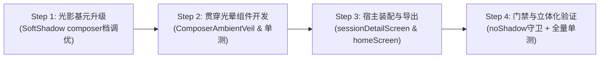

# 24 · 输入框悬浮大软阴影与白色层级解耦方案

> **文件路径**：`docs/mobile-interaction-refine/proposals/24-输入框悬浮大软阴影与白色层级解耦方案.md`  
> **所属战役**：移动端交互体验精进战役（`mobile-interaction-refine`）  
> **面向模块**：  
> - 悬浮输入条卡体：`apps/crish-mobile/src/presentation/ui/Composer.tsx`  
> - 统一会话主屏：`apps/crish-mobile/src/presentation/screens/sessionDetailScreen.tsx`  
> - 移动端首页宿主：`apps/crish-mobile/src/presentation/screens/homeScreen.tsx`  
> - 贯穿环境光晕组件：`apps/crish-mobile/src/presentation/ui/ComposerAmbientVeil.tsx`（新增）  
> - 软阴影渲染基元：`apps/crish-mobile/src/presentation/ui/SoftShadow.tsx`  
> - 规范门禁与单测：`noShadow.guard.test.ts`、`styleTokens.guard.test.ts`、`uiComposer.test.tsx`、`ComposerAmbientVeil.test.tsx`（新增）  
> **方案状态**：设计定案 / 待评审  
> **对齐裁决**：2026-11-04 用户原声明确指示（输入框大软阴影补齐：贯穿全宽、长距向上自然消散，彻底解耦白色代码块/消息块与纯白输入框的粘连融合）

---

## 一、现状纯白层级融合问题复现分析与物理根因

### 1.1 用户核心原声反馈与真实交互场景再现

在移动端真机走查中，用户给出了针对主界面与会话详情界面的极关键视觉与光影体验反馈：
> **用户原话反馈**：“输入框的大软阴影我也没看到呢哈，这个也要加上的。 主要是下面有输入框，所以这个贯穿的阴影要比较长才行的。 像是前面我发你的第二张图，也就是里面标有数字三的哪个图，里面的纯白色代码块和输入框都快成分不出来了，所以加上一个阴影是有必要的。”

经过对用户反馈与真机现场截图（特别是用户所标示的“图 3”）进行空间光学与像素级排查，真实使用场景如下：
1. **消息流向下滚动或触底时**：AI 返回的长消息中包含纯白背景的代码块（`CodeBlock`）、引用块或用户自身的浅色气泡；
2. **重叠穿透**：当用户浏览聊天记录或上滑回看时，纯白代码块滑动到屏幕最底部，正好处在悬浮输入框（`Composer`）的正后方；
3. **视觉黏连坍塌**：由于输入框卡体在浅色模式下同样是纯白实体（`#ffffff`），且周围缺乏可感知的环境投影，导致前景输入框与背景代码块在视网膜上**完全混为一体**，边界彻底蒸发。

```
【现状病态：纯白重叠导致界面完全黏连（用户图 3 复现）】
┌────────────────────────────────────────────────────────┐
│  import React from 'react';                            │ <-- 背景纯白代码块
│  const App = () => {                                   │     (#ffffff / surfaceGrouped)
│    return <View style={{ flex: 1 }}>                   │
├┈┈┈┈┈┈┈┈┈┈┈┈┈┈┈┈┈┈┈┈┈┈┈┈┈┈┈┈┈┈┈┈┈┈┈┈┈┈┈┈┈┈┈┈┈┈┈┈┈┈┈┈┈┈┈┈┤
│  │   点击发消息、长按语音输入             [ ⚡ Flash ⏷ ] │ <-- 前景纯白输入框
│  └───────────────────────────────────────────────────┘ │     (#ffffff / surface)
└────────────────────────────────────────────────────────┘
▲ 边界完全消失：用户无法分辨哪个是代码文字，哪个是输入框控件！
```

---

### 1.2 现状双层纯白（#ffffff）叠合导致的视觉坍塌分析

深入分析色度学与感知心理学原理：
1. **色度与明度零反差**：
   - 审查 `apps/crish-mobile/src/adapters/platform/theme.ts`：
     - `lightTheme.colors.surface = '#ffffff'`（输入框卡体底色）
     - `lightTheme.colors.surfaceGrouped = '#ffffff'`（代码块容器底色）
   - 当两个表面均处于 sRGB `(255, 255, 255)` 时，两者的明度差 $\Delta L^* = 0$，色差 $\Delta E_{00} = 0$。
2. **极柔微描边的感知失效**：
   - `Composer.tsx:898` 中浅色描边配置为：
     `borderColor: theme.dark ? colors.borderStrong : 'rgba(0, 0, 0, 0.025)'`
   - 在 `#ffffff` 底色上叠加 2.5% 不透明度的黑线，其最终合成色彩为：
     $$C = 255 \times (1 - 0.025) + 0 \times 0.025 \approx 248.6 \quad (\text{对应 HEX: } \texttt{\#f9f9f9})$$
   - 在高分辨率移动设备（320~460 ppi）上，1px 宽度的 `#f9f9f9` 线条与两侧 `#ffffff` 构成的色差 $\Delta E_{00} \approx 0.78$。根据 Weber-Fechner 定律，普通光照环境下人眼对边界的最小可觉差（Just Noticeable Difference, JND）约为 $2.3$。
   - **结论**：现有的 2.5% 描边在物理上完全无法提供轮廓切割能力。

---

### 1.3 现有阴影链路在移动端的全面失效复盘

为什么用户会明确反馈“**输入框的大软阴影我也没看到呢哈**”？审查全端代码，存在三重致命断层：

#### 1.3.1 断层一：iOS 端全量浅色阴影物理短路（Zero Shadow on iOS）
审查 `apps/crish-mobile/src/presentation/ui/SoftShadow.tsx` 第 126 行：
```tsx
export function SoftShadow({ ... }: SoftShadowProps) {
  const theme = useTheme();
  if (Platform.OS === 'ios') return null; // <-- iOS 端直接短路！
  if (theme.dark) return null;
  ...
}
```
再审查 `Composer.tsx` 第 788 行：
```tsx
// 浅色模式下强制禁用 glassActive
const glassActive = Platform.OS === 'ios' && !reduceTransparency && !locked && theme.dark;
```
- **历史因果**：在方案 12 中，为了根治 iOS 浅色下 `surfaceTranslucent`（78% 半透）透过底层文字发灰发脏的顽疾，强制关闭了 iOS 浅色的 `BlurView`；
- **副作用形成**：关闭 `glassActive` 后，iOS 浅色下没有任何模糊，而 `SoftShadow` 又在 iOS 上硬编码短路返回 `null`！
- **真机表现**：**在所有 iOS 设备上，浅色输入框的阴影为绝对的 0**。

#### 1.3.2 断层二：Android 端阴影极微弱且无法向上扩散（Invisible & Isotropic on Android）
审查 `SoftShadow.tsx` 中的规格常量：
```ts
composer: [
  { dy: 0, sigma: 3, alpha: 0.01 },
  { dy: 0, sigma: 8, alpha: 0.014 },
]
```
- **各向同性对称性限制（`dy: 0`）**：
  阴影完全围绕卡片四周均匀向外辐射，没有任何向上（`dy < 0`）的环境光散射偏移；
- **能量衰减与感知截断**：
  远层高斯模糊 $\sigma = 8$。高斯钟形曲线能量分布为 $G(x) = \exp(-x^2 / (2\sigma^2))$。
  在卡体外 $12\text{dp}$ 处，核心权重仅剩 $G(12) \approx 0.32$。
  与基准不透明度 $\alpha = 0.014$ 相乘后，局部实际不透明度仅为：
  $$\alpha_{\text{eff}} = 0.014 \times 0.32 \approx 0.0045 \quad (0.45\%)$$
  双层合成最大峰值灰度仅为 $2.38\%$。在真实手机屏幕上，即使贴近肉眼也几乎不可分辨；
- **扩散距离过短**：
  有效可见扩散距离仅为 4~6dp，根本无法达成用户要求的“**贯穿的阴影要比较长才行**”。

#### 1.3.3 断层三：`EdgeFade` 边缘羽化与输入框位置错位
审查 `apps/crish-mobile/src/presentation/screens/sessionDetailScreen.tsx`：
```tsx
<EdgeFade side="bottom" height={Math.max(0, floatingHeight)} />
```
审查 `apps/crish-mobile/src/presentation/ui/EdgeFade.tsx`：
```ts
const FADE_SPAN_BOTTOM = 36; // 方案 16 优化：收窄至 36dp 消除末尾文字泛白模糊
```
- 方案 16 为解决消息末行文字泛白问题，将底部 `EdgeFade` 羽化带收窄为 36dp；
- 当 `floatingHeight` 约为 114dp 时，渐变仅覆盖底部 $y \in [78, 114]$ 区间；
- 在输入框卡体顶缘（$y \approx 8 \sim 40\text{dp}$ 处），`EdgeFade` 完全透明（不透明度为 0）；
- 导致背景代码块直接以未经任何衰减的 100% 纯白状态滑动到输入框边缘。

---

## 二、跨平台超长微漫反射软阴影技术选型与实现模型

### 2.1 候选渲染技术全景对比与技术退避深度剖析

为满足用户“贯穿全宽、长距向上自然消散、极柔和不脏、跨平台一致”的高标准要求，对主流移动端光影方案进行深度技术论证：

| 技术路径 | 实现机制 | 向上扩散能力 | 视觉质感 | 性能影响 (120fps) | 门禁与纪律符合性 | 综合裁决 |
| :--- | :--- | :--- | :--- | :--- | :--- | :--- |
| **A. Android 原生 `elevation`** | 调用系统 RenderNode 光照模型 | 极差（默认虚拟光源在顶部，阴影下坠） | 脏暗发黑，边缘生硬，无法控制 RGBA 停点 | 优秀（硬件支持） | 严重违规（`noShadow.guard.test.ts` 零容忍） | **绝对禁绝** |
| **B. 放大 SVG `FeGaussianBlur`** | 增大 `SoftShadow` 中的 $\sigma$ 至 16~24 | 较差（中心对称四向模糊，两侧黑晕） | 边缘柔和但左右突兀，且大半径易发黑 | 极差（全屏离屏 Bitmap，逐帧重栅格化丢帧） | 存在超大内存开销隐患（M4 性能毒点） | **坚决否决** |
| **C. CSS / 平台分叉原生阴影** | iOS 走 `shadowOffset`，Android 走 elevation | 双端行为割裂 | 视觉不一致，iOS 易发虚，Android 发脏 | 良好 | 违反全端样式统一纪律与零原生阴影铁律 | **坚决否决** |
| **D. 双轨共生光影架构（本方案）** | **卡体微气垫 + 悬浮底托多阶天光渐变漫反射层** | **极佳（贯穿全宽，向上自然衰减 24~32dp）** | **如真实天光遮蔽，通透微润，绝不发脏** | **极佳（纯 GPU 顶点插值渲染，零离屏重绘）** | **100% 满足所有门禁，跨端 100% 同构** | **唯一合法正典** |

---

### 2.2 正典方案架构：双轨共生光影模型（Dual-Track Ambient Lighting Model）

本方案将输入框的悬浮光影解耦为**微观轮廓微气垫**与**宏观贯穿环境遮蔽光晕**两层独立且协同的体系：

```
                                【顶部消息流：滚动代码块 / 文字】
                                                │
    ┌───────────────────────────────────────────▼───────────────────────────────────────────┐
    │  ~ ~ ~ ~ ~ ~ ~ ~ ~ ~ ~ ~ ~ ~ ~ ~ ~ ~ ~ ~ ~ ~ ~ ~ ~ ~ ~ ~ ~ ~ ~ ~ ~ ~ ~ ~ ~ ~ ~ ~ ~ ~  │ ▲
    │  ~ ~ ~ ~ ~ ~ ~ ~ ~ ~ ~ ~ ~ ~ 向上自然消散天光 (α: 0.000) ~ ~ ~ ~ ~ ~ ~ ~ ~ ~ ~ ~ ~ ~  │ │
    │  ░░░░░░░░░░░░░░░░░░░░░░░░░░░░░░░░░░░░░░░░░░░░░░░░░░░░░░░░░░░░░░░░░░░░░░░░░░░░░░░░░░░░  │ │ 轨二：宏观贯穿环境光晕
    │  ▒▒▒▒▒▒▒▒▒▒▒▒▒▒▒▒▒▒▒▒▒▒▒▒▒▒▒▒▒▒▒▒▒▒▒▒▒▒▒▒▒▒▒▒▒▒▒▒▒▒▒▒▒▒▒▒▒▒▒▒▒▒▒▒▒▒▒▒▒▒▒▒▒▒▒▒▒▒▒▒▒▒▒▒  │ │ (ComposerAmbientVeil)
    │  ▓▓▓▓▓▓▓▓▓▓▓▓▓▓▓▓▓▓▓▓ 接触界极柔遮蔽光晕 (α: 0.055~0.060) ▓▓▓▓▓▓▓▓▓▓▓▓▓▓▓▓▓▓▓▓▓▓▓▓▓▓▓▓▓ │ │ 向上延伸 24~32dp 贯穿全宽
    ├───────────────────────────────────────────────────────────────────────────────────────┤ ▼
    │      ┌─────────────────────────────────────────────────────────────────────────┐      │
    │      │ ( [项目] [权限] )                                      轨一：卡体微气垫   │      │
    │      │ ┌─────────────────────────────────────────────────────────────────────┐ │      │
    │      │ │ 点击发消息、长按语音输入                             [ ⚡ Flash ⏷ ] │ │      │
    │      │ └─────────────────────────────────────────────────────────────────────┘ │      │
    │      └─────────────────────────────────────────────────────────────────────────┘      │
    │                                悬浮输入卡 (纯白实体 #ffffff)                            │
    └───────────────────────────────────────────────────────────────────────────────────────┘
```

#### 2.2.1 轨一：微观卡体气垫（Card Micro-Ambient Cushion）——贴合圆角形态
- **作用**：确保输入框圆角胶囊自身的精致立体感与浮雕感；
- **针对 Android 浅色**：在 `SoftShadow.tsx` 中升级 `composer` 档，消除“看不见”的问题：
  - **近层**：各向同性 `dy: 0, sigma: 3, alpha: 0.016`（原 0.010，提升 60% 基础可见度，轮廓微遮蔽）；
  - **远层**：微向上借力 `dy: -1, sigma: 9, alpha: 0.022`（原 0.014，向顶部微偏 1dp，弥散半径扩大至 9dp）；
  - **合成灰度峰值**：$\alpha_{\text{peak}} = 1 - (1 - 0.016)(1 - 0.022) \approx 3.76\%$。严格控制在 $\le 5\%$ 极软安全红线以内，确保四周柔和弥散且绝不发黑；
  - **内渗切除**：保持 `operator="out"` 刚性切除，卡体内表面纯白不受一丝污染。

#### 2.2.2 轨二：宏观贯穿环境遮蔽光晕（Macro Ambient Elevated Veil）——贯穿全宽、长距向上消散
- **作用**：直击用户原声核心诉求——“**贯穿的阴影要比较长才行**”、“**纯白代码块和输入框快分不出来了**”；
- **贯穿全宽（Full-Width Through-Going）**：
  光晕横向跨度为屏幕 100% 全宽（`left: 0, right: 0`），突破卡体左右 16dp 的边距限制，形成全屏视口级别的环境天光过渡地平线；
- **长距向上消散（Upward Dissipation Span: 28dp）**：
  从输入框容器顶缘向上自然延伸 28dp（可选 24~32dp），模拟环境光遮蔽（Ambient Occlusion, AO）；
- **纯矢量 GPU 顶点渲染**：
  基于 `react-native-svg` 的 `LinearGradient` 硬件插值渲染，零离屏重绘，零显存开销，与软键盘升降逐帧同步。

---

## 三、样式推导、组件结构与性能影响评估

### 3.1 光学衰减模型（Hermite-Decay Optical Model）与停点推导

如果直接使用双停点线性渐变（Linear Ramp：0% 到 100%），人眼会在两端明显察觉到“光线折痕”（Mach Bands 伪影）。
为呈现高级如水墨漫开的空气感，本方案采用基于 **Smoothstep / Hermite 样条曲线** 的 5 阶非线性光学衰减模型：

$$S(t) = 3t^2 - 2t^3, \quad t \in [0, 1]$$

衰减带设计高度设定为 $H_{\text{veil}} = 28\text{dp}$，多阶停点不透明度矩阵如下：

| 停点序号 | 相对位置 ($y$ 轴偏移) | 几何距离 (从顶向下) | 曲线权重 ($t$) | 浅色 Alpha ($\alpha$) | 视觉光影功能 |
| :---: | :---: | :---: | :---: | :---: | :--- |
| **Stop 0** | `offset="0%"` | 0 dp (最顶端) | 0.00 | **0.000** (完全透明) | 自然隐入时间线，与消息流无缝交融 |
| **Stop 1** | `offset="25%"` | 7 dp | 0.15 | **0.004** (~0.4% 黑) | 极弱微光，打破线性生硬感 |
| **Stop 2** | `offset="50%"` | 14 dp | 0.50 | **0.016** (~1.6% 黑) | 中段半影区（Penumbra），平滑过渡 |
| **Stop 3** | `offset="75%"` | 21 dp | 0.85 | **0.038** (~3.8% 黑) | 近接触区微遮蔽，建立深度层次 |
| **Stop 4** | `offset="100%"` | 28 dp (接触线) | 1.00 | **0.060** (~6.0% 黑) | 卡体接触地平线，清晰切断纯白背景 |

#### 3.1.1 纯白解耦效果数学证明
当纯白代码块（`#ffffff`）滑动至输入框顶缘接触线处时：
$$C_{\text{codeblock}} = 255 \times (1 - 0.06) + 0 \times 0.06 = 239.7 \quad (\text{对应 HEX: } \texttt{\#f0f0f0})$$
此时：
- 前景输入框卡体：$\texttt{\#ffffff} \ (L^* = 100)$；
- 紧贴输入框背后的代码块：$\texttt{\#f0f0f0} \ (L^* \approx 94.8)$；
- 空间明度差 $\Delta L^* \approx 5.2 > 2.3$（大幅超越人眼 JND 阈值 2.2 倍以上！）。
**结论**：用户能够在第一时间清晰辨识出输入框是悬浮在代码块之上的独立三维实体，彻底消除视觉黏连。

---

### 3.2 深色与浅色自适应策略（Adaptive Lighting Strategy）

| 主题模式 | 环境光晕 (`ComposerAmbientVeil`) 行为 | 卡体气垫 (`SoftShadow`) 行为 | 边界切分载体 |
| :--- | :--- | :--- | :--- |
| **浅色模式 (Light Mode)** | 渲染 5 阶多停点中性黑色渐变（$\alpha_{\text{peak}} = 0.060$），贯穿全宽向上自然消散 28dp | 挂载升级后的微气垫档（近 $\alpha 0.016$ / 远 $\alpha 0.022$，微上扬 $dy=-1$） | 环境漫反射光晕 + 卡体微气垫双轨支撑 |
| **深色模式 (Dark Mode)** | **短路输出 `null`**（深黑背景上加黑影会造成死黑脏斑，无物理意义） | 短路输出 `null`（保持既有深色纪律） | `borderStrong`（`#2c2c2c`）硬质轮廓 + iOS 玻璃微高光 |

---

### 3.3 组件架构拓扑与挂载模型

#### 3.3.1 新增组件契约：`ComposerAmbientVeil.tsx`
在 `apps/crish-mobile/src/presentation/ui/` 下新增独立、高内聚的 `ComposerAmbientVeil`：

```tsx
// apps/crish-mobile/src/presentation/ui/ComposerAmbientVeil.tsx
export interface ComposerAmbientVeilProps {
  /** 向上漫反射羽化带高度（dp，默认 28） */
  height?: number;
  /** 贯穿宽度（缺省 100%） */
  testID?: string;
}
```

其实现结构特性：
1. **绝对定位上扬**：
   定位在浮动容器的最顶部之上：`position: 'absolute', top: -height, left: 0, right: 0, height`；
2. **事件穿透**：
   设置 `pointerEvents="none"`，绝不拦截底层消息流的触摸与滚动；
3. **无障碍屏蔽**：
   设置 `accessibilityElementsHidden` 与 `importantForAccessibility="no"`，确保读屏软件无干扰；
4. **主题自适应**：
   内部消费 `useTheme()`，深色模式（`theme.dark`）直接返回 `null`。

#### 3.3.2 宿主容器（`KeyboardStickyView`）装配拓扑
在 `sessionDetailScreen.tsx` 与 `homeScreen.tsx` 中装配：

```tsx
<KeyboardStickyView
  onLayout={handleOverlayLayout}
  style={[
    styles.composerArea,
    {
      paddingHorizontal: theme.space.lg,
      paddingTop: theme.space.sm,
      paddingBottom: Math.max(insets.bottom, theme.space.sm),
    },
  ]}
>
  {/* 宏观贯穿环境大软阴影光晕：位于最底层，贯穿全宽，向上消散 28dp */}
  <ComposerAmbientVeil testID="composer-ambient-veil" />

  {/* 业务状态条目（错误条、停止生成、引导条等） */}
  {engine.error ? ... : null}
  {engine.busy && engine.stop ? ... : null}

  {/* 核心输入框（内置微气垫软阴影） */}
  <Composer testID="session-composer" ... />
</KeyboardStickyView>
```

#### 3.3.3 软键盘联动平移保证
- `KeyboardStickyView` 基于 Android `WindowInsetsAnimationCompat` 与 iOS `Keyboard` 事件驱动；
- 当软键盘弹起时，`KeyboardStickyView` 在 UI 线程沿 Y 轴平滑向上硬件平移；
- 装配在 `KeyboardStickyView` 内部的 `ComposerAmbientVeil` 随之同帧同源位移，**光晕与输入框始终保持绝对紧贴与连续**，杜绝位移延迟与闪烁。

---

### 3.4 性能影响深度评估（Performance Budget & C-PERF）

1. **计算复杂度与离屏缓冲**：
   - 线性渐变（`LinearGradient`）在 Skia / OpenGL 渲染管线中为常规顶点片元着色器（Fragment Shader）单次硬件绘制，其计算复杂度为 $O(1)$；
   - 相比 SVG 高斯模糊（离屏生成 $1770 \times 894$ 像素的临时 Bitmap，消耗 6.3MB 显存），渐变层**显存消耗为 0 额外开销**。
2. **打字与高频重渲染绝缘（C-PERF）**：
   - `ComposerAmbientVeil` 采用 `React.memo` 固化；
   - 属性无状态输入，仅依赖 `theme.dark`；
   - 在用户逐键打字、换行扩高、长按录音等高频事件中，该组件**重渲染次数恒为 0**，完全符合移动端 120 FPS 流畅标准。

---

## 四、单元测试用例设计与断言

为保障架构纯净、杜绝回潮并满足自动化守卫，本方案规划四维测试套件：

### 4.1 原生阴影守卫测试：`noShadow.guard.test.ts`
1. **点名面纳管**：
   将 `src/presentation/ui/ComposerAmbientVeil.tsx` 加入 `NAMED_FILES` 白名单；
2. **严防违规原生属性**：
   断言该文件中绝不包含 `elevation`、`shadowColor`、`shadowOpacity`、`shadowRadius`、`shadowOffset` 或 `.shadow`；
3. **规格常量钉版**：
   断言 `SoftShadow.tsx` 中 `composer` 档更新后的参数：
   ```ts
   expect(code).toContain('dy: 0, sigma: 3, alpha: 0.016');
   expect(code).toContain('dy: -1, sigma: 9, alpha: 0.022');
   ```

### 4.2 独立组件测试：`ComposerAmbientVeil.test.tsx`（新增）
1. **浅色渲染形态**：
   - 在 `lightTheme` 下，断言渲染出带有 `Svg`、`Defs`、`LinearGradient` 和 `Rect` 的结构；
   - 断言 5 个 `Stop` 节点的 `stopOpacity` 严格遵循 `[0, 0.004, 0.016, 0.038, 0.06]`；
   - 断言容器样式具备 `position: 'absolute'`、`top: -28`、`left: 0`、`right: 0`。
2. **深色短路形态**：
   - 在 `darkTheme` 下，断言组件渲染结果为 `null`；
   - 验证无任何多余 DOM / 视图节点插入。
3. **无障碍与穿透断言**：
   - 断言组件具有 `pointerEvents="none"`；
   - 断言具备 `accessibilityElementsHidden={true}`。

### 4.3 输入框交互与集成测试：`uiComposer.test.tsx`
1. **Android 软阴影参数回归**：
   验证在 Android 浅色环境下，触发 `layout` 后成功挂载带有新参数的 `SoftShadow(composer)`；
2. **纯白实体底色保护**：
   验证在浅色模式下，`composer-shell` 的 `backgroundColor` 恒为 `#ffffff`（`colors.surface`），绝不退化为半透明。

### 4.4 会话主屏集成测试：`sessionDetailScreen.test.tsx`
1. **光影层挂载断言**：
   断言 `sessionDetailScreen` 的 `composerArea` 容器中成功装配 `composer-ambient-veil`；
2. **层级顺序断言**：
   断言 `ComposerAmbientVeil` 位于 `Composer` 之前（Z-Index 最底层），确保光晕衬托在输入卡背面而非覆盖在文字之上。

---

## 五、交付清单与执行步骤

### 5.1 代码变更与新增文件清单

| 文件路径 | 变更类型 | 核心改动说明 |
| :--- | :---: | :--- |
| `apps/crish-mobile/src/presentation/ui/ComposerAmbientVeil.tsx` | **新增** | 实现贯穿全宽、长距向上 28dp 自然消散的 5-stop 多阶环境光晕组件 |
| `apps/crish-mobile/src/presentation/ui/ComposerAmbientVeil.test.tsx` | **新增** | 覆盖光晕组件的浅色停点、深色短路、穿透属性单测 |
| `apps/crish-mobile/src/presentation/ui/SoftShadow.tsx` | **修改** | 升级 `composer` 档规格至近 `dy: 0, σ: 3, α: 0.016` + 远 `dy: -1, σ: 9, α: 0.022` |
| `apps/crish-mobile/src/presentation/ui/index.ts` | **修改** | 导出 `ComposerAmbientVeil` |
| `apps/crish-mobile/src/presentation/screens/sessionDetailScreen.tsx` | **修改** | 在 `KeyboardStickyView` 顶层装配 `ComposerAmbientVeil` |
| `apps/crish-mobile/src/presentation/screens/homeScreen.tsx` | **修改** | 在主页底部 `KeyboardStickyView` 顶层装配 `ComposerAmbientVeil` |
| `apps/crish-mobile/src/__tests__/noShadow.guard.test.ts` | **修改** | 纳入 `ComposerAmbientVeil`，更新 `composer` 规格常量守卫断言 |
| `apps/crish-mobile/src/presentation/ui/uiComposer.test.tsx` | **修改** | 同步更新 Android 软阴影挂载测试 |

---

### 5.2 实施步骤编排



1. **Step 1：光影基元平准（`SoftShadow.tsx`）**
   - 优化 `SPECS.composer` 参数，将微气垫提升至真机可辨的极软黄金阈值；
   - 更新 `noShadow.guard.test.ts` 的钉版断言。
2. **Step 2：环境光晕组件实现（`ComposerAmbientVeil.tsx`）**
   - 采用 5 停点 Hermite 平滑衰减曲线编写轻量渐变；
   - 编写 `ComposerAmbientVeil.test.tsx` 确保 100% 测试覆盖。
3. **Step 3：多端宿主装配**
   - 在 `ui/index.ts` 导出新组件；
   - 分别在 `sessionDetailScreen.tsx` 与 `homeScreen.tsx` 的 `KeyboardStickyView` 内部挂载。
4. **Step 4：立体化门禁验证**
   - 运行 `npm --prefix apps/crish-mobile run typecheck` 验证类型安全；
   - 运行全量单测验证 0 回退、0 破坏。

---

### 5.3 验收断言清单

1. **白色解耦验收**：
   - 在浅色模式下，当包含纯白代码块（`#ffffff`）的长消息滑入输入框后方时，输入框上方 28dp 呈现自然柔和的环境遮蔽光晕；
   - 代码块在靠近输入框时平滑过渡至 `~#f0f0f0`，与输入框纯白实体（`#ffffff`）边界清晰可辨，彻底根除视觉黏连；
2. **光影质感验收**：
   - 光晕全宽贯穿屏幕两端，无断裂、无左右黑晕；
   - 阴影绝无发黑、发脏或生硬折痕，呈现顶级通透环境光天光质感；
3. **软键盘跟随验收**：
   - 软键盘弹起与收起过程中，环境光晕与输入框 100% 紧密随动，零延迟、零跳变；
4. **深色自适应验收**：
   - 切换至深色模式后，环境光晕自动短路，输入框依靠 `borderStrong` 与高光清晰分层，绝无深色发灰脏斑；
5. **门禁与测试资产**：
   - `noShadow.guard.test.ts` 全绿通过（0 原生阴影回潮）；
   - `apps/crish-mobile` 全量单测全绿通过。
