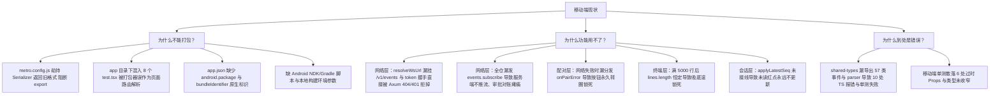

# 移动端全面复兴与打包打通审计战役 · 调研汇总索引 (00-summary.md)

> 战役目录：`docs/mobile-revival-audit/`
> 审计日期：2026-09-04
> 调度主控：主 Agent（亲自精读 5500+ 行源码，驱动 11 位专职子 Agent 并发深度审计）
> 审计范围：`apps/crish-mobile/` 全域、`packages/shared-types/`、跨端 WebSocket/Axum 路由与协议契约（不含笔记功能）

---

## 一、11 维度专项调研报告清单

| 编号 | 调查报告文件 | 核心主题 | 责任 Agent | 核心审计结论与关键发现 |
| :---: | :--- | :--- | :--- | :--- |
| **01** | [`surveys/01-packaging-and-build-infrastructure.md`](./surveys/01-packaging-and-build-infrastructure.md) | 打包与工程化 | Packaging & Build Auditor | **证实打包崩溃罪魁祸首为历史冗余**：`metro.config.js` 的 `customSerializer` 破坏了 Expo 静态导出契约，且底层已改用零随机 ladder 算法，该 Serializer 与 `r2-16-crypto-polyfill.js` 属纯死代码；明确了 `app.json` 缺少 package/bundleId、缺少 `expo-crypto` 与构建脚本的完整补齐方案。 |
| **02** | [`surveys/02-typecheck-and-contract-drift.md`](./surveys/02-typecheck-and-contract-drift.md) | 类型系统与契约 | Typecheck & Contract Auditor | **精准穿透编译阻断根因**：`packages/shared-types` 漏导出 57 类事件与 108 个严格解析器（`parseEngineEvent`）；排查出 `engine/parser` 与 `device/parser` 的 6 个同名符号冲突并给出命名消歧方案；逐一定位并提供了 6 处散落 TS 报错的零破坏修复法。 |
| **03** | [`surveys/03-pairing-and-crypto-handshake.md`](./surveys/03-pairing-and-crypto-handshake.md) | 配对与密码学 | Pairing & Crypto Auditor | **确认 DEF-1/2/3 彻底攻克，挖出交互死锁**：确认 RFC7748 x25519 ladder 算法与输入反向抽取在数学和逻辑上均成立（230 单测全绿）；但抓出 P0 死锁（连接 dead 时漏分发 `onPairError` 导致按钮永久转圈锁死）及 `unpair()` 读错瞬态漏发网络通知的缺陷。 |
| **04** | [`surveys/04-network-gateway-and-reconcile.md`](./surveys/04-network-gateway-and-reconcile.md) | 长连接与游标对账 | Network Gateway Auditor | **揭露握手被拒与对账瘫痪盲区**：`resolveWsUrl` 漏带 `/v1/events` 路径与 `?token=` 导致 HTTP 握手直接被 404/401 拦截；全仓漏发 `events.subscribe` 订阅帧；`FeedBridge` 全量重放未重置游标导致回放事件全部被当重复项丢弃。 |
| **05** | [`surveys/05-approval-center-and-outbox.md`](./surveys/05-approval-center-and-outbox.md) | 审批中心与 Outbox | Approval & Outbox Auditor | **发现跨端命令黑洞与零持久化风险**：桌面端 `ws.rs` 对 `remote.approve` / `remote.deny` 路由挂载不全，`mobile_list_pending_approvals` 协议缺失；移动端 Outbox 沦为纯内存态（`SqlApprovalQueueDao` 成死代码），进程被杀丢决策。 |
| **06** | [`surveys/06-sessions-runs-and-events.md`](./surveys/06-sessions-runs-and-events.md) | 会话状态与事件流 | Sessions & Events Auditor | **抓出会话未读红点断层**：`applyLatestSeq` 在生产链路全局悬空导致红点永远不生效；断线续传快照丢失生命周期副作用导致重连后活动 Run 状态丢失；高频流式 `message-delta` 挤爆窗口历史。 |
| **07** | [`surveys/07-terminal-and-line-buffer.md`](./surveys/07-terminal-and-line-buffer.md) | 终端输出与环形缓冲 | Terminal & Buffer Auditor | **挖出吸底冻结 P0 漏洞**：满 5000 行后 `lines.length` 恒定导致 `useEffect` 不触发、自动滚底跟随彻底死锁；`ListHeaderComponent` 引发虚拟化坐标错位 24dp；无状态 ANSI 导致跨 chunk 碎片乱码；领域层逆向依赖展现层。 |
| **08** | [`surveys/08-storage-sqlite-and-secure-store.md`](./surveys/08-storage-sqlite-and-secure-store.md) | 本地存储与 SQLite | Storage & SQLite Auditor | **揭露 8 表中 6 表空心化**：SQLite 仅 `settings` 表通畅，6 张表完全无业务写读（死层）；`cachePolicy.ts` 280 行无调用点；`app.json` 未配置 `allowBackup: false` 存在硬件 Keystore 解密崩溃隐患；冷启动水合时序导致路由跳跃回弹。 |
| **09** | [`surveys/09-notifications-and-expo-compatibility.md`](./surveys/09-notifications-and-expo-compatibility.md) | 通知推送与兼容性 | Notifications Auditor | **确认 DEF-5 动态门面完全有效，挖出推送穿透 Bug**：在 Expo Go 下 100% 避免崩溃；但挖出严重 Bug（`pushConsumer` 漏调偏好门禁，关闭通知后台仍会弹窗）；排查出原生打包缺少 `expo-notifications` 插件配置与 Device Token 注册契约。 |
| **10** | [`surveys/10-ui-specification-and-interaction.md`](./surveys/10-ui-specification-and-interaction.md) | UI 规范与触控热区 | UI Spec & Theme Auditor | **排查出 16 处触控热区违规与死路由**：42 处交互元素中 16 处不足 44/48dp 且漏设 hitSlop；返回按钮在 7 个页面重复实现；缺少原子 Input/Tooltip 组件；存在 4 个纯占位死路由和 1 个扫码死页面；色彩空间残留多处硬编码 Hex/rgba。 |
| **11** | [`surveys/11-dead-code-and-markers-audit.md`](./surveys/11-dead-code-and-markers-audit.md) | 全仓重复实现与死层 | Dead Code & Zombie Auditor | **全仓清查死层与负产出空间**：排查出 7 组重复手写路径；3 个空目录、6 个死层 SQLite DAO、280 行死层算法；污染 `app/` 路由的 8 个 `*.test.tsx` 页面单测（也是打包隐患）；梳理出 15 处降级回落路径的清理边界。 |

---

## 二、四大致命（P0）与高危（P1）问题收敛表

根据 11 位 Agent 的深度调查，影响“正常打包”与“功能正常使用”的核心根因已被彻底穿透：

---

## 三、三分类问题与负产出（删除面）汇总

遵照《主 Agent 全流程调度提示词 v3》的收敛铁律，所有修复必须先做**负产出（删除与收敛）**：

### 1. 删除面清单（负产出，清退死层与冗余）
1. **彻底删除 `metro.config.js` 的 `customSerializer` 与根目录 `r2-16-crypto-polyfill.js`**（已证实为底层解决后的历史死代码）；
2. **彻底清理 `apps/crish-mobile/app/` 下误置的 8 个 `*.test.tsx` 页面单测**（移至 `__tests__` 或 `src/presentation/` 对应测试目录，解除路由树污染）；
3. **彻底删除 `cachePolicy.ts`（280 行死层算法）** 及测试它的无效单测；
4. **收敛/清理 SQLite 存储层 6 个未接线空心 DAO**（`SqlEventsDao`、`SqlSessionSummariesDao`、`SqlApprovalHistoryDao`、`SqlApprovalQueueDao`、`SqlPushTokensDao`、`SqlDeviceInfoDao`）；
5. **删除 3 个空目录**（`src/hooks`、`src/domain/db`、`src/domain/services`）与孤岛 `HttpClient.ts`；
6. **收敛 7 处重复的返回按钮** 为统一的 `HeaderBackButton`；
7. **删除 4 个受保护占位路由**（`diagnostics.tsx`、`tasks.tsx`、`usage.tsx`、`approval-history.tsx`）与未启用的占位组件。

### 2. 缺陷修复面（行为正确性）
1. **修复 `packages/shared-types` 导出**：导出 `generated/engine/events` 与 `generated/engine/parser`（显式消歧命名冲突符号）；
2. **修复移动端 6 处散落 TS 类型报错**，恢复 `typecheck` 与 Jest 单测 100% 全绿；
3. **修复网络端点 URL 与握手**：`resolveWsUrl` 规范补齐 `/v1/events?token=`，补齐 `events.subscribe` 订阅帧发送；
4. **修复配对死锁**：在网络断开时向状态机分发 `onPairError`，解除 Loading 锁死；
5. **修复会话未读红点**：接线 `applyLatestSeq`；续传补全生命周期副作用；
6. **修复终端吸底死锁**：重构依赖项，解除满 5000 行后的自动滚动冻结；扣除 Header 24dp 坐标偏移。

### 3. 新增补齐面（打包工程化）
1. **补齐 `app.json` 原生构建配置**：补齐 `android.package: "com.crish.mobile"`、`ios.bundleIdentifier: "com.crish.mobile"`、`expo-notifications` 插件、局域网明文许可与权限声明；
2. **补齐 `package.json` 构建命令**：增加 `prebuild`、`export`、`build:android` 脚本，引入 `expo-crypto` 原生绑定依赖。
