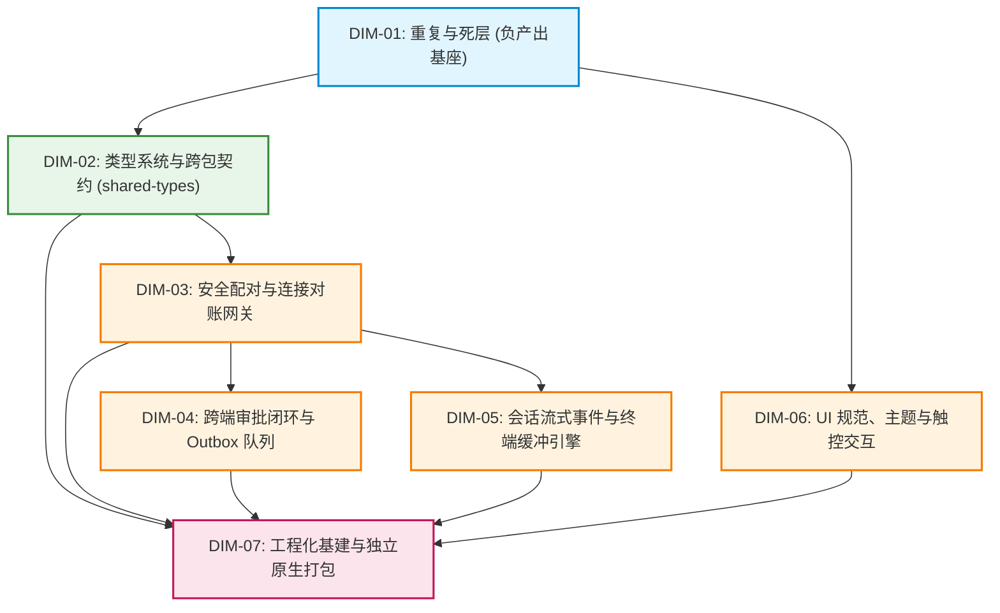

# 移动端全面复兴与打包打通 · 实施维度终审定案文档 (01-final-dimensions.md)

> **战役目录**：`docs/mobile-revival-audit/`
> **定案日期**：2026-09-04
> **裁决主控**：主 Agent（亲自精读 5500+ 行核心代码，审阅 11 份专项调研与 3 份维度建议报告）
> **遵循规范**：《主 Agent 全流程调度提示词 v3》、《AGENTS.md》、反退避纪律、反过度设计红线
> **核心原则**：推进单位为领域概念、负产出绝对先行、一个概念一条主路径、无波次编号、立体双向验收

---

## 一、主控定案裁决总览

在完成 11 维度专项深度调查（`surveys/01` ~ `11`）与 3 位维度建议 Agent（`proposal-a`、`proposal-b`、`proposal-c`）的独立交叉推演后，主控依据第一线代码现实，正式拍板确定移动端后续方案与实施的 **7 大领域维度**。

本定案彻底废弃“11 份调研 1:1 照搬”的碎片化划分（消除多 Agent 在文件域上的死锁与循环等待），也拒绝“3 维度粗放合并”（防止掩盖高敏感安全与协议缺陷），确立以**领域概念高内聚、单向无环依赖（DAG）、负产出强制先行**为准则的 7 维精益拓扑。

---

## 二、最终实施维度框架清单与删除面刚性约定

| 维度编号 | 维度名称 | 领域概念边界 | 核心解决问题 (缺陷/缺失) | 刚性删除面 (本维度必须清退的内容) | 依赖关系 |
| :--- | :--- | :--- | :--- | :--- | :--- |
| **DIM-01** | **重复与死层** *(全局固定维度)* | 全仓冗余资产核销、历史临时补丁拔除、死 DAO/算法清理、重复手写实现收敛、测试路由隔离 | 根治打包器被拦截破坏、路由树被单测污染、多处同一概念双轨漂移、死代码与僵尸目录虚耗维护成本 | 1. 物理删除 `r2-16-crypto-polyfill.js` 与 `lint-out.txt`； 2. 清理 `metro.config.js`（删除 `customSerializer`、硬编码绝对路径 `METRO_ROOT` 与 `blockList` 掩盖补丁）； 3. 将 `app/` 路由下的 8 个 `*.test.tsx` 移出至 `src/presentation/__tests__/`； 4. 彻底删除 `cachePolicy.ts`（280 行死算法）及对应测试 `cachePolicy.test.ts`（401 行）； 5. 清退 SQLite 层 6 个未接线空心 DAO； 6. 删除 3 个空目录（`hooks`、`domain/db`、`domain/services`）与孤岛 `HttpClient.ts`； 7. 收敛 7 组重复手写路径（相对时间、时钟、Run 状态色、Base64/Hex/SHA-256 造轮子）； 8. 删除 4 个占位模板路由（`diagnostics`、`tasks`、`usage`、`approval-history`）。 | *无 (全域基座，必须最先执行)* |
| **DIM-02** | **类型系统与跨包契约** | `@crish/shared-types` 导出结构治理、跨包契约消歧、移动端全局 TS 编译严密性、桌面端深路径收敛 | 补齐 57 类事件与 108 个严格解析器导出、消歧 6 个同名工具符号、根除移动端 22 处 TS 编译报错（恢复 `typecheck` 100% 全绿） | 1. 消除桌面端 16 处深路径直接引用（`../../../../packages/shared-types/src/generated/engine`）； 2. 清理移动端单测中废弃的 `kind`/`badge` 历史属性； 3. 移除错位的 `@ts-expect-error` 指令； 4. 消除 `ParseResult` 等 6 个重叠导出符号的编译歧义。 | DIM-01 |
| **DIM-03** | **安全配对与连接对账网关** | 设备发现、X25519 密钥协商、长连接生命周期、握手订阅、游标对账与全量重放 | 修复 `resolveWsUrl` 遗漏 `/v1/events?token=` 导致的 404/401 拒连；修复全仓漏发 `events.subscribe`；修复 `FeedBridge` 全量重放未重置游标 Bug；修复配对 Dead 相位漏分发 `onPairError` 导致的按钮永久 Loading 死锁；修复冷启动 `unpair()` 漏通知桌面端 | 1. 移除 `ReconnectingWsClient` 3 处空路由监听； 2. 移除无用中继端口占位代码与 dead options； 3. 清理 SecureStore 中未引用的 Nonce 读写接口； 4. 移除 6 个冗余密码学常量与多余校验正则； 5. 清除冷启动孤儿配对元数据残留。 | DIM-01, DIM-02 |
| **DIM-04** | **跨端审批闭环与 Outbox 队列** | 跨端工具安全裁决、Outbox 本地队列、单飞 FIFO 重放、双阶段确认、桌面端 Axum/WebSocket 协议对接 | 桌面端 `ws.rs` 补齐 `remote.approve` / `remote.deny` 路由分发（消除命令黑洞）；桌面端补齐 `mobile_list_pending_approvals` 协议处理；移动端 Outbox 接入可靠持久化（防杀进程丢决策）；完善 120s 倒计时耗尽状态机闭环 | 1. 清理 `approvalWiring.ts` 中的纯内存态占位代码与注释； 2. 清理 `approvalReducers.ts` 中残留的过时 Mock 生成辅助函数； 3. 收敛审批状态冗余字段与双轨 `decisionBusy`； 4. 移除 `outboxState.replaying` 死状态。 | DIM-01, DIM-02, DIM-03 |
| **DIM-05** | **会话流式事件与终端缓冲引擎** | 会话列表与详情、57 类事件分发与人话摘要、未读红点同步、断线续传快照副作用回放、5000 行环形缓冲与虚拟化渲染 | 修复 `applyLatestSeq` 悬空导致的未读红点恒为 0；修复终端满 5000 行后 `lines.length` 恒定导致的 auto-follow 滚底死锁；修复 FlatList `getItemLayout` 未计入 Header 24dp 高度导致的坐标撕裂；补齐快照回放丢失的生命周期副作用；防高频 delta 爆内存 | 1. 消除 `terminalScreen.tsx` 的双真理 fallback 分支； 2. 解除领域层 `terminalStore.ts` 对表现层的逆向引用（缓冲纯逻辑下沉至 Domain）； 3. 删除 chunk 边界提前裁剪最旧行的脆弱逻辑； 4. 清退已删除死契约 `tool-update`（5 处残留）。 | DIM-01, DIM-02, DIM-03 |
| **DIM-06** | **UI 规范、主题与触控交互** | 移动端原子组件库补齐、AGENTS.md 视觉与交互规范落地、双轨触控热区达标、公共导航组件收敛、现代 HSLA 色彩治理、系统推送偏好门禁 | 补齐原子 `<Input>`（克制激活态边框 ~6%）与 `<Tooltip>` 组件；治理 16 处触控尺寸不足 (<44/48dp) 并补齐 `dualHitSlop`；收敛 7 处手写返回按钮为统一 `<HeaderBackButton>`；修复 `pushConsumer.ts` 漏调偏好门禁导致的后台穿透推送 Bug | 1. 删除 7 个页面中手写的返回按钮 JSX/样式； 2. 删除 `fileMeta.ts` 散落的硬编码 Hex 颜色； 3. 删除对 RN 原生 `Modal` 的违规引用； 4. 清退扫码配对假占位页面 `pairScanScreen.tsx`。 | DIM-01, DIM-02 |
| **DIM-07** | **工程化基建与独立原生打包** | Expo 原生预构建 (Prebuild)、独立 APK/IPA 原生配置补齐、JSI 安全随机源链接、构建脚本与 CI 离线编译打通 | 补齐 `app.json` 原生包名 `com.crish.mobile` 与 BundleId；引入 `expo-crypto` 解决独立包内 JSI 随机模块断裂；补齐通知插件与权限；配置 `allowBackup: false` 防 Keystore 解密崩溃；补齐 `package.json` 构建命令集；打通 `export`/`prebuild` 自动化 | 1. 清理开发期临时构建缓存与无用配置项； 2. 移除代码中假定必须依赖 Expo Go 宿主容器的隐性假设； 3. 清退 package.json 中无效与未对齐依赖。 | DIM-01 至 DIM-06 |

---

## 三、拓扑依赖图 (DAG)

---

## 四、准出与验收断言

1. **类型与语法门禁**：`npm run typecheck -w @crish/crish-mobile` 22 处报错全部归零，TypeScript 零错误；
2. **测试资产保护**：移出路由树的 8 个单测与既有单元测试全量跑通，覆盖率不下降；
3. **网络与协议全闭环**：WebSocket 携带合法 token 顺畅连接 `/v1/events`，桌面端命令分发无黑洞，Outbox 离线耐受杀进程；
4. **终端与可观测性**：5000 行环形缓冲区在极限压力下平滑滚底无冻结，无坐标错位；
5. **打包工程化彻底打通**：`npx expo export` 正常生成合法的静态导出产物包；`npx expo prebuild` 顺利生成 Android 原生工程。

定案已出，全战役即刻转入【第二阶段：多 Agent 独立方案设计】！
