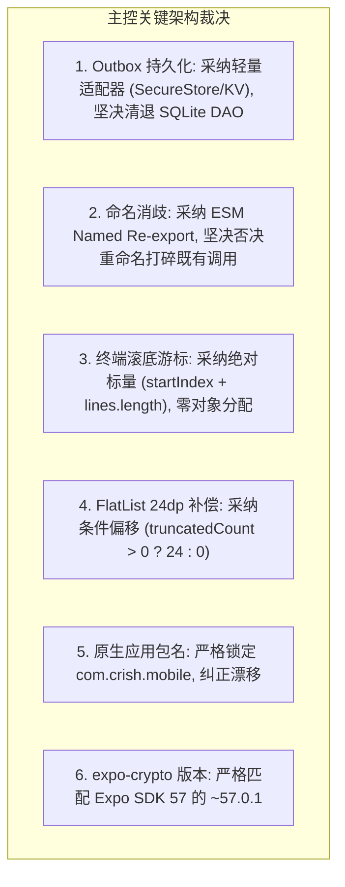
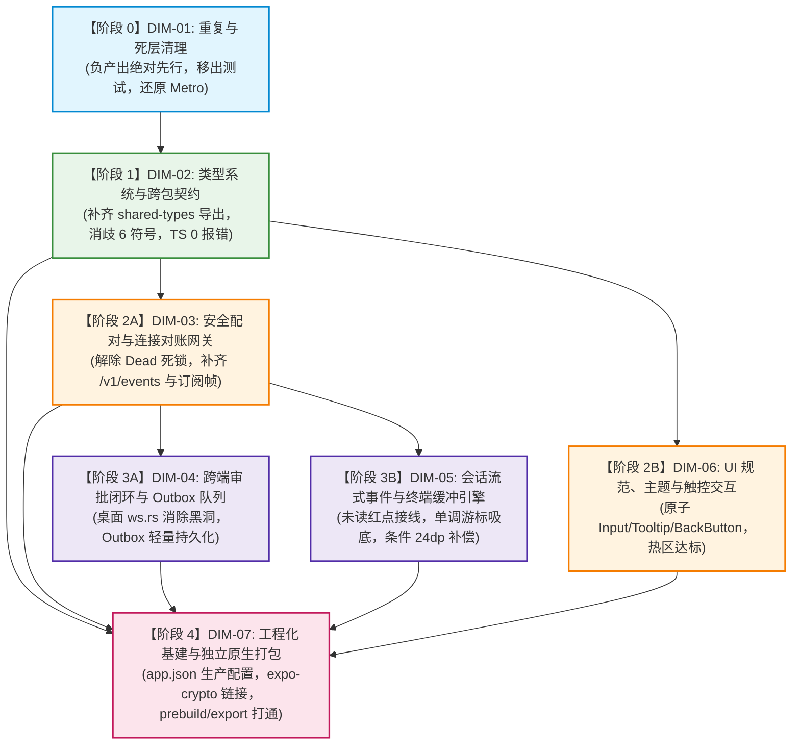

# 移动端全面复兴与打包打通总计划框架 (02-master-revival-plan.md)
## —— 融合六大流派与三方严审的唯一实施总纲

> **战役目录**：`docs/mobile-revival-audit/`  
> **总纲编号**：`02-master-revival-plan.md`  
> **主控裁决**：主 Agent（亲自精读 5500+ 行核心源码，审阅 11 份调研、6 份独立方案与 3 份多维对撞评审）  
> **基准遵循**：`01-final-dimensions.md`（7 大维度）、`00-summary.md`、根目录《AGENTS.md》、反退避纪律、反过度设计红线 (`ANTI_OVERENGINEERING_GUARDRAILS.md`)  
> **核心原则**：推进单位为领域概念、负产出绝对先行、一个概念一条主路径、严禁波次编号、立体双向验收  

---

## 一、方案核心哲学与战略定位

本总计划框架是移动端从“无法打包、契约漂移、多处死锁”走向“原生独立打包打通、类型 100% 严密、双端通信自愈、人机交互细腻”的唯一权威技术总纲。

经 6 份独立方案的技术交锋与 3 位评审员的交叉盲审，主控正式裁决确立核心战略定位：
1. **移动端系统定位**：轻量、高敏捷、强韧性的实时观测与审批交互终端；桌面端（Rust 内核 + Tauri）为权威状态与数据持久化中心。坚决拒绝在移动端重造沉重脱节的双主 SQLite 数据库，坚决清退 6 个未接线空心 DAO；
2. **负产出绝对先行**：任何增强方案必须先执行删除与收敛。优先核销 1500+ 行死代码、22 个死文件与 800+ 行无用单测，扫清打包器与编译器的历史毒素；
3. **单一真理源（SSOT）**：全仓协议与类型以 `@crish/shared-types` 为唯一真理；禁止私自创建第二条格式化、转换或持久化路径；
4. **单向无环依赖（DAG）**：全案划分为 5 个逻辑推进阶段，严格按因果关系单调推进，零环路，零依赖倒置。

---

## 二、7 大维度核心问题与刚性删除面（裁决清单）

| 维度编号 | 维度名称 | 领域概念边界 | 核心解决问题 (缺陷/缺失) | 刚性删除面清单 (本维度必须核销的内容) |
| :--- | :--- | :--- | :--- | :--- |
| **DIM-01** | **重复与死层** *(全域负产出基座)* | 全仓冗余资产核销、历史临时补丁拔除、死 DAO/算法清理、重复算法收敛、测试路由物理隔离 | 1. `metro.config.js` 被 customSerializer 破坏导致 `npx expo export` 100% 崩溃； 2. `app/` 目录下 8 个单测被 expo-router 误判为路由引发崩溃； 3. 全仓残留 1500+ 行形式主义死代码与 7 组重复手写算法。 | 1. **物理删除 22 个文件/模板**：`r2-16-crypto-polyfill.js`、`lint-out.txt`、`cachePolicy.ts`（280行）及 `cachePolicy.test.ts`（401行）、`HttpClient.ts` 及 `HttpClient.test.ts`、4 个死路由（`diagnostics.tsx`、`tasks.tsx`、`usage.tsx`、`approval-history.tsx`）、扫码假页面 `pairScanScreen.tsx` 及 `scan.test.tsx`、3 个空目录（`hooks`、`domain/db`、`domain/services`）、`mobileCommands.test.ts`（589行虚构单测）； 2. **物理移出 8 个真实页面单测** 至 `src/presentation/__tests__/routes/`； 3. **彻底拔除 Metro 三大毒素**：`customSerializer` 劫持、`METRO_ROOT` 绝对路径与 `blockList` 补丁； 4. **彻底清退 SQLite 6 个空心 DAO**（`SqlEventsDao` 等）及对应 5 个单测文件； 5. **收敛 7 组重复手写路径**（相对时间、时钟、Run 状态色、Base64/Hex/SHA-256、返回按钮）。 |
| **DIM-02** | **类型系统与跨包契约** | `@crish/shared-types` 导出中枢、跨包契约消歧、移动端全局 TS 编译严密性、桌面端深路径收敛 | 1. `shared-types/src/index.ts` 漏导出 57 类事件与 108 个严格解析器； 2. `engine/parser` 与 `device/parser` 重合 6 个同名符号引发编译歧义； 3. 移动端 22 处 TS 编译报错（10 处契约缺失 + 12 处散落测试/代码书写瑕疵）； 4. 桌面端 16 处深路径侵入。 | 1. 消除桌面端 16 处深路径直引（`../../../../packages/shared-types/src/generated/engine`）； 2. 清除移动端单测中废弃的 `kind`/`badge` 历史属性； 3. 移除错位的 `@ts-expect-error` 指令； 4. 采用 ESM 显式命名导出消除 6 个重叠工具符号的通配歧义。 |
| **DIM-03** | **安全配对与连接对账网关** | 设备发现、X25519 密钥协商、长连接生命周期、握手订阅、游标对账与全量重放 | 1. `EndpointResolver.resolveWsUrl` 遗漏 `/v1/events?token=` 导致 404/401 拒连； 2. 全仓漏发 `events.subscribe` 订阅帧导致推流瘫痪； 3. `FeedBridge` 全量重放未重置游标导致历史帧被全部丢弃 Bug； 4. 配对 Dead 相位漏发 `onPairError` 导致按钮永久 Loading 死锁； 5. 冷启动 `unpair()` 漏通知桌面端 `device.unlink`； 6. 建连时先 setPhase('open') 后 attachSend 导致时序竞态。 | 1. 移除 `ReconnectingWsClient` 3 处空路由监听存根； 2. 移除无用中继端口占位代码与 dead options； 3. 清理 SecureStore 中未引用的 Nonce 读写接口； 4. 移除 6 个冗余密码学常量与多余校验正则； 5. 清除冷启动孤儿配对元数据残留。 |
| **DIM-04** | **跨端审批闭环与 Outbox 队列** | 跨端工具安全裁决、Outbox 本地队列、单飞 FIFO 重放、双阶段确认、桌面端 Axum/WebSocket 协议对接 | 1. 桌面端 `ws.rs` 丢弃 `remote.approve` / `remote.deny` 导致远程命令黑洞（10s 超时）； 2. 桌面端漏注册 `mobile_list_pending_approvals`； 3. 移动端 Outbox 缺乏抗进程崩溃能力； 4. 审批状态机缺少 120s 倒计时到期与 300ms 防双点硬时间锁。 | 1. 清理 `approvalWiring.ts` 中的纯内存态占位注释与死代码； 2. 清理 `approvalReducers.ts` 中残留的过时 Mock 生成辅助函数； 3. 收敛审批状态冗余字段与双轨 `decisionBusy`； 4. 移除 `outboxState.replaying` 死状态。 |
| **DIM-05** | **会话流式事件与终端缓冲引擎** | 会话列表与详情、57 类事件人话摘要、未读红点同步、断线续传快照副作用、5000 行环形缓冲与虚拟化渲染 | 1. `applyLatestSeq` 悬空导致会话未读红点恒为 0； 2. 终端满 5000 行后 `lines.length` 恒定导致 auto-follow 滚底死锁； 3. FlatList `getItemLayout` 未条件计入 Header 24dp 导致坐标撕裂跳动； 4. 缓冲纯逻辑逆向依赖展现层； 5. 高频 `message-delta` 爆满 500 环形缓冲。 | 1. 彻底消除 `terminalScreen.tsx` 的双真理 fallback 分支； 2. 解除领域层 `terminalStore.ts` 对表现层的逆向引用（缓冲纯逻辑下沉至 Domain）； 3. 删除 chunk 边界提前裁剪最旧行的脆弱逻辑； 4. 全仓核销死契约 `tool-update`（5 处残留）与死函数（`replaceAllTerminalText`、`stripAnsiDetailed`）。 |
| **DIM-06** | **UI 规范、主题与触控交互** | 移动端原子组件库补齐、AGENTS.md 视觉与交互规范落地、双轨触控热区达标、公共导航组件收敛、现代 HSLA 色彩治理、系统推送偏好门禁 | 1. 散落原生 TextInput 带有粗深黑边或重阴影（违背 AGENTS.md §13）； 2. 缺乏自定义 Tooltip，长文本与状态图标无释义（违背 AGENTS.md §12）； 3. 16 处交互元素触控热区不足（<44/48dp）； 4. 7 处页面手写重复返回按钮； 5. `pushConsumer.ts` 漏接偏好门禁导致系统弹窗穿透打扰； 6. 会话列表冷启动空态闪现（Flash of Empty State）。 | 1. 删除 7 个页面中手写的返回按钮 JSX 与重复样式； 2. 删除 `fileMeta.ts` 散落的 5 处硬编码 Hex 图标色； 3. 删除对 RN 原生 `Modal` 的违规引用； 4. 清退扫码配对假占位页面与路由； 5. 收拢 `themeProjection.ts` 双轨别名。 |
| **DIM-07** | **工程化基建与独立原生打包** | Expo 原生预构建 (Prebuild)、独立 APK/IPA 原生配置补齐、JSI 安全随机源链接、构建脚本与 CI 离线编译打通 | 1. `app.json` 缺少 `package: com.crish.mobile`、`bundleIdentifier`、通知插件与明文权限； 2. 缺少 `expo-crypto: ~57.0.1` 导致独立原生包运行时密钥生成崩溃； 3. 缺少 `allowBackup: false` 导致 Android 云备份恢复后 Keystore 硬件解密崩溃； 4. 缺少自动化构建与导出命令矩阵。 | 1. 清理开发期临时构建缓存与无用配置项； 2. 移除代码中假定必须依赖 Expo Go 容器的原生模块假定； 3. 清退 package.json 中无效与未对齐依赖。 |

---

## 三、主控权威仲裁：关键技术路径裁决表

针对 6 份方案在评审中暴露的 8 大技术分歧，主控依据架构优雅度与反过度设计红线，裁决如下：

---

## 四、全局单向无环依赖拓扑 (DAG)

实施过程严格按以下拓扑单调推进，严禁反向依赖与并发生死锁：

---

## 五、立体验证准出断言（交付门禁）

1. **类型与语法门禁（底线）**：
   - `npm run typecheck -w @crish/crish-mobile` 零错误输出；
   - `npm run typecheck` 根工作区全量绿灯；
2. **测试资产保护（零回退）**：
   - `npm --workspace @crish/shared-types run test` 100% 通过；
   - `npm --workspace @crish/crish-mobile run test` 包含移出的 8 个路由单测在内的全量测试 100% 绿灯（统一使用 monorepo 兼容命令，禁止 `npx vitest run apps/crish-mobile` 导致的找不到文件错误）；
3. **双端协议与自愈闭环（端到端）**：
   - 移动端连接 `/v1/events?token=` 成功 Upgrade HTTP 101；
   - 移动端触发 `remote.approve` / `remote.deny`，桌面端 `ws.rs` 顺利响应回执，无超时黑洞；
   - 离线写入审批决策后杀进程重启，Outbox 成功水合并在网络恢复后单飞重放；
4. **流式性能与人机视效（物理现场）**：
   - 终端在 10,000 行超限流式推送下，满 5000 行自动滚底无冻结，无坐标跳动；
   - 全应用触控元素满足 iOS 44pt / Android 48dp 规范，输入框激活态边框克制在 ~5.8%，零重阴影；
5. **工业级原生打包打通（终极交付）**：
   - `npx expo export --platform android` 成功生成完整的静态离线 Bundle，无 Serializer 异常；
   - `npx expo prebuild --platform android --clean` 顺利生成包名为 `com.crish.mobile` 的合法 Android 原生工程。

---

## 六、终审对撞仲裁与执行定稿裁决（11 项阻断点清零）

依据终审 Agent 1（`04-final-review-contracts-and-dag.md`）与终审 Agent 2（`05-final-review-dead-code-and-verification.md`）的交叉严审，主控正式定夺并锁定 11 项阻断点的落地准则：

1. **[BLK-01 & BLK-10] 连带删除与编译安全锁**：
   - 阶段 0 删除 `cachePolicy.ts` 时，必须同步清理 `src/db/index.ts:10` 的重导出，严防编译中断；
   - `themeProjection.ts` 禁止在阶段 0 删除（尚有 8 处 UI 引用），严格顺延至阶段 2B（DIM-06 完成原子化重构后）物理删除，保证阶段 1 `typecheck` 0 报错。
2. **[BLK-11] 路由与单测资产保护**：
   - `app/pair/scan.tsx` 严禁物理删除，就地重写为 `<Redirect href="/pair/manual" />`，既清退假 UI，又保护路由拓扑与单测资产不崩。
3. **[BLK-04 & BLK-05 & BLK-06] 唯一文件域防写冲突锁**：
   - `terminalScreen.tsx` 写权限独占收归阶段 3B（DIM-05），DIM-01 与 DIM-06 不得修改此文件；
   - `pairManualScreen.tsx` 写权限独占收归阶段 2B（DIM-06），DIM-03 仅下沉 `cxnCode.ts` 纯函数；
   - `secureStore.ts` Nonce 接口清理独占收归阶段 0（DIM-01），DIM-03 仅作为只读消费者。
4. **[BLK-07 & BLK-08] 协议与对账无损锁**：
   - `resolveWsUrl` 严禁隐式直读 `authStore.token` 对象，由调用方显式注入字符串 Token，根除 401 拒连；
   - `WsGateway.invoke` 支持 `msgIdOverride?: string`，确保 Outbox 失败单飞重放保持原 `msgId`，根除 409 假冲突。
5. **[BLK-09] 验收测试命令标准化锁**：
   - 移动端单测命令强制锁定为 `npm --workspace @crish/crish-mobile run test -- <pattern>`，彻底根除跨目录路径幻觉。

**主控裁决声明**：至此，多 Agent 方案生成与终审闭环全量通过，方案正式定稿锁定！全仓即刻进入【第三阶段：执行阶段（按 DAG 先删后改）】！
