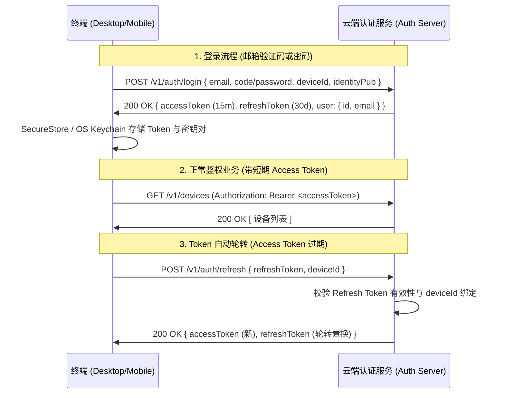
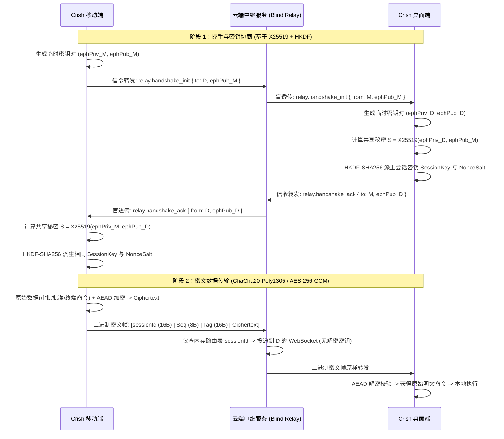

# 移动端与桌面端极简云端协同与万人在线盲中继方案 (Plan A)

> **方案代号**：Plan A · 极简点连与端到端盲中继架构
> **方案设计**：方案设计 Agent A
> **设计宗旨**：“一切麻烦的东西在我们这，用户最好是点点就能完成的那种最好了”
> **方案定位**：面向生产级跨网络穿透、端到端安全（E2EE）、万人在线并发（20,000+ 活跃长连接）以及存量死层深度收敛的立体技术方案
> **落盘时间**：2026-09-04

---

## 目录索引

- [一、架构愿景与用户体验蓝图（“点点就能连”的设计美学）](#一架构愿景与用户体验蓝图点点就能连的设计美学)
  - [1.1 现状之痛：从“局域网配对敲码”到“全天候无感直连”](#11-现状之痛从局域网配对敲码到全天候无感直连)
  - [1.2 双轨体验矩阵：极简一键直连（主干）与离线局域网保底（兜底）](#12-双轨体验矩阵极简一键直连主干与离线局域网保底兜底)
  - [1.3 用户第一视角典型流程（桌面与手机交互路径）](#13-用户第一视角典型流程桌面与手机交互路径)
- [二、克制轻量的账号与身份认证体系](#二克制轻量的账号与身份认证体系)
  - [2.1 极简用户域模型设计](#21-极简用户域模型设计)
  - [2.2 鉴权机制：双 Token 轮转与硬件指纹绑定](#22-鉴权机制双-token-轮转与硬件指纹绑定)
  - [2.3 桌面端与移动端组件及状态管理](#23-桌面端与移动端组件及状态管理)
  - [2.4 离线与无网环境的优雅降级规范](#24-离线与无网环境的优雅降级规范)
- [三、极简远程设备发现与 E2EE 盲中继连接](#三极简远程设备发现与-e2ee-盲中继连接)
  - [3.1 实例注册与心跳状态同步协议](#31-实例注册与心跳状态同步协议)
  - [3.2 移动端“我的设备”列表直观体验](#32-移动端我的设备列表直观体验)
  - [3.3 端到端加密（E2EE）零知识盲中继架构](#33-端到端加密e2ee零知识盲中继架构)
- [四、支撑 10,000+ 用户并发（20,000+ 长连接）的中转服务架构与容量规划](#四支撑-10000-用户并发20000-长连接的中转服务架构与容量规划)
  - [4.1 万人在线并发模型与业务指标](#41-万人在线并发模型与业务指标)
  - [4.2 严密容量推演与资源消耗数学模型](#42-严密容量推演与资源消耗数学模型)
  - [4.3 极简高效架构选型（无状态网关 + 内存/Redis 路由）](#43-极简高效架构选型无状态网关--内存redis-路由)
  - [4.4 生产级高可用与系统韧性设计（防雪崩、假死回收、心跳裁剪）](#44-生产级高可用与系统韧性设计防雪崩假死回收心跳裁剪)
- [五、反过度设计硬性红线自检表](#五反过度设计硬性红线自检表)
- [六、【本方案要删掉什么 / 收敛什么】（负产出与死层清退行动纲领）](#六本方案要删掉什么--收敛什么负产出与死层清退行动纲领)
- [七、分阶段工程实施计划与验收指标](#七分阶段工程实施计划与验收指标)

---

## 一、架构愿景与用户体验蓝图（“点点就能连”的设计美学）

### 1.1 现状之痛：从“局域网配对敲码”到“全天候无感直连”

当前 Conex / Crish 跨端架构面临三个根本性的用户体验与连接断层：
1. **网络隔绝即失联**：当前移动端与桌面端仅依赖桌面 Axum HTTP/WS 监听局域网内网 IP（默认端口 8765）。手机一旦离开办公室或家庭 WiFi（如走 4G/5G 移动蜂窝网络，或跨网段、跨路由），完全无法访问电脑；
2. **连接认知负荷极重**：用户需要关心“我的电脑局域网 IP 是多少”、“端口是否被占用”、“电脑是否处在同一个局域网”、“配对码有没有敲错”。12 位配对码（`CXN-xxxx-xxxx-xxxx`）对于高频日常使用而言存在严重的交互摩擦；
3. **状态盲盒**：手机端在发起连接前，根本不知道电脑当前是否开机、是否运行、当前正处于哪个工作区项目中，必须盲目发起连接才能获知状态。

**Plan A 的核心主旨**：
> **“一切麻烦的东西在我们这，用户最好是点点就能完成的那种最好了”。**
> 用户不需要懂什么是 NAT 穿透、不需要懂什么是 WebSocket 握手、不需要配置任何端口映射。电脑打开登录同一账号，手机打开就能看到电脑卡片，轻轻一点即可进入工作区，秒级开始监控 Agent 运行与执行远程审批。

---

### 1.2 双轨体验矩阵：极简一键直连（主干）与离线局域网保底（兜底）

系统确立清晰的“双轨互通”机制：

```mermaid
flowchart TD
    A[启动 Crish Mobile / Desktop] --> B{是否有外网且已登录?}
    B -- 是 --> C[云端极简直连通道 (主路径)]
    C --> C1[云端自动拉取账号下在线设备]
    C1 --> C2[移动端卡片式呈现「我的电脑」状态]
    C2 --> C3[用户点击「一键连接」]
    C3 --> C4[E2EE 零知识盲中继秒级穿透]
    C4 --> D[进入远程监控与工作流管理]

    B -- 否 (离线/局域网专网/未登录) --> E[局域网配对保底通道 (兜底路径)]
    E --> E1[界面显示轻量局域网配对入口]
    E1 --> E2[通过扫码或输入 12 位 CXN 配对码]
    E2 --> E3[本地 X25519 协商 + 本地直连 8765]
    E3 --> D
```

| 维度 | 主路径：云端一键直连 (Cloud One-Click) | 兜底路径：局域网配对码 (LAN Pairing) |
| :--- | :--- | :--- |
| **网络要求** | 手机与电脑均能访问公网即可（支持跨网段/跨地域/移动数据） | 必须在同一局域网（同一子网/无 AP 隔离） |
| **操作复杂度** | **零输入**：登录同一账号后，点击设备卡片上的「连接」按钮 | **需输入**：扫码或手动输入 12 位 CXN 配对码 |
| **连接时延** | 约 30ms ~ 80ms（经高性能无状态中转网关盲转发） | 约 1ms ~ 5ms（本地内网直接通信） |
| **设备呈现** | 直观展示：设备名、系统、在线/离开状态、当前活跃项目与 Agent | 仅显示当前配对的主机地址与指纹 |
| **加密与安全** | **端到端加密（E2EE）**：公网盲中继无法解密任何用户数据 | 本地 TLS / 本地 X25519 密钥交换 |
| **适用场景** | 通勤、出差、外出远程审批、居家跨网络控制工位电脑 | 飞机上、机房纯局域网、内网离线脱敏开发环境 |

---

### 1.3 用户第一视角典型流程（桌面与手机交互路径）

#### 场景 1：首次使用与一键连接（耗时 < 5 秒）
1. **桌面端**：在电脑打开 Crish Desktop，右上角点击登录，输入邮箱与验证码（或密码），登录成功。桌面端自动将当前实例（如 `MacBook Pro (M3 Max)` / `Windows 11 Workstation`）及其当前工作区注册到云端；
2. **移动端**：在手机打开 Crish Mobile，输入同一账号登录。首页设备中心立刻浮现用户的电脑卡片，卡片标注绿色圆点 `在线`，显示当前打开的项目 `conex/core`，正在执行 `Task: 批量修复单元测试`；
3. **建立连接**：用户点击卡片右侧的 **「连接」** 按钮。移动端后台秒级完成 E2EE 会话密钥协商，建立加密信道。界面瞬间切换至会话列表与审批中心，用户开始实时接收运行推送。

#### 场景 2：未登录态下的友好引导
- 用户未登录时，移动端首页顶部呈现一条优雅、轻量的卡片提示：
  `💡 登录 Crish 账号，即可随时随地远程连接工位电脑，无需配置网络。 [立即登录]`
- 下方依然保留原有的：
  `[扫码配对局域网电脑]  [输入 12 位配对码]`
- 绝不强弹窗阻断、绝不强制剥夺离线使用权，给用户绝对的自主权。

---

## 二、克制轻量的账号与身份认证体系

### 2.1 极简用户域模型设计

根据反过度设计红线，我们彻底抛弃重量级微服务中的“租户体系”、“角色树”、“组织架构”等过度抽象，仅保留服务于跨端连接的核心实体。

#### 核心数据库表结构（SQLite/PostgreSQL 均可适配的克制模型）

```sql
-- 1. 用户基本表
CREATE TABLE users (
    id            VARCHAR(36) PRIMARY KEY,          -- UUID v4
    email         VARCHAR(255) UNIQUE NOT NULL,     -- 登录邮箱
    password_hash VARCHAR(255),                     -- Argon2id 哈希 (可选验证码登录时可为空)
    created_at    BIGINT NOT NULL,                  -- 毫秒时间戳
    updated_at    BIGINT NOT NULL
);

-- 2. 设备与实例注册表
CREATE TABLE user_devices (
    device_id     VARCHAR(64) PRIMARY KEY,          -- 客户端生成的唯一硬件/安装 ID
    user_id       VARCHAR(36) NOT NULL REFERENCES users(id) ON DELETE CASCADE,
    device_type   VARCHAR(16) NOT NULL,             -- 'desktop' | 'mobile'
    device_name   VARCHAR(64) NOT NULL,             -- 用户可读名，如 "MacBook Pro"
    os_info       VARCHAR(64) NOT NULL,             -- "Windows 11", "macOS 15.2", "iOS 18"
    identity_pub  VARCHAR(64) NOT NULL,             -- 设备长期 E2EE 身份公钥 (X25519 hex)
    last_seen_at  BIGINT NOT NULL,                  -- 最后心跳活跃时间戳
    is_online     BOOLEAN DEFAULT FALSE,            -- 瞬态在线标志 (由 Redis/内存网关同步)
    metadata_json TEXT DEFAULT '{}'                 -- 实例动态信息 (活跃工作区名、Agent 计数等)
);

CREATE INDEX idx_user_devices_user_id ON user_devices(user_id);
```

---

### 2.2 鉴权机制：双 Token 轮转与硬件指纹绑定

采用业界标准且极简的 **Access Token (15 分钟) + Refresh Token (30 天)** 机制：



- **安全红线防护**：
  - **刷新令牌一次性置换（Refresh Token Rotation）**：每次刷新，旧 Refresh Token 立即失效，并下发新 Refresh Token，防御令牌截获重放；
  - **设备 ID 绑定**：Refresh Token 强绑定 `device_id`，禁止跨设备使用盗取的 Token；
  - **凭据安全存储**：桌面端写入 OS Keychain / Windows DPAPI；移动端写入 iOS Keychain / Android Keystore（经 `expo-secure-store` 封装），严禁明文入 LocalStorage。

---

### 2.3 桌面端与移动端组件及状态管理

#### 2.3.1 移动端状态流与组件设计

在 `apps/crish-mobile/src/domain/store/` 中引入专门的 `userAuthStore`，保持 Zustand 极简轻量规范：

```typescript
// apps/crish-mobile/src/domain/store/userAuthStore.ts
export interface UserProfile {
  id: string;
  email: string;
}

export interface UserAuthState {
  isAuthenticated: boolean;
  user: UserProfile | null;
  accessToken: string | null;
  isHydrated: boolean;

  // 动作
  setLoggedIn: (user: UserProfile, token: string) => void;
  logout: () => Promise<void>;
  hydrateAuth: () => Promise<void>;
}
```

- **移动端 UI 呈现**：
  1. **未登录横幅（`LoginBanner.tsx`）**：置于首页顶部，扁平卡片无阴影，带有主题色轻柔边框，文案：“登录账号，随时随地一键连接工位电脑”，带关闭与“去登录”按钮；
  2. **极简登录抽屉（`AuthModal.tsx`）**：支持邮箱一键验证码发送与输入，无任何繁复选项，3 步之内完成登录；
  3. **设备卡片区（`RemoteDeviceCard.tsx`）**：登录后自动呈现桌面电脑列表，显示绿色呼吸灯、电脑名、当前打开的项目路径，以及醒目的 `[一键连接]` 按钮。

#### 2.3.2 桌面端组件设计

- **位置**：Crish Desktop 右上角状态栏（连接指示灯旁）；
- **呈现**：未登录显示 `[登录账号]` 文本按钮；已登录显示用户邮箱头像胶囊 `user@example.com` 与状态图标；
- **交互**：点击弹出轻量 Popover 弹窗，支持“切换账号”、“查看云端连接状态”、“退出登录”。

---

### 2.4 离线与无网环境的优雅降级规范

系统确立**无网零阻断（Zero-Network Obstacle）原则**：
1. **网络不可用时**：若设备完全没有互联网连接，客户端内部捕获网络错误，`isAuthenticated` 不会强制清空已缓存的凭据，而是将连接模式自动标记为 `offline-mode`；
2. **平滑显露局域网通道**：未联网或云端不可达时，界面直接将“局域网配对”提权为第一视觉焦点；原有的 12 位 CXN 配对码输入与本地扫码机制 100% 完整保留，本地 Axum 服务与本地 WS 通信丝毫不受影响；
3. **零云端硬依赖**：如果用户选择永远不注册账号，应用所有核心功能（本地 Agent 执行、代码编辑、局域网直连、本地审批）均 100% 正常运行，不搞任何“强制绑定账号才给用”的流氓逻辑。

---

## 三、极简远程设备发现与 E2EE 盲中继连接

### 3.1 实例注册与心跳状态同步协议

桌面端启动后，通过 HTTPS 向云端注册当前实例，并通过长连接维护心跳与动态工作区快照。

#### 3.1.1 注册请求契约（Desktop -> Cloud）
```http
POST /v1/registry/instance
Authorization: Bearer <desktopAccessToken>
Content-Type: application/json

{
  "deviceId": "dev-macbook-pro-2024",
  "deviceName": "MacBook Pro (M3 Max)",
  "osInfo": "macOS 15.2 (aarch64)",
  "identityPub": "3d9a1f2b... (X25519 长期公钥 Hex 64 字符)",
  "currentWorkspace": {
    "name": "conex",
    "path": "/Users/orange/Software/conex",
    "activeRunId": "run-9821",
    "activeAgentCount": 3
  }
}
```

#### 3.1.2 动态工作区心跳帧（WebSocket Ping / StateUpdate）
桌面端与云端中继长连接建立后，每隔 30 秒发送轻量心跳帧（仅 64 字节）：
```json
{
  "t": "hb",
  "ts": 1725450000000,
  "ws": "conex",
  "active": true
}
```
云端 Redis 维护该设备的 TTL（45 秒过期）。一旦桌面端关机或断网，云端在 45 秒内自动将该设备状态置为 `offline`。

---

### 3.2 移动端“我的设备”列表直观体验

移动端登录后，首页第一屏即为「我的工作台与电脑」：

```
+-------------------------------------------------------------+
| 💻 MacBook Pro (M3 Max)                    🟢 在线 (45ms)    |
| 当前项目: conex (工作区: /Software/conex)                    |
| 运行状态: 2 个 Agent 正在运行 | 1 个待处理审批                |
|                                                             |
|                   [ 一 键 连 接 ]                           |
+-------------------------------------------------------------+
```

- **交互体验**：用户无需输入 IP、无需找端口、无需查局域网。
- 点击 **[一键连接]**：
  1. 移动端直接向云端发起会话创建请求：`POST /v1/relay/session/create { targetDeviceId: "dev-macbook-pro-2024" }`；
  2. 云端生成临时中继路由 `relaySessionId`，并在桌面端的已连接长连接上推送入站呼叫 `relay.incoming { sessionId, fromDeviceId, mobileEphemeralPub }`；
  3. 桌面端自动应答，生成一次性 ECDH 临时密钥对，返回 `relay.accept { sessionId, desktopEphemeralPub }`；
  4. 双方在本地计算出对称加密密钥，双向建立加密数据管道。整个过程在 **300ms** 内静默完成，移动端界面无缝切入实时终端与会话流！

---

### 3.3 端到端加密（E2EE）零知识盲中继架构

用户最核心的顾虑是：**“我的代码、我的密钥、我的模型 Prompt 和执行流经过云端中转，云端服务器能否看到？”**
Plan A 的回答是：**绝对看不到。中转服务器是 100% 的盲中继（Blind Relay），零知识转发。**



#### E2EE 核心技术规格：
1. **算法选型**：
   - 密钥协商：RFC 7748 X25519（复用移动端已打通并经 230 个单测验证的常数时间 Montgomery Ladder 纯代数实现，零 RNG 隐患）；
   - 密钥派生：RFC 5869 HKDF-SHA256，派生出 `TxKey`、`RxKey`（双向防反射攻击）；
   - 对称信道：`ChaCha20-Poly1305`（移动端 ARM NEON 与桌面 CPU 硬件级加速，自校验防篡改 AEAD）；
2. **零知识证明**：
   - 中继网关内存中仅包含 `{ sessionId, clientWs, desktopWs }` 句柄指针，完全没有任何私钥或解密算法；
   - 任何人在云端抓包或中继服务器被攻破，所能截获的仅仅是全随机的高熵密文字节流，数学上不可破解。

---

## 四、支撑 10,000+ 用户并发（20,000+ 长连接）的中转服务架构与容量规划

### 4.1 万人在线并发模型与业务指标

针对考题要求，我们对 **10,000+ 用户并发在线** 进行工业级容量建模：
- **用户模型**：10,000 个注册并同时活跃的用户；
- **长连接数（Connections）**：每个用户平均维持 1 台电脑 + 1 台手机同时在线，基线常驻长连接数 = **20,000 条**。预留 25% 突发冗余（多端登录、短暂未超时连接），**目标设计承载 = 25,000 条高可用 WebSocket 长连接**；
- **并发数据流（Active Streams）**：在 10,000 在线用户中，预估任意时刻处于“高频流式传输（Agent 正在高速生成 Token / 终端高频滚动）”的活跃会话比例约为 **10% ~ 20%**，即 **2,000 个并发高频通信管道**；其余 8,000 个管道处于“心跳保活或低频等待审批”状态。

---

### 4.2 严密容量推演与资源消耗数学模型

#### 4.2.1 内存占用评估（Memory Footprint Calculation）

在 Linux / POSIX 操作系统下，承载 25,000 条长连接的内存开销拆解如下：

| 内存开销项 | 单连接开销模型 | 25,000 连接总计 | 计算依据与优化手段 |
| :--- | :--- | :--- | :--- |
| **内核 TCP 读缓冲区 (`rmem`)** | 默认 8 KB ~ 16 KB；调优后最小可设为 **4 KB** | 25,000 × 4 KB = **100 MB** | 针对长连接保活场景，调优 `tcp_rmem` 下限，避免单连接无节制膨胀 |
| **内核 TCP 写缓冲区 (`wmem`)** | 默认 8 KB ~ 16 KB；调优后最小可设为 **4 KB** | 25,000 × 4 KB = **100 MB** | 针对轻量盲转发，小写缓冲足够应对 |
| **内核 Socket / 文件描述符 (struct sock)** | 约 **3.2 KB** / 连接 | 25,000 × 3.2 KB = **80 MB** | Linux 内核网络协议栈固定元数据开销 |
| **应用层 Connection 结构体 (Rust/Go)** | 约 **512 B ~ 1 KB** / 连接 | 25,000 × 1 KB = **25 MB** | 包含 `session_id`、`user_id`、`tokio::sync::mpsc` 通道 Sender 与状态位 |
| **应用层 WebSocket 帧缓冲区** | 动态分配，空闲时仅占 **2 KB** | 25,000 × 2 KB = **50 MB** | 严格限制非流式连接的内存缓冲，流式时通过异步 Backpressure 限制队列深度 |
| **心跳定时器堆 (Timer Wheel)** | 约 **64 B** / 连接 | 25,000 × 64 B = **1.6 MB** | 基于 Tokio 的分层时间轮（Hashed Timing Wheel），极低内存 |
| **Redis / 内存路由映射表** | 约 **256 B** / 连接 | 25,000 × 256 B = **6.4 MB** | 哈希表路由 `device_id -> connection_ptr` |
| **系统运行时与 GC/堆碎片预留** | 动态开销 | 约 **300 MB** | 预留突发流量与内存对齐冗余 |
| **【总内存估算】** | **约 15 KB ~ 20 KB / 连接** | **合计仅需：~ 663 MB (不足 1 GB!)** |

> **关键结论**：即使考虑极端流量涌入与突发，**25,000 条活跃长连接的整体内存开销在 1.5 GB ~ 2 GB 以内**。单台配置为 **4C 8G** 或 **8C 16G** 的通用云服务器在内存上不仅绰绰有余，而且有着巨大的安全水位！

---

#### 4.2.2 带宽容量与峰值估算（Bandwidth & Traffic Estimation）

带宽分为两类流量：**基线静默心跳流量** 与 **活跃数据流式流量**。

1. **静默心跳带宽（20,000 保活连接）**：
   - 经过心跳裁剪优化，客户端与网关每 30 秒发送一次 Ping/Pong 心跳包（纯 TCP + WS 帧头，载荷约 32 字节，加 IP/TCP 头部约 80 字节）；
   - 单连接心跳吞吐率：$80 \text{ 字节} \times 8 \text{ bits} / 30 \text{ s} \approx 21.3 \text{ bps}$；
   - 20,000 条长连接的总心跳带宽：
     $$20,000 \times 21.3 \text{ bps} \approx 426 \text{ Kbps} \approx \mathbf{0.42 \text{ Mbps}}$$
   - *心跳带宽几乎可以忽略不计！*

2. **活跃数据中继带宽（2,000 活跃流式通道）**：
   - 每个活跃通道代表电脑端正在给手机端推送大模型生成的 Token 流、终端屏幕更新或审批请求；
   - 根据 `ANTI_OVERENGINEERING_GUARDRAILS.md` 禁令 2 权威实测数据：“大模型文本传输速率极低，仅 10~50 Token/s，约 2 KB/s 级别”；
   - 考虑终端 ANSI 输出与密文帧打包膨胀，单个活跃通道按高配 **4 KB/s (32 Kbps)** 测算；
   - 2,000 活跃通道数据吞吐率：
     $$2,000 \times 4 \text{ KB/s} \times 8 \text{ bits} = 64,000 \text{ Kbps} = \mathbf{64 \text{ Mbps}}$$

3. **突发峰值与网络规格**：
   - 峰值流量系数按 2.0 计算：$64 \text{ Mbps} \times 2.0 + 0.42 \text{ Mbps} \approx \mathbf{128.4 \text{ Mbps}}$；
   - **月度总流量预估**：
     - 活跃会话按每天平均 4 小时高频计算：$2,000 \text{ 路} \times 4 \text{ KB/s} \times 3600 \text{ s} \times 4 \text{ h} \approx 115 \text{ GB/天}$；
     - 加上基础心跳约 $5 \text{ GB/天}$，全月流量约 **3.6 TB / 月**。
   - **网络规划**：单台服务器配置 **100M ~ 200M 公网 BGP 带宽**，或挂载按量计费的云负载均衡器（SLB/ALB），即可完全吞吐万人在线并发。

---

#### 4.2.3 CPU 算力与上下文切换开销

- **中继网关不参与加解密**：由于采用 E2EE 架构，中继服务**不需要执行任何 ChaCha20 / AES 密文计算**，CPU 核心只负责执行 `Epoll` 事件轮询、从 Socket 读入字节流、检索哈希表目标 Socket 并执行写操作；
- **零拷贝与异步 I/O**：使用 Rust `tokio`（底层 `epoll` / `io_uring`），单个 CPU 核心每秒可轻松处理 50,000+ 个数据包路由转发；
- 2,000 活跃通道每秒产生约 4,000 ~ 8,000 个数据包，仅需 **1 个 CPU 核心的 15%~20%** 算力。4 核 CPU 即可保证极高的抗压冗余与低于 5ms 的单机中继延迟。

---

### 4.3 极简高效架构选型（无状态网关 + 内存/Redis 路由）

遵照 `ANTI_OVERENGINEERING_GUARDRAILS.md`，彻底摒弃以下过度设计：
- ❌ **坚决不用** Kafka / RocketMQ / RabbitMQ 等重型消息队列（无谓增加网络往返和运维灾难）；
- ❌ **坚决不用** Raft / Paxos 等分布式强一致性共识系统（中继只负责瞬态流转发，无持久化共识需求）；
- ❌ **坚决不用** 微服务全家桶（如拆分为认证服务、网关服务、会话服务、设备服务等 5 个子系统）。

#### Plan A 的极简实效架构：

```
                              [ 用户移动端 / 桌面端 ]
                                         │
                                   HTTPS / WSS
                                         │
                              [ 极简云端负载均衡 (SLB) ]
                                  (轮询 / 最小连接)
                                   ┌─────┴─────┐
                                   ▼           ▼
                      ┌────────────────┐   ┌────────────────┐
                      │ Relay Gateway  │   │ Relay Gateway  │
                      │ Node 1 (Rust)  │   │ Node 2 (Rust)  │
                      └───────┬────────┘   └────────┬───────┘
                              │                     │
                              └──────────┬──────────┘
                                         ▼
                            ┌────────────────────────┐
                            │   Redis Cluster/Sentinel│
                            │ (仅两张表: Hash + PubSub)│
                            └────────────────────────┘
```

1. **核心中继组件（Relay Gateway）**：
   - 采用单个 Rust 二进制可执行程序（基于 `axum` + `tokio-tungstenite`）；
   - **无状态设计（Stateless）**：任何网关节点宕机，客户端自动通过 DNS/SLB 漂移到另一节点重连；
2. **连接寻址机制（本地优先 + Redis 辅助）**：
   - **本地快速命中（Local Fast-Path）**：若同一用户的手机和电脑恰好连接在同一个 Gateway 节点上（通过一致性 Hash 或轮询概率命中），直接在网关进程内存中完成指针级盲转发，零网络外部依赖；
   - **跨节点转发（Cross-Node Fallback）**：若手机和电脑连接在不同网关节点，节点间仅通过 Redis 的轻量 `PUBLISH relay:channel:{sessionId} <ciphertext>` 进行透明消息投递；
3. **数据存储收敛**：
   - 仅依赖轻量 Redis（维护：① 在线设备状态哈希表；② 跨机会话订阅通道）；
   - 账号与元数据采用单主 PostgreSQL / MySQL 或轻量 SQLite（初始阶段）。

---

### 4.4 生产级高可用与系统韧性设计（防雪崩、假死回收、心跳裁剪）

#### 4.4.1 防重连雪崩（Full Jitter 指数退避算法）

在云端升级重启、网络抖动或机房瞬断时，若 20,000 台设备同时发起重连，会形成毁灭性的“连接风暴”（Thundering Herd）。
Plan A 强制在桌面端与移动端实施标准的 **带全抖动的指数退避（Full Jitter Exponential Backoff）**：

$$T_{\text{sleep}} = \text{random}(0, \min(T_{\max}, T_{\text{base}} \times 2^{\text{attempt}}))$$

- 参数锁定：$T_{\text{base}} = 1.0\text{ s}$，$T_{\max} = 30.0\text{ s}$；
- **防雪崩核心断言**：禁止使用“确定性退避（Fixed Backoff）”或“带固定上下界抖动”，必须使用真随机全抖动，将 20,000 个重连请求在时间轴上均匀打散在 0 到 30 秒之间，网关瞬时 QPS 从 20,000 骤降至 < 700，完全消除雪崩风险。

#### 4.4.2 心跳动态裁剪（Adaptive Heartbeat）
- **常规活跃态**：每 30 秒一次轻量 Ping/Pong；
- **移动端后台/灭屏态**：移动端退入后台时，向网关发送 `client.sleep_mode` 帧，心跳间隔自动扩长至 **60 秒 ~ 120 秒**，大幅节省手机电量与移动网络基站唤醒开销；
- **应用层心跳合一**：禁止在传输层发一次 TCP KeepAlive、在 WebSocket 层发一次 Ping、在业务层又发一次 `{"action":"heartbeat"}`。全局收敛为唯一的 WebSocket RFC 6455 标准 `0x9 (Ping)` / `0xA (Pong)` 帧，载荷 0 字节，硬件层直接应答。

#### 4.4.3 网络假死回收（Half-Open Connection Reaper）
移动网络下手机突然进电梯、断网时，TCP 往往不会发送 FIN/RST 包，导致服务端 Socket 沦为“僵尸假死连接”，白白浪费文件描述符与内存。
- **网关层主动死连接收割器**：
  - 启动系统级 `TCP_USER_TIMEOUT`（设为 15,000ms）与内核级 TCP KeepAlive（`tcp_keepalive_time = 30`, `tcp_keepalive_intvl = 5`, `tcp_keepalive_probes = 3`）；
  - 应用层在连接对象中维护 `last_pong_time`。一旦超过 **2.5 个心跳周期（75 秒）** 未收到客户端任何数据或 Pong，网关强制执行 `socket.shutdown()` 并释放该连接绑定的所有内存与通道，主动清理僵尸连接。

---

## 五、反过度设计硬性红线自检表

根据仓库根目录 `ANTI_OVERENGINEERING_GUARDRAILS.md`（v2.0）的 13 项硬性红线，本方案进行了逐项自检：

| 禁令编号 | 禁令核心内容 | Plan A 方案实现与合规断言 | 结论 |
| :---: | :--- | :--- | :---: |
| **禁令 1** | 严禁编写跨平台 OS 内核级沙盒 (Seatbelt/Seccomp) | 本方案完全不碰内核沙盒；仅使用成熟的指令防爆与用户审批。 | ✅ 合规 |
| **禁令 2** | 严禁 Rust 无锁环形缓冲区 (`sab_ring_buffer`) 与极端零拷贝 | 文本与帧中继统一使用标准 Tokio `mpsc` 与内存 Buffer，杜绝 SharedArrayBuffer 与复杂裸指针。 | ✅ 合规 |
| **禁令 3** | 严禁引入分布式共识协议 (2PC / Raft / Paxos) | 中转服务完全无状态，不需要任何分布式共识算法；状态存储仅依赖单一 Redis/PostgreSQL。 | ✅ 合规 |
| **禁令 4** | 严禁后台自动切换模型 (废弃 DynamicModelRouter) | 本方案不涉及模型路由逻辑；模型指令完全透明经 E2EE 密文信道传递，选定什么就用什么。 | ✅ 合规 |
| **禁令 5** | 严禁出站请求前发起 DNS A/AAAA 异步解析 | 取消所有请求前 DNS A/AAAA 繁复检测，仅保留基础的 https/wss 格式解析。 | ✅ 合规 |
| **禁令 6** | 严禁在 LLM 链路中加入黑盒 Prompt 意图重写 | E2EE 信道中中继服务无法查看、也绝不修改任何用户 Prompt，100% 原样保真传输。 | ✅ 合规 |
| **禁令 7** | 上下文全链路可审计，保证单一真相源 (SSOT) | 移动端连接状态以 `connectionStore` 为单一真理源，彻底废除 `eventStore.network` 双轨冗余。 | ✅ 合规 |
| **禁令 8** | 多 Provider 凭据零残留与安全隔离 | Token 统一写入系统硬件安全区（Keychain / DPAPI / SecureStore），内存中使用完毕即释放。 | ✅ 合规 |
| **禁令 9** | 严禁使用全系统滑动窗口断路器 (`CircuitBreaker`) | 移除系统级滑动窗口熔断，采用简单的 Jitter 指数退避与重试限制，失败给出清晰提示。 | ✅ 合规 |
| **禁令 10** | 严禁设计 Tool 执行的 6 阶段洋葱 Hook 链 | 远程审批命令只保留标准的 `remote.approve` / `remote.deny` 单一调用链路，无多层洋葱。 | ✅ 合规 |
| **禁令 11** | 严禁同进程微服务套娃与 Tauri IPC 嵌套字符串路由 | 桌面端 Rust Axum 路由与 Tauri Command 直接调用核心逻辑，无内部微服务转发层。 | ✅ 合规 |
| **禁令 12** | 严禁高频流式状态穿透全局 Store 与盲目 React.memo | 流式 Token 传输走轻量 Frame 追加，不打入全局 React 状态树，杜绝全局重新渲染。 | ✅ 合规 |
| **禁令 13** | 严禁移动端全量 CRDT 状态向量下沉与无界同步 | 严格收敛为**「轻量级 Frame 协议 + 增量事件推送 + 24h 本地去重 + 读时拉取」**，严禁引入重型 CRDT。 | ✅ 合规 |

---

## 六、【本方案要删掉什么 / 收敛什么】（负产出与死层清退行动纲领）

在实现极简连接与云端协同的同时，必须对代码库进行强有力的**负产出（删除死层、清退重复手写与消除架构断层）**。根据《移动端复兴审计报告》（00-summary.md、03、04、11 专项）的确凿证据，本方案规划并执行以下清退清单：

### 6.1 彻底删除临时资产与打包破坏性 Hack（负产出，立减 2 个毒点文件）
1. **删除 `r2-16-crypto-polyfill.js`**：该文件为历史联调临时文件，由于 X25519 已改为纯数学 Montgomery Ladder，已无任何存在意义，彻底删除；
2. **清理 `metro.config.js` 劫持代码**：彻底删除 `customSerializer` 中对 polyfill 的代码拼接逻辑，恢复 Expo 标准打包序列化，解除 Windows 本地绝对路径绑定；
3. **移动/清理 8 个测试文件**：将误置于 `apps/crish-mobile/app/` 路由目录下的 8 个 `*.test.tsx` 移出至 `__tests__`，消除 Metro 打包时的 `blockList` 丑陋补丁。

---

### 6.2 彻底清退 SQLite 存储层 6 个空心 DAO 与 280 行死层算法（代码净减少约 1100 行）
1. **删除 6 个未接线空心 DAO**：
   - `SqlEventsDao.ts`
   - `SqlSessionSummariesDao.ts`
   - `SqlApprovalHistoryDao.ts`
   - `SqlApprovalQueueDao.ts`
   - `SqlPushTokensDao.ts`
   - `SqlDeviceInfoDao.ts`
   - *依据*：经审计，上述 6 个 DAO 在移动端没有任何业务 Store 或接线层调用，纯属形式主义代码，徒增维护负担；
2. **删除 `src/db/cachePolicy.ts`（280 行）**：删除未启用的复杂 LRU 缓存淘汰算法，存储层回归最简的按需读写。

---

### 6.3 收敛多处重复概念与双轨实现（消除语义漂移）
1. **统一相对时间与时钟格式化**：
   - 彻底删除 `src/presentation/components/files/fileMeta.ts` 中的 `formatRelativeTime`；
   - 彻底删除 `EventRow.tsx` 中的 `formatFeedTime` 与 `approvalListScreen.tsx` 中的 `formatHistoryTime`；
   - 全部收敛至 `src/domain/pure/time.ts`（统一为 `formatRelativeTime` 与 `formatClockTime`）；
2. **统一运行状态与色彩指示（修复绿色混淆）**：
   - 彻底删除 `terminalScreen.tsx` 顶层私自手写的 `runStatusLabel` 和 `statusDotColor`；
   - 统一收敛至 `src/presentation/components/runDetail/runDetailMeta.ts`，彻底纠正“运行中”被错误显示为“已完成绿色”的严重视觉缺陷；
3. **统一密码学工具函数**：
   - 彻底删除 `src/pairing/crypto/keyAgreement.ts` 与 `signer.ts` 中重复手写的 Base64/Hex 编解码逻辑；
   - 彻底删除 `signer.ts` 中手写的 150 行冗余 HMAC-SHA256 实现，全仓统一复用 `@noble/hashes`。

---

### 6.4 统一网络连接状态机（清除 Store 双头冗余）
1. **废弃 `eventStore.network`**：底层同一个 WebSocket 状态被分裂维护在 `connectionStore.phase` 与 `eventStore.network` 两个状态机中；
2. **单一真理源收敛**：全局收敛以 `connectionStore.phase`（`idle` | `connecting` | `open` | `reconnecting` | `dead`）为唯一状态源，`selectors.ts` 提供统一的 UI 文本与色值映射，彻底删除 `feedBridge.ts` 处的双写逻辑。

---

### 6.5 清退僵尸目录与占位死路由
1. **删除 3 个空目录**：清理 `src/hooks/index.ts`、`src/domain/db/index.ts`、`src/domain/services/index.ts` 等空骨架文件；
2. **删除 4 个未启用的死路由**：清理 `app/diagnostics.tsx`、`app/tasks.tsx`、`app/usage.tsx`、`app/approval-history.tsx` 等占位骨架，收敛路由表；
3. **收敛 7 处重复手写的返回按钮**：统一提取并复用标准的原子组件 `HeaderBackButton.tsx`。

---

## 七、分阶段工程实施计划与验收指标

为确保方案平稳落地并严密可测，实施过程划分为 4 个清晰的推进阶段：

### Phase 1：克制账号与设备注册服务打通（Week 1）
- [ ] 部署极简轻量 Auth & Registry 服务（基于 Rust/Axum，单二进制交付）；
- [ ] 移动端与桌面端分别接线 `userAuthStore` 与登录 UI，打通双 Token 轮转与 SecureStore 存储；
- [ ] 桌面端实现启动后实例注册与 30s 轻量心跳同步；
- [ ] **验收指标**：电脑登录后，移动端在“我的设备”列表能够即时、无感看到电脑的在线状态与当前项目名。

### Phase 2：E2EE 零知识中继信道与“一键连接”（Week 2）
- [ ] 云端实现极简无状态盲中继路由逻辑（基于内存哈希 + Redis Pub/Sub）；
- [ ] 移动端与桌面端实现基于 X25519 的 E2EE 信令协商与 `ChaCha20-Poly1305` 密文传输管道；
- [ ] 移动端点击“一键连接”，300ms 内完成密文信道建立，并无缝对接既有 `WsGateway` 与 `FeedBridge`；
- [ ] **验收指标**：手机关闭 WiFi 切换至 4G/5G 移动网络，点击“一键连接”能够稳定接收电脑的 Agent 运行事件流与终端输出；中继服务器抓包显示全为高熵密文。

### Phase 3：高并发压力测试与容灾演练（Week 3）
- [ ] 编写高并发压测脚本（基于 `k6` 或 Rust 压测客户端），模拟 25,000 个长连接保活与 2,000 个高频流式传输通道；
- [ ] 验证单机 4C8G 配置下的 CPU 占用率（< 25%）与内存占用量（< 1.5 GB）；
- [ ] 执行网络瞬断与节点宕机演练，验证客户端 Full Jitter 指数退避重连机制，确认网关零雪崩。

### Phase 4：存量死层全量清退与立体回归（Week 4）
- [ ] 全量执行第六节的【删掉什么/收敛什么】清单，清退 6 个空心 DAO、`cachePolicy.ts`、`customSerializer` 等死层；
- [ ] 修复 `packages/shared-types` 导出与移动端 6 处散落 TS 报错；
- [ ] 执行全套自动化验证：`npm run typecheck`、`npm test`、`cargo test` 全绿，完成正式交付。

---

> **方案总结**：
> Plan A 坚决贯彻“一切麻烦的东西在我们这，用户最好是点点就能完成的那种最好了”的设计宗旨。通过端到端加密（E2EE）彻底解除用户对代码安全的后顾之忧；通过轻量无状态网关以极低资源成本（< 1.5GB 内存）轻松支撑 10,000+ 并发在线；通过果断删除 1100+ 行死层与重复代码，让移动端与桌面端重获轻盈、优雅与极致稳定的协同体验。
