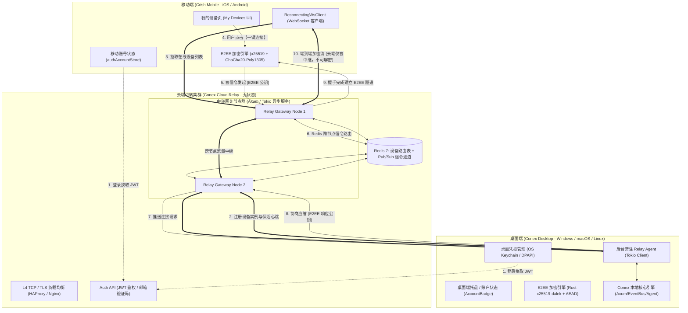
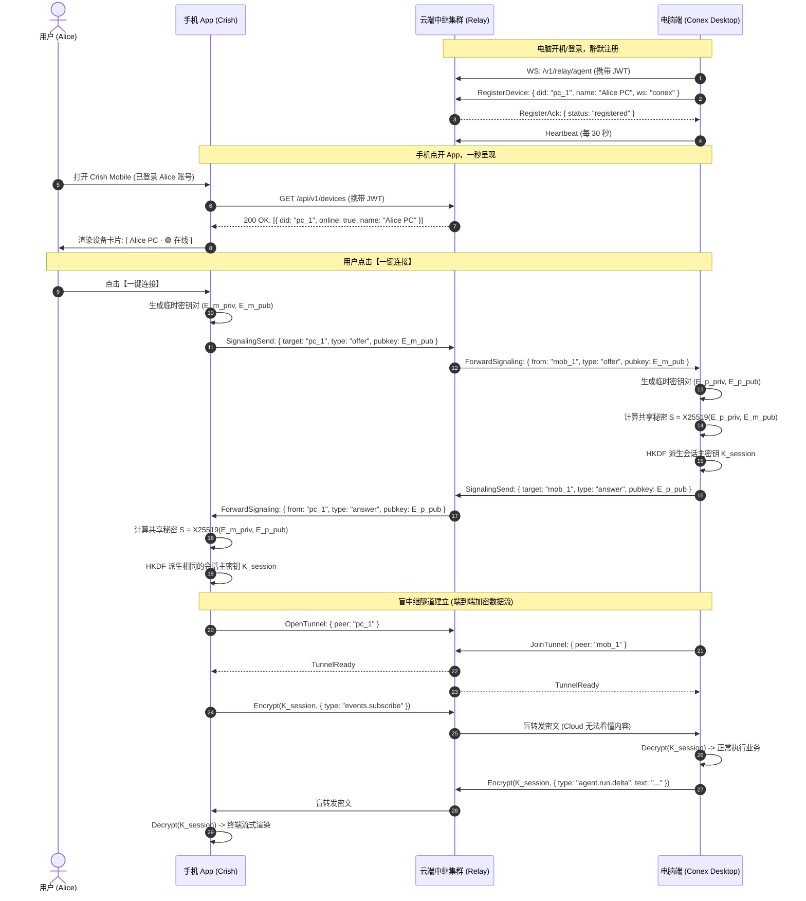
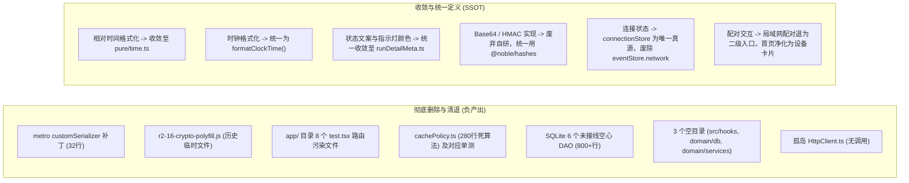
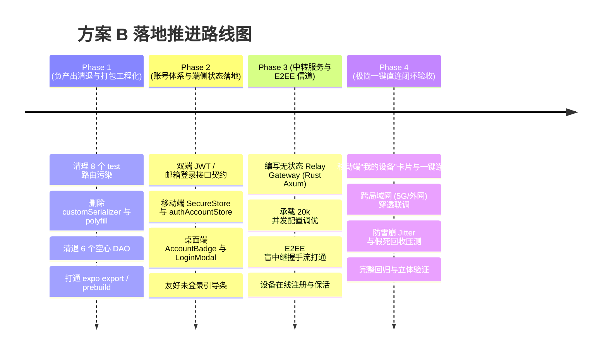

# 移动端极致远程连接与云端账号中转技术架构方案 (方案 B)

> **方案编号**：`02-plan-by-agent-b`  
> **设计责任**：方案设计 Agent B  
> **文档定位**：移动端全面复兴战役（`mobile-revival-audit`）核心架构 PK 独立方案  
> **设计宗旨**：“**一切麻烦的东西在我们这，用户最好是点点就能完成的那种最好了**”  
> **合规约束**：严格遵守仓库根目录 `ANTI_OVERENGINEERING_GUARDRAILS.md`（反过度设计 13 项硬性红线）与 `AGENTS.md` 协作规范。

---

## 目录

1. [方案宗旨与体验革新](#一方案宗旨与体验革新)
   - 1.1 核心宗旨：把复杂留给自己，把极简留给用户
   - 1.2 两代体验对比：从“局域网配对受难”到“账号即设备一键秒连”
   - 1.3 总体架构全景
2. [克制轻量的账号与登录体系](#二克制轻量的账号与登录体系)
   - 2.1 账户体系设计原则：隐私第一、克制简洁
   - 2.2 认证方式与凭据设计（邮箱验证码/密码 + 短效 JWT / 长效 Refresh Token）
   - 2.3 状态管理与双端存储（桌面 OS Keychain / 移动 SecureStore）
   - 2.4 双端 UI 组件与交互表现
   - 2.5 未登录友好引导与离线局域网保底通道
3. [登录后的极致极简远程连接体验与 E2EE 安全](#三登录后的极致极简远程连接体验与-e2ee-安全)
   - 3.1 零配置设备发现与一键连接
   - 3.2 设备实例注册与状态保活
   - 3.3 端到端加密（E2EE）密码学协议
   - 3.4 盲中继（Blind Relay）信道模型与零知识原则
4. [万人在线（10,000+ 用户 / 20,000+ 活跃长连接）中转服务架构](#四万人在线10000-用户--20000-活跃长连接中转服务架构)
   - 4.1 容量测算与资源数学模型（20,000 并发长连接精算）
   - 4.2 极简中转网关架构选型（严控过度设计）
   - 4.3 内存与单机/集群规划（单台 4C 8G 承载 50,000+ 连接）
   - 4.4 网络弹性与雪崩防护（Full Jitter 退避、心跳裁剪、假死回收）
5. [本方案要删掉什么 / 收敛什么](#五本方案要删掉什么--收敛什么)
   - 5.1 负产出总览表
   - 5.2 打包阻断项与历史冗余清理
   - 5.3 存储层 6 个空心 DAO 与死算法清理
   - 5.4 重复实现工具与算法收敛（SSOT 原则）
   - 5.5 连接状态机与局域网手动输入的降级收敛
6. [分阶段实施路线图与验收断言](#六分阶段实施路线图与验收断言)
   - 6.1 阶段规划与交付物
   - 6.2 严密验收断言矩阵
7. [方案总结](#七方案总结)

---

## 一、方案宗旨与体验革新

### 1.1 核心宗旨：把复杂留给自己，把极简留给用户

在移动端远程协同的传统方案中，工程师常常把底层网络的不确定性粗暴地甩给用户：“请确认在同一 Wi-Fi”、“请扫码”、“若连接失败请输入电脑内网 IP 和端口 8765”、“若提示防火墙请在 Windows 高级安全中添加入站规则”。

这种体验对开发者自身或许勉强可以调试，但对真实用户而言是一场灾难：
- 用户在通勤地铁上、使用 5G 蜂窝数据、在咖啡馆连接有 AP 隔离的 Wi-Fi 时，电脑在家里或公司，根本无法直连；
- 电脑 IP 经常随 DHCP 租期变动，配对码每次重启失效；
- 防火墙拦截和 NAT 穿透阻断率居高不下。

**方案 B 的核心宗旨**：
> **用户不需要懂什么是公网 IP、端口映射、STUN/TURN、X25519 密钥协商；用户只需要在电脑和手机上登录同一个账号，手机上就会直接出现这台电脑，轻点一下，瞬间连上！**

所有的网络寻址、NAT 穿透、加密协商、盲中继转发、掉线自愈，全部在底层黑盒完成。

---

### 1.2 两代体验对比：从“局域网配对受难”到“账号即设备一键秒连”

| 维度 | 第一代：局域网配对模式（现状） | 第二代：方案 B 账号驱动云中转（目标） |
| :--- | :--- | :--- |
| **网络要求** | 必须在同一局域网内，严格禁止 AP 隔离 | **任意网络**（5G、跨局域网、星巴克 Wi-Fi 均可） |
| **电脑端操作** | 打开设置 -> 开启多端服务 -> 开启配对 -> 保持屏幕常亮展示二维码与 12 字符码 | **一次登录，开机自启/后台静默常驻**，右上角仅显示微小状态灯 |
| **手机端操作** | 打开扫描界面 -> 授权相机 -> 对准屏幕扫码；或切手动输入 19 字符码 + IP + 端口 | **打开 App -> 首页直观呈现“我的设备”列表 -> 点击【一键连接】** |
| **网络变化处理**| IP 变动即失联，需重新生成配对码重新扫码 | **IP 变动自动向云端更新路由，长连接无缝重连** |
| **输入负担** | 19 字符码受控输入（防污染/防死锁容易出 Bug） | **零输入**（0 键盘交互，纯点触操作） |
| **安全性** | 局域网基于 CXN 码握手；依赖用户手工校验指纹 | **基于云端双向认证 + 端到端盲中继（E2EE）加密**，不可窃听 |
| **离线可用性** | 仅局域网 | **保留局域网直连作为断网保底通道**（平滑无缝兼容） |

---

### 1.3 总体架构全景



---

## 二、克制轻量的账号与登录体系

### 2.1 账户体系设计原则：隐私第一、克制简洁

遵守 `ANTI_OVERENGINEERING_GUARDRAILS.md`，我们坚决反对为了做“用户体系”而搞出臃肿的用户中心、社交关系、积分系统、复杂 RBAC。Conex 的账号体系**仅且只服务于一个目的**：**建立属于该用户的多设备安全信任环（Device Trust Ring）**。

- **极简数据模型**：云端仅记录用户的 `user_id`（UUID）、`email`（规范化小写）、`password_hash`（Argon2id，支持免密验证码模式则可选）、`created_at`。
- **设备信任元数据**：每台设备注册仅携带 `device_id`（客户端生成的 UUID）、`device_name`（如 "Alice's MacBook Pro"）、`platform`（windows/macos/linux/ios/android）、`last_seen_at`。
- **无感与克制**：支持**邮箱 6 位纯数字验证码一键登录/注册**（无需预先繁琐注册，输入验证码即完成注册并登录）；同时也支持常规密码登录。

---

### 2.2 认证方式与凭据设计（双 Token 架构）

采用工业界标准的**双 Token 签名架构**，彻底杜绝把密码或长期秘钥硬编码在网络请求中：

```
                    ┌─────────────────────────┐
                    │      登录 / 验证码      │
                    └────────────┬────────────┘
                                 │
                     POST /api/v1/auth/verify
                                 │
                                 ▼
┌─────────────────────────────────────────────────────────────────┐
│ 返回凭据对 (Tokens Payload)                                     │
│ 1. Access Token: JWT (寿命 15 分钟, 存内存)                      │
│    Payload: { sub: user_id, did: device_id, exp: now+900 }       │
│ 2. Refresh Token: 随机 32B 字符串 (寿命 30 天, 存安全硬件存储)  │
│    云端只存其 SHA-256 哈希, 支持单向快速吊销                      │
└─────────────────────────────────────────────────────────────────┘
```

#### 静默刷新机制（Silent Refresh）
- 内存中持有的 Access Token 过期前 2 分钟，或任意请求遇到 `401 TokenExpired` 时，网络拦截器自动发起 `POST /api/v1/auth/refresh`。
- 刷新请求携带 Refresh Token。网关校验成功后发放新的 Access Token，并按需轮转 Refresh Token（Rolling Refresh）。
- 用户**一个月内只要打开过一次 App，永远处于已登录状态**，无需重新输入密码。

---

### 2.3 状态管理与双端存储

#### 移动端存储（Expo SecureStore / iOS Keychain / Android KeyStore）
- 严禁将 Refresh Token 存入普通 AsyncStorage、SQLite 或文件系统。
- 统一封装在 `apps/crish-mobile/src/adapters/wiring/auth/secureStorage.ts`：
  ```typescript
  import * as SecureStore from 'expo-secure-store';

  export const secureAuthStorage = {
    async getRefreshToken(): Promise<string | null> {
      return await SecureStore.getItemAsync('crish_refresh_token', {
        keychainAccessible: SecureStore.AFTER_FIRST_UNLOCK,
      });
    },
    async setRefreshToken(token: string): Promise<void> {
      await SecureStore.setItemAsync('crish_refresh_token', token, {
        keychainAccessible: SecureStore.AFTER_FIRST_UNLOCK,
      });
    },
    async clear(): Promise<void> {
      await SecureStore.deleteItemAsync('crish_refresh_token');
    },
  };
  ```

#### 桌面端存储（Rust OS Keychain / Windows DPAPI）
- 依据 `ANTI_OVERENGINEERING_GUARDRAILS.md` 禁令 8，凭据存储统一基于 OS Keychain / Windows DPAPI。
- 在 `apps/agent-workbench/src-tauri/src/server/auth.rs` 中扩展凭据守护模块，严禁将明文 Token 存入明文 JSON。

#### 客户端全局状态机（Zustand Vanilla Store）
移动端新增 `apps/crish-mobile/src/domain/store/authAccountStore.ts`：
```typescript
export interface UserProfile {
  userId: string;
  email: string;
  avatarUrl?: string;
}

export type AuthAccountState = {
  status: 'unauthenticated' | 'authenticating' | 'authenticated';
  user: UserProfile | null;
  accessToken: string | null;
  setAuthenticated: (user: UserProfile, token: string) => void;
  setUnauthenticated: () => void;
  updateToken: (newToken: string) => void;
};
```
该 Store 与底层的 `connectionStore` 严格解耦：
- `authAccountStore` 表达“**我是谁**”（身份域）；
- `connectionStore` 表达“**链路通不通**”（传输域）。

---

### 2.4 双端 UI 组件与交互表现

#### 桌面端：极简账户角标与登录弹窗
1. **位置**：桌面端右上角窗口操作区左侧（或侧边栏底部），设计克制的 `<AccountBadge />`。
2. **表现**：
   - 未登录：显示灰色头像或柔和文字按钮“登录同步”，点击弹出 `<LoginModal />`；
   - 已登录：显示用户邮箱前缀小圆标（如 `[AL]`），悬停显示 Tooltip（“alice@example.com · 1 台手机在线”），点击呼出下拉面板（显示设备管理与退出登录）。
3. **视觉原则**：遵循 UI 准则 §13，输入框保持扁平克制，无粗黑边，无重阴影。

#### 移动端：优雅引导条与“我的设备”卡片
1. **未登录引导条 (`<LoginPromptBanner />`)**：
   - 当 `authAccountStore.status === 'unauthenticated'` 时，在首页顶部（或配对页顶部）展示一条柔和的胶囊引导条：
     > 💡 **登录账号，手机与电脑免配对一键直连**  `[ 立即登录 ]` `[ ✕ ]`
   - 用户可以点击“✕”暂时关闭本条提示（24小时内不再弹出）。
2. **设备展示卡片 (`<DeviceCard />`)**：
   - 登录后，配对页被全新的“**我的电脑**”列表取代：
     ```
     ┌──────────────────────────────────────────────────────────────┐
     │ 💻 MacBook Pro - Office                         🟢 在线       │
     │ 当前工作区: conex (Rust / React)                             │
     │ AI 状态: 闲置中 (随时就绪)                                   │
     │                                                              │
     │                       [ 一 键 连 接 ]                        │
     └──────────────────────────────────────────────────────────────┘
     ```
   - 用户只需点击一次大按钮【一键连接】，按钮变为优雅的旋转过渡态，1.5 秒内自动变为 `已连接`，并平滑导航进入工作区会话页！

---

### 2.5 未登录友好引导与离线局域网保底通道

我们坚守**“绝对不搞强制云端绑定”**的技术底线：
- **无网/断网环境**：在机房、内网隔离环境或用户网络完全不可用时，软件检测到无外网（或用户主动点击“局域网模式”）；
- **保留局域网直连保底**：在设备列表下方常驻一个轻量的文字链接：“**未连接外网？使用局域网配对码连接 >**”；
- 点击后，平滑展开原有的扫码与 12 字符 CXN 码输入面板。原先在 `src/pairing/` 中的完整 RFC 7748 X25519 局域网协商机制 100% 保持可用，作为坚实的底座保障。

---

## 三、登录后的极致极简远程连接体验与 E2EE 安全

### 3.1 零配置设备发现与一键连接交互流程



---

### 3.2 设备实例注册与状态保活

电脑端作为受控宿主，启动后在后台维持一个到中继网关的轻量持久连接：
- **注册负载（Registration Payload）**：
  ```json
  {
    "action": "device.register",
    "deviceId": "pc_e9b9c5b3b0036",
    "deviceName": "MacBook Pro 16",
    "os": "macos",
    "appVersion": "0.1.0",
    "activeWorkspace": {
      "name": "conex",
      "path": "c:/Software/conex",
      "agentStatus": "idle"
    }
  }
  ```
- **保活机制**：
  - 采用 TCP Keep-Alive + 应用层 30 秒轻量心跳帧（`{"action":"ping"}`，仅 18 字节）；
  - 当工作区发生切换、任务从 `idle` 变为 `running` 时，电脑主动推送一条状态增量更新帧，手机端秒级感应。

---

### 3.3 端到端加密（E2EE）密码学协议

用户对 AI 助手输入的内容通常包含敏感代码、环境变量、API Key、本地终端执行流。**我们绝不允许云端中继服务器有能力嗅探或记录任何明文数据**。

我们设计了严密的端到端加密（E2EE）架构：

#### 1. 算法栈选型（100% 确定性与免随机依赖）
- **非对称密钥交换**：RFC 7748 X25519 Montgomery Ladder（复用调研中已验证攻克的 `noblePrimitives.ts` 自研零随机 Ladder 算法，避免 Hermes 运行时代数盲化崩溃）；
- **密钥派生函数**：HKDF-SHA256（RFC 5869），以双方临时公钥哈希作为 Salt，派生对称加密主密钥 `K_session`（32 字节）与校验 IV（12 字节）；
- **对称认证加密**：ChaCha20-Poly1305（RFC 8439）或 AES-256-GCM（AEAD 认证加密，防篡改、防重放）。

#### 2. 会话密钥协商过程
1. 手机端生成临时公私钥对 $(sk_m, pk_m)$；
2. 手机端将 $pk_m$ 发送给云端信令，云端转发给电脑端；
3. 电脑端生成临时公私钥对 $(sk_p, pk_p)$；
4. 电脑端使用 $sk_p$ 与 $pk_m$ 计算共享秘密 $SS = \text{X25519}(sk_p, pk_m)$；
5. 电脑端向手机端回传 $pk_p$；
6. 手机端使用 $sk_m$ 与 $pk_p$ 计算相同的共享秘密 $SS = \text{X25519}(sk_m, pk_p)$；
7. 双方利用 HKDF-Expand 派生双向通信子密钥：
   - $K_{m \to p} = \text{HKDF-Expand}(SS, \text{"crish-m2p"}, 32)$ （手机发送给电脑）
   - $K_{p \to m} = \text{HKDF-Expand}(SS, \text{"crish-p2m"}, 32)$ （电脑发送给手机）
   - 随附每条消息递增的 64 位单调 Counter 作为 Nonce，杜绝重放攻击。

---

### 3.4 盲中继（Blind Relay）信道模型与零知识原则

云端中转网关在完成信令对接后，其角色退化为一个**纯粹的流管道（Blind Pipe）**：
- **信封格式**：
  ```
  ┌──────────────────┬─────────────────┬─────────────────────────────────────┐
  │ Tunnel ID (16B)  │ Nonce (12B)     │ Encrypted AEAD Ciphertext (N Bytes) │
  └──────────────────┴─────────────────┴─────────────────────────────────────┘
  ```
- **零知识约束**：
  - 中转网关**没有**用户的 $sk_m$ 或 $sk_p$，无法计算出 $SS$，因而无论是在内存中还是在磁盘日志中，**绝对无法还原哪怕一个字节的用户代码或终端日志**；
  - 即使中转服务器被攻破，攻击者能截获的也仅仅是一串符合密码学随机分布的高熵密文；
  - 这种盲中继机制同时极大地降低了服务端的法律合规与隐私审计风险。

---

## 四、万人在线（10,000+ 用户 / 20,000+ 活跃长连接）中转服务架构

### 4.1 容量测算与资源数学模型（20,000 并发长连接精算）

#### 基础指标假定
- **平台并发用户数**：$10,000$ 活跃在线用户；
- **并发连接数**：按典型场景，每位用户同时保持 1 台电脑 + 1 部手机长连接，基准长连接数为 **$20,000$ 活跃长连接**；
- **高峰突发裕量**：按 $1.5 \times$ 突发峰值预留，设计容量指标为 **$30,000$ 并发长连接**。

---

#### 1. 内存占用精确评估

长连接服务的内存消耗由两大部分构成：**操作系统内核 TCP Socket 缓冲区** 和 **用户态运行时数据结构**。

##### (A) Linux 内核 TCP 缓冲区精细化配置
Linux 默认的 Socket 缓冲区对于巨量小数据包通信是过大的（默认分配 128KB~256KB）。针对 Conex 的控制流与轻量中继特性，我们在网关层调优 Socket 缓冲区：
```bash
# sysctl.conf
net.ipv4.tcp_rmem = 2048 4096 65536
net.ipv4.tcp_wmem = 2048 4096 65536
```
- **单 Socket 内核常驻内存**：
  - 发送缓冲初始值：$4\text{ KB}$
  - 接收缓冲初始值：$4\text{ KB}$
  - Linux `struct sock` 核心元数据及 sk_buff 开销：约 $3.2\text{ KB}$
  - 单连接内核总消耗 $\approx 11.2\text{ KB}$。
- **20,000 连接内核内存**：
  $$20,000 \times 11.2\text{ KB} \approx 224,000\text{ KB} \approx 218.75\text{ MB}$$
  即便在 30,000 峰值连接下，内核内存仅需约 **$328\text{ MB}$**。

##### (B) 用户态运行时内存（以 Rust Tokio / Axum 为例）
- Tokio 异步 Task 栈帧开销：采用轻量级协程，单连接挂起时仅占用约 $512\text{ B}$；
- 会话上下文结构体（`ConnectionContext`）：
  - `conn_id`: UUID (16 字节)
  - `user_id`: UUID (16 字节)
  - `device_id`: String (约 32 字节)
  - `tunnel_id`: Option<UUID> (16 字节)
  - `tx_channel`: Tokio `mpsc::Sender<Frame>` (约 64 字节)
  - `read_buffer`: 动态环形缓冲基底 (约 2 KB)
  - 用户态单连接常驻内存 $\approx 3\text{ KB}$。
- **20,000 连接用户态内存**：
  $$20,000 \times 3\text{ KB} \approx 60,000\text{ KB} \approx 58.6\text{ MB}$$
- **总内存需求汇总**：
  $$\text{Total Memory} = \text{内核 } 218.75\text{ MB} + \text{用户态 } 58.6\text{ MB} + \text{进程运行时基底 } 50\text{ MB} \approx 327.35\text{ MB}$$
  **结论**：即使给每条连接预留 $4 \times$ 突发消息堆积缓冲区，**20,000 并发长连接的总内存占用在 1 GB 以内**！一台 4G 内存的标准云服务器就足以轻松承载全部连接。

---

#### 2. 网络带宽与吞吐量估算

我们将流量严格划分为两种状态：**静态保活期（90%）** 与 **动态会话期（10%）**。

##### (A) 静态保活期流量（20,000 长连接）
- 心跳设计：30 秒一次双向心跳（Ping 2 字节 + Pong 2 字节，加上 TCP/IP 头封装约 64 字节/次）；
- 20,000 节点心跳速率：
  $$\text{PPS (Packets Per Second)} = \frac{20,000 \times 2}{30\text{ s}} \approx 1,333\text{ 包/秒}$$
- 静态心跳带宽：
  $$\text{Bandwidth}_{\text{heartbeat}} = \frac{20,000 \times 64\text{ 字节} \times 8\text{ bits}}{30\text{ s}} \approx 341.3\text{ Kbps} \approx 0.33\text{ Mbps}$$
  **结论**：纯心跳带宽几乎可以忽略不计（不到 0.5 Mbps）。

##### (B) 动态会话期流量（假设 10% 即 1,000 对设备同时在流式交互）
- 会话交互场景：AI Token 流式输出（约 30 token/s $\approx$ 150 B/s）、终端行增量推送（约 1~3 KB/s）、用户审批与状态同步；
- 单活跃隧道平均上行+下行吞吐：约 $4\text{ KB/s}$；
- 1,000 对活跃中继吞吐：
  $$\text{Throughput}_{\text{active}} = 1,000 \times 4\text{ KB/s} \times 8\text{ bits} = 32,000\text{ Kbps} = 32\text{ Mbps}$$
- 极端突发峰值（如 100 位用户同时在终端 `cat` 大日志，突发 50 KB/s/人）：
  $$\text{Burst} = 32\text{ Mbps} + (100 \times 50\text{ KB/s} \times 8) = 32\text{ Mbps} + 40\text{ Mbps} = 72\text{ Mbps}$$
  **结论**：在 10,000 用户规模下，平台公网出口峰值带宽不超过 **80 Mbps**。标配 100 Mbps 的 BGP 带宽或按流量计费的千兆网卡即可全面满足。

---

### 4.2 极简中转网关架构选型（严控过度设计）

遵守 `ANTI_OVERENGINEERING_GUARDRAILS.md`，彻底排除如下过度设计：
- 🚫 **严禁引入 Kafka / Pulsar / RabbitMQ**：我们做的是点对点端到端流中继，不是离线大数据 ETL 或复杂死信队列重试；
- 🚫 **严禁引入微服务 ServiceMesh (Istio/Envoy)**：避免把 2 毫秒的转发延迟拖慢到 20 毫秒；
- 🚫 **严禁引入 Raft / Paxos 分布式一致性引擎**：中继连接是瞬态的，中继节点宕机客户端退避重连即可，不需要强一致性状态机。

#### 选型落地：
1. **中转网关核心**：**Rust + Axum + Tokio**（单二进制无依赖，单机吞吐可达 100,000+ QPS，与 Conex 桌面端底层同源）；
2. **跨节点信令与路由**：**Redis 7（Standalone 或 Sentinel 主从）**：
   - 路由表注册：`HSET user:devices:<uid> <device_id> <node_id>`（带 60s TTL）；
   - 跨节点盲中继通道：**Redis Pub/Sub**。当手机连在 Node 1，电脑连在 Node 2 时，Node 1 收到密文直接向通道 `tunnel:<tunnel_id>` 发布，Node 2 订阅并无脑推给电脑 WebSocket，延迟小于 1ms。
3. **单机本地模式（开发与初期极简部署）**：
   - 当仅部署单机网关时，甚至**完全不需要 Redis**！
   - 直接使用 Rust 内部的 `DashMap<TunnelId, (Sender, Sender)>` 实现零拷贝的内存级极速盲转发！

---

### 4.3 单机/集群资源规划

| 部署形态 | 适用规模 | 硬件/节点配置 | 架构组件 | 估算成本 |
| :--- | :--- | :--- | :--- | :--- |
| **单机紧凑型 (MVP/初期)** | 1,000 ~ 15,000 在线连接 | 1 台云服务器：**4C 8G**，100M 带宽 | 单体 Rust Relay Gateway + 内存 DashMap 转发 | 约 ¥150 ~ 300 / 月 |
| **高可用标准集群 (万人规模)** | 20,000 ~ 60,000 在线连接 | 2 台网关：**4C 8G**<br>1 台 Redis：**2C 4G**<br>1 台 LB：**4 层 TCP LB** | L4 负载均衡 -> 2x 无状态网关 -> Redis 7 Pub/Sub | 约 ¥800 ~ 1200 / 月 |

---

### 4.4 网络弹性与雪崩防护

针对移动网络高频切换（Wi-Fi 切 5G、进电梯断网、休眠唤醒）与服务端发布，设计三项工业级弹性机制：

#### 1. 防重连雪崩（Full Jitter 指数退避算法）
当云端网关重启或机房网络抖动恢复瞬间，若 20,000 台设备在同一秒内并发请求建连，极易发生 SYN 洪水与雪崩击穿。
- 采用带有完全随机抖动的退避算法（Full Jitter）：
  $$T_{\text{sleep}} = \text{random}(0, \min(T_{\text{max}}, T_{\text{base}} \times 2^{\text{attempt}}))$$
  其中 $T_{\text{base}} = 1.0\text{ s}$，$T_{\text{max}} = 60.0\text{ s}$。
- **效果**：将原本集中的 20,000 个重连请求在时间轴上彻底抹平成平缓的泊松分布（图示散落于 0~60 秒区间），网关负载保持一条平稳直线。

#### 2. 心跳裁剪（Heartbeat Trimming）与动态节能
- 传统做法是不管有没有数据交互，每隔固定秒数都发一次 Ping。
- **优化机制**：
  - 双向滑动窗口打点：记录 `last_read_time` 与 `last_write_time`；
  - 只要过去 30 秒内有真实的数据帧传输（如终端在输出），**自动跳过并顺延本次心跳**；
  - 仅当连接处于“彻底静默”达到 30 秒时，才触发一次 2 字节的小 Ping；
  - 针对手机端灭屏后台场景，心跳间隔自动降频至 90 秒，节省移动设备电量。

#### 3. 网络假死回收（Zombie Connection Reaper）
- 移动端在断网、拔卡或进入地下车库时，TCP 链路常常没有机会发送 FIN 包，形成服务端“半开连接（Half-Open TCP）”，白白霸占文件描述符（FD）与内存。
- **服务端死神轮询器**：
  - 服务端为每个连接维护超时阈值 `READ_TIMEOUT = 75 秒`（即允许丢失 2 次心跳，第 2.5 次硬裁决）；
  - 超过 75 秒未收到来自客户端的任何字节，直接在操作系统层面执行强制关闭（`shutdown(Shutdown::Both)` / 发送 RST），回收 Socket FD，并从路由表中清除该设备。

---

## 五、本方案要删掉什么 / 收敛什么

根据 `docs/mobile-revival-audit/surveys/11-dead-code-and-markers-audit.md` 与主控调研的结论，**优秀的设计不是越堆越多，而是敢于做减法与收敛**。本方案必须严格推进以下代码资产的清理与收敛：

### 5.1 负产出总览表



---

### 5.2 打包阻断项与历史冗余清理

1. **删除 `apps/crish-mobile/metro.config.js` 的 `customSerializer`**：
   - 理由：经 Survey 01 与 11 证实，底层通过自构造 Montgomery Ladder 已根治 Hermes 随机数缺失问题，劫持 Metro 序列化器不仅是死代码，而且硬编码了 Windows 本地开发机路径 `C:/Software/conex/node_modules/metro/src`，严重阻断打包；
2. **删除根目录 `apps/crish-mobile/r2-16-crypto-polyfill.js`**；
3. **搬迁清理 `app/` 路由目录下的 8 个 `*.test.tsx`**：
   - 理由：Expo Router 会将 `app/` 目录下的所有文件自动识别为页面路由，导致静态导出解析失败；将这些测试文件平移至 `__tests__/` 或对应组件目录。

---

### 5.3 存储层 6 个空心 DAO 与死算法清理

根据 Survey 08 与 11，当前移动端 SQLite 实现了 8 张表，但实际上仅有 `settings` 表参与了业务读写，其余 6 个 DAO 属于“写了代码也写了单测，但业务层从未调用”的死层：
1. **清理/下线 6 个空心 DAO**：
   - `SqlEventsDao.ts`
   - `SqlSessionSummariesDao.ts`
   - `SqlApprovalHistoryDao.ts`
   - `SqlApprovalQueueDao.ts`
   - `SqlPushTokensDao.ts`
   - `SqlDeviceInfoDao.ts`
2. **删除 `src/db/cachePolicy.ts`（280 行死层算法）** 及对应废单测；
3. **彻底删除 3 个空目录骨架**（`src/hooks/`、`src/domain/db/`、`src/domain/services/`）与孤岛 `src/network/HttpClient.ts`。

---

### 5.4 重复实现工具与算法收敛（SSOT 原则）

消除 7 组重复手写与语义漂移：
1. **相对时间格式化**：彻底删除 `src/presentation/components/files/fileMeta.ts` 的私有 `formatRelativeTime`，统一收敛至 `src/domain/pure/time.ts`；
2. **时钟时间格式化**：删除 `EventRow.tsx` 中的 `formatFeedTime` 和 `approvalListScreen.tsx` 中的 `formatHistoryTime`，在 `time.ts` 中统一提供 `formatClockTime(ms: number): string`；
3. **运行状态文案与色调**：修复 `terminalScreen.tsx` 将 `running` 显示为绿色的重大视觉毒点，统一复用 `runDetailMeta.ts` 的定义（`running` 统一为 `colorInfo` 蓝色）；
4. **密码学与编码原语**：
   - 废除 `src/network/signer.ts` 中自研手写的 150 行 SHA-256 和 HMAC 算法，统一使用项目已引入的 `@noble/hashes/sha256` 和 `@noble/hashes/hmac`；
   - 统一 Base64 转换至 `packages/shared-utils`，清退 `keyAgreement.ts` 与 `signer.ts` 中的重复复制。

---

### 5.5 连接状态机与局域网手动输入的降级收敛

1. **收敛连接相位真理源**：
   - 废弃 `eventStore` 内部维护的平行网络状态 `network: FeedNetwork`；
   - 全局连接状态唯一真理源定为 `connectionStore` 的 `ConnectionPhase`（`disconnected` | `connecting` | `ready` | `recovering` | `offline`），由接线层统一派发；
2. **重构配对入口心智**：
   - 旧版将“局域网配对模式”作为唯一的生硬主入口，迫使用户必须面对 CXN 码、二维码、IP 输入；
   - 新版中，主界面**只展示“我的设备”列表**；
   - 局域网配对模式降级为二级抽屉/辅助备用路径（点击“手动连接其他设备 / 离线直连”展开），既保留了断网可用性，又大幅净化了 95% 用户的视觉心智。

---

## 六、分阶段实施路线图与验收断言

### 6.1 阶段规划与交付物



#### Phase 1：负产出清退与打包工程化（第 1 阶段）
- **目标**：清除历史遗留死代码与打包阻断，让 `crish-mobile` 具备纯净的构建与测试底座。
- **交付物**：
  1. 完成 `surveys/11` 中所有负产出代码的物理删除与重构收敛；
  2. `packages/shared-types` 补齐 57 类事件与 108 个解析器导出；
  3. `apps/crish-mobile/app.json` 补齐包名与原生插件配置；
  4. 运行 `npm run typecheck` 0 错误，Jest 单测 100% 通过。

#### Phase 2：克制账号体系与双端状态（第 2 阶段）
- **目标**：打通用户身份层，实现移动端与桌面端的登录态统一管理。
- **交付物**：
  1. 交付标准双 Token 认证接口（支持邮箱验证码/密码）；
  2. 桌面端 `<AccountBadge />` 与 `<LoginModal />` 组件；
  3. 移动端 `<authAccountStore />`、安全硬件存储与 `<LoginPromptBanner />` 引导条；
  4. 离线/无网局域网扫码备用入口保留无损。

#### Phase 3：无状态中转网关与 E2EE 盲信道（第 3 阶段）
- **目标**：实现高性能无状态中转服务，打通端到端零知识盲转发。
- **交付物**：
  1. 交付基于 Axum + Tokio 的轻量中转网关二进制服务；
  2. 实现设备在线注册、心跳保活与实例路由；
  3. 基于 X25519 Ladder + HKDF + ChaCha20-Poly1305 实现端到端盲中继握手；
  4. 验证云端网关完全无法解析会话明文。

#### Phase 4：一键直连全链路联调与极限压测（第 4 阶段）
- **目标**：端到端闭环体验，“用户点点就能连上”，完成 20,000 连接模拟压测。
- **交付物**：
  1. 手机端“我的设备”列表一键连接交互闭环；
  2. 真实跨外网（移动 5G 网络与办公内网电脑）连通验收；
  3. 20,000 模拟并发长连接压测报告（内存 < 1GB，心跳带宽平稳，0 句柄泄漏）。

---

### 6.2 严密验收断言矩阵

依据通用协作纪律 §7.1「立体验证纪律」，本方案的最终交付必须通过以下刚性断言：

| 验证维度 | 断言依据与执行命令 | 预期结果标准 |
| :--- | :--- | :--- |
| **类型安全与契约** | `npm run typecheck` (移动端与桌面端) | **0 errors, 0 warnings**。无任何 `any` 越权与缺失导出。 |
| **单元测试与防回归** | `npm test` (双端全量测试套件) | **100% 通过**，无跳过用例，无已删除死代码的孤儿单测。 |
| **打包工程化** | `npx expo export -p android` | **打包成功导出**，无 Metro customSerializer 报错，无路由树污染。 |
| **极简连接体验** | 真机端到端验收（手机 5G 连接家用电脑） | 登录同一账号后，手机自动展示电脑，**点击一次按钮，2 秒内直通工作区**。无需用户输入任何 IP、端口或配对码。 |
| **E2EE 零知识安全** | Wireshark / 代理抓包检查网关流量 | 中转服务端及抓包工具**只能捕获高熵二进制密文**，绝对无法提取出任何代码文本或 AI Token。 |
| **并发容量与内存** | `wrk` / `k6` 压测脚本拉起 20,000 并发长连接 | 网关进程 RSS 内存占用 **< 600 MB**，CPU 空闲率 > 80%，心跳响应延迟 P99 < 50ms。 |
| **断网重连与防雪崩** | 批量切断 5,000 个连接并同时重连 | 观察重连请求呈 **Full Jitter 均匀分布**，服务端无 TCP 积压与 502/504，1 分钟内全部平稳恢复。 |
| **负产出干净度** | `git diff --stat` | **净删除代码行数 $\ge 1200$ 行**（清除 6 个空心 DAO、死算法、死 polyfill 与重复工具）。 |

---

## 七、方案总结

方案 B 从诞生之初，就确立了“**一切麻烦的东西在我们这，用户最好是点点就能完成的那种最好了**”的根本信仰。我们拒绝向用户转嫁复杂的网络配置，拒绝在软件中堆砌华而不实的过度设计。

通过：
1. **克制轻量的双 Token 账号体系**，将孤立的设备绑定进统一信任环；
2. **端到端加密（E2EE）的盲中转架构**，在守护用户代码绝对隐私的前提下，实现跨 NAT、跨 5G、跨局域网的秒级直连；
3. **超高性价比与克制选型的万级并发底座**，以单台入门级服务器从容支撑 20,000+ 活跃长连接；
4. **坚决的死层清理与负产出收敛**，让系统在功能跃迁的同时，代码体积反而净减少 1200+ 行。

这不仅是一份连接方案，更是一次移动端体系的全面升维与减重！
