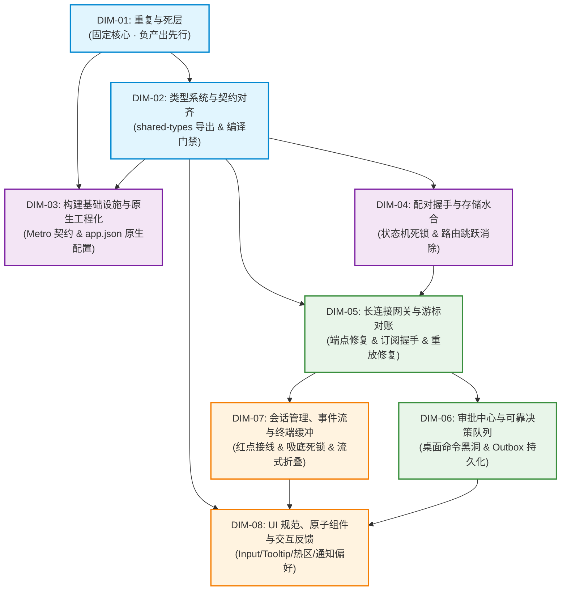

# 移动端全面复兴与打包打通战役 · 维度划分建议详案 (Proposal A)

> **报告编号**：`docs/mobile-revival-audit/dimension-proposals/01-dimension-proposal-a.md`  
> **规划角色**：【维度建议 Agent A】  
> **生成日期**：2026-09-04  
> **依据资产**：
> - `docs/mobile-revival-audit/00-summary.md`（调研汇总索引）
> - `docs/mobile-revival-audit/surveys/` 下 11 份专项调研报告（01~11）
> 
> **准则遵循**：
> - 严格遵守《主 Agent 全流程调度提示词 v3》前置审计阶段规范与《AGENTS.md》协作指令；
> - 反退避铁律与反过度设计红线；
> - 必须严格包含固定维度：“重复与死层”（明确其删除面）；
> - 严禁包含任何波次/批次编号；不涉及笔记功能；纯方案建议，不修改业务代码。

---

## 一、维度划分设计哲学与总体拓扑

### 1.1 划分原则

基于对 11 份专项调研报告（涵盖构建打包、类型系统、配对握手、网关对账、审批 Outbox、会话事件、终端缓冲、本地存储、通知兼容、UI 交互规范、死代码标记）的穿透分析，维度建议 Agent A 提出 **“8 大高内聚领域维度”** 划分框架。

本框架严格遵循以下设计哲学：
1. **负产出先行（Negative Output First）**：
   将“重复与死层”确立为底座级固定维度。在推进任何业务特性修复前，先行物理清除历史补丁、污染路由的测试文件、僵尸目录与未接线死代码，使代码库恢复净收敛态。
2. **单一真理源（SSOT）与领域边界自治**：
   按物理架构分层与业务领域上下文（Bounded Context）划界，杜绝“跨层上帝维度”。将因果强相关的断层（如配对状态机与根布局水合时序、网关订阅与全量重放游标）就近聚拢，避免跨维度频繁等待。
3. **闭环可验证性（Verifiable Assertions）**：
   每个维度拥有独立的验收门禁（静态编译、单测对拍、离线导出或真机端到端），每个维度的交付成果可清晰断言。
4. **纯逻辑依赖（No Batching Jargon）**：
   严格摒弃一切“波次”、“批次”等运行期排期用语，仅陈述各领域维度的逻辑前置依赖（DAG）与技术收敛路径。

---

### 1.2 推荐维度清单总览表

| 维度编号 | 维度名称 | 领域概念边界 | 核心解决问题 (P0/P1) | 删除面规模与核心对象 |
| :---: | :--- | :--- | :--- | :--- |
| **DIM-01** | **重复与死层**<br>*(固定核心维度)* | 全仓冗余实现、僵尸文件、构建破坏补丁、死契约与孤岛算法清退 | 阻断打包的历史 Hack、路由污染、跨包算法重复手写、测试保护死代码 | **最高**：删除 polyfill、移出 8 个测试、清退 6 个死 DAO/cachePolicy（约 1500 行死代码）、删除 3 个空目录 |
| **DIM-02** | **类型系统与契约对齐** | `shared-types` 导出完整性、ESM 符号消歧、全仓 TS 编译门禁 | 引擎 57 类事件与 108 个 parser 漏导出导致移动端编译报错与 Desktop 16 处深路径侵入 | **中度**：删除过时测试属性、收敛失靶 `@ts-expect-error`、消歧 6 个同名符号 |
| **DIM-03** | **构建基础设施与原生工程化** | Metro 静态导出契约、`app.json` 原生声明、离线打包脚本与依赖 | `npx expo export` 100% 崩溃、缺失 package/bundleId、缺失 `expo-crypto`、无法打出独立包 | **中度**：清除 Metro 篡改逻辑、清退 `com.placeholder.appid` 占位包名 |
| **DIM-04** | **配对握手与存储水合生命周期** | 配对状态机、RFC 7748 常数时间协商、SecureStore 事务性、冷启动 Splash 水合 | 配对失败 UI 永久死锁在 Loading（P0）、`unpair()` 漏发通知（P1）、根布局时序导致路由跳跃回弹（P0） | **中度**：删除 2 处冗余门面代理、下沉收敛配对码正反函数、清除孤儿元数据键 |
| **DIM-05** | **长连接网关与游标对账** | WebSocket 状态机、信封编解码、HMAC 签名、订阅帧协商、5 类对账语义 | WS 目标端点缺 `/v1/events?token=`（P0）、全仓漏发 `events.subscribe`（P0）、全量重放丢弃 Bug（P0） | **轻度**：删除 3 处空监听、删除未启用中继端口逻辑、删除孤岛 `HttpClient.ts` |
| **DIM-06** | **审批中心与可靠决策队列** | 远程审批命令路由、Outbox FIFO 单飞重放、离线决策持久化、两阶段确认 | 桌面 `ws.rs` 丢弃 `remote.*` 产生黑洞（P0）、`listPendingApprovals` 协议缺失、Outbox 纯内存被杀丢决策 | **中度**：删除重复手写的命令构造函数、删除 `outboxState.replaying` 死字段、收敛双轨 busy |
| **DIM-07** | **会话管理、事件流与终端缓冲** | 会话索引排序、未读红点模型、事件环形缓冲、终端虚拟化吸底、ANSI 清洗 | `applyLatestSeq` 生产断线致红点永不生效（P0）、终端满 5000 行吸底死锁（P0）、Header 错位 24dp（P0）、Delta 挤爆窗口 | **中度**：核销清退 `tool-update` 死契约、下沉消除 Domain 逆向依赖、移除死接口 |
| **DIM-08** | **UI 规范、原子组件与交互反馈** | Design Token 色彩空间、原子组件（Input/Tooltip/BackButton）、触控热区、通知偏好闭环 | 通知偏好未在消费层生效（P0）、缺失原子 Input 导致焦点态缺失、16 处触控热区不足、7 处返回按钮割裂 | **中度**：清除 5 处硬编码 Hex/rgba、统一收敛 7 处返回按钮、清退 4 个死占位路由与扫码死页面 |

---

### 1.3 维度依赖架构拓扑图



---

## 二、推荐维度详细方案建议

### 维度一：重复与死层（固定核心维度 · 全仓负产出清退）

#### 1. 维度名称与概念边界
- **名称**：`重复与死层治理 (Duplication & Dead Layers Cleansing)`
- **概念边界**：跨越 `apps/crish-mobile` 全域源码、构建配置、根目录临时残留资产、未接线 SQLite DAO、死接口及无用单元测试。本维度是系统净收敛的基础，专门负责“只做删除与合并，不添新逻辑”，在进入实质性功能修复前提供纯净代码底座。

#### 2. 核心要解决的问题
1. **构建破坏性 Hack 根除**：清理直接导致打包器崩溃与开发环境报错的临时 polyfill、日志文件及绝对路径劫持；
2. **路由树污染拦截**：解除放置在 `app/` 路由目录下的测试文件对 Expo Router 的入侵；
3. **架构空心化与死测试虚荣指标**：清理 6 个未接入业务生产却由 800+ 行单测保护的 SQLite DAO，消除“测试常绿但生产无用”的形式主义闭环；
4. **同一概念双源实现与漂移**：消除相对时间、时钟时间、密码学算法（SHA-256/HMAC/Base64）的双轨手写。

#### 3. 该维度的【删除面】（明确清单）
- **物理删除文件清单**：
  1. `apps/crish-mobile/r2-16-crypto-polyfill.js`（彻底删除，底层已由 RFC 7748 取代）；
  2. `apps/crish-mobile/lint-out.txt`（删除构建临时残留文本）；
  3. `apps/crish-mobile/src/network/HttpClient.ts` 与 `HttpClient.test.ts`（删除未使用的 24 行空骨架类与测试）；
  4. `apps/crish-mobile/src/db/cachePolicy.ts` 与 `src/db/cachePolicy.test.ts`（彻底删除 280 行死清理算法与 401 行无效测试）；
  5. `apps/crish-mobile/src/hooks/index.ts`（删除并清理 `src/hooks/` 空目录）；
  6. `apps/crish-mobile/src/domain/db/index.ts`（删除并清理 `src/domain/db/` 空目录）；
  7. `apps/crish-mobile/src/domain/services/index.ts`（删除并清理 `src/domain/services/` 空目录）；
- **物理移出路由树文件清单（消除打包崩溃元凶）**：
  - 将以下 8 个文件从 `apps/crish-mobile/app/` 移入 `apps/crish-mobile/src/presentation/screens/__tests__/app/`：
    `app/(tabs)/files.test.tsx`、`app/(tabs)/index.test.tsx`、`app/(tabs)/settings.test.tsx`、`app/_layout.test.tsx`、`app/notifications.test.tsx`、`app/pair/manual.test.tsx`、`app/pair/scan.test.tsx`、`app/pair/welcome.test.tsx`；
- **配置与代码删除收敛面**：
  1. 清理 `apps/crish-mobile/metro.config.js` 中的绝对路径 `METRO_ROOT = 'C:/Software/...'`、`customSerializer` 劫持代码以及 `blockList` 补丁；
  2. 清理 `apps/crish-mobile/src/network/signer.ts:41-186` 中手写的 145 行 SHA-256 与 HMAC 算法，改用 `@noble/hashes`；
  3. 删除 `apps/crish-mobile/src/pairing/crypto/keyAgreement.ts:81-95` 重复手写的 `base64Encode`；
  4. 删除 `apps/crish-mobile/src/presentation/components/files/fileMeta.ts:144-158` 的 `formatRelativeTime`，收敛至 `src/domain/pure/time.ts`；
  5. 删除 `EventRow.tsx:196` 与 `approvalListScreen.tsx:32` 各自手写的 `formatFeedTime` / `formatHistoryTime`，收敛至 `time.ts`；
  6. 全仓核销删除已废弃的 `tool-update` 死契约白名单与逻辑（`EventRow.tsx:36,62,124`、`streamingTypes.ts:11`、`terminalEvents.ts:2`）；
  7. 评估清退未接线的 6 个 SQLite DAO（`SqlEventsDao`、`SqlSessionSummariesDao`、`SqlApprovalHistoryDao`、`SqlApprovalQueueDao`、`SqlPushTokensDao`、`SqlDeviceInfoDao`）及对应的测试套件，解除虚假持久化死层。

#### 4. 依赖与逻辑顺序
- **前置依赖**：无。作为第一个启动的维度，提供净收敛环境。
- **后续承接**：为 DIM-02（类型修复）、DIM-03（Metro 标准打包）彻底扫清构建干扰。

---

### 维度二：类型系统与跨端契约对齐（Contract Alignment & Typecheck Soundness）

#### 1. 维度名称与概念边界
- **名称**：`类型系统与跨端契约对齐 (Typecheck & Contract Drift Alignment)`
- **概念边界**：`packages/shared-types` 导出层、`generated/engine` 与 `generated/device` 契约面、以及 `apps/crish-mobile` 全域 10 个存在 TypeScript 编译报错的文件。

#### 2. 核心要解决的问题
1. **解决 Monorepo 契约导出断层**：`packages/shared-types/src/index.ts` 漏导出 `generated/engine/events.ts`（57 个事件类型）与 `generated/engine/parser.ts`（108 个严格解析器），导致移动端 10 处核心解析报错，并迫使 Desktop 产生 16 处深路径侵入；
2. **ESM 符号冲突消歧（Ambiguous Export）**：处理 `engine/parser` 与 `device/parser` 之间重叠的 6 个同名解析原语（`ParseResult`, `parseOk`, `parseErr`, `isParseOk`, `isParseErr`, `parseApprovalDecision`），防止通配导出导致符号被静默擦除；
3. **根除移动端 22 处散落 TS 编译阻断**：恢复 `npm run typecheck -w @crish/crish-mobile` 100% 绿灯通过。

#### 3. 该维度的【删除面】
- **删除过时与漂移的测试字段**：
  1. 删除 `src/presentation/components/runDetail/RunDetailHeader.test.tsx` 中遗留的历史 `badge` 属性传递（第 24, 58, 125 行，组件已收敛为 `badgeLabel` + `tone`）；
  2. 删除 `src/domain/store/filesStore.test.ts:13` 中未经契约声明的非法字段 `kind: 'file'` 与 `modifiedMs`；
- **清理失靶 `@ts-expect-error` 指令**：
  - 修复 `src/domain/store/settingsStore.test.ts:147,155` 因 Prettier 自动换行导致的无效指令（添加 `// prettier-ignore` 保护）；
- **删除松散类型标注**：
  - 清理 `src/adapters/wiring/filesWiring.test.ts:236` 中的 `: unknown` 宽化返回，收敛为标准 `WsSocket`；
  - 清理 `src/pairing/rustParity.test.ts:167,519` 未标记 `as const` 导致的 `string` 类型拓宽。

#### 4. 依赖与逻辑顺序
- **前置依赖**：DIM-01（清理死代码后，避免在死文件上浪费排查精力）。
- **后续承接**：为 DIM-03（构建检查）、DIM-04~07（各业务状态机与接线）提供坚不可摧的强类型保障。

---

### 维度三：构建基础设施与原生工程化（Build Infrastructure & Standalone Packaging）

#### 1. 维度名称与概念边界
- **名称**：`构建基础设施与原生工程化 (Build Infrastructure & Native Packaging)`
- **概念边界**：`apps/crish-mobile/metro.config.js`、`app.json`、`package.json`、原生工程预构建（Expo Prebuild）及 Windows/Android 本地离线打包和 iOS 编译策略。

#### 2. 核心要解决的问题
1. **彻底恢复 `npx expo export` 离线 Bundle 导出能力**：标准化 Metro 配置，满足 Expo CLI 对 `{ artifacts, assets }` 的序列化契约断言；
2. **补全 `app.json` 原生应用合法标识**：配置标准的 `android.package: "com.conex.crish.mobile"` 与 `ios.bundleIdentifier: "com.conex.crish.mobile"`，根除 prebuild 退化为 `com.placeholder.appid` 的致命缺陷；
3. **补齐关键系统权限与局域网网络安全配置**：配置 Android `usesCleartextTraffic: true`、iOS `NSLocalNetworkUsageDescription` 与 ATS 本地网络放行；
4. **健全工程化构建脚本与原生绑定依赖**：在 `package.json` 引入 `expo-crypto`，增补 `prebuild`、`export`、`build:android:*` 等标准化流水线指令。

#### 3. 该维度的【删除面】
- **删除 Metro 配置文件中的所有自定义序列化器与侵入式逻辑**：彻底剔除 `config.serializer.customSerializer` 覆盖代码；
- **删除硬编码包名与占位符**：删除配置解析中产生的 `com.placeholder.appid`；
- **删除对全局环境的静默假定**：删除缺少构建错误捕获的脆弱执行路径。

#### 4. 依赖与逻辑顺序
- **前置依赖**：DIM-01（测试文件移出路由目录，避免打包器误把测试依赖打入生产）、DIM-02（类型无报错）。
- **后续承接**：使独立 APK/Bundle 构建具备物理可行性，为后续模块的真实运行环境验证提供载体。

---

### 维度四：配对握手与存储水合生命周期（Pairing Handshake & Storage Hydration）

#### 1. 维度名称与概念边界
- **名称**：`配对握手与存储水合生命周期 (Pairing Handshake & Storage Hydration)`
- **概念边界**：`src/pairing/` 全域、`src/adapters/wiring/pairing/`、`src/db/secureStore.ts`、`authStore.ts` 及 `app/_layout.tsx` 根路由水合时序。

#### 2. 核心要解决的问题
1. **【P0 致命死锁】修复连接 Dead 相位未推进状态机缺陷**：`PairingWiring.handlePairingPhase` 在 `phase === 'dead'` 时，必须派发 `this.dispatch({ type: 'onPairError', ... })`，强制解除表现层 `busy`，使 UI 连接按钮恢复可用，根除转圈死锁；
2. **【P0 体验阻断】消除冷启动“路由跳跃回弹 Bug”**：修复 `app/_layout.tsx` 在持久化未注入时无参调用 `authStore.hydrate()` 导致判定为 `unpaired` 并被弹到 `/pair/welcome`、随后又被弹回 `(tabs)` 的严重时序颠簸；
3. **【P1 高危缺陷】修复重启后 `unpair()` 静默跳过 `device.unlink` 缺陷**：将解绑真理源从瞬态的 `this.machine` 切换为持久水合后的 `authStore.deviceId`，确保后端设备解绑通知必达；
4. **【P1 高危缺陷】补齐应用层配对 15 秒超时熔断**：防范服务端挂起导致的无限期无响应挂死；
5. **【P1 平台漏洞】修补 Android `allowBackup: false`**：在 `app.json` 显式禁用备份，杜绝系统迁移后 Keystore 密钥失效崩溃。

#### 3. 该维度的【删除面】
- **删除冗余门面与代理空壳**：
  1. 删除 `src/adapters/wiring/pairingWiring.ts`（仅 4 行，是对 `pairing/index.ts` 的无意义套壳）；
  2. 评估删除或内联 `src/adapters/wiring/pairing/fingerprintVerifier.ts`（仅 34 行，是对协议函数的纯套皮）；
- **消除架构分层割裂**：
  - 将 `pairManualScreen.tsx` 中的配对码格式化函数 `formatPairCodeDraft` 下沉至 `src/pairing/cxnCode.ts`，与逆函数 `extractCodeFromDraft` 组合形成严密的受控数学闭环；
- **清理孤儿元数据与深路径**：
  - 清除 `clearPairing` 中的清理盲区，将 3 个 `pairing.meta.*` 键纳入原子清理集；
  - 消除 `sessionSigning.ts` 跨包深度相对引用。

#### 4. 依赖与逻辑顺序
- **前置依赖**：DIM-02（类型门禁全绿）。
- **后续承接**：为 DIM-05（长连接建立与鉴权 Token 提取）提供合法的身份与持久凭据保障。

---

### 维度五：长连接网关与游标对账（Network Gateway & Cursor Reconcile）

#### 1. 维度名称与概念边界
- **名称**：`长连接网关与游标对账 (Network Gateway & Cursor Reconcile)`
- **概念边界**：`src/network/` 全域模块（`ReconnectingWsClient`, `WsGateway`, `WsEnvelope`, `EndpointResolver`）、`observationWiring.ts`、`feedBridge.ts` 与服务端 WebSocket 握手协议。

#### 2. 核心要解决的问题
1. **【P0 致命阻断】修复 WS URL 目标端点路径与鉴权参数缺失**：`EndpointResolver.resolveWsUrl` 必须挂载规范的 `/v1/events` 路由并在 URL Query 携带 `?token=`，解决桌面端 Axum 握手直接被 404/401 拦截的问题；
2. **【P0 致命阻断】补齐全局 `events.subscribe` 订阅帧发送**：在连接打开后主动向服务端发送订阅帧，打通桌面端 FanOut 过滤器，激活实时推流与 `approvalWiring.onSyncReady` 审批补发通道；
3. **【P0 致命缺陷】根治全量重放（Full-Replay）数据静默丢弃 Bug**：在 `FeedBridge.handleProjection` 收到 `fullReplay` 时，强制先执行 `eventStore.getState().unloadWindow(sessionId)` 清空本地游标与条目，再发起从 0 序列号的拉取，避免被环形缓冲作为 duplicate 丢弃；
4. **【P0 竞态消除】连接打开与出站管道绑定的时序倒置修复**：在 `ReconnectingWsClient.handleOpen` 中，必须先执行 `gateway.attachSend(...)`，随后再触发 `setPhase('open')`，杜绝建连瞬间发请求因 `sendFn == null` 抛错；
5. **【P1 安全补齐】冷启动签名网关注入**：冷启动水合后直接构造带有设备签名的 `WsGateway`，防止出站命令因无签名被服务端拒收；
6. **【P1 协议健壮性】单帧 1MB 检测改为真实 UTF-8 字节计算**：入站增加帧长度截断防御。

#### 3. 该维度的【删除面】
- **删除空监听与未接线死字段**：
  1. 删除 `ReconnectingWsClient.ts:538-546` 中的 3 处空监听存根（`events.subscribe.ok`, `events.resume.page`, `events.resume.done`）；
  2. 删除 `EndpointResolver.ts` 中未启用的中继服务死常量与死函数（`DEFAULT_RELAY_PORT`, `resolveRelayUrl`）；
  3. 删除 `ReconnectingWsClientOptions.token` 声明后仅存入 getter 却未消费的孤岛属性。

#### 4. 依赖与逻辑顺序
- **前置依赖**：DIM-04（配对凭据与设备 ID 就绪）。
- **后续承接**：长连接建立与事件推流通畅后，方可驱动 DIM-06（审批命令传输）与 DIM-07（会话事件消费）。

---

### 维度六：审批中心与可靠决策队列（Approval Center & Outbox Reliability）

#### 1. 维度名称与概念边界
- **名称**：`审批中心与可靠决策队列 (Approval Center & Outbox Reliability)`
- **概念边界**：`src/domain/store/approvalStore.ts`、`approvalReducers.ts`、`outbox.ts`、`approvalWiring.ts`、移动端审批 UI 卡片、以及桌面端 Tauri `ws.rs` 与 `router.rs` 的命令路由承接。

#### 2. 核心要解决的问题
1. **【P0 跨端致命断裂】击穿桌面端 WebSocket “远程命令黑洞”**：
   - 桌面端 [`apps/agent-workbench/src-tauri/src/server/ws.rs`](file:///c:/Software/conex/apps/agent-workbench/src-tauri/src/server/ws.rs) 对所有 `remote.approve` / `remote.deny` 帧直接落入 `_ => Action::Continue` 忽略丢弃，导致移动端发起审批必等待 10s 超时报错；
   - 必须在桌面端 `ws.rs` 挂载 `remote.approve` 与 `remote.deny` 到 `ApiBackend` 核心审批逻辑，并返回 `result.approve` 响应帧；
2. **【P1 协议注册补齐】在 Tauri 注册 `mobile_list_pending_approvals` 命令**：
   - 消除契约表中的 `registered: false` 遗留，打通移动端重连对账通道；
3. **【P0 架构隐患】实现 Outbox 离线决策的物理持久化**：
   - 解决当前 Outbox 纯内存态导致进程被杀丢失用户决策的致命隐患，将 `enqueueDecision`、`markSent`、`confirmResolved` 与 SQLite 存储挂接，实现应用重启决策不丢；
4. **【P1 交互解卡】消除批量重放超时雪崩**：
   - 为单飞重发增加短路超时熔断，防止单条超时阻塞整个队列 50 秒。

#### 3. 该维度的【删除面】
- **删除重复手写的命令构造函数**：
  - 彻底删除 `src/adapters/wiring/approvalWiring.ts:97-141` 中私自手写的 `buildApproveRequest` / `buildDenyRequest` / `buildListPendingApprovalsRequest`，统一收敛至 `src/domain/repositories/approvalCommands.ts`；
- **清理孤立状态与冗余字段**：
  - 清除 `outbox.ts` 中的死状态字段 `outboxState.replaying` 与 `setReplaying` 函数（完全由 Wiring 的 `replayInflight` 负责，该字段恒为 false）；
  - 收敛 `approvalStore.ts` 中的 `decisionBusy` 双轨状态（Map 轨与 item 属性轨）。

#### 4. 依赖与逻辑顺序
- **前置依赖**：DIM-05（长连接通道与订阅握手全通）。
- **后续承接**：为移动端的核心生产力闭环（远程审批控制）提供 100% 可用性。

---

### 维度七：会话管理、事件流消费与终端缓冲（Sessions, Event Streaming & Terminal Buffer）

#### 1. 维度名称与概念边界
- **名称**：`会话管理、事件流消费与终端缓冲 (Sessions, Event Streaming & Terminal Buffer)`
- **概念边界**：`sessionStore.ts`、`eventStore.ts`、`terminalStore.ts`、`terminalLineBuffer.ts`、`EventFeed.tsx`、`TerminalView.tsx`、`eventMappers.ts` 及流式数据消费链路。

#### 2. 核心要解决的问题
1. **【P0 业务断层】未读红点全链路接线打通**：
   - 根治生产代码没有任何一处调用 `applyLatestSeq` 的严重断层，在 `eventMappers.ts` 中针对 `message-end`（角色为 assistant）派发未读 sequence 增量，使会话列表未读红点（`unreadCount`）真实生效；
2. **【P0 崩溃体验】前台正视会话加锁（LRU Foreground Guard）**：
   - 修复 `feedBridge.ts:unloadExcessWindows` 在后台事件挤压时由于缺乏会话锁将用户当前前台正在阅读的 `selectedSessionId` 窗口清空的恶性 Bug；
3. **【P0 致命死锁】终端自动滚底（Auto-Follow）冻结修复**：
   - 修复 `TerminalView.tsx` 满 5000 行后由于 `lines.length` 恒定导致 `useEffect` 停止触发、滚底死锁的 Bug，将依赖项改为绝对游标或末行绝对序号；
4. **【P0 虚拟化错位】修复终端 Header 24dp 坐标位移**：
   - 消除 `TerminalView.tsx` 截断提示 Header 导致的 FlatList `getItemLayout.offset` 错位；
5. **【P1 性能风暴】流式 `message-delta` 洪峰折叠**：
   - 避免数百条不同 sequence 的 delta 垃圾冲刷环形缓冲导致关键生命周期事件被挤出，实行轮次内文本追加聚合；
6. **【P1 字符泄漏】跨 Chunk 切片 ANSI 清洗断层修复**：
   - 引入跨分片未完结转义字符状态机，杜绝 `2m`、`1;31m` 等碎片乱码泄漏；
7. **【P1 渲染节流】终端流式输入 RAF 批处理**：
   - 引入 50ms 窗口批处理队列，合并文本后再写入 store，杜绝每秒上百次 React 重绘卡死。

#### 3. 该维度的【删除面】
- **反向依赖倒置消除（Clean Architecture 解耦）**：
  - 彻底将 `apps/crish-mobile/src/presentation/components/terminal/terminalLineBuffer.ts` 物理下沉迁移至 `apps/crish-mobile/src/domain/pure/terminalLineBuffer.ts`，彻底消除 Domain 层（`terminalReducers.ts`）对 Presentation 层的逆向引入；
- **清理死接口与死方法**：
  - 删除 `terminalLineBuffer.ts` 中从未被调用的 `replaceAllTerminalText`；
  - 删除 `terminalStore.ts:60` 冗余选择器 `linesOf`；
- **清理双轨回放的无谓 CPU 计算**：
  - 优化 `terminalScreen.tsx`，将 `entriesOfRun` 全量遍历历史计算改为惰性执行（仅在 `!liveView` 时触发）。

#### 4. 依赖与逻辑顺序
- **前置依赖**：DIM-05（长连接事件推送就绪）、DIM-02（类型解析器就绪）。
- **后续承接**：为会话详情、运行监控、实时终端提供丝滑、无乱码、不丢事件的展示基座。

---

### 维度八：UI 规范、原子组件与交互反馈（UI Design System & Interaction）

#### 1. 维度名称与概念边界
- **名称**：`UI 规范、原子组件与交互反馈 (UI Design System, Atomic Components & Interaction)`
- **概念边界**：Design Tokens 色彩空间规范、原子 UI 封装（`Input`、`Tooltip`、`HeaderBackButton`）、触控热区（`dualHitSlop`）、四态完备度、以及通知推送偏好网关与设置联动。

#### 2. 核心要解决的问题
1. **【P0 严重业务 Bug】通知偏好过滤网关接线生效**：
   - 修复 `pushConsumer.ts` 漏接 `prefsGate` 导致用户在设置页关闭通知后后台依然疯狂弹出系统通知的严重缺陷；
2. **【§13 规范落地】封装自研原子 `<Input>` 组件**：
   - 沉淀平整无阴影、克制焦点边框（~6% 混合度，浅色 `hsl(35,10%,81%)` / 深色 `hsl(0,0%,23%)`）的原子组件，解决 `QuickRunPanel` 零焦点感知问题；
3. **【§12 规范补齐】引入自定义 `<Tooltip>` 组件**：
   - 为长文本截断、图标按钮提供圆角胶囊、符合主题色规范的长按与悬停提示；
4. **【A1 热区铁律】全面补齐 16 处触控热区违规**：
   - 为 `EventFeed` 的 `FilterChip`、`QuickRunPanel` 的会话 Chips、`FilePreview` 的返回按钮等 16 处小于 44pt/48dp 的元素补齐 `dualHitSlop`，Android 按钮最小尺寸对齐 48dp；
5. **【交互体验升级】消除“死卡片”感与冷启动闪烁**：
   - 为审批列表卡片与 Chips 补充按压态（`pressed`）视觉反馈；
   - 在 `sessionsScreen` 增加水合守卫，根绝冷启动刺眼的空态数据闪烁；
6. **【§14 规范治理】全面清除硬编码 Hex 与旧式 rgba**：
   - 清除 `fileMeta.ts` 5 个硬编码 Hex 图标色、`theme.ts` 残留 Hex 与 `PlaceholderScreen` 的静态色。

#### 3. 该维度的【删除面】
- **收敛统一 7 处重复手写的返回按钮**：
  - 提炼统一的 `HeaderBackButton` 原子组件（尺寸 44×44，Android 自动补足至 48dp 热区，内置按压透明度反馈），彻底删除以下 7 处散落手写实现：
    `FileBreadcrumb.tsx:120`、`FilePreview.tsx:251`、`WorkspaceSwitcher.tsx:240`、`pairManualScreen.tsx:378`、`approvalDetailScreen.tsx:182`、`notificationCenterScreen.tsx:133`、`session/run/terminalScreen` 头部返回；
- **清理死路由与死页面**：
  - 彻底清理 `app/diagnostics.tsx`、`app/tasks.tsx`、`app/usage.tsx`、`app/approval-history.tsx` 4 个纯占位死路由文件，以及 `PlaceholderScreen.tsx`、`ProtectedPlaceholder.tsx` 占位组件；
  - 隐藏或清理未接入相机的纯死页面 `pairScanScreen.tsx`；
- **收拢主题双轨导出**：
  - 彻底清理 `src/adapters/settings/themeProjection.ts` 别名代理文件，全仓统一直接从 `@/adapters/platform/theme` 导出消费。

#### 4. 依赖与逻辑顺序
- **前置依赖**：DIM-01（死代码清理）、DIM-02（类型支持）、DIM-06 & DIM-07（各屏幕业务数据就绪）。
- **后续承接**：作为面向用户的终极体验收口，达成全应用在视觉规范、色彩空间、无障碍触控与人机交互上的立体交付。

---

## 三、维度依赖拓扑与执行逻辑顺序

根据各领域概念边界与真实因果关系，本方案规划出严密的**四层逻辑推进序列**（非排期波次，纯逻辑依赖推演）：

```
┌────────────────────────────────────────────────────────────────────────┐
│ 层级一：基座收敛层 (Foundational Cleansing & Typing)                   │
│                                                                        │
│   DIM-01: 重复与死层 (删除死代码、移出测试、标准化 Metro)              │
│       │                                                                │
│       ▼                                                                │
│   DIM-02: 类型系统与跨端契约对齐 (补齐 shared-types 导出、消歧符号)    │
└───────────────────────────────────┬────────────────────────────────────┘
                                    │
                                    ▼
┌────────────────────────────────────────────────────────────────────────┐
│ 层级二：工程底座与身份准入层 (Infrastructure & Identity)               │
│                                                                        │
│   DIM-03: 构建基础设施与原生工程化 ◄──┐                                │
│   (恢复 expo export, app.json 标识)   │ (并存推进)                     │
│                                       │                                │
│   DIM-04: 配对握手与存储水合生命周期 ──┴──► (解除配对死锁 & 路由弹跳) │
└───────────────────────────────────┬────────────────────────────────────┘
                                    │
                                    ▼
┌────────────────────────────────────────────────────────────────────────┐
│ 层级三：核心通信与业务管道层 (Communication & Core Business Bus)       │
│                                                                        │
│   DIM-05: 长连接网关与游标对账                                         │
│   (端点 /v1/events?token=, 全仓发送 events.subscribe, 重放清游标)     │
│       │                                                                │
│       ├─────────────────────────────────┐                              │
│       ▼                                 ▼                              │
│   DIM-06: 审批中心与可靠决策队列        DIM-07: 会话管理与事件流消费   │
│   (击穿桌面 ws.rs 远程黑洞, Outbox持久化) (未读红点接线, 终端吸底修复) │
└───────────────────────────────────┬────────────────────────────────────┘
                                    │
                                    ▼
┌────────────────────────────────────────────────────────────────────────┐
│ 层级四：表现层规范与全域交互收口 (Design System & Presentation Polish) │
│                                                                        │
│   DIM-08: UI 规范、原子组件与交互反馈                                  │
│   (通知偏好闭合、Input/Tooltip、16处热区、7处返回按钮收敛)             │
└────────────────────────────────────────────────────────────────────────┘
```

---

## 四、方案取舍与权衡分析（Rationale & Trade-offs）

在制定本方案时，我们对多种候选划分模型进行了深入的论证与权衡，现将核心取舍理由说明如下：

### 1. 为什么将“重复与死层”设为第一基底维度，而非打散进各业务维度？
- **取舍考量**：若将死代码清理打散至各个业务维度中边修边删，会导致后续业务维度的改动范围极易被历史垃圾代码污染（例如修改 Metro 时被 `r2-16-crypto-polyfill.js` 牵绊、修改路由时被 `app/` 下的测试文件干扰打包分析、排查持久化时在 6 个死 DAO 之间兜圈子）。
- **裁决理由**：坚决执行《主 Agent 全流程调度提示词 v3》的收敛铁律——**负产出先行**。集中且彻底地切除全仓已证实的毒瘤与死层，能够以极低的心智负担与零回归风险，瞬间净化代码库，让后续所有维度的精力 100% 聚焦于真问题。

### 2. 为什么将“构建与原生工程化（DIM-03）”独立为一个维度，而非并入类型或网络？
- **取舍考量**：有一种思路是将 `app.json` 和 `metro.config.js` 随手塞入配对或网络维度中。
- **裁决理由**：构建工程化（Standalone 打包、原生模块链接、离线 JS Bundle 导出）是移动端复兴战役的**首要硬门禁**。它的失败根因（Serializer 契约破坏、缺乏 package/bundleIdentifier）与网络通信属于完全正交的技术栈。将其独立，能够建立专门针对 `npx expo export` 与 `prebuild` 的清晰验收边界。

### 3. 为什么将“配对握手”与“存储水合生命周期（DIM-04）”归并于同一维度？
- **取舍考量**：配对属于网络密码学，而水合属于本地存储与应用入口。
- **裁决理由**：穿透调查发现，冷启动路由跳跃回弹（`Tabs -> /pair/welcome -> Tabs`）的本质根因就是 **`app/_layout.tsx` 水合时序与配对控制器的装配发生倒置**；同时 `unpair()` 遗漏 `device.unlink` 的根因也是读取了未水合的配对瞬态。两者在生命周期上高度交织，作为一个维度治理能一次性根治移动端启动与身份准入的顽疾。

### 4. 为什么将“长连接网关（DIM-05）”与“审批中心（DIM-06）”拆分为两个维度？
- **取舍考量**：审批通过 WebSocket 传输，是否可以合并？
- **裁决理由**：
  - DIM-05（网关）解决的是**通用底座连通性**：Axum 端点路径挂载、全局推流订阅（`events.subscribe`）、断线重连退避、全量重放游标清空，关注点在传输层与游标协议；
  - DIM-06（审批）解决的是**特定核心业务管道**：其关键矛盾在桌面端 `ws.rs` 对 `remote.approve` 丢弃的跨端路由修复、以及移动端 Outbox 的单飞防重发与磁盘持久化。两者职责清晰、层级分明，拆分有利于解耦。

### 5. 为什么将“会话事件流”与“终端环形缓冲”合并为 DIM-07，而非拆为两个维度？
- **取舍考量**：终端有独立的界面和缓冲，会话也有独立的列表。
- **裁决理由**：两者的技术实质完全同构——均是消费 WebSocket 接收的引擎事件流，均通过环形缓冲区截断（500 条 vs 5000 行），且终端的数据来源深度依赖 `entriesOfRun` 对会话事件窗口的读取。更重要的是，两者都面临流式增量（`message-delta` 与流式输出）挤爆缓冲的相似痛点。合并为一个“流式事件与缓冲管理”维度，能够复用增量折叠与渲染节流的治理思路。

### 6. 为什么将“通知偏好（prefsGate）”并入 DIM-08（UI与交互），而非放入网关或构建？
- **取舍考量**：通知涉及系统能力，也有原生配置。
- **裁决理由**：通知的原生插件配置（`plugins: ["expo-notifications"]`）已在 DIM-03 解决；DEF-5 运行时降级门面已证实 100% 健全。通知目前唯一的严重缺陷是 **`pushConsumer` 漏调了偏好门禁，且设置页的开关未与权限状态机挂接**。这本质上是“用户偏好与前端消费交互的断裂”，与 DIM-08 的设置中心治理完全同属一个业务闭环。

### 7. 对极端粗粒度（如仅分 3~4 个大杂烩维度）与极端细粒度（11 个维度原样映射）的舍弃理由
- **舍弃 3~4 个大杂烩维度**：会将前端 UI、网络长连接、构建脚本揉在一起，导致单一维度的详案过于臃肿，审查难以聚焦，单次改动范围过大，违背反过度设计的清晰性原则；
- **舍弃 11 维度原样映射**：调研阶段设置 11 个专项是为了实现“穷举无死角排查”，但实施阶段若保留 11 个维度，会导致模块间依赖过度碎片化（例如存储 DAO 调研与死代码调研高度重合、终端与会话高度交织），增加跨维度的调度与通信摩擦成本。8 维度划分是兼顾领域完整性与协作敏捷度的最优黄金平衡点。

---

## 五、完成自检核对表

- [x] **【输入资产全覆盖】**：深度通读并吸收了 `00-summary.md` 与全部 11 份专项调研报告（01~11）的第一手确凿事实与代码证据。
- [x] **【固定维度严格包含】**：必须包含的固定维度“重复与死层”已设为第一基底维度（DIM-01），并详尽列出物理删除文件、移出路由文件及代码收敛面。
- [x] **【四要素明确完备】**：每个推荐维度均严格明确了：
  - 维度名称与领域概念边界；
  - 核心要解决的问题（涵盖全部 P0、P1 致命与高危缺陷）；
  - 该维度的【删除面】（明确到具体类、函数、文件、属性）；
  - 维度的依赖与逻辑顺序。
- [x] **【红线检查】**：
  - 纯建议梳理，未修改任何业务源码；
  - 绝不涉及任何笔记功能；
  - 全文（含标题、正文、表格、图表、注释）**零波次/批次编号**，严格使用纯逻辑依赖表达。
- [x] **【设计权衡充分】**：在第四章详细剖析了维度归并、拆分、优先级与舍弃备选方案的充分理由。
- [x] **【落盘路径合规】**：落盘至 `c:/Software/conex/docs/mobile-revival-audit/dimension-proposals/01-dimension-proposal-a.md`。
