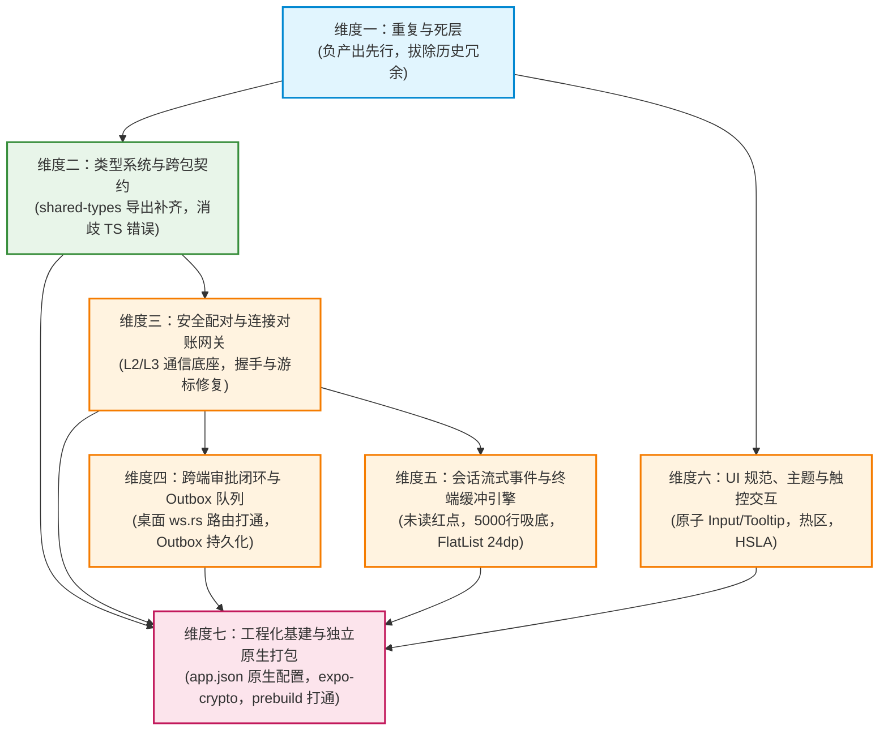

# 移动端全面复兴与打包打通 · 后续实施维度建议报告 (Proposal B)

> **文档编号**：`docs/mobile-revival-audit/dimension-proposals/02-dimension-proposal-b.md`
> **规划角色**：维度建议 Agent B
> **落盘日期**：2026-09-04
> **输入资产**：`docs/mobile-revival-audit/00-summary.md` 及 11 份专项调研报告（`surveys/01` ~ `11`）
> **核心原则**：反退避（效果锁与纯逻辑规划）、反过度设计红线、负产出先行、单一真理源（SSOT）、严禁补丁作弊
> **纪律约束**：纯建议梳理，不修改任何业务代码；不涉及笔记功能；严禁使用任何波次/批次编号。

---

## 目录索引

- [一、建议总览与战略定位](#一建议总览与战略定位)
  - [1.1 提案定位与核心设计哲学](#11-提案定位与核心设计哲学)
  - [1.2 推荐维度框架速查表](#12-推荐维度框架速查表)
- [二、推荐维度拓扑图与逻辑依赖关系](#二推荐维度拓扑图与逻辑依赖关系)
  - [2.1 依赖拓扑图 (Dependency DAG)](#21-依赖拓扑图-dependency-dag)
  - [2.2 拓扑执行顺序与可并行性分析](#22-拓扑执行顺序与可并行性分析)
- [三、推荐维度全景详案](#三推荐维度全景详案)
  - [维度一：【重复与死层】（固定维度 · 负产出基座）](#维度一重复与死层固定维度--负产出基座)
  - [维度二：【类型系统与跨包契约】](#维度二类型系统与跨包契约)
  - [维度三：【安全配对与连接对账网关】](#维度三安全配对与连接对账网关)
  - [维度四：【跨端审批闭环与 Outbox 队列】](#维度四跨端审批闭环与-outbox-队列)
  - [维度五：【会话流式事件与终端缓冲引擎】](#维度五会话流式事件与终端缓冲引擎)
  - [维度六：【UI 规范、主题与触控交互】](#维度六ui-规范主题与触控交互)
  - [维度七：【工程化基建与独立原生打包】](#维度七工程化基建与独立原生打包)
- [四、维度切分取舍理由与方案对比](#四维度切分取舍理由与方案对比)
  - [4.1 为什么不直接沿用 11 份调研设立 11 个实施维度？](#41-为什么不直接沿用-11-份调研设立-11-个实施维度)
  - [4.2 为什么不压缩为粗放的 3 维度（清理/修复/打包）？](#42-为什么不压缩为粗放的-3-维度清理修复打包)
  - [4.3 核心业务领域的合并与拆分考量](#43-核心业务领域的合并与拆分考量)
- [五、自检清单与验收准出断言](#五自检清单与验收准出断言)

---

## 一、建议总览与战略定位

### 1.1 提案定位与核心设计哲学

本提案由【维度建议 Agent B】基于 11 份深入源码第一线的专项调查报告及汇总索引独立梳理产出。

在深入通读全部 11 份调研报告后，Agent B 明确确立了后续方案与修复的三大核心设计哲学：

1. **负产出绝对先行（Clean-up First）**：
   任何新功能的修复或补齐，若建立在存在 6 张空心数据表、280 行死算法、Metro 破坏性 Serializer 以及 8 个测试污染路由树的脏代码库之上，都会引发严重的回归与连锁崩塌。必须首先执行彻底的【负产出】，将死代码、临时补丁、重复手写路径连根拔起。
2. **领域概念高内聚、低耦合（Domain-Driven Cohesion）**：
   维度的划分不应简单按“调查时的视角”机械映射，而应以“领域模型与系统边界”为准绳。配对握手与长连接网关同属通信底座；审批 Outbox 涉及高敏感安全决策与桌面端协议对接，必须成闭环；终端缓冲属于高性能数据管道，不应与通用 UI 混杂。
3. **单向无环依赖与立体验证（Acyclic Dependency & Rigorous Acceptance）**：
   维度之间必须构成严格的有向无环图（DAG）。每个维度均具备清晰的领域概念边界、明确的核心缺陷治理清单、详尽的负产出删除面以及可量化的自动化门禁断言。

---

### 1.2 推荐维度框架速查表

| 推荐维度编号 | 维度名称 | 领域概念边界 | 核心解决问题 (缺陷/缺失) | 删除面规模摘要 | 前置依赖 |
| :--- | :--- | :--- | :--- | :--- | :--- |
| **维度一** | **重复与死层** *(固定维度)* | 全仓冗余资产清退、历史临时补丁拔除、死 DAO/算法清理、重复路径合并、路由污染测试迁移 | 根治打包器被拦截破坏、路由树被单测污染、多处同一概念双规漂移、死代码与僵尸目录虚耗维护成本 | 删 2 个历史临时文件、删 280 行死算法、清退 6 个空心 DAO、收敛 7 组重复实现、移出 8 个路由单测、删 3 个空目录、删 4 个占位路由 | *无 (全域基座)* |
| **维度二** | **类型系统与跨包契约** | `shared-types` 导出结构治理、跨包契约消歧、移动端全局 TS 编译严密性、桌面端深路径收敛 | 补齐 57 类事件与 108 个解析器导出、消歧 6 个同名符号、修复移动端 22 处 TS 报错、消除桌面端 16 处深路径侵入 | 移除桌面端 16 处深路径直引、清理移动端单测中废弃的 `kind`/`badge` 属性、移除错位 `@ts-expect-error` | 维度一 |
| **维度三** | **安全配对与连接对账网关** | 设备发现、X25519 密钥协商、长连接生命周期、握手订阅、游标对账与全量重放 | 修复 URL 缺少 `/v1/events?token=` 导致的 404/401 拒连、修复全仓漏发 `events.subscribe`、修复重放事件误丢 Bug、修复配对 Dead 状态机挂起死锁、修复冷启动 `unpair` 漏通知桌面 | 移除 3 处空路由监听、移除无用中继端口占位、清理 SecureStore 中未引用的 Nonce 读写方法、移除 6 个冗余密码学常量 | 维度一、维度二 |
| **维度四** | **跨端审批闭环与 Outbox 队列** | 跨端工具安全裁决、Outbox 本地队列、单飞 FIFO 重放、双阶段确认、桌面端 Axum/WebSocket 协议对接 | 桌面端 `ws.rs` 补齐 `remote.approve`/`remote.deny` 路由处理（消除命令黑洞）、桌面端补齐 `mobile_list_pending_approvals`、移动端 Outbox 接入可靠持久化防止杀进程丢决策 | 清理 `approvalWiring.ts` 中的纯内存态占位注释、移除过期的 Mock 数据生成器、收敛审批状态冗余字段 | 维度一、维度二、维度三 |
| **维度五** | **会话流式事件与终端缓冲引擎** | 会话列表与详情、57 类事件分发与人话摘要、未读红点同步、断线续传快照回放、5000 行环形缓冲与虚拟化无缝渲染 | 修复 `applyLatestSeq` 悬空导致的未读红点恒为 0、修复终端满 5000 行 auto-follow 滚底死锁、修复 FlatList 24dp 坐标错位撕裂、补齐快照回放丢失的生命周期副作用、防高频 delta 爆内存 | 消除 `terminalScreen` 双真理 fallback 分支、彻底解除领域层对展示层缓冲的逆向依赖、移除 chunk 边界提前裁剪最旧行的脆弱逻辑 | 维度一、维度二、维度三 |
| **维度六** | **UI 规范、主题与触控交互** | 移动端原子组件库补齐、AGENTS.md 视觉与交互规范落地、双轨触控热区达标、公共导航组件收敛、现代 HSLA 色彩治理、系统推送偏好门禁 | 补齐原子 `<Input>` 与 `<Tooltip>` 组件、治理 16 处触控尺寸不足 (<44/48dp)、收敛 7 处手写返回按钮为统一组件、修复通知偏好被旁路导致的穿透推送 Bug、清退硬编码 Hex/rgba | 移除 7 个页面手写的返回按钮 JSX/样式、移除 `fileMeta.ts` 散落的 Hex 颜色、移除违背规范的 RN 原生 `Modal`、清退扫码假占位页面 | 维度一、维度二 |
| **维度七** | **工程化基建与独立原生打包** | Expo 原生工程预构建 (Prebuild)、独立 APK/IPA 原生配置补齐、JSI 安全随机源链接、构建脚本与 CI 编译打通 | 补齐 `app.json` 原生包名/BundleId、引入 `expo-crypto` 解决独立包 JSI 随机源缺失、补齐通知插件与权限、配置 `allowBackup: false` 防 Keystore 解密崩溃、打通 `export`/`prebuild` 自动化 | 清理开发期临时构建缓存、移除多余依赖与黑盒假定、彻底拔除依赖 Expo Go 容器的原生模块假定 | 维度一 至 维度六 |

---

## 二、推荐维度拓扑图与逻辑依赖关系

### 2.1 依赖拓扑图 (Dependency DAG)

---

### 2.2 拓扑执行顺序与可并行性分析

根据逻辑依赖拓扑，维度的执行逻辑与工程调度具备高度清晰的阶段性：

1. **第一逻辑层（基座减负）**：
   - **维度一（重复与死层）** 必须作为全局第一步执行。它不仅将代码库中的死代码与重复实现清理干净，更关键的是将 `app/` 路由下的 8 个单测移出，并拔除 `metro.config.js` 的破坏性 Serializer，为所有后续维度的编译、运行和测试扫清障碍。
2. **第二逻辑层（契约与类型底座）**：
   - **维度二（类型系统与跨包契约）** 紧随维度一执行。一旦 `packages/shared-types` 补齐了 57 类事件与 108 个解析器并完成消歧，移动端全域的 22 处 TS 报错将得以彻底清除，全仓类型检查门禁（`npm run typecheck`）即可恢复全绿。
3. **第三逻辑层（通信核心与独立表现层并发）**：
   - **维度三（安全配对与连接对账网关）** 依赖维度二的类型支持，负责将移动端与桌面端的安全加密通道、WebSocket 连接和游标对账彻底打通。
   - **维度六（UI 规范、主题与触控交互）** 仅依赖维度一的清理产出与维度二的基础类型，主要聚焦于原子组件（Input/Tooltip）、触控热区、主题 Token 与无障碍治理，**可与维度三完全并发推进**，互不干扰。
4. **第四逻辑层（高阶业务闭环）**：
   - **维度四（跨端审批闭环与 Outbox 队列）** 与 **维度五（会话流式事件与终端缓冲引擎）** 均依赖维度三所建立的可靠网络长连接与事件流。
   - 两者之间解耦非常彻底：维度四聚焦安全审批交互与桌面端命令响应；维度五聚焦高吞吐终端渲染、未读红点与会话事件窗口。两者在领域逻辑上平行，**完全支持并行方案设计与独立实现**。
5. **第五逻辑层（全域收口与原生打包打通）**：
   - **维度七（工程化基建与独立原生打包）** 作为全战役的收口维度。独立原生打包（Standalone APK/IPA）的成功不仅要求代码逻辑正确，更要求零类型错误、零路由树污染、原生依赖完整注入以及合规配置就位。因此，它必须在前序全部业务与基础维度落地后统一收敛验收。

---

## 三、推荐维度全景详案

### 维度一：【重复与死层】（固定维度 · 负产出基座）

#### 1. 领域概念边界
本维度专注于 `apps/crish-mobile` 全域及相关构建脚本的**负产出治理**。涵盖：历史联调临时文件拔除、构建工具链破坏性 Hack 清理、测试文件误置导致的路由污染治理、SQLite 存储层空心死 DAO 与死算法剔除、僵尸目录与占位路由收敛、以及多处“同一概念多条路径”手写重复逻辑的规范归一。

#### 2. 核心要解决的问题（缺陷 / 缺失）
- **打包器被阻断**：`metro.config.js` 中暴力篡改 `config.serializer.customSerializer` 强行内联临时 polyfill，破坏 Expo 静态导出契约，且硬编码 Windows 绝对路径导致跨平台必崩；
- **路由树被测试严重污染**：`app/` 路由目录下混入 8 个 `*.test.tsx` 页面单测，被 Expo Router 误识别为物理路由打入生产 Bundle，被迫使用 `blockList` 掩盖；
- **存储层严重空心化**：SQLite 定义的 8 张表中，有 6 张表（`events`, `session_summaries`, `approval_history`, `approval_queue`, `push_tokens`, `device_info`）完全无业务读写，对应 DAO 沦为纯死代码；
- **死算法占用维护成本**：`cachePolicy.ts`（280 行双上限清理算法）在生产中零调用，却被 401 行测试套件虚假保护；
- **同一概念多头手写导致逻辑与视觉漂移**：
  - 相对时间格式化在 `time.ts` 与 `fileMeta.ts` 行为漂移；
  - 时钟格式化在 `EventRow.tsx` 与 `approvalListScreen.tsx` 逐字克隆；
  - 运行状态色调在 `runDetailMeta.ts`（蓝色）与 `terminalScreen.tsx`（绿色）严重冲突；
  - 连接状态在 `connectionStore` 与 `eventStore` 存在双真理冗余；
  - 密码学 Base64、Hex 与 SHA-256/HMAC 多次重复造轮子。

#### 3. 本维度的【删除面】（负产出核心资产清单）
1. **彻底物理删除临时文件与构建垃圾**：
   - 彻底删除 `apps/crish-mobile/r2-16-crypto-polyfill.js`（底层已由 RFC 7748 常数时间 ladder 完全取代）；
   - 彻底删除 `apps/crish-mobile/lint-out.txt`。
2. **彻底清理 `metro.config.js` 中的破坏性篡改**：
   - 删除 `METRO_ROOT` 硬编码绝对路径；
   - 删除 `config.serializer.customSerializer` 覆写逻辑，恢复 Expo 官方默认静态导出契约；
   - 删除 `config.resolver.blockList` 中针对测试文件的临时屏蔽正则。
3. **彻底移出 `app/` 路由目录下的 8 个污染单测**：
   - 将 `app/(tabs)/files.test.tsx`、`app/(tabs)/index.test.tsx`、`app/(tabs)/settings.test.tsx`、`app/_layout.test.tsx`、`app/notifications.test.tsx`、`app/pair/manual.test.tsx`、`app/pair/scan.test.tsx`、`app/pair/welcome.test.tsx` 移出路由树，统一迁移至 `src/presentation/__tests__/` 对应层级。
4. **彻底删除/收敛存储层死层与空心 DAO**：
   - 彻底删除 `apps/crish-mobile/src/db/cachePolicy.ts`（280 行死算法）及 `src/db/cachePolicy.test.ts`（401 行无效测试）；
   - 彻底删除/清退从未接线的空心 DAO：`SqlEventsDao`、`SqlSessionSummariesDao`、`SqlApprovalHistoryDao`、`SqlApprovalQueueDao`、`SqlPushTokensDao`、`SqlDeviceInfoDao` 及其伴随单测（仅保留经评估真实接入存储的必要表结构）；
   - 清理 `src/db/secureStore.ts` 中无生产引用的 `saveExchangeNonce`、`loadExchangeNonce`、`clearExchangeNonce`。
5. **彻底删除僵尸空目录与占位文件**：
   - 删除 `src/hooks/index.ts` 并移除 `src/hooks/` 空目录；
   - 删除 `src/domain/db/index.ts` 并移除 `src/domain/db/` 空目录；
   - 删除 `src/domain/services/index.ts` 并移除 `src/domain/services/` 空目录；
   - 删除 `src/network/HttpClient.ts` 空壳类及 `HttpClient.test.ts`；删除未用类型 `AppEnv`。
6. **收敛 7 组重复手写路径**：
   - 相对时间：删除 `fileMeta.ts:formatRelativeTime`，统一收敛至 `src/domain/pure/time.ts`；
   - 时钟格式化：删除 `EventRow.tsx` 与 `approvalListScreen.tsx` 中的手写时钟函数，统一在 `time.ts` 导出 `formatClockTime`；
   - 运行状态映射：删除 `terminalScreen.tsx` 中私自手写的 `runStatusLabel` 与 `statusDotColor`，统一收敛至 `runDetailMeta.ts` 并修正 `running` 为统一的主题蓝；
   - 连接状态：消除 `eventStore.network`，统一以 `connectionStore.phase` 为单一真理源；
   - 密码学工具：删除 `keyAgreement.ts` 中的手写 Base64，删除 `signer.ts` 中手写的 150 行 SHA-256 与 HMAC 实现，全量切换为标准库 `@noble/hashes`；清理测试中手写的 Hex 编解码。
7. **删除 4 个占位模板路由**：
   - 删除 `app/diagnostics.tsx`、`app/tasks.tsx`、`app/usage.tsx`、`app/approval-history.tsx` 及 `ProtectedPlaceholder.tsx` 模板组件。

#### 4. 依赖与逻辑顺序
- **前置依赖**：无。本维度为全系统实施的绝对第一步（基座减负）。
- **后置影响**：为后续全部维度的静态检查、代码编译、测试运行和打包清除干扰源。

---

### 维度二：【类型系统与跨包契约】

#### 1. 领域概念边界
本维度专注于跨包公共类型定义包 `@crish/shared-types` 的生成面导出契约治理、ESM 符号冲突消歧机制、移动端全域 TypeScript 编译错误根治、以及桌面端对共享包深路径穿透调用的收敛。

#### 2. 核心要解决的问题（缺陷 / 缺失）
- **核心契约严重漏导**：`packages/shared-types/src/index.ts` 未导出 `generated/engine/events.ts`（57 类事件接口）与 `generated/engine/parser.ts`（108 个严格解析器），导致移动端无法解析 `parseEngineEvent`、`parseEngineTimelineTruncateEvent`、`EngineEvent` 等核心契约符号（报 10 处 `TS2305` 编译错误）；
- **ESM 符号冲突遮蔽**：`generated/engine/parser.ts` 与 `generated/device/parser.ts` 存在 6 个同名同构符号（`ParseResult<T>`, `parseOk`, `parseErr`, `isParseOk`, `isParseErr`, `parseApprovalDecision`），通配导出时产生命名歧义导致消费端无法导入；
- **散落本地类型书写瑕疵**：移动端存在 12 处本地 TS 报错（涉及测试注入类型宽化为 `unknown`、`window.entries` 缺少可选链防护、`FileEntry` 残留历史 `kind` 字段、Prettier 换行导致 `@ts-expect-error` 指令失靶错位、平台字符串字面量未收窄、组件重构后单测残留废弃 `badge` 属性等）；
- **桌面端技术债务双轨**：桌面端因共享包导出不全，存留 16 处深路径直接引用 `../../../../packages/shared-types/src/generated/engine`，违背架构分层规范。

#### 3. 本维度的【删除面】
- **删除桌面端 16 处深路径直接引用**：将 `apps/crish-desktop` 中所有直引 `generated/engine` 的深路径重构为统一由 `@crish/shared-types` 公共入口导入；
- **删除移动端测试集中的废弃属性**：彻底删除 `filesStore.test.ts` 中传入 `FileEntry` 的废弃字段 `kind`；彻底删除 `RunDetailHeader.test.tsx` 中传入组件的已废弃 `badge` 属性；
- **清理失靶错位的类型抑制指令**：彻底删除 `settingsStore.test.ts` 中因格式化换行导致失效的 2 处 `@ts-expect-error` 指令。

#### 4. 依赖与逻辑顺序
- **前置依赖**：维度一（重复与死层）。必须在移出路由单测并清理死代码后执行，避免对死文件进行无意义的类型修复。
- **后置影响**：恢复全仓 `npm run typecheck` 100% 全绿，为维度三、四、五、六提供坚不可摧的强类型契约保障。

---

### 维度三：【安全配对与连接对账网关】

#### 1. 领域概念边界
本维度涵盖移动端与桌面端之间的端到端安全连接（L2/L3）全生命周期：配对流程状态机（Pairing Machine）、X25519 密钥协商与 RFC 7748 常数时间 Ladder 原语、SecureStore 跨键凭据存储、WebSocket 长连接状态机（`ReconnectingWsClient`）、端点解析器（`EndpointResolver`）、握手订阅协议（`events.subscribe`）及游标对账（Cursor Reconcile）引擎。

#### 2. 核心要解决的问题（缺陷 / 缺失）
- **阻断级 URL 路径与 Token 丢失 (P0)**：`resolveWsUrl` 产出的 WebSocket URL 缺少 `/v1/events` 路由路径与 `?token=` 鉴权参数，真实通信在 HTTP 握手阶段即被 Axum 404/401 拦截；
- **阻断级订阅握手缺失 (P0)**：移动端在长连接建立后全局漏发 `events.subscribe` 订阅帧，导致桌面 FanOut 过滤器为空，`events.subscribe.ok` 从未返回，审批同步对账与实时推流陷入永久假死；
- **全量重放丢弃缺陷 (P0)**：`FeedBridge.handleProjection` 在处理 `fullReplay` 时未重置本地事件窗口的 `lastSeq`，导致后端重放的历史事件全部触发 `seq <= window.lastSeq` 而被当作重复项误丢；
- **连接打开事件时序竞态 (P0)**：`handleOpen` 在调用 `this.gateway.attachSend` 之前就置位了 `'open'` 相位，导致观察面在相位回调中发起的 RPC 请求因 `sendFn == null` 必然失败；
- **配对 Loading 永久死锁 (P0)**：`PairingWiring.handlePairingPhase` 在连接判定为 `dead` 时未向状态机分发 `onPairError`，导致状态机永久挂起在 `sending-hello`，UI 连接按钮永久禁用转圈；
- **冷启动解绑漏发通知 (P1)**：冷启动水合后调用 `unpair()`，由于机器态为 `idle` 且 `deviceId` 提取错误，漏发 `device.unlink` 通知桌面端；
- **配对应用层超时缺失 (P1)**：发送 `pair.hello` 后若服务端挂起无响应，客户端无限期等待，缺少配对超时熔断机制；
- **跨键写入事务性不足 (P2)**：SecureStore 凭据存储缺少原子性保护，异常中断时残留孤儿键。

#### 3. 本维度的【删除面】
- **删除网络客户端空路由与未用监听**：彻底删除 `ReconnectingWsClient.setupRoutes` 中 3 处未使用的空监听逻辑；
- **删除未生效的占位参数**：删除 `ReconnectingWsClient` 构造选项中占位但从未传入的 `opts.projections`；
- **删除未实现的中继穿透代码**：清理 `EndpointResolver.ts` 中中继端口占位代码与分支存根；
- **清理无引用的冗余密码学常量与类型**：清理 `keyAgreement.ts` 中的 `CONEX_PAIR_IKM_PREFIX` 等 6 个无用常量，清理 `pairProtocol.ts` 中无引用的校验正则与类型定义。

#### 4. 依赖与逻辑顺序
- **前置依赖**：维度一（死层清理）、维度二（类型系统与跨包契约）。
- **后置影响**：为维度四（审批中心）与维度五（会话流/终端）提供通畅的物理连接、可靠的订阅推流以及健全的双端加密会话。

---

### 维度四：【跨端审批闭环与 Outbox 队列】

#### 1. 领域概念边界
本维度专注于移动端的核心价值业务——**远程安全审批与 Outbox 离线决策队列**。涵盖：移动端审批状态机、本地 120s 倒计时器、409 冲突裁决处理、Outbox 本地两阶段确认（Two-Phase Confirmation）与 FIFO 单飞重放机制、以及**桌面端 Tauri/Rust 内核（`ws.rs`, `router.rs`, `run_approval.rs`）对应协议路由的完整挂载**。

#### 2. 核心要解决的问题（缺陷 / 缺失）
- **桌面端命令黑洞阻断 (P0)**：桌面端 `ws.rs` 缺少对移动端 `remote.approve` 与 `remote.deny` 帧的路由分发，导致移动端发出的裁决在桌面端被直接丢弃，审批流程无法推进；
- **待审批列表协议缺失 (P0)**：桌面端缺少 `mobile_list_pending_approvals` 协议处理，移动端在重连或首次进入页面时无法拉取待批条目全量快照；
- **移动端 Outbox 纯内存态风险 (P1)**：当前移动端 Outbox 为纯内存态（`SqlApprovalQueueDao` 未接入），若应用被系统杀掉或用户划卡，未送达的审批决策将永久丢失；
- **审批倒计时与超时状态闭环**：完善本地 120s 倒计时耗尽后的 `expired` 迁移，并妥善处理与桌面端并发裁决产生的 409 状态冲突；
- **审批动作防双点与单飞重放**：确保在网络不佳时，用户的审批操作严格处于单飞锁定状态，按 FIFO 顺序逐条重发。

#### 3. 本维度的【删除面】
- **清理内存态占位与临时脚手架**：删除 `approvalWiring.ts` 中的“内存态占位”临时代码与注释；
- **删除过期的 Mock 数据构造**：清理 `approvalReducers.ts` 中早期遗留的假数据生成辅助函数；
- **收敛审批状态冗余字段**：消除 `approvalStore` 与 `outbox` 之间重复记录的中间过渡状态，统一以 Outbox 两阶段状态为唯一真理。

#### 4. 依赖与逻辑顺序
- **前置依赖**：维度一、维度二、维度三（必须依托健全的长连接与 `events.subscribe` 订阅机制）。
- **后置影响**：打通跨端最高敏感级的安全审批闭环，为移动端独立运行提供核心交互保障。

---

### 维度五：【会话流式事件与终端缓冲引擎】

#### 1. 领域概念边界
本维度涵盖移动端实时观测面的核心管线：会话列表与详情的状态机、57 类引擎事件的路由分发与人话摘要映射、未读红点同步机制、断线续传快照副作用补齐、以及**终端输出的高性能 5000 行有界环形缓冲与虚拟化列表无缝渲染引擎**。

#### 2. 核心要解决的问题（缺陷 / 缺失）
- **未读红点全局失效 (P0)**：`sessionStore.applyLatestSeq` 在生产链路中全局悬空未被调用，导致 `latestSeq` 恒为 0，会话列表的未读徽标与红点永远不更新；
- **终端自动滚底吸底死锁 (P0)**：`TerminalView` 自动滚底 `useEffect` 的依赖项为 `lines.length`；当缓冲达到 5000 行饱和后，数组长度恒定不变，导致滚底逻辑被彻底冻结死锁；
- **终端虚拟化坐标严重撕裂错位 (P0)**：当产生截断提示时，`ListHeaderComponent` 占据 24~30dp 高度，但 `getItemLayout` 硬编码 `offset = 24 * index` 未将 Header 高度计入，导致全列表虚拟化测量撕裂、滚动弹跳甚至无法触顶；
- **断线重连快照丢失生命周期副作用 (P1)**：重连拉取快照时未正确分发 `run-active` 等副作用，导致活动中（Running）的 Run 状态丢失；
- **领域层逆向依赖展现层架构违规 (P1)**：领域层 `terminalStore.ts` 逆向导入了表现层 `terminalLineBuffer.ts`；
- **终端 Chunk 边界裁剪漏洞 (P1)**：在跨 Chunk 接收到未终结行时提前执行裁剪，下一个 Chunk 若遇到覆盖或折叠，会导致已裁剪的有效行被永久丢弃；
- **高频增量流防爆与虚拟化遍历优化 (P2)**：治理高频 `message-delta` 挤爆窗口历史的问题；优化 `runDetailScreen` 中 `entriesOfRun` 全量遍历窗口数组的性能开销；补齐 57 类事件中缺失的人话文案与错误诊断标红。

#### 3. 本维度的【删除面】
- **彻底消除 `terminalScreen.tsx` 的双真理路径**：删除其内部维护的 `fallback` 分支与冗余本地状态，全量由领域 Store 驱动；
- **解除领域层对表现层的逆向引用**：将终端缓冲核心纯算法从 `presentation/` 下沉至 `domain/pure/`，消除逆向 import；
- **删除脆弱的提前裁剪逻辑**：删除 `terminalLineBuffer.ts` 中在 chunk 尾部带有未完成段 `pending` 时盲目提前执行 `lines.splice` 的漏洞代码；
- **清理过时的“49 类事件”历史注释**：全面刷新为权威的 57 类生成面契约口径。

#### 4. 依赖与逻辑顺序
- **前置依赖**：维度一、维度二、维度三。
- **后置影响**：恢复终端流畅的吸底输出体验与会话红点准确性，保障实时监控与长任务日志查看体验。

---

### 维度六：【UI 规范、主题与触控交互】

#### 1. 领域概念边界
本维度专注于移动端视觉体验与交互规范合规化（严格对照《AGENTS.md》§12、§13、§14、A1 触控热区准则及 R2UX 规范）。涵盖：原子组件库补齐（Input/Tooltip）、16 处触控热区达标治理、公共导航返回按钮收敛、现代 HSLA 色彩空间治理、系统通知权限联动与偏好过滤闭环。

#### 2. 核心要解决的问题（缺陷 / 缺失）
- **原子 Input 组件缺失与焦点态遗漏**：`components/ui/` 缺失原子 `Input` 组件；`QuickRunPanel` 的输入框完全遗漏 `onFocus`/`onBlur` 焦点态，聚焦时无任何视觉反馈；
- **自定义 Tooltip 组件缺失 (违反 AGENTS.md §12)**：全仓缺失自定义 `<Tooltip>`，导致长文本截断（会话标题、文件路径）和图标按钮用户无法长按查看完整释义；
- **触控热区大面积违规 (违反 A1 准则)**：全仓 42 处交互元素中有 16 处尺寸不足 iOS 44pt / Android 48dp 且漏设 `dualHitSlop`（如 `EventFeed` 悬浮恢复条、`FilePreview` 返回按钮、`terminalScreen` 滚动控制等）；
- **返回按钮重复手写**：7 个二级页面独立编写样式各异的返回按钮，缺乏统一规范；
- **色彩空间与 Token 违规 (违反 AGENTS.md §14)**：`theme.ts` 残留 Hex（`#111111`）与旧式 `rgba`；`fileMeta.ts` 硬编码 5 处文件图标 Hex 色；`WorkspaceSwitcher` 硬编码黑色遮罩；
- **通知偏好过滤被旁路重大 Bug**：`pushConsumer.ts` 漏调用 `prefsGate.ts` 中的 `shouldPresentPush` 门禁，导致用户在设置中关闭通知后，系统后台仍会弹窗打扰；
- **违规使用原生 Modal**：`WorkspaceSwitcher.tsx` 违背轻量自研规范引入了 React Native 原生 `Modal`。

#### 3. 本维度的【删除面】
- **删除 7 处独立手写的返回按钮**：彻底删除 7 个页面中各自手写的返回按钮 JSX 与 StyleSheet 样式，收敛为统一的 `<HeaderBackButton>`；
- **删除散落的硬编码 Hex 与旧式 rgba**：删除 `fileMeta.ts` 中的硬编码色值数组，删除 `WorkspaceSwitcher.tsx` 中的 rgba 遮罩样式，统一使用 Design Token；
- **删除对 RN 原生 Modal 的依赖**：重构 `WorkspaceSwitcher.tsx`，移除原生 `Modal`，统一使用自研轻量 Overlay；
- **清退扫码配对假页面**：清退 `pairScanScreen.tsx` 静态假占位，在未实际接入相机前在入口处置灰或给予明确反馈，杜绝进入死路由。

#### 4. 依赖与逻辑顺序
- **前置依赖**：维度一（死层清理）、维度二（类型补齐）。可与维度三、四、五并发推进。
- **后置影响**：全面达成移动端无障碍触控达标、符合 AGENTS.md 视觉设计红线，消除打扰用户的错误通知。

---

### 维度七：【工程化基建与独立原生打包】

#### 1. 领域概念边界
本维度是移动端全面复兴战役的**总收敛与交付闭环**。涵盖：Expo 原生工程预构建（`expo prebuild`）、`app.json` 独立应用原生元数据规范化、Android/iOS 权限与网络合规配置、JSI 原生密码学模块链接（`expo-crypto`）、硬件 Keystore 防解密崩溃配置、`package.json` 工程化构建脚本集、以及离线打包验证打通。

#### 2. 核心要解决的问题（缺陷 / 缺失）
- **原生标识完全缺失阻断打包 (P0)**：`app.json` 缺少 `android.package`（`"com.crish.mobile"`）与 `ios.bundleIdentifier`（`"com.crish.mobile"`），执行 prebuild 只能生成不可用的占位包；
- **原生 JSI 随机源断裂 (P0)**：独立原生包脱离 Expo Go 底座后，因缺少 `expo-crypto` 原生模块依赖，导致 JSI `globalThis.expo.modules.ExpoCrypto` 为空，私钥随机种子生成失败；
- **局域网通信与系统权限缺失 (P1)**：`app.json` 缺少 Android `usesCleartextTraffic: true`（局域网 HTTP/WS 必须）与 iOS `NSLocalNetworkUsageDescription`；缺少 Android 13+ 通知权限（`POST_NOTIFICATIONS`）与振动权限；
- **通知原生插件漏配 (P1)**：`app.json` 的 `plugins` 数组未注册 `"expo-notifications"` 插件；
- **硬件 Keystore 解密崩溃隐患 (P1)**：未在 `app.json` 配置 `allowBackup: false`，在系统云备份恢复后旧 Keystore 主密钥失效导致解密时原生闪退；
- **工程化构建脚本真空 (P2)**：`package.json` 缺少 `prebuild`、`export`、`build:android` 等流水线驱动命令。

#### 3. 本维度的【删除面】
- **删除多余与冲突的开发依赖**：清理 `package.json` 中因历史联调误装的未用依赖；
- **清理本地残留的临时构建缓存**：清理 `android/` 或 `.expo/` 下遗留的脏构建缓存与历史临时产物；
- **彻底消除对 Expo Go 黑盒容器的隐式假定**：拔除全仓所有针对 Expo Go 的特殊临时兼容分支（全面走向合规的标准原生模块探测体系）。

#### 4. 依赖与逻辑顺序
- **前置依赖**：维度一至维度六全部完成。作为整个战役的最终集成与打包打通验收环节。
- **后置影响**：成功产出可独立安装、脱离 Expo Go 容器、具备完整端到端配对、审批、监控与终端功能的独立原生包。

---

## 四、维度切分取舍理由与方案对比

### 4.1 为什么不直接沿用 11 份调研设立 11 个实施维度？

在审计阶段设立 11 个调查专项，是为了让 11 位专职 Agent 能够“分兵把口、穷尽细节”，实现对源码的无死角立体排查。然而，**“调查维度”绝不等同于“实施与方案维度”**：

1. **跨专项高频重叠导致多 Agent 冲突**：
   - 调查报告 01（打包）、08（存储）、10（UI）与 11（死代码）均发现了大量需要删除的死层（如 01 抓出 polyfill，08 抓出死 DAO 和 cachePolicy，10 抓出重复返回按钮，11 穷举了全部死代码）。
   - 如果按 11 维度实施，会有 4 个维度的 Agent 同时修改 `metro.config.js`、`db/` 和组件文件，直接引发极其严重的 Git 文件冲突与逻辑踩踏。
2. **存在强烈的循环依赖**：
   - 调查 01（打包）依赖调查 02（类型消除报错）和 08（存储防崩溃）；而调查 02 又依赖调查 11（先删掉死代码测试才能消报错）。
   - 11 维度切分会导致执行依赖链条高度网状缠绕，无法梳理出清晰的线性拓扑。
3. **收敛原则**：
   - 将 11 份报告中的死层清退全部抽离收敛至**维度一（重复与死层）**，一次性彻底解决负产出，使后续各个业务领域的方案维度能够轻装上阵、高内聚推进。

---

### 4.2 为什么不压缩为粗放的 3 维度（清理/修复/打包）？

亦有考量是否可采用极简的三分法（如“1. 删死层 -> 2. 修逻辑 -> 3. 打包”）。Agent B 经过严谨推演，坚决否定了此种粗放划分：

1. **违背单一职责与领域内聚**：
   - 若将配对（密码学）、网关（网络状态机）、审批（Outbox 与安全决策）、终端（5000 行虚拟化环形缓冲）和 UI（热区与组件）混在一个巨型的“修逻辑”维度中，其代码变更面将高达数千行，涉及 40+ 核心文件。
   - 没有任何单一实现 Agent 能够同时兼顾底层密码学数学正确性、Rust 桌面端路由挂载与 React Native 虚拟化像素计算，极易产生“顾此失彼、补丁作弊”的低劣修复。
2. **丧失并发调度优势**：
   - 粗放的 3 维度使得中间阶段无法并行。而在本提案推荐的 7 维度模型中，**维度四（审批）、维度五（会话终端）与维度六（UI 规范）在依赖就绪后完全可以并发设计与实现**，大幅提升战役整体推进效能。
3. **验收断言无法精确对齐**：
   - 7 维度模型中，每个维度都有独立的单测集、门禁指令和现场验证断言，责任边界清晰至极。

---

### 4.3 核心业务领域的合并与拆分考量

#### 1. 为什么将“安全配对”与“连接网关”合并为同一个维度（维度三）？
- **强物理耦合**：移动端配对流程产生的输出（PSK、Master Secret、Device ID、Token）正是长连接网关初始化所必需的输入；且 `PairingWiring` 中的 Dead 相位死锁 Bug 直接跨越了配对状态机与网络客户端。
- **协议同一性**：配对使用的也是底层 WebSocket / HTTP 端点解析器（`EndpointResolver`）。将两者合并为“通信与安全底座”，保证了凭据生产与网络消费的原子对齐。

#### 2. 为什么将“跨端审批”独立为专项维度（维度四）？
- **业务敏感度极高**：审批中心是 Conex/Crish 移动端控制桌面 Agent 的安全命脉（Tool Call 授权），属于高危核心功能。
- **涉及桌面端 Rust 内核协同**：本战役中唯一需要修改/扩展桌面端（`apps/agent-workbench/src-tauri/src/server/ws.rs`）协议分发逻辑的就在此维度（解决命令黑洞）。独立切分有利于桌面端与移动端协议的精确对拍与双向集成测试。

#### 3. 为什么将“会话与终端”独立于“UI 规范”（维度五 vs 维度六）？
- **算法与数据结构密集度截然不同**：终端缓冲涉及 5000 行变长数组的高频滚动、ANSI 跨分片状态机、FlatList 虚拟化 `getItemLayout` 像素级测量补偿；会话流涉及 57 类引擎事件的路由与未读红点同步。这是典型的高性能数据流管道。
- **UI 规范重在人机工程与视觉设计**：维度六聚焦于原子组件抽象、44/48dp 触控热区达标、HSLA 色彩空间治理与 Design Tokens 规范。将两者解耦，使得前端表现层重构不致破坏终端的高频渲染性能。

---

## 五、自检清单与验收准出断言

依照《主 Agent 全流程调度提示词 v3》与立体验证纪律，本建议方案落盘前经过全面自检，各维度方案与实施必须满足以下验收断言：

| 校验维度 | 强制验收准出断言 (Gate Assertion) | 检验方式 / 门禁命令 |
| :--- | :--- | :--- |
| **维度一（重复与死层）** | 1. `r2-16-crypto-polyfill.js` 与 `lint-out.txt` 彻底物理删除； 2. `app/` 路由目录下 0 个测试文件（全部移入测试目录）； 3. `metro.config.js` 恢复 Expo 官方默认 serializer，0 硬编码路径； 4. 彻底删除 `cachePolicy.ts` 及伴随测试，收敛 7 组重复实现。 | 1. `git status` 确认死文件删除； 2. `ls apps/crish-mobile/app/**/*.test.tsx` 结果为空； 3. 静态比对确认 7 组重复代码收敛至单一真理源。 |
| **维度二（类型与契约）** | 1. `packages/shared-types` 导出 57 类事件与 108 个严格解析器； 2. ESM 6 个同名符号消除歧义； 3. 移动端 22 处 TS 报错彻底归零； 4. 桌面端 16 处深路径直接引用彻底消除。 | 1. 根目录 `npm run typecheck` 100% 全绿； 2. `npm run typecheck -w @crish/crish-mobile` 零错误； 3. 全局搜索 `packages/shared-types/src/generated/engine` 结果为 0。 |
| **维度三（配对与网关）** | 1. `resolveWsUrl` 产出包含 `/v1/events?token=`，握手成功率 100%； 2. 长连接建立后自动分发 `events.subscribe`，正常收到 `.ok` 响应； 3. 配对断开（Dead）时 UI 正确分发 `onPairError`，解除 Loading 锁死； 4. 冷启动水合后 `unpair()` 成功向桌面发送 `device.unlink` 帧。 | 1. `noblePrimitives.test.ts`、`rustParity.test.ts` 100% 通过； 2. Mock WS 验证 dead 状态触发后 UI 按钮恢复可点击态； 3. 游标重放对账单测全绿。 |
| **维度四（审批与 Outbox）** | 1. 桌面端 `ws.rs` 成功分发 `remote.approve` 与 `remote.deny` 并执行裁决； 2. 桌面端支持 `mobile_list_pending_approvals` 查询； 3. 移动端 Outbox 具备可靠持久化，杀进程重启后排队决策不丢失； 4. 120s 倒计时与 409 冲突状态机转移健全。 | 1. 双端通信集成测试验证决策送达桌面端； 2. Outbox 单元测试覆盖 FIFO 单飞重放与重试退避； 3. 模拟应用被杀冷启动，Outbox 待发送条目成功恢复。 |
| **维度五（会话与终端）** | 1. 会话列表 `latestSeq` 正确同步，未读红点与徽标数字实时更新； 2. 终端满 5000 行后 auto-follow 吸底滚动保持流畅不冻结； 3. 截断提示存在时，FlatList `getItemLayout` 精确补偿 Header 高度，零坐标撕裂； 4. 领域层对展现层缓冲的逆向依赖彻底消除。 | 1. `npm test` 跑通终端缓冲与会话映射全量单测； 2. 在真机/模拟器注入 6000 行日志流，验证吸底跟随与首行滚动测量稳定性； 3. 架构依赖检查工具确认零逆向 import。 |
| **维度六（UI 规范与触控）** | 1. 提供统一样式与焦点态的原子 `<Input>` 与 `<Tooltip>` 组件； 2. 42 处交互元素 100% 满足 iOS 44pt / Android 48dp 触控标准（补齐 hitSlop）； 3. 7 处手写返回按钮全部替换为统一 `<HeaderBackButton>`； 4. `theme.ts` 与组件零散落 Hex/rgba，全部遵循 HSLA 斜杠语法； 5. 关闭通知偏好后，后台系统横幅 100% 抑制。 | 1. 自动化 UI 巡检脚本扫描触控尺寸与 hitSlop 覆盖率； 2. Grep 扫描除平台必需外零硬编码 Hex 色值； 3. 单测验证 `prefsGate` 拦截非活跃推送呈现。 |
| **维度七（工程化与独立打包）** | 1. `app.json` 完整声明 package、bundleId、通知插件与安全权限； 2. 引入 `expo-crypto`，独立包内 JSI 随机模块正常加载； 3. 配置 `allowBackup: false`，杜绝 Keystore 硬件解密崩溃； 4. 执行 `npx expo export` 100% 成功生成静态 Bundle 与静态资产； 5. 执行 `npx expo prebuild --clean` 成功生成合规的 `android/` 原生工程并支持 Gradle 离线编译。 | 1. `npm run export -w @crish/crish-mobile` 成功，0 错误退出； 2. `npx expo prebuild --no-install` 生成原生工程，inspect 验证 package 为 `com.crish.mobile`； 3. 产出独立 Standalone 产物并通过静态校验。 |

---

> **提案结论**：
> 本建议报告通过建立**以【重复与死层】为坚实负产出基座、以【类型与跨包契约】为强类型护栏、以【配对网关】为通信基石、以【审批】与【会话终端】为核心业务双翼、以【UI规范】为体验护城河、最终由【工程化打包】整体收口**的 7 维度架构，彻底穿透并收敛了 11 份审计报告中的全部阻断点。各维度边界清晰、依赖明确、删除面彻底，可直接作为主控后续方案设计与推进分工的基准依据。
