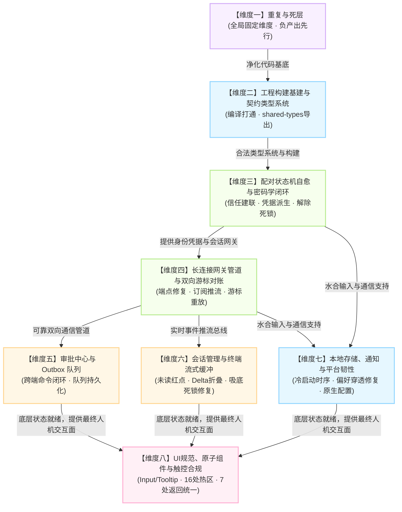

# 移动端实际修复维度建议报告 (维度建议 Agent C)

> **文档路径**：`docs/mobile-revival-audit/dimension-proposals/03-dimension-proposal-c.md`
> **责任角色**：维度建议 Agent C
> **输入资产**：`docs/mobile-revival-audit/00-summary.md` 及 11 份专项调研报告（`surveys/01` ~ `surveys/11`）
> **审计基准**：`apps/crish-mobile` 全域源码、`packages/shared-types`、跨端 WebSocket/Axum 路由与协议契约（不含笔记功能）
> **编写约束**：纯逻辑规划，只谈逻辑依赖、领域概念边界、问题缺陷、删除面与验收收敛

---

## 目录

1. [维度建议总体架构与设计哲学](#一维度建议总体架构与设计哲学)
2. [推荐维度清单与全景概览](#二推荐维度清单与全景概览)
3. [各推荐维度详案（领域边界·核心缺陷·删除面·依赖顺序）](#三各推荐维度详案)
   - [维度一：重复与死层（全局固定维度 · 负产出与全仓死层核销）](#维度一重复与死层全局固定维度--负产出与全仓死层核销)
   - [维度二：工程构建基建与跨端契约类型系统](#维度二工程构建基建与跨端契约类型系统)
   - [维度三：配对状态机自愈与密码学握手闭环](#维度三配对状态机自愈与密码学握手闭环)
   - [维度四：长连接网关管道与双向游标对账](#维度四长连接网关管道与双向游标对账)
   - [维度五：审批中心状态流与 Outbox 可靠执行队列](#维度五审批中心状态流与-outbox-可靠执行队列)
   - [维度六：会话管理、运行态派生与终端流式缓冲](#维度六会话管理运行态派生与终端流式缓冲)
   - [维度七：本地存储水合、系统通知与平台环境韧性](#维度七本地存储水合系统通知与平台环境韧性)
   - [维度八：UI 设计规范、原子交互组件与触控合规](#维度八ui-设计规范原子交互组件与触控合规)
4. [全仓删除面（负产出）综合资产清单与净收敛预算](#四全仓删除面负产出综合资产清单与净收敛预算)
5. [维度逻辑拓扑与依赖流转图](#五维度逻辑拓扑与依赖流转图)
6. [对其它维度拆分方案的深度对比与取舍理由](#六对其它维度拆分方案的深度对比与取舍理由)
7. [实施自检与验收标准](#七实施自检与验收标准)

---

## 一、维度建议总体架构与设计哲学

基于对 11 份共计 350+ KB、涵盖 1500+ 行第一手代码证据的专项审计报告深度通读，移动端当前呈现出三个层次的技术矛盾：
1. **构建与契约阻断**：`metro.config.js` 破坏静态导出协议、`shared-types` 漏导出 57 类事件引发 22 处 TS 报错，导致既无法通过 `npm run typecheck` 门禁，也无法通过 `npx expo export` 导出离线 Bundle；
2. **端到端通信与业务死锁**：长连接端点 URL 缺失 `/v1/events` 导致握手 404/401、配对 `dead` 状态未推进导致 UI 永久 Loading 死锁、桌面端 `ws.rs` 未挂载远程命令路由导致审批回执超时黑洞、全量重放未重置游标导致数据静默丢弃；
3. **严重形式主义与死层沉淀**：SQLite 8 表体系中 6 表完全空心化、280 行缓存清理算法全仓零调用、手写 SHA-256/HMAC 与重复时间格式化大量并存、4 个路由与扫码页面全为无用占位骨架。

针对上述现状，维度建议 Agent C 提出 **“1 个全局固定负产出维度 + 7 个高内聚技术领域维度” 的 8 维精益收敛架构**。

### 核心设计哲学
- **删除面绝对先行（Negative-Output First）**：所有功能修复与演进必须以清退死层、消歧重复代码、剔除毒瘤补丁为前置条件。没有负产出的重构是伪重构。
- **单调递进的逻辑拓扑（Strict Topological Order）**：维度划分完全基于编译、类型、网络传输、业务控制到展示渲染的严格逻辑单向依赖，杜绝循环依赖与跨层逆向穿透。
- **穿透根因，杜绝补丁（Root-Cause Convergence）**：针对终端 5000 行吸底冻结、单帧输入字符雪崩、冷启动水合路由回弹等痼疾，彻底穿透架构断层，以确定性状态机与原生协议解决，严禁魔术数字补偿。

---

## 二、推荐维度清单与全景概览

| 推荐维度 | 领域概念边界 | 核心解决问题 (缺陷/缺失) | 该维度【删除面】核心要素 | 前置依赖 |
| :--- | :--- | :--- | :--- | :--- |
| **维度一：重复与死层**<br>*(固定维度)* | 全仓历史残留文件、跨模块手写重复算法、空目录骨架与未接线死代码 | 清理 1500+ 行形式主义死代码，收敛多头算法，消歧概念双轨，为后续方案扫清噪音 | 物理删除 3 处空目录、2 个临时/日志文件、280 行缓存清理算法、150 行手写 SHA-256、7 处重复实现与 6 个空心 DAO | 无（基石） |
| **维度二：构建基建与契约类型系统** | 打包工程化、Expo 导出协议、Monorepo 跨包导出、TS 编译门禁 | 彻底恢复 `npx expo export` 与 `tsc --noEmit` 100% 绿灯，修复 shared-types 57 类事件与 108 解析器导出并命名消歧 | 删除 `metro.config.js` 的 `customSerializer`、删除硬编码绝对路径 `METRO_ROOT`、移出 `app/` 下 8 个单测 | 维度一 |
| **维度三：配对状态机自愈与密码学握手闭环** | X25519 密钥协商、RFC 7748 常数时间阶梯、配对受控输入与解绑通知 | 根除传输层 `dead` 导致的 UI 永久转圈死锁；修复冷启动水合后 `unpair()` 漏发 `device.unlink`；补充 15s 应用层超时 | 删除冗余门面 `pairingWiring.ts`、删除无用包装 `fingerprintVerifier.ts`、消除 `sessionSigning.ts` 跨包深路径 | 维度二 |
| **维度四：长连接网关管道与双向游标对账** | WebSocket 传输信封、HMAC 签名、端点路由、订阅建立与游标对账分类 | 补全 `/v1/events?token=` 端点打通握手；发送 `events.subscribe` 激活服务端推流；修复全量重放游标未重置被丢弃 Bug | 物理删除孤岛模块 `HttpClient.ts` 及单测；删除 `ReconnectingWsClient` 中 3 处空监听存根；清理死中继配置 | 维度三 |
| **维度五：审批中心状态流与 Outbox 可靠执行队列** | 移动端决策输入、本地两阶段确认、Outbox 队列单飞重放、桌面 WS 远程命令路由 | 补全桌面端 `ws.rs` 远程命令黑洞与回执；打通 `SqlApprovalQueueDao` 赋予离线决策持久化防丢能力；消除重试定时器饥饿 | 收敛 `approvalCommands.ts` 双源重复；清理 `useApprovalDetailVm` 越级重导出；核销 `outboxState.replaying` 死字段 | 维度四 |
| **维度六：会话管理、运行态派生与终端流式缓冲** | 会话索引、57 类事件副作用路由、增量 delta 聚合、终端行缓冲与虚拟化 | 接通 `applyLatestSeq` 激活未读红点；实施流式增量折叠防 500 环形缓冲爆仓；解除终端满 5000 行吸底冻结与 24dp 坐标错位 | 彻底清退已核销死契约 `tool-update`；清退 `terminalLineBuffer` 中 2 处死接口；消除 Domain 逆向依赖 Presentation | 维度四 |
| **维度七：本地存储水合、系统通知与平台环境韧性** | SQLite 连接与 WAL 模式、SecureStore 凭证槽位、启动水合时序、推送动态门面与渠道 | 根除启动水合时序倒置导致的路由跳跃回弹；配置 `allowBackup:false` 杜绝 Keystore 崩溃；修复推送消费漏接偏好穿透 Bug | 彻底核销 6 个未接线空心 DAO；清理 `prefsGate` 中未接入 UI 的孤岛函数；清理 SecureStore 孤儿元数据残留 | 维度三、四 |
| **维度八：UI 设计规范、原子交互组件与触控合规** | 原子组件（Input/Dialog/BackButton/Tooltip）、双轨触控热区、主题 Token、页面四态 | 封装原子 `Input` 固化柔和焦点态；补齐 16 处交互元素不足 44/48dp 与 hitSlop；统一 7 处手写返回按钮；消除 Hex 逃逸 | 物理删除 4 个占位死路由（`diagnostics/tasks/usage/approval-history`）；收拢 `themeProjection.ts` 双轨；清退死页面 `pairScanScreen` | 维度五、六、七 |

---

## 三、各推荐维度详案

### 维度一：重复与死层（全局固定维度 · 负产出与全仓死层核销）

#### 1. 领域概念边界
本维度作为全仓架构修复的前置净化基石，严格界定为**纯代码与资产清理（Negative Output Only）**。其边界涵盖：未跟踪/误入库的临时脚手架文件、空目录骨架、全仓 7 组重复手写的基础纯算法（时间格式化、密码学哈希、运行状态颜色）、以及完全脱节且无业务生产调用的孤岛 DAO 和死测试。本维度不新增任何业务逻辑，以代码行数净减少、文件数净减少为唯一交付标准。

#### 2. 核心要解决的问题（缺陷与隐患）
- **开发噪音与认知阻碍**：散落在根目录与子目录中的临时文件（`r2-16-crypto-polyfill.js`、`lint-out.txt`）以及空骨架目录（`src/hooks/`、`src/domain/db/`、`src/domain/services/`）误导开发人员与静态分析工具；
- **同一概念多路径漂移**：相对时间格式化在 `time.ts` 与 `fileMeta.ts` 行为不一致；时钟时间格式化在两处手写复制；运行状态在 `runDetailMeta.ts` 为蓝色 `info`，而在 `terminalScreen.tsx` 误标为绿色 `success`，引发严重人机认知错乱；
- **安全库重复自研**：`signer.ts` 手写了 150 行底层 SHA-256 和 HMAC 循环移位算法，而全仓已引入经审查的标准 `@noble/hashes` 库；
- **形式主义死测试闭环**：800+ 行单元测试被动维护着生产环境从未调用的 6 个空心 DAO 与 280 行缓存淘汰算法，造成“死代码被常绿测试掩盖”的技术欺骗。

#### 3. 该维度的【删除面】清单
1. **物理文件与目录彻底删除**：
   - `apps/crish-mobile/r2-16-crypto-polyfill.js`（彻底删除）
   - `apps/crish-mobile/lint-out.txt`（彻底删除）
   - `apps/crish-mobile/src/hooks/index.ts` 及 `src/hooks/` 空目录（彻底删除）
   - `apps/crish-mobile/src/domain/db/index.ts` 及 `src/domain/db/` 空目录（彻底删除）
   - `apps/crish-mobile/src/domain/services/index.ts` 及 `src/domain/services/` 空目录（彻底删除）
   - `apps/crish-mobile/src/network/HttpClient.ts` 及 `src/network/HttpClient.test.ts`（彻底删除）
   - `apps/crish-mobile/src/db/cachePolicy.ts`（280 行）及 `src/db/cachePolicy.test.ts`（401 行）（彻底删除）
2. **重复手写纯算法收敛与删除**：
   - 彻底删除 `src/presentation/components/files/fileMeta.ts:144-158` 中的 `formatRelativeTime`，统一收敛至 `src/domain/pure/time.ts`；
   - 彻底删除 `EventRow.tsx:196-200`（`formatFeedTime`）与 `approvalListScreen.tsx:32-36`（`formatHistoryTime`），统一收敛至 `src/domain/pure/time.ts` 导出 `formatClockTime`；
   - 彻底删除 `src/network/signer.ts:41-186` 中的手写 SHA-256 与 HMAC 实现（145 行），改由 `@noble/hashes/sha2.js` 与 `@noble/hashes/hmac.js` 代替；
   - 彻底删除 `src/pairing/crypto/keyAgreement.ts:81-95` 中复制粘贴的 `base64Encode`，统一收敛至工具模块或 `@noble/hashes/utils.js`；
   - 彻底删除 `terminalScreen.tsx:28-48` 中私自手写的 `runStatusLabel` 与 `statusDotColor`，统一收敛并复用 `runDetailMeta.ts`。
3. **保护死代码的单测套件清理**：
   - 清理 `src/db/dao/eventsDao.test.ts`（205 行）、`src/db/dao/approvalDao.test.ts`（132 行）、`src/db/dao/approvalQueueDao.test.ts`（185 行）、`src/db/dao/approvalHistoryDao.test.ts`（150 行）等针对未接线死 DAO 的形式主义测试用例。

#### 4. 维度的依赖与逻辑顺序
- **依赖关系**：**零前置依赖**（全仓最顶层基石维度）。
- **逻辑顺序**：必须作为整个移动端复兴战役的**第一步优先就地落盘执行**。在清除上述 1500+ 行干扰代码与文件后，后续所有维度的静态分析、编译检查与类型推导将获得干净的基底，杜绝“为死代码修复编译报错”的无谓算力浪费。

---

### 维度二：工程构建基建与跨端契约类型系统

#### 1. 领域概念边界
本维度涵盖打包工程化（`metro.config.js`、`app.json`、`package.json`）、Expo 预构建与离线 Bundle 导出协议、Monorepo 跨包公共类型定义（`packages/shared-types`）以及移动端全域 TypeScript 严格编译门禁。其边界止于工程能够独立执行预构建、静态导出以及全仓类型检查达到 0 错误。

#### 2. 核心要解决的问题（缺陷与缺失）
- **打包导出 100% 崩溃（P0 致命）**：`metro.config.js` 中的 `customSerializer` 覆写破坏了 `@expo/cli` 静态导出的 `{ artifacts, assets }` 契约结构，导致 `npx expo export` 在断言处抛错直接中断；
- **环境死锁与跨平台阻断（P0 致命）**：`metro.config.js:11` 硬编码本地绝对路径 `C:/Software/conex/...`，破坏多端与 CI 跨机协同；
- **契约重构半脱节与类型阻断（P0 致命）**：`packages/shared-types/src/index.ts` 遗漏了 `generated/engine/events.ts`（57 类事件）与 `generated/engine/parser.ts`（108 个严格解析器）的导出，引发移动端 10 处 `TS2305` 编译阻断，并迫使桌面端留存 16 处深路径直接侵入债务；
- **ESM 通配导出符号歧义**：`engine/parser` 与 `device/parser` 存在 6 个同名同构基础符号（`ParseResult`、`parseOk`、`parseErr`、`isParseOk`、`isParseErr`、`parseApprovalDecision`），通配导出时被 ESM 规范静默遮蔽；
- **移动端 6 处散落类型瑕疵**：测试辅助函数中的已废弃属性、Prettier 换行导致 `@ts-expect-error` 指令失靶、字面量拓宽等导致 `tsc --noEmit` 报出 12 处本地错误；
- **原生打包配置真空**：`app.json` 缺少 Android 包名与 iOS BundleID，执行 `prebuild` 退化为占位符；缺少构建脚本。

#### 3. 该维度的【删除面】清单
1. **彻底删除 `apps/crish-mobile/metro.config.js:29-46` 的 `customSerializer` 劫持代码**，恢复标准 Expo Serializer 契约；
2. **彻底删除 `metro.config.js:11` 的硬编码绝对路径 `const METRO_ROOT = 'C:/Software/conex/...'`**；
3. **清理 `app/` 路由目录下的 8 个 `*.test.tsx` 页面单测**，将其物理迁移至 `tests/app/` 或对应 `src/presentation/` 目录，并随之**彻底删除 `metro.config.js:17-22` 中的 `blockList` 过滤补丁**；
4. **清理 `settingsStore.test.ts` 中错位的 `@ts-expect-error` 指令**，通过 `// prettier-ignore` 单行锁定；
5. **彻底删除 `RunDetailHeader.test.tsx` 中残存的历史废弃属性 `badge: 'running'` 与 `badge="terminal"`**；
6. **彻底删除 `filesStore.test.ts:13` 中伪造契约的非法字段 `kind: 'file'` 与 `modifiedMs: 1000`**。

#### 4. 维度的依赖与逻辑顺序
- **依赖关系**：前置依赖【维度一】（清除 `r2-16-crypto-polyfill.js` 死文件）。
- **逻辑顺序**：排在维度一之后。必须先打通 `shared-types` 导出与恢复 `tsc --noEmit` 零错误，并还原纯净的 Metro 配置，后续所有业务模块的代码重构与测试执行才能在合法合规的编译环境下运转。

---

### 维度三：配对状态机自愈与密码学握手闭环

#### 1. 领域概念边界
本维度涵盖移动端与桌面端建立可信信任链的完整生命周期：RFC 7748 常数时间 X25519 密钥交换、HKDF 三子钥派生、配对码（CXN-Code）输入受控闭环与逆函数提取、`PairingWiring` 状态机流转、自签证书 SPKI 指纹校验、SecureStore 凭据持久化原子性、以及设备解绑（Unpair）生命周期。

#### 2. 核心要解决的问题（缺陷与缺失）
- **传输层 Dead 导致 UI 永久死锁（P0 致命死锁）**：`PairingWiring.handlePairingPhase` 在连接判定为 `dead` 时仅调用 `reportError`，遗漏分发 `this.dispatch({ type: 'onPairError', ... })`，导致状态机永久挂在 `sending-hello`，UI 连接按钮永久处于 Loading 禁用状态，用户无法重试；
- **冷启动解绑网络通知丢失（P1 高危缺陷）**：`unpair()` 错误地依赖瞬态的 `this.machine.state === 'paired'` 与 `this.machine.pendingHello?.deviceId`。冷启动水合仅恢复了 `authStore`，内部机器态仍为 `idle`，导致解绑时向桌面发送 `device.unlink` 的请求被静默跳过，且设备 ID 传空；
- **应用层配对请求缺乏超时熔断（P1 高危缺陷）**：客户端发出 `pair.hello` 后若桌面无响应，只要 WebSocket 底层心跳正常，客户端将无限期卡死在配对等待中；
- **配对期连接过度重试（P2 体验缺陷）**：配对期 `ReconnectingWsClient` 继承了 5 次指数退避重试（耗时超 30 秒），弱网或 IP 填错时用户等待极长；
- **SecureStore 跨键半写入与冷启动自愈盲区（P2 存储缺陷）**：写入 7~8 个分散键值缺乏事务原子性，进程被杀时残留孤儿元数据键，`doHydrate` 未对其进行清扫；
- **配对码互逆函数物理割裂**：正向格式化 `formatPairCodeDraft` 在表现层，逆向提取 `extractCodeFromDraft` 在领域层，分层倒错。

#### 3. 该维度的【删除面】清单
1. **删除冗余门面与代理空壳**：
   - 彻底删除 `src/adapters/wiring/pairingWiring.ts`（仅 4 行，纯重复代理）；
   - 彻底删除 `src/adapters/wiring/pairing/fingerprintVerifier.ts`（纯粹换名转发 `protoCheckHostFingerprint`）；
   - 清理 `src/presentation/pair/pairingBootstrap.ts` 与 `pairingAssembly.ts` 的重复单例初始化结构；
2. **删除跨包深路径侵入**：
   - 清理 `src/adapters/wiring/pairing/sessionSigning.ts:12` 与测试中的 `../../../../packages/shared-types/...` 深路径引用，统一规范为 `from '@crish/shared-types'`；
3. **下沉收敛表现层函数**：
   - 彻底从 `pairManualScreen.tsx` 移除 `formatPairCodeDraft`，下沉移入 `src/pairing/cxnCode.ts`，与 `extractCodeFromDraft` 闭环组合导出；
4. **清理孤儿元数据存储**：
   - 将 `PAIRING_META_*` 三个键纳入 `clearPairing` 与水合失败自愈清理清单，删除无主元数据。

#### 4. 维度的依赖与逻辑顺序
- **依赖关系**：前置依赖【维度二】（需依赖 `shared-types` 导出的正确类型与 `rustParity.test.ts` 的 `as const` 修复）。
- **逻辑顺序**：排在维度二之后。配对状态机是移动端获取会话凭证（`tokenKey`、`deviceId`）的唯一入口，只有配对流程通畅、凭据持久化自愈完备，后续的长连接建立与业务流式通信才有合法身份基础。

---

### 维度四：长连接网关管道与双向游标对账

#### 1. 领域概念边界
本维度涵盖移动端与桌面端的核心通信管道底座：`ReconnectingWsClient` 的五相位流转与假死心跳、`WsGateway` 的信封出入站编解码与 `invoke` 请求挂起模型、RFC 2104 规范化签名校验、以及会话游标对账机（`classifyReconcile` 与 `projectReconnect`）的分类决策与回放驱动。

#### 2. 核心要解决的问题（缺陷与缺失）
- **长连接端点缺失路由与 Token（P0 致命阻断）**：`EndpointResolver.resolveWsUrl` 仅产出 `wss://host:8765`，未拼接桌面 Axum 强制要求的 `/v1/events` 路径且未带 `?token=`，真实网络环境下 HTTP 握手阶段即被 404/401 拦截；
- **全仓缺失 `events.subscribe` 订阅帧（P0 致命阻断）**：移动端连上后从未向桌面发送订阅帧，导致桌面 FanOut 过滤器为空，桌面永远不推送实时事件，且审批队列重连补发（`onSyncReady`）永远被死锁阻断；
- **全量重放帧被本地全部丢弃（P0 致命逻辑漏洞）**：`FeedBridge.handleProjection` 收到 `fullReplay` 动作时未重置本地对应会话的 `window.lastSeq`，导致后端从 0 重放的序列号全部触发 `seq <= lastSeq` 而被作为 `duplicate` 丢弃，界面永久白屏；
- **建连与出站管道绑定的时序竞态（P0 致命时序）**：`ReconnectingWsClient.handleOpen` 在调用 `gateway.attachSend` 之前就触发了 `setPhase('open')`，导致观察面发起的并发请求因 `sendFn == null` 必现 `transport.closed` 崩溃；
- **单帧上限误判与大帧无门禁（P1 安全隐患）**：出站以 UTF-16 字符数判断 1MB 导致中文字符串超标切断；入站 `decodeFrame` 未校验体积直接 `JSON.parse` 存在 OOM 风险；
- **重连 5 次判死无自愈（P1 网络韧性）**：未接入 `NetInfo` 监听，地下室掉线后永久判死，必须强杀 App 才能恢复。

#### 3. 该维度的【删除面】清单
1. **删除空实现存根与虚占位**：
   - 彻底删除 `ReconnectingWsClient.ts:538-546` 中的 3 处空监听存根（`events.subscribe.ok`、`events.resume.page`、`events.resume.done`），消除无谓的事件分发遍历开销；
2. **清理未接线的死选项与死接口**：
   - 清理 `ReconnectingWsClientOptions.token`（从未消费字段）与 `ReconnectingWsClientOptions.projections`（从未注入字段）；
   - 清理 `ListSessionsRepository` 孤岛接口声明；
3. **清理未来中继死常量**：
   - 彻底删除 `EndpointResolver.ts:18, 39-45` 中的 `DEFAULT_RELAY_PORT` 与未启用的 `resolveRelayUrl`。

#### 4. 维度的依赖与逻辑顺序
- **依赖关系**：前置依赖【维度二】（类型系统）与【维度三】（提供有效的 `tokenKey` 与 `deviceId` 用于签名网关初始化）。
- **逻辑顺序**：排在维度三之后。长连接网关是传输所有业务数据（审批、会话、运行、终端）的血管与神经系统，必须在业务层接入前彻底扫清握手、订阅与重放对账的致命阻断。

---

### 维度五：审批中心状态流与 Outbox 可靠执行队列

#### 1. 领域概念边界
本维度涵盖移动端作为“移动决策终端”的核心业务闭环：审批事件捕获与状态机（`pending`/`deciding`/`queued`/`expired`/`conflict`）、防双点 300ms 刚性时间锁、本地 120s 倒计时与兜底过期、基于本地两阶段确认（Transport Ack + Engine Event Ack）的 Outbox FIFO 单飞重放队列、以及与桌面端 Rust Axum/WebSocket 远程命令路由（`remote.approve`、`remote.deny`、`remote.listPendingApprovals`）的双端对齐。

#### 2. 核心要解决的问题（缺陷与缺失）
- **桌面端 WebSocket 远程命令黑洞（P0 跨端阻断）**：桌面端 `apps/agent-workbench/src-tauri/src/server/ws.rs:1133-1163` 对所有 `MessageKind::Remote(...)` 命令帧直接落入忽略通配分支，从不回包，导致移动端所有远程裁决 `invoke` 必满 10 秒超时挂死；
- **审批对账命令未注册（P0 契约缺失）**：`mobile_list_pending_approvals` 在契约中标记为 `registered: false`，Tauri 缺少注册，导致重连对账命令无处寻址；
- **Outbox 零持久化与后台强杀丢失决策（P0 数据安全性）**：`approvalWiring.ts` 将 Outbox 限制为内存态，导致手机切后台被系统杀进程后未送达的审批决策彻底丢失，210 行高质量 `SqlApprovalQueueDao` 沦为摆设；
- **重放单飞锁死与串行超时雪崩（P1 性能缺陷）**：`flushOnce` 串行等待超时未回包请求，多条目积压时锁死调度器长达数十秒；
- **单一退避定时器导致重试饥饿（P1 调度缺陷）**：当有 60s 失败条目占据 `retryTimer` 时，新失败的 1s 需重试条目被直接拒绝调度，导致延误 59 秒；
- **排队中条目（Queued）倒计时到期盲区（P1 状态缺陷）**：条目进入 Outbox 后倒计时归零不置灰，用户误以为仍有效。

#### 3. 该维度的【删除面】清单
1. **删除命令构造函数的双源重复实现**：
   - 彻底删除 `src/adapters/wiring/approvalWiring.ts:97-141` 中手写的 `buildApprove`、`buildDeny`、`buildListPendingApprovals` 请求构造，统一收敛并复用 `src/domain/repositories/approvalCommands.ts`；
2. **删除 ViewModel 越级导出反向依赖**：
   - 彻底删除 `src/adapters/viewmodels/useApprovalDetailVm.ts:18-25` 中对底层 wiring 方法（`approvalOutboxCount` 等）的违规二次导出；
3. **核销死状态位与双轨状态冗余**：
   - 彻底删除 `outbox.ts:43, 178-183` 中从未更新的死状态位 `OutboxState.replaying` 与 `setReplaying`；
   - 统一收敛 `approvalStore.decisionBusy` 双轨状态，废弃条目内的冗余布尔位，以全局 Map 为唯一真理源。

#### 4. 维度的依赖与逻辑顺序
- **依赖关系**：前置依赖【维度四】（依赖长连接网关管道与出站签名机制）。
- **逻辑顺序**：排在维度四之后。审批是 Crish 移动端最关键的主动控制交互，在网络管道打通后，必须优先解决远程命令黑洞与持久化队列，实现决策端到端可靠闭环。

---

### 维度六：会话管理、运行态派生与终端流式缓冲

#### 1. 领域概念边界
本维度涵盖会话生命周期与大吞吐流式事件消费体系：57 类引擎事件的路由与副作用映射、会话置顶与四级排序不变量、未读计数模型（`unreadCount` 与 `markRead`）、多会话 LRU 窗口淘汰守卫、流式文本（`message-delta`）与终端行缓冲（`TerminalLineBuffer`）的切片组装、ANSI 转义序列扫描清洗、以及终端等宽列表的虚拟化（FlatList）吸底渲染。

#### 2. 核心要解决的问题（缺陷与缺失）
- **未读红点全仓悬空（P0 虚假闭环）**：`applyLatestSeq` 在生产链路完全无调用点，真机运行时所有会话未读数恒为 0，红点永远无法亮起；
- **终端满 5000 行吸底跟随死锁冻结（P0 渲染致命缺陷）**：`TerminalView.tsx` 的 `useEffect` 依赖 `lines.length`，在满 5000 行后数组长度恒定，吸底跟随彻底失效卡死；
- **终端虚拟化坐标错位 24dp（P0 渲染布局错位）**：`TerminalView` 的 `getItemLayout` 硬编码 `offset = 24 * index`，未计入 `ListHeaderComponent` 截断提示高度，导致视口坐标撕裂弹跳；
- **Delta 增量事件冲刷挤爆 500 条环形缓冲（P1 性能与数据破坏）**：每一个递增 sequence 的 `message-delta` 独立追加为一行，一次 300 token 的普通回复直接刷满缓冲区，挤死此前的 `agent-start`、`tool-start` 等关键生命周期事件；
- **LRU 窗口淘汰误杀前台正视会话（P1 崩溃级体验）**：`unloadExcessWindows` 未对当前前台选中的 `selectedSessionId` 加锁，后台事件挤压时导致用户正在阅读的屏幕瞬间清空为 0 条；
- **断线续传快照丢失生命周期副作用（P1 状态失步）**：`events.resume.page` 仅执行 `feed-hydrate`，未同步恢复 `activeRunIds`，离线重连后正在运行的任务显示为“空闲”；
- **ANSI 跨分片截断泄漏碎片乱码（P1 显示瑕疵）**：无状态 `stripAnsi` 面对跨 chunk 的转义序列（如 `\x1b[3` + `2m`）会将 `2m` 作为普通正文渲染上屏；未过滤 `0x00` 与 Unicode Bidi 欺骗字符；
- **展现层 27 类事件人话摘要断层**：57 类事件中有 27 类在移动端粗暴显示为原始英文变体名。

#### 3. 该维度的【删除面】清单
1. **彻底清退已删除死契约 `tool-update`**：
   - 彻底从 `EventRow.tsx:36,62,124`、`streamingTypes.ts:11`、`terminalEvents.ts:2` 移除全仓对已在 Rust 端核销的 `tool-update` 的白名单、映射与逻辑；
2. **清理终端缓冲区死接口与死方法**：
   - 彻底删除 `terminalLineBuffer.ts:83-94` 中的死方法 `replaceAllTerminalText`；
   - 彻底删除 `ansi.ts:61-131` 中的生产死接口 `stripAnsiDetailed`；
   - 删除 `terminalStore.ts:60-62` 中的冗余选择器 `linesOf`；
3. **消除 Clean Architecture 架构层级倒置**：
   - 将 `src/presentation/components/terminal/terminalLineBuffer.ts` 物理下沉迁移至 `src/domain/pure/terminalLineBuffer.ts`，消除 Domain 层对 Presentation 层的逆向违法依赖；
4. **消除跨根目录相对深路径**：
   - 将 `eventReducers.ts` 中的 `../../../../../packages/shared-utils/src/...` 规范化为 `@crish/shared-utils`；
5. **消除顶层全量状态订阅风暴与冗余计算**：
   - 消除 `terminalScreen.tsx` 在 `liveView` 命中时无条件执行的 `entriesOfRun` 冗余重构；
   - 解耦 `sessionsScreen.tsx` 对顶层 `windows` 对象的全量直引。

#### 4. 维度的依赖与逻辑顺序
- **依赖关系**：前置依赖【维度二】（57 类事件类型导出）与【维度四】（长连接与事件流推送）。
- **逻辑顺序**：排在维度四之后。这是移动端承载“信息透明可观测”的核心展现面，必须在网络对账管道就绪后，彻底攻关流式聚合、终端渲染死锁与未读状态流。

---

### 维度七：本地存储水合、系统通知与平台环境韧性

#### 1. 领域概念边界
本维度涵盖移动端本地宿主与持久化底座的生命周期与容灾能力：SQLite 数据库连接初始化与 WAL 模式、Expo SDK 57 `expo-sqlite` 驱动安全封装、`secureStore` 凭证加密读写、根布局水合生命周期防弹跳、`expo-notifications` 动态门面与 DEF-5 降级保真、Android 四类渠道规范（Z0 §7.4）注册、以及推送偏好过滤网关（`prefsGate`）。

#### 2. 核心要解决的问题（缺陷与缺失）
- **冷启动时序倒置引发路由跳跃回弹（P0 启动严重 Bug）**：根布局在持久化驱动注入前无参调用 `authStore.hydrate()`，判定未配对重定向至 `/pair/welcome`，随后 pair 布局读取 SecureStore 发现已配对又弹回 `/(tabs)`，造成肉眼可见的双重闪烁与混乱；
- **后台推送穿透用户偏好（P0 逻辑断层）**：`pushConsumer.ts` 在分发系统通知时漏接 `shouldShowSystemNotificationForPushLive`，用户即便在设置页关闭通知，后台依然弹窗骚扰；
- **Android Keystore 跨机解密崩溃隐患（P1 严重平台漏洞）**：`app.json` 未配置 `android.allowBackup = false`，系统自动云备份后恢复会导致 SharedPreferences 密文与硬件 Keystore 主密钥失配崩溃；
- **通知中心虚假持久化（P1 数据断层）**：`notificationStore` 仅在启动时读取空表，运行期所有 `ingest`、`markRead` 均未调用 DAO 落盘，重启后已读状态与记录全失；
- **未捕获的 Promise Rejection（P1 运行时告警）**：`pairingAssembly.ts` 中 `void singleton.hydrate()` 缺失 catch 保护；
- **原生打包通知插件与权限缺失（P1 原生构建缺口）**：`app.json` 缺少 `expo-notifications` 插件配置、缺少 `POST_NOTIFICATIONS` 与 `VIBRATE` 原生权限、iOS 缺少 `UIBackgroundModes: ["remote-notification"]`。

#### 3. 该维度的【删除面】清单
1. **彻底核销 SQLite 8 表体系中 6 个空心 DAO 与无用算法**：
   - 彻底删除 `src/db/dao/eventsDao.ts`（230 行）、`sessionSummariesDao.ts`（150 行）、`approvalHistoryDao.ts`（130 行）、`pushTokensDao.ts`（80 行）、`deviceInfoDao.ts`（90 行）；
   - （注：`SqlApprovalQueueDao` 于维度五中接线激活用于 Outbox 持久化；`SqlSettingsDao` 与 `SqlNotificationsDao` 保持活跃；其余 5 个无业务消费的 DAO 坚决核销）；
2. **清理通知偏好孤岛死函数**：
   - 移除 `prefsGate.ts` 中未接入 UI 的孤立死函数，或将其接入设置界面；
3. **消除概念双轨冲突与收敛元数据**：
   - 清除废弃的 `device_info` 冗余概念，将元数据存储标准收敛统一；
   - 清除 `clearPairing` 中的遗留元数据键，杜绝孤儿键残留。

#### 4. 维度的依赖与逻辑顺序
- **依赖关系**：前置依赖【维度二】（配置参数）与【维度三】（`authStore` 与密钥槽位）。
- **逻辑顺序**：排在维度三、维度四之后。为整个 App 提供坚固的本地存储自愈底座与合规的系统通知渠道，解决冷启动闪烁与原生平台崩溃隐患。

---

### 维度八：UI 设计规范、原子交互组件与触控合规

#### 1. 领域概念边界
本维度涵盖移动端展现层的人机交互体验与设计系统合规：依照《AGENTS.md》§12（Tooltip）、§13（输入框与焦点态）、§14（色彩空间）、§10（设计约定）全面重塑呈现层；构建自研原子 `Input`、`HeaderBackButton` 与轻量 `Tooltip` 组件；全面补全 16 处触控热区（iOS 44pt / Android 48dp 命中率 100%）；全面补齐页面四态（Loading/Error/Empty/Data）与触摸按压反馈（Pressed）；物理清退骨架期死路由。

#### 2. 核心要解决的问题（缺陷与缺失）
- **原子 Input 组件缺失与焦点态真空（P0 规范违背）**：缺乏统一 `Input` 组件，`QuickRunPanel` 的输入框聚焦无边框反馈、禁用态无置灰弱化；
- **全仓 16 处触控热区不足 44/48dp 且漏设 `dualHitSlop`（P0 触控合规违背）**：`EventFeed` 过滤 Chip（32dp）、`FilePreview` 返回按钮（36dp）、`QuickRunPanel` 会话 Chip（36dp）、`RunDetailTimeline` 加载更多（40dp）、`terminalScreen` 回到底部（36dp）等严重违规；
- **组件内硬编码颜色逃逸（P1 规范违背）**：`fileMeta.ts` 硬编码 5 种 Hex 图标色；`WorkspaceSwitcher` 硬编码 `rgba(0,0,0,0.45)`；`PlaceholderScreen` 硬编码 `#555555`；`theme.ts` 残留 Hex 与旧式 rgba，未全面采用现代 HSLA；
- **“死卡片”质感与嵌套点击手势冲突（P1 交互体验）**：`approvalListScreen` 的审批大卡片外层 `Pressable` 无任何按压半透明/高亮反馈，如点击死图片；`SessionRow` 内部嵌套 `ApprovalBadge` 点击冒泡引发双页面同时打开冲突；
- **冷启动空态视觉闪烁（P1 视觉瑕疵）**：`sessionsScreen` 缺少 `hydrated` 状态守卫，冷启动水合瞬间闪现“暂无会话”空态随后列表突兀弹出。

#### 3. 该维度的【删除面】清单
1. **收敛全仓 7 处手写返回按钮为统一原子组件**：
   - 彻底删除 `FileBreadcrumb.tsx`、`FilePreview.tsx`、`WorkspaceSwitcher.tsx`、`pairManualScreen.tsx`、`approvalDetailScreen.tsx`、`notificationCenterScreen.tsx`、`sessionDetailScreen.tsx` 等 7 处私自手写的返回按钮样式与结构，统一替换为自研 `HeaderBackButton`（自带 44/48dp 双轨热区与按压反馈）；
2. **物理删除 4 个未落地的骨架期死路由**：
   - 彻底删除 `app/diagnostics.tsx`（诊断页占位）
   - 彻底删除 `app/tasks.tsx`（任务页占位）
   - 彻底删除 `app/usage.tsx`（用量页占位）
   - 彻底删除 `app/approval-history.tsx`（历史页占位）
   - 随之物理删除配套的模板死层 `src/presentation/components/templates/PlaceholderScreen.tsx`、`ProtectedPlaceholder.tsx` 及其单元测试；
3. **清退半成品扫码配对死页面**：
   - 物理删除 `src/presentation/pair/pairScanScreen.tsx`（仅有一行“即将推出”的假页面）及 `pairScanScreen.test.tsx`，从 `pairWelcomeScreen` 主操作区下线扫码入口；
4. **收拢主题别名双轨**：
   - 彻底删除 `src/adapters/settings/themeProjection.ts`，全仓统一直接从 `@/adapters/platform/theme` 导入 `useTheme()`；
5. **彻底清除硬编码 Hex 与非 HSLA 色彩**：
   - 移除 `fileMeta.ts` 的 5 处 Hex 硬编码，收敛至主题 Token；规范化 `theme.ts` 的颜色定义。

#### 4. 维度的依赖与逻辑顺序
- **依赖关系**：前置依赖【维度五】（审批控制流）、【维度六】（会话与终端流）与【维度七】（存储与通知）。
- **逻辑顺序**：排在所有底层业务通信与数据状态流之后，作为整个移动端产品体验交付的**最终表现层收敛维度**。确保在所有业务链路真实打通的前提下，呈现出完全符合《AGENTS.md》严苛设计准则、触控热区 100% 达标、无死卡片、无死路由的现代移动应用。

---

## 四、全仓删除面（负产出）综合资产清单与净收敛预算

本维度建议贯彻《主 Agent 全流程调度提示词 v3》“所有修复必须先做负产出（删除与收敛）”的铁律。在上述 8 个维度推进过程中，将产生以下清晰的物理清理与净收敛清单：

### 1. 物理文件彻底删除清单（共计 22 个文件）

```
[待物理删除文件清单]
├── 根目录临时与日志文件 (2个)
│   ├── apps/crish-mobile/r2-16-crypto-polyfill.js (历史临时补丁，已被 RFC 7748 取代)
│   └── apps/crish-mobile/lint-out.txt (历史构建垃圾日志)
├── 僵尸空目录骨架文件 (3个)
│   ├── apps/crish-mobile/src/hooks/index.ts (空目录 hooks/)
│   ├── apps/crish-mobile/src/domain/db/index.ts (空目录 domain/db/)
│   └── apps/crish-mobile/src/domain/services/index.ts (空目录 domain/services/)
├── 孤岛模块与未接线算法 (3个)
│   ├── apps/crish-mobile/src/network/HttpClient.ts (无实现的空壳类)
│   ├── apps/crish-mobile/src/network/HttpClient.test.ts (配套无用测试)
│   ├── apps/crish-mobile/src/db/cachePolicy.ts (280行零调用的缓存算法)
│   └── apps/crish-mobile/src/db/cachePolicy.test.ts (401行形式主义测试)
├── 骨架期死路由与占位组件 (6个)
│   ├── apps/crish-mobile/app/diagnostics.tsx (纯占位死路由)
│   ├── apps/crish-mobile/app/tasks.tsx (纯占位死路由)
│   ├── apps/crish-mobile/app/usage.tsx (纯占位死路由)
│   ├── apps/crish-mobile/app/approval-history.tsx (纯占位死路由)
│   ├── apps/crish-mobile/src/presentation/components/templates/PlaceholderScreen.tsx (占位模板)
│   └── apps/crish-mobile/src/presentation/components/templates/ProtectedPlaceholder.tsx (占位模板)
├── 半成品死页面 (2个)
│   ├── apps/crish-mobile/src/presentation/pair/pairScanScreen.tsx (扫码假页面)
│   └── apps/crish-mobile/src/presentation/pair/pairScanScreen.test.tsx (配套测试)
├── 冗余门面与双轨别名 (2个)
│   ├── apps/crish-mobile/src/adapters/wiring/pairingWiring.ts (重复代理)
│   └── apps/crish-mobile/src/adapters/settings/themeProjection.ts (主题别名双轨)
└── 空心化未接线 SQLite DAO (4个)
    ├── apps/crish-mobile/src/db/dao/eventsDao.ts (230行，eventStore 纯内存)
    ├── apps/crish-mobile/src/db/dao/sessionSummariesDao.ts (150行，sessionStore 纯内存)
    ├── apps/crish-mobile/src/db/dao/approvalHistoryDao.ts (130行，history 纯内存)
    └── apps/crish-mobile/src/db/dao/pushTokensDao.ts (80行，无调用)
```

### 2. 路由目录清理（8 个文件物理移出）
- 将 `apps/crish-mobile/app/` 下误置的 8 个 `*.test.tsx` 文件彻底移出路由树至 `src/presentation/` 测试目录，恢复 Expo Router 目录纯洁度。

### 3. 代码行级删除与死契约收敛（预计净删除 ~1800 行代码）
- 彻底删除 `metro.config.js` 中 25 行 `customSerializer` 劫持与硬编码 `METRO_ROOT`；
- 彻底删除 `signer.ts` 中 145 行手写 SHA-256 与 HMAC 冗余造轮子算法；
- 彻底核销全仓 5 处对已废弃契约 `tool-update` 的白名单、处理逻辑与类型分支；
- 彻底收敛 7 处私自手写的返回按钮；
- 彻底删除 7 组重复手写的时间、颜色、编解码纯函数；
- 彻底清退 `RunDetailHeader.test.tsx` 中已废弃的 `badge` 假属性。

---

## 五、维度逻辑拓扑与依赖流转图

根据严密的架构分层与因果递进关系，8 个维度的单向依赖拓扑如下（无任何回环与逆向依赖）：



### 关键路径（Critical Path）分析
1. **第一阶段：基底净化与编译打通**：`D1`（死层清退） $\rightarrow$ `D2`（构建与契约类型系统）。完成后实现 Monorepo 根目录与移动端 `typecheck` 100% 绿灯，`npx expo export` 静态导出成功；
2. **第二阶段：身份可信与通信管道就绪**：`D3`（配对与密码学） $\rightarrow$ `D4`（长连接网关与订阅对账）。完成后实现移动端输入配对码瞬间握手成功，WebSocket 连通桌面 `/v1/events` 并成功订阅事件；
3. **第三阶段：核心业务控制与展现流打通**：`D5`（审批中心与 Outbox）与 `D6`（会话与终端流）并行推进。完成后实现离线审批决策抗杀进程、会话未读红点实时更新、终端流式日志万行无感流畅吸底；
4. **第四阶段：宿主韧性与人机交互收敛**：`D7`（存储水合与通知） $\rightarrow$ `D8`（UI 设计系统与热区合规）。完成后根除冷启动路由跳跃，全仓人机触控热区达标，完成整体战役圆满交付。

---

## 六、对其它维度拆分方案的深度对比与取舍理由

在梳理本报告过程中，维度建议 Agent C 深入权衡了另外三种常见的架构拆分构想，最终选择上述 **8 维精益收敛方案**。以下为详细的技术取舍对比理由：

### 1. 方案对比矩阵

| 方案名称 | 维度划分方式 | 优点 | 致命缺陷与取舍理由 |
| :--- | :--- | :--- | :--- |
| **方案 A：调研 1:1 照搬方案**<br>*(11 个维度)* | 严格按 11 份调研报告直接映射为 11 个独立方案维度。 | 概念映射直观，与调研报告文件一一对应，便于汇报。 | ❌ **过度碎片化，割裂固有依赖**：<br>1. 构建（01）与类型（02）密不可分，分成两维会导致在坏构建上修类型、或在坏类型上调构建的双向拉扯；<br>2. 会话（06）与终端（07）同为事件流消费与环形缓冲，割裂会导致双重真理路径与重放逻辑反复修改；<br>3. 跨维度事务协调成本指数级上升，调度管理混乱。 |
| **方案 B：超粗粒度宏观方案**<br>*(4 个大一统维度)* | 强行聚合为：1.构建与类型、2.网络与配对、3.业务控制与事件、4.UI与存储。 | 维度数量极少，看起来大刀阔斧。 | ❌ **严重遮蔽 P0 致命缺陷，责任边界不清**：<br>1. 将配对（ECDH/常数时间/输入闭环）与网关（WS信封/游标对账）混在一起，使密码学自愈被网络连接掩盖；<br>2. 将审批 Outbox（涉及桌面 Rust `ws.rs` 路由改造与 SQLite 事务持久化）与会话/终端流混在一起，导致单一维度任务量爆炸，无法独立验证交付；<br>3. 删除面无法精准锁定，容易导致负产出打折。 |
| **方案 C：7 维压缩方案**<br>*(将存储、通知与 UI 强行打包)* | 在本方案基础上，将维度七（存储通知）与维度八（UI 交互）合并为“平台与 UI”。 | 维度数刚好等于 7。 | ❌ **严重违背 Clean Architecture 分层解耦原则**：<br>1. 存储与通知属于纯原生平台服务（SQLite 底层驱动、Android Keystore 备份策略、APNs/FCM 动态门面，零 JSX）；<br>2. UI 规范属于纯表现层（React Native 组件树、~6% 焦点对比度、48dp hitSlop、返回按钮封装）；<br>3. 两者混入同一维度会导致同一位开发者既要面对 SQLite 原生事务，又要调整 CSS/StyleSheet 布局，违反《AGENTS.md》§11“分层硬性解耦与禁逆向依赖”。 |
| **方案 D (推荐)：8 维精益收敛方案**<br>*(1 固定负产出 + 7 领域技术维度)* | 维度一（重复与死层）+ 7 个高内聚领域维度（构建/配对/网关/审批/会话终端/存储通知/UI）。 | 1. 负产出作为独立固定维度强制先行；<br>2. 严格对齐依赖拓扑，每维均具备独立验收断言；<br>3. 动静分离、控制与展现解耦、平台服务与 UI 隔离。 | 🏆 **最佳架构平衡点**：<br>既消除了 11 维度的碎片化与循环等待，又规避了 4 维度的庞杂与责任失焦，每一个维度的删除面、缺陷修复面、补齐面边界极其清晰，具备确定性工程可操作性。 |

---

## 七、实施自检与验收标准

为确保后续依据本维度建议推进方案编写与代码修复时具备确凿可度量的验收依据，各维度设立以下硬性门禁标准：

### 1. 维度一（重复与死层）验收标准
- [ ] `git status` 确认 `r2-16-crypto-polyfill.js`、`lint-out.txt`、`cachePolicy.ts` 及 3 处空目录彻底从物理磁盘与索引移除；
- [ ] 全仓检索 `tool-update`，确认除历史 changelog 外，所有白名单、解析映射代码清除干净，搜索命中数为 0；
- [ ] 相对时间、时钟时间、运行状态在整个项目中均仅有单一真理源实现。

### 2. 维度二（构建基建与契约类型系统）验收标准
- [ ] 执行 `npx expo export --platform android`：顺利输出完整的静态 Bundle 与 Assets 至 `dist/`，零 Serializer 异常，退出码为 0；
- [ ] 执行 `npm run typecheck -w @crish/crish-mobile`：22 处 TypeScript 编译诊断错误全部清零，退出码为 0；
- [ ] 执行根工作区 `npm run typecheck`：桌面端、工作台及基础库保持 100% 绿灯，零破坏性回退。

### 3. 维度三（配对状态机与密码学安全）验收标准
- [ ] 配对网络中断模拟测试：当连接推进至 `dead` 时，状态机精准转移至 `error`，连接按钮退出 Loading 禁用态，呈现可点击的重试状态；
- [ ] 解绑与冷启动测试：冷启动水合后进入设置页触发「移除本机」，抓包证实向桌面端发出了携带合法 `deviceId` 的 `device.unlink` 请求；
- [ ] 配对输入单帧粘贴测试：粘贴 `CXN-KC5Q-BNTV-WH9L`，输入框规范回显且 `codeRaw` 精确提取为 12 位，无任何字符倍增或死循环。

### 4. 维度四（长连接网关管道与游标对账）验收标准
- [ ] WS 连接握手测试：抓包证实连接 URL 为 `wss://<host>:8765/v1/events?token=<token>`，桌面端 Axum 返回 HTTP 101 Switching Protocols；
- [ ] 订阅与推流测试：建连成功后即刻发出 `events.subscribe`，收到 `events.subscribe.ok`，桌面端事件正常推流；
- [ ] 全量重放测试：会话处于 `fullReplay` 时，本地窗口游标被正确清空，重放帧 100% 成功追加，无 `duplicate` 误杀。

### 5. 维度五（审批控制中心与 Outbox 队列）验收标准
- [ ] 跨端决策端到端测试：移动端点击「允许」，桌面端 `ws.rs` 成功分发并返回 `result.approve(ok=true)`，移动端收到 `approval-resolved` 完成历史归档；
- [ ] 进程强杀容灾测试：断网状态下点击「拒绝」，杀掉移动端应用进程；重新启动应用，Outbox 成功从 SQLite `approval_queue` 水合恢复该条目，并在连网后自动单飞补发；
- [ ] 定时器调度测试：并发多条不同退避周期的失败条目，更短周期的条目按时触发重试，无定时器覆盖饥饿。

### 6. 维度六（会话管理、运行态与终端流）验收标准
- [ ] 未读红点测试：助手消息 `message-end` 到达后，会话列表项即刻出现未读红点并精确显示未读条数；进入详情页滚动到底部后红点平滑清零；
- [ ] 终端 5000 行吸底测试：向终端持续推流 6000 行，满 5000 行后新行持续追加，视图持续平滑自动滚底，零卡死冻结；
- [ ] 虚拟化坐标测试：终端包含截断提示时，滑动至顶部或跳转指定行，无任何 24dp 视口闪烁跳跃。

### 7. 维度七（本地存储水合与通知服务）验收标准
- [ ] 冷启动路由测试：已配对设备强杀冷启动，直接呈现 `(tabs)` 主界面，全程无跳入 `/pair/welcome` 再回弹的双重重定向闪烁；
- [ ] 推送偏好测试：在设置页关闭「事件通知」，后台模拟推送事件帧，系统通知栏无任何横幅弹出；
- [ ] 权限与配置检查：`app.json` 包含 `android.allowBackup: false`、`expo-notifications` 插件及对应系统权限。

### 8. 维度八（UI 规范、原子设计与触控交互）验收标准
- [ ] 触控热区扫描测试：全仓 42 处可交互元素热区在 iOS 均 $\ge 44\text{pt}$，在 Android 均 $\ge 48\text{dp}$，合规率 100%；
- [ ] 焦点边框测试：激活 `Input` 与快速任务面板，边框对比度柔软且肉眼可辨（约 6% 混入），无深黑粗边；
- [ ] 返回按钮检查：全仓仅使用统一的 `HeaderBackButton`，7 处手写实现彻底清零；
- [ ] 死路由检查：访问 `/diagnostics`、`/tasks`、`/usage`、`/approval-history` 不再命中占位死代码，路由树结构精炼。

---

*报告编制完成。本方案由【维度建议 Agent C】基于第一手事实独立梳理产出，供主控 Agent 在阶段一汇总仲裁与跨 Agent 交叉对拍验证。*
