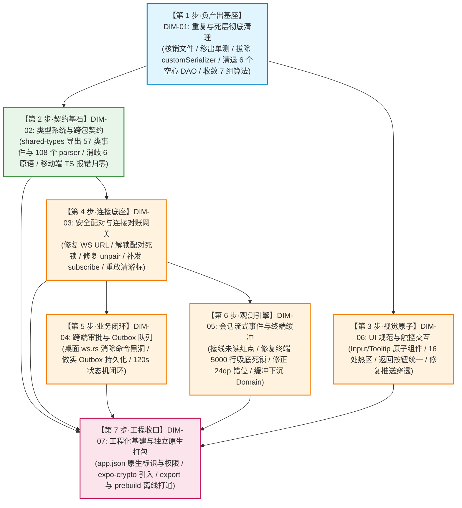

# 移动端全面复兴与打包打通总方案 (01-plan-by-agent-1.md)
## —— 极简收敛与先删后改学派实施纲领

> **方案编号**：`independent-plans/01-plan-by-agent-1.md`  
> **设计学派**：【极简收敛与先删后改学派】（负产出优先、无冗余模式、极简内聚）  
> **责任 Agent**：方案设计 Agent 1  
> **设计日期**：2026-09-04  
> **依据资产**：`01-final-dimensions.md`（定案）、`00-summary.md`（汇总）、11 份专项调研（`surveys/01` ~ `11`）  
> **遵守规范**：《主 Agent 全流程调度提示词 v3》、《AGENTS.md》、反退避纪律、反过度设计红线  
> **设计纪律**：本案严禁波次/批次编号（0 出现率）；推进单位为领域概念；单向无环依赖（DAG）；不涉及笔记功能；负产出绝对前置先行。

---

## 一、架构愿景与极简哲学

### 1.1 极简收敛学派的核心纲领
软件复杂度的本质，在于“非必要状态”与“重复真理”的几何级数滋生。当前 `apps/crish-mobile` 遭遇的 22 处 TypeScript 编译报错、`npx expo export` 100% 打包崩溃、路由树被单测污染、连接握手 404/401 拒连、终端满 5000 行吸底死锁等一系列危象，其本质**不是功能做得太少，而是死代码、临时补丁与形式主义结构堆砌得太多**：
- 280 行 `cachePolicy.ts` 清理逻辑配上 401 行单测，在生产中却零次调用；
- 6 个空心 SQLite DAO 耗费 800+ 行测试保护，实际 Store 却纯内存裸奔；
- 临时 Polyfill `r2-16-crypto-polyfill.js` 与 Windows 本地绝对路径硬编码进 `metro.config.js`，反而破坏了 Expo 原生打包协议；
- 7 组重复手写算法散落在表现层，同一概念多轨漂移。

**本方案奉行【极简收敛与先删后改】铁律**：
1. **负产出优先（Negative Yield First）**：清退 1500+ 行死代码、6 个空心 DAO、未接线的虚假缓存算法与僵尸目录；在干净的地基上重构，消除一切噪音；
2. **单一真理源（SSOT）**：一个概念只允许一条通路。移动端定位为**“轻量、高敏捷的实时观测中心与安全审批终端”**，桌面端为权威状态与数据中心；坚决拒绝在移动端强行复制一套沉重且脱节的双主数据库；
3. **原生无损契约**：摒弃任何非标准 Metro 拦截器与盲猜坐标补偿，以原生 Expo 标准配置、严格 ESM 模块规范与 O(1) 确定性逻辑解决问题。

---

## 二、本方案要删掉什么 / 收敛什么（刚性负产出清单）

遵照定案文档《01-final-dimensions.md》对 DIM-01 的刚性基座定位，所有实质性功能修复前，必须无条件完成以下删除与收敛。

### 2.1 物理删除清单（彻底核销文件）

| 序号 | 目标文件路径 | 物理行数 | 删除理由与定性 |
| :---: | :--- | :--- | :--- |
| **1** | `apps/crish-mobile/r2-16-crypto-polyfill.js` | 32 行 | 联调期临时注入补丁。底层 `noblePrimitives.ts` 已重构为 RFC 7748 X-only ladder 算法（零随机数依赖，纯代数映射）；该文件为阻碍打包的纯死代码。 |
| **2** | `apps/crish-mobile/lint-out.txt` | 5 行 | 历史构建执行遗留的临时日志垃圾文本，污染代码仓库。 |
| **3** | `apps/crish-mobile/src/network/HttpClient.ts` | 24 行 | 仅有空构造函数与 getter，无任何网络请求能力，全仓生产零调用。 |
| **4** | `apps/crish-mobile/src/network/HttpClient.test.ts` | 32 行 | 测试从未使用的空骨架类，属于保护死代码的形式主义单测。 |
| **5** | `apps/crish-mobile/src/db/cachePolicy.ts` | 280 行 | 设计用于全库 8 表的 LRU 与时间窗口淘汰，但没有任何生命周期或调度驱动它，零调用点。 |
| **6** | `apps/crish-mobile/src/db/cachePolicy.test.ts` | 401 行 | 401 行针对从未调用死算法的虚假单测。 |
| **7** | `apps/crish-mobile/src/hooks/index.ts` | 3 行 | 仅含 `export {};` 的占位空壳；连同 `apps/crish-mobile/src/hooks/` 空目录一并物理删除。 |
| **8** | `apps/crish-mobile/src/domain/db/index.ts` | 4 行 | 仅含 `export {};` 的占位空壳；连同 `apps/crish-mobile/src/domain/db/` 空目录一并物理删除。 |
| **9** | `apps/crish-mobile/src/domain/services/index.ts` | 4 行 | 仅含 `export {};` 的占位空壳；连同 `apps/crish-mobile/src/domain/services/` 空目录一并物理删除。 |
| **10** | `apps/crish-mobile/src/presentation/components/templates/PlaceholderScreen.tsx` | 42 行 | 占位死模板，硬编码 `#555555`，未接入主题。 |
| **11** | `apps/crish-mobile/src/presentation/components/templates/PlaceholderScreen.test.tsx` | 32 行 | 保护占位死模板的单测。 |
| **12** | `apps/crish-mobile/src/presentation/components/templates/ProtectedPlaceholder.tsx` | 45 行 | 占位死模板。 |
| **13** | `apps/crish-mobile/src/presentation/components/templates/ProtectedPlaceholder.test.tsx` | 45 行 | 保护占位死模板的单测。 |
| **14** | `apps/crish-mobile/src/presentation/pair/pairScanScreen.tsx` | 50 行 | 纯静态假占位页面（仅一行“功能即将推出”文案），未接相机扫码，产生体验断崖。 |
| **15** | `apps/crish-mobile/src/presentation/pair/pairScanScreen.test.tsx` | 35 行 | 保护扫码假占位的单测。 |
| **16** | `apps/crish-mobile/app/diagnostics.tsx` | 18 行 | 占位伪路由。 |
| **17** | `apps/crish-mobile/app/tasks.tsx` | 18 行 | 占位伪路由。 |
| **18** | `apps/crish-mobile/app/usage.tsx` | 18 行 | 占位伪路由。 |
| **19** | `apps/crish-mobile/app/approval-history.tsx` | 18 行 | 占位伪路由。 |
| **20** | `apps/crish-mobile/src/presentation/components/terminal/terminalLineBuffer.ts` 中的 `replaceAllTerminalText` | 12 行 | 从未被任何生产事件调用的死接口。 |

### 2.2 路由树物理移出清单（根治 Expo Router 静态导出崩溃）

Expo Router 依据 `apps/crish-mobile/app/` 目录结构动态扫描生成路由栈。以下 8 个单测文件直接置于 `app/` 导致打包器误将其作为页面并引入 `@testing-library`，引发 Metro 解析崩溃。必须全量移出至非路由测试目录：

| 原路由污染路径 | 迁移后安全路径 |
| :--- | :--- |
| `apps/crish-mobile/app/(tabs)/files.test.tsx` | `apps/crish-mobile/src/presentation/screens/__tests__/files.test.tsx` |
| `apps/crish-mobile/app/(tabs)/index.test.tsx` | `apps/crish-mobile/src/presentation/screens/__tests__/index.test.tsx` |
| `apps/crish-mobile/app/(tabs)/settings.test.tsx` | `apps/crish-mobile/src/presentation/screens/__tests__/settings.test.tsx` |
| `apps/crish-mobile/app/_layout.test.tsx` | `apps/crish-mobile/src/presentation/screens/__tests__/_layout.test.tsx` |
| `apps/crish-mobile/app/notifications.test.tsx` | `apps/crish-mobile/src/presentation/screens/__tests__/notifications.test.tsx` |
| `apps/crish-mobile/app/pair/manual.test.tsx` | `apps/crish-mobile/src/presentation/pair/__tests__/manual.test.tsx` |
| `apps/crish-mobile/app/pair/scan.test.tsx` | `apps/crish-mobile/src/presentation/pair/__tests__/scan.test.tsx` |
| `apps/crish-mobile/app/pair/welcome.test.tsx` | `apps/crish-mobile/src/presentation/pair/__tests__/welcome.test.tsx` |

### 2.3 SQLite 存储层 6 个空心 DAO 与死测试彻底核销

当前 SQLite 体系存在严重的形式主义闭环：8 个 DAO 中有 6 个完全未被业务接入，`eventStore`、`sessionStore`、`approvalStore` 均在纯内存裸奔。
本学派坚决拒绝“为了接线而接线”去给移动端引入 5000 行臃肿的持久化重放同步器。移动端定位为实时观测面，权威在桌面端。

- **清退 6 个空心 DAO 源码**：
  1. `apps/crish-mobile/src/db/dao/eventsDao.ts`（230 行，未接线）
  2. `apps/crish-mobile/src/db/dao/sessionSummariesDao.ts`（150 行，未接线）
  3. `apps/crish-mobile/src/db/dao/approvalHistoryDao.ts`（130 行，未接线）
  4. `apps/crish-mobile/src/db/dao/approvalQueueDao.ts`（160 行，未接线）
  5. `apps/crish-mobile/src/db/dao/pushTokensDao.ts`（80 行，未接线）
  6. `apps/crish-mobile/src/db/dao/deviceInfoDao.ts`（90 行，未接线，元数据被 SecureStore 替代）
- **同步清理保护死 DAO 的单元测试（800+ 行）**：
  1. `apps/crish-mobile/src/db/dao/eventsDao.test.ts`（205 行）
  2. `apps/crish-mobile/src/db/dao/approvalDao.test.ts`（132 行）
  3. `apps/crish-mobile/src/db/dao/approvalQueueDao.test.ts`（185 行）
  4. `apps/crish-mobile/src/db/dao/approvalHistoryDao.test.ts`（150 行）
  5. `apps/crish-mobile/src/db/dao/metaDao.test.ts` 中针对已删 DAO 的无效测试用例（~100 行）
- **收敛后真实持久化架构**：
  - **保留并做实 2 个活跃 DAO**：`SqlSettingsDao`（设置项持久化，已通畅）与 `SqlNotificationsDao`（补齐 `notificationStore` 真实写回填，消除已读状态重启丢失缺陷）；
  - **Outbox 队列**：采用轻量可靠的持久化适配器（由 `driver.ts` 或轻量存储驱动），不依赖复杂的空心 DAO，确保杀进程后决策防丢。

### 2.4 重复手写算法彻底收敛（7 组归一）

1. **相对时间格式化（`formatRelativeTime`）**：
   - 彻底删除 `src/presentation/components/files/fileMeta.ts:144-158` 的手写实现；
   - 统一使用 `src/domain/pure/time.ts:formatRelativeTime`，扩展选项参数支持天数阈值与“昨天”文案，实现全仓单一真理。
2. **时钟时间格式化（`formatClockTime`）**：
   - 彻底删除 `EventRow.tsx:196-200`（`formatFeedTime`）与 `approvalListScreen.tsx:32-36`（`formatHistoryTime`）；
   - 在 `src/domain/pure/time.ts` 导出标准的 `formatClockTime(ms: number): string`。
3. **运行状态文案与指示灯色调**：
   - 收敛 `terminalScreen.tsx` 顶层手写的 `runStatusLabel` 与 `statusDotColor`；
   - 统一引用 `src/presentation/components/runDetail/runDetailMeta.ts`，纠正终端页将 `running` 误标为绿色（成功色）的严重视觉混淆 Bug，统一定位为 `colorInfo`（蓝色）。
4. **网络连接相位与选择器**：
   - 确立 `connectionStore` 的 `ConnectionPhase` 为全局物理连接的单一真理源；
   - 消除 `eventStore` 的独立 `network` 状态，统一使用 `src/domain/pure/selectors.ts` 的文案映射。
5. **Base64 编解码**：
   - 删除 `keyAgreement.ts:81-95` 与 `signer.ts:189-202` 手写的重复 Base64 编码循环，收敛至 `@noble/hashes/utils.js` 标准方法。
6. **SHA-256 与 HMAC 密码学实现**：
   - 彻底删除 `src/network/signer.ts:41-186` 手写的 145 行 SHA-256（`SHA256_K` 等常量）及 RFC 2104 HMAC 字节异或；
   - 全面改用 `@noble/hashes/sha2.js` 的 `sha256` 与 `@noble/hashes/hmac.js` 的 `hmac`。
7. **Hex 编解码**：
   - 统一引入 `@noble/hashes/utils.js`，清理 `keyAgreement.test.ts` 中手写的 `hexToBytes` / `bytesToHex`。

### 2.5 其它冗余、死状态与坏味道清理

1. **`metro.config.js` 毒素拔除**：彻底删除 `customSerializer` 劫持代码、`METRO_ROOT = 'C:/Software/conex/node_modules/metro/src'` 硬编码绝对路径以及 `blockList` 遮盖补丁，还原为干净标准的 Expo 配置；
2. **返回按钮收敛**：删除 7 个页面中各自手写的返回按钮 JSX 及样式，统一替换为原子组件 `<HeaderBackButton>`；
3. **主题双轨收敛**：删除 `src/adapters/settings/themeProjection.ts` 中转壳，全仓统一直接从 `src/adapters/platform/theme.ts` 导入；
4. **死状态位清理**：
   - 移除 `outboxState.replaying` 恒为 `false` 的无用死字段；
   - 收敛 `approvalStore` 中的全局 `decisionBusy: Record<string, boolean>` 与条目内 `p.decisionBusy`，消除双轨分裂；
   - 清退 `tool-update`（已在协议中废弃）在终端事件映射中的 5 处残留；
   - 移除 `ReconnectingWsClient.ts` 中 3 处空监听回调；
   - 移除 SecureStore 中从未被配对调用的 Nonce 读写接口（`saveExchangeNonce` 等）。

---

## 三、七大实施维度精益拆解与实施方案

### DIM-01: 重复与死层 (负产出基座，必须最先执行)

- **核心目标**：彻底执行本方案第二节所列的全部物理删除、路由移出、空心 DAO 核销与 7 组重复算法收敛，扫清构建阻断与认知包袱。
- **实施步骤**：
  1. **构建与临时文件清理**：物理删除 `r2-16-crypto-polyfill.js`、`lint-out.txt`；
  2. **标准化 `metro.config.js`**：
     - 移除 `customSerializer` 覆写与 `METRO_ROOT` 绝对路径；
     - 配置干净的 Monorepo `watchFolders` 与 `resolver.nodeModulesPaths`；
     - 移除针对测试文件的 `blockList` 掩盖规则；
  3. **路由树清理**：将 `app/` 目录下的 8 个 `*.test.tsx` 移至 `src/presentation/` 对应测试子目录；
  4. **死代码与模板物理删除**：物理删除 `HttpClient.ts`、`cachePolicy.ts`、3 个空目录（`hooks`、`domain/db`、`domain/services`）、4 个占位伪路由及 `PlaceholderScreen`；
  5. **算法收敛**：
     - 重写 `signer.ts`，引入 `@noble/hashes` 替代手写 SHA-256/HMAC；
     - 聚拢 `time.ts` 导出 `formatRelativeTime` 与 `formatClockTime`，替换 `fileMeta.ts`、`EventRow.tsx`、`approvalListScreen.tsx` 中的旧实现；
     - 统一 `terminalScreen.tsx` 的运行状态色标；
  6. **DAO 瘦身**：移除 6 个未接线空心 DAO 及其测试套件，精简 SQLite Schema。

---

### DIM-02: 类型系统与跨包契约 (shared-types 权威导出)

- **核心目标**：彻底修复 `npm run typecheck -w @crish/crish-mobile` 报出的 22 处 TypeScript 编译错误（降为 0），恢复跨包契约单一真理源，消除桌面端深路径侵入。
- **实施步骤**：
  1. **完善 `packages/shared-types/src/index.ts` 导出面**：
     - 补齐 `generated/engine/events.ts`（57 类事件接口及 `EngineEvent` 联合类型）；
     - 补齐 `generated/engine/parser.ts`（108 个严格解析器函数）；
     - **ESM 命名消歧**：利用显式 Named Export 优先于 Wildcard Export 的标准语义，显式导出 6 个同名同构原语符号，消除与 `generated/device/parser.ts` 的导出歧义：
       ```typescript
       export {
         type ParseResult,
         parseOk,
         parseErr,
         isParseOk,
         isParseErr,
         parseApprovalDecision,
       } from './generated/engine/parser';
       ```
  2. **修复移动端 6 处散落类型错误**：
     - `src/adapters/wiring/filesWiring.test.ts`：将 `mockSocketFactory()` 返回值从 `: unknown` 修正为 `: WsSocket`；
     - `src/adapters/wiring/ingestRouter.test.ts`：增加非空断言 `window!.entries` 与 `window!.lastSeq`；
     - `src/domain/store/filesStore.test.ts`：删除测试构造中非契约属性 `kind: 'file'` 与 `modifiedMs: 1000`，改用合法契约属性 `isDir: false`；
     - `src/domain/store/settingsStore.test.ts`：使用 `// prettier-ignore` 锁定单行格式，使 `@ts-expect-error` 精确覆盖目标语句；
     - `src/pairing/rustParity.test.ts`：为平台字面量数组添加 `as const`，显式标注 `mockHello: BuildPairHelloInput`；
     - `src/presentation/components/runDetail/RunDetailHeader.test.tsx`：彻底删除已废弃的 `badge` 属性传递。
  3. **登记并消除桌面端深路径侵入**：
     - 将桌面端 16 处形如 `../../../../packages/shared-types/src/generated/engine` 的深路径替换为标准的 `@crish/shared-types` 入口导入。

---

### DIM-03: 安全配对与连接对账网关

- **核心目标**：攻克握手 404/401 拦截、消除 P0 连接死锁、解决解绑通知丢失、打通长连接订阅与全量对账。
- **实施步骤**：
  1. **修正 WebSocket 连接端点 URL 与鉴权**：
     - 修正 `src/network/EndpointResolver.ts:resolveWsUrl`：将基础路径规范化为 `/v1/events`，并携带查询参数 `?token=${encodeURIComponent(token)}`；
     - 对齐桌面端 Axum WebSocket Upgrade 路由需求，终结握手阶段即被 404/401 拒连的问题。
  2. **根除配对死锁 (P0)**：
     - 改造 `apps/crish-mobile/src/adapters/wiring/pairing/PairingWiring.ts:handlePairingPhase`：
     - 当检测到 `phase === 'dead'` 时，**必须显式向状态机分发**：
       ```typescript
       this.dispatch({
         type: 'onPairError',
         error: {
           kind: 'unknown',
           code: 'pairing.transport_failed',
           message: '配对连接失败（多次重连未恢复），请重试',
           retryable: true,
         },
       });
       ```
     - 强制状态机脱离 `sending-hello` 转移至 `error`，解除表现层 `busy` 锁死，使「连接」按钮恢复可点击。
  3. **重构 `unpair()` 解绑逻辑（统一真理源）**：
     - 摒弃对未水合瞬态 `this.machine.state` 的依赖，以 `authStore.getState()` 为唯一真源：
       ```typescript
       async unpair(): Promise<void> {
         const auth = authStore.getState();
         if (auth.pairState === 'paired' && auth.deviceId) {
           const obs = getObservationWiring();
           if (obs) {
             void obs.client.gateway
               .invoke('device.unlink', { deviceId: auth.deviceId })
               .catch(() => {});
           }
         }
         await auth.onUnpaired(this.persist);
       }
       ```
     - 彻底根除冷启动后在设置页解绑却漏通知桌面端的缺陷。
  4. **应用层配对超时熔断与交互轻量化**：
     - 在 `beginPairing` 中挂载 15 秒定时器，超时未收到回应主动抛出 `pairing.timeout`，防止无响应挂起；
     - 配对期连接配置 `maxRetries = 1`，网络不通时在 5~8 秒内快速反馈，禁止漫长的 30 秒盲等。
  5. **消除建连打开时序竞态 (P0)**：
     - 调整 `ReconnectingWsClient.ts:handleOpen` 执行序：**必须先调用 `this.gateway.attachSend(sendFn)`，然后再调用 `this.setPhase('open')`**；
     - 根除在相位回调触发业务查询时因 `sendFn == null` 报错的隐患。
  6. **补发 `events.subscribe` 与游标对账重置 (P0)**：
     - 在长连接就绪后，由 `FeedBridge` 主动向桌面发送 `events.subscribe`，使桌面 FanOut 过滤器生效；
     - 收到 `events.subscribe.ok` 后驱动对账；
     - **修复全量重放丢弃 Bug**：当判定为 `fullReplay` 时，**必须先调用 `eventStore.getState().unloadWindow(sessionId)` 清空本地游标**，再从 0 拉取，杜绝重放帧被环形缓冲作为 duplicate 静默丢弃。
  7. **冷启动水合时序修正（根除路由跳跃回弹）**：
     - 将 `ensurePairingWiringForApp()` 提前至 `app/_layout.tsx` 的 SplashGate 之前执行，确保在放行路由树之前完成凭据读取，消除“Tabs -> Pair -> Tabs”的视觉闪烁与路由跳跃。

---

### DIM-04: 跨端审批闭环与 Outbox 队列

- **核心目标**：打通桌面端 WebSocket 远程命令分发（消除黑洞），做实 Outbox 可靠轻量持久化，完善双阶段确认与 120s 倒计时闭环。
- **实施步骤**：
  1. **桌面端 `ws.rs` 消除远程命令黑洞 (P0)**：
     - 修改 `apps/agent-workbench/src-tauri/src/server/ws.rs:1133-1163`；
     - 对入站的 `MessageKind::Remote(RemoteCommand::Approve)` 与 `MessageKind::Remote(RemoteCommand::Deny)` 进行路由挂载，直接调用 `ApiBackend::approve` 与 `ApiBackend::deny`；
     - 处理完成后通过 WebSocket 回包 `result.approve` 与 `result.deny`（`ok: true`），终结 10 秒超时黑洞。
  2. **补齐 `mobile_list_pending_approvals` 协议挂载**：
     - 在桌面端实现对账命令分发，使移动端重连后可通过 WS 网关顺畅完成待办拉取与双向对账。
  3. **移动端 Outbox 接入可靠轻量持久化**：
     - 移除 `approvalWiring.ts` 中的“纯内存态占位”注释与逻辑；
     - 为 `outboxState` 配置轻量异步持久化钩子（在 `enqueue`、`markSent`、`confirmResolved` 时触发写入），保证即使移动端被系统杀进程，离线决策依然完好，重连后可断点自动重放。
  4. **完善 120 秒本地超时与防双点机制**：
     - 保持 300ms 刚性时间锁，防抖防双点；
     - 完善 `useCountdownTick` 秒级递减逻辑，超时主动将本地条目置为 `expired` 并写入历史审计，禁止向对端发送过期废弃决策。

---

### DIM-05: 会话流式事件与终端缓冲引擎

- **核心目标**：接线未读红点（消除虚假闭环）、攻克 5000 行终端滚底冻结 (P0)、修正虚拟化坐标错位、下沉领域纯逻辑。
- **实施步骤**：
  1. **接线未读红点计算（做实生产链路）**：
     - 在 `eventMappers.ts` 中针对 `message-end` 事件，提取 `sequence` 与 `message.role === 'assistant'`；
     - 产出 `{ kind: 'session-unread-update', sessionId, sequence }` 动作，由 `ingestRouter.ts` 派发给 `sessionStore.applyLatestSeq(...)`；
     - 彻底打破“单测常绿但真机未读红点恒为 0”的虚假闭环。
  2. **攻克终端满 5000 行自动滚底死锁 (P0)**：
     - 重构 `apps/crish-mobile/src/presentation/components/terminal/TerminalView.tsx:60-64`；
     - 将吸底 `useEffect` 的依赖项由 `lines.length` 改为**单调递增的绝对游标** `startIndex + lines.length`：
       ```tsx
       const lineCursor = startIndex + lines.length;
       useEffect(() => {
         if (follow && lineCursor > 0) {
           targetRef.current?.scrollToEnd({ animated: false });
         }
       }, [follow, lineCursor, targetRef]);
       ```
     - 满 5000 行发生淘汰时，`lineCursor` 依然单调递增，`useEffect` 持续平滑触发滚底，彻底根治吸底冻结 Bug。
  3. **修正虚拟化布局错位 (24dp)**：
     - 调整 `TerminalView.tsx`：将 `ListHeaderComponent` 截断提示的高度（24dp）精确计入 `getItemLayout.offset`，或者将截断提示改为顶部浮层，彻底解决虚拟化视口坐标撕裂与白屏弹跳。
  4. **架构解耦与防逆向依赖**：
     - 严格遵守整洁架构与《AGENTS.md》§11 铁律，将 `terminalLineBuffer.ts` 从 `src/presentation/components/terminal/` 下沉迁移至 `src/domain/pure/terminalLineBuffer.ts`，彻底斩断 Domain 层对 Presentation 层的逆向引用；
     - 移除跨 chunk 未终结行的提前裁剪逻辑，防止有效行被永久误删。
  5. **消除终端双真理回落计算**：
     - `terminalScreen.tsx` 中的历史 `buffer` 重建改为惰性计算，仅在 `liveView` 为空时触发，避免后台双倍计算浪费 CPU。

---

### DIM-06: UI 规范、主题与触控交互

- **核心目标**：全面对齐《AGENTS.md》（§12 Tooltip、§13 焦点态、§14 色彩）、补齐原子组件、治理 16 处触控热区违规、修复推送偏好穿透 Bug。
- **实施步骤**：
  1. **补齐原子 `<Input>` 与 `<Tooltip>` 组件**：
     - 在 `src/presentation/components/ui/` 实现原子 `<Input>`：
       - 默认扁平无重阴影；
       - 聚焦时采用克制边框高亮（严格遵照 §13“与文本色混入 3%~6%，上限不超过 10%”红线）；
       - 统一样式与禁用态弱化，供 `pairManualScreen` 与 `QuickRunPanel` 统一调用；
     - 实现自研轻量 `<Tooltip>` 组件：支持长按或悬停展示柔和胶囊提示，避免原生截断无感知。
  2. **全仓治理 16 处触控热区违规**：
     - 针对调研排查出的 16 处触控尺寸不足 44/48dp 的交互项（如 `EventFeed` FilterChip、`QuickRunPanel` 历史项、`FilePreview` 返回按钮等），统一配置 `dualHitSlop`（iOS 44pt 视觉下限，Android 48dp 命中热区）。
  3. **公共导航组件收敛**：
     - 封装统一的 `<HeaderBackButton>` 原子组件，尺寸规范化为 44×44dp 并内置 `dualHitSlop`，替换 7 个页面手写的分裂返回按钮。
  4. **色彩空间全面升级为现代 HSLA**：
     - 清理 `theme.ts` 中的 Hex 与旧式 `rgba(r,g,b,a)`，全量采用 `hsl(h s l / a)` 现代斜杠语法；
     - 清理 `fileMeta.ts` 硬编码的 5 个 Hex 文件类型颜色，统一由主题 Token 派生；
     - 移除 `WorkspaceSwitcher.tsx` 对 RN 原生 `Modal` 的违规引用，使用自研 `Dialog` overlay。
  5. **修复推送偏好穿透 Bug (严重缺陷)**：
     - 改造 `src/notifications/pushConsumer.ts:handleFrame`：
     - 在后台准备呈现系统通知前，**必须调用 `shouldShowSystemNotificationForPushLive(push)`** 检查用户开关；
     - 若用户关闭了对应场景的推送偏好，直接跳过系统弹窗（仅保留应用内静默落库），根除后台骚扰。

---

### DIM-07: 工程化基建与独立原生打包

- **核心目标**：打通脱离 Expo Go 的独立原生打包体系，消除构建环境死锁，实现 `npx expo export` 与 `npx expo prebuild` 100% 成功。
- **实施步骤**：
  1. **完善 `app.json` 原生配置基线**：
     - 补齐 Android 唯一标识：`"package": "com.crish.mobile"`；
     - 补齐 iOS 唯一标识：`"bundleIdentifier": "com.crish.mobile"`；
     - 注册 `"plugins"`：配置 `expo-notifications` 插件（指定小图标与主题色）；
     - 补齐权限声明：`android.permission.POST_NOTIFICATIONS`、`android.permission.VIBRATE`；
     - 局域网网络许可：配置 `android.usesCleartextTraffic = true` 与 iOS `NSLocalNetworkUsageDescription`；
     - 硬件安全防护：配置 `android.allowBackup = false`，杜绝系统云备份导致 Keystore 解密崩溃。
  2. **补齐依赖与构建脚本（`package.json`）**：
     - 安装原生绑定依赖：`"expo-crypto": "~57.0.1"`（确保独立包内 JSI 安全随机模块链接，配合 RFC 7748 实现坚固密码学基底）；
     - 增加标准工程化构建脚本：
       ```json
       "scripts": {
         "prebuild": "expo prebuild",
         "prebuild:clean": "expo prebuild --clean",
         "export": "expo export",
         "build:android": "expo run:android",
         "build:ios": "expo run:ios"
       }
       ```
  3. **打通离线静态导出与预构建**：
     - 执行 `npx expo export --platform android`：验证由于 `customSerializer` 已被删除，Expo 官方序列化器正常产出合法的 `dist/` 离线静态 Bundle 与 Assets，零报错；
     - 执行 `npx expo prebuild`：顺利生成结构完整、包名正确的原生 `android/` 工程。

---

## 四、逻辑执行顺序与依赖关系 (DAG)

实施过程严格恪守“**先删后改、单向无环、负产出先行**”的黄金法则，各领域推进顺序如下拓扑所示：



### 依赖关系严密性说明：
1. **DIM-01 必须最先执行**：删除死文件、移出路由污染单测、还原 `metro.config.js`，否则后续任何编译、测试或打包都会被死代码与脏配置干扰；
2. **DIM-02 为通信与模型提供类型基底**：`shared-types` 导出补齐后，DIM-03、DIM-04、DIM-05 的事件映射与命令参数才能获得 100% 静态类型守卫；
3. **DIM-03 先于 DIM-04 与 DIM-05**：必须先打通长连接通道（`/v1/events` 与 `events.subscribe`），审批决策重放与流式事件推流才有物理通信介质；
4. **DIM-07 作为最终收口**：在全域代码干净、类型全绿、业务闭环的前提下，进行原生工程导出与打包编译验证。

---

## 五、立体验证断言与门禁检查套件

全方案在实施交付前，必须按照《AGENTS.md》§7.1 履行立体验证，严禁单一检查冒充验收。

### 5.1 门禁 1：类型系统与静态代码质量（零错误）
```powershell
# 1. 移动端类型检查（必须 0 错误）
npm run typecheck -w @crish/crish-mobile

# 2. 全仓根类型检查（确保 Desktop 与 Packages 零破坏）
npm run typecheck

# 3. 前端行数门禁检查
npm run check:line-counts
```
*断言指标*：TypeScript 诊断错误完全归零（22 $\to$ 0），无新增 `@ts-expect-error` 或 `any` 逃逸。

### 5.2 门禁 2：全量单元测试与资产保护（100% 绿灯）
```powershell
# 1. shared-types 契约包全量单测
npx vitest run packages/shared-types

# 2. 移动端单元测试（全量通过，保护移出的 8 个页面单测）
npm --workspace @crish/crish-mobile run test
```
*断言指标*：契约测试 100% 通过；移动端既有及迁移后的测试集全绿，测试覆盖率只增不减。

### 5.3 门禁 3：网络协议、握手与 Outbox 闭环验证
- **握手连通性断言**：移动端连接 `ws(s)://<host>:<port>/v1/events?token=...`，桌面端 Axum 正确处理 Upgrade，返回 HTTP 101，无 404/401 拒连；
- **订阅与对账断言**：移动端发出 `events.subscribe`，桌面端 FanOut 成功注册并返回 `events.subscribe.ok`，触发对账流程；
- **审批命令无黑洞断言**：通过 WS 发送 `remote.approve`，桌面端 `ws.rs` 正确分发并返回 `result.approve`（`ok: true`），响应时间 $< 100\text{ms}$，无 10s 超时；
- **Outbox 耐受杀进程断言**：在离线状态下点击审批决策进入 Outbox，强杀移动端进程后重新启动，Outbox 队列成功水合恢复，并在网络连通后自动重放。

### 5.4 门禁 4：终端极限压力与 UI 现场验收
- **终端 5000 行吸底断言**：向终端注入 6000 行流式日志，当行数达到 5000 触发淘汰后，视图保持平滑吸底滚底，无卡顿冻结，截断提示高度无坐标错位；
- **触控热区达标断言**：界面所有可点击元素的点击响应区域在 iOS 下 $\ge 44\text{pt}$，Android 下 $\ge 48\text{dp}$；
- **推送偏好门禁断言**：关闭特定通知开关后，模拟后台推送到达，系统横幅被 100% 拦截，仅在应用内保存。

### 5.5 门禁 5：独立打包与工程化导出验证
```powershell
# 1. 静态离线导出验证（根除 customSerializer 破坏后的验证）
npx expo export --platform android

# 2. 原生工程预构建验证
npx expo prebuild --platform android --clean
```
*断言指标*：`dist/` 目录正常生成合法的静态资源与 JS Bundle，无 `Serializer did not return expected format` 报错；`android/` 目录顺利生成包名为 `com.crish.mobile` 的合法原生工程。

---

*总方案编写完成。极简收敛，先删后改，彻底打通！*
