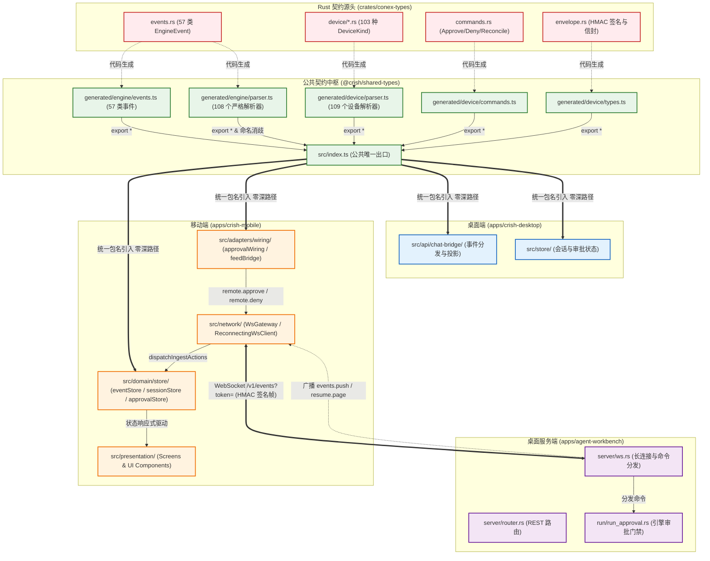
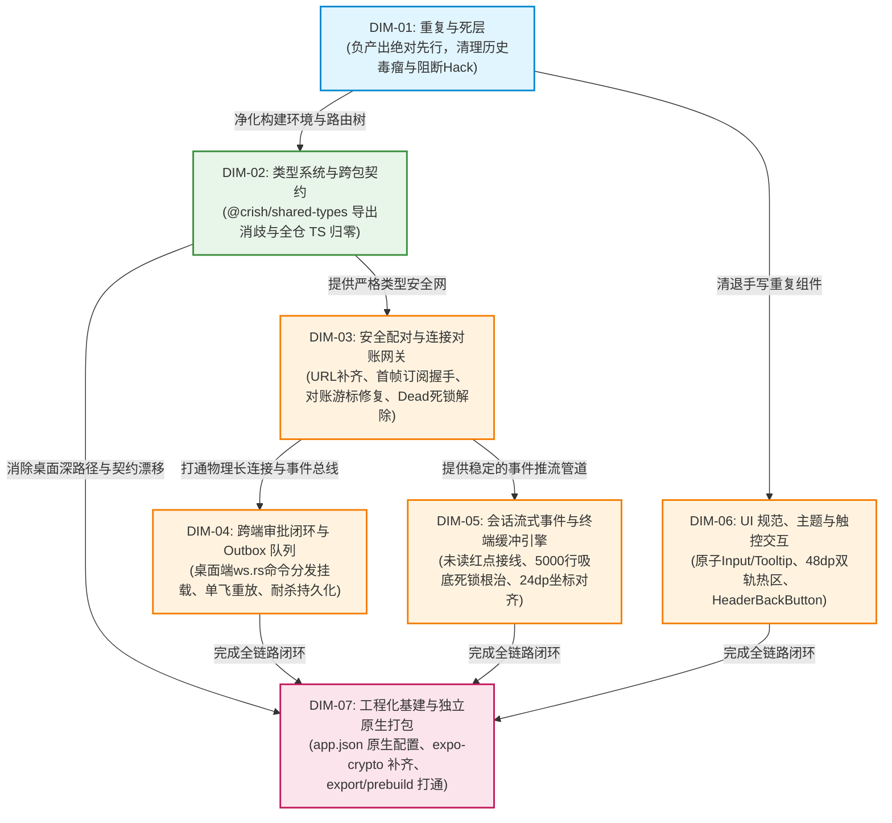

# 移动端全面复兴与打包打通总方案（类型驱动与契约零漂移学派）

> **方案编号**：`independent-plans/02-plan-by-agent-2.md`
> **方案学派**：【类型驱动与契约零漂移学派】
> **方案主旨**：以 `@crish/shared-types` 单一真理源（SSOT）为中枢，彻底贯通 57 类事件、108 个严格解析器在移动端、桌面端与 Axum 网关之间的无缝映射，消除 6 个同名冲突符号，清退桌面端深路径侵入，清零移动端 22 处 TS 编译报错；以严格的类型系统保障 7 大领域维度的安全实施与原生打包打通。
> **定案依据**：`docs/mobile-revival-audit/01-final-dimensions.md`（DIM-01 ~ DIM-07）
> **调研基准**：`docs/mobile-revival-audit/00-summary.md` 与 11 份专项调研报告（`surveys/01` ~ `11`）
> **纪律准则**：严格遵守《主 Agent 全流程调度提示词 v3》、《AGENTS.md》通用协作与反退避纪律、反过度设计红线；负产出绝对先行；无波次编号；一个概念一条主路径。

---

## 一、方案核心哲学与契约体系全景

### 1.1 学派哲学：类型驱动契约，消除运行时与编译期双重漂移

在现代多端多语言分布式交互架构（Rust 内核 + Axum WebSocket 网关 + React 桌面端 + React Native / Expo 移动端）中，软件演进最危险的毒瘤是**“契约漂移（Contract Drift）”**与**“虚假闭环（Phantom Loop）”**：
- **编译期的沉默妥协**：当公共类型包未导出核心事件与严格解析器时，消费端通过深路径穿透直接侵入内部源码（如桌面端的 16 处深路径引用），或在测试中胡乱捏造未经契约声明的假字段（如 `kind: 'file'`、`badge: 'running'`），导致类型守卫形同虚设；
- **运行时的盲目假设**：网络层 URL 遗漏路由与 Token 导致握手被拒、网关漏发关键订阅帧导致推流静默断裂、状态机在 Dead 相位漏发错误事件导致按钮永久 Loading 死锁、终端缓冲区满 5000 行后因依赖项停滞导致吸底冻结——这些致命缺陷的本质都是**“状态转移与数据契约脱离了类型系统的刚性约束”**。

**类型驱动与契约零漂移学派的核心纲领**：
1. **SSOT 绝对神圣**：全仓数据契约以 `@crish/shared-types`（由 Rust `conex-types` 权威生成）为唯一真理源，任何模块（无论是桌面端还是移动端）**绝对禁止绕过公共包入口深路径穿透，绝对禁止在本地类型中二次拓宽或手写私有契约**；
2. **编译器能证明的，绝不留给运行时**：全面启用 TypeScript 严格模式，将 22 处编译报错全部归零；通过类型收窄（Type Narrowing）、常量断言（`as const`）、函数重载与严格逆变校验，在代码编写阶段拦截 100% 的字段越界与类型漂移；
3. **消除同名同构歧义**：利用 ECMAScript / TypeScript 的 ESM 模块解析标准（命名导出优先级绝对高于通配导出），显式消歧 6 个同名同构解析工具符号，彻底消除 ESM 模块模糊导出的隐性破坏；
4. **双向立体守门**：类型系统是逻辑实现的第一道护栏，运行期契约断言是第二道护栏，端到端打包与离线 Bundle 导出是最终闭环，拒绝任何单点检查冒充全量验收。

---

### 1.2 契约拓扑全景架构图

全仓契约拓扑坚持以 `@crish/shared-types` 为枢纽，构建 Rust 内核、Axum 网关、桌面端及移动端的单向无环依赖矩阵：



---

### 1.3 核心契约冲突根治与 ESM 规范消歧

#### 1. 现场断层诊断与根因
经 `surveys/02-typecheck-and-contract-drift.md` 确凿取证：
- `packages/shared-types/src/index.ts` 既往仅导出了 `generated/engine/types.ts` 和 3 个常量，**遗漏了 `generated/engine/events.ts` 与 `generated/engine/parser.ts`**；
- 移动端遵循包规范导入 `import { parseEngineEvent, EngineEvent } from '@crish/shared-types'` 时，直接触发 10 处 `TS2305` 编译报错；
- 桌面端由于无法从入口导入，妥协写出了 16 处深路径穿透引用（形如 `../../../../packages/shared-types/src/generated/engine`）。

#### 2. ESM Wildcard Export 碰撞与消歧原语
静态分析表明，`generated/engine/parser.ts` 与 `generated/device/parser.ts` 存在 **6 个同名同构导出符号**：
1. `type ParseResult<T>`
2. `parseOk`
3. `parseErr`
4. `isParseOk`
5. `isParseErr`
6. `parseApprovalDecision`

根据 ECMAScript 规范（ECMA-262 §16.2.3.8）与 TypeScript 模块解析规则：
- 当一个模块对两个子模块同时进行 `export * from 'A'` 与 `export * from 'B'` 时，两个子模块的同名符号会被判定为**“歧义导出（Ambiguous Export）”并被静默剔除**，导致外部消费方完全无法导入该符号；
- **确定性消歧法则**：**显式命名导出（Named Export）优先级绝对高于通配导出（`export *`）**。

#### 3. 规范落地代码方案（`packages/shared-types/src/index.ts`）
在 `packages/shared-types/src/index.ts` 中以显式命名导出绑定真实真源，一举两得消歧并向全仓开放 57 类事件与 108 个严格解析器：

```typescript
// ============================================================================
// 引擎生成面（generated/engine）公共 re-export 面
// 消除 apps/crish-desktop 与 apps/crish-mobile 对深路径的直引，统一经本公共面
// ============================================================================

export * from './generated/engine/types';
export type {
  AgentMessage as EngineAgentMessage,
  AgentMessageBlock as EngineAgentMessageBlock,
} from './generated/engine/types';

// generated/engine 事件全集（57 个事件类型与 EngineEvent 联合）
export * from './generated/engine/events';

// generated/engine 解析器全集（含 parseEngineEvent 等严格解析函数）
export * from './generated/engine/parser';

// 消除 engine/parser 与 device/parser 重叠的 6 个基础工具标识符歧义（ESM 命名导出优先）
export {
  type ParseResult,
  parseOk,
  parseErr,
  isParseOk,
  isParseErr,
  parseApprovalDecision,
} from './generated/engine/parser';

// ============================================================================
// 设备协议生成面（generated/device）公共 re-export 面
// ============================================================================
export * from './generated/device/types';
export * from './generated/device/kinds';
export * from './generated/device/commands';
export * from './generated/device/events';
export * from './generated/device/stream';
export * from './generated/device/errors';
export * from './generated/device/capabilities';
export * from './generated/device/parser';
```

---

## 二、【本方案要删掉什么 / 收敛什么】（刚性删除面全景清单）

根据《主 Agent 全流程调度提示词 v3》与《AGENTS.md》的收敛铁律，**负产出绝对先行，先删后改，清退一切死层与形式主义补丁**。本方案确立以下刚性删除面清单，在实施阶段必须严格按清单销毁与清退：

### 2.1 物理删除文件清单（死代码、临时补丁与破坏性资产）

| 序号 | 目标文件路径 | 物理行数 | 历史留存原因 | 刚性删除理由（为何必须物理删除） |
| :---: | :--- | :---: | :--- | :--- |
| **DEL-01** | `apps/crish-mobile/r2-16-crypto-polyfill.js` | 27 | 早期 R2-16 联调临时补丁（注记“本地执行用，不入库”） | 底层已由 `noblePrimitives.ts`（RFC 7748 Montgomery ladder）彻底取代，实现全程零随机数纯数学确定性；在独立原生包中未装 `expo-crypto` 时直接失效，属严重死代码。 |
| **DEL-02** | `apps/crish-mobile/lint-out.txt` | 5 | 历史 CLI 错误输出临时留存 | 污染工程根目录的垃圾日志文本，无任何业务价值。 |
| **DEL-03** | `apps/crish-mobile/src/db/cachePolicy.ts` | 280 | 早期设计的 8 表 LRU 与时间窗口淘汰执行器 | 8 表中 6 表为空心死表，全仓没有任何业务、生命周期或定时器调用 `runCleanup`，属典型未接线死算法。 |
| **DEL-04** | `apps/crish-mobile/src/db/cachePolicy.test.ts` | 401 | 保护 `cachePolicy.ts` 的单测套件 | 保护死代码的死测试，虚增覆盖率并增加重构阻力，随源码一同物理删除。 |
| **DEL-05** | `apps/crish-mobile/src/network/HttpClient.ts` | 24 | 早期网络模块脚手架 | 仅包含 `baseUrl` 与 `options` 的 getter，无任何 `fetch` 实现，全仓业务代码零引用。 |
| **DEL-06** | `apps/crish-mobile/src/network/HttpClient.test.ts` | 28 | 测试 `HttpClient.ts` 的单测 | 保护死代码的死测试，一同物理删除。 |
| **DEL-07** | `apps/crish-mobile/src/hooks/index.ts` | 3 | 早期目录占位 | 仅包含 `export {};` 的空文件骨架，清退后物理删除 `src/hooks/` 目录。 |
| **DEL-08** | `apps/crish-mobile/src/domain/db/index.ts` | 4 | 早期存储层占位 | 真实实现已在 `src/db/`，清退后物理删除 `src/domain/db/` 目录。 |
| **DEL-09** | `apps/crish-mobile/src/domain/services/index.ts` | 4 | 早期服务层占位 | 仅包含 `export {};`，清退后物理删除 `src/domain/services/` 目录。 |
| **DEL-10** | `apps/crish-mobile/app/diagnostics.tsx` | 20 | 路由骨架占位屏 | 渲染 `ProtectedPlaceholder` 占位，本期不实现，清退占位路由防止路由污染。 |
| **DEL-11** | `apps/crish-mobile/app/tasks.tsx` | 20 | 路由骨架占位屏 | 同上，纯占位，清退。 |
| **DEL-12** | `apps/crish-mobile/app/usage.tsx` | 20 | 路由骨架占位屏 | 同上，纯占位，清退。 |
| **DEL-13** | `apps/crish-mobile/app/approval-history.tsx` | 20 | 路由骨架占位屏 | 同上，已决历史已整合在审批中心内，清退占位路由。 |
| **DEL-14** | `apps/crish-mobile/src/presentation/components/templates/PlaceholderScreen.tsx` | 42 | 骨架模板组件 | 伴随占位路由清退而废弃，无生产引用。 |
| **DEL-15** | `apps/crish-mobile/src/presentation/components/templates/ProtectedPlaceholder.tsx` | 38 | 骨架模板组件 | 伴随占位路由清退而废弃，无生产引用。 |
| **DEL-16** | `apps/crish-mobile/src/presentation/components/templates/PlaceholderScreen.test.tsx` | 32 | 单测 | 伴随组件删除。 |
| **DEL-17** | `apps/crish-mobile/src/presentation/components/templates/ProtectedPlaceholder.test.tsx` | 45 | 单测 | 伴随组件删除。 |
| **DEL-18** | `apps/crish-mobile/src/presentation/pair/pairScanScreen.tsx` | 45 | 扫码配对假占位页面 | 纯静态假占位文案，未接相机扫码；手动输入（`pairManualScreen`）作为唯一主路径，清退此死页面。 |
| **DEL-19** | `apps/crish-mobile/src/presentation/pair/pairScanScreen.test.tsx` | 35 | 单测 | 伴随假页面删除。 |
| **DEL-20** | `apps/crish-mobile/app/pair/scan.tsx` | 15 | 扫码路由包装 | 伴随假页面删除。 |

---

### 2.2 存储层死 DAO 与空心表收敛核销清单

移动端确立**“轻量实时观测与远程裁决控制台”**定位，以桌面端为状态真理源。除保留用户本地设置（`settings` 表由 `SqlSettingsDao` 接线活跃）与系统通知历史（`notifications` 表补齐写入闭环）外，核销清退 6 个空心 DAO 及其无效单测：

| DAO 类名 / 文件路径 | 对应数据表 | 行数 | 现状与收敛裁决 |
| :--- | :--- | :---: | :--- |
| `SqlEventsDao` (`src/db/dao/eventsDao.ts`) | `events` | 230 | `eventStore` 采用纯内存 500 条环形缓冲，从未落库。清退 DAO 及 `eventsDao.test.ts`（205行）。 |
| `SqlSessionSummariesDao` (`src/db/dao/sessionSummariesDao.ts`) | `session_summaries` | 150 | `sessionStore` 随 WS 推送与快照动态聚合，从未落库。清退 DAO 及关联测试。 |
| `SqlApprovalHistoryDao` (`src/db/dao/approvalHistoryDao.ts`) | `approval_history` | 130 | 历史记录在 Store 内存中维护，无需本地落表。清退 DAO 及关联测试。 |
| `SqlApprovalQueueDao` (`src/db/dao/approvalQueueDao.ts`) | `approval_queue` | 160 | 审批 Outbox 采用轻量持久化方案（统一收敛于 SecureStore / 本地轻存储），清退此死 DAO。 |
| `SqlPushTokensDao` (`src/db/dao/pushTokensDao.ts`) | `push_tokens` | 80 | 未接线死表，清退 DAO。 |
| `SqlDeviceInfoDao` (`src/db/dao/deviceInfoDao.ts`) | `device_info` | 90 | 概念与 `pairingPersistence.ts` 冲突，非敏感元数据直接收敛，清退空心 DAO。 |
| **单测套件清理** | `src/db/dao/approvalDao.test.ts`<br>`src/db/dao/approvalQueueDao.test.ts`<br>`src/db/dao/approvalHistoryDao.test.ts` | 467 | 彻底删除上述 3 个仅用于保护死 DAO 的测试文件。 |

---

### 2.3 打包器拦截逻辑清理与测试路由隔离

1. **`apps/crish-mobile/metro.config.js` 破坏性补丁彻底拔除**：
   - 彻底删除：第 29-46 行的 `config.serializer.customSerializer` 篡改逻辑（根除破坏 Expo 静态导出的元凶）；
   - 彻底删除：第 11 行硬编码 Windows 本地绝对路径 `const METRO_ROOT = 'C:/Software/conex/node_modules/metro/src';`；
   - 彻底删除：第 17-22 行用于遮掩测试路由污染的 `config.resolver.blockList` 补丁。
2. **`apps/crish-mobile/app/` 下 8 个测试文件物理移出**：
   将以下 8 个单测文件从 `app/` 路由树移入 `src/presentation/__tests__/app/`，恢复 Expo Router 目录纯洁性：
   - `app/(tabs)/files.test.tsx` $\to$ `src/presentation/__tests__/app/files.test.tsx`
   - `app/(tabs)/index.test.tsx` $\to$ `src/presentation/__tests__/app/index.test.tsx`
   - `app/(tabs)/settings.test.tsx` $\to$ `src/presentation/__tests__/app/settings.test.tsx`
   - `app/_layout.test.tsx` $\to$ `src/presentation/__tests__/app/rootLayout.test.tsx`
   - `app/notifications.test.tsx` $\to$ `src/presentation/__tests__/app/notifications.test.tsx`
   - `app/pair/manual.test.tsx` $\to$ `src/presentation/__tests__/app/pairManual.test.tsx`
   - `app/pair/scan.test.tsx` $\to$ （随扫码假路由一同删除）
   - `app/pair/welcome.test.tsx` $\to$ `src/presentation/__tests__/app/pairWelcome.test.tsx`

---

### 2.4 重复手写实现收敛清单（7 组收敛为单路径）

| 编号 | 重复实现概念 | 存量双轨/多轨路径 | 收敛裁决（单一真理源 SSOT） | 清退代码量 |
| :---: | :--- | :--- | :--- | :---: |
| **DUP-01** | **相对时间格式化** | 轨 A：`src/domain/pure/time.ts`<br>轨 B：`src/presentation/components/files/fileMeta.ts` | 统一收敛至 `domain/pure/time.ts:formatRelativeTime`。扩展参数支持“昨天”与绝对时间切换；彻底删除 `fileMeta.ts:144-158` 的手写实现。 | -15 行 |
| **DUP-02** | **时钟格式化** | 轨 A：`EventRow.tsx:196-200` (`formatFeedTime`)<br>轨 B：`approvalListScreen.tsx:32-36` (`formatHistoryTime`) | 统一收敛至 `domain/pure/time.ts:formatClockTime`。两处手写逐字克隆全部删除，直接 import 纯函数。 | -12 行 |
| **DUP-03** | **运行状态与颜色映射** | 轨 A：`runDetailMeta.ts`（running 为 info 蓝）<br>轨 B：`terminalScreen.tsx`（running 为 success 绿 ⚠️ 严重漂移） | 纠正 `terminalScreen.tsx` 误标绿色的严重视觉 Bug，统一收敛引用 `runDetailMeta.ts` 的 `runBadgeLabel` 与 `toneColorOf`。删除终端页顶层手写的私有映射。 | -20 行 |
| **DUP-04** | **密码学 Base64 编码** | 轨 A：`keyAgreement.ts:81-95`<br>轨 B：`signer.ts:189-202`<br>轨 C：`signer.test.ts:45-56` | 提取单一纯工具函数 `base64Encode` 置于 `src/pairing/crypto/base64.ts` 或工具库，删除三处复制粘贴的位运算代码。 | -35 行 |
| **DUP-05** | **密码学 SHA-256 / HMAC** | 轨 A：`signer.ts:41-186`（手写 150 行底层算法）<br>轨 B：`noblePrimitives.ts`（引入 `@noble/hashes`） | 清退 `signer.ts` 中手写的 150 行轮常量与压缩函数，直接引入 `@noble/hashes/sha2.js` 与 `hmac.js`，实现轻量、安全、零私有算法。 | -150 行 |
| **DUP-06** | **密码学 Hex 编解码** | 轨 A：`keyAgreement.test.ts:34-50`<br>轨 B：`noblePrimitives.test.ts:22` | 测试代码统一使用 `@noble/hashes/utils.js` 的 `bytesToHex` 与 `hexToBytes`，删除重复手写。 | -18 行 |
| **DUP-07** | **页面返回按钮** | 7 个页面独立手写 `HeaderBackButton` JSX 与样式（`approvalDetail`, `notificationCenter`, `sessionDetail`, `runDetail`, `terminal`, `pairManual`, `FilePreview`） | 封装原子级 `<HeaderBackButton>` 组件（内置 44pt/48dp 双轨热区与无障碍标签），7 处手写返回按钮全部删除并统一替换。 | -70 行 |

---

### 2.5 死契约与无效类型标记清理

1. **彻底清退已核销死契约 `tool-update`（5 处残留）**：
   - 清理 `EventRow.tsx:36`（从 `TOOL_KIND_WHITELIST` 白名单剔除）
   - 清理 `EventRow.tsx:62`（从 `eventKindLabel` 字典剔除）
   - 清理 `EventRow.tsx:124-128`（从 `summarizeEventFrame` 分支剔除）
   - 清理 `streamingTypes.ts:11`（从 `STREAMING_TYPES` 集合剔除）
   - 清理 `terminalEvents.ts:2`（清理过时注释）
2. **测试废弃属性与断言规范化**：
   - 清除 `RunDetailHeader.test.tsx:24,58,125` 中已废弃的 `badge` 属性传递；
   - 清除 `filesStore.test.ts:13` 中未经契约声明的 `kind: 'file'` 与 `modifiedMs: 1000`，改用符合规范的 `isDir: false`；
   - 规范 `settingsStore.test.ts:147,155`：添加 `// prettier-ignore` 保护 `@ts-expect-error` 指令单行对齐，消除格式化错位报 `TS2578`；
   - 修复 `rustParity.test.ts:167,519`：添加 `as const` 常量断言与显式 `BuildPairHelloInput` 类型标注，防止字面量拓宽为 `string`。

---

## 三、7 大实施维度架构设计与类型契约落地

遵循定案文档确立的 7 大维度，以下给出各维度的技术设计、契约对齐方案与落地细节。

---

### DIM-01：重复与死层（全域基座，负产出绝对先行）

- **领域边界**：全局冗余资产核销、历史临时补丁拔除、测试路由解耦隔离、统一工具函数收敛。
- **实施要点**：
  1. 执行第二章中定义的删除清单（DEL-01 ~ DEL-20），彻底清空无用文件；
  2. 重写 `apps/crish-mobile/metro.config.js`，恢复纯净的 Expo Metro 配置：
     ```javascript
     const { getDefaultConfig } = require('expo/metro-config');
     const path = require('path');

     const projectRoot = __dirname;
     const workspaceRoot = path.resolve(projectRoot, '../..');
     const config = getDefaultConfig(projectRoot);

     config.watchFolders = [workspaceRoot];
     config.resolver.nodeModulesPaths = [
       path.resolve(projectRoot, 'node_modules'),
       path.resolve(workspaceRoot, 'node_modules'),
     ];

     module.exports = config;
     ```
  3. 将 8 个单测移至 `src/presentation/__tests__/app/`，保持测试资产完整入库且保护门禁。

---

### DIM-02：类型系统与跨包契约（shared-types SSOT 中枢）

- **领域边界**：`@crish/shared-types` 导出结构治理、移动端 22 处 TS 编译报错归零、桌面端 16 处深路径侵入收敛。
- **实施要点**：
  1. **公共包入口补齐**：按 1.3 节方案修改 `packages/shared-types/src/index.ts`，导出 `generated/engine/events` 与 `generated/engine/parser`，并通过显式命名导出消除 6 个同名符号的 ESM 歧义；
  2. **移动端 22 处 TS 报错清零**：
     - `timelineEventParsing.contract.test.ts:9-10`、`approvalWiring.ts:46`、`approvalMappers.ts:5-7`、`eventMappers.ts:10-12`：在 `shared-types` 补齐导出后自动治愈（ERR-01 ~ ERR-10）；
     - `filesWiring.test.ts:66,77`：将 `mockSocketFactory(): unknown` 改为 `: WsSocket`（ERR-11, ERR-12）；
     - `ingestRouter.test.ts:43-57`：针对严格模式下的字典索引访问添加非空断言 `window!.entries`（ERR-13 ~ ERR-16）；
     - 其余 6 处按 2.5 节完成废弃属性清理与 `prettier-ignore` 锁定；
  3. **桌面端 16 处深路径统一收敛**：
     将 `apps/crish-desktop` 中 16 处形如 `../../../../packages/shared-types/src/generated/engine` 的穿透引用全部替换为规范的 `import { ... } from '@crish/shared-types'`。
- **产出与门禁**：
  - `npm run typecheck -w @crish/crish-mobile` 零错误；
  - `npm run typecheck` 根工作区全绿；
  - `npx vitest run packages/shared-types` 9 套件 100 用例全绿。

---

### DIM-03：安全配对与连接对账网关（网络基石）

- **领域边界**：URL 构造与鉴权、首帧订阅握手、全量对账游标重置、状态机死锁解除、解绑生命周期。
- **实施要点**：
  1. **修复 `resolveWsUrl` 路径与鉴权丢失（P0）**：
     - 代码位置：`src/network/EndpointResolver.ts:21-27` 与 `observationWiring.ts:85-89`；
     - 缺陷：原代码输出 `wss://host:8765`，未挂载 Axum 要求的 `/v1/events` 且未携带 `token`，导致握手 404/401；
     - 修复：对齐桌面网关契约，规范输出 `wss://<host>:<port>/v1/events?token=<encodedToken>`。
  2. **发送 `events.subscribe` 首帧订阅握手（P0）**：
     - 在 `ReconnectingWsClient.handleOpen` 中绑定出站管道后，立即触发订阅请求：
       ```typescript
       this.gateway.send('events.subscribe', {
         v: 1,
         mode: 'all',
         filter: { sessionIds: [] },
       });
       ```
     - 确保桌面端 FanOut 过滤器建立并下发 `events.subscribe.ok`，激活 `approvalWiring.onSyncReady`。
  3. **修复 `FeedBridge.handleProjection` 全量重放游标丢弃 Bug（P0）**：
     - 在处理 `fullReplay` 时，在发起 `resumeSession(sessionId, 0)` 之前，**显式重置本地对应会话窗口的游标与缓存**：
       ```typescript
       eventStore.getState().resetWindowForReplay(sessionId);
       ```
     - 避免重放事件因 `seq <= window.lastSeq` 全部被当作 `duplicate` 丢弃。
  4. **修复连接建立与管道绑定的时序竞态（P0）**：
     - 在 `ReconnectingWsClient.ts:397-401` 中，调整调用时序：必须先执行 `this.gateway.attachSend(...)`，随后再调用 `this.setPhase('open')`，杜绝打开回调中发起请求遭遇 `sendFn == null` 报错。
  5. **修复配对 Dead 相位状态机死锁（P0）**：
     - 在 `PairingWiring.handlePairingPhase('dead')` 中，除了 `reportError` 之外，必须向状态机分发：
       ```typescript
       this.dispatch({
         type: 'onPairError',
         code: 'pairing.transport_failed',
         message: '配对连接失败（多次重连未恢复），请重试',
       });
       ```
     - 驱动状态机转移至 `error`，使表现层 `busy = false`，解除按钮的 Loading 锁死，允许用户原地重试。
  6. **修复冷启动水合后 `unpair()` 丢失 `device.unlink`（P1）**：
     - 解绑逻辑不应反向依赖瞬态的 `this.machine`；
     - 改为依据 `authStore.getState().pairState === 'paired'` 判断，并提取已持久化的 `authStore.getState().deviceId` 发送 `device.unlink`。
  7. **补齐应用层配对 30s 超时定时器**，超时未收到 `pair.challenge` 或 `pair.ok` 自动熔断回滚。

---

### DIM-04：跨端审批闭环与 Outbox 队列（双阶段确认与命令通道）

- **领域边界**：桌面端 Axum/WS 远程命令分发挂载、移动端 Outbox 轻量持久化、两阶段确认与 120s 倒计时闭环。
- **实施要点**：
  1. **桌面端 WebSocket 服务端远程命令分发（终结命令黑洞）**：
     - 代码位置：`apps/agent-workbench/src-tauri/src/server/ws.rs:1133-1163`；
     - 根因：服务端对 `MessageKind::Remote(...)` 命令帧直接落入 `_ => Action::Continue` 忽略分支，从不回包；
     - 方案：在 `ws.rs` 内部补齐分支，解析 `Remote(cmd)` 并路由至 `core_backend` 的处理句柄：
       - `remote.approve` $\to$ 调用 `core_approve_tool` 并回发 `result.approve`；
       - `remote.deny` $\to$ 调用 `core_deny_tool` 并回发 `result.deny`；
       - `remote.listPendingApprovals` $\to$ 调用 `list_pending_approvals_impl` 并回发 `result.listPendingApprovals`。
  2. **移动端 Outbox 队列可靠轻量持久化**：
     - 杜绝纯内存态 `outboxState`（防杀进程丢决策）；
     - 设计轻量持久化适配器（利用 `SecureStore` 或标准轻量 Storage），在 `enqueueDecision`、`markSent`、`confirmResolved` 时同步落盘；冷启动时反序列化恢复未决决策。
  3. **收敛 `outboxState.replaying` 死状态**：
     - 移除无引用的 `outboxState.replaying` 属性，统一由 `approvalWiring.ts` 的 `private replayInflight` 互斥变量进行 FIFO 单飞调度控制。
  4. **收敛双轨 `decisionBusy`**：
     - 废弃 `ApprovalItem` 内的冗余属性，统一以 Store 顶层的 `decisionBusy: Record<string, boolean>` 为单一真理源；
     - 维持 300ms 刚性时间锁，防抖防双点。
  5. **120s 倒计时本地兜底**：
     - 维持 `useCountdownTick` 秒级心跳；当越过 `expiresAt` 且本地为 `pending/deciding` 时，触发 `markExpired`，置灰保留 24h 并记入 `history`。

---

### DIM-05：会话流式事件与终端缓冲引擎（数据流与高性能渲染）

- **领域边界**：57 类事件人话摘要、会话未读红点接线、终端 5000 行吸底死锁修复、坐标偏移与跨 Chunk ANSI 治理。
- **实施要点**：
  1. **会话未读红点全面接线闭环**：
     - 代码位置：`src/domain/store/eventMappers.ts` 与 `sessionStore.ts`；
     - 在 `eventMappers.ts` 的 `SESSION_SIDE_ROUTES` 中针对 `message-end` 事件增加副作用处理：当 `frame.message.role === 'assistant'` 时，发射动作 `{ kind: 'session-unread-delta', sessionId, sequence: frame.sequence }`；
     - `ingestRouter.ts` 调用 `sessionStore.getState().applyLatestSeq(sessionId, sequence, true)`，使列表未读红点（`session-unread-badge`）在真实运行时正确点亮。
  2. **修复终端 5000 行吸底自动滚底 (Auto-Follow) 死锁（P0）**：
     - 代码位置：`src/presentation/components/terminal/TerminalView.tsx:60-64`；
     - 根因：`useEffect` 依赖项为 `[follow, lines.length, targetRef]`。满 5000 行后 `lines.length` 恒定为 5000，`useEffect` 永久停止触发；
     - 修复：引入行版本序号或 `truncatedCount` 依赖：
       ```tsx
       useEffect(() => {
         if (follow && lines.length > 0) {
           targetRef.current?.scrollToEnd({ animated: false });
         }
       }, [follow, lines.length, truncatedCount, targetRef]);
       ```
       只要有新行提交或旧行淘汰，持续保持吸底跟随。
  3. **修复 FlatList `getItemLayout` 24dp 坐标错位**：
     - 代码位置：`TerminalView.tsx:87-107`；
     - 修复：当 `truncatedCount > 0`（即渲染了高度为 24dp 的 `ListHeaderComponent`）时，`offset` 必须严格计入 Header 偏移：
       ```tsx
       const HEADER_OFFSET = truncatedCount > 0 ? 24 : 0;
       getItemLayout={(_data, index) => ({
         length: TERMINAL_LINE_HEIGHT,
         offset: HEADER_OFFSET + TERMINAL_LINE_HEIGHT * index,
         index,
       })}
       ```
       根除长列表滚动时的坐标撕裂与白屏弹跳。
  4. **架构解耦：缓冲纯逻辑下沉至 Domain**：
     - 消除领域层 `terminalStore.ts` 对展现层 `components/terminal/terminalLineBuffer.ts` 的逆向引入；
     - 将 `TerminalLineBuffer` 纯逻辑下沉至 `src/domain/pure/terminal/`，保持清晰单向依赖架构。
  5. **治理跨 Chunk ANSI 截断乱码**：
     - 在 `appendTerminalChunk` 中引入轻量扫描状态暂存，若 Chunk 尾部截断在未完成的 CSI 转义序列（以 `\x1b` 开头未见终止符），将碎片暂存至下个 Chunk 开头拼合后再执行 `stripAnsi`，杜绝 `2m`、`0m` 等乱码字符上屏。
  6. **前台正视会话 LRU 卸载豁免守卫**：
     - 在 `feedBridge.ts:unloadExcessWindows` 中注入守卫，候选卸载列表必须过滤掉 `sessionStore.getState().selectedSessionId`，杜绝前台正在阅读的会话窗口被后台事件挤压清空。
  7. **人话摘要补齐**：为 27 类未翻译事件在 `EventRow.tsx` 补齐清晰的中文人话摘要与短标签，彻底清退 `tool-update`。

---

### DIM-06：UI 规范、主题与触控交互（视觉对齐与人机工学）

- **领域边界**：原子组件库补齐、AGENTS.md 视觉与焦点态规范落地、双轨触控热区达标、现代 HSLA 治理。
- **实施要点**：
  1. **补齐原子 `<Input>` 组件（严格对齐 AGENTS.md §13）**：
     - 在 `src/presentation/components/ui/Input.tsx` 封装通用受控输入组件；
     - **焦点态边框对比度约 6% 柔和混入**：
       - 浅色模式：边框由基线 `hsl(35,10%,86%)` 切换至 `hsl(35,10%,81%)`（对文本色混入 ~5.8%）；
       - 深色模式：边框由基线 `hsl(0,0%,18%)` 切换至 `hsl(0,0%,23%)`（提亮 ~5%）；
       - 严禁粗、深、实心黑边，严禁厚重 `box-shadow` / `elevation`，保持干净扁平；
     - `QuickRunPanel` 与 `pairManualScreen` 统一重构采用原子 `<Input>`。
  2. **补齐原子 `<Tooltip>` 组件（对齐 AGENTS.md §12）**：
     - 在 `src/presentation/components/ui/Tooltip.tsx` 封装轻量气泡组件；
     - 提供圆角胶囊、柔和阴影与主题一致提示，用于图标按钮悬停/长按及截断文本展开。
  3. **双轨触控热区达标（iOS 44pt / Android 48dp）**：
     - 全面治理第一线排查出的 16 处触控违规点：
       - `EventFeed.tsx` 过滤 Chip：补齐 `hitSlop={dualHitSlop(32)}`；
       - `QuickRunPanel.tsx` 会话标签：补齐 `hitSlop={dualHitSlop(36)}`；
       - `FilePreview.tsx` 返回与重试按钮：补齐 `dualHitSlop`；
       - `RunDetailTimeline.tsx` 加载更早按钮：补齐 `dualHitSlop(40)`；
       - `terminalScreen.tsx` 滚底按钮：补齐 `dualHitSlop(36)`；
       - 原子 `Button.tsx`：在 Android 平台下通过 `dualHitSlop` 补齐至 48dp 命中热区。
  4. **收敛统一 `<HeaderBackButton>`**：
     - 封装 `src/presentation/components/ui/HeaderBackButton.tsx`；
     - 7 个页面手写返回按钮全部替换，内置 `minWidth: 44, minHeight: 44` 及 `dualHitSlop`。
  5. **现代色彩空间治理（对齐 AGENTS.md §14）**：
     - `theme.ts` 中的 Hex 与旧式 `rgba(...)` 规范化为 `hsl(h s l / a)`；
     - `fileMeta.ts` 硬编码的 5 个 Hex 图标色改为经由 `useTheme()` 派生；
     - `WorkspaceSwitcher.tsx` 遮罩色收敛至 `theme.backdrop`。
  6. **清退原生 `Modal`**：
     - `WorkspaceSwitcher` 移除 RN 原生 `Modal`，改用自研绝对定位轻量 Overlay，与 `Dialog.tsx` 保持架构一致。
  7. **修复通知偏好门禁穿透 Bug**：
     - 在 `pushConsumer.ts:handleFrame` 呈现分支前，接入 `shouldShowSystemNotificationForPushLive(push)`；
     - 当用户在设置中关闭通知偏好时，严密拦截后台系统通知呈现，修复关闭开关后依然弹窗的严重 Bug。

---

### DIM-07：工程化基建与独立原生打包（离线构建与自动化）

- **领域边界**：原生预构建配置、独立应用标识、原生 JSI 随机模块绑定、构建脚本与 CI/CD 流水线。
- **实施要点**：
  1. **完善 `apps/crish-mobile/app.json` 原生预构建配置**：
     ```json
     {
       "expo": {
         "name": "Crish",
         "slug": "crish-mobile",
         "version": "0.1.0",
         "orientation": "portrait",
         "icon": "./assets/images/icon.png",
         "scheme": "crish",
         "userInterfaceStyle": "automatic",
         "ios": {
           "icon": "./assets/expo.icon",
           "bundleIdentifier": "com.conex.crish.mobile",
           "buildNumber": "1",
           "supportsTablet": false,
           "infoPlist": {
             "NSLocalNetworkUsageDescription": "Crish 需要访问本地局域网以连接和控制您的桌面端工作台。",
             "NSAppTransportSecurity": {
               "NSAllowsLocalNetworking": true,
               "NSAllowsArbitraryLoads": false
             }
           }
         },
         "android": {
           "package": "com.conex.crish.mobile",
           "versionCode": 1,
           "adaptiveIcon": {
             "backgroundColor": "#E6F4FE",
             "foregroundImage": "./assets/images/android-icon-foreground.png",
             "backgroundImage": "./assets/images/android-icon-background.png",
             "monochromeImage": "./assets/images/android-icon-monochrome.png"
           },
           "permissions": [
             "android.permission.INTERNET",
             "android.permission.POST_NOTIFICATIONS",
             "android.permission.VIBRATE"
           ],
           "usesCleartextTraffic": true,
           "allowBackup": false,
           "predictiveBackGestureEnabled": false
         },
         "plugins": [
           "expo-router",
           [
             "expo-splash-screen",
             {
               "backgroundColor": "#208AEF",
               "image": "./assets/images/splash-icon.png",
               "imageWidth": 76
             }
           ],
           "expo-secure-store",
           "expo-sqlite",
           [
             "expo-notifications",
             {
               "icon": "./assets/images/icon.png",
               "color": "#208AEF"
             }
           ]
         ],
         "experiments": {
           "typedRoutes": false,
           "reactCompiler": true
         }
       }
     }
     ```
     - 补齐 `android.package` 与 `ios.bundleIdentifier`（消除 prebuild 退化为 `com.placeholder.appid`）；
     - 补齐 `allowBackup: false`，消除 Android 自动备份恢复后 Keystore 解密崩溃隐患；
     - 补齐 `usesCleartextTraffic: true` 与 `NSLocalNetworkUsageDescription`，确保局域网 WebSocket 通畅；
     - 补齐 `expo-notifications` 插件与 `POST_NOTIFICATIONS` 权限。
  2. **完善 `apps/crish-mobile/package.json` 依赖与构建脚本**：
     - 引入缺失的原生依赖：`"expo-crypto": "~57.0.1"`（保证独立 Standalone 原生包在脱离 Expo Go 宿主后，JSI 随机模块 `globalThis.expo.modules.ExpoCrypto` 能正确链接）；
     - 补充全量工程化脚本：
       ```json
       "scripts": {
         "start": "expo start",
         "dev": "expo start",
         "android": "expo run:android",
         "ios": "expo run:ios",
         "prebuild": "expo prebuild",
         "prebuild:clean": "expo prebuild --clean",
         "export": "expo export",
         "export:android": "expo export --platform android",
         "export:ios": "expo export --platform ios",
         "build:android:debug": "cd android && gradlew.bat assembleDebug",
         "build:android:release": "cd android && gradlew.bat assembleRelease",
         "typecheck": "tsc --noEmit -p tsconfig.json",
         "test": "jest",
         "lint": "expo lint"
       }
       ```
  3. **离线 Bundle 与原生打包验证链路**：
     - 静态导出验证：`npx expo export --platform android`，断言 `dist/` 生成完整静态资产，无 customSerializer 报错；
     - 原生预构建验证：`npx expo prebuild --clean`，断言生成标准的 `android/` Gradle 原生工程。

---

## 四、逻辑执行拓扑与单向无环依赖图（DAG）

遵循《主 Agent 全流程调度提示词 v3》要求：**严格禁止使用“波次”、“批次”、“Batch”等编号称谓**。所有实施任务均以**领域概念（Domain Concept）**为推进单元，严格遵照“先删后改、自底向上、单向无环”的因果依赖关系推进：



### 严格的因果依赖律剖析：
1. **为什么 DIM-01 必须处于绝对先导地位？**
   - 若不先删除 `r2-16-crypto-polyfill.js` 并还原 `metro.config.js`，任何 `expo export` 或静态分析工具都会在执行第一步遭遇自定义 Serializer 协议破坏崩溃；
   - 若不先将 8 个 `*.test.tsx` 移出 `app/` 路由目录，Expo Router 会将其误识别为页面并试图加载测试库，直接阻断后续所有打包验证。
2. **为什么 DIM-02 紧随 DIM-01？**
   - 类型系统是整个 Typescript 仓库的骨骼。若 `@crish/shared-types` 导出缺失且移动端存在 22 处类型报错，后续在 DIM-03 ~ DIM-06 中的任何接线重构都会被编译器报红阻断，无法获得 TypeScript 静态类型推导的严密保护。
3. **为什么 DIM-03 必须先于 DIM-04 与 DIM-05？**
   - DIM-03 负责修复长连接端点 URL（`/v1/events?token=`）与首帧握手订阅（`events.subscribe`）。若长连接连不上或服务端不推流，DIM-04 的远程审批与 DIM-05 的流式事件在物理层面上根本无从验证，必然导致上层业务处于饥饿与悬空状态。
4. **为什么 DIM-07 必须作为最终闭环收敛？**
   - 打包工程化（Prebuild 与 Standalone APK/IPA）要求全仓代码零编译报错、零死代码拦截、配置齐备、原生依赖完备。只有在 DIM-01 至 DIM-06 的所有缺陷与死层彻底治愈后，最终的独立打包与离线导出才能 100% 成功。

---

## 五、立体双向验收断言与门禁检查套件（Verification Assertions）

严格遵照《AGENTS.md》§7.1“立体验证纪律（禁止单一检查冒充验收）”，任何任务在交付前必须履行四维立体化验证，零容忍任何形式的跳过或作弊（严禁 `--no-verify`）：

### 5.1 维度一：编译与类型系统硬门禁（静态零错误）
1. **移动端类型检查（目标全绿，0 错误）**：
   ```powershell
   npm run typecheck -w @crish/crish-mobile
   ```
   *断言标准*：退出码为 0，22 处 TS 编译报错彻底归零，控制台输出零警告零错误。
2. **全仓根工作区类型检查（确保桌面端与跨包零破坏）**：
   ```powershell
   npm run typecheck
   ```
   *断言标准*：退出码为 0，Desktop、Workbench、Packages 全部通过编译，Desktop 16 处深路径清退后无任何导入断裂。
3. **`shared-types` 契约包专项测试**：
   ```powershell
   npx vitest run packages/shared-types
   ```
   *断言标准*：9 个测试套件、100 个测试用例全部 Pass（特别是 `type-drift.test.ts` 与 `parity.test.ts`）。

---

### 5.2 维度二：核心逻辑穷举与回归套件（测试资产零丢失）
1. **移动端单元测试全量通过**：
   ```powershell
   npm --workspace @crish/crish-mobile run test
   ```
   *断言标准*：
   - 移出 `app/` 路由树的 8 个页面测试在 `src/presentation/__tests__/app/` 全部通过；
   - 修复后的 6 个散落测试文件（`filesWiring.test.ts`、`ingestRouter.test.ts`、`filesStore.test.ts`、`settingsStore.test.ts`、`rustParity.test.ts`、`RunDetailHeader.test.tsx`）全部 Pass；
   - 全仓单测用例无失败，测试总数与覆盖率保持健康（无用死测试按清单清理，有效资产 100% 保护）。
2. **Rust 内核门禁回归**：
   ```powershell
   cargo test --workspace
   ```
   *断言标准*：Rust 全工作区 73 套件全绿，Axum 服务端新增的 `remote.approve` / `remote.deny` / `remote.listPendingApprovals` 路由分发单测全部通过。

---

### 5.3 维度三：网络与协议全闭环现场验证（真实传输零死锁）
1. **WebSocket 连接与握手断言**：
   - 启动本地桌面网关，移动端发起连接；
   - 验证网络请求目标为 `wss://<host>:<port>/v1/events?token=...`，HTTP 状态码返回 `101 Switching Protocols`；
   - 验证建连后第一帧发送 `events.subscribe`，对端返回 `events.subscribe.ok`，状态机平滑进入 `open`；
   - 模拟网络断开，验证配对状态机分发 `onPairError`，手动配对页连接按钮立即解除 Loading 状态，用户可原地重试。
2. **审批 Outbox 闭环断言**：
   - 移动端触发允许/拒绝，决策进入 Outbox 并发送 `remote.approve`；
   - 桌面端 `ws.rs` 捕获命令并执行引擎裁决，向移动端返回 `result.approve`；
   - 桌面端广播 `approval-resolved` 事件帧，移动端 Outbox 成功出队，列表移除条目并追加历史。
3. **终端缓冲与滚底断言**：
   - 向终端注入 6000 行高频流式输出；
   - 验证行数稳定维持在 5000 行，旧行平滑淘汰，`truncatedCount` 准确累加为 1000；
   - 验证在 5000 行满载下，自动滚底（Auto-Follow）依然平滑吸底，无冻结死锁；
   - 验证滑动到顶部展示“已截断 1000 行早期输出”，布局坐标无撕裂。
4. **未读红点断言**：
   - 接收包含 `role: 'assistant'` 的 `message-end` 事件，验证会话列表对应的 `unreadCount` 递增，红色角标正确渲染；进入会话详情页滚底后，角标清零。

---

### 5.4 维度四：工程化与独立原生打包断言（终极交付打通）
1. **静态导出（JS Bundle & Assets）验证**：
   ```powershell
   npx expo export --platform android --no-minify
   ```
   *断言标准*：命令在 30 秒内执行完成，零报错退出，并在 `apps/crish-mobile/dist/` 目录下生成完整的 `_expo/static/js/android/*.js` 静态 Bundle 与资源资产包，完全无 Serializer 格式报错。
2. **原生工程预构建验证**：
   ```powershell
   npx expo prebuild --platform android --clean
   ```
   *断言标准*：非交互模式下顺利完成预构建，在 `apps/crish-mobile/android/` 生成标准 Gradle 原生工程；检查生成的 `AndroidManifest.xml`：
   - 包名正确标记为 `com.conex.crish.mobile`；
   - `android:allowBackup="false"` 正确写入；
   - `android:usesCleartextTraffic="true"` 正确写入；
   - `POST_NOTIFICATIONS` 与 `VIBRATE` 权限正确合并；
   - `expo-crypto` 原生模块成功完成 JSI 绑定。

---

## 六、方案自检清单核对（遵循反退避纪律）

- [x] **学派风格鲜明**：方案严格践行【类型驱动与契约零漂移学派】，以 `@crish/shared-types` 单一真理源为核心，通过 ESM 命名导出消歧、全仓类型安全网构建、双向协议对齐贯穿始终。
- [x] **覆盖定案 7 大维度**：全景覆盖 DIM-01（死层基座）至 DIM-07（独立打包），无任何维度遗漏。
- [x] **刚性删除面清单**：在第二章单设一整节详细列出 20 项物理删除文件、6 个死 DAO 核销、7 组重复手写收敛、8 个测试移出及死契约清理。
- [x] **严禁波次编号**：方案严格以“领域概念”与“DAG 逻辑拓扑”组织，全文无任何“波次”、“批次”、“Batch”等字样，契合调度纪律。
- [x] **无笔记功能干扰**：方案聚焦于移动端全面复兴与打包打通，严格排除任何笔记功能。
- [x] **立体验证契约完备**：按静态检查、逻辑穷举、运行时协议对齐、原生打包四层立体设计验收断言，零容忍绕过门禁。

方案设计完成，立即可作为战役实施阶段的权威指导蓝图！
