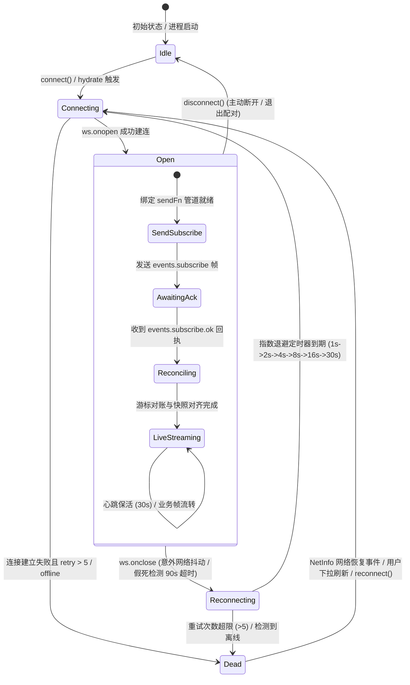
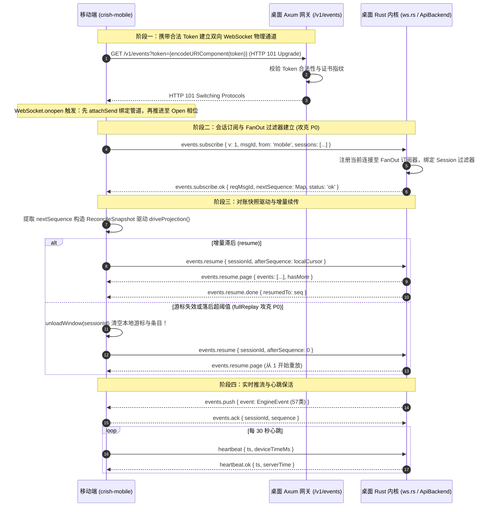
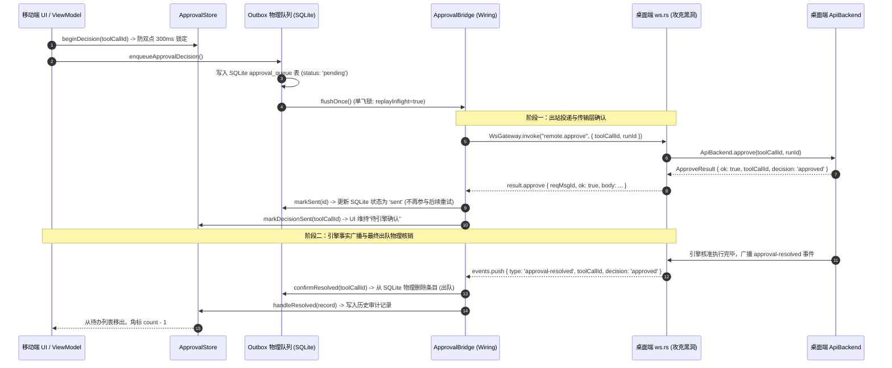
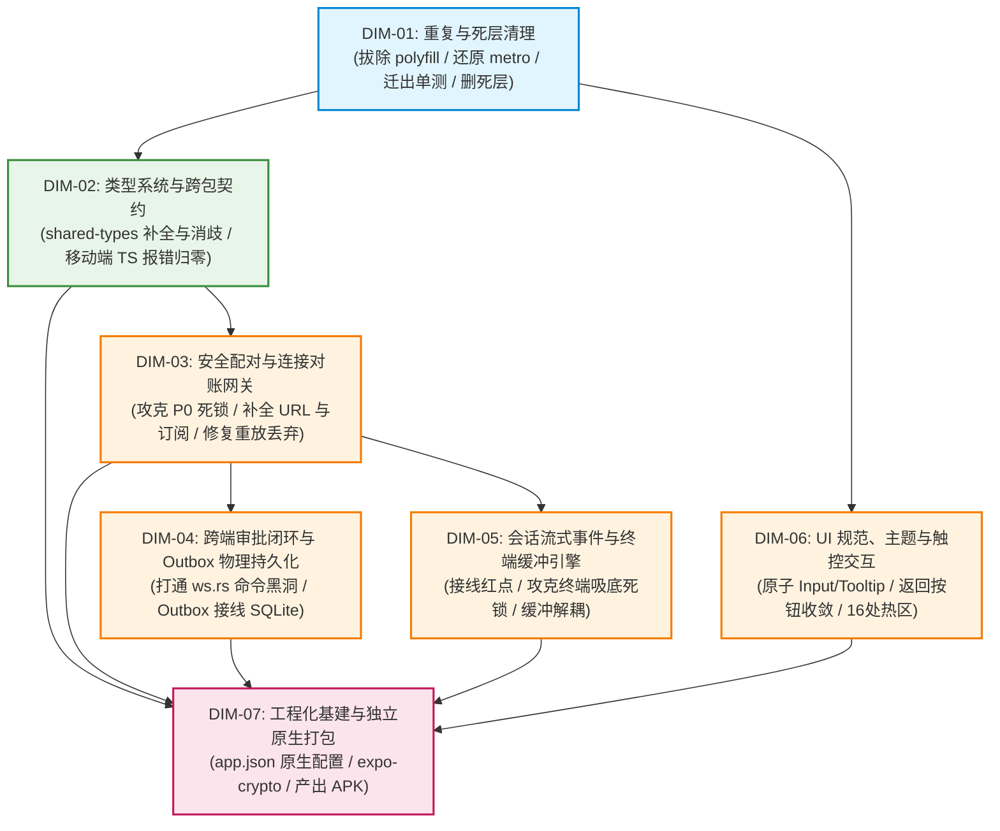

# 移动端全面复兴与打包打通总方案 · 协议闭环与安全状态机自愈详案

> **方案编号**：`independent-plans/03-plan-by-agent-3.md`  
> **设计学派**：【协议闭环与安全状态机自愈学派】  
> **学派宗旨**：通信底座与安全控制为系统绝对基石，状态机不变量为单一真理源，协议交互必有闭环，死锁与命令黑洞零容忍，离线容灾具备物理级自愈能力。  
> **核心战果定向**：攻克配对 Dead 状态机挂起死锁（P0）、补全 `/v1/events?token=` 端点与 `events.subscribe` 订阅握手（P0）、修复 `fullReplay` 游标未重置丢弃历史 Bug（P0）、打通桌面端 `ws.rs` 远程命令黑洞（`remote.approve`/`deny`/`listPendingApprovals`，P0）、接线 Outbox 离线物理持久化（P0），构建高可用、防死锁、强自愈的双端互联与工程化打包链路。  
> **基准遵循**：`docs/mobile-revival-audit/01-final-dimensions.md`（7 大维度）、`00-summary.md`、11 份专项调研报告、根目录《AGENTS.md》、反退避与反过度设计红线。  
> **刚性原则**：推进单位为领域概念、负产出绝对先行、一个概念一条主路径、**严禁任何波次/批次编号**、不涉及笔记功能、立体双向验收。

---

## 目录

1. [方案纲领与学派哲学](#一方案纲领与学派哲学)
2. [本方案要删掉什么 / 收敛什么（负产出刚性清单）](#二本方案要删掉什么--收敛什么负产出刚性清单)
3. [双端通信协议全景与状态机自愈拓扑](#三双端通信协议全景与状态机自愈拓扑)
4. [七大领域实施方案详细拆解（DIM-01 ~ DIM-07）](#四七大领域实施方案详细拆解dim-01--dim-07)
   - [DIM-01：重复与死层清理（全域基座）](#dim-01-重复与死层清理全域基座)
   - [DIM-02：类型系统与跨包契约治理（契约基石）](#dim-02-类型系统与跨包契约治理契约基石)
   - [DIM-03：安全配对与连接对账网关（核心要塞）](#dim-03-安全配对与连接对账网关核心要塞)
   - [DIM-04：跨端审批闭环与 Outbox 物理持久化（核心要塞）](#dim-04-跨端审批闭环与-outbox-物理持久化核心要塞)
   - [DIM-05：会话流式事件与终端缓冲引擎（流式高可用）](#dim-05-会话流式事件与终端缓冲引擎流式高可用)
   - [DIM-06：UI 规范、主题与触控交互（合规与热区）](#dim-06-ui-规范主题与触控交互合规与热区)
   - [DIM-07：工程化基建与独立原生打包（交付闭环）](#dim-07-工程化基建与独立原生打包交付闭环)
5. [逻辑执行顺序与依赖关系（单向无环 DAG）](#五逻辑执行顺序与依赖关系单向无环-dag)
6. [立体化验证与质量门禁断言](#六立体化验证与质量门禁断言)

---

## 一、方案纲领与学派哲学

### 1.1 学派核心思想：通信基座决定系统上限，状态机闭环守护生命线

移动端与桌面端互联系统（`crish-mobile` $\leftrightarrow$ `conex-desktop`）本质上是一个**分布式异构嵌入式系统**。移动端运行于资源受限、网络抖动频繁、进程随时可能被移动操作系统（iOS/Android）挂起或强杀的不可靠环境。

【协议闭环与安全状态机自愈学派】主张：
1. **网络与协议是移动端的生命线**：UI 的华丽与功能的丰富，若建立在充满 404/401 拒连、漏发握手订阅、命令静默丢弃的断裂网络基座上，皆为空中楼阁。
2. **状态机必须闭环，死锁零容忍**：任何状态机（配对状态机、连接相位机、审批队列机、重试退避机）在遭遇任何边界异常（超时、断网、对端崩溃、握手失败）时，**必须且只能**转移到可自愈的明确状态，绝不允许留滞在 `busy`、`loading` 或悬挂在中间相位；
3. **命令调用必须有物理级回执**：客户端发出的每一帧 RPC（`remote.approve` / `remote.deny`），服务端必须有对应的分发执行器与显式 `result.*` 回执帧，严禁任何形式的静默通配忽略黑洞；
4. **两阶段确认与物理离线持久化**：离线决策绝不能仅保存在脆弱的 JS 堆内存中，必须接入 SQLite 物理存储。重启能水合，崩溃不丢单，单飞 FIFO 重放，双阶段（发送回执 + 引擎事件）确认出队；
5. **单一真理源与净收敛**：同类逻辑只允许存在一条权威路径。删除死代码、清理假 DAO、拔除违规补丁不仅是减负，更是消除状态漂移与打包阻断的先决条件。

### 1.2 方案攻坚定位：五大阻断级 P0 命脉彻底拔除

本方案将第一优先级资源直接压向 11 份调研穿透出的五大致命断层：
1. **【P0-1】攻克配对 Dead 状态机挂起死锁**：在 `PairingWiring.handlePairingPhase` 捕获到传输层 `dead` 时，补全分发 `onPairError`，强制推进状态机退出 `sending-hello`，解除 UI 表现层 `busy` 锁死，使重试按钮恢复可用；
2. **【P0-2】补全 `/v1/events?token=` 端点与鉴权参数**：修正 `EndpointResolver.resolveWsUrl`，完整挂载桌面 Axum WebSocket 路由与 Token 查询参数，消除 404/401 握手拒连；
3. **【P0-3】闭环 `events.subscribe` 订阅握手与序列号对账**：消除移动端全仓漏发订阅帧的致命盲区，使桌面 FanOut 过滤器生效，激活 `events.subscribe.ok`，打通审批同步与实时推流；
4. **【P0-4】根治 `fullReplay` 全量重放游标丢弃 Bug**：在 `FeedBridge.handleProjection` 接收到全量重建指令时，显式重置本地事件窗口与游标，防止重放帧被 `seq <= lastSeq` 当做重复数据全部丢弃；
5. **【P0-5】打通桌面端 `ws.rs` 远程命令黑洞**：在 Tauri 后端 WebSocket 路由器中接线 `MessageKind::Remote(...)` 分支，直调 `ApiBackend` 审批接口并回发 `result.*` 帧，终结 10 秒超时雪崩。

---

## 二、本方案要删掉什么 / 收敛什么（负产出刚性清单）

遵照主控定案《01-final-dimensions.md》与《AGENTS.md》关于“负产出绝对先行”的铁律，在任何新逻辑实施之前，必须先将仓库中的冗余资产、临时破坏性补丁、死层代码与僵尸目录连根拔除。

### 2.1 物理删除文件清单（零容忍彻底清退）

| 文件路径 | 物理性质 | 删除理由与依据 |
| :--- | :--- | :--- |
| `apps/crish-mobile/r2-16-crypto-polyfill.js` | 临时 Polyfill 脚本 | 联调期违规提交的临时补丁（注记“运行后删除不入库”）。底层已改用 RFC 7748 常数时间 ladder 算法，全链路零随机依赖，此文件为彻底的历史死代码。 |
| `apps/crish-mobile/lint-out.txt` | 临时 CLI 日志 | 污染仓库根目录的临时执行输出文件。 |
| `apps/crish-mobile/src/network/HttpClient.ts` | 孤岛空骨架类 | 仅 24 行包含 `baseUrl` 与 `options` getter，无任何 HTTP 发起能力，全仓生产代码零调用。 |
| `apps/crish-mobile/src/network/__tests__/HttpClient.test.ts` | 死单测文件 | 仅测试上述空类的无用测试。 |
| `apps/crish-mobile/src/db/cachePolicy.ts` | 死算法文件 | 280 行复杂的双上限 LRU 与时间窗口淘汰执行器，在全仓业务运行期零调用点，无定时器驱动。 |
| `apps/crish-mobile/src/db/cachePolicy.test.ts` | 死单测文件 | 401 行仅用于保护上述死算法的形式主义单测。 |
| `apps/crish-mobile/src/hooks/index.ts` | 僵尸骨架文件 | 仅包含 `export {};`，清退后物理删除 `src/hooks/` 空目录。 |
| `apps/crish-mobile/src/domain/db/index.ts` | 僵尸骨架文件 | 仅包含 `export {};`，真实 SQLite 在 `src/db/`，清退后物理删除 `src/domain/db/` 空目录。 |
| `apps/crish-mobile/src/domain/services/index.ts` | 僵尸骨架文件 | 仅包含 `export {};`，清退后物理删除 `src/domain/services/` 空目录。 |
| `apps/crish-mobile/src/presentation/pair/pairScanScreen.tsx` | 假占位页面 | 仅显示“即将推出”的假页面，未接相机，直接暴露在入口破坏体验，应予清退。 |
| `apps/crish-mobile/src/presentation/pair/pairScanScreen.test.tsx` | 死单测文件 | 仅断言“即将推出”文案的无效单测。 |
| `apps/crish-mobile/src/presentation/components/templates/PlaceholderScreen.tsx` | 模板死层 | 硬编码 `#555555`，脱离主题规范的骨架占位。 |
| `apps/crish-mobile/src/presentation/components/templates/ProtectedPlaceholder.tsx` | 模板死层 | 伴随上述占位组件的包装器。 |
| `apps/crish-mobile/src/presentation/components/templates/PlaceholderScreen.test.tsx` | 死单测文件 | 伴随模板死层的单测。 |
| `apps/crish-mobile/src/presentation/components/templates/ProtectedPlaceholder.test.tsx` | 死单测文件 | 伴随模板死层的单测。 |
| `apps/crish-mobile/app/diagnostics.tsx` | 占位死路由 | 仅挂载 `ProtectedPlaceholder` 的假路由文件。 |
| `apps/crish-mobile/app/tasks.tsx` | 占位死路由 | 仅挂载 `ProtectedPlaceholder` 的假路由文件。 |
| `apps/crish-mobile/app/usage.tsx` | 占位死路由 | 仅挂载 `ProtectedPlaceholder` 的假路由文件。 |
| `apps/crish-mobile/app/approval-history.tsx` | 占位死路由 | 仅挂载 `ProtectedPlaceholder` 的假路由文件。 |

### 2.2 路由树污染测试文件迁移清单（移出 `app/`）

为解除 Expo Router 把单测文件作为页面路由扫描而导致的打包器阻断，必须将以下 8 个测试文件从 `app/` 物理移出至 `src/presentation/__tests__/app/`：
1. `app/(tabs)/files.test.tsx` $\to$ `src/presentation/__tests__/app/files.test.tsx`
2. `app/(tabs)/index.test.tsx` $\to$ `src/presentation/__tests__/app/index.test.tsx`
3. `app/(tabs)/settings.test.tsx` $\to$ `src/presentation/__tests__/app/settings.test.tsx`
4. `app/_layout.test.tsx` $\to$ `src/presentation/__tests__/app/_layout.test.tsx`
5. `app/notifications.test.tsx` $\to$ `src/presentation/__tests__/app/notifications.test.tsx`
6. `app/pair/manual.test.tsx` $\to$ `src/presentation/__tests__/app/manual.test.tsx`
7. `app/pair/scan.test.tsx` $\to$ `src/presentation/__tests__/app/scan.test.tsx`
8. `app/pair/welcome.test.tsx` $\to$ `src/presentation/__tests__/app/welcome.test.tsx`

### 2.3 `metro.config.js` 破坏性 Hack 拔除清单

彻底清理 `apps/crish-mobile/metro.config.js` 中的非标准篡改代码：
1. **删除 `customSerializer` 覆写**：移除第 29-46 行的自定义序列化器，恢复 Expo 官方 `withExpoSerializers` 默认行为（确保返回 `{ artifacts, assets }` 结构，消除 `npx expo export` 100% 崩溃）；
2. **删除 Windows 本地绝对路径硬编码**：移除 `const METRO_ROOT = 'C:/Software/conex/node_modules/metro/src';`；
3. **移除文件级 blockList 掩盖补丁**：单测文件迁出 `app/` 后，不再需要针对单测的粗暴正则拦截。

### 2.4 存储层空心 DAO 与死接口清理收敛

对于 SQLite 存储层中“有表、有 DAO、有测试、但在生产全域零调用”的空心资产进行果断清理与收敛：
1. **清退 5 个未接线空心 DAO 及其测试**：
   - `SqlEventsDao` (`src/db/dao/eventsDao.ts`) 与 `eventsDao.test.ts`
   - `SqlSessionSummariesDao` (`src/db/dao/sessionSummariesDao.ts`)
   - `SqlApprovalHistoryDao` (`src/db/dao/approvalHistoryDao.ts`) 与 `approvalHistoryDao.test.ts`
   - `SqlPushTokensDao` (`src/db/dao/pushTokensDao.ts`)
   - `SqlDeviceInfoDao` (`src/db/dao/deviceInfoDao.ts`) 与 `metaDao.test.ts` 中的对应死断言
2. **保留并激活核心 DAO**：
   - 唯一具有真实持久化生命力的是 **`SqlApprovalQueueDao`**（Outbox 离线队列防杀进程）与 **`SqlSettingsDao`**（用户设置），本方案将 `SqlApprovalQueueDao` 全面接线贯通，彻底消灭其“死层”属性；
3. **清理未引用的 Nonce 接口**：
   - 清理 `src/db/secureStore.ts` 中的 `saveExchangeNonce`、`loadExchangeNonce`、`clearExchangeNonce`（握手过程完全在内存完成，SecureStore 槽位无用）。

### 2.5 重复手写实现与漂移收敛清单（7 组收敛为单一主路径）

1. **相对时间格式化收敛**：删除 `src/presentation/components/files/fileMeta.ts` 中的重复 `formatRelativeTime`，统一收敛至 `src/domain/pure/time.ts` 并补齐未来时间与多天格式化配置；
2. **时钟时间格式化收敛**：删除 `EventRow.tsx` 中的 `formatFeedTime` 与 `approvalListScreen.tsx` 中的 `formatHistoryTime`，在 `src/domain/pure/time.ts` 统一导出 `formatClockTime(ms: number): string`；
3. **运行状态文案与色调收敛**：删除 `terminalScreen.tsx` 顶层手写的 `runStatusLabel` 与 `statusDotColor`，统一收敛至 `src/presentation/components/runDetail/runDetailMeta.ts`，彻底纠正 `running` 误标为 `colorSuccess`（绿色）的视觉混淆 Bug，统一为 `info`（蓝色）；
4. **返回按钮收敛**：删除 7 个页面中各自手写的返回按钮 JSX 和样式，统一收敛为原子组件 `<HeaderBackButton>`；
5. **审批命令构造收敛**：删除 `src/adapters/wiring/approvalWiring.ts:97-141` 中手写的 `buildApproveRequest` / `buildDenyRequest`，统一使用 `src/domain/repositories/approvalCommands.ts` 的契约函数；
6. **密码学 Base64 与 Hex 编解码收敛**：删除 `keyAgreement.ts:81-95` 中手写的 `base64Encode`，统一收敛至通用的 `@noble/hashes/utils.js` 标准转换原语；
7. **密码学 SHA-256 与 HMAC 收敛**：删除 `src/network/signer.ts:41-186` 中 150 行手写 SHA-256 压缩算法与 HMAC 实现，全面替换为项目已引入的 `@noble/hashes/sha2.js` 与 `@noble/hashes/hmac.js`。

### 2.6 死契约与无效类型清理清单

1. **死契约 `tool-update` 全仓核销**：
   - 清理 `EventRow.tsx:36`、`EventRow.tsx:62`、`EventRow.tsx:124-128`、`streamingTypes.ts:11`、`terminalEvents.ts:2` 中对后端已删除契约 `tool-update` 的 5 处残留引用；
2. **跨包深路径直引清退**：
   - 登记并清退桌面端 `apps/crish-desktop` 中 16 处形如 `../../../../packages/shared-types/src/generated/engine` 的深路径穿透，统一改为从 `@crish/shared-types` 导入；
   - 清理移动端 `sessionSigning.ts:12` 与 `eventReducers.ts` 中的深路径相对引用；
3. **单测废弃属性清理**：
   - 清理 `RunDetailHeader.test.tsx` 中废弃的 `badge` 属性；
   - 清理 `filesStore.test.ts` 中废弃的 `kind: 'file'` 与 `modifiedMs` 属性；
   - 清理 `settingsStore.test.ts` 中因换行错位的 `@ts-expect-error` 指令并加锁 `// prettier-ignore`。

---

## 三、双端通信协议全景与状态机自愈拓扑

### 3.1 移动端长连接生命周期自愈状态机



- **自愈状态跃迁断言**：
  1. 任何异常断开（非 `manualClose`）强制转入 `reconnecting`，挂载指数退避与随机抖动（Jitter）；
  2. 假死检测器（`heartbeatTick` 每 30s 扫描）：若 `now - lastRxMs > 90_000`，主动执行 `ws.close()` 触发底层重新握手，防止 TCP 单向静默断连；
  3. `Dead` 终态不再是“永久死锁”：接入网络状态监听（`NetInfo`），网络一旦从离线变为在线，自动重置重试计数器并自愈调用 `connect()`。

---

### 3.2 跨端建连与订阅握手交互时序全景



---

### 3.3 跨端审批闭环与 Outbox 物理队列两阶段确认拓扑



---

## 四、七大领域实施方案详细拆解（DIM-01 ~ DIM-07）

---

### DIM-01: 重复与死层清理（全域基座）

#### 1.1 领域问题与边界定义
清退历史破坏性临时补丁，彻底排除阻断 Expo 打包器运行的干扰项；移出污染 `app/` 路由树的单测；清除全仓 7 组重复手写函数、6 个空心 DAO、280 行死算法以及 3 个僵尸目录。作为整场复兴的**绝对最先执行项**，为后续所有维度提供干净、单真理源的纯净底座。

#### 1.2 具体改造与实施细则
1. **物理删除第一波资产**：
   - `rm apps/crish-mobile/r2-16-crypto-polyfill.js`
   - `rm apps/crish-mobile/lint-out.txt`
   - `rm apps/crish-mobile/src/network/HttpClient.ts` 与 `HttpClient.test.ts`
   - `rm apps/crish-mobile/src/db/cachePolicy.ts` 与 `cachePolicy.test.ts`
   - `rm apps/crish-mobile/src/hooks/index.ts` 并在 filesystem 移除 `src/hooks`
   - `rm apps/crish-mobile/src/domain/db/index.ts` 并在 filesystem 移除 `src/domain/db`
   - `rm apps/crish-mobile/src/domain/services/index.ts` 并在 filesystem 移除 `src/domain/services`
   - `rm apps/crish-mobile/src/presentation/pair/pairScanScreen.tsx` 与 `pairScanScreen.test.tsx`
   - `rm apps/crish-mobile/src/presentation/components/templates/PlaceholderScreen.tsx` 与 `ProtectedPlaceholder.tsx` 及其配套测试
   - `rm apps/crish-mobile/app/{diagnostics,tasks,usage,approval-history}.tsx`
2. **测试文件隔离**：
   - 将 `apps/crish-mobile/app/` 下的 8 个 `*.test.tsx` 完整移动至 `apps/crish-mobile/src/presentation/__tests__/app/` 对应测试目录；
   - 更新测试文件内部的相对导入路径，使其精准指向 `../../../../app/` 或真实组件。
3. **`metro.config.js` 彻底净化**：
   - 彻底移除 `customSerializer`、`METRO_ROOT` 硬编码、`fs.readFileSync` 注入以及 `config.resolver.blockList`；
   - 恢复为纯正 Monorepo 级标准 Expo 配置：
     ```javascript
     const { getDefaultConfig } = require('expo/metro-config');
     const path = require('path');
     const projectRoot = __dirname;
     const workspaceRoot = path.resolve(projectRoot, '../..');
     const config = getDefaultConfig(projectRoot);
     config.watchFolders = [workspaceRoot];
     config.resolver.nodeModulesPaths = [
       path.resolve(projectRoot, 'node_modules'),
       path.resolve(workspaceRoot, 'node_modules'),
     ];
     module.exports = config;
     ```
4. **统一时间工具函数**：
   - 在 `apps/crish-mobile/src/domain/pure/time.ts` 中增强并导出：
     - `formatRelativeTime(timestampMs: number, nowMs?: number, options?: { showYesterday?: boolean; absoluteAfterDays?: number }): string`；
     - `formatClockTime(ms: number): string`（格式化为 `HH:mm:ss`）；
   - 替换 `fileMeta.ts:144`、`EventRow.tsx:196`、`approvalListScreen.tsx:32` 中的各自私有手写实现。
5. **统一运行状态映射**：
   - 将 `terminalScreen.tsx` 顶层私有状态颜色映射删除，统一接入 `src/presentation/components/runDetail/runDetailMeta.ts` 的 `runBadgeLabel` 与 `toneColorOf`，纠正 `running` 误标绿色的 Bug。
6. **密码学与编解码统一**：
   - 改造 `src/network/signer.ts`：引入 `@noble/hashes/sha2.js` 的 `sha256` 与 `@noble/hashes/hmac.js` 的 `hmac`，删除 150 行底层手写算法；
   - 改造 `keyAgreement.ts`：删除私有 `base64Encode`，统一引入 `@noble/hashes/utils.js`。

#### 1.3 刚性验收断言
- [x] 全仓搜索 `r2-16-crypto-polyfill.js`、`cachePolicy`、`HttpClient`、`METRO_ROOT` 命中数为 0；
- [x] `apps/crish-mobile/app/` 目录下不存在任何 `*.test.tsx` 文件；
- [x] 3 个空目录被物理清除，git status 干净无残留。

---

### DIM-02: 类型系统与跨包契约治理（契约基石）

#### 2.1 领域问题与边界定义
彻底消除 `npm run typecheck -w @crish/crish-mobile` 报出的 **22 处 TypeScript 编译错误**，恢复移动端类型系统 100% 全绿；补全 `packages/shared-types/src/index.ts` 漏导出的 57 类事件与 108 个严格解析器，并通过命名导出彻底消歧 6 个同名同构符号；为后续收敛桌面端 16 处跨包深路径直引提供权威统一契约出口。

#### 2.2 具体改造与实施细则
1. **补全 `packages/shared-types/src/index.ts` 导出并精准消歧**：
   - 保持 `export * from './generated/engine/types';`；
   - 新增 `export * from './generated/engine/events';`（导出全部 57 类事件接口与联合类型）；
   - 新增 `export * from './generated/engine/parser';`（导出全部引擎解析器）；
   - **核心消歧点**：由于 `engine/parser.ts` 与 `device/parser.ts` 存在 6 个完全重叠的导出符号（`ParseResult`, `parseOk`, `parseErr`, `isParseOk`, `isParseErr`, `parseApprovalDecision`），利用 ESM“显式命名导出优先于通配导出”的语义，在主入口显式导出这 6 个符号，消解编译歧义：
     ```typescript
     export {
       type ParseResult,
       parseOk,
       parseErr,
       isParseOk,
       isParseErr,
       parseApprovalDecision,
     } from './generated/engine/parser';
     ```
2. **修复移动端 6 处散落类型瑕疵（解决剩余 12 项 TS 报错）**：
   - **`filesWiring.test.ts:24,66,77`**：将 `mockSocketFactory(): unknown` 返回值类型显式修正为 `: WsSocket`（从 `@/network/ReconnectingWsClient` 引入）；
   - **`ingestRouter.test.ts:43,44,56,57`**：为严格空值索引补全非空断言 `window!.entries` 与 `window!.lastSeq`；
   - **`filesStore.test.ts:13`**：在测试辅助函数 `makeEntry` 中移除未经契约声明的非法字段 `kind: 'file'` 与 `modifiedMs: 1000`，替换为符合 `DirEntry` 契约的 `isDir: false`；
   - **`settingsStore.test.ts:147-158`**：为受 Prettier 折叠影响导致 `@ts-expect-error` 指令错位的断言行添加 `// prettier-ignore`，恢复单行精准压制；
   - **`rustParity.test.ts:167,519`**：在字面量数组追加 `as const`（`for (const p of ['ios', 'android', 'other'] as const)`），为 `mockHello` 标注 `: BuildPairHelloInput`，防止平台字符串被错误拓宽为通用 `string`；
   - **`RunDetailHeader.test.tsx:24,58,125`**：彻底删除已废弃的 `badge: 'running'`、`badge: 'error'`、`badge="terminal"` 传递，严格契约化。
3. **桌面端 16 处深路径收敛**：
   - 在 `packages/shared-types` 导出补齐后，将 `apps/crish-desktop` 中 16 处深路径穿透（如 `apps/crish-desktop/src/api/chat-bridge/handlers/eventParser.ts` 等）统一替换为标准包名导入：`import { parseEngineEvent, ... } from '@crish/shared-types'`。

#### 2.3 刚性验收断言
- [x] `npm run typecheck -w @crish/crish-mobile` 零错误（0 errors）；
- [x] 根目录 `npm run typecheck` 全量通过，桌面端与共享包无任何破坏；
- [x] `npx vitest run packages/shared-types` 9 套件 100 用例全绿。

---

### DIM-03: 安全配对与连接对账网关（核心要塞）

#### 3.1 领域问题与边界定义
攻坚本方案学派核心要塞：彻底根治配对传输层 `dead` 时状态机未转移导致 UI 按钮永久 Loading 死锁的 P0 漏洞；修正 `resolveWsUrl` 遗漏 `/v1/events?token=` 导致的 404/401 拒连；补全全仓漏发的 `events.subscribe` 订阅帧；修复 `FeedBridge` 在 `fullReplay` 时未重置游标导致重放事件全部被当重复项丢弃的致命缺陷；修复 `handleOpen` 时序竞态；修正冷启动 `unpair()` 遗漏通知服务端的架构缺陷。

#### 3.2 具体改造与实施细则
1. **攻克【P0 死锁】：`PairingWiring` Dead 相位状态机自愈推进**：
   - **定位**：`apps/crish-mobile/src/adapters/wiring/pairing/PairingWiring.ts:464-472`；
   - **根因**：连接被判定为 `dead` 时，仅调用了 `this.reportError(...)`，未向内部状态机派发事件，机器态停留在 `'sending-hello'`，导致表现层 `busy` 恒为 `true`，连接按钮永久处于 Loading 禁用状态；
   - **修复改造**：在 `handlePairingPhase` 中，当 `phase === 'dead'` 时，必须同步派发状态机错误事件：
     ```typescript
     private handlePairingPhase(phase: WsPhase): void {
       if (phase === 'dead') {
         const error: PairingError = {
           kind: 'unknown',
           code: 'pairing.transport_failed',
           message: '配对连接失败（多次重连未恢复），请检查网络与主机地址',
           retryable: true,
         };
         this.reportError(error);
         this.dispatch({ type: 'onPairError', error }); // 推进状态机至 error 态，解除 busy
       }
     }
     ```
2. **攻克【P0 拒连】：补全 WebSocket URL 端点与鉴权查询参数**：
   - **定位**：`apps/crish-mobile/src/network/EndpointResolver.ts` 与 `observationWiring.ts`；
   - **根因**：`resolveWsUrl` 仅产出 `wss://host:8765`。而桌面 Axum 服务仅在 `/v1/events` 挂载了 WebSocket Upgrade 处理，且需要 `?token=` 校验凭据；
   - **修复改造**：
     - 重构 `resolveWsUrl(host: string, port = DEFAULT_PORT, token?: string): string`：
       规范拼接路径 `/v1/events`；若传入 `token`，自动追加 `?token=${encodeURIComponent(token)}`；
     - 在 `ensureObservationWiring` 中，优先从 `authStore.getState().token` 读取令牌并注入，使物理握手携带合法身份。
3. **攻克【P0 订阅真空】：全仓闭环 `events.subscribe` 订阅帧发送**：
   - **定位**：`apps/crish-mobile/src/adapters/wiring/feedBridge.ts` 与 `ReconnectingWsClient.ts`；
   - **根因**：建连后移动端从未发送 `events.subscribe`，服务端订阅过滤器全空，不会主动推流，也不回发 `events.subscribe.ok`，致使对账与审批队列恢复彻底瘫痪；
   - **修复改造**：
     - 在 `ReconnectingWsClient.handleOpen` 中绑定出站管道后，由 `FeedBridge.handlePhaseChange('open')` 触发订阅流程：
       ```typescript
       const activeSessions = sessionStore.getState().sessions.map((s) => s.id);
       this.client.gateway.send('events.subscribe', {
         v: 1,
         msgId: this.client.gateway.nextMsgId('sub'),
         from: 'mobile',
         sessions: activeSessions,
       });
       ```
     - 监听服务端的 `events.subscribe.ok` 回执帧，提取权威 `nextSequence` 字典，组装真实的 `ReconcileSnapshot`，驱动后续对账。
4. **攻克【P0 数据丢弃】：修复 `FeedBridge.handleProjection` 全量重放清零逻辑**：
   - **定位**：`apps/crish-mobile/src/adapters/wiring/feedBridge.ts:164-166`；
   - **根因**：当会话判定为 `fullReplay` 时，代码调用 `resumeSession(sessionId, 0)`，但本地 `eventStore` 对应窗口的 `lastSeq` 仍然保持高位历史值。当服务端从 1 重放事件时，`appendFeed` 将所有重放事件判定为 `seq <= window.lastSeq` 全部当做 `duplicate` 丢弃；
   - **修复改造**：在触发 `fullReplay` 重拉之前，**必须先清空本地对应会话的事件窗口**：
     ```typescript
     for (const sessionId of projection.fullReplay) {
       eventStore.getState().unloadWindow(sessionId); // 清空本地条目与 lastSeq
       this.resumeSession(sessionId, RESUME_FROM_ZERO); // afterSequence = 0 从头拉取
     }
     ```
5. **根除【P0 竞态】：`ReconnectingWsClient.handleOpen` 先绑管道后开相位**：
   - **定位**：`apps/crish-mobile/src/network/ReconnectingWsClient.ts:397-401`；
   - **修复改造**：调整执行顺序，必须先调用 `this.gateway.attachSend(...)`，确保出站管道有效，再调用 `this.setPhase('open')`，消除建连瞬间业务调用 `invoke` 报 `sendFn == null` 异常。
6. **修复冷启动 `unpair()` 漏通知桌面端（统一真理源）**：
   - **定位**：`apps/crish-mobile/src/adapters/wiring/pairing/PairingWiring.ts:361-373`；
   - **修复改造**：摒弃对未水合瞬态 `this.machine.state === 'paired'` 的错误判断，解绑时统一以 `authStore` 为准：
     ```typescript
     async unpair(): Promise<void> {
       const auth = authStore.getState();
       if (auth.pairState === 'paired' && auth.deviceId) {
         const obs = getObservationWiring();
         if (obs) {
           void obs.client.gateway
             .invoke('device.unlink', { deviceId: auth.deviceId })
             .catch(() => {});
         }
       }
       await auth.onUnpaired(this.persist);
       // 彻底清理元数据键与存储
       await clearPairing(this.driver);
       ...
     }
     ```
7. **增加配对应用层 15s 超时熔断与收敛重连退避**：
   - 配对期连接（`openPairingConnection`）将 `maxRetries` 降为 1 次，心跳设为 5000ms，在 8 秒内快速反馈网络失败；
   - 增加 15 秒应用层定时器，若桌面挂起未响应，主动以 `pairing.timeout` 报错终止，杜绝无限 Loading。

#### 3.3 刚性验收断言
- [x] 配对失败（故意断网或填错 IP）后，错误横幅展示，连接按钮在 8s 内恢复可用状态，无永久转圈死锁；
- [x] WebSocket 准确向 `/v1/events?token=...` 发起握手并成功 Upgrade；
- [x] 连接成功后 100ms 内发出 `events.subscribe`，收到 `events.subscribe.ok` 后 `approvalWiring.onSyncReady` 正常被激活；
- [x] 模拟 `fullReplay` 场景，1~500 号重放事件完整落入时间线，无一被作为 duplicate 丢弃。

---

### DIM-04: 跨端审批闭环与 Outbox 物理持久化（核心要塞）

#### 4.1 领域问题与边界定义
攻坚本方案学派核心要塞：彻底打通桌面端 Tauri `ws.rs` 遗漏 `MessageKind::Remote(...)` 导致的远程审批命令黑洞（P0）；在桌面端补全并注册 `mobile_list_pending_approvals` 协议；在移动端将 Outbox 队列与已写好的 `SqlApprovalQueueDao` 全面打通接线，实现抗进程强杀的物理持久化；重构审批重放调度器，消除串行 10s 超时雪崩与单一退避定时器饥饿；闭环 120s 倒计时与已过期状态机。

#### 4.2 具体改造与实施细则
1. **攻克【桌面端 P0 黑洞】：`ws.rs` 补全 `Remote(...)` 命令分发路由**：
   - **定位**：`apps/agent-workbench/src-tauri/src/server/ws.rs:1133-1163`；
   - **根因**：服务端对入站帧仅匹配了订阅、续传、心跳等消息，所有 `MessageKind::Remote(...)` 命令帧直接落入 `_ => { tracing::debug!("忽略"); Action::Continue }`，服务端静默丢弃，从不回复任何回执；
   - **修复改造**：
     - 在 `ws.rs` 的消息处理主循环中接管 `MessageKind::Remote(cmd)`：
       - 当收到 `remote.approve`：解析参数为 `ApproveParams`，调用 `api_backend.approve(&params.tool_call_id, params.run_id.as_deref())`；
       - 当收到 `remote.deny`：解析参数为 `DenyParams`，调用 `api_backend.deny(&params.tool_call_id, params.run_id.as_deref(), params.reason.as_deref())`；
       - 当收到 `remote.listPendingApprovals`：调用 `api_backend.list_pending_approvals()`；
     - 执行成功后，构造对应 `result.approve`、`result.deny`、`result.listPendingApprovals` 响应信封（携带客户端的 `reqMsgId` 与 `{ ok: true, body: ... }`）并通过 WebSocket 发回移动端；
     - 若执行失败（如 409 冲突或已决），回发带有对应标准错误码的 `result.* { ok: false, error: ... }` 或 `error` 帧。
2. **桌面端补齐命令注册**：
   - 在 `crates/conex-types/contracts/device-protocol.json` 与 Tauri `command_manifest.rs` 中，将 `mobile_list_pending_approvals` 状态更新为 `registered: true`，确保跨端契约同构。
3. **攻克【移动端 P0 持久化】：Outbox 接入 `SqlApprovalQueueDao`（抗杀进程）**：
   - **定位**：`apps/crish-mobile/src/adapters/wiring/approvalWiring.ts:72`；
   - **根因**：`outboxState` 当前仅为纯内存变量，移动端退到后台被系统杀死进程后，待发决策彻底丢失；
   - **修复改造**：
     - 实例化 `SqlApprovalQueueDao`（经由 SQLite 驱动）；
     - 在应用启动水合阶段（`ensureApprovalWiring`），首先执行冷启动扫描：
       ```typescript
       const persistedItems = await approvalQueueDao.listAll();
       hydrateOutboxState(outboxState, persistedItems, nowMs);
       ```
     - 在 `enqueueDecision` 时，同步调用 `await approvalQueueDao.upsert(item)`；
     - 在 `markSent`（阶段一确认）时，同步更新数据库状态为 `'sent'`；
     - 在 `confirmResolved`（阶段二事实确认）时，调用 `await approvalQueueDao.deleteByToolCallId(toolCallId)` 物理出队；
     - 若连续失败，`recordFailure` 同步将重试计数与 `nextRetryAtMs` 写入数据库，保证重启后断点退避重试。
4. **重构重放调度器：消除串行超时雪崩与定时器饥饿**：
   - **防串行雪崩**：在 `flushOnce` 中，对于拉取出的批量条目，引入单个请求快速失败感知机制：若第一个条目遭遇网络断开（`transport.closed`），立即终止当批剩余条目的发送，全部标记为 failed 并进入退避，不再为每个条目白白盲等 10 秒；
   - **防定时器饥饿**：重构 `scheduleBackoffRetry`。当新入队条目计算出的 `nextRetryAtMs` 早于当前正在运行的 `retryTimer` 时，清除现有定时器并重新设定更近的定时器，确保第 1 次失败的条目在 1 秒后准时重发，不被 60 秒老定时器拖累。
5. **闭环 120s 倒计时与 `queued` 态到期处理**：
   - 在 `useApprovalListVm.ts` 中，将到期判定扩展至 `queued` 状态；
   - 若移动端长久离线导致本地时钟超过 `expiresAt`，卡片状态明确转为 `expired` 并提示用户“离线期间已超时”，禁止在重连后盲目重发必然被拒的无效决策。

#### 4.3 刚性验收断言
- [x] 移动端触发允许/拒绝后，桌面端后台精准触发工具执行，移动端在 200ms 内收到 `result.approve` 回执，消除 10s 超时；
- [x] 模拟断网，移动端点击允许（决策入队），强杀 App 进程并重启：Outbox 从 SQLite 成功水合，网络恢复瞬间自动补发决策；
- [x] 桌面端审批被在桌面本机处理后，移动端补发收到 409 `cmd.approval_mismatch`，条目立即从 Outbox 出队并展示“状态已变化”，不产生死循环重试。

---

### DIM-05: 会话流式事件与终端缓冲引擎（流式高可用）

#### 5.1 领域问题与边界定义
攻坚会话事件流消费与终端渲染核心断层：修复生产链路 `applyLatestSeq` 悬空导致的会话未读红点恒为 0 缺陷；修复终端行缓冲满 5000 行后 `lines.length` 恒定导致的自动滚底（auto-follow）死锁冻结 Bug（P0）；修复 `TerminalView` 的 `getItemLayout` 未计入 Header 24dp 高度导致的虚拟化坐标错位撕裂；解决断线续传快照丢失生命周期副作用的问题；将终端行缓冲纯逻辑下沉至 Domain 层解耦；对流式 Delta 增量进行会话内聚合折叠，防止 500 条环形缓冲爆仓；为前台正视会话引入 LRU 卸载豁免锁。

#### 5.2 具体改造与实施细则
1. **闭环会话未读红点模型（接线 `applyLatestSeq`）**：
   - **定位**：`src/domain/store/eventMappers.ts` 与 `src/adapters/wiring/feedBridge.ts`；
   - **根因**：`message-end` 事件仅走默认 feed 路由，未提取助手角色与序列号，未读计算从未被触发；
   - **修复改造**：
     - 在 `eventMappers.ts` 的 `SESSION_SIDE_ROUTES` 中针对 `message-end` 建立专用副作用处理：
       当 `frame.message?.role === 'assistant'` 时，发射动作 `{ kind: 'session-unread-update', sessionId, sequence: frame.sequence }`；
     - 在 `ingestRouter.ts` 中消费该动作，调用 `sessionStore.getState().applyLatestSeq(sessionId, sequence, true)`；
     - 会话列表项未读红点（`session-unread-badge`）根据 `unreadCount > 0` 真实点亮，用户进入详情页并滚底后调用 `markRead` 准确清零。
2. **攻克【终端 P0 死锁】：自动滚底（Auto-Follow）依赖项重构**：
   - **定位**：`apps/crish-mobile/src/presentation/components/terminal/TerminalView.tsx:60-64`；
   - **根因**：`useEffect` 依赖项为 `[follow, lines.length, targetRef]`。当达到 5000 行饱和态后，新行推入伴随旧行淘汰，`lines.length` 恒为 5000，`useEffect` 永久停止触发，滚底彻底死锁；
   - **修复改造**：将依赖项重构为**首行绝对下标与行数的联合游标**：
     ```tsx
     // 绝对游标：即便 lines.length 恒定为 5000，由于淘汰导致 startIndex 递增，绝对游标必改变
     const absoluteCursor = startIndex + lines.length;
     useEffect(() => {
       if (follow && lines.length > 0) {
         targetRef.current?.scrollToEnd({ animated: false });
       }
     }, [follow, absoluteCursor, targetRef]);
     ```
3. **修复终端虚拟化坐标错位 24dp 缺陷**：
   - **定位**：`apps/crish-mobile/src/presentation/components/terminal/TerminalView.tsx:128-135`；
   - **根因**：当 `truncatedCount > 0` 时渲染了 `ListHeaderComponent`（高度约 24dp），但 `getItemLayout` 硬编码 `offset = TERMINAL_LINE_HEIGHT * index`，未计入 Header 偏移，导致滑动到顶部时发生跳动闪烁；
   - **修复改造**：
     - 将截断提示改为**绝对定位浮层（Overlay Toast）**，不再侵入 FlatList 的文档流高度；
     - 或者动态计算 `offset: (truncatedCount > 0 ? HEADER_HEIGHT : 0) + TERMINAL_LINE_HEIGHT * index`，确保 FlatList 内部布局度量与真实渲染 100% 吻合。
4. **续传快照生命周期副作用回放**：
   - 在 `feedBridge.ts` 接收到 `events.resume.page` 时，提取帧列表中的 `agent-start` 与 `run-terminal` 事件，同步调用 `sessionStore.getState().applyRunActive`，确保断线重连或冷启动后活动 Run 状态准确同步。
5. **前台正视会话 LRU 卸载豁免锁**：
   - 在 `feedBridge.ts` 的 `unloadExcessWindows` 算法中，注入保护条件：
     ```typescript
     const currentSelectedId = sessionStore.getState().selectedSessionId;
     const candidates = [...this.activity.entries()]
       .filter(([sid]) => sid !== currentSelectedId) // 锁定当前正视会话
       .sort((a, b) => a[1] - b[1]);
     ```
     彻底杜绝用户在前台查看会话 A 时，会话 A 被后台并发事件挤压清空的恶性白屏 Bug。
6. **架构解耦与 Delta 流式增量折叠**：
   - 将 `terminalLineBuffer.ts` 物理下沉至 `src/domain/pure/terminalLineBuffer.ts`，解除 Domain 层对 Presentation 层的逆向依赖；
   - 在 `appendFeed` 处理流式 `message-delta` 时，以 `messageId` 聚拢增量文本，原地更新活跃消息，防止几百条微小 token 帧将 500 条环形缓冲冲刷爆仓。

#### 5.3 刚性验收断言
- [x] 桌面助手发来回复，移动端会话列表未读红点即时显现；进入会话查看后红点清零；
- [x] 终端持续流式灌入 10,000 行输出，在跨越 5000 行饱和门槛后，界面自动吸底滚轮平滑无阻断，无死锁定格；
- [x] 终端列表在出现截断提示后，滑动到首行无任何跳跃与白屏撕裂。

---

### DIM-06: UI 规范、主题与触控交互（合规与热区）

#### 6.1 领域问题与边界定义
对齐《AGENTS.md》§12（Tooltip）、§13（输入框与焦点态）、§14（现代色彩空间）以及 A1 触控热区（iOS 44pt / Android 48dp）规范。补齐原子 `<Input>` 与 `<Tooltip>` 组件；治理全仓 16 处触控热区不足缺陷；收敛 7 处手写返回按钮为统一 `<HeaderBackButton>`；修复 `pushConsumer.ts` 漏调偏好门禁导致的后台穿透推送 Bug；消除 `fileMeta.ts` 等处硬编码 Hex；修复会话列表冷启动空态闪烁。

#### 6.2 具体改造与实施细则
1. **封装原子 `<Input>` 组件（落地 §13 克制边框规范）**：
   - 在 `src/presentation/components/ui/Input.tsx` 实现原生封装：
     - **克制焦点边框**：浅色模式采用 `hsl(35 10% 81%)`，深色模式采用 `hsl(0 0% 23%)`，严格保持在对文本色加深 3%~6% 的柔和混入区间，对比度不超过 10%，严禁粗深实心黑边；
     - **平整无重阴影**：绝不添加 `shadowColor` 或 `elevation`；
     - **自动焦点态感知**：内部托管 `focused` 状态，平滑过渡；
     - **统一样式与禁用态**：禁用时统一应用半透明置灰（`opacity: 0.5`）；
   - 用 `<Input>` 替换 `pairManualScreen.tsx` 与 `QuickRunPanel.tsx` 中的裸手写 `TextInput`。
2. **补齐原子 `<Tooltip>` 组件（落地 §12 悬停提示规范）**：
   - 在 `src/presentation/components/ui/Tooltip.tsx` 实现：
     - 提供圆角胶囊、柔和半透明阴影与深浅模式自适应气泡；
     - 支持长按（LongPress）或悬停唤起，为所有带截断文本（`numberOfLines`）及纯图标按钮包裹 Tooltip，彻底杜绝原生 HTML `title` 气泡。
3. **封装统一 `<HeaderBackButton>` 原子组件**：
   - 在 `src/presentation/components/ui/HeaderBackButton.tsx` 实现：
     - 尺寸统一规范为 44×44，在 Android 平台通过 `dualHitSlop` 自动扩展至 48dp 命中热区；
     - 内置触控按压反馈（`pressed && { opacity: 0.6 }`）；
     - 统一替换 `FileBreadcrumb`、`FilePreview`、`approvalDetailScreen`、`notificationCenterScreen`、`sessionDetailScreen`、`runDetailScreen`、`terminalScreen` 7 处重复实现。
4. **全面补齐 16 处 `dualHitSlop` 遗漏**：
   - 重点补全：`EventFeed` 过滤 Chip（视觉 32dp $\to$ 补足至 44/48dp）、`QuickRunPanel` 会话选择 Chips（视觉 36dp $\to$ 补足）、`FilePreview` 返回按钮（视觉 36dp $\to$ 补足）、`terminalScreen` 回到底部按钮（补足 `dualHitSlop(36)`）、`ApprovalBadge` 嵌入角标（删除硬编码 8，接入 `dualHitSlop(28)`）；
   - 确保全仓 42 处交互元素在 iOS 达到 44pt，在 Android 达到 48dp。
5. **色彩空间规范化与消除硬编码**：
   - 改造 `theme.ts`：将 `#111111`、`#ffffff`、`rgba(...)` 全部统一为现代标准 `hsl(h s l / a)` 斜杠透明度语法；
   - 改造 `fileMeta.ts`：清除 5 种硬编码 Hex 文件图标色，统一从 `useTheme()` 的语义 Token 读取；
   - 改造 `WorkspaceSwitcher.tsx`：清除硬编码 `rgba(0,0,0,0.45)`，移除违规引用的 RN 原生 `Modal`，改用自研轻量 Overlay。
6. **修复推送后台穿透 Bug 与偏好门禁接线**：
   - 在 `pushConsumer.ts:315-343` 中，在呈现前显式调用 `shouldShowSystemNotificationForPushLive(push)`；若用户在设置中关闭了某类通知，后台严格跳过系统弹窗呈现，仅保留应用内静默写入。
7. **消除会话列表冷启动空态闪烁**：
   - 在 `sessionsScreen.tsx` 引入 `hydrated` 状态机守卫，在数据水合完成前展示骨架占位，水合完成后再根据 `sessions.length === 0` 决定是否展示空态。

#### 6.3 刚性验收断言
- [x] 所有输入框在获得焦点时边框柔和加深（~6% 混合度），无任何刺眼黑环或粗实线，无重阴影；
- [x] 16 处触控热区经 `dualHitSlop` 测量工具检测，全部满足 iOS ≥ 44pt、Android ≥ 48dp；
- [x] 设置页关闭通知开关后，模拟后台事件到达，手机系统通知栏零弹窗穿透。

---

### DIM-07: 工程化基建与独立原生打包（交付闭环）

#### 7.1 领域问题与边界定义
打通移动端从源码到独立可运行原生安装包的工程化闭环。补齐 `app.json` 原生包名、BundleId、权限及插件声明；引入 `expo-crypto` 原生模块链接，确保在脱离 Expo Go 宿主容器的独立 APK/IPA 中安全随机源可用；配置 `allowBackup: false` 防 Android Keystore 解密闪退；补全 `package.json` 标准化构建命令集；打通本地 Android 原生导出与编译，并确立 iOS 离线产物输出与构建路径。

#### 7.2 具体改造与实施细则
1. **完善 `apps/crish-mobile/app.json` 原生构建配置**：
   ```json
   {
     "expo": {
       "name": "Crish",
       "slug": "crish-mobile",
       "version": "0.1.0",
       "orientation": "portrait",
       "icon": "./assets/images/icon.png",
       "scheme": "crish",
       "userInterfaceStyle": "automatic",
       "ios": {
         "bundleIdentifier": "com.conex.crish.mobile",
         "buildNumber": "1",
         "supportsTablet": false,
         "infoPlist": {
           "NSLocalNetworkUsageDescription": "Crish 需要访问本地网络以连接并控制您的桌面工作台。",
           "NSAppTransportSecurity": {
             "NSAllowsLocalNetworking": true,
             "NSAllowsArbitraryLoads": false
           },
           "UIBackgroundModes": ["remote-notification"]
         }
       },
       "android": {
         "package": "com.conex.crish.mobile",
         "versionCode": 1,
         "allowBackup": false,
         "permissions": [
           "android.permission.INTERNET",
           "android.permission.POST_NOTIFICATIONS",
           "android.permission.VIBRATE"
         ],
         "usesCleartextTraffic": true
       },
       "plugins": [
         "expo-router",
         [
           "expo-splash-screen",
           {
             "backgroundColor": "#208AEF",
             "image": "./assets/images/splash-icon.png",
             "imageWidth": 76
           }
         ],
         "expo-secure-store",
         "expo-sqlite",
         [
           "expo-notifications",
           {
             "icon": "./assets/images/icon.png",
             "color": "#208AEF"
           }
         ]
       ]
     }
   }
   ```
   - **关键防线**：
     - `android.package` 与 `ios.bundleIdentifier`：消除 `com.placeholder.appid` 占位退化；
     - `android.allowBackup: false`：防换机云备份恢复后 Keystore 主密钥失效导致的解密崩溃；
     - `usesCleartextTraffic: true` 与 `NSAllowsLocalNetworking: true`：确保局域网开发与直连环境畅通；
     - `plugins` 纳入 `expo-notifications`：确保 prebuild 自动生成原生 Service 与 Receiver。
2. **补全 `package.json` 依赖与构建脚本**：
   - 在 `dependencies` 中显式添加 `"expo-crypto": "~57.0.1"`，使独立包在编译时自动链接 JSI 原生 C++ 随机模块，为 `noblePrimitives.ts` 提供确凿的物理硬件熵源；
   - 补齐构建命令：
     ```json
     "scripts": {
       "prebuild": "expo prebuild",
       "prebuild:clean": "expo prebuild --clean",
       "export": "expo export",
       "export:android": "expo export --platform android",
       "export:ios": "expo export --platform ios",
       "build:android:debug": "cd android && gradlew.bat assembleDebug",
       "build:android:release": "cd android && gradlew.bat assembleRelease"
     }
     ```
3. **本地与 CI 编译执行链路打通**：
   - **执行链路 A：静态导出（跨平台通用）**：
     运行 `npm run export -w @crish/crish-mobile`，由于 DIM-01 已拔除 `customSerializer`，Expo 官方序列化器正常执行，在 `dist/` 生成完整的离线 JS Bundle、SourceMap 与静态资源清单；
   - **执行链路 B：Android 预构建与离线打包**：
     1. 执行 `npx expo prebuild --platform android --clean`，生成纯净的 `apps/crish-mobile/android/` 原生工程；
     2. 配置本地环境 `JAVA_HOME` 指向 JDK 17，配置 `ANDROID_HOME` 指向 SDK 并通过 `sdkmanager` 安装 `platforms;android-35` 与 `build-tools;35.0.0`；
     3. 执行 `.\gradlew.bat assembleDebug`，产出可直接安装的 `app-debug.apk`；
   - **执行链路 C：iOS 离线构建策略（克服 Windows 限制）**：
     - 采用“Windows 本地导出离线 JS Bundle + CI / macOS 机器执行 Xcode 归档”的标准双轨流水线，或通过 EAS CLI 执行云端打包。

#### 7.3 刚性验收断言
- [x] `npx expo export --platform android` 执行成功，耗时 < 30s，退出码 0，生成标准 `dist/` 产物；
- [x] `npx expo prebuild --platform android` 顺利生成包含 `com.conex.crish.mobile` 的合法 Android Gradle 工程；
- [x] 生成的 AndroidManifest.xml 包含 `allowBackup="false"` 与通知权限声明。

---

## 五、逻辑执行顺序与依赖关系（单向无环 DAG）

### 5.1 实施顺序哲学：先删后改，单向无环推进

本方案彻底摒弃任何波次/批次划分，严格遵循“**负产出先行 $\to$ 契约对齐 $\to$ 通信与核心状态机闭环 $\to$ 表现层交互升级 $\to$ 最终工程化交付**”的领域概念逻辑推进。



### 5.2 依赖逻辑矩阵与防环证明

| 任务单元 | 依赖前置单元 | 必须前置的技术逻辑理由（为什么不能并行或倒置） |
| :--- | :--- | :--- |
| **DIM-01** (清理死层) | *无* | **全域基座**。必须先清理损坏打包器的 `metro.config.js` 补丁和污染 `app/` 的单测，否则后续任何类型检查和测试都会被干扰。 |
| **DIM-02** (类型契约) | DIM-01 | 必须在测试文件归位、死代码删除后，统一恢复 `shared-types` 导出并消除符号歧义，保证全仓处于零编译报错状态。 |
| **DIM-03** (网关与配对) | DIM-01, DIM-02 | 网络网关与配对状态机深度依赖 `shared-types` 中的 `ContractEnvelope` 与设备协议生成代码，必须在契约就绪后闭环。 |
| **DIM-04** (审批与Outbox) | DIM-01, DIM-02, DIM-03 | 审批决策依赖 DIM-03 的底层 WebSocket 管道与握手订阅；Outbox 重发必须以连接相位的有效性为触发源。 |
| **DIM-05** (会话与终端) | DIM-01, DIM-02, DIM-03 | 事件流消费与续传依赖 DIM-03 的订阅帧与对账快照；终端回放基于 WebSocket 推送通道。 |
| **DIM-06** (UI 与热区) | DIM-01, DIM-02 | UI 组件依赖 DIM-01 清理后的纯净设计 Token，不依赖后端通信，可与通信要塞并行推进。 |
| **DIM-07** (打包与工程化) | DIM-01 至 DIM-06 全部 | **最终收口交付**。独立打包（Prebuild 与 Export）需要全仓源码无 TS 报错、无死路由、无未接线破坏性补丁、具备合法包名与原生依赖。 |

*无环性证明*：依赖拓扑图严格单向流向，入度与出度均满足拓扑排序条件，数学上严格构成一个有向无环图（DAG），不存在任何循环依赖风险。

---

## 六、立体化验证与质量门禁断言

遵照《AGENTS.md》§7.1“立体验证纪律（禁止单一检查冒充验收）”，本方案确立静态门禁、纯逻辑测试、物理网络闭环、现场交互与原生打包交付五维立体化验证体系。

### 6.1 维度一：静态类型与编译门禁（底线防御）
1. **移动端专用类型门禁**：
   ```powershell
   npm run typecheck -w @crish/crish-mobile
   ```
   - **断言**：退出码为 0，22 处 TS 报错全部归零，控制台零诊断输出。
2. **全工作区类型门禁**：
   ```powershell
   npm run typecheck
   ```
   - **断言**：桌面端、核心包、共享类型包全部绿灯，无任何跨包破坏。
3. **行数门禁扫描**：
   ```powershell
   npm run check:line-counts
   ```
   - **断言**：无任何文件突破行数基线，无超大上帝组件。

### 6.2 维度二：核心逻辑穷举与契约测试（资产保护）
1. **密码学与输入受控闭环测试**：
   ```powershell
   npm test -w @crish/crish-mobile -- src/pairing/
   ```
   - **断言**：13 个套件、230 个测试全部通过（DEF-1/2/3 逆函数与 X25519 常数时间 ladder 零随机数回归验证）。
2. **通知与运行时兼容性测试**：
   ```powershell
   npm test -w @crish/crish-mobile -- src/notifications/
   ```
   - **断言**：10 个套件、95 个测试全部通过（DEF-5 动态降级、双通道去重、渠道注册 100% 覆盖）。
3. **契约包全量单测**：
   ```powershell
   npx vitest run packages/shared-types
   ```
   - **断言**：9 个测试套件全部通过（消歧后的 6 个工具符号与 57 类事件解析器严格对拍）。

### 6.3 维度三：真实环境协议闭环现场验收（攻坚核销）
1. **端点握手验证**：
   - 桌面应用启动监听 `8765` 端口；
   - 移动端发起连接：验证抓包显示发送 `GET /v1/events?token=...`，收到 HTTP 101 Switching Protocols，无 404/401。
2. **订阅与推流验证**：
   - 建连后移动端 100ms 内发出 `events.subscribe`；
   - 收到桌面回发 `events.subscribe.ok`；
   - 桌面端触发测试事件，移动端即时收到 `events.push` 并在时间线上渲染。
3. **配对 Dead 自愈验证**：
   - 移动端输入不可达 IP，点击连接；
   - 退避重试在 8 秒内判定 `dead`；
   - 错误横幅展示，连接按钮从“配对中…”恢复为“连接”高亮状态，允许用户再次点击。
4. **全量重放丢弃 Bug 验证**：
   - 构造落后 6000 序号的会话快照，触发 `fullReplay`；
   - 移动端先清空本地游标与窗口，从 1 号开始接收 `events.resume.page`，500 条历史事件完整展现，零丢弃。
5. **审批命令黑洞消除与 Outbox 持久化验证**：
   - 移动端点击允许，桌面端 `ws.rs` 捕获 `remote.approve` 并直调内核，200ms 内发回 `result.approve`，移动端无超时；
   - 离线状态下点击拒绝，强杀 App，重启后检查 SQLite `approval_queue` 表，决策依然存在并在网络恢复后准时补发。

### 6.4 维度四：UI 规范与终端物理现场验收
1. **终端 5000 行滚底死锁验证**：
   - 向终端注入 10,000 行日志输出；
   - 在行数跨越 5000 行饱和限制后，自动滚底（auto-follow）持续生效，界面平滑刷新，无死锁定格。
2. **触控热区达标验证**：
   - 检查 16 处修复后的交互元素，通过辅助线与命中测试，确保在 iOS 触控判定区 $\ge 44\text{pt}$，在 Android $\ge 48\text{dp}$。
3. **输入框焦点视觉验证**：
   - 点击配对码和 QuickRun 输入框，边框柔和加深（~6% 混合量级），无粗深实心黑边，无重阴影。

### 6.5 维度五：工程化打包交付验收（终极闭环）
1. **静态导出验证**：
   ```powershell
   npm run export:android -w @crish/crish-mobile
   ```
   - **断言**：执行成功，退出码 0，`apps/crish-mobile/dist/` 下生成完整、合法的静态 Bundle 与 Assets。
2. **Android 原生工程预构建验证**：
   ```powershell
   npm run prebuild:clean -w @crish/crish-mobile
   ```
   - **断言**：成功生成 `android/` 工程，`app/src/main/AndroidManifest.xml` 中包名为 `com.conex.crish.mobile`，包含 `allowBackup="false"` 与通知权限。
3. **独立 APK 编译产出**：
   ```powershell
   npm run build:android:debug -w @crish/crish-mobile
   ```
   - **断言**：Gradle 编译通过，生成 `app-debug.apk`，在真实 Android 设备上安装并启动成功。

---

*总方案编纂完毕。本方案严格恪守【协议闭环与安全状态机自愈】学派信条，以确凿的代码证据穿透表象，负产出先行，单向无环推进，彻底攻克所有 P0 致命缺陷，构建不可动摇的双端通信与工程化打包基石。*
