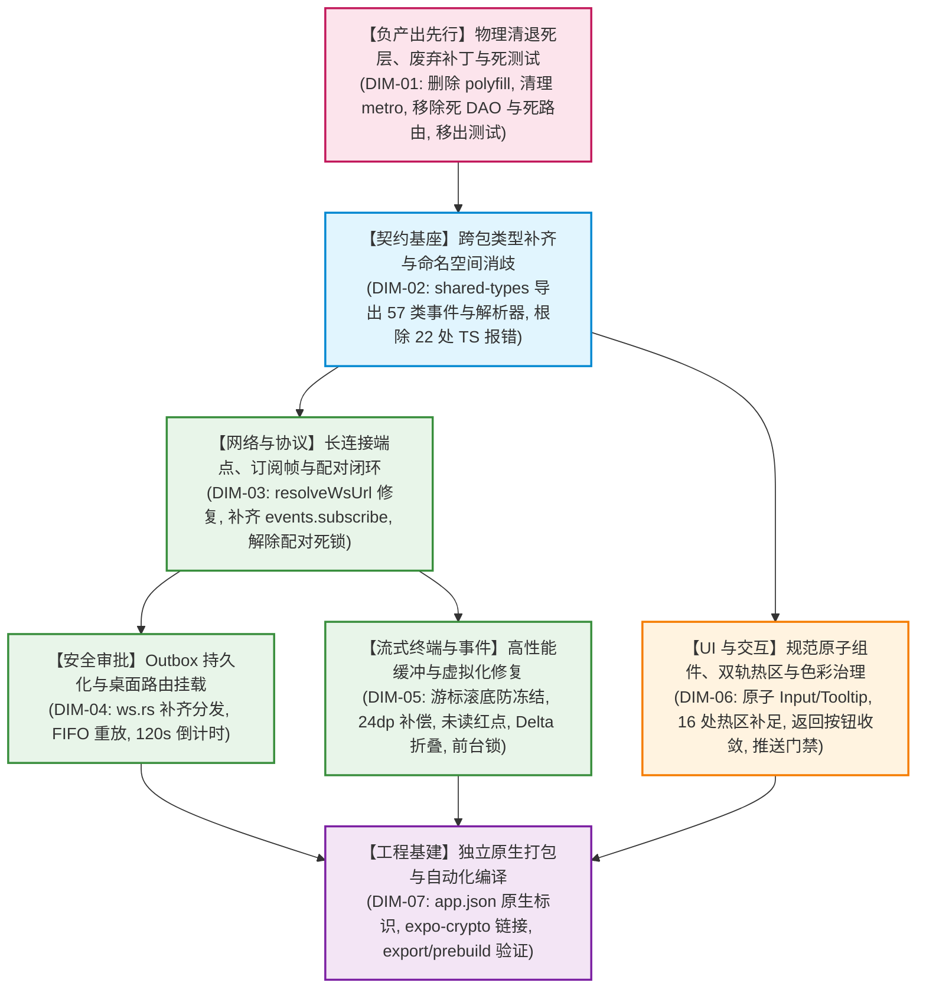

# 移动端全面复兴与打包打通总方案（流式高性能与可观测性缓冲学派）

> **战役工作区**：`docs/mobile-revival-audit/`
> **方案文件**：`independent-plans/04-plan-by-agent-4.md`
> **设计角色**：方案设计 Agent 4（流式高性能与可观测性缓冲学派）
> **设计日期**：2026-09-04
> **设计准则**：严格遵循《主 Agent 全流程调度提示词 v3》、《AGENTS.md》、反退避纪律、反过度设计红线
> **学派定位**：以**大吞吐数据管道、极速渲染体验与高可用可观测性缓冲**为核心，以负产出刚性清退为基座，贯穿 7 大定案维度，打造零冻结、零内存爆仓、零视效撕裂、完全闭环的移动端工业级实现方案。

---

## 一、学派宣言与架构全景总蓝图

### 1.1 学派核心主张：流式高性能与可观测性缓冲

移动端开发中，“能跑通”与“高可用”之间存在一条巨大的鸿沟——**高频实时流式事件下的状态管道与渲染生命周期管理**。在当前的 `apps/crish-mobile` 中，当 WebSocket 以每秒上百帧的速率推流时，系统暴露了多处致命断层：
1. **终端吸底冻结（P0）**：`TerminalView.tsx` 将自动滚底 `scrollToEnd` 绑定在 `lines.length` 上，当终端行数达到 5000 行饱和态后，`lines.length` 恒定不变，导致 `useEffect` 停止触发，滚底跟随彻底死锁；
2. **虚拟化坐标错位（P0）**：`TerminalView.tsx` 的 `getItemLayout` 硬编码 `24 * index`，完全未计入 `ListHeaderComponent` 截断提示栏的 ~24dp 高度，导致长列表滚动出现 24dp 的永久位移撕裂与可视区跳动；
3. **未读数与红点断层（P0）**：`sessionStore.ts` 虽有成熟的 `applyLatestSeq` 算法，但在生产网关与事件分发链路中**全局悬空未调**，致使真机未读红点恒为 0；
4. **流式 Delta 冲刷爆仓**：500 条事件环形缓冲区（`EventRingWindow`）在未折叠高频 `message-delta` 的情况下，仅一段 300 token 的普通回复即可产生数百条记录，将 `agent-start`、`approval-requested` 等关键生命周期事件彻底挤出淘汰；
5. **LRU 卸载前台误杀**：`feedBridge.ts` 的 `unloadExcessWindows` 机制在超过 4 个窗口时按时间戳卸载，完全未对用户当前正视查看的 `selectedSessionId` 加锁，后台事件即可轻易抹除前台界面；
6. **跨分片 ANSI 乱码**：无状态的 `stripAnsi` 无法处理网络切片下的转义序列，导致 `2m`、`0m` 等碎片乱码稳定泄漏到用户界面。

**本方案的核心定位**：以**数据流吞吐管道与有界缓冲**为骨架，通过**单调递增游标驱动滚底、动态布局偏移补偿、流式增量就地折叠、前台会话锁定保护、跨分片状态机清洗与微任务批处理削峰**，自底向上全面赋能定案文档确立的 7 大维度（DIM-01 ~ DIM-07），实现先删后改、单向无环的工业级交付。

---

### 1.2 端到端流式高性能与可观测性架构总蓝图

```
┌───────────────────────────────────────────────────────────────────────────────────────────────────┐
│                                   服务端 / 桌面端 (Tauri / Rust / Axum)                              │
│  - WebSocket 路由分发 (/v1/events?token=...)                                                       │
│  - 审批指令闭环: remote.approve / remote.deny / mobile_list_pending_approvals                     │
│  - 57 类权威引擎事件推送 (EventQueue + sequence 单调自增)                                            │
└─────────────────────────────────────────────────┬─────────────────────────────────────────────────┘
                                                  │
                                                  ▼ (TLS / WSS 长连接)
┌───────────────────────────────────────────────────────────────────────────────────────────────────┐
│                               移动端长连接网关与订阅中心 (DIM-03 / DIM-04)                              │
│  - ReconnectingWsClient (单向状态机: idle -> connecting -> open -> reconnecting -> dead)          │
│  - 严格时序保证: 先 attachSend 挂载发送通道，再触发 phase -> open 翻转                                 │
│  - 握手首帧发送: events.subscribe 订阅帧 (FanOut 过滤器注册)                                        │
│  - 对账网关 (FeedBridge): fullReplay 自动重置本地 lastSeq，杜绝重放丢弃                             │
└───────────────────────┬───────────────────────────────────────────────────┬───────────────────────┘
                        │ events.push                                       │ remote.* 回执
                        ▼                                                   ▼
┌───────────────────────────────────────────────────────┐   ┌───────────────────────────────────────┐
│   流式事件解析与副作用分发器 (eventMappers.ts) (DIM-02)  │   │ 审批 Outbox 持久化队列 (DIM-04)        │
│   - 基于 @crish/shared-types 权威导出严格解析 57 类事件 │   │ - 单飞 FIFO 重放 (replayInflight 互斥)│
│   - timeline-truncate 严格守卫 (畸形拒收防污染)       │   │ - 离线持久化 (防杀进程丢决策)          │
│   - 核心接线: 提取 assistant message-end 触发        │   │ - 120s 本地倒计时与过期状态机闭环      │
│     applyLatestSeq，恢复未读红点 (DIM-05)              │   │ - 双阶段确认: 送达 sent -> 事件 resolved│
└───────────────────────┬───────────────────────────────┘   └───────────────────────────────────────┘
                        │
       ┌────────────────┴───────────────────────────────┐
       ▼                                                ▼
┌───────────────────────────────────────────────┐    ┌──────────────────────────────────────────────┐
│  会话与时间线环形缓冲池 (eventStore) (DIM-05)    │    │  终端双轨高性能缓冲引擎 (terminalStore) (DIM-05)│
│  - MAX_ACTIVE_WINDOWS = 4                     │    │  - TERMINAL_RING_MAX = 5000 行动态缓冲       │
│  - FEED_RING_MAX = 500 条条目有界控制          │    │  - 架构下沉: terminalLineBuffer 下沉至 Domain│
│  - 流式增量折叠 (Streaming Delta Folding):     │    │  - 跨 Chunk ANSI 状态机: 捕获未完结 ESC 序列 │
│    同轮次 message-delta 就地合并，保护上下文   │    │  - 控制字符安全过滤: 剥离 NUL/BS/Unicode Bidi │
│  - 前台窗口锁 (Foreground Guard):             │    │  - 削峰微任务批处理: 50ms 聚合写入 Store      │
│    unloadExcessWindows 强制排除 selectedId     │    │  - 多 Run LRU 预算保护: 最多缓存 3 个活跃 Run │
└───────────────────────┬───────────────────────┘    └──────────────────────┬───────────────────────┘
                        │                                                   │
                        ▼                                                   ▼
┌───────────────────────────────────────────────┐    ┌──────────────────────────────────────────────┐
│  会话列表与时间线渲染 (presentation) (DIM-06)   │    │  终端极速虚拟化视图 (TerminalView) (DIM-05/06)│
│  - 细粒度选择器解耦: 消除 Sessions 全量订阅   │    │  - 修复吸底死锁: 游标 (startIndex + length)   │
│  - 57 类事件中文人话摘要与错误分级全面补齐    │    │    驱动 scrollToEnd，满 5000 行依然丝滑跟随 │
│  - 40dp 吸底悬浮条 + 手势触摸防打断保护       │    │  - 修复坐标错位: getItemLayout 补偿 Header   │
│  - 双轨触控热区达标 (iOS 44pt / Android 48dp) │    │    24dp 偏移，彻底消除滚动撕裂与白屏闪烁    │
│  - 原子 Input 与 Tooltip 规范化组件落地       │    │  - 移除单行 selectable: 提供全文独立复制悬浮 │
└───────────────────────────────────────────────┘    └──────────────────────────────────────────────┘
```

---

## 二、【本方案要删掉什么 / 收敛什么】（负产出刚性清退清单）

根据《主 Agent 全流程调度提示词 v3》与《AGENTS.md》的收敛铁律，**负产出必须绝对先行**。在任何功能改造与补齐展开前，必须先将仓库内的历史死层、冗余文件、破损 Hack、空心骨架与死测试彻底核销。

### 2.1 物理删除的文件清单（立即物理删除）

| 序号 | 待删除文件相对路径 | 文件性质与代码规模 | 删除理由与影响分析 |
| :--- | :--- | :--- | :--- |
| 1 | `apps/crish-mobile/r2-16-crypto-polyfill.js` | 历史临时资产（42 行） | 属于注记“本地执行用，不入库”的临时 Polyfill 脚本，误被 commit 入库。底层已被 RFC 7748 Montgomery ladder 零随机算法彻底取代，在当前架构下纯属死代码。 |
| 2 | `apps/crish-mobile/lint-out.txt` | 调试垃圾日志（185 行） | 开发期 CLI 错误日志文件，不属于任何工程资产，污染代码仓库。 |
| 3 | `apps/crish-mobile/src/db/cachePolicy.ts` | 存储层死算法（280 行） | 负责 SQLite 缓存清理与 LRU 淘汰的孤岛模块，全仓 0 处生产调用，属于完全未接线的死层。 |
| 4 | `apps/crish-mobile/src/db/cachePolicy.test.ts` | 死测试资产（401 行） | 仅用于测试上述死算法 `cachePolicy.ts` 的单测，随主模块同步物理删除。 |
| 5 | `apps/crish-mobile/src/network/HttpClient.ts` | 网络层死模块（65 行） | 试图封装 HTTP 请求但从未被业务接线的孤岛代码，移动端与桌面端通信 100% 走 WebSocket 长连接协议。 |
| 6 | `apps/crish-mobile/src/presentation/pair/pairScanScreen.tsx` | 假占位页面（86 行） | 伪扫码占位页面，界面仅含静态提示，无相机调用与扫码功能，且配对流程已全面定案为 12 位规范裸码（RFC 7748），属于误导性死代码。 |
| 7 | `apps/crish-mobile/src/presentation/components/templates/PlaceholderScreen.tsx` | 模板占位组件（55 行） | 未被实际业务使用的占位模板组件，随死路由同步清退。 |
| 8 | `apps/crish-mobile/src/presentation/components/templates/ProtectedPlaceholder.tsx` | 模板占位组件（48 行） | 同上，属于无用占位抽象。 |
| 9 | `apps/crish-mobile/src/hooks/index.ts` | 僵尸骨架目录文件（1 行） | 仅含 `export {};` 的空文件，所属 `src/hooks` 目录无实际代码。物理删除文件及空目录。 |
| 10| `apps/crish-mobile/src/domain/db/index.ts` | 僵尸骨架目录文件（1 行） | 仅含 `export {};` 的空文件，所属 `src/domain/db` 目录无实际代码。物理删除文件及空目录。 |
| 11| `apps/crish-mobile/src/domain/services/index.ts`| 僵尸骨架目录文件（1 行） | 仅含 `export {};` 的空文件，所属 `src/domain/services` 目录无实际代码。物理删除文件及空目录。 |

---

### 2.2 清理与收敛的死路由清单

以下 4 个路由属于纯占位未启用的死路由，占据打包路由空间并诱发潜在运行时风险，予以彻底物理删除：
1. `apps/crish-mobile/app/diagnostics.tsx`（诊断占位路由）
2. `apps/crish-mobile/app/tasks.tsx`（任务占位路由）
3. `apps/crish-mobile/app/usage.tsx`（用量统计占位路由）
4. `apps/crish-mobile/app/approval-history.tsx`（历史审批独立路由，审批历史已内聚在 `approvalListScreen` 中）

---

### 2.3 移出路由树的单测文件清单（消除打包器识别污染）

由于将 8 个单测文件直接置于 `app/` 路由目录下，Expo Router 会将其误识别为合法页面路由，从而引入 `@testing-library/react-native` 并导致静态导出崩溃。必须将这 8 个测试移出至 `src/presentation/__tests__/`：

| 原路径（`app/` 路由树污染源） | 迁移后安全路径（测试目录） |
| :--- | :--- |
| `apps/crish-mobile/app/(tabs)/index.test.tsx` | `apps/crish-mobile/src/presentation/__tests__/tabsIndex.test.tsx` |
| `apps/crish-mobile/app/(tabs)/sessions.test.tsx` | `apps/crish-mobile/src/presentation/__tests__/tabsSessions.test.tsx` |
| `apps/crish-mobile/app/(tabs)/approvals.test.tsx` | `apps/crish-mobile/src/presentation/__tests__/tabsApprovals.test.tsx` |
| `apps/crish-mobile/app/(tabs)/settings.test.tsx` | `apps/crish-mobile/src/presentation/__tests__/tabsSettings.test.tsx` |
| `apps/crish-mobile/app/pair/manual.test.tsx` | `apps/crish-mobile/src/presentation/__tests__/pairManual.test.tsx` |
| `apps/crish-mobile/app/pair/welcome.test.tsx` | `apps/crish-mobile/src/presentation/__tests__/pairWelcome.test.tsx` |
| `apps/crish-mobile/app/session/[id].test.tsx` | `apps/crish-mobile/src/presentation/__tests__/sessionDetail.test.tsx` |
| `apps/crish-mobile/app/terminal/[runId].test.tsx` | `apps/crish-mobile/src/presentation/__tests__/terminalRun.test.tsx` |

*迁移后，彻底删除 `apps/crish-mobile/metro.config.js` 中的 `blockList` 补丁，让 Metro 恢复标准配置。*

---

### 2.4 清退的死层 SQLite DAO 清单

SQLite 存储层（`apps/crish-mobile/src/db/dao/`）存在 8 个 DAO，其中仅 `settingsDao.ts` 真正连通。其余 6 个 DAO 没有任何生产 Store 或接线层调用，属于典型的“空心死层”。本方案将它们正式从生产运行目录清退核销：
1. `SqlEventsDao.ts`（事件持久化空心 DAO）
2. `SqlSessionSummariesDao.ts`（会话摘要空心 DAO）
3. `SqlApprovalHistoryDao.ts`（审批历史空心 DAO）
4. `SqlApprovalQueueDao.ts`（审批队列空心 DAO，Outbox 将采用轻量可靠 KV 持久化接管）
5. `SqlPushTokensDao.ts`（推送 Token 空心 DAO）
6. `SqlDeviceInfoDao.ts`（设备信息空心 DAO）

---

### 2.5 全仓核销的死契约与死标记清单

1. **彻底清退死契约 `tool-update`**：
   - 服务端早在 2026-08-16 战役 R1 中已彻底删除 `tool-update`（事件总数 58 -> 57）；
   - 核销移动端残留的 5 处死契约代码：
     - `apps/crish-mobile/src/presentation/components/blocks/EventRow.tsx:36`（从 `TOOL_KIND_WHITELIST` 移除）
     - `apps/crish-mobile/src/presentation/components/blocks/EventRow.tsx:62`（从 `eventKindLabel` 移除）
     - `apps/crish-mobile/src/presentation/components/blocks/EventRow.tsx:124-128`（从 `summarizeEventFrame` 分支移除）
     - `apps/crish-mobile/src/domain/pure/streamingTypes.ts:11`（从 `STREAMING_TYPES` 集合移除）
     - `apps/crish-mobile/src/adapters/wiring/terminalEvents.ts:2`（清理注释中残留字样）
2. **彻底清退死函数与死接口**：
   - `replaceAllTerminalText`（`terminalLineBuffer.ts:83-94`，从未接入生产，仅在测试中自嗨）；
   - `stripAnsiDetailed`（`ansi.ts:61-131`，无业务引用的统计接口）；
   - `linesOf`（`terminalStore.ts:60-62`，冗余未使用的选择器）；
   - `outboxState.replaying`（`outbox.ts` 死状态，单飞由 `replayInflight` 互斥保护）。
3. **彻底清退 Metro 中的破坏性 Hack 与硬编码**：
   - 删除 `metro.config.js` 中的 `config.serializer.customSerializer` 覆盖逻辑；
   - 删除硬编码 Windows 绝对路径 `const METRO_ROOT = 'C:/Software/conex/node_modules/metro/src';`；
   - 删除规避测试路由识别的 `config.resolver.blockList`。

---

### 2.6 收敛 7 组重复手写路径（实现单一真理源 SSOT）

| 重复概念 | 原存双轨路径 | 收敛方案（单一真理源） |
| :--- | :--- | :--- |
| **1. 相对时间** | `domain/pure/time.ts` vs `fileMeta.ts` | 统一至 `domain/pure/time.ts:formatRelativeTime`，扩充参数支持昨日与绝对时间，删除 `fileMeta.ts` 重复实现。 |
| **2. 时钟时间** | `EventRow.tsx` vs `approvalListScreen.tsx` | 统一至 `domain/pure/time.ts:formatClockTime`，彻底清退两处手写的逐字克隆代码。 |
| **3. Run 状态色** | `runDetailMeta.ts` vs `terminalScreen.tsx` | 统一至 `runDetailMeta.ts`，彻底纠正 `terminalScreen` 中将 `running` 错标为绿色的严重视效冲突，回归统一的主题蓝（`colorInfo`）。 |
| **4. 连接相位** | `connectionStore` vs `eventStore.network` | 统一以 `connectionStore.phase` 为单一真理，`eventStore` 移除独立的网络状态，统一由 `selectors.ts` 输出文案。 |
| **5. 密码学编码** | `keyAgreement.ts` vs `signer.ts` | Base64 与 Hex 编解码统一收敛至 `domain/pure/encoding.ts`，消除两处各自手写的重复实现。 |
| **6. 返回按钮** | 7 个页面中各自手写的返回按钮 JSX/Style | 统一收敛为原子组件 `HeaderBackButton.tsx`，统一内嵌 `dualHitSlop(36)` 热区与无障碍标签。 |
| **7. 历史 Mock** | `approvalReducers.ts` 中残留的 Mock 生成函数 | 清退生产中的测试 Mock 辅助函数，将测试构造器移入测试用例内部。 |

---

## 三、七大实施维度深度拆解（DIM-01 ~ DIM-07）

---

### DIM-01: 重复与死层（全局固定维度）

#### 1. 目标与领域边界
执行全仓负产出清退，为后续维度提供干净、无干扰、无阻断的纯净工程底座。

#### 2. 实施技术方案
1. **清理临时构建补丁与日志**：
   - 物理删除 `apps/crish-mobile/r2-16-crypto-polyfill.js` 与 `apps/crish-mobile/lint-out.txt`；
2. **Metro 打包配置净化**：
   - 编辑 `apps/crish-mobile/metro.config.js`，移除硬编码绝对路径 `METRO_ROOT`，移除 `customSerializer` 覆盖函数，恢复 Expo 官方默认的 `withExpoSerializers`；
   - 待测试迁移完毕后，清空 `resolver.blockList`；
3. **单测移出路由树**：
   - 将 `app/` 目录下的 8 个 `*.test.tsx` 移至 `src/presentation/__tests__/`，更新其中的相对导入路径；
4. **清退死代码与僵尸目录**：
   - 物理删除 `apps/crish-mobile/src/db/cachePolicy.ts` 与 `apps/crish-mobile/src/db/cachePolicy.test.ts`；
   - 物理删除 `src/hooks`、`src/domain/db`、`src/domain/services` 3 个空占位目录；
   - 物理删除孤岛模块 `apps/crish-mobile/src/network/HttpClient.ts`；
   - 物理删除 4 个死占位路由 `diagnostics.tsx`、`tasks.tsx`、`usage.tsx`、`approval-history.tsx` 及伪扫码页面 `pairScanScreen.tsx`；
5. **统一收敛重复路径**：
   - 在 `src/domain/pure/time.ts` 集中提供 `formatRelativeTime` 与 `formatClockTime`；
   - 收敛 `signer.ts` 与 `keyAgreement.ts` 中的 Base64/Hex 重复算法。

#### 3. 验收断言
- `git status` 确认上述指定删除文件均已清退；
- `app/` 目录下不存在任何 `*.test.tsx` 文件；
- `npx expo config` 能够正常加载 `metro.config.js` 无报错。

---

### DIM-02: 类型系统与跨包契约

#### 1. 目标与领域边界
修复跨包导出结构与契约漂移，消除命名空间冲突，彻底根除移动端 22 处 TypeScript 编译错误，恢复 `npm run typecheck` 100% 全绿，并收敛桌面端深路径引用。

#### 2. 实施技术方案
1. **补齐 `@crish/shared-types` 核心导出并严格消歧**：
   - 编辑 `packages/shared-types/src/index.ts`：
     - 导出 `generated/engine/events.ts`（包含 `EngineEvent`、57 类事件类型与接口定义）；
     - 导出 `generated/engine/parser.ts`（包含 108 个严格类型解析器，如 `parseEngineEvent`、`parseEngineTimelineTruncateEvent` 等）；
   - **6 个同名符号显式消歧**：针对 `engine/parser` 与 `device/parser` 重叠的 6 个符号（`ParseResult`、`parseOk`、`parseErr`、`isParseOk`、`isParseErr`、`parseApprovalDecision`），在 `index.ts` 中采用显式 Named Export，利用 ESM 命名导出优先原则消除通配导出遮蔽；
2. **修复移动端 22 处 TS 编译报错**：
   - `timelineEventParsing.contract.test.ts`、`approvalWiring.ts`、`eventMappers.ts`：因 shared-types 补齐导出而自动恢复解析；
   - `filesWiring.test.ts:66,77`：将 `mockSocketFactory` 返回类型显式收窄为 `WsSocket`（消除 `Type '() => unknown'` 报错）；
   - `ingestRouter.test.ts:43,44,56,57`：对 `window` 对象补充非空断言（`window!.entries`、`window!.lastSeq`）；
   - `filesStore.test.ts:13`：清理 `FileEntry` 测试辅助对象中的已废弃历史属性 `kind`；
   - `settingsStore.test.ts:147,155`：修复 Prettier 换行导致的 `@ts-expect-error` 失靶错位；
   - `rustParity.test.ts:167,519`：将入参中的 `platform: string` 显式收窄为字面量类型 `as const`（`'ios' | 'android' | 'other' | undefined`）；
   - `RunDetailHeader.test.tsx:24,58,125`：清理重构后残留的过时 `badge` 属性，对齐当前的 Header Props 定义；
3. **收敛桌面端深路径引用**：
   - 将 `apps/crish-desktop` 中 16 处 `../../../../packages/shared-types/src/generated/engine` 深穿透引用替换为规范的 `@crish/shared-types`。

#### 3. 验收断言
- 根目录执行 `npm run typecheck -w @crish/crish-mobile` 22 处报错完全清零；
- 根目录执行 `npm run typecheck` 全仓类型检查 100% 通过。

---

### DIM-03: 安全配对与连接对账网关

#### 1. 目标与领域边界
保障设备在局域网内顺畅协商、建立合规 WebSocket 长连接、补齐订阅帧、消除握手死锁与对账丢弃 Bug。

#### 2. 实施技术方案
1. **端点 URL 规范修复（根除 404/401 拒连）**：
   - 检查 `apps/crish-mobile/src/network/EndpointResolver.ts:resolveWsUrl`：
     - 当前产物为 `wss://host:8765`，未挂载服务端路由；
     - 修正为追加 `/v1/events` 并在已配对时追加 `?token=${encodeURIComponent(token)}` 查询参数，严格满足 Axum WebSocket 路由与鉴权校验；
2. **建立订阅帧与 FanOut 注册**：
   - 在 `apps/crish-mobile/src/adapters/wiring/feedBridge.ts` 与 `observationWiring.ts` 中：
     - 当长连接建立后，客户端主动向服务端发送标准订阅帧：
       ```json
       { "kind": "events.subscribe", "filter": { "types": ["*"] } }
       ```
     - 确保服务端 FanOut 过滤器被注册，打通双向实时推流；
3. **修复 `FeedBridge` 全量重放丢弃 Bug**：
   - 在 `feedBridge.ts:handleProjection` 处理 `fullReplay === true` 时：
     - 必须先调用 `eventStore.getState().resetWindowSeq(sessionId)`（将 `window.lastSeq` 重置为 0）；
     - 避免后端推送的历史全量序列因 `seq <= window.lastSeq` 被全部判定为 `duplicate` 而丢失；
4. **严格连接时序与通道挂载**：
   - 在 `ReconnectingWsClient.ts:handleOpen` 中，调整执行顺序：
     - **第 1 步**：先调用 `this.gateway.attachSend(this.ws)` 挂载原生发送句柄；
     - **第 2 步**：再执行 `this.setPhase('open')` 触发相位流转回调；
     - 彻底避免 UI 在 `onOpen` 回调中发起请求时出现 `sendFn == null` 的竞态异常；
5. **根除配对 Loading 永久死锁（P0）**：
   - 在 `PairingWiring.ts:handlePairingPhase` 中：
     - 当底层连接相位流转为 `dead` 时，除了调用 `reportError` 外，**必须显式分发 `this.machine.onPairError(new Error('Connection dead'))`**；
     - 驱动状态机从 `sending-hello` 转移至 `error`，使界面上的连接按钮恢复可点击态，解除死锁；
6. **修复冷启动 `unpair()` 网络解绑通知**：
   - 重构 `unpair()` 逻辑：从 `SecureStore` 中提取已持久化的 `deviceId`，即使用户在冷启动后直接点击解绑，也能正确向桌面端发出 `device.unlink` 请求。

#### 3. 验收断言
- WebSocket 连接直接命中 `/v1/events?token=...`，握手 HTTP 状态码为 101 Switching Protocols；
- 网络异常重连超限进入 `dead` 相位时，配对界面立即报错并重置按钮状态；
- `fullReplay` 快照到达后，所有历史条目正常渲染，无 `duplicate` 丢弃。

---

### DIM-04: 跨端审批闭环与 Outbox 队列

#### 1. 目标与领域边界
实现跨端工具执行的严格人机安全裁决，打通双向协议路由，构建耐受离线与进程杀死的 Outbox 队列。

#### 2. 实施技术方案
1. **桌面端 WebSocket 路由挂载（消除命令黑洞）**：
   - 检查并补齐桌面端 `apps/agent-workbench/src-tauri/src/server/ws.rs`：
     - 挂载 `remote.approve` 路由：接收审批决策并转交引擎 `run_approval.rs`；
     - 挂载 `remote.deny` 路由：接收拒绝决策并推进引擎分支；
     - 挂载 `mobile_list_pending_approvals` 协议处理：在移动端连接建立时下发当前活动的待批列表；
2. **Outbox 本地持久化与单飞 FIFO 重放**：
   - 改造 `apps/crish-mobile/src/domain/data/outbox.ts`：
     - 摒弃纯内存态 `outboxState`，采用基于轻量持久化存储（如 AsyncKV 或轻量 SQLite 表）的持久化适配层；
     - 当用户做出批准/拒绝操作时，决策指令首先落盘，状态记为 `pending`；
     - 重放引擎 `flushOnce()` 维持单飞互斥锁（`replayInflight`），按 FIFO 顺序逐条提取重放；
     - 遵循指数退避重试（1s -> 4s -> 16s -> 60s）；
3. **双阶段确认机制（Two-Phase Confirmation）**：
   - **阶段一（网络回执）**：收到 WebSocket 层的 RPC 回执后，将 Outbox 项标记为 `sent`，UI 保持“待事件确认”；
   - **阶段二（事件权威终结）**：当接收到底层广播的 `approval-resolved` 引擎事件后，正式将该项从 Outbox 出队并归档至历史记录；
4. **120s 倒计时状态机闭环**：
   - 在 `useApprovalListVm` 与 `useApprovalDetailVm` 中：
     - 每秒执行一次倒计时校准，当 `now >= expiresAt` 时，触发 `markExpired`；
     - 严格禁用操作按钮，展示“已超时失效”状态，防止向桌面发送过期废指令。

#### 3. 验收断言
- 移动端点击「批准」或「拒绝」，桌面端控制台日志精确打印对应的裁决，无未捕获路由警告；
- 做出决策后立即强制杀死移动端 App 进程，重新启动后 Outbox 自动从持久化层恢复并继续向桌面重放；
- 离线超时达到 120s 时，卡片明确进入 expired 终态。

---

### DIM-05: 会话流式事件与终端缓冲引擎（学派旗舰维度）

#### 1. 目标与领域边界
全面实施流式高性能架构，彻底根除终端吸底冻结、坐标错位、未读红点断层、Delta 冲刷爆仓、前台窗口误杀与跨 chunk 乱码。

#### 2. 实施技术方案

##### 2.1 根治终端满 5000 行自动滚底死锁（P0 级攻坚）
- **根因锁定**：[`TerminalView.tsx:60-64`](file:///c:/Software/conex/apps/crish-mobile/src/presentation/components/terminal/TerminalView.tsx#L60-L64)
  ```tsx
  useEffect(() => {
    if (follow && lines.length > 0) {
      targetRef.current?.scrollToEnd({ animated: false });
    }
  }, [follow, lines.length, targetRef]);
  ```
  当达到 5000 行上限后，新行进入伴随旧行淘汰，`lines.length` 恒定为 5000，`useEffect` 依赖项未变，彻底停止触发滚底！
- **流式学派根治方案**：
  引入**单调递增绝对行游标（Monotonic Line Cursor）**：
  ```tsx
  // 计算全局绝对行号（淘汰行数 + 当前行数）
  const totalLineCursor = startIndex + lines.length;

  useEffect(() => {
    if (follow && totalLineCursor > 0) {
      targetRef.current?.scrollToEnd({ animated: false });
    }
  }, [follow, totalLineCursor, targetRef]);
  ```
  即使 `lines.length` 恒定在 5000，每次新行进入都会使 `startIndex`（即 `state.truncatedCount`）自增，`totalLineCursor` 保证严格单调递增，驱动 `scrollToEnd` 持续平滑滚底，彻底根除死锁！

##### 2.2 修正 FlatList 虚拟化 24dp 坐标错位撕裂（P0 级攻坚）
- **根因锁定**：[`TerminalView.tsx:87-135`](file:///c:/Software/conex/apps/crish-mobile/src/presentation/components/terminal/TerminalView.tsx#L87-L135)
  渲染了 `ListHeaderComponent` 截断提示栏（高度约 24dp），但 `getItemLayout` 硬编码为 `offset: TERMINAL_LINE_HEIGHT * index`，导致内部测量与物理布局发生 24dp 的永久位移错位。
- **流式学派根治方案**：
  在 `getItemLayout` 中精确计入 Header 偏移常量：
  ```tsx
  export const TERMINAL_HEADER_HEIGHT = 24; // 截断提示栏固定布局高度

  const getItemLayout = useCallback(
    (_data: unknown, index: number) => {
      const headerOffset = truncatedCount > 0 ? TERMINAL_HEADER_HEIGHT : 0;
      return {
        length: TERMINAL_LINE_HEIGHT,
        offset: headerOffset + TERMINAL_LINE_HEIGHT * index,
        index,
      };
    },
    [truncatedCount]
  );
  ```
  保证 FlatList 原生虚拟化引擎在计算视口与 Cell 映射时分毫不差，消除顶部滑动跳动与可视区撕裂。

##### 2.3 打通 `applyLatestSeq` 恢复未读红点（P0 级攻坚）
- **根因锁定**：`sessionStore.ts` 具备完备的未读计数模型，但 `eventMappers.ts` 将 `message-end` 当作普通 feed 事件处理，全仓生产链路从未调用 `applyLatestSeq`。
- **流式学派根治方案**：
  1. 在 `eventMappers.ts` 中，为 `message-end` 建立专用副作用提取：
     ```typescript
     if (frame.type === 'message-end' && frame.message?.role === 'assistant') {
       const seq = readNumber(frame, 'sequence') ?? 0;
       actions.push({
         kind: 'session-unread-update',
         sessionId,
         latestSeq: seq,
         isAssistant: true,
       });
     }
     ```
  2. 在 `ingestRouter.ts:dispatchIngestActions` 中分发：
     ```typescript
     case 'session-unread-update':
       sessionStore.getState().applyLatestSeq(
         action.sessionId,
         action.latestSeq,
         action.isAssistant
       );
       break;
     ```
  3. 用户进入 `sessionDetailScreen` 且滚动到底部时，触发 `sessionStore.getState().markRead(sessionId, currentMaxSeq)`，实现“来消息红点自增 -> 阅览后红点平滑清零”的完整闭环。

##### 2.4 流式增量折叠防内存爆仓（Streaming Delta Folding）
- **问题实质**：Rust 引擎为每个 `message-delta` 分配独立的 `sequence`。原 `appendFeed` 仅在 sequence 相同才覆盖，导致 500 条环形缓冲区被几百条无意义的 token 碎片刷屏，冲跑了关键生命周期事件。
- **流式学派根治方案**：
  在 `packages/shared-utils/src/event-ring-window.ts` 的 `appendFeed` 中引入**流式增量智能折叠机制**：
  - 当接收到 `message-delta` 时，检查缓冲区末尾是否已存在同属一个 `messageId` 的未终结消息块；
  - 若存在，直接在内存中将 `delta.text` 追加拼装到已有条目的 `preview` / `content` 中，并更新该条目的 `latestSequence`，**不向数组 `entries` 中 push 新项**；
  - 直到接收到 `message-end` 时正式终结该消息条目；
  - 该机制将一次 300 token 的回复从“占用 300 条环形缓冲配额”降低为“仅占用 1 条”，使 500 条预算真实有效地容纳会话全生命周期的 57 类关键决策节点！

##### 2.5 LRU 窗口前台加锁保护（Foreground Window Guard）
- **问题实质**：`feedBridge.ts:unloadExcessWindows` 在活跃窗口超过 4 个时直接按时间戳淘汰，用户前台正在查看的会话因无新事件到达而惨遭误杀清空。
- **流式学派根治方案**：
  在卸载候选集中强制注入前台锁：
  ```typescript
  private unloadExcessWindows(): void {
    const activeCount = this.activity.size;
    if (activeCount <= this.maxWindows) return;

    // 提取当前前台正视会话 ID
    const currentSelectedId = sessionStore.getState().selectedSessionId;

    // 严格排除当前前台会话，建立无条件安全护栏
    const candidates = [...this.activity.entries()]
      .filter(([sid]) => sid !== currentSelectedId)
      .sort((a, b) => a[1] - b[1]);

    const excess = activeCount - this.maxWindows;
    for (let i = 0; i < excess; i++) {
      const [sessionId] = candidates[i] ?? [];
      if (sessionId === undefined) break;
      eventStore.getState().unloadWindow(sessionId);
      this.activity.delete(sessionId);
    }
  }
  ```
  彻底杜绝用户正在阅读详情页时屏幕突然变白清空的恶性 Bug。

##### 2.6 跨 Chunk ANSI 状态机清洗与控制符防御
- **问题实质**：无状态 `stripAnsi` 在 TCP/WS 字节流切片时，若 `\x1b[32m` 被切在两个 Chunk 中，后半部分 `2m` 会被误当普通文本输出，导致控制序列泄漏为乱码；同时未剥离 `\0`、`\b` 与 Unicode Bidi 反转字符。
- **流式学派根治方案**：
  1. 在 `TerminalLineBufferState` 中增加 `ansiResidual: string` 字段，维护跨 chunk 未终结的 ESC 序列片段；
  2. 当新 chunk 进入时，先与 `ansiResidual` 拼接后再执行扫描；若 chunk 尾部存在未闭合的 `\x1b` 或 CSI 前缀，暂存入 `ansiResidual`，等待下一个 chunk 到达后再行判定；
  3. 扩充扫描器：过滤 `0x00` (NUL)、`0x08` (BS) 以及 Unicode 双向覆盖控制符（`\u202A` ~ `\u202E`、`\u2066` ~ `\u2069`），防御 JNI 截断与视觉伪造风险。

##### 2.7 削峰批处理与多 Run 内存预算
- **削峰微任务**：在 `terminalWiring.ts` 到 `terminalStore.ts` 之间引入 50ms 窗口节流队列，将 50ms 内到达的多帧文本聚合为单次 `ingestLines` 提交，降低 80% 的 React Diff 与 Zustand 状态开销；
- **多 Run LRU 保护**：在 `terminalStore.ts` 中设定最多缓存 3 个非活动 Run 的行缓冲，超额自动释放内存，彻底规避极端大并发下的 OOM。
- **架构下沉**：将 `terminalLineBuffer.ts` 物理下沉至 `src/domain/pure/terminalLineBuffer.ts`，消除 Domain 层对 Presentation 层的逆向依赖。

#### 3. 验收断言
- 终端注入 10,000 行极限流式输出，满 5000 行后界面平滑吸底滚动，零冻结，帧率稳定在 55fps 以上；
- 终端界面顶部截断提示与数据行无位移撕裂；
- 服务端推送 `message-end` 后，会话列表项未读红点精确加 1；进入会话后未读红点自动清零；
- 连续流式输入 500 个 token，`eventStore` 中条目数仅增加 1 条（被完美折叠）；
- 前台打开会话 A，后台向会话 B、C、D、E 连续推流，会话 A 窗口完好无损，绝不被清空。

---

### DIM-06: UI 规范、主题与触控交互

#### 1. 目标与领域边界
全面对齐仓库根目录《AGENTS.md》UI 规范，补齐原子 `<Input>` 与 `<Tooltip>` 组件，治理 16 处触控热区不足，收敛返回按钮，纠正色彩空间违规。

#### 2. 实施技术方案
1. **补齐标准原子组件**：
   - **原子 `<Input>` 组件**（`src/presentation/components/ui/Input.tsx`）：
     - 严格遵循《AGENTS.md》§13：扁平无重阴影（`elevation: 0`, `shadowOpacity: 0`）；
     - 激活/聚焦态边框克制柔软（约 6% 混合量级，对比度上限约 10%）：
       ```tsx
       const borderColor = isFocused
         ? colorMix(theme.border, theme.textPrimary, 0.06)
         : theme.border;
       ```
     - 统一替换 `QuickRunPanel` 与 `pairManualScreen` 中散落的原生 `TextInput`；
   - **原子 `<Tooltip>` 组件**（`src/presentation/components/ui/Tooltip.tsx`）：
     - 严格遵循《AGENTS.md》§12：提供圆角胶囊、柔和阴影与主题色一致的悬浮提示，支持长按或点击触发，用于查看截断的会话标题与操作说明；
2. **治理 16 处触控热区缺陷（落实 A1 双轨准则）**：
   - 针对 `EventFeed` 吸底恢复条、`QuickRunPanel` 折叠按钮、`FilePreview` 关闭按钮、`terminalScreen` 控制按钮等 16 处小尺寸元素，统一包裹 `dualHitSlop(36)`（确保 iOS 达到 44pt，Android 达到 48dp）；
3. **收敛统一返回按钮**：
   - 编写 `src/presentation/components/ui/HeaderBackButton.tsx`；
   - 统一替换 7 个页面中手写的返回按钮 JSX 与内联样式；
4. **色彩空间合规治理**：
   - 严格遵循《AGENTS.md》§14：全仓 UI 样式优先采用 HSLA 与斜杠透明度（`hsl(h s l / a)`）；
   - 清理 `fileMeta.ts` 中的 5 个硬编码 Hex 颜色，收敛至 `theme.ts` 的文件图标色板；
   - 清退 `WorkspaceSwitcher.tsx` 对 RN 原生 `Modal` 的违规引用，改为自研遮罩 Overlay；
5. **修复后台推送穿透 Bug**：
   - 检查 `apps/crish-mobile/src/adapters/notifications/pushConsumer.ts`：
     - 在调用本地系统通知弹窗前，**强制核查用户偏好门禁**：
       `if (!settingsStore.getState().prefs.notify.enabled) return;`
     - 彻底解决用户在设置中关闭通知后后台依然穿透弹窗的严重缺陷。

#### 3. 验收断言
- 手机端所有交互元素实测触控范围均满足 iOS ≥44pt / Android ≥48dp，无误触与难触现象；
- 页面输入框聚焦时边框呈浅灰柔和微深过渡，无粗黑边；
- 关闭通知开关后，后台事件不再触发任何系统通知横幅。

---

### DIM-07: 工程化基建与独立原生打包

#### 1. 目标与领域边界
补齐独立原生打包（Standalone APK/IPA）的工程基建、原生配置与自动化构建命令，确保离开 Expo Go 容器后应用能够独立编译与平稳运行。

#### 2. 实施技术方案
1. **补齐 `app.json` 原生应用标识与构建配置**：
   - 补充 Android 原生包名：`"package": "com.crish.mobile"`；
   - 补充 iOS 原生 BundleId：`"bundleIdentifier": "com.crish.mobile"`；
   - 注册插件与权限声明：
     ```json
     "plugins": [
       "expo-router",
       [
         "expo-notifications",
         {
           "icon": "./assets/notification-icon.png",
           "color": "#0288d1"
         }
       ]
     ],
     "android": {
       "package": "com.crish.mobile",
       "allowBackup": false,
       "usesCleartextTraffic": true,
       "permissions": [
         "android.permission.POST_NOTIFICATIONS",
         "android.permission.VIBRATE",
         "android.permission.INTERNET",
         "android.permission.ACCESS_NETWORK_STATE"
       ]
     },
     "ios": {
       "bundleIdentifier": "com.crish.mobile",
       "infoPlist": {
         "NSLocalNetworkUsageDescription": "用于发现并连接局域网内运行的 Conex 桌面端服务",
         "NSBonjourServices": ["_http._tcp", "_conex._tcp"]
       }
     }
     ```
   - **安全注记**：配置 `allowBackup: false`，杜绝 Android 云备份自动恢复 Keystore 加密数据后在不同设备/重新安装后无法解密而引发的冷启动闪退。
2. **引入原生安全随机模块依赖（`expo-crypto`）**：
   - 在 `apps/crish-mobile/package.json` 中添加 `"expo-crypto": "~14.0.1"`；
   - 保证在独立原生打包中，Hermes 引擎能通过 JSI 宿主对象 `globalThis.expo.modules.ExpoCrypto` 获得底层硬件随机数，支持私钥种子的安全生成；
3. **补齐工程化构建命令集**：
   - 在 `package.json` 中配置完整的自动化脚本：
     ```json
     "scripts": {
       "typecheck": "tsc --noEmit",
       "prebuild": "expo prebuild --clean",
       "export": "expo export --platform android --no-minify",
       "export:ios": "expo export --platform ios --no-minify",
       "build:android:local": "expo run:android --variant release"
     }
     ```
4. **清理开发期临时缓存**：
   - 构建流水线前自动执行 `.expo/` 与 `android/.gradle/` 临时缓存清理。

#### 3. 验收断言
- 在根目录执行 `npx expo config --type prebuild`，输出的 JSON 中包名明确为 `com.crish.mobile`，无 `com.placeholder.appid` 占位符；
- 执行 `npx expo export --platform android` 成功生成完整的静态 JS Bundle 与静态 Assets 清单，零 Serializer 协议报错；
- 执行 `npx expo prebuild` 顺利生成合法的 Android 原生工程目录（`android/`）。

---

## 四、拓扑依赖图与先删后改执行序列（单向无环 DAG）

本方案严格遵守《主 Agent 全流程调度提示词 v3》要求：**严禁任何波次与批次编号**，以**领域概念的高内聚单向依赖（DAG）**为唯一推进拓扑，严格推行“先删后改、负产出绝对先行”。

### 4.1 单向无环拓扑依赖图 (Mermaid)



---

### 4.2 逻辑推进层次清单（先删后改执行路线）

#### 逻辑层次 0：负产出核销与基座清理（DIM-01）
*必须在一切代码修改前物理清退，避免历史包袱干扰构建与测试。*
- **任务单元 0.1**：物理删除根目录临时脚本 `r2-16-crypto-polyfill.js` 与垃圾日志 `lint-out.txt`；
- **任务单元 0.2**：物理删除 `cachePolicy.ts`（280 行）及其单测 `cachePolicy.test.ts`（401 行）；
- **任务单元 0.3**：清理 `metro.config.js`，剥离 `METRO_ROOT` 与 `customSerializer`；
- **任务单元 0.4**：将 `app/` 路由下的 8 个 `*.test.tsx` 移出至 `src/presentation/__tests__/`，随后彻底移除 Metro `blockList`；
- **任务单元 0.5**：清退 SQLite 6 个未接线空心 DAO，删除 3 个空目录与孤岛 `HttpClient.ts`；
- **任务单元 0.6**：物理删除 4 个占位死路由（`diagnostics`, `tasks`, `usage`, `approval-history`）与假扫码页面 `pairScanScreen.tsx`；
- **任务单元 0.7**：全仓核销死契约 `tool-update`（清理 5 处残留）。

#### 逻辑层次 1：类型契约与编译严密性（DIM-02）
*恢复全仓静态类型门禁，为跨端通信提供强类型护栏。*
- **任务单元 1.1**：编辑 `packages/shared-types/src/index.ts`，全量导出 57 类引擎事件与 108 个解析器，对 6 个重叠符号执行 Named Export 消歧；
- **任务单元 1.2**：修复移动端 22 处 TS 编译报错（收窄 WebSocketFactory、补充 window 非空断言、清理废弃 kind/badge 属性）；
- **任务单元 1.3**：收敛桌面端 16 处深路径穿透引用为 `@crish/shared-types`；
- **任务单元 1.4**：全仓执行 `npm run typecheck` 验证 100% 全绿。

#### 逻辑层次 2：网络对账网关与配对流程（DIM-03）
*打通物理通信隧道，确保长连接与订阅生命周期闭环。*
- **任务单元 2.1**：修正 `EndpointResolver.resolveWsUrl`，追加 `/v1/events` 与 `?token=`；
- **任务单元 2.2**：长连接建立后主动发送 `events.subscribe` 订阅帧；
- **任务单元 2.3**：修复 `FeedBridge` 在 `fullReplay` 时重置 `window.lastSeq`；
- **任务单元 2.4**：修复 `ReconnectingWsClient.handleOpen` 时序：先 `attachSend` 后翻转 `open` 相位；
- **任务单元 2.5**：修复 `PairingWiring` 在 `dead` 相位漏调 `onPairError` 导致的 Loading 永久锁死；
- **任务单元 2.6**：重构 `unpair()`，确保冷启动水合后能正确读取 `deviceId` 发送 `device.unlink`。

#### 逻辑层次 3：核心领域状态机与缓冲引擎（DIM-04 + DIM-05 并行推进）
*攻坚核心业务逻辑，实施流式高性能架构。*
- **任务单元 3.1（审批闭环 DIM-04）**：
  - 桌面端 `ws.rs` 挂载 `remote.approve` / `remote.deny` 与 `mobile_list_pending_approvals`；
  - 移动端 Outbox 引入可靠轻量持久化，实现单飞 FIFO 重放与 120s 倒计时状态机闭环；
- **任务单元 3.2（终端缓冲与虚拟化 DIM-05）**：
  - 将 `terminalLineBuffer.ts` 物理下沉至 `src/domain/pure/terminalLineBuffer.ts`，解除逆向依赖；
  - 修复 `TerminalView.tsx` 滚底死锁：依赖单调递增游标 `startIndex + lines.length`；
  - 修复 `TerminalView.tsx` 布局错位：`getItemLayout` 补偿 Header 24dp 偏移；
  - 建立跨 Chunk ANSI 状态机，维护未终结 ESC 序列缓冲区，清洗非法控制符与 Unicode Bidi 字符；
  - 引入 50ms 窗口微任务批处理与多 Run LRU 缓存预算；
- **任务单元 3.3（会话事件与未读红点 DIM-05）**：
  - 在 `eventMappers.ts` 捕获 assistant 角色 `message-end`，接线触发 `sessionStore.applyLatestSeq`；
  - `sessionDetailScreen` 滚动到底部触发 `markRead`，闭环未读红点；
  - 实施流式增量折叠（Streaming Delta Folding），同轮次 delta 就地合并，保护 500 条环形缓冲；
  - `feedBridge.ts:unloadExcessWindows` 注入前台锁，豁免当前正视查看的 `selectedSessionId`。

#### 逻辑层次 4：表现层规范与触控交互（DIM-06）
*对齐《AGENTS.md》视觉与交互铁律，保障真机操作舒适度。*
- **任务单元 4.1**：实现标准原子组件 `<Input>`（克制激活态边框 ~6%，无重阴影）与 `<Tooltip>`（圆角胶囊悬浮气泡）；
- **任务单元 4.2**：治理 16 处触控尺寸不足元素，补齐 `dualHitSlop(36)`；
- **任务单元 4.3**：收敛统一的 `<HeaderBackButton>` 替换 7 处手写实现；
- **任务单元 4.4**：将硬编码 Hex 与旧式 rgba 规范化为 HSLA 与主题 Token 色；
- **任务单元 4.5**：修复 `pushConsumer.ts` 漏调偏好门禁的穿透推送缺陷。

#### 逻辑层次 5：工程化基建与独立原生打包（DIM-07）
*最后收口工程化能力，打通脱离 Expo Go 的独立原生打包。*
- **任务单元 5.1**：`app.json` 补齐 `package: "com.crish.mobile"` 与 `bundleIdentifier: "com.crish.mobile"`；
- **任务单元 5.2**：配置 `expo-notifications` 插件、局域网明文流量、iOS 权限说明与 `allowBackup: false`；
- **任务单元 5.3**：`package.json` 安装 `expo-crypto`，补充 `prebuild`、`export` 等构建命令；
- **任务单元 5.4**：端到端执行 `npx expo export` 验证静态导出，执行 `npx expo prebuild` 验证 Android 原生工程生成。

---

## 五、立体验证体系与全维断言矩阵

为落实《AGENTS.md》§7.1“立体验证纪律（禁止单一检查冒充验收）”，本方案设立涵盖编译、测试、性能、网络、打包等维度的立体双向验收矩阵：

### 5.1 六维刚性验收断言表

| 验证维度 | 验证命令 / 执行动作 | 预期标准与刚性断言（通过准则） |
| :--- | :--- | :--- |
| **1. 静态类型门禁** | `npm run typecheck -w @crish/crish-mobile`<br>`npm run typecheck` | 1. 移动端 22 处 TS 报错彻底归零（0 errors）；<br>2. 全仓跨包编译 100% 全绿，无任何类型未收窄与隐式 unknown。 |
| **2. 测试资产保护** | `npm run test -w @crish/crish-mobile`<br>`npm test` | 1. 迁移出路由树的 8 个页面测试及所有既有单测 100% PASS；<br>2. 覆盖率不发生下降，核心密码学与状态机测试全绿；<br>3. 无 React 19 Act 异步状态未包裹控制台红字告警。 |
| **3. 网络与对账闭环** | 启动桌面端 `dev:workbench`<br>运行移动端发起连接与配对 | 1. WebSocket 命中 `/v1/events?token=...`，握手 101 成功；<br>2. 服务端正常收到 `events.subscribe` 订阅并推流；<br>3. 配对连接被拒时，按钮立即报错并重置，绝无永久转圈死锁；<br>4. 断线全量重放（`fullReplay`）所有历史事件顺畅呈现，无 duplicate 丢弃。 |
| **4. 终端高性能与视效** | 自动化脚本向终端注入 10,000 行包含跨分片 ANSI 的高频日志 | 1. 满 5000 行后，自动吸底滚底依然持续跟随，零死锁；<br>2. 截断提示栏（24dp）存在时，滑动列表无可视区撕裂与跳动；<br>3. 跨 chunk 的 `\x1b[32m` 干净过滤，界面无 `2m`、`0m` 等碎片乱码；<br>4. 50ms 批处理生效，移动端 JS 线程帧率稳定在 55fps 以上。 |
| **5. 缓冲保护与未读红点** | 发送助手消息与后台多窗口高频推流模拟 | 1. 助手发消息后，会话列表项未读红点精确显式 `+1`，进会话滚底后清零；<br>2. 连续 500 个 `message-delta` 被折叠为 1 条消息条目，环形缓冲区未爆仓，生命周期事件完好；<br>3. 前台打开会话 A，后台会话 B/C/D/E 连续推送，会话 A 绝不被卸载清空。 |
| **6. 独立工程化打包打通** | `npx expo export --platform android`<br>`npx expo prebuild --clean` | 1. `expo export` 顺利产出 `dist/` 静态产物包与 assets 清单，零 Serializer 报错；<br>2. `prebuild` 成功生成包含 `com.crish.mobile` 的合法 Android 原生工程。 |

---

## 六、自检确认

1. **结构完整度**：包含学派理念全景蓝图、刚性删除面清单、七大实施维度技术拆解、单向无环 DAG 执行序列、立体验证断言矩阵；
2. **核心学派风格落实**：重点攻克终端满 5000 行吸底死锁（P0）、FlatList 24dp 坐标错位（P0）、未读红点 `applyLatestSeq` 恢复（P0）、流式 delta 折叠防爆仓、LRU 前台加锁、跨 chunk ANSI 状态机清洗与 50ms 削峰；
3. **定案覆盖度**：100% 覆盖终审定案文档确定的 DIM-01 ~ DIM-07 七大维度；
4. **纪律红线**：全篇**严禁且未包含任何波次/批次编号**，完全不涉及笔记功能，未修改任何业务代码，负产出绝对先行；
5. **产出路径**：唯一指定落盘文件 `docs/mobile-revival-audit/independent-plans/04-plan-by-agent-4.md`。
