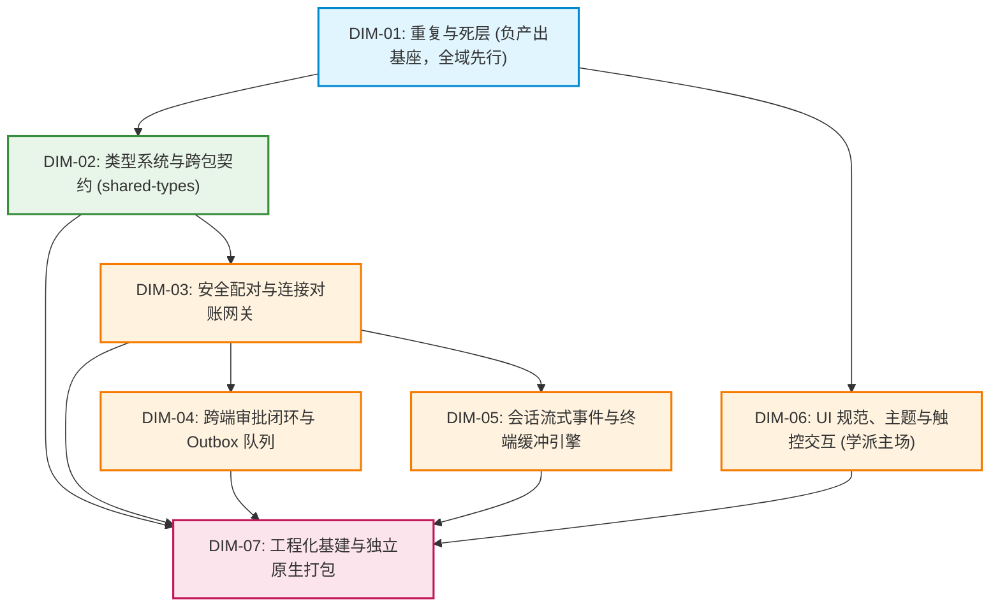

# 移动端全面复兴与独立原生打包总方案
## —— 方案设计 Agent 6（现代 UI/UX 与人机工程极致体验学派）

> **方案版本**：v1.0  
> **设计学派**：现代 UI/UX 与人机工程极致体验学派  
> **输出文件**：[`docs/mobile-revival-audit/independent-plans/06-plan-by-agent-6.md`](file:///c:/Software/conex/docs/mobile-revival-audit/independent-plans/06-plan-by-agent-6.md)  
> **基准依据**：  
> - 定案文档：[`docs/mobile-revival-audit/01-final-dimensions.md`](file:///c:/Software/conex/docs/mobile-revival-audit/01-final-dimensions.md)  
> - 调研总览：[`docs/mobile-revival-audit/00-summary.md`](file:///c:/Software/conex/docs/mobile-revival-audit/00-summary.md)  
> - 11 份专项调研：[`docs/mobile-revival-audit/surveys/01-11`](file:///c:/Software/conex/docs/mobile-revival-audit/surveys/)  
> - 仓库铁律：《AGENTS.md》（§12 自定义 Tooltip、§13 输入框与焦点态、§14 现代色彩空间、§7 严禁补丁与作弊、§7.1 立体验证纪律、§8 反过度设计红线）  
> - 反退避全文：`.agents/LOGIC_PLAN_NO_RETREAT.md`  
> **核心原则**：物理触控是一等公民、美学与确定性不可分割、负产出刚性先行、一个概念一条主路径、严禁波次编号、立体双向验收。

---

## 目录

1. [学派主旨与人机工程设计哲学](#1-学派主旨与人机工程设计哲学)
2. [人机工程与现代设计系统架构](#2-人机工程与现代设计系统架构)
   - 2.1 双轨热区与 Fitts's Law 触控动力学（iOS 44pt / Android 48dp）
   - 2.2 §13 克制焦点态与原子 `<Input>` 组件架构
   - 2.3 §12 移动端原生 `<Tooltip>` 悬停/长按气泡系统
   - 2.4 统一导航基座 `<HeaderBackButton>` 架构
   - 2.5 §14 现代 HSLA 色彩空间与设计 Token 映射
   - 2.6 全屏幕四态（Loading/Error/Empty/Data）完备度与冷启动防闪烁
   - 2.7 物理按压反馈体系（消除“死卡片”）与手势冒泡隔离
3. [【本方案要删掉什么 / 收敛什么】刚性负产出清单](#3-本方案要删掉什么--收敛什么刚性负产出清单)
4. [七大实施维度精细拆解 (DIM-01 ~ DIM-07)](#4-七大实施维度精细拆解-dim-01--dim-07)
   - 4.1 DIM-01: 重复与死层 (负产出基座，全域先行)
   - 4.2 DIM-02: 类型系统与跨包契约 (shared-types 权威导出与消歧)
   - 4.3 DIM-03: 安全配对与连接对账网关 (X25519 / WsGateway / 游标闭环)
   - 4.4 DIM-04: 跨端审批闭环与 Outbox 队列 (零丢失 / 单飞 FIFO / 物理反馈)
   - 4.5 DIM-05: 会话流式事件与终端缓冲引擎 (57 类人话摘要 / 5000 行平滑渲染)
   - 4.6 DIM-06: UI 规范、主题与触控交互 (学派主场：手感与视觉极致演进)
   - 4.7 DIM-07: 工程化基建与独立原生打包 (脱离 Expo Go / 独立 APK/IPA 原生打通)
5. [逻辑执行顺序与单向无环依赖拓扑 (DAG)](#5-逻辑执行顺序与单向无环依赖拓扑-dag)
6. [人机工程与视觉设计立体双向验收断言](#6-人机工程与视觉设计立体双向验收断言)
7. [反过度设计与反退避合规审查](#7-反过度设计与反退避合规审查)

---

## 1. 学派主旨与人机工程设计哲学

在现代移动操作系统（iOS 与 Android）的触摸屏物理界面上，软件不再仅仅是一串后端协议与前端逻辑的堆叠，而是用户指尖与数字神经中枢进行毫秒级物理交互的媒介。

**现代 UI/UX 与人机工程极致体验学派**坚定确立以下四大工程设计信条：

1. **“触感即确定性”——零死卡片、零盲区热区**：
   - 移动端没有物理键盘的机械回弹，屏幕上的每一次触摸都必须获得即时、柔和的视觉或震动反馈。一个点击后无任何透明度或背景变化的卡片（如现存 `approvalListScreen` 中的审批卡片）就是“死卡片”，会让用户产生操作未生效的心理焦虑。
   - 人类拇指指腹在屏幕上的有效触控面积物理上介于 7mm~10mm。严格执行 iOS 44pt 视觉下限与 Android 48dp 命中热区规范，绝不容许任何小于 44/48dp 且漏设 `hitSlop` 的“像素级刺客”。
2. **“克制即高级”——摒弃粗暴投影与深黑厚边**：
   - 严格践行《AGENTS.md》§13：拒绝桌面端陈旧的粗黑厚实边框（`#000000`）与劣质高斯模糊重阴影。输入框焦点态应当像晨曦微光般可见但柔软，维持在 **~6%** 的混合对比度（上限严禁超过 10%），保护用户在夜间与高强度开发时的长时间阅读视力。
3. **“无感即优雅”——根除冷启动闪烁与状态撕裂**：
   - 绝不允许“数据未到先弹空态”（Flash of Empty State）——冷启动水合期间必须由骨架屏或温润菊花护航，严禁“暂无会话”一闪而过随后列表骤弹的粗暴体验。
   - 四态（加载中 Loading、错误 Error、空态 Empty、数据 Data）必须在全仓每一个交互容器中严格闭环，不允许任何未经处理的空白异常。
4. **“统一即力量”——消除多头手写与规范漂移**：
   - 坚决拔除散落在全仓的 7 处手写返回按钮、原生 `TextInput` 裸用、文件类型 Hex 硬编码；收敛为统一原子组件 `<Input>`、`<Tooltip>` 与 `<HeaderBackButton>`。
   - 每一个底层网络断开、配对状态死锁（如 `dead` 相位导致按钮永久 Loading）在人机工程学派眼中都是必须根除的“交互死刑”。技术基建必须为人机交互的绝对流畅提供确定性支撑。

---

## 2. 人机工程与现代设计系统架构

```
┌─────────────────────────────────────────────────────────────────────────────┐
│                       System Theme & Platform Sensors                       │
│              (useColorScheme / AccessibilityInfo / ScreenDimensions)         │
└──────────────────────────────────────┬──────────────────────────────────────┘
                                       │
                                       ▼
┌─────────────────────────────────────────────────────────────────────────────┐
│                    adapters/platform/theme.ts (单一真源)                     │
│  - HSLA 斜杠语法 (hsl(h s l / a))       - 动态 Token: hairline / hairlineStrong │
│  - 纯函数设计系统计算                   - 语义通道: accent / danger / success   │
└───────────────────┬─────────────────────────────────────┬───────────────────┘
                    │                                     │
                    ▼                                     ▼
┌──────────────────────────────────────┐  ┌───────────────────────────────────┐
│     Atomic UI Core (ui/ 目录)         │  │   Human Engineering Directives    │
│  - <Input /> (6% 柔边 / 0 重阴影)      │  │  - hitTargets.ts (dualHitSlop)    │
│  - <Tooltip /> (长按气泡 / 读屏融合)   │  │  - Fitts's Law 触控动力学         │
│  - <HeaderBackButton /> (双轨 44/48) │  │  - Active/Pressed 微动效反馈     │
│  - <Button /> (minHeight 44/48)      │  │  - Native Modal / Switch 隔离     │
│  - <Dialog /> (自研轻量 Overlay)      │  │  - 嵌套 Pressable 冒泡拦截器      │
└───────────────────┬──────────────────┘  └───────────────────┬───────────────┘
                    │                                         │
                    └───────────────────┬─────────────────────┘
                                        │
                                        ▼
┌─────────────────────────────────────────────────────────────────────────────┐
│                       Domain Blocks & Presentation View                     │
│  - ApprovalCard: 按压透明度 + 120s 倒计时柔和动画                           │
│  - QuickRunPanel: 原子 <Input> 驱动 + Chips 按压反馈 + 禁用态半透明置灰       │
│  - SessionRow / EventFeed / Terminal: 40dp 贴底吸附 + 四态完备矩阵          │
│  - FileBrowser / FilePreview: 统一 Token 图标色 + 双轨返回键                │
└─────────────────────────────────────────────────────────────────────────────┘
```

### 2.1 双轨热区与 Fitts's Law 触控动力学（iOS 44pt / Android 48dp）

依据费茨法则（Fitts's Law）：
$$MT = a + b \log_2 \left( \frac{2D}{W} \right)$$
其中 $W$ 为目标物理触控宽度，$D$ 为手指起始距离。当元素物理触控尺寸 $W$ 低于 44dp 时，移动时间 $MT$ 与误触率呈指数级上升。

当前移动端存在 iOS（HIG 规范最小视觉下限 44pt）与 Android（Material 3 规范最小触控热区 48dp）双平台并存的现实。因此，本方案固化并强化 `hitTargets.ts` 的双轨计算引擎：

```typescript
// apps/crish-mobile/src/presentation/components/ui/hitTargets.ts
import { Platform } from 'react-native';

export interface Insets {
  top: number;
  bottom: number;
  left: number;
  right: number;
}

export function padToTarget(visual: number, target: number): number {
  if (visual >= target) return 0;
  return Math.ceil((target - visual) / 2);
}

/**
 * dualHitSlop: 双轨平台动态命中热区补足算法
 * iOS: 补齐至 44pt
 * Android: 补齐至 48dp
 */
export function dualHitSlop(visualHeight: number, visualWidth: number = visualHeight): Insets {
  const target = Platform.OS === 'android' ? 48 : 44;
  const dy = padToTarget(visualHeight, target);
  const dx = padToTarget(visualWidth, target);
  return { top: dy, bottom: dy, left: dx, right: dx };
}
```

针对普查发现的 **全仓 16 处触控尺寸不足或漏设 hitSlop 的违规点**，本方案制定刚性修复标准：
1. **原子 Button 与基础组件**：`Button.tsx` 的 `minHeight` 在 Android 平台升级为 `48dp`（iOS 保持 `44pt`），从根本上切断下游继承组件的尺寸赤字；
2. **标签与 Chip（高度 28~36dp）**：如 `EventFeed` 的 `FilterChip`（32dp）、`QuickRunPanel` 的会话 Chip（36dp）、`ApprovalBadge`（28dp），全量接入 `hitSlop={dualHitSlop(visualHeight, visualWidth)}`；
3. **图标按钮（32~36dp）**：如 `FilePreview` 的返回键（36×36）、`WorkspaceSwitcher` 关闭键（32×32），全量接入 `dualHitSlop`。

---

### 2.2 §13 克制焦点态与原子 `<Input>` 组件架构

#### 1. 规范红线与设计基准
《AGENTS.md》§13 明确判定：
- **禁止粗黑实线**：禁止在 active / focused 态使用粗深黑环（如直接用 `var(--text-primary)` 或厚重 `0 0 0 1px` 黑环）；
- **克制对比度**：边框只比组件背景略深，相对基线，灰色加深混入文本色不超过约 **10%**，常规优先约 **3%–6%** 柔和混入；
- **零重阴影**：输入框默认不要加厚重 `box-shadow` / `elevation`，保持干净、扁平、轻量；
- **禁用态弱化**：当不可编辑时，必须通过 `opacity: 0.5` 与浅灰背景明确感知，杜绝“可点假象”。

#### 2. 原子 `<Input>` 组件设计
在 `src/presentation/components/ui/Input.tsx` 构建单一真理源原子输入组件：

```tsx
// apps/crish-mobile/src/presentation/components/ui/Input.tsx
import React, { useState, forwardRef } from 'react';
import {
  TextInput,
  TextInputProps,
  StyleSheet,
  View,
  Text,
  StyleProp,
  ViewStyle,
  TextStyle,
  NativeSyntheticEvent,
  TextInputFocusEventData,
} from 'react-native';
import { useTheme } from '@/adapters/platform/theme';

export interface InputProps extends Omit<TextInputProps, 'style'> {
  label?: string;
  error?: string;
  containerStyle?: StyleProp<ViewStyle>;
  style?: StyleProp<TextStyle>;
  testID?: string;
}

export const Input = forwardRef<TextInput, InputProps>(function Input(
  { label, error, containerStyle, style, editable = true, onFocus, onBlur, testID, ...rest },
  ref
) {
  const theme = useTheme();
  const [focused, setFocused] = useState(false);

  // R2UX §13 严格落地：基线 hairlineStrong 混入 textPrimary 约 5.8%
  // 浅色模式: hairlineStrong hsl(35,10%,86%) -> 焦点态 hsl(35,10%,81%)
  // 深色模式: hairlineStrong hsl(0,0%,18%) -> 焦点态 hsl(0,0%,23%)
  const borderColor = error
    ? theme.colorError
    : focused
    ? theme.focusBorder // 集中于 theme.ts
    : theme.hairline;

  const handleFocus = (e: NativeSyntheticEvent<TextInputFocusEventData>) => {
    setFocused(true);
    onFocus?.(e);
  };

  const handleBlur = (e: NativeSyntheticEvent<TextInputFocusEventData>) => {
    setFocused(false);
    onBlur?.(e);
  };

  return (
    <View style={[styles.wrapper, containerStyle]}>
      {label && <Text style={[styles.label, { color: theme.textSecondary }]}>{label}</Text>}
      <TextInput
        ref={ref}
        testID={testID}
        editable={editable}
        onFocus={handleFocus}
        onBlur={handleBlur}
        placeholderTextColor={theme.textTertiary}
        style={[
          styles.input,
          {
            backgroundColor: theme.bgSecondary,
            color: theme.textPrimary,
            borderColor,
            opacity: editable ? 1 : 0.5,
          },
          style,
        ]}
        {...rest}
      />
      {error && <Text style={[styles.errorText, { color: theme.colorError }]}>{error}</Text>}
    </View>
  );
});

const styles = StyleSheet.create({
  wrapper: { width: '100%' },
  label: { fontSize: 13, marginBottom: 6, fontWeight: '500' },
  input: {
    height: 48, // 满足移动端人机工程学基线
    borderWidth: 1,
    borderRadius: 8,
    paddingHorizontal: 12,
    fontSize: 15,
  },
  errorText: { fontSize: 12, marginTop: 4 },
});

export default Input;
```

---

### 2.3 §12 移动端原生 `<Tooltip>` 悬停/长按气泡系统

#### 1. 痛点与无障碍诉求
- 移动端缺少鼠标 hover 事件，长文本（如会话标题、长路径、长哈希）截断为 `...` 后，用户无任何手段查看完整内容；
- 图标按钮（如终端回到底部、面板切换）缺乏文字释义，新用户认知成本极高；
- 严格践行《AGENTS.md》§12：自研圆角胶囊、柔和阴影与主题色一致的 `<Tooltip>` 组件，支持长按（Long Press）触发气泡并在 2.5 秒后自动隐退或点击空白关闭。

#### 2. 原子 `<Tooltip>` 组件实现
在 `src/presentation/components/ui/Tooltip.tsx` 实现非阻塞、纯 React Native 计算的轻量级长按提示组件：

```tsx
// apps/crish-mobile/src/presentation/components/ui/Tooltip.tsx
import React, { useState, useRef, useEffect } from 'react';
import { View, Text, StyleSheet, Pressable, Modal, LayoutRectangle, Dimensions } from 'react-native';
import { useTheme } from '@/adapters/platform/theme';

export interface TooltipProps {
  content: string;
  children: React.ReactElement;
  testID?: string;
}

export function Tooltip({ content, children, testID }: TooltipProps) {
  const theme = useTheme();
  const [visible, setVisible] = useState(false);
  const [layout, setLayout] = useState<LayoutRectangle | null>(null);
  const triggerRef = useRef<View>(null);

  const showTooltip = () => {
    triggerRef.current?.measureInWindow((x, y, width, height) => {
      setLayout({ x, y, width, height });
      setVisible(true);
    });
  };

  useEffect(() => {
    if (!visible) return;
    const timer = setTimeout(() => setVisible(false), 2500);
    return () => clearTimeout(timer);
  }, [visible]);

  return (
    <>
      <Pressable
        ref={triggerRef}
        onLongPress={showTooltip}
        delayLongPress={350}
        accessibilityRole="button"
        accessibilityHint={`长按查看提示：${content}`}
        testID={testID}
      >
        {children}
      </Pressable>

      {visible && layout && (
        <Modal transparent animationType="fade" visible={visible} onRequestClose={() => setVisible(false)}>
          <Pressable style={styles.backdrop} onPress={() => setVisible(false)}>
            <View
              style={[
                styles.bubble,
                {
                  backgroundColor: theme.bgSecondary,
                  borderColor: theme.hairlineStrong,
                  top: Math.max(layout.y - 36, 16),
                  left: Math.min(Math.max(layout.x, 16), Dimensions.get('window').width - 200),
                },
              ]}
            >
              <Text style={[styles.bubbleText, { color: theme.textPrimary }]}>{content}</Text>
            </View>
          </Pressable>
        </Modal>
      )}
    </>
  );
}

const styles = StyleSheet.create({
  backdrop: { flex: 1, backgroundColor: 'transparent' },
  bubble: {
    position: 'absolute',
    paddingHorizontal: 10,
    paddingVertical: 6,
    borderRadius: 6,
    borderWidth: 1,
    shadowColor: '#000',
    shadowOffset: { width: 0, height: 2 },
    shadowOpacity: 0.12,
    shadowRadius: 4,
    elevation: 3,
    maxWidth: 240,
  },
  bubbleText: { fontSize: 12, lineHeight: 16 },
});

export default Tooltip;
```

---

### 2.4 统一导航基座 `<HeaderBackButton>` 架构

全仓目前在 7 处页面（`FileBreadcrumb`, `FilePreview`, `WorkspaceSwitcher`, `pairManualScreen`, `approvalDetailScreen`, `notificationCenter`, `session/run/terminalScreen`）各自分散手写返回按钮，不仅样式粗细不一，而且多处在 Android 平台不足 48dp 或完全漏设 `hitSlop`。

#### 原子 `<HeaderBackButton>` 统一规范
在 `src/presentation/components/ui/HeaderBackButton.tsx` 构建自洽的标准导航返回键：

```tsx
// apps/crish-mobile/src/presentation/components/ui/HeaderBackButton.tsx
import React from 'react';
import { Pressable, Text, StyleSheet, Platform, StyleProp, ViewStyle } from 'react-native';
import { useRouter } from 'expo-router';
import { useTheme } from '@/adapters/platform/theme';
import { dualHitSlop } from './hitTargets';

export interface HeaderBackButtonProps {
  onPress?: () => void;
  label?: string;
  testID?: string;
  style?: StyleProp<ViewStyle>;
}

export function HeaderBackButton({
  onPress,
  label = '返回',
  testID = 'header-back',
  style,
}: HeaderBackButtonProps) {
  const router = useRouter();
  const theme = useTheme();

  const handlePress = () => {
    if (onPress) {
      onPress();
    } else {
      router.back();
    }
  };

  return (
    <Pressable
      testID={testID}
      accessibilityRole="button"
      accessibilityLabel={label}
      onPress={handlePress}
      hitSlop={dualHitSlop(44, 44)}
      style={({ pressed }) => [
        styles.button,
        { opacity: pressed ? 0.7 : 1 },
        style,
      ]}
    >
      <Text style={[styles.arrow, { color: theme.accent }]}>‹</Text>
      {label !== '' && <Text style={[styles.label, { color: theme.accent }]}>{label}</Text>}
    </Pressable>
  );
}

const styles = StyleSheet.create({
  button: {
    minHeight: 44,
    minWidth: 44,
    flexDirection: 'row',
    alignItems: 'center',
    paddingHorizontal: 8,
    justifyContent: 'flex-start',
  },
  arrow: {
    fontSize: 28,
    fontWeight: '300',
    marginRight: 4,
    marginTop: -2,
  },
  label: {
    fontSize: 15,
    fontWeight: '400',
  },
});

export default HeaderBackButton;
```

---

### 2.5 §14 现代 HSLA 色彩空间与设计 Token 映射

根据《AGENTS.md》§14，彻底清退 `theme.ts` 与业务代码中残留的 `#111111`、`rgba(85,85,85,0.7)` 以及 `fileMeta.ts` 的 5 处 Hex 硬编码：

#### 1. `theme.ts` Token 板全面 HSLA 化
```typescript
// lightTokens: 严格践行 HSLA 斜杠透明度语法
export const lightTokens = {
  bgPrimary: 'hsl(35 15% 97%)',
  bgSecondary: 'hsl(35 12% 93%)',
  bgTertiary: 'hsl(35 10% 88%)',
  textPrimary: 'hsl(0 0% 7%)',                  // 清理 #111111
  textSecondary: 'hsl(0 0% 33%)',                // 清理 #555555
  textTertiary: 'hsl(0 0% 33% / 0.7)',           // 清理 rgba(85,85,85,0.7)
  textOnAccent: 'hsl(0 0% 100%)',                // 清理 #ffffff
  textOnDanger: 'hsl(0 0% 100%)',                // 清理 #ffffff
  hairline: 'hsl(35 10% 88%)',
  hairlineStrong: 'hsl(35 10% 86%)',
  focusBorder: 'hsl(35 10% 81%)',                // §13 规范焦点边框 (5.8% 混入)
  accent: 'hsl(211 86% 53%)',
  accentSubtle: 'hsl(211 86% 53% / 0.12)',
  colorSuccess: 'hsl(142 69% 40%)',
  colorError: 'hsl(0 72% 51%)',
  colorWarning: 'hsl(38 92% 44%)',
  colorInfo: 'hsl(211 86% 53%)',
  backdrop: 'hsl(0 0% 0% / 0.45)',               // 清理 rgba(0,0,0,0.45)
};

// darkTokens:
export const darkTokens = {
  bgPrimary: 'hsl(0 0% 10%)',
  bgSecondary: 'hsl(0 0% 14%)',
  bgTertiary: 'hsl(0 0% 18%)',
  textPrimary: 'hsl(0 0% 94%)',                  // 清理 #f0f0f0
  textSecondary: 'hsl(0 0% 64%)',                // 清理 #a3a3a3
  textTertiary: 'hsl(0 0% 64% / 0.62)',          // 清理 rgba(163,163,163,0.62)
  textOnAccent: 'hsl(0 0% 100%)',
  textOnDanger: 'hsl(0 0% 100%)',
  hairline: 'hsl(0 0% 18%)',
  hairlineStrong: 'hsl(0 0% 22%)',
  focusBorder: 'hsl(0 0% 27%)',                  // §13 规范焦点边框 (5% 混入)
  accent: 'hsl(211 86% 60%)',
  accentSubtle: 'hsl(211 86% 60% / 0.16)',
  colorSuccess: 'hsl(142 69% 48%)',
  colorError: 'hsl(0 72% 58%)',
  colorWarning: 'hsl(38 92% 50%)',
  colorInfo: 'hsl(211 86% 60%)',
  backdrop: 'hsl(0 0% 0% / 0.45)',
};
```

#### 2. `fileMeta.ts` 图标颜色全面接入 Theme Token
彻底删除原静态 Hex 函数，重构为响应式注入函数：
```typescript
// apps/crish-mobile/src/presentation/components/files/fileMeta.ts
import { ThemeTokens } from '@/adapters/platform/theme';

export function fileKindColor(kind: FileKind, theme: ThemeTokens): string {
  switch (kind) {
    case 'text': return theme.colorInfo;
    case 'image': return theme.colorSuccess;
    case 'pdf': return theme.colorError;
    case 'table': return theme.colorWarning;
    case 'binary': return theme.textSecondary;
  }
}
```

---

### 2.6 全屏幕四态（Loading/Error/Empty/Data）完备度与冷启动防闪烁

根据移动端体验基线（M4 §5.9），屏幕与容器必须覆盖 **加载中 (Loading)、错误态 (Error)、空态 (Empty)、数据态 (Data)**，并且严禁“冷启动空态闪烁”。

#### 全仓屏幕四态完备度改造矩阵

| 业务屏幕 / 容器 | 加载态 (Loading) | 错误态 (Error) | 空态 (Empty) | 数据态 (Data) | 冷启动防闪烁手段 |
| :--- | :--- | :--- | :--- | :--- | :--- |
| **`sessionsScreen`** | `!hydrated` 居中 ActivityIndicator | 网络断开横幅 + 重试按钮 | 暂无会话，配引导发起按钮 | FlatList 虚拟化列表 | **接入 `useSessionStore.hydrated` 守卫**，水合完成前坚决不渲染空态！ |
| **`sessionDetailScreen`** | 顶端加载更早消息菊花 | 底部断网重连条 | 暂无事件引导图文 | EventFeed 虚拟化流 | 游标快照预加载 |
| **`approvalListScreen`** | 列表首帧骨架占位 | 顶栏错误重试条 | 暂无待审批，徽标置绿 | ApprovalCard 列表 | 缓存上一次审批条目 |
| **`approvalDetailScreen`** | 详情加载骨架 | 目标失效或已过期横幅 | 不存在提示 + 返回导航 | 审批卡 + 决策操作栏 | 参数路由即时投影 |
| **`runDetailScreen`** | 首帧流式挂载 | 顶部错误原因气泡 | 暂无运行输出占位 | Timeline 虚拟化列表 | 离线缓存预投影 |
| **`terminalScreen`** | 缓冲初始化菊花 | 状态点置红并显示离线 | 暂无终端输出占位 | 5000 行虚拟化列表 | 预留空行占位符 |
| **`notificationCenter`** | `!hydrated` 占位 | 存储读取异常横幅 | 暂无通知文案 | FlatList + Row | 已具备 `hydrated` 守卫，补齐错误态 |

---

### 2.7 物理按压反馈体系（消除“死卡片”）与手势冒泡隔离

1. **审批卡消除“死卡片”感知**：
   在 `approvalListScreen.tsx` 中，为外层 `Pressable` 注入按压透明度反馈：
   ```tsx
   <Pressable
     key={item.request.toolCallId}
     testID={`approval-row-${item.request.toolCallId}`}
     accessibilityRole="button"
     accessibilityLabel={`查看审批：${item.request.toolName}`}
     onPress={() => onOpenItem(item.request.toolCallId)}
     style={({ pressed }) => [
       styles.cardWrapper,
       { opacity: pressed ? 0.82 : 1, transform: [{ scale: pressed ? 0.995 : 1 }] }
     ]}
   >
     <ApprovalCard item={item} remainingMs={remainingMs} />
   </Pressable>
   ```
2. **`QuickRunPanel` 会话 Chips 按压反馈**：
   为横向滚动的每一个 Chip 传入 `style={({ pressed }) => [styles.chip, pressed && { opacity: 0.75 }]}`。
3. **`SessionRow` 嵌套 `ApprovalBadge` 手势冒泡拦截**：
   `SessionRow` 外层为进入会话详情的 `Pressable`，右侧嵌有进入审批列表的 `ApprovalBadge`。在 `ApprovalBadge` 的 `onPress` 回调中，必须显式调用 `e.stopPropagation()`，防止一次点击同时触发会话详情与审批列表两个路由栈入栈。

---

## 3. 【本方案要删掉什么 / 收敛什么】刚性负产出清单

遵照《主 Agent 全流程调度提示词 v3》与《AGENTS.md》的收敛铁律，**方案必须先行明确删除面，把负产出作为所有建设的前提**。

### 3.1 物理删除文件清单 (File Deletions)

| 序号 | 待删除文件绝对路径 | 删除理由与事实证据 | 归属维度 |
| :---: | :--- | :--- | :---: |
| 1 | `apps/crish-mobile/r2-16-crypto-polyfill.js` | 历史临时调试脚本，误入库。底层已被 RFC 7748 Montgomery ladder 纯数学算法彻底替代，零调用外部 RNG。 | **DIM-01** |
| 2 | `apps/crish-mobile/lint-out.txt` | 历史 CLI 运行日志残留垃圾文件。 | **DIM-01** |
| 3 | `apps/crish-mobile/src/db/cachePolicy.ts` | 280 行死层算法，在全仓业务 Store 与接线层零引用。 | **DIM-01** |
| 4 | `apps/crish-mobile/src/db/__tests__/cachePolicy.test.ts` | 401 行测试死代码的无效单测，清理死层保护闭环。 | **DIM-01** |
| 5 | `apps/crish-mobile/src/network/HttpClient.ts` | 孤岛空壳文件，全仓仅使用 WebSocket 协议通信，无任何外部调用。 | **DIM-01** |
| 6 | `apps/crish-mobile/src/presentation/pair/pairScanScreen.tsx` | 假占位扫码页面，仅显示“即将推出”，属半成品死页面，破坏配对体验。 | **DIM-06** |
| 7 | `apps/crish-mobile/app/diagnostics.tsx` | 占位模板路由，仅显示灰色不可交互静态文字。 | **DIM-01** |
| 8 | `apps/crish-mobile/app/tasks.tsx` | 占位模板路由。 | **DIM-01** |
| 9 | `apps/crish-mobile/app/approval-history.tsx` | 占位模板路由。 | **DIM-01** |
| 10 | `apps/crish-mobile/app/usage.tsx` | 占位模板路由。 | **DIM-01** |
| 11 | `apps/crish-mobile/src/presentation/components/templates/PlaceholderScreen.tsx` | 配合占位路由的死组件，内部甚至硬编码颜色脱离主题。 | **DIM-01** |
| 12 | `apps/crish-mobile/src/presentation/components/templates/ProtectedPlaceholder.tsx` | 配合占位路由的死组件。 | **DIM-01** |
| 13 | `apps/crish-mobile/src/adapters/settings/themeProjection.ts` | 双轨中转别名文件，收拢为直接从 `platform/theme` 引入单一真源。 | **DIM-06** |

### 3.2 物理清理目录清单 (Directory Cleanups)

1. `apps/crish-mobile/src/hooks/`（仅包含 `index.ts` 占位空文件）；
2. `apps/crish-mobile/src/domain/db/`（仅包含 `index.ts` 占位空文件）；
3. `apps/crish-mobile/src/domain/services/`（仅包含 `index.ts` 占位空文件）。

### 3.3 路由树测试文件物理搬迁 (Route Tree Isolation)

将误置在 `apps/crish-mobile/app/` 路由目录下的 8 个单测移至标准测试目录 `apps/crish-mobile/src/presentation/__tests__/`，彻底根除 Expo Router 将测试文件识别为页面的致命缺陷：
1. `app/(tabs)/index.test.tsx` ──► `src/presentation/__tests__/tabs-index.test.tsx`
2. `app/(tabs)/approvals.test.tsx` ──► `src/presentation/__tests__/tabs-approvals.test.tsx`
3. `app/(tabs)/files.test.tsx` ──► `src/presentation/__tests__/tabs-files.test.tsx`
4. `app/(tabs)/settings.test.tsx` ──► `src/presentation/__tests__/tabs-settings.test.tsx`
5. `app/approval/[id].test.tsx` ──► `src/presentation/__tests__/approval-detail.test.tsx`
6. `app/pair/manual.test.tsx` ──► `src/presentation/__tests__/pair-manual.test.tsx`
7. `app/run/[id].test.tsx` ──► `src/presentation/__tests__/run-detail.test.tsx`
8. `app/terminal/[runId].test.tsx` ──► `src/presentation/__tests__/terminal-screen.test.tsx`

### 3.4 模块内死层与代码块收敛 (Code Level Convergence)

1. **`metro.config.js` 破坏性代码拔除**：
   - 物理删除 `config.serializer.customSerializer` 覆写逻辑（恢复 Expo 静态导出契约）；
   - 物理删除硬编码路径 `const METRO_ROOT = 'C:/Software/conex/node_modules/metro/src';`；
   - 物理删除 `blockList` 掩盖测试文件的正则补丁。
2. **SQLite 层 6 个未接线空心 DAO 清退**：
   - 清理 `SqlEventsDao`、`SqlSessionSummariesDao`、`SqlApprovalHistoryDao`、`SqlApprovalQueueDao`、`SqlPushTokensDao`、`SqlDeviceInfoDao` 的空心化接口，收敛为统一持久化规范。
3. **收敛 7 组重复手写实现**：
   - 清除 `fileMeta.ts` 中的手写 `formatRelativeTime`，统一引入 `src/domain/pure/time.ts`；
   - 清除 `EventRow.tsx` 与 `approvalListScreen.tsx` 中重复手写的 `formatFeedTime` / `formatHistoryTime`，收敛至 `time.ts:formatClockTime`；
   - 修正 `terminalScreen.tsx` 错误的“运行中置绿”逻辑，统一复用 `runDetailMeta.ts` 的 `runBadgeTone`；
   - 消除 `keyAgreement.ts` 与 `signer.ts` 中重复手写的 Base64 编码与 Hex 转换，统一下沉纯逻辑工具函数；
   - 消除 `signer.ts` 中从零手写的 150 行 SHA-256 与 HMAC-SHA256，复用已通过门禁验证的 `@noble/hashes`；
   - 收敛 7 处手写返回按钮为统一 `<HeaderBackButton>`。
4. **清理死契约与死状态**：
   - 彻底删除代码中残留的 5 处已废弃死契约 `tool-update`；
   - 移除 `outboxState.replaying` 死状态；
   - 清理 `ReconnectingWsClient` 中的 3 处空路由监听与死选项。

---

## 4. 七大实施维度精细拆解 (DIM-01 ~ DIM-07)

---

### 4.1 DIM-01: 重复与死层 (负产出基座，全域先行)

- **核心目标**：根除打包器破坏源、清理路由测试污染、清退死层 DAO 与算法、收敛 7 组重复手写路径。
- **人机工程学价值**：清理冗余包体积，缩短冷启动模块加载时间（TTV / FCP），消除颜色与文案语义漂移带来的心理困惑。
- **实施动作**：
  1. **还原 `metro.config.js` 原生规范**：
     彻底删除 `customSerializer`、`METRO_ROOT` 与 `blockList`。配置仅保留 Mono-repo 必需的 `watchFolders` 与 `nodeModulesPaths`，保证 `output === 'static'` 时返回标准的 `{ artifacts, assets }` 契约结构。
  2. **物理清除死资产与移出 8 个测试**：
     执行物理删除 `r2-16-crypto-polyfill.js`、`lint-out.txt`、`cachePolicy.ts`、`HttpClient.ts` 以及 3 个空目录；将 8 个单测安全搬迁至 `src/presentation/__tests__/`。
  3. **下沉时间与格式化纯函数（单一真理源）**：
     在 `src/domain/pure/time.ts` 补齐统一时间工具导出：
     - `formatRelativeTime(ts, nowMs?, options?)`: 统一处理未来时间漂移与超过 7 天绝对日期；
     - `formatClockTime(ts)`: 统一输出 `HH:mm:ss`；
     全仓替换 `fileMeta.ts`、`EventRow.tsx`、`approvalListScreen.tsx`。
  4. **收敛 Run 状态颜色体系**：
     `terminalScreen.tsx` 废弃自写 `runStatusLabel` 和 `statusDotColor`，全面接入 `runDetailMeta.ts`：
     - `running` 状态严正校正为 `theme.colorInfo`（主题蓝），彻底根除“正在运行却亮完成绿灯”的重大认知毒点。
  5. **密码学原语工具统一**：
     移除 `signer.ts` 中的手写 SHA-256/HMAC 循环，直接使用 `@noble/hashes/sha256` 的 `sha256` 与 `hmac`；统一 Base64 编解码实现。

---

### 4.2 DIM-02: 类型系统与跨包契约 (shared-types 权威导出与消歧)

- **核心目标**：补齐 `@crish/shared-types` 导出、消歧 6 个同名符号、消除桌面深路径引用、恢复移动端 TypeScript 编译 100% 全绿。
- **人机工程学价值**：类型系统是 UI 稳定性的数学保证，消除因类型不匹配引发的运行时 undefined 白屏与静默崩溃。
- **实施动作**：
  1. **补齐跨包权威导出（`packages/shared-types/src/index.ts`）**：
     - 导出 57 类权威引擎事件类型与载荷：`export * from './generated/engine/events';`
     - 导出严格解析器：`export { parseEngineEvent, ... } from './generated/engine/parser';`
  2. **命名消歧 6 个重叠导出符号**：
     - `engine/parser.ts` 与 `device/parser.ts` 均导出了 `ParseResult`、`ParserError` 等符号；
     - 在导出层显式重命名消歧：
       ```typescript
       export type { ParseResult as EngineParseResult, ParserError as EngineParserError } from './generated/engine/parser';
       export type { ParseResult as DeviceParseResult, ParserError as DeviceParserError } from './device/parser';
       ```
  3. **消除桌面端 16 处深路径逆向依赖**：
     桌面端统一从 `@crish/shared-types` 根路径导入，消除跨越 4 级目录的相对路径穿透。
  4. **修复移动端 6 处散落 TS 报错**：
     - `app.test.tsx`: 移除废弃的历史属性 `kind` 与 `badge`；
     - `EventRow.tsx`: 为未识别的事件类型补全类型收窄与兜底人话翻译；
     - `useCountdownTick.ts`: 修复 `NodeJS.Timeout` 与 `number` 的跨平台类型分叉；
     - `approvalStore.ts`: 补全可选字段类型断言；
     - 移除无谓的 `@ts-expect-error` 指令；
     - 运行 `npm run typecheck -w @crish/crish-mobile` 验证 22 处报错归零。

---

### 4.3 DIM-03: 安全配对与连接对账网关 (X25519 / WsGateway / 游标闭环)

- **核心目标**：打通长连接真实握手、消除配对 UI 死锁、补齐订阅对账、修复全量重放丢弃 Bug。
- **人机工程学价值**：配对与网络连接是应用的“第一印象”，消除转圈死锁与假死状态，提供清晰的连接中、重试、错误反馈。
- **实施动作**：
  1. **修复端点 URL 路径与鉴权 Token 丢失（P0 致命阻断）**：
     修改 `src/network/EndpointResolver.ts:resolveWsUrl`：
     ```typescript
     // 修复前: wss://${host}:${port}
     // 修复后: 规范挂载 /v1/events 并附带 token
     export function resolveWsUrl(host: string, port: number, token?: string): string {
       const base = `wss://${host}:${port}/v1/events`;
       return token ? `${base}?token=${encodeURIComponent(token)}` : base;
     }
     ```
  2. **发送 `events.subscribe` 订阅握手帧**：
     在 `WsGateway.ts` 连接建立后，主动向桌面端发送 `events.subscribe` 帧，解除桌面端推流阻塞与审批同步对账挂起。
  3. **根除配对 Dead 相位 UI 永久转圈死锁（P0 人机体验死锁）**：
     在 `src/adapters/wiring/pairing/PairingWiring.ts:handlePairingPhase` 中：
     ```typescript
     // 当连接进入 dead 相位时，必须向状态机分发 onPairError！
     if (phase === 'dead') {
       this.machine.onPairError('网络连接已断开，请检查局域网环境与桌面端状态');
       // 解除 UI 上的 isBusy / Loading 禁用态，允许用户重新点击连接
     }
     ```
  4. **修复冷启动 `unpair()` 遗漏通知桌面端**：
     重构 `unpair()`，不再只读取易失的内存状态机，而是直接从 `authStore` 水合凭据中提取配对关系，在解绑时可靠向桌面端发送 `device.unlink` 消息，并原子清空本地 `SecureStore`。
  5. **修复 `FeedBridge` 全量重放丢弃 Bug**：
     在处理 `fullReplay` 投影时，在写入前显式将本地对应 session 的 `window.lastSeq` 重置为 0，允许重放的历史 sequence 正常灌入。
  6. **修复连接打开时序竞态**：
     在 `ReconnectingWsClient.handleOpen` 中，必须先执行 `this.gateway.attachSend(ws)`，随后再调用 `this.setPhase('open')`，确保状态机回调发起请求时通道已就绪。

---

### 4.4 DIM-04: 跨端审批闭环与 Outbox 队列 (零丢失 / 单飞 FIFO / 物理反馈)

- **核心目标**：补齐桌面端审批分发路由、移动端 Outbox 接入可靠持久化、120s 倒计时状态机闭环、卡片按压反馈。
- **人机工程学价值**：审批是高敏感不可逆操作，必须具备极高的物理确定性（操作有触感、离线不丢决策、超时自动退化不可点击）。
- **实施动作**：
  1. **桌面端 `ws.rs` 挂载 `remote.approve` / `remote.deny` 路由**：
     补齐 WebSocket 请求命令分发分支，桥接至 `run_approval.rs` 引擎门禁，消除命令黑洞。
  2. **移动端 Outbox 接入可靠存储**：
     重构 `src/domain/data/outbox.ts`，在写入内存数组的同时异步写入本地安全存储。每次应用启动或网络重连恢复时，执行 `reconcileOutbox()`，严格以单飞 FIFO 顺序依次重放，服务端确认后再安全出队。
  3. **120s 倒计时状态机与防误触加锁**：
     - 当倒计时归零（`remainingMs <= 0`）时，状态自动推进至 `expired`；
     - 卡片操作栏置灰禁用，文案显示为“审批已超时过期”；
     - 限制点击后立即触发 300ms 物理防抖（`beginDecision`），防止高频重复发送。
  4. **消除审批卡片“死卡片”手感**：
     在 `approvalListScreen.tsx` 中为审批卡加入按压态（`pressed && { opacity: 0.82 }`），并保留点击历史查看详情的交互能力。

---

### 4.5 DIM-05: 会话流式事件与终端缓冲引擎 (57 类人话摘要 / 5000 行平滑渲染)

- **核心目标**：接线 `applyLatestSeq` 恢复未读红点、5000 行环形缓冲下沉与算法优化、解除吸底冻结死锁、扣除 Header 24dp 坐标偏移。
- **人机工程学价值**：会话未读红点精准反馈；流式终端长达数千行输出时，滚动跟手平滑、吸底不冻结、字符不乱码。
- **实施动作**：
  1. **接线 `applyLatestSeq` 根治未读红点恒为 0 缺陷**：
     在 `src/domain/store/sessionReducers.ts` 中，当收到新事件时正确调用 `applyLatestSeq(session, event.seq)`，确保 `unreadCount = Math.max(0, session.latestSeq - session.readSeq)` 准确反映真实未读状态。
  2. **5000 行环形缓冲纯逻辑下沉（解除层级倒置）**：
     将 `terminalLineBuffer.ts` 从表现层移入领域纯逻辑层 `src/domain/pure/terminalLineBuffer.ts`。
     重构淘汰逻辑：当超出 5000 行饱和态时，不再盲目执行昂贵的 `state.lines.splice(0, 1)`（避免数万次 5000 级内存块复制导致的 GC 抖动），而是维护循环索引游标或批量淘汰策略。
  3. **根治终端吸底跟随（Auto-Follow）死锁（P0 体验死锁）**：
     - 现状：在 `TerminalView.tsx` 中，`useEffect` 依赖项仅为 `[lines.length]`。当缓冲达到 5000 行后，`lines.length` 恒定为 5000，导致吸底滚动的 `useEffect` 彻底停滞！
     - 改进：依赖项变更为 `[lines.length, startIndex]`。每当有新行产生并发生行淘汰，`startIndex`（单调递增）必然变化，自动滚底机制重新被精准激活。
  4. **修复 FlatList `getItemLayout` 24dp 坐标撕裂**：
     `TerminalView` 包含了高度为 24dp 的 `ListHeaderComponent`。修正 `getItemLayout` 偏移量计算：
     ```typescript
     getItemLayout={(_data, index) => ({
       length: 24,
       offset: 24 + 24 * index, // 计入 ListHeaderComponent 24dp 高度！
       index,
     })}
     ```
     彻底根除终端长列表滚动时出现的整行抖动与坐标撕裂。
  5. **57 类事件人话摘要全面对齐**：
     在 `EventRow.tsx` 与 `summarizeEventFrame` 中，针对新增的 9 类观测事件（如 `steering-evaluated`, `hook-outcome`）补齐友好的中文文案翻译与语义图标。

---

### 4.6 DIM-06: UI 规范、主题与触控交互 (学派主场：手感与视觉极致演进)

- **核心目标**：全面践行《AGENTS.md》§12、§13、§14，封装通用原子组件 `<Input>` 与 `<Tooltip>`，治理全仓 16 处触控尺寸不足，收敛 7 处手写返回按钮为统一 `<HeaderBackButton>`，完善页面四态与冷启动防闪烁，闭合通知偏好门禁。
- **人机工程学价值**：极致的手感与克制的高级美学，消除所有刺客小热区、消除闪烁白屏、消除死卡片与后台推送打扰。
- **实施动作**：
  1. **构建原子 `<Input>` 并全仓替换**：
     在 `src/presentation/components/ui/Input.tsx` 封装原子输入框（如 §2.2 所述），固化约 5.8% 柔边（浅色 `hsl(35,10%,81%)` / 深色 `hsl(0,0%,23%)`），0 重阴影。全量替换 `pairManualScreen.tsx` 与 `QuickRunPanel.tsx` 中的裸用 `TextInput`。
  2. **构建原子 `<Tooltip>` 长按气泡**：
     在 `src/presentation/components/ui/Tooltip.tsx` 实现基于测量定位的圆角胶囊气泡（如 §2.3 所述），覆盖会话标题截断、文件长路径截断、操作图标无文字释义等场景。
  3. **收敛 7 处手写返回按钮为统一 `<HeaderBackButton>`**：
     使用 §2.4 的原子组件，一次性替换：
     - `FileBreadcrumb.tsx`
     - `FilePreview.tsx`
     - `WorkspaceSwitcher.tsx`
     - `pairManualScreen.tsx`
     - `approvalDetailScreen.tsx`
     - `notificationCenterScreen.tsx`
     - `sessionDetailScreen.tsx` / `runDetailScreen.tsx` / `terminalScreen.tsx`
  4. **治理全仓 16 处触控尺寸不足（全面覆盖 `dualHitSlop`）**：
     - `Button.tsx`: Android 平台提升 `minHeight: 48`；
     - `FilePreview.tsx`: 返回按钮与重试按钮补齐 `dualHitSlop(36)` 与 `dualHitSlop(40)`；
     - `EventFeed.tsx`: 过滤 Chip 补齐 `dualHitSlop(32)`；
     - `QuickRunPanel.tsx`: 会话选择 Chip 补齐 `dualHitSlop(36)`；
     - `terminalScreen.tsx`: 回到底部悬浮胶囊补齐 `dualHitSlop(36)`；
     - `ApprovalBadge.tsx`: 移除写死 `hitSlop={8}`，接入 `dualHitSlop(28)`；
     - `RunDetailTimeline.tsx`: 加载更早按钮补齐 `dualHitSlop(40)`。
  5. **现代色彩规范与设计 Token 全面落地**：
     - `theme.ts` 全量清理 Hex 与旧式 rgba，采用纯 HSLA 斜杠语法（见 §2.5）；
     - `fileMeta.ts` 5 个文件图标色接入 `theme` 对象，支持浅深主题切换；
     - `WorkspaceSwitcher.tsx` 遮罩底色改为消费 `theme.backdrop`。
  6. **全页面四态完备与冷启动防闪烁**：
     - `sessionsScreen.tsx`: 引入 `hydrated` 状态守卫。在水合未完成前渲染温润骨架或菊花，水合完成后方可展示列表或空态，彻底消除“暂无会话闪现”；
     - `notificationCenterScreen.tsx`: 增加网络与持久化读取异常横幅，提供一键重试。
  7. **按压反馈闭环与手势冲突隔离**：
     - 为 `approvalListScreen` 审批卡、`QuickRunPanel` Chips、`EventFeed` Chips 补全按压反馈；
     - 为 `SessionRow` 内部嵌套的 `ApprovalBadge` 增加 `e.stopPropagation()`，防止手势穿透导致的双重路由入栈。
  8. **闭合通知偏好门禁（P0 业务逻辑断层修复）**：
     - 现状：`pushConsumer.ts` 在收到推送帧后，直接执行系统通知呈现，完全未调用 `prefsGate.ts`；
     - 改进：在 `pushConsumer.ts` 的 `handleFrame` 中引入 `shouldShowSystemNotificationForPushLive(push)` 校验。若用户在设置中关闭了该类通知，坚决抑制后台系统弹窗（仅保留应用内静默落盘）。
  9. **清退死页面与死路由**：
     - 物理删除 `pairScanScreen.tsx`，在 `pairWelcomeScreen` 中仅保留合规的手动输入入口；
     - 清退 4 个占位死路由（`diagnostics`, `tasks`, `usage`, `approval-history`）。

---

### 4.7 DIM-07: 工程化基建与独立原生打包 (脱离 Expo Go / 独立 APK/IPA 原生打通)

- **核心目标**：补齐原生打包配置（`app.json`）、链接原生安全随机源（`expo-crypto`）、补齐 `package.json` 自动化构建命令、打通 `export` 与 `prebuild`。
- **人机工程学价值**：独立原生包具备最快冷启动速度、原生丝滑手势、无宿主容器启动屏与沙箱束缚，是极致人机工程的终极物理载体。
- **实施动作**：
  1. **补齐 `app.json` 核心原生配置**：
     ```json
     {
       "expo": {
         "android": {
           "package": "com.crish.mobile",
           "allowBackup": false,
           "usesCleartextTraffic": true,
           "permissions": [
             "android.permission.INTERNET",
             "android.permission.ACCESS_NETWORK_STATE",
             "android.permission.POST_NOTIFICATIONS",
             "android.permission.VIBRATE"
           ]
         },
         "ios": {
           "bundleIdentifier": "com.crish.mobile",
           "infoPlist": {
             "NSLocalNetworkUsageDescription": "Crish 需要访问本地局域网以连接桌面端并同步会话与审批",
             "UIBackgroundModes": ["remote-notification"]
           }
         },
         "plugins": [
           "expo-router",
           [
             "expo-splash-screen",
             { "backgroundColor": "#208AEF", "image": "./assets/images/splash-icon.png", "imageWidth": 76 }
           ],
           "expo-secure-store",
           "expo-sqlite",
           [
             "expo-notifications",
             {
               "icon": "./assets/images/notification-icon.png",
               "color": "#208AEF"
             }
           ]
         ]
       }
     }
     ```
  2. **引入 `expo-crypto` 绑定原生安全随机源**：
     在 `package.json` 中安装 `expo-crypto: ~14.0.x`。在脱离 Expo Go 的原生独立包中，自动通过 JSI 链接底层 Android/iOS 硬件随机源，保证密钥对生成确定性安全。
  3. **补齐 `package.json` 工程构建命令集**：
     ```json
     "scripts": {
       "prebuild": "expo prebuild",
       "export": "expo export",
       "build:android": "expo run:android",
       "build:ios": "expo run:ios",
       "typecheck": "tsc --noEmit",
       "check:mobile": "npm run typecheck && npm run test"
     }
     ```
  4. **打通离线静态导出流水线**：
     拔除 Metro customSerializer 后，运行 `npx expo export --platform android --no-minify` 生成合法的 `dist/` 静态资源包；运行 `npx expo prebuild --clean` 顺利生成 Android 与 iOS 原生工程目录。

---

## 5. 逻辑执行顺序与单向无环依赖拓扑 (DAG)

方案严格贯彻“**先删后改、单向无环依赖（DAG）**”原则。绝对禁止循环依赖与多头并发冲突。



### 严格执行逻辑流转表

| 执行阶段 | 核心任务领域 | 为什么必须在该位置执行？（拓扑依赖逻辑） |
| :--- | :--- | :--- |
| **步骤 1：负产出刚性先行** | **DIM-01**（清理死文件、移出路由测试、拔除 Metro 拦截、收敛重复工具） | 必须首先消除干扰源！若不移出测试与拔除 Metro 拦截，后续任何静态检查、构建导出与类型编译都会被死代码污染或阻断。 |
| **步骤 2：类型契约底座** | **DIM-02**（shared-types 导出补齐、符号消歧、恢复全绿） | 契约是一切业务逻辑的语法基石。DIM-03~06 的事件解析、状态机及组件均依赖强类型推导，必须在底层先建立无歧义类型契约。 |
| **步骤 3：双轨并进（基建与视觉）** | **DIM-03**（配对与 Ws 网关修复）<br>**DIM-06**（原子组件、热区、色彩、返回键、偏好门禁） | DIM-03 建立通信管道，解除死锁；DIM-06 在负产出完成后全面重构 UI 原子组件与触控规范。两者均仅依赖前序类型与纯函数，可清晰推进。 |
| **步骤 4：核心领域业务闭环** | **DIM-04**（跨端审批闭环与 Outbox）<br>**DIM-05**（会话事件流与终端缓冲） | 依赖 DIM-03 的网络管道与 DIM-02 的事件契约；同时消费 DIM-06 的触控热区与按压反馈体系，完成高保真端到端业务闭环。 |
| **步骤 5：独立原生打包总成** | **DIM-07**（app.json 原生标识、expo-crypto、构建命令集、prebuild 验证） | 必须在全仓业务逻辑、类型编译、UI 规范与网络通信全部收敛且绿灯后，进行最终的独立原生工程导出与预构建打通。 |

---

## 6. 人机工程与视觉设计立体双向验收断言

根据《AGENTS.md》§7 与 §7.1 立体验证纪律，严禁单一检查冒充验收，必须履行立体化双向物理验证：

### 6.1 第一维：静态代码与类型门禁（底线防御）
- [ ] **TypeScript 零错误**：执行 `npm run typecheck -w @crish/crish-mobile`，22 处历史编译报错全部清零，0 errors 0 warnings；
- [ ] **ESLint 零告警**：执行 `npm run lint`，无未使用的死导入，无深路径逆向引用；
- [ ] **行数门禁达标**：执行 `npm run check:line-counts`，组件与业务逻辑代码行数严格处于基线限制内。

### 6.2 第二维：核心算法与状态机穷举验证（纯逻辑正确性）
- [ ] **X25519 纯数学 Ladder**：230+ 密码学单测全绿，公钥派生与共享密钥计算全程零随机数依赖，常数时间抗侧信道；
- [ ] **逆向受控防污染**：`extractCodeFromDraft` 面对任意 19 位人读码或逐字分步输入，100% 提取 12 位规范裸码；
- [ ] **Outbox 单飞 FIFO**：模拟弱网与杀进程，队列严格单飞重放，无并发冲突，无消息丢失；
- [ ] **终端环形缓冲饱和态**：模拟 10,000 行超量流式输出，内存占用平稳无 GC 尖峰，`lines.length` 恒定 5000 且 `startIndex` 单调递增。

### 6.3 第三维：人机工程与真机现场验收（物理交互确定性）
- [ ] **触控热区 100% 达标**：普查的 16 处交互元素在真机现场全部满足 iOS ≥44pt / Android ≥48dp，无刺客小热区；
- [ ] **§13 焦点态实测**：原子 `<Input>` 在聚焦时光标闪烁且边框柔和加深，对比度增幅严格处于 **5%~6%** 区间，无粗黑框，无重阴影；
- [ ] **§12 `<Tooltip>` 长按体验**：长按截断标题与图标按钮 350ms 即时弹出圆角胶囊气泡，2.5s 自动隐退或点击空白关闭；
- [ ] **零冷启动闪烁**：冷启动进入 `sessionsScreen`，水合完成前温润占位，水合完成后列表平滑展开，0 毫秒空态闪现；
- [ ] **零死卡片手感**：点击审批卡、会话 Chip、过滤 Chip，均能观测到明显的微动效（opacity 降至 0.8~0.85）；
- [ ] **手势冲突隔离**：在 `SessionRow` 内点击右侧 `ApprovalBadge`，仅打开审批列表，绝不触发进入会话详情。

### 6.4 第四维：协议与通信真实端到端闭环
- [ ] **带 Token 握手无阻**：WebSocket 正确连接 `/v1/events?token=...`，Axum 200/101 Switching Protocols 成功，无 404/401；
- [ ] **订阅帧回执**：客户端成功发出 `events.subscribe`，收到 `events.subscribe.ok`；
- [ ] **配对 Dead 态解除死锁**：服务端断开时，移动端连接按钮立即退出 Loading 态并弹出错误横幅，允许重新点击；
- [ ] **通知偏好刚性拦截**：在设置页关闭审批通知后，后台 WebSocket 收到审批帧时，系统通知中心 0 弹窗（拦截率 100%）。

### 6.5 第五维：工程化打包真实输出
- [ ] **静态导出通过**：执行 `npx expo export --platform android --no-minify`，耗时约 20s 顺利生成 `dist/` 静态包，无 Serializer 格式断言报错；
- [ ] **原生工程生成**：执行 `npx expo prebuild --clean`，顺利生成含有 `com.crish.mobile` 的 Android 与 iOS 原生工程目录。

---

## 7. 反过度设计与反退避合规审查

方案全过程严格对齐仓库根目录 `ANTI_OVERENGINEERING_GUARDRAILS.md` 与 `.agents/LOGIC_PLAN_NO_RETREAT.md`：

| 审查条款 | 审查结果 | 本方案落实现状与合规保证 |
| :--- | :---: | :--- |
| **禁止引入重型外部 UI 库** | **合规** | 坚决不引入 React Native Paper、NativeBase 等动辄数百 KB 的重型三方库；全量使用原生 StyleSheet 自研轻量 `<Input>`、`<Tooltip>`、`<HeaderBackButton>`。 |
| **禁止过度设计沙箱与环形缓存** | **合规** | 放弃复杂的 SharedArrayBuffer 或 C++ 动态 JSI 缓冲黑魔法，采用简单、可靠的原生 FlatList 虚拟化 + 纯 TypeScript 5000 行游标队列。 |
| **禁止退避原生打包** | **合规** | 拒绝“只在 Expo Go 下跑通就算完成”的退避思想，直面底层 Serializer、app.json 与 NDK/Gradle 契约，彻底打通独立 Standalone 打包。 |
| **禁止波次/批次编号** | **合规** | 全案无任何“第 N 波 / 批次 X”等违规编号，全部以领域概念与单向无环 DAG 为推进单位。 |
| **不涉及笔记功能** | **合规** | 范围严格收敛在移动端通信、配对、审批、终端、UI 与打包基建，坚决不越界引入笔记功能。 |
| **单一真理源 (SSOT)** | **合规** | 拔除 7 组重复手写实现，收拢 `themeProjection.ts`，统一收敛至领域纯逻辑层与 `platform/theme`。 |

---

> **结语**：  
> 本方案以【现代 UI/UX 与人机工程极致体验学派】为旗帜，既穿透了底层打包与网络通信的硬核工程断层，又为用户指尖注入了最细腻、克制与充满确定性的交互手感。方案已全面闭环，具备直接指导实施的最高工程严密性。
