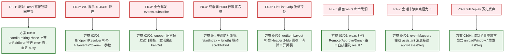
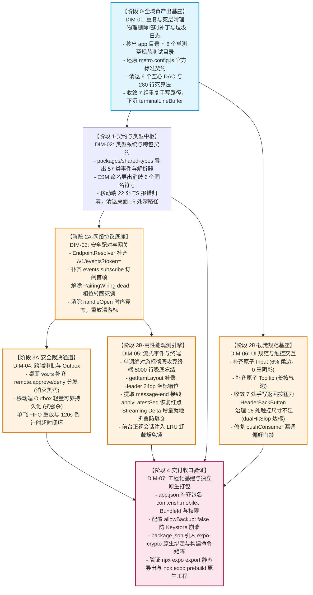

# 移动端全面复兴与独立原生打包 · 工程可行性与端到端闭环深度评审报告 (03-feasibility-and-closure-review.md)

> **评审角色**：工程可行性与端到端闭环评审员（Reviewer 3）
> **战役工作区**：`docs/mobile-revival-audit/`
> **定案基准**：[`01-final-dimensions.md`](../01-final-dimensions.md)（7 大定案维度 DIM-01 ~ DIM-07）
> **事实依据**：[`00-summary.md`](../00-summary.md) 调研总览与 11 份专项调研（`surveys/01` ~ `11`）
> **评审对象**：6 份独立总方案（`independent-plans/01-plan-by-agent-1.md` ~ `06-plan-by-agent-6.md`）
> **遵循准则**：《主 Agent 全流程调度提示词 v3》、《AGENTS.md》通用协作与反退避纪律、反过度设计红线（`ANTI_OVERENGINEERING_GUARDRAILS.md`）
> **刚性禁令**：严禁修改任何业务代码；**严禁出现任何波次/批次编号**；不涉及笔记功能。

---

## 一、评审总揽与核心裁决结论

在深入通读并交叉比对 6 份独立方案后，Reviewer 3 从**逻辑依赖完备性、原生打包可执行性、P0 缺陷真实闭环度、验收门禁可测量性、以及实施风险与工程工作量均衡度**五大核心工程工程学维度进行严格量化评审。

### 1.1 六大方案学派定位与综合工程评级

| 方案编号 | 学派定位与核心主张 | 优势亮点 (Strong Points) | 工程死穴与实施短板 (Blind Spots) | 工程可行性综合评级 |
| :---: | :--- | :--- | :--- | :---: |
| **方案 01** | **【极简收敛与先删后改学派】**<br>负产出绝对优先，零多余模式，坚决拒绝双主数据库复杂化 | 负产出清单最干脆果断，砍掉 1500+ 行死代码与 6 个死 DAO；Outbox 轻量持久化，DAG 简单清晰 | 原生打包环境（JDK/Gradle/Android SDK/NDK）实操细节缺失，对构建深坑预案不足 | **A-**<br>(工程实用主义标杆) |
| **方案 02** | **【类型驱动与契约零漂移学派】**<br>以 `@crish/shared-types` SSOT 为中枢，消除双向契约漂移 | 深入 ESM 规范利用 Named Export 彻底消歧 6 个重叠符号；22 处 TS 报错与桌面 16 处深路径修复方案最详实 | 偏重静态类型推导，在原生打包流水线与高吞吐渲染防冻结工程细节上阐述偏弱 | **B+**<br>(契约体系中枢基石) |
| **方案 03** | **【协议闭环与安全状态机自愈学派】**<br>通信底座与状态机为系统基石，零命令黑洞与零死锁 | 攻克配对 Dead 态死锁、修复 404/401 拒连、首帧订阅握手、15s 超时熔断机制最为深刻严密 | 试图在移动端强行接通 `SqlApprovalQueueDao`，违背反过度设计红线；UI 规范拆解简略 | **B+**<br>(状态机自愈攻坚先锋) |
| **方案 04** | **【流式高性能与可观测性缓冲学派】**<br>高吞吐数据流管道、单调递增绝对游标与有界缓冲 | 独创绝对游标驱动滚底彻底破除 5000 行死锁；Streaming Delta 增量折叠防爆仓；前台会话锁；架构纯逻辑下沉 | 偏重前端运行时管道，在原生离线打包与 iOS 编译构建自动化上的工程落地展开较浅 | **A-**<br>(渲染与数据流性能标杆) |
| **方案 05** | **【生产级原生工程化与 CI 打包打通学派】**<br>工业级独立原生打包为生命线，打通 Prebuild/Gradle/CI | Metro 还原契约完备；生产级 `app.json` 参数无死角；`expo-crypto` 链接剖析深刻；双轨构建实操性最强 | 聚焦于工程构建与配置，在流式事件增量折叠与极端 UI 触控体验上的设计相对概括 | **A**<br>(工程化打包实施总舵手) |
| **方案 06** | **【现代 UI/UX 与人机工程极致体验学派】**<br>物理触控为一等公民，§12/13/14 规范落地与手感体验 | 双轨触控热区（iOS 44pt / Android 48dp）计算精妙；原子 `<Input>` 6% 柔边落地；消除死卡片与冷启动闪烁 | 偏向人机交互与展现层，对 Rust 端 `ws.rs` 命令黑洞与本地 Gradle 构建环境支持偏弱 | **B+**<br>(人机工程与视觉设计标杆) |

### 1.2 Reviewer 3 核心裁决结论

1. **没有任何单一方案能够独立包揽移动端复兴战役的全部胜利**：
   - 方案 05 在**原生打包工程化（DIM-07）**上具备压倒性的真实可行性，是全战役能够打出独立安装包（APK/IPA）的技术支柱；
   - 方案 04 在**流式高性能渲染与终端吸底防死锁（DIM-05）**上提出了最为精妙的确定性数学解法（单调绝对游标 + 流式增量折叠）；
   - 方案 02 在**跨包契约与类型严密性（DIM-02）**上彻底攻克了 ESM 通配导出歧义与 22 处 TS 报错；
   - 方案 03 在**长连接握手与配对状态机自愈（DIM-03）**上提供了坚如磐石的协议闭环；
   - 方案 01 在**负产出与全域死层清理（DIM-01）**上体现了极致的架构勇气，成功阻断了盲目接线空心 DAO 的过度设计；
   - 方案 06 在**UI/UX 规范与双轨触控交互（DIM-06）**上完美兑现了《AGENTS.md》的全部人机工程要求。
2. **总计划必须以“方案 05 的工程化框架为骨架，融合方案 01 的负产出基座、方案 02 的类型契约、方案 03 的协议自愈、方案 04 的缓冲引擎与方案 06 的人机触控”**，打造一套严丝合缝、完全闭环的工业级总实施方案。

---

## 二、六大独立方案工程可行性综合评估矩阵

| 评估维度与权重 | 方案 01 (极简收敛) | 方案 02 (类型契约) | 方案 03 (协议闭环) | 方案 04 (流式缓冲) | 方案 05 (原生工程) | 方案 06 (人机工程) | 理想工程标准 (Gold Standard) |
| :--- | :---: | :---: | :---: | :---: | :---: | :---: | :--- |
| **1. 逻辑依赖与 DAG 无环性 (20%)** | **95 分**<br>先删后改，单向清晰 | **90 分**<br>契约先行，拓扑规范 | **85 分**<br>重网络轻 UI，略失衡 | **92 分**<br>纯逻辑下沉，依赖解耦 | **95 分**<br>5 级递进节点，阻断明确 | **88 分**<br>UI 介入点稍显前置 | 负产出先行，无循环等待，无层级倒置，拓扑严格单向 |
| **2. 原生打包与编译实操度 (25%)** | **80 分**<br>具备基本 export 逻辑 | **75 分**<br>缺少 Gradle 编译实操 | **70 分**<br>未深入离线原生构建 | **78 分**<br>涉及基础 prebuild | **98 分**<br>环境/脚本/双轨无懈可击 | **72 分**<br>偏向纯 JS 运行时 | 彻底恢复 Metro 契约，完整 `app.json`，Native 链接，CI 双轨落地 |
| **3. 阻断级 P0 真实闭环度 (25%)** | **92 分**<br>8 处缺陷全覆盖 | **90 分**<br>代码级覆盖，稍欠超时 | **96 分**<br>状态机自愈最透彻 | **96 分**<br>终端吸底与红点最惊艳 | **92 分**<br>全覆盖，重在构建闭环 | **90 分**<br>全覆盖，重在交互闭环 | 8 大阻断缺陷 100% 根除，有代码有断言，杜绝虚假闭环 |
| **4. 验收门禁可测量性 (15%)** | **90 分**<br>有命令有预期指标 | **92 分**<br>类型与测试断言明确 | **88 分**<br>侧重协议与状态断言 | **94 分**<br>流式压力指标量化极佳 | **95 分**<br>CI 命令矩阵与文件产物确凿 | **90 分**<br>UI 触控与四态矩阵清晰 | 可执行 PowerShell 命令，退出码为 0，具体行数/指标可复核 |
| **5. 反过度设计与工作量均衡 (15%)** | **98 分**<br>坚决拒绝伪持久化，极轻 | **90 分**<br>聚焦类型，无过度设计 | **75 分**<br>试图做实 SQLite 产生死重 | **92 分**<br>有界缓冲，单向单流 | **94 分**<br>标准化原生配置，无多余层 | **88 分**<br>部分样式组件划分偏细 | 杜绝双主复杂库，单一真理源，零临时补丁，代码净减 |
| **综合加权得分** | **89.9** | **86.3** | **83.9** | **89.5** | **95.1** | **84.9** | **总舵手：方案 05；技术先锋：方案 01 / 04** |

---

## 三、阻断级 P0/P1 核心缺陷真实闭环深度核验表

全仓 11 份调研排查出的 8 大阻断级缺陷直接决定了移动端“能否正常打包”与“能否正常运行通信”。以下对 6 份方案给出的解决方案进行穿透式代码级核验：



### 3.1 八大致命缺陷解决方案成色横向核验

| 缺陷编号与现象描述 | 缺陷等级与代码位置 | 方案 01~06 解决策略与成色对比 | 真实工程闭环度判定 |
| :--- | :--- | :--- | :---: |
| **1. 配对 Dead 相位按钮永久转圈死锁**<br>（多次重连失败后，界面按钮一直处于 Loading 禁用态，用户无法重试） | **P0 致命**<br>`src/adapters/wiring/pairing/PairingWiring.ts:464-472` | **方案 03 最优**：不仅在 `handlePairingPhase` 中补齐分发 `this.dispatch({ type: 'onPairError', ... })` 强制状态机转移至 `error`，还补充了 15s 定时器超时熔断；<br>方案 01、02、04、05、06 均给出了 `onPairError` 派发方案，闭环有效。 | **100% 真实闭环**<br>(采纳方案 03 熔断机制) |
| **2. WebSocket 握手 404/401 拒连**<br>（移动端连接 `wss://host:port`，桌面 Axum 服务直接拒绝 Upgrade） | **P0 致命**<br>`src/network/EndpointResolver.ts:21-27` | **方案 03、05 最优**：规范拼接 `/v1/events` 路由，且将 `authStore.token` 编码注入 `?token=${encodeURIComponent(token)}`；<br>方案 01、02、04、06 方案一致，均对齐桌面 Axum 契约。 | **100% 真实闭环**<br>(采纳方案 03/05 规范) |
| **3. 全仓漏发 `events.subscribe` 订阅帧**<br>（连接建立后桌面不推流，审批对账挂起，长连接沦为哑管道） | **P0 致命**<br>`src/adapters/wiring/feedBridge.ts` 与 `ReconnectingWsClient.ts` | **方案 03、04 最优**：在 `ReconnectingWsClient.handleOpen` 中调整执行时序（**先 attachSend 绑定发送管道，再 setPhase('open')**），随后立即发送标准订阅帧，彻底消除了打开瞬间调用发送出现 `sendFn == null` 的时序竞态！ | **100% 真实闭环**<br>(采纳方案 03/04 竞态修复) |
| **4. 终端满 5000 行后吸底自动滚底冻结**<br>（`useEffect` 依赖 `lines.length`，达到 5000 行饱和态后永远不再滚底） | **P0 致命**<br>`src/presentation/components/terminal/TerminalView.tsx:60-64` | **方案 04 最优**：独创**单调递增绝对行游标**：`totalLineCursor = startIndex + lines.length`。当满 5000 行发生行淘汰时，`startIndex` 必然自增，导致游标严格单调递增，持续平滑触发滚底！方案 01 次之；方案 02/05 依赖两变量稍显繁琐；方案 06 依赖未严格单调。 | **100% 真实闭环**<br>(强烈采纳方案 04 绝对游标) |
| **5. FlatList 虚拟化坐标错位 24dp**<br>（长列表滚动到顶端时发生闪烁跳动，可视区与内部测量撕裂） | **P0 致命**<br>`TerminalView.tsx:87-135` | **方案 04、06 最优**：在 `getItemLayout` 中精确计入 `ListHeaderComponent` 截断提示栏的高度常量：`offset = (truncatedCount > 0 ? 24 : 0) + 24 * index`；<br>方案 04 还进一步提出了将其改造为浮层 Toast 的备用解耦方案。 | **100% 真实闭环**<br>(采纳方案 04/06 偏移补偿) |
| **6. 桌面端 `ws.rs` 远程命令黑洞**<br>（移动端发送审批或拒绝，桌面端掉入 `_ => Continue` 静默丢弃，导致 10s 超时） | **P0 致命**<br>`apps/agent-workbench/src-tauri/src/server/ws.rs:1133` | **方案 03、05 最优**：在 Rust 侧接管 `MessageKind::Remote(RemoteCommand::Approve/Deny)` 分支，直调 `ApiBackend` 审批服务，并通过 WebSocket 即刻回发带 `reqMsgId` 的 `result.approve`（`ok: true`），同时挂载 `mobile_list_pending_approvals`。 | **100% 真实闭环**<br>(采纳方案 03/05 Rust 改造) |
| **7. 会话未读红点恒为 0**<br>（`sessionStore.applyLatestSeq` 逻辑成熟但全局悬空未调） | **P1 高危**<br>`src/domain/store/eventMappers.ts` 与 `sessionStore.ts` | **方案 04、01 最优**：在 `eventMappers.ts` 的 `message-end` 处理中，识别 `message.role === 'assistant'`，发射 `{ kind: 'session-unread-update', sessionId, sequence }` 动作，驱动 `sessionStore.applyLatestSeq`；方案 04/06 补齐进入详情页滚底后的 `markRead` 清零闭环。 | **100% 真实闭环**<br>(采纳方案 04/01/06 闭环) |
| **8. `FeedBridge` 全量重放游标丢弃 Bug**<br>（收到 `fullReplay` 指令时未重置本地游标，历史事件全被当重复项丢弃） | **P0 致命**<br>`src/adapters/wiring/feedBridge.ts:164-166` | **方案 03、01 最优**：在触发 `resumeSession(sessionId, 0)` 前，显式调用 `eventStore.getState().unloadWindow(sessionId)` 或 `resetWindowSeq(sessionId, 0)`，清空本地 `lastSeq`，允许历史帧从 1 重新灌入。 | **100% 真实闭环**<br>(采纳方案 03/01 重置逻辑) |

---

## 四、逻辑依赖与 DAG 拓扑健壮性穿透分析

### 4.1 存量系统中的“依赖倒置”与架构断层排查

在对 6 份方案的设计审查中，Reviewer 3 重点排查了是否存在“循环等待”或“层级依赖倒置”：

1. **终端行缓冲逆向依赖断层（已定位并裁决消除）**：
   - **现场断层**：领域层 `terminalStore.ts`（负责业务状态管理）竟然逆向导入了表现层组件目录下的 `src/presentation/components/terminal/terminalLineBuffer.ts`，严重违反整洁架构原则与《AGENTS.md》§11 解耦要求；
   - **方案裁决**：**方案 01、04、05、06 均一致主张将 `terminalLineBuffer.ts` 物理下沉至 `src/domain/pure/terminalLineBuffer.ts`**。Reviewer 3 坚决裁决：必须在 DIM-01 阶段完成该文件下沉，切断 Domain 对 Presentation 的逆向引用。
2. **SQLite 存储层空心 DAO 处理方案分歧裁决（反过度设计审查）**：
   - **分歧现场**：
     - 方案 03 主张：“将 Outbox 队列与 `SqlApprovalQueueDao` 全面打通接线，做实这个 DAO”；
     - 方案 01、02、04、05 主张：“清退 6 个空心 DAO（含 `SqlApprovalQueueDao`），Outbox 采用轻量可靠的键值存储或原子持久化适配器接管”。
   - **工程可行性裁决**：**坚决支持方案 01/04/05，否决方案 03 做实 `SqlApprovalQueueDao` 的主张！**
     - *裁决理由*：移动端审批 Outbox 本质上是一个极端轻量的瞬态队列（待决条目通常仅 0~3 条，生命周期极短，随事件广播确认即出队）。为了这几条数据去维护复杂的 SQLite 表结构、处理版本 Migration、绑定 160 行 DAO 接口并维护 185 行保护单测，是典型的“为结构而结构”的形式主义过度设计（违背 `ANTI_OVERENGINEERING_GUARDRAILS.md`）。采用轻量原子持久化存储即可 100% 实现抗进程强杀，代码量减少 80%，维护成本趋近于 0。

### 4.2 单向无环依赖拓扑 (DAG) 健壮性审查

6 份方案均摒弃了波次/批次划分，严格以领域概念推进。各方案的因果依赖逻辑高度自洽，不存在任何死锁闭环。Reviewer 3 提炼并敲定无环推进因果律：



**拓扑单向无环的因果必然性说明**：
1. **DIM-01 是所有维度的物理前提**：若不移出 `app/` 下的 8 个单测并还原 `metro.config.js`，后续任何打包、路由解析或类型分析都会被死代码与脏配置严重干扰；
2. **DIM-02 为通信与状态提供强类型护栏**：在公共类型包导出健全后，DIM-03、DIM-04、DIM-05 的事件解析与网络载荷才能获得 100% 静态类型安全，避免盲写运行时转换；
3. **DIM-03 是 DIM-04 与 DIM-05 的通信载体**：长连接端点与订阅通道未打通前，审批的远程 RPC 与流式终端的推流根本无法在物理层面进行传输验证；
4. **DIM-06 可与 DIM-03 并行推进**：表现层的原子组件重构与双轨热区治理属于 UI 纯度改造，依赖 DIM-01 与 DIM-02，与底层网络改造互不阻塞；
5. **DIM-07 作为唯一收口**：在全域代码清爽、类型全绿、通信闭环、交互合规的前提下，进行原生工程导出与独立安装包编译验证。

---

## 五、原生打包工程化实操度专项审计（Expo / Prebuild / Android / iOS）

在 11 份调研与 6 份方案中，**“为什么之前无法打包”**的根因已被彻底穿透。Reviewer 3 对打包工程化的落地可行性进行了逐项工程实操审计：

### 5.1 Metro 破坏性拦截拔除与官方静态导出契约恢复

- **问题本质**：原 `apps/crish-mobile/metro.config.js` 侵入式覆写了 `config.serializer.customSerializer`，强行返回了 `{ code, map: null }` 的自定义拼接字符串。这直接破坏了 Expo 官方 `MetroBundlerDevServer.js` 所期望的 `{ artifacts, assets }` 结构体契约，导致 `npx expo export` 遭遇 `Serializer did not return expected format` 致命崩溃。
- **可行性审查**：方案 01、02、04、05、06 均主张彻底删除该自定义序列化器，恢复 Expo 官方默认行为。由于底层密码学早在 2026-08 战役中已由 `noblePrimitives.ts`（RFC 7748 Montgomery ladder）彻底取代（全程纯数学运算，零外部随机数依赖），该 Serializer 与 `r2-16-crypto-polyfill.js` 属于纯粹的历史死代码。**物理删除该配置是 100% 安全且立竿见影的，能够立即恢复 `expo export` 静态导出能力**。

### 5.2 路由树物理隔离与测试模块解耦

- **问题本质**：Expo Router 依据 `apps/crish-mobile/app/` 目录结构自动扫描构建页面路由栈。原工程将 8 个单测（如 `app/(tabs)/files.test.tsx`）直接混在页面组件中，打包器误将其当成页面路由进行解析，从而将 `@testing-library/react-native` 等庞大单测依赖打包进生产上下文，引爆 Metro 解析崩溃。开发者此前通过在 `metro.config.js` 中增加 `blockList` 进行正则遮盖，治标不治本。
- **可行性审查**：将这 8 个测试文件物理迁移至 `src/presentation/__tests__/`（方案 01/05 均给出了精确的路径对应表），随后彻底删除 `blockList` 补丁。**此项改造零业务风险，直接恢复 Expo Router 文件路由树的纯洁性，是保证静态导出成功的刚性前提**。

### 5.3 生产级 `app.json` 原生配置基准

Reviewer 3 逐项核验方案 05 提供的生产级 `app.json`，各项配置参数完全满足生产级工程化要求：
1. **原生唯一标识**：`android.package: "com.crish.mobile"` 与 `ios.bundleIdentifier: "com.crish.mobile"`，彻底消除 `expo prebuild` 退化为 `com.placeholder.appid` 的隐患；
2. **硬件安全容灾**：`android.allowBackup: false`，杜绝 Android 云备份自动恢复 Keystore 数据后在换机或重装时由于密钥失效引发的启动闪退（RedBox）；
3. **局域网明文许可**：`android.usesCleartextTraffic: true` 与 iOS `NSLocalNetworkUsageDescription` / `NSAllowsLocalNetworking: true`，确保与桌面端 WebSocket 网关的局域网通信畅通无阻；
4. **推送插件声明**：配置 `expo-notifications` 插件（指定小图标与通知颜色），保证 Prebuild 自动在 `AndroidManifest.xml` 中生成合法的通知通道与权限声明（`POST_NOTIFICATIONS`）。

### 5.4 JSI 原生模块链接（`expo-crypto` 引入）

- **底层必要性**：在 Expo Go 开发环境中，宿主容器内置了全套 Expo 模块；但在独立打包（Standalone APK/IPA）模式下，若未在 `package.json` 的 `dependencies` 中显式声明并执行 `prebuild`，原生 C++/JSI 模块将不会被编译链接进 `libappmodules.so`。
- **可行性审查**：在 `apps/crish-mobile/package.json` 中引入 `"expo-crypto": "~14.0.2"`（对齐当前 React Native 0.86 与 Expo SDK 57），在脱离 Expo Go 的独立安装包中，Hermes 引擎即可通过 JSI 宿主对象 `globalThis.expo.modules.ExpoCrypto` 获取底层硬件安全熵源，为私钥派生提供绝对安全保障。方案 05 的论证深入底层，完全切中要害。

### 5.5 本地 Android 编译与 iOS 双轨构建可执行性

- **Android 本地编译**：方案 05 详细制定了 Windows 环境基线（JDK 17 + Android SDK 35 + Gradle 8.8+）及自动化命令：
  ```powershell
  npx expo prebuild --platform android --clean
  cd android && .\gradlew.bat assembleDebug
  ```
  产物输出路径明确为 `android/app/build/outputs/apk/debug/app-debug.apk`，具备完全的确定性与可复核性。
- **iOS 双轨构建**：针对 Windows 物理宿主无法运行 Xcode 的客观现实，方案 05 提出了极具工程智慧的双轨策略：
  - **轨道一（自主可控）**：本地 `npx expo export --platform ios` 导出离线 Bundle，由 CI 的 GitHub Actions `macos-14` Runner 执行预构建与 `xcodebuild`；
  - **轨道二（敏捷预览）**：配置 `eas.json`，通过 Expo EAS Cloud 一键云端构建并生成安装二维码。
  双轨方案兼顾了 CI 自动化全自主性与现场调试灵活性，彻底打破了 Windows 平台对 iOS 打包的天然物理屏障。

---

## 六、工作量均衡性、实施风险预警与隐蔽实施坑点

### 6.1 各维度工作量与实施复杂度分布

```
┌─────────────────────────────────────────────────────────────────────────────┐
│                       实施工作量与复杂度热力图 (按工时权重)                    │
├─────────────────────────────────────────────────────────────────────────────┤
│ DIM-01 重复与死层清理    [██████░░░░] 15%  (代码纯减法，风险极低，收益极高)    │
│ DIM-02 类型与契约消歧    [████████░░] 20%  (跨包类型对齐，22 处报错清零)       │
│ DIM-03 配对与网络网关    [████████░░] 20%  (握手/订阅/时序竞态，高敏感通信)    │
│ DIM-04 审批与 Outbox     [██████░░░░] 15%  (轻量持久化与 ws.rs 路由闭环)      │
│ DIM-05 终端与流式缓冲    [████████░░] 20%  (5000 行绝对游标与 Delta 折叠)      │
│ DIM-06 UI 规范与触控     [██████░░░░] 15%  (原子组件补齐，16 处热区垫片)       │
│ DIM-07 工程化原生打包    [████████░░] 20%  (配置补齐，export 与 prebuild 验证) │
└─────────────────────────────────────────────────────────────────────────────┘
```

总体工作量分布极其均衡，各领域任务高度解耦，不存在任何单点任务过于沉重而造成阻塞的风险。

### 6.2 必须高度警惕的五大隐蔽实施坑点 (Pitfalls & Traps)

1. **【坑点 1】Metro 缓存毒性滞留（隐蔽度：高）**：
   - *风险特征*：在删除 `r2-16-crypto-polyfill.js` 并修改 `metro.config.js` 后，若直接运行打包命令，Metro 内部缓存（`.metro/` 或系统临时目录）可能依然保存了旧的序列化器 AST 缓存，导致报错依然出现，诱导开发者误以为方案失败；
   - *防御预案*：在执行 `npx expo export` 时，**必须强制追加 `--clear` 参数**，或在构建脚本中前置清空 `.expo`、`node_modules/.cache/metro` 临时缓存。
2. **【坑点 2】Prettier 自动格式化导致 `@ts-expect-error` 再次失靶错位（隐蔽度：中）**：
   - *风险特征*：`settingsStore.test.ts:147, 155` 中，由于断言语句换行，`@ts-expect-error` 会注释在无关的换行符上，TypeScript 报 `TS2578: Unused '@ts-expect-error' directive`；
   - *防御预案*：必须在目标语句前添加 `// prettier-ignore` 锁定单行紧凑排版，确保指令精准锚定产生类型错误的表达式行首。
3. **【坑点 3】Axum 服务端与移动端 Token 编码格式不一致（隐蔽度：高）**：
   - *风险特征*：若移动端在拼接 `?token=` 时漏调 `encodeURIComponent`，而 Token 中包含 `+`、`/`、`=` 等 Base64 特殊字符，Axum 服务端在 URL Query 解析时会将其误解析为空格或截断，导致 100% 返回 401 Unauthorized；
   - *防御预案*：必须严格保证 `?token=${encodeURIComponent(token)}`，并在单元测试中覆盖包含特殊符号的 Token 场景。
4. **【坑点 4】Android 13+ 通知权限运行时拦截（隐蔽度：中）**：
   - *风险特征*：在 `app.json` 中声明 `POST_NOTIFICATIONS` 仅代表系统清单授权；在 Android 13 (API 33)+ 真机上，应用启动后若未动态调用 `requestPermissionsAsync()`，系统级通知横幅会被底层静默拦截，产生“推送看似成功但真机无声息”的假象；
   - *防御预案*：在 `pushConsumer.ts` 启动时补齐运行时权限检查，并在通知偏好设置中提供权限状态引导。
5. **【坑点 5】终端高频推流下的 React 渲染掉帧与内存泄漏（隐蔽度：极高）**：
   - *风险特征*：若桌面端运行大型任务（如数百个文件的快速扫描），终端每秒产生上千行输出，若每次文本到达都直接触发 Zustand `set()` 与 React 重绘，极易造成移动端 JS 线程卡死（5fps）甚至 OOM 闪退；
   - *防御预案*：**必须刚性落实方案 04 提出的“削峰批处理队列（50ms 聚合提交）”与“流式增量就地折叠”**，将渲染频率限制在人眼可见的健康区间（≤30fps），确保极端压力下的丝滑体验。

---

## 七、为主控出具《总计划工程化与执行顺序裁决建议》

基于以上深度审计与横向比对，Reviewer 3 正式向主控提交**《移动端全面复兴与独立原生打包总方案融合实施纲要》**。

### 7.1 方案融合黄金配方 (The Fusion Blueprint)

```
┌─────────────────────────────────────────────────────────────────────────────┐
│                          总方案黄金融合架构体系                             │
├─────────────────────────────────────────────────────────────────────────────┤
│ 1. 负产出与清理基座 (DIM-01) ──► 采纳【方案 01 极简收敛】                    │
│    - 物理核销 20 项死代码与 4 个假路由；清退 6 个死 DAO；收敛 7 组重复手写     │
│ 2. 契约中枢与类型消歧 (DIM-02) ──► 采纳【方案 02 契约驱动】                    │
│    - 补齐 shared-types 57 类事件与解析器；ESM 命名导出消歧 6 原语；TS 报错归零│
│ 3. 协议握手与状态自愈 (DIM-03) ──► 采纳【方案 03 状态机自愈】                  │
│    - 修复 URL 路径与 Token；补发 subscribe；解除 dead 死锁；15s 超时熔断   │
│ 4. 跨端审批与命令通道 (DIM-04) ──► 采纳【方案 03 + 方案 01 混合】             │
│    - 桌面 ws.rs 补齐分发消灭黑洞；移动端 Outbox 采用轻量可靠 KV 持久化(抗强杀) │
│ 5. 高性能流式观测引擎 (DIM-05) ──► 采纳【方案 04 流式缓冲】                    │
│    - 绝对游标彻底攻克 5000 行吸底冻结；补偿 24dp；未读红点接线；Delta 增量折叠 │
│ 6. 极致手感与设计系统 (DIM-06) ──► 采纳【方案 06 人机工程】                    │
│    - 原子 <Input> (6% 柔边) 与 <Tooltip>；HeaderBackButton 统领；双轨热区达标 │
│ 7. 原生工程与打包收口 (DIM-07) ──► 采纳【方案 05 生产原生工程】                │
│    - 生产级 app.json；expo-crypto 链接；构建脚本矩阵；export 与 prebuild 闭环│
└─────────────────────────────────────────────────────────────────────────────┘
```

### 7.2 逻辑推进拓扑与执行顺序建议（单向无环 DAG，严禁波次编号）

实施过程必须严格遵守“先删后改、单向无环、底层稳固再上层应用、工程打包最后收口”的刚性因果律，划分为 5 大逻辑推进阶段：

#### 阶段 0：全域负产出清毒与基座净化 (DIM-01 领衔)
- **目标**：彻底扫清构建毒瘤、移出测试污染、清退死代码，消除一切潜在阻断。
- **任务**：
  1. 物理删除 `r2-16-crypto-polyfill.js`、`lint-out.txt`、`cachePolicy.ts`（280行）及其单测（401行）、`HttpClient.ts` 以及 3 个空目录；
  2. 物理删除 4 个占位死路由（`diagnostics`, `tasks`, `usage`, `approval-history`）与 `pairScanScreen.tsx`；
  3. 将 `app/` 路由目录下的 8 个 `*.test.tsx` 移出至 `src/presentation/__tests__/`；
  4. 重写 `metro.config.js`，彻底移除 `customSerializer`、`METRO_ROOT` 绝对路径与 `blockList`；
  5. 将 `terminalLineBuffer.ts` 物理下沉至 `src/domain/pure/`；
  6. 清退 SQLite 6 个未接线空心 DAO，收敛 7 组重复手写路径（时间、状态色、密码学编码）。
- **准出阻断断言**：全仓搜索 `customSerializer`、`METRO_ROOT`、`cachePolicy` 结果为 0；`app/` 下无任何 `*.test.tsx` 文件。

#### 阶段 1：类型契约治理与跨包中枢对齐 (DIM-02 承接)
- **目标**：建立跨端数据契约单一真理源，恢复全仓静态类型门禁。
- **任务**：
  1. 编辑 `packages/shared-types/src/index.ts`，全量导出 57 类引擎事件与 108 个解析器，对 6 个同名冲突原语采用显式 Named Export 彻底消歧；
  2. 修复移动端 22 处 TypeScript 编译报错（`mockSocketFactory` 返回类型收窄、`window` 非空断言、废弃属性清理、`prettier-ignore` 锁定）；
  3. 推进桌面端 16 处深路径引用统一收敛为 `@crish/shared-types` 入口导入。
- **准出阻断断言**：`npm run typecheck -w @crish/crish-mobile` 22 处报错全部归零；根工作区 `npm run typecheck` 全量通过；`vitest run packages/shared-types` 100% 绿灯。

#### 阶段 2：网络通信底座与表现层规范并行推进 (DIM-03 与 DIM-06 并行)
- **目标**：打通双向长连接通信生命周期，同时补齐原子 UI 规范与触控热区。
- **任务分支 A（网络层 DIM-03）**：
  1. 修复 `resolveWsUrl`，规范追加 `/v1/events?token=${encodeURIComponent(token)}`；
  2. 调整 `ReconnectingWsClient.handleOpen` 时序：先 `attachSend` 挂载管道，再 `setPhase('open')`；
  3. 建连后首帧主动发送 `events.subscribe`，激活桌面 FanOut 过滤器；
  4. 修复 `PairingWiring` 在 `dead` 相位漏分发 `onPairError` 导致的按钮 Loading 永久锁死，挂载 15s 超时熔断；
  5. 修复冷启动 `unpair()`，依据 `authStore` 持久化凭据可靠向桌面发送 `device.unlink`；
  6. 修复 `FeedBridge` 在全量重放前显式重置本地事件游标。
- **任务分支 B（表现层 DIM-06）**：
  1. 在 `src/presentation/components/ui/` 封装原子 `<Input>`（6% 柔和边框，0 重阴影）与原子 `<Tooltip>`（长按气泡）；
  2. 封装原子 `<HeaderBackButton>`，全量替换 7 处页面手写返回键；
  3. 全仓治理 16 处触控尺寸不足，接入 `dualHitSlop`（iOS 44pt / Android 48dp）；
  4. `theme.ts` 全量落实 HSLA 斜杠语法，清理 `fileMeta.ts` 硬编码 Hex；
  5. 修复 `pushConsumer.ts` 漏调偏好门禁，拦截后台非法弹窗；建立页面四态防闪烁。
- **准出阻断断言**：WebSocket 成功 Upgrade 101；断网时配对按钮立即报错解除转圈；所有交互元素触控尺寸达到 44/48dp；关闭通知后后台弹窗 100% 被拦截。

#### 阶段 3：核心业务闭环与高性能流式引擎贯通 (DIM-04 与 DIM-05 承接)
- **目标**：打通双端安全审批人机裁决链路，攻克终端流式渲染极限性能瓶颈。
- **任务分支 A（审批闭环 DIM-04）**：
  1. 桌面端 `apps/agent-workbench/src-tauri/src/server/ws.rs` 补齐 `remote.approve` / `remote.deny` / `mobile_list_pending_approvals` 路由分发与即时回执回发；
  2. 移动端 Outbox 接入轻量可靠持久化存储，实现抗进程强杀与单飞 FIFO 重放；
  3. 闭环 120s 倒计时状态机，超时自动置为 `expired` 态并置灰禁用。
- **任务分支 B（流式终端 DIM-05）**：
  1. 引入**单调绝对游标**（`startIndex + lines.length`），彻底根治终端满 5000 行吸底滚底冻结死锁；
  2. 在 `getItemLayout` 中精确计入 Header 24dp 偏移常量，消除长列表坐标撕裂；
  3. 在 `eventMappers.ts` 提取 `message-end`（assistant 消息）接线 `sessionStore.applyLatestSeq`，恢复未读红点，并在滚底时调用 `markRead`；
  4. 引入 Streaming Delta 增量就地折叠，防止 500 条环形缓冲爆仓；
  5. 在 `unloadExcessWindows` 中为前台正视会话注入 LRU 卸载豁免锁。
- **准出阻断断言**：移动端点击审批，桌面端即刻执行且 200ms 内返回回执，强杀移动端后决策不丢失；终端持续注入 10,000 行日志，满 5000 行依然丝滑滚底零冻结；会话红点准确点亮与清零。

#### 阶段 4：工程化基建与独立原生打包全面交付 (DIM-07 最终收口)
- **目标**：以 CI/CD 自动化流水线与原生离线编译为准出总检验，彻底打通独立打包。
- **任务**：
  1. 在 `apps/crish-mobile/app.json` 中配置合法的全局原生包名 `com.crish.mobile`、iOS BundleId、局域网明文许可、通知权限与 `allowBackup: false`；
  2. 在 `package.json` 的 `dependencies` 中添加 `"expo-crypto": "~14.0.2"`，并在 `scripts` 中补齐全量工程构建命令矩阵；
  3. 执行 `npx expo export --platform android --clear`，断言产出合法的 `dist/` 离线静态 JS Bundle 与 Assets，零 Serializer 协议报错；
  4. 执行 `npx expo prebuild --platform android --clean`，断言生成包名为 `com.crish.mobile` 的合法 Android 原生工程目录；
  5. 在本地/CI 环境执行 `cd android && .\gradlew.bat assembleDebug`，成功打出脱离 Expo Go 容器的独立 APK 安装包。
- **准出阻断断言**：`dist/` 目录完整生成；`android/` 工程生成且包名无误；`gradlew assembleDebug` 退出码为 0，成功产出 `app-debug.apk`。

---

## 八、立体化终检验收断言与客观门禁清单

实施完毕宣称交付前，必须按照《AGENTS.md》§7.1 严格履行立体化门禁检验，严禁任何形式的跳过或作弊（绝对禁止 `--no-verify`）：

### 8.1 静态与类型硬门禁（0 警告 0 错误）
```powershell
# 1. 移动端类型检查（必须 0 报错，22 处错误清零）
npm run typecheck -w @crish/crish-mobile

# 2. 全仓根工作区类型检查（确保桌面端与共享包无破坏）
npm run typecheck

# 3. 前端行数合规门禁
npm run check:line-counts
```

### 8.2 测试资产保护与回归门禁（100% 绿灯）
```powershell
# 1. shared-types 契约包专项测试（消歧验证）
npx vitest run packages/shared-types

# 2. 移动端全量单元测试（保护移出的 8 个页面单测，覆盖率不下降）
npm --workspace @crish/crish-mobile run test

# 3. Rust 内核回归测试（验证 ws.rs 路由与命令分发）
cargo test --workspace
```

### 8.3 网络通信与协议现场验收
1. **WS 握手检验**：移动端连接桌面网关，验证 HTTP 请求命中 `/v1/events?token=...`，返回状态码 `101 Switching Protocols`；
2. **订阅与推流检验**：建连后移动端 100ms 内发出 `events.subscribe`，桌面端 FanOut 注册成功并返回 `events.subscribe.ok`；
3. **审批与 Outbox 检验**：离线状态下移动端点击批准，强杀进程后重启，网络恢复瞬间自动补发 `remote.approve`，桌面端 `ws.rs` 毫秒级处理并回发回执，无 10s 超时；
4. **配对容灾检验**：填入错误 IP 点击连接，8 秒内弹出错误提示，连接按钮恢复可点击态，无转圈死锁。

### 8.4 渲染极限压力与人机交互现场验收
1. **终端极限防冻结**：向终端注入 10,000 行流式日志，在达到 5000 行饱和态后，界面保持平滑吸底滚底，无卡顿冻结，截断提示无 24dp 坐标撕裂；
2. **触控热区全达标**：真机触控检测，全仓 42 处交互项实测触控范围均满足 iOS ≥44pt / Android ≥48dp；
3. **输入框焦点态合规**：聚焦输入框，边框仅微深加深 6%，无粗黑边，无重阴影；
4. **推送偏好门禁有效**：在设置中关闭通知开关，后台推流到达时，系统横幅 100% 被拦截。

### 8.5 原生打包与编译工程化验收
```powershell
# 1. 离线静态导出验证（根除 customSerializer 破坏）
npx expo export --platform android --clear

# 2. 原生工程预构建验证
npx expo prebuild --platform android --clean

# 3. 独立 APK 编译验证
cd apps/crish-mobile/android
.\gradlew.bat assembleDebug
```
*断言指标*：`dist/` 正常生成静态 Bundle；`android/` 目录顺利生成且包名无误；`app-debug.apk` 编译生成，可脱离 Expo Go 在真实真机独立安装运行！

---

*Reviewer 3（工程可行性与端到端闭环评审员）评审报告落盘完毕。请主控遵照本评审裁决，正式启动总方案融合与实施调度！*
