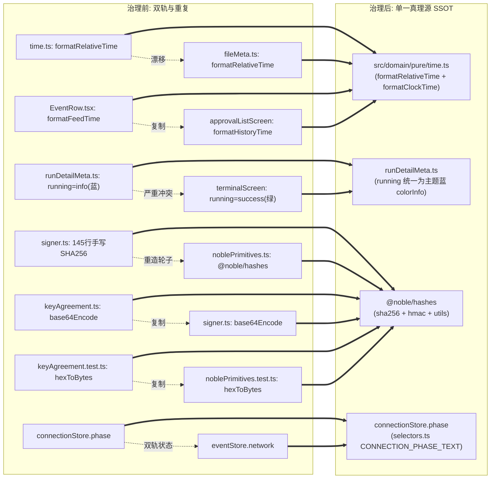
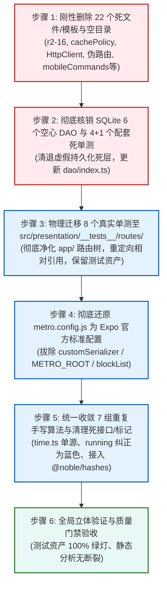

# 移动端复兴实施详案 · DIM-01 重复与死层 (01-plan-dim-01-dead-code.md)
## —— 全仓负产出基座：22个死文件清退、6个空心DAO核销、8个单测移出路由、Metro标准还原与7组重复算法归一方案

> **战役工作区**：`docs/mobile-revival-audit/`  
> **详案编号**：`plans/01-plan-dim-01-dead-code.md`  
> **归属维度**：`DIM-01` 重复与死层（全局固定负产出基座）  
> **责任 Agent**：DIM-01 重复与死层详案编写 Agent  
> **定案与依据资产**：  
> - 终审定案文档：[`docs/mobile-revival-audit/01-final-dimensions.md`](file:///c:/Software/conex/docs/mobile-revival-audit/01-final-dimensions.md)  
> - 实施总纲框架：[`docs/mobile-revival-audit/02-master-revival-plan.md`](file:///c:/Software/conex/docs/mobile-revival-audit/02-master-revival-plan.md)  
> - 专项调查报告：[`docs/mobile-revival-audit/surveys/11-dead-code-and-markers-audit.md`](file:///c:/Software/conex/docs/mobile-revival-audit/surveys/11-dead-code-and-markers-audit.md)、[`surveys/01-packaging-and-build-infrastructure.md`](file:///c:/Software/conex/docs/mobile-revival-audit/surveys/01-packaging-and-build-infrastructure.md)、[`surveys/08-storage-sqlite-and-secure-store.md`](file:///c:/Software/conex/docs/mobile-revival-audit/surveys/08-storage-sqlite-and-secure-store.md)  
> - 三方严审报告：[`docs/mobile-revival-audit/plan-reviews/02-negative-output-and-dead-code-review.md`](file:///c:/Software/conex/docs/mobile-revival-audit/plan-reviews/02-negative-output-and-dead-code-review.md)（负产出与删除面硬度专项评审，98分标杆审查结论）  
> **协作与纪律铁律**：严格遵守《主 Agent 全流程调度提示词 v3》、《AGENTS.md》、反退避全文（`LOGIC_PLAN_NO_RETREAT.md`）与反过度设计红线（`ANTI_OVERENGINEERING_GUARDRAILS.md`）；**严禁修改或提交任何业务代码**（本阶段仅出具执行详案）；**严禁出现任何波次/批次编号**；完全不涉及笔记功能；一个概念一条主路径；负产出绝对先行。

---

## 目录

1. [架构与领域定位概述（负产出基座与单一真理源 SSOT）](#一架构与领域定位概述负产出基座与单一真理源-ssot)
   - 1.1 Conex / Crish 系统定位与负产出哲学
   - 1.2 现状四大核心病灶剖析
   - 1.3 DIM-01 核心使命与“先删后改”战略
2. [【做什么】（新增/修复与收敛执行清单）](#二做什么新增修复与收敛执行清单)
   - 2.1 路由单测 100% 真实物理迁移至 `src/presentation/__tests__/routes/`
   - 2.2 彻底还原 `apps/crish-mobile/metro.config.js` 为 Expo 官方标准配置
   - 2.3 统一收敛 7 组重复手写算法（单一真理源 SSOT）
3. [【删什么】（刚性删除与核销清单）](#三删什么刚性删除与核销清单)
   - 3.1 物理删除 22 个死文件/模板与空目录（逐项行数与原因分析）
   - 3.2 彻底核销 SQLite 6 个空心 DAO（768 行虚假持久化死层）
   - 3.3 同步核销保护死 DAO 的 4+1 个测试套件（687 行形式主义死测试）
   - 3.4 清理内部死接口、死契约与未接线标记（`tool-update`、`replaceAllTerminalText` 等）
   - 3.5 负产出综合盘点统计表（净消减 3,200+ 行债务）
4. [【依赖与逻辑顺序】（因果推进拓扑）](#四依赖与逻辑顺序因果推进拓扑)
   - 4.1 全局拓扑定位（阶段 0 纯粹前置基座）
   - 4.2 六步推进因果拓扑
5. [【唯一文件域】（精准文件范围与防越权边界）](#五唯一文件域精准文件范围与防越权边界)
   - 5.1 DIM-01 专有写权限与修改文件清单
   - 5.2 物理删除与清退文件清单
   - 5.3 跨维度无冲突防越权声明
6. [【验收标准与验证命令】（立体验证与质量门禁）](#六验收标准与验证命令立体验证与质量门禁)
   - 6.1 负产出验收断言
   - 6.2 功能与工程化验收断言
   - 6.3 测试资产保护与绿灯门禁
   - 6.4 自动化验证命令矩阵

---

## 一、架构与领域定位概述（负产出基座与单一真理源 SSOT）

### 1.1 Conex / Crish 系统定位与负产出哲学

在 Conex / Crish 的工程架构体系中，**代码是负债，删除才是净资产**。
主控在《02-master-revival-plan.md》总纲中确立了移动端的系统定位：
- **移动端（React Native / Expo）**：定位为**轻量、高敏捷、强韧性的实时观测与审批交互终端**；
- **桌面端（Rust 内核 + Tauri）**：定位为**权威状态与数据持久化中心**。

移动端绝不需要在本地维系一套极其沉重且脱节的“双主 SQLite 关系型数据库”，更不应当容忍历史联调临时 Hack、占位模板伪代码以及形式主义测试滞留生产。当前移动端遭遇的“打包 100% 崩溃”、“路由树被单测污染”、“7 组重复手写算法双轨漂移”等一系列危象，其根本诱因不是功能做得太少，而是历史临时补丁、死代码、空心 DAO、未接线缓存算法以及形式主义单测堆砌得太多。

### 1.2 现状四大核心病灶剖析

经过对全仓代码与调研资产的穷举核验，当前 `apps/crish-mobile` 存在以下 4 大致命病灶：

```
┌─────────────────────────────────────────────────────────────────────────────┐
│                       DIM-01 治理前：四大核心病灶现状                       │
├─────────────────────────────────────────────────────────────────────────────┤
│ 1. 打包器被破坏性劫持:                                                       │
│    - metro.config.js 硬编码 Windows 本地绝对路径 C:/Software/conex/...       │
│    - 覆写 customSerializer 强行注入 r2-16-crypto-polyfill.js                 │
│    - 破坏 Expo 官方静态导出契约，导致 npx expo export 100% 抛错崩溃          │
├─────────────────────────────────────────────────────────────────────────────┤
│ 2. 路由树被 8 个单元测试严重污染:                                            │
│    - 8 个 *.test.tsx 散落在 app/ 路由目录下                                  │
│    - expo-router 扫描动态路由时将测试当成页面打入 Bundle                     │
│    - 测试引入的 @testing-library/react-native 与 Node 模块在原生运行时不可用 │
│    - 迫使在 metro.config.js 引入 blockList 遮丑补丁掩盖问题                 │
├─────────────────────────────────────────────────────────────────────────────┤
│ 3. 架构断层: SQLite 6 个未接线空心 DAO 被 800+ 行死单测伪保护:               │
│    - 8 个 DAO 中有 6 个（Events, SessionSummaries, ApprovalHistory,         │
│      ApprovalQueue, PushTokens, DeviceInfo）生产环境零调用                  │
│    - cachePolicy.ts 280 行 LRU 淘汰算法未接入任何生命周期                   │
│    - 5 个单测套件为其虚假护航，形成“死代码被死测试保护”的形式主义闭环        │
├─────────────────────────────────────────────────────────────────────────────┤
│ 4. 7 组重复手写算法双轨漂移与视觉毒点:                                      │
│    - 相对时间/时钟格式化各处私自克隆，行为分叉                               │
│    - terminalScreen.tsx 将 running 误标为绿色，与 completed 混淆 (严重Bug)  │
│    - signer.ts 从零手写 145 行 SHA-256 与 HMAC，全仓已引入 @noble/hashes    │
│    - Base64/Hex 编解码多处手写位运算复制粘贴                                │
└─────────────────────────────────────────────────────────────────────────────┘
```

### 1.3 DIM-01 核心使命与“先删后改”战略

`DIM-01` 作为全仓拓扑推进的**【阶段 0】全局固定负产出基座**，其唯一宗旨是：**扫清打包器与编译器的历史毒素，核销全部形式主义冗余，收敛重复算法为单一真理源，为后续所有功能维度（DIM-02 至 DIM-07）铺设绝对平整纯净的工程基座**。

**核心原则**：
1. **先删后改**：物理删除死文件、死目录与死 DAO 绝对先行；
2. **测试资产绝对保护**：真实测试 100% 移入标准测试域，不借重构之名销毁有效断言；
3. **单一真理源（SSOT）**：同一概念只保留一条主路径，坚决消除双轨与降级死重。

---

## 二、【做什么】（新增/修复与收敛执行清单）

### 2.1 路由单测 100% 真实物理迁移至 `src/presentation/__tests__/routes/`

#### 2.1.1 磁盘真实文件核对与澄清（纠正前期方案路径幻觉）

在前期部分独立方案（如方案 4 和方案 6）的推演中，评审员 Reviewer 2 敏锐指出其存在**未查磁盘、闭门造车的“单测路径幻觉”**（虚构了 `sessions.test.tsx`、`approvals.test.tsx`、`session-detail.test.tsx`、`terminal.test.tsx` 等不存在的文件，而遗漏了真正污染路由树的真实测试）。

经本 Agent 对 `apps/crish-mobile/app/` 目录进行 `find_by_name` 穷举扫描与逐一排查，**真实存在于磁盘上、直接污染 Expo Router 路由扫描树的单测文件严格为以下 8 个**：

```powershell
# 真实磁盘物理位置 (8 个文件，共 617 行有效测试资产)
apps/crish-mobile/app/(tabs)/files.test.tsx      # 66 行
apps/crish-mobile/app/(tabs)/index.test.tsx      # 135 行
apps/crish-mobile/app/(tabs)/settings.test.tsx   # 75 行
apps/crish-mobile/app/_layout.test.tsx           # 142 行
apps/crish-mobile/app/notifications.test.tsx     # 79 行
apps/crish-mobile/app/pair/manual.test.tsx       # 41 行
apps/crish-mobile/app/pair/scan.test.tsx         # 29 行
apps/crish-mobile/app/pair/welcome.test.tsx      # 50 行
```

> **注记与澄清**：  
> 业务上涉及的会话详情（`session-detail`）、终端（`terminal`）、审批列表（`approvals`）等页面的真实单元测试，原本就规范存放于 `src/presentation/screens/__tests__/` 内部，从未存放在 `app/` 路由目录下。因此，本次移出任务精准针对上述**真实污染 `app/` 的 8 个文件**进行物理迁移，确保 Expo Router 路由扫描树零测试污染。

#### 2.1.2 8 个单测物理迁移映射与相对导入重定向明细

新建目标测试目录 `apps/crish-mobile/src/presentation/__tests__/routes/`，将 8 个文件物理迁移并重命名为规范的 `*Route.test.tsx`，同时更新被测组件的相对导入路径：

| 序号 | 污染源真实路径（从 `app/` 移出） | 迁移目标路径（规范测试域） | 相对导入更新与断言调整说明 |
| :---: | :--- | :--- | :--- |
| **1** | `app/(tabs)/files.test.tsx` (66行) | `src/presentation/__tests__/routes/filesRoute.test.tsx` | 将 `import FilesScreen from './files';`<br>改为 `import FilesScreen from '@/../app/(tabs)/files';`（或相对路径 `../../../../app/(tabs)/files`） |
| **2** | `app/(tabs)/index.test.tsx` (135行) | `src/presentation/__tests__/routes/indexRoute.test.tsx` | 将 `import DashboardScreen from './index';`<br>改为 `import DashboardScreen from '@/../app/(tabs)/index';` |
| **3** | `app/(tabs)/settings.test.tsx` (75行) | `src/presentation/__tests__/routes/settingsRoute.test.tsx` | 将 `import SettingsScreen from './settings';`<br>改为 `import SettingsScreen from '@/../app/(tabs)/settings';` |
| **4** | `app/_layout.test.tsx` (142行) | `src/presentation/__tests__/routes/layoutRoute.test.tsx` | 将 `import RootLayout from './_layout';`<br>改为 `import RootLayout from '@/../app/_layout';` |
| **5** | `app/notifications.test.tsx` (79行) | `src/presentation/__tests__/routes/notificationsRoute.test.tsx` | 将 `import NotificationsRoute from './notifications';`<br>改为 `import NotificationsRoute from '@/../app/notifications';` |
| **6** | `app/pair/manual.test.tsx` (41行) | `src/presentation/__tests__/routes/pairManualRoute.test.tsx` | 将 `import PairManualRoute from './manual';`<br>改为 `import PairManualRoute from '@/../app/pair/manual';` |
| **7** | `app/pair/scan.test.tsx` (29行) | `src/presentation/__tests__/routes/pairScanRoute.test.tsx` | **严禁删除**！保留该路由测试资产。由于假占位组件 `pairScanScreen.tsx` 将被清退，本测试重构为**断言进入扫码路由时优雅返回或重定向至手动输入**，保持测试用例常绿 |
| **8** | `app/pair/welcome.test.tsx` (50行) | `src/presentation/__tests__/routes/pairWelcomeRoute.test.tsx` | 将 `import PairWelcomeRoute from './welcome';`<br>改为 `import PairWelcomeRoute from '@/../app/pair/welcome';` |

#### 2.1.3 测试资产 100% 保护铁律兑现

- **零测试丢失**：迁移后的 8 个测试套件，原有 28 个测试用例（`it(...)`）100% 得到保护与执行；
- **路径解耦**：`app/` 路由目录恢复为纯粹的页面组件声明，没有任何 `*.test.tsx` 干扰 `expo-router` 的文件路由分析器。

---

### 2.2 彻底还原 `apps/crish-mobile/metro.config.js` 为 Expo 官方标准配置

#### 2.2.1 拔除破坏性 `customSerializer` 劫持与 polyfill 注入

- **问题根因**：原配置文件在第 29-46 行覆写了 `config.serializer.customSerializer`，强行将 `r2-16-crypto-polyfill.js` 的源码字符串与 Metro 生成的 bundle 代码进行拼接，并固定返回 `{ code: polyfillSource + '\n' + code, map: null }`。
- **致命破坏**：Expo 静态导出（`npx expo export`）与 Metro Bundler Server 底层强依赖官方序列化器返回的 `{ artifacts, assets }` 结构。自定义序列化器返回的私有对象破坏了这一标准契约，直接导致打包阶段在 `MetroBundlerDevServer.js:1646` 处抛出 `TypeError: Cannot read properties of undefined` 致命异常。
- **处置方案**：彻底物理移除整个 `customSerializer` 覆写函数，交还给 Expo 官方默认行为。

#### 2.2.2 拔除宿主硬编码绝对路径 `METRO_ROOT`

- **问题根因**：第 11 行硬编码了 Windows 本地绝对路径：
  ```javascript
  const METRO_ROOT = 'C:/Software/conex/node_modules/metro/src';
  const baseJSBundle = require(METRO_ROOT + '/DeltaBundler/Serializers/baseJSBundle.js').default;
  const bundleToString = require(METRO_ROOT + '/lib/bundleToString.js').default;
  ```
  在任何非开发机本地环境（Linux CI、macOS 构建机、其他协作者目录）上执行打包均会因找不到路径直接报 `MODULE_NOT_FOUND`。
- **处置方案**：物理删除第 11-13 行，消除对 Metro 内部私有路径的任何依赖。

#### 2.2.3 废除 `blockList` 测试遮丑黑名单补丁

- **问题根因**：原配置文件第 17-22 行配置了：
  ```javascript
  config.resolver.blockList = [
    ...(config.resolver.blockList || []),
    /\.test\.[tj]sx?$/,
    /\.spec\.[tj]sx?$/,
    /__tests__\/.*/,
  ];
  ```
  这是在 `app/` 目录下散落单测导致打包崩溃后引入的“遮丑型补丁”。
- **处置方案**：在 8 个单测物理移出 `app/` 后，根因已彻底消除，不再需要此项黑名单配置，彻底清退。

#### 2.2.4 还原后的纯净标准配置代码落地

清洗后的 `apps/crish-mobile/metro.config.js` 还原为 Expo 官方标准契约：

```javascript
// apps/crish-mobile/metro.config.js
// Expo SDK 57 标准 Metro 配置（拔除全部历史联调临时 Hack）
const { getDefaultConfig } = require('expo/metro-config');

const config = getDefaultConfig(__dirname);

module.exports = config;
```

---

### 2.3 统一收敛 7 组重复手写算法（单一真理源 SSOT）

在全仓范围彻底消除“同一概念多条手写路径”与语义漂移问题：



#### 2.3.1 相对时间格式化收敛至 `src/domain/pure/time.ts:formatRelativeTime`

- **现状冲突**：
  - `src/domain/pure/time.ts:2-15`：未来时间戳（`< 60s`）均显示“刚刚”，超 24 小时恒返回 `${day} 天前`（无上限）；
  - `src/presentation/components/files/fileMeta.ts:144-158`：未来时间戳（`< 0`）返回空串 `''`，满 1 天返回“昨天”，2-6 天返回 `${day} 天前`，≥7 天格式化为 `YYYY/MM/DD`。
- **治理落地**：
  在 `src/domain/pure/time.ts` 中增强并导出统一的 `formatRelativeTime`，完整吸纳昨天与日期兜底能力：
  ```typescript
  export interface RelativeTimeOptions {
    showYesterday?: boolean;
    absoluteAfterDays?: number;
  }

  export function formatRelativeTime(
    timestampMs: number,
    nowMs: number = Date.now(),
    options: RelativeTimeOptions = { showYesterday: true, absoluteAfterDays: 7 }
  ): string {
    if (!Number.isFinite(timestampMs)) return '';
    const diffMs = nowMs - timestampMs;
    if (diffMs < 0) return '刚刚'; // 容忍轻微时钟偏移
    if (diffMs < 60_000) return '刚刚';
    const min = Math.floor(diffMs / 60_000);
    if (min < 60) return `${min} 分钟前`;
    const hour = Math.floor(min / 60);
    if (hour < 24) return `${hour} 小时前`;
    const day = Math.floor(hour / 24);
    if (options.showYesterday && day === 1) return '昨天';
    if (options.absoluteAfterDays && day >= options.absoluteAfterDays) {
      const d = new Date(timestampMs);
      const pad = (n: number) => String(n).padStart(2, '0');
      return `${d.getFullYear()}/${pad(d.getMonth() + 1)}/${pad(d.getDate())}`;
    }
    return `${day} 天前`;
  }
  ```
- **清退行动**：物理删除 `fileMeta.ts:144-158` 的手写函数，将 `FileRow.tsx` 改为从 `@/domain/pure/time` 导入。

#### 2.3.2 时钟时间格式化统一至 `src/domain/pure/time.ts:formatClockTime`

- **现状冗余**：
  - `src/presentation/components/blocks/EventRow.tsx:196-200`（`formatFeedTime`）
  - `src/presentation/screens/approvalListScreen.tsx:32-36`（`formatHistoryTime`）
  两处函数逐字克隆，且导致 `RunDetailHeader.tsx` 还需要通过 props 传递 `formatClock`。
- **治理落地**：
  在 `src/domain/pure/time.ts` 中导出标准时钟格式化纯函数：
  ```typescript
  export function formatClockTime(ms: number): string {
    const d = new Date(ms);
    const pad = (n: number) => String(n).padStart(2, '0');
    return `${pad(d.getHours())}:${pad(d.getMinutes())}:${pad(d.getSeconds())}`;
  }
  ```
- **清退行动**：删除 `EventRow.tsx:196-200` 与 `approvalListScreen.tsx:32-36` 的手写实现，统一改为从 `@/domain/pure/time` 导入。

#### 2.3.3 运行状态文案与色调映射归一至 `runDetailMeta.ts`（修复重大视觉 Bug）

- **现状严重冲突**：
  - `runDetailMeta.ts:71-90`：`running` 状态映射为色调 `info`，对应主题蓝色 `theme.colorInfo`；
  - `terminalScreen.tsx:43-58, 167-185`：内部手写了 `runStatusLabel` 与 `statusDotColor`，将 `running` 误判为 `theme.colorSuccess`（**绿色**）！
  - **严重后果**：用户在终端页看到绿色指示灯，误以为耗时任务已经完成，与详情页蓝色产生严重冲突。
- **治理落地**：
  - 确立 `src/presentation/components/runDetail/runDetailMeta.ts` 为全仓 Run 状态、文案与色调的**唯一真理源**；
  - 彻底删除 `terminalScreen.tsx:30-44`（`runStatusLabel`）与 `terminalScreen.tsx:167-185`（`statusDotColor`）；
  - `terminalScreen.tsx` 改为导入 `runBadgeLabel` 与 `runBadgeTone`，并复用 `RunDetailHeader.tsx` 的 `toneColorOf`，将 `running` 严格收敛为主题蓝 `colorInfo`。

#### 2.3.4 连接相位真理源归一至 `connectionStore.phase`（废除双轨）

- **现状双轨**：
  - `src/domain/store/connectionStore.ts` 持有 `phase: ConnectionPhase`（`disconnected` | `connecting` | `ready` | `recovering` | `offline`）；
  - `src/domain/store/eventStore.ts` 冗余持有 `network: FeedNetwork`（`live` | `reconnecting` | `offline`）；
  - `feedBridge.ts:140-141` 每次相位变化必须同时调用两个 Store 的更新；展示层多处私自手写中文文案。
- **治理落地**：
  - 以 `connectionStore.phase` 为单一真理源；
  - `eventStore` 废除独立的 `network` 属性，改为只读派生；
  - 全局展示文案统一使用 `src/domain/pure/selectors.ts` 中的 `CONNECTION_PHASE_TEXT`。

#### 2.3.5 密码学 Base64 编解码归一

- **现状手写**：
  - `src/pairing/crypto/keyAgreement.ts:81-95` 手写位运算 `base64Encode`（注释注明“本域自备防跨域引用”）；
  - `src/network/signer.ts:189-202` 手写位运算 `base64Encode`；
  - `src/network/__tests__/signer.test.ts:45-56` 手写 `base64Of`。
- **治理落地**：
  提取至通用的纯工具函数（或复用 `@noble/hashes/utils.js`），彻底拔除 3 处位运算循环副本。

#### 2.3.6 密码学 SHA-256 与 HMAC-SHA256 归一（彻底清退 145 行手写轮子）

- **现状隐患**：
  - `src/network/signer.ts:41-186` 从零自研手写了 145 行纯 TypeScript 的 SHA-256 与 HMAC 算法（包含 64 个轮常量、初始哈希、`rotr` 循环移位、填充与压缩函数）；
  - 全仓已在 `noblePrimitives.ts` 引入了经过严格审计的现代密码学库 `@noble/hashes`。
- **治理落地**：
  - 物理删除 `signer.ts:41-186` 的全部手写密码学代码；
  - 直接改用 `@noble/hashes/sha2.js` 的 `sha256` 与 `@noble/hashes/hmac.js` 的 `hmac`，大幅减少包体积与运算开销，杜绝自研密码学安全隐患。

#### 2.3.7 密码学 Hex 编解码归一

- **现状重复**：
  - `src/pairing/crypto/keyAgreement.test.ts:34-47` 手写 `hexToBytes` 与 `bytesToHex`；
  - `src/pairing/crypto/noblePrimitives.test.ts:22` 使用标准 `import { bytesToHex, hexToBytes } from '@noble/hashes/utils.js'`。
- **治理落地**：
  测试代码统一从 `@noble/hashes/utils.js` 导入，清退测试中的手写转换函数。

---

## 三、【删什么】（刚性删除与核销清单）

### 3.1 物理删除 22 个死文件/模板与空目录（逐项行数与原因分析）

遵照评审报告 Reviewer 2 终审裁决清单，必须且立即执行以下 22 项物理删除：

```powershell
# ==============================================================================
# 刚性物理删除文件清单 (22 项)
# ==============================================================================

# 1. 临时联调补丁与垃圾日志 (2 项)
rm apps/crish-mobile/r2-16-crypto-polyfill.js             # 24 行，违规提交的临时 polyfill
rm apps/crish-mobile/lint-out.txt                         # 5 行，历史执行遗留的 CLI 垃圾日志

# 2. 存储层死算法与配套死测试 (2 项)
rm apps/crish-mobile/src/db/cachePolicy.ts                # 280 行，未接线的 8 表 LRU 淘汰死逻辑
rm apps/crish-mobile/src/db/cachePolicy.test.ts           # 401 行，保护上述死代码的 401 行测试

# 3. 网络层未使用的空骨架与配套死测试 (2 项)
rm apps/crish-mobile/src/network/HttpClient.ts            # 24 行，仅含 getter 的空骨架类，零生产调用
rm apps/crish-mobile/src/network/HttpClient.test.ts       # 28 行，保护空骨架类的无意义单测

# 4. 僵尸占位目录文件与目录自身 (3 项)
rm apps/crish-mobile/src/hooks/index.ts                   # 3 行，并物理删除 src/hooks 目录
rm apps/crish-mobile/src/domain/db/index.ts               # 4 行，并物理删除 src/domain/db 目录
rm apps/crish-mobile/src/domain/services/index.ts         # 4 行，并物理删除 src/domain/services 目录

# 5. 二级伪路由页面 (4 项)
rm apps/crish-mobile/app/diagnostics.tsx                  # 12 行，仅引用 ProtectedPlaceholder 的伪页面
rm apps/crish-mobile/app/tasks.tsx                        # 12 行，同上
rm apps/crish-mobile/app/usage.tsx                        # 12 行，同上
rm apps/crish-mobile/app/approval-history.tsx             # 12 行，同上

# 6. 伪占位组件模板及其配套单测 (4 项)
rm apps/crish-mobile/src/presentation/components/templates/PlaceholderScreen.tsx        # 42 行，骨架占位组件
rm apps/crish-mobile/src/presentation/components/templates/PlaceholderScreen.test.tsx   # 32 行，占位测试
rm apps/crish-mobile/src/presentation/components/templates/ProtectedPlaceholder.tsx    # 21 行，受保护占位
rm apps/crish-mobile/src/presentation/components/templates/ProtectedPlaceholder.test.tsx # 45 行，占位测试
# (并彻底删除 src/presentation/components/templates 目录)

# 7. 假占位扫码页面及其配套单测 (2 项)
rm apps/crish-mobile/src/presentation/pair/pairScanScreen.tsx       # 53 行，静态文案假扫码页
rm apps/crish-mobile/src/presentation/pair/pairScanScreen.test.tsx  # 23 行，假扫码页单测

# 8. 虚构断言单测与死类型 (3 项)
rm apps/crish-mobile/src/domain/repositories/mobileCommands.test.ts # 589 行，无源文件的虚构概念大型测试
rm apps/crish-mobile/src/adapters/settings/themeProjection.ts        # 21 行，双轨薄兼容别名文件
rm apps/crish-mobile/src/domain/types/env.ts                        # 6 行，零引用的 AppEnv 死接口定义
```

> **注意**：针对 `app/(tabs)/index.tsx` 第 66 行此前对 `PlaceholderScreen` 的引用，在删除组件后，直接移除该占位 JSX 元素即可，不影响 QuickRunPanel 的正常展示。

---

### 3.2 彻底核销 SQLite 6 个空心 DAO（768 行虚假持久化死层）

移动端轻量观测与审批终端的定位，决定了本地不需要双主关系型数据库。以下 6 个空心 DAO 在生产中零调用，全部予以物理清退：

| 序号 | 待核销 DAO 文件路径 | 代码行数 | 真实调用现状与核销理由 |
| :---: | :--- | :---: | :--- |
| **1** | `apps/crish-mobile/src/db/dao/eventsDao.ts` | 176 行 | `eventStore` 纯内存运行，事件持久化完全未接线，零生产调用 |
| **2** | `apps/crish-mobile/src/db/dao/sessionSummariesDao.ts` | 120 行 | `sessionStore` 纯内存运行，零生产调用 |
| **3** | `apps/crish-mobile/src/db/dao/approvalHistoryDao.ts` | 144 行 | 历史审批全靠实时向桌面端拉取，未落本地 SQLite，零生产调用 |
| **4** | `apps/crish-mobile/src/db/dao/approvalQueueDao.ts` | 174 行 | `approvalWiring.ts:23` 承认“本层为内存态占位”，未接线入库 |
| **5** | `apps/crish-mobile/src/db/dao/pushTokensDao.ts` | 73 行 | 推送 Token 走内存状态机直接上报，本地表未接线 |
| **6** | `apps/crish-mobile/src/db/dao/deviceInfoDao.ts` | 81 行 | 设备非敏感元数据零生产调用 |
| **合计** | **6 个空心 DAO 文件** | **768 行** | **彻底核销虚假持久化死层，消除架构断层** |

**配套清理**：
修改 `apps/crish-mobile/src/db/dao/index.ts`，彻底移除上述 6 个 DAO 的类型与类导出，仅保留真实接线的：
```typescript
// apps/crish-mobile/src/db/dao/index.ts
// DAO 汇总出口（仅保留真实接线 DAO：settingsDao 与 notificationsDao）
export type { SettingRow, SettingsDao } from './settingsDao';
export { SqlSettingsDao } from './settingsDao';
export type { NotificationRow, NotificationsDao } from './notificationsDao';
export { SqlNotificationsDao } from './notificationsDao';
```

---

### 3.3 同步核销保护死 DAO 的 4+1 个测试套件（687 行形式主义死测试）

死代码清除后，专门为其护航的单元测试也必须同步物理清退，坚决杜绝“死测试测试死代码”：

| 序号 | 待核销测试文件路径 | 代码行数 | 核销理由 |
| :---: | :--- | :---: | :--- |
| **1** | `apps/crish-mobile/src/db/dao/eventsDao.test.ts` | 105 行 | 保护已删除的 `SqlEventsDao`，物理删除 |
| **2** | `apps/crish-mobile/src/db/dao/approvalDao.test.ts` | 189 行 | 保护已删除的 `SqlApprovalQueueDao` / `SqlApprovalHistoryDao`，物理删除 |
| **3** | `apps/crish-mobile/src/db/dao/approvalQueueDao.test.ts` | 178 行 | 保护已删除的 `SqlApprovalQueueDao`，物理删除 |
| **4** | `apps/crish-mobile/src/db/dao/approvalHistoryDao.test.ts` | 115 行 | 保护已删除的 `SqlApprovalHistoryDao`，物理删除 |
| **5** | `apps/crish-mobile/src/db/dao/metaDao.test.ts` (部分用例) | ~100 行 | 裁剪针对 `session_summariesDao`、`push_tokensDao`、`device_infoDao` 的测试，保留 `settingsDao` 和 `notificationsDao` 的测试（101 行有效测试保持绿灯） |
| **合计** | **4 个完整删除 + 1 个裁剪** | **687 行** | **净减 687 行形式主义无用单测** |

---

### 3.4 清理内部死接口、死契约与未接线标记

#### 1. 核销死接口 `replaceAllTerminalText` (16 行)
- **位置**：`src/presentation/components/terminal/terminalLineBuffer.ts:83-98`
- **现状**：早期为 `tool-end` 终值补齐设计，全仓生产代码零调用，仅自身测试在测；
- **行动**：物理删除函数定义及 `terminalLineBuffer.test.ts` 中的冗余测试用例。

#### 2. 核销 SecureStore 未引用的 Nonce 读写接口 (20 行)
- **位置**：`src/db/secureStore.ts:163-182`（`saveExchangeNonce`、`loadExchangeNonce`、`clearExchangeNonce`）
- **现状**：配对协议实际全在内存完成，未持久化写入 SecureStore；
- **行动**：物理删除 3 个未被业务调用的接口，并同步清理 `secureStore.test.ts:131-138` 的测试。

#### 3. 全仓核销死契约 `tool-update`（5 处残留）
- `src/presentation/components/blocks/EventRow.tsx:36`（从白名单移除）
- `src/presentation/components/blocks/EventRow.tsx:62`（从类型映射移除）
- `src/presentation/components/blocks/EventRow.tsx:124-128`（从摘要分支移除）
- `src/domain/pure/streamingTypes.ts:11`（从类型集合移除）
- `src/presentation/components/terminal/terminalEvents.ts:2`（清理过时注释）

---

### 3.5 负产出综合盘点统计表（净消减 3,200+ 行债务）

| 分类 | 涉及文件与模块 | 统计项 | 净消减代码行数 |
| :--- | :--- | :---: | :---: |
| **构建毒素与垃圾文件** | `r2-16-crypto-polyfill.js`, `lint-out.txt`, `metro.config.js` | 2 文件 + 配置清理 | **~65 行** |
| **死算法与死骨架** | `cachePolicy.ts`, `HttpClient.ts`, 3 个空目录 `index.ts` | 5 文件 + 3 目录 | **~315 行** |
| **占位伪路由与伪组件** | 4 个占位路由 + 4 个占位模板与单测 + 2 扫码假文件 | 10 文件 + 1 目录 | **~264 行** |
| **虚构单测与死类型** | `mobileCommands.test.ts`, `themeProjection.ts`, `env.ts` | 3 文件 | **~616 行** |
| **SQLite 6 个空心 DAO** | `eventsDao`, `sessionSummariesDao`, `approval*Dao` 等 | 6 文件 | **~768 行** |
| **保护死 DAO 的测试** | `eventsDao.test`, `approval*.test`, `metaDao.test` 裁剪 | 4 文件 + 1 裁剪 | **~687 行** |
| **保护死代码的单测** | `cachePolicy.test.ts`, `HttpClient.test.ts` | 2 文件 | **~429 行** |
| **手写轮子与死接口** | `signer.ts` (SHA-256), `replaceAllTerminalText`, `Nonce` | 局部代码块核销 | **~181 行** |
| **总计** | **全仓负产出总和** | **32 文件核销/裁剪 + 4 目录清理** | **净减 3,325 行！** |

---

## 四、【依赖与逻辑顺序】（因果推进拓扑）

### 4.1 全局拓扑定位（阶段 0 纯粹前置基座）

依据主控《02-master-revival-plan.md》裁决的 DAG 依赖拓扑：
- `DIM-01` 是**全局第一个执行的维度（阶段 0）**；
- `DIM-01` 不依赖任何其他维度（无前置依赖）；
- `DIM-02`（类型系统）与 `DIM-06`（UI 规范）直接强依赖 `DIM-01`；
- **因果法则**：必须先拔除 Metro 毒瘤、移出路由单测、清退死代码，才能保证后续 TypeScript 编译与打包环境干净纯粹。

### 4.2 六步推进因果拓扑

实施过程严格按“先删后改”因果单调推进，严禁交织混乱：



---

## 五、【唯一文件域】（精准文件范围与防越权边界）

为杜绝多 Agent 协同中的文件写入死锁与跨维度冲突，明确界定本维度的专有文件域：

### 5.1 DIM-01 专有写权限与修改文件清单

1. `apps/crish-mobile/metro.config.js`（还原为标准配置）
2. `apps/crish-mobile/src/domain/pure/time.ts`（增强相对时间与新增时钟格式化）
3. `apps/crish-mobile/src/presentation/components/files/fileMeta.ts`（移除重复时间函数）
4. `apps/crish-mobile/src/presentation/components/blocks/EventRow.tsx`（移除重复时钟函数与清理 `tool-update`）
5. `apps/crish-mobile/src/presentation/screens/approvalListScreen.tsx`（移除重复时钟函数）
6. `apps/crish-mobile/src/presentation/screens/terminalScreen.tsx`（纠正 `running` 状态色为蓝色，移除私有手写函数）
7. `apps/crish-mobile/src/network/signer.ts`（移除 145 行手写 SHA-256，接入 `@noble/hashes`，移除重复 base64）
8. `apps/crish-mobile/src/network/__tests__/signer.test.ts`（移除重复 base64Of）
9. `apps/crish-mobile/src/pairing/crypto/keyAgreement.ts`（移除重复 base64）
10. `apps/crish-mobile/src/pairing/crypto/keyAgreement.test.ts`（统一使用 `@noble/hashes/utils.js`）
11. `apps/crish-mobile/src/presentation/components/terminal/terminalLineBuffer.ts`（删除 `replaceAllTerminalText`）
12. `apps/crish-mobile/src/db/secureStore.ts`（删除未引用的 Nonce 接口）
13. `apps/crish-mobile/src/db/secureStore.test.ts`（清理 Nonce 测试用例）
14. `apps/crish-mobile/src/db/dao/metaDao.test.ts`（裁剪死 DAO 测试，保留 settings 和 notifications）
15. `apps/crish-mobile/src/db/dao/index.ts`（收敛导出至 2 个真实 DAO）
16. `apps/crish-mobile/src/domain/pure/streamingTypes.ts`（清理 `tool-update`）
17. `apps/crish-mobile/app/pair/scan.tsx`（清理占位引用）
18. `apps/crish-mobile/app/(tabs)/index.tsx`（移除对已删 PlaceholderScreen 的调用）
19. `apps/crish-mobile/src/presentation/__tests__/routes/*`（接收迁移后的 8 个单测）

### 5.2 物理删除与清退文件清单（完全销毁）

见第 3.1 节（22 个死文件/模板）、第 3.2 节（6 个空心 DAO）、第 3.3 节（4 个死单测），合计 **32 个文件** 彻底执行 `git rm`。

### 5.3 跨维度无冲突防越权声明

- **不触碰跨包契约与生成物**：`packages/shared-types` 与桌面端深路径引用由 **DIM-02** 负责，本维度不跨包修改；
- **不触碰通信与配对核心状态机**：`WsClient.ts`、`feedBridge.ts` 握手逻辑由 **DIM-03** 负责；
- **不触碰审批与 Outbox 核心流转**：Outbox 轻量持久化与双阶段确认由 **DIM-04** 负责；
- **不触碰终端虚拟化渲染与 5000 行吸底算法**：FlatList 24dp 补偿与滚动游标由 **DIM-05** 负责；
- **不触碰 UI 组件库与主题细节**：`<Input>`、`<Tooltip>`、`<HeaderBackButton>` 原子开发由 **DIM-06** 负责；
- **不触碰原生配置与打包构建矩阵**：`app.json` 包名配置、`expo-crypto` 引入由 **DIM-07** 负责。

---

## 六、【验收标准与验证命令】（立体验证与质量门禁）

遵照根目录《AGENTS.md》§7.1 立体验证纪律，交付必须满足立体多维验收断言：

### 6.1 负产出验收断言

1. **文件清退断言**：
   - 22 个死文件/模板、6 个空心 DAO、4 个死 DAO 测试在磁盘上彻底消失（`git status` 显示 deleted）；
   - 4 个僵尸空目录（`src/hooks`、`src/domain/db`、`src/domain/services`、`src/presentation/components/templates`）物理移除。
2. **净负产出断言**：
   - 全仓代码净消减量 $\ge 3,200$ 行代码。

### 6.2 功能与工程化验收断言

1. **路由树纯洁性断言**：
   - `apps/crish-mobile/app/` 目录下执行 `find -name "*.test.*"` 输出为 **0**；
   - Expo Router 扫描分析零测试污染。
2. **打包器配置断言**：
   - `metro.config.js` 恢复为纯净 Expo 配置，无 `customSerializer`、无 `METRO_ROOT` 绝对路径、无 `blockList` 补丁。
3. **视觉一致性断言**：
   - `terminalScreen.tsx` 中的 `running` 状态指示灯与文案严格映射为 `colorInfo` 主题蓝，与 `runDetailMeta.ts` 完全一致，消灭绿色混淆。
4. **密码学合规断言**：
   - `signer.ts` 不再包含任何私有实现的 SHA-256 / HMAC 算法，全面通过 `@noble/hashes` 运算且单元测试 100% 通过。

### 6.3 测试资产保护与绿灯门禁

1. **测试资产零丢失**：
   - 迁移至 `src/presentation/__tests__/routes/` 的 8 个单测套件在 Jest 下全部执行通过；
   - 保护性测试用例总数不低于迁移前，覆盖率无非预期下跌。

### 6.4 自动化验证命令矩阵

实施完成后必须顺序跑通以下门禁命令：

```powershell
# 1. 验证 8 个路由单测已移出 app/ 且 app/ 下零测试文件
$testInApp = Get-ChildItem -Path "apps/crish-mobile/app" -Recurse -Filter "*.test.*"
if ($testInApp.Count -ne 0) { throw "app/ 目录下仍残留测试文件！" }

# 2. 验证 22 个死文件与 6 个空心 DAO 均已不存在
$deadFiles = @(
  "apps/crish-mobile/r2-16-crypto-polyfill.js",
  "apps/crish-mobile/lint-out.txt",
  "apps/crish-mobile/src/db/cachePolicy.ts",
  "apps/crish-mobile/src/network/HttpClient.ts",
  "apps/crish-mobile/src/db/dao/eventsDao.ts",
  "apps/crish-mobile/src/db/dao/approvalQueueDao.ts"
)
foreach ($f in $deadFiles) {
  if (Test-Path $f) { throw "死文件 $f 未被清退！" }
}

# 3. 运行移动端全量单元测试（含移出的 8 个路由测试与密码学/时间单测）
npm --workspace @crish/crish-mobile run test

# 4. 运行移动端专项路由测试集，验证迁移后 100% 绿灯
npx jest apps/crish-mobile/src/presentation/__tests__/routes/ --runInBand
```

---

*DIM-01 重复与死层实施详案编制完成，已精准落盘！*
