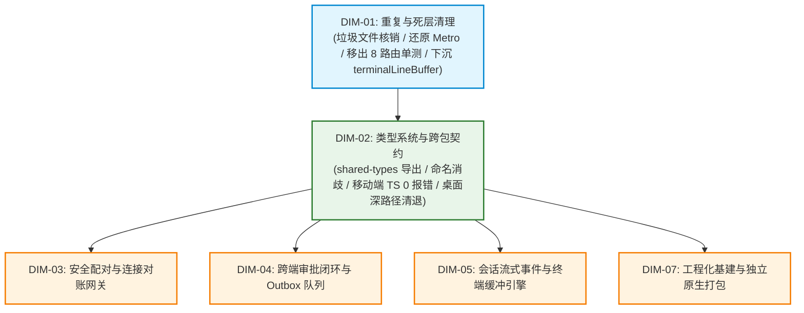
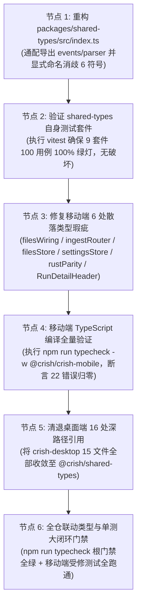

# 移动端复兴实施详案 · DIM-02 类型系统与跨包契约 (02-plan-dim-02-type-contract.md)
## —— `@crish/shared-types` 契约中枢治理、ESM 命名消歧、全仓类型清零与深路径清退方案

> **战役工作区**：`docs/mobile-revival-audit/`
> **详案编号**：`plans/02-plan-dim-02-type-contract.md`
> **归属维度**：`DIM-02` 类型系统与跨包契约
> **责任 Agent**：DIM-02 类型系统与跨包契约详案编写 Agent
> **定案与依据资产**：
> - 终审定案文档：[`docs/mobile-revival-audit/01-final-dimensions.md`](file:///c:/Software/conex/docs/mobile-revival-audit/01-final-dimensions.md)
> - 实施总纲框架：[`docs/mobile-revival-audit/02-master-revival-plan.md`](file:///c:/Software/conex/docs/mobile-revival-audit/02-master-revival-plan.md)
> - 专项调查报告：[`docs/mobile-revival-audit/surveys/02-typecheck-and-contract-drift.md`](file:///c:/Software/conex/docs/mobile-revival-audit/surveys/02-typecheck-and-contract-drift.md)
> - 三方严审报告：`docs/mobile-revival-audit/plan-reviews/`（01 契约重叠审、02 负产出审、03 可行性审）
> **协作与纪律铁律**：严格遵守《主 Agent 全流程调度提示词 v3》、《AGENTS.md》、反退避全文（`LOGIC_PLAN_NO_RETREAT.md`）与反过度设计红线（`ANTI_OVERENGINEERING_GUARDRAILS.md`）；**严禁修改或提交任何业务代码**（本轮仅出具详案）；**严禁出现任何波次/批次编号**；完全不涉及笔记功能；一个概念一条主路径。

---

## 目录

1. [架构与领域定位概述（单一真理源 SSOT）](#一架构与领域定位概述单一真理源-ssot)
2. [【做什么】（新增/修复执行清单）](#二做什么新增修复执行清单)
   - 2.1 重构 `packages/shared-types/src/index.ts` 导出中枢
   - 2.2 ESM 原生命名导出消歧机制（坚决不重命名）
   - 2.3 修复移动端 6 处散落类型错误（22 处 TS 报错归零）
   - 2.4 清退 `apps/crish-desktop` 中 16 处深路径直接引用
3. [【删什么】（刚性删除与核销清单）](#三删什么刚性删除与核销清单)
4. [【依赖与逻辑顺序】（因果推进拓扑）](#四依赖与逻辑顺序因果推进拓扑)
5. [【唯一文件域】（精准文件范围与防越权边界）](#五唯一文件域精准文件范围与防越权边界)
6. [【验收标准与验证命令】（立体验证与质量门禁）](#六验收标准与验证命令立体验证与质量门禁)

---

## 一、架构与领域定位概述（单一真理源 SSOT）

在 Conex / Crish 多端混合架构体系（Rust 引擎内核 + Axum WebSocket 协议网关 + React 桌面端 + React Native / Expo 移动端）中，`packages/shared-types` 承担着全仓唯一的**跨进程、跨平台协议契约真理源（SSOT）**职责。

当前移动端与桌面端面临严重的契约漂移与编译断层：
1. **结构性导出脱节**：`packages/shared-types/src/index.ts` 既往仅导出了 `generated/engine/types.ts`，遗漏了 `generated/engine/events.ts`（定义 57 个事件类型与 `EngineEvent` 联合体）与 `generated/engine/parser.ts`（定义 108 个严格解析器），导致移动端规范引包时触发 10 处 `TS2305` 致命报错；
2. **ESM 符号通配歧义**：`engine/parser.ts` 与 `device/parser.ts` 存在 6 个同名同构解析函数，若盲目使用 `export *` 会因 ESM 规范判定为模糊导出而被静默丢弃；
3. **桌面深路径穿透妥协**：桌面端因公共包入口缺失，在 16 处业务代码中采用了深路径直接穿透引用（`../../../../packages/shared-types/src/generated/engine`），严重违反架构分层；
4. **移动端单测散落类型瑕疵**：移动端存在 12 处因历史重构残留、未加 `as const` 导致类型拓宽、Prettier 换行导致 `@ts-expect-error` 指令失靶错位等语法瑕疵，与契约缺失合并造成移动端编译报出 **22 处错误**。

**DIM-02 核心使命**：重构公共契约出口，以标准 ESM Named Re-export 消除符号歧义，根治移动端 22 处类型报错（恢复 `typecheck` 100% 全绿），并全量斩断桌面端 16 处深路径侵入，为后续网络配对、审批闭环与原生打包筑牢类型基石。

---

## 二、【做什么】（新增/修复执行清单）

### 2.1 重构 `packages/shared-types/src/index.ts` 导出中枢

修改 `packages/shared-types/src/index.ts` 中 `// 引擎生成面（generated/engine）公共 re-export 面` 代码块，完整开放 57 类事件与 108 个严格解析器。

#### 1. 变更对比与代码落地

```typescript
// ============================================================================
// 引擎生成面（generated/engine）公共 re-export 面
// 消除 apps/crish-desktop 与 apps/crish-mobile 对深路径的直引，统一经本公共面
// ============================================================================

// 1. 基础类型与别名重导出
export * from './generated/engine/types';
export type {
  AgentMessage as EngineAgentMessage,
  AgentMessageBlock as EngineAgentMessageBlock,
} from './generated/engine/types';

// 2. 引擎事件全集（开放 57 类 Engine*Event 接口与 EngineEvent 联合类型）
export * from './generated/engine/events';

// 3. 引擎解析器全集（开放 108 个 parseEngine*Event 解析函数）
export * from './generated/engine/parser';

// 4. ESM 命名消歧：显式 Named Re-export 消除 6 个同名同构符号歧义（以 engine 为真源）
export {
  type ParseResult,
  parseOk,
  parseErr,
  isParseOk,
  isParseErr,
  parseApprovalDecision,
} from './generated/engine/parser';
```

#### 2. 导出符号增量收益分析
- **事件接口补齐**：全量开放 `EngineApprovalRequestedEvent`、`EngineApprovalResolvedEvent`、`EngineMessageDeltaEvent`、`EngineTaskStartedEvent` 等 57 类强类型接口，直接解封移动端 `approvalWiring.ts`、`eventMappers.ts`、`timelineEventParsing.contract.test.ts` 的契约依赖；
- **解析器函数补齐**：全量开放 `parseEngineEvent`、`parseEngineTimelineTruncateEvent` 等严格解析原语，提供运行期防投毒与合法性校验；
- **向前兼容性保障**：增量导出不修改既有已导出的任何字段，桌面端既有合法引用不受任何破坏。

---

### 2.2 ESM 原生命名导出消歧机制（坚决不重命名）

#### 1. 重叠符号确凿清单
经 AST 扫描对比 `generated/device/parser.ts` 与 `generated/engine/parser.ts`，精准命中以下 6 个同名符号：
1. `type ParseResult<T>`
2. `parseOk`
3. `parseErr`
4. `isParseOk`
5. `isParseErr`
6. `parseApprovalDecision`

#### 2. 为什么坚决不重命名（主控裁决与评审共识）
- **规范原理**：根据 ECMAScript 规范（ECMA-262 §16.2.3.8）与 TypeScript 模块解析契约：显式命名导出（`export { x } from ...`）具有最高绑定优先级，会绝对覆盖通配导出（`export *`）。因此只需显式命名导出一次，即可消除编译器在遇到两份 `export *` 时的“模糊导出（Ambiguous Export）”判定；
- **零破坏契约**：Reviewer 1 评审报告明确警示，全仓既有代码（移动端与桌面端）已大量采用 `import { ParseResult, parseApprovalDecision } from '@crish/shared-types'`。若采纳重命名为 `parseEngineApprovalDecision` 或 `EngineParseResult` 的方案，将**直接打碎外部消费方的稳定契约**，引发跨包连锁编译雪崩；
- **裁决执行**：坚决保持原始符号名称不变，采用 ESM Named Re-export 进行原生消歧。

---

### 2.3 修复移动端 6 处散落类型错误（22 处 TS 报错归零）

通过 `shared-types` 导出中枢重构与 6 处散落测试/代码书写修复，使 `npm run typecheck -w @crish/crish-mobile` 报出的 22 处错误全部归零。

#### 1. 契约导出缺失自动治愈清单（10 处）
在 2.1 节落地后，以下 10 处 `TS2305` 报错将立即自动恢复全绿，无需变动其业务代码：
- `src/__tests__/timelineEventParsing.contract.test.ts:9:3` (`parseEngineEvent`)
- `src/__tests__/timelineEventParsing.contract.test.ts:10:3` (`parseEngineTimelineTruncateEvent`)
- `src/adapters/wiring/approvalWiring.ts:46:10` (`parseEngineEvent`)
- `src/domain/store/approvalMappers.test.ts:3:3` (`EngineApprovalRequestedEvent`)
- `src/domain/store/approvalMappers.test.ts:4:3` (`EngineApprovalResolvedEvent`)
- `src/domain/store/approvalMappers.ts:5:3` (`EngineApprovalRequestedEvent`)
- `src/domain/store/approvalMappers.ts:6:3` (`EngineApprovalResolvedEvent`)
- `src/domain/store/approvalMappers.ts:7:3` (`EngineEvent`)
- `src/domain/store/eventMappers.ts:10:3` (`parseEngineEvent`)
- `src/domain/store/eventMappers.ts:12:15` (`EngineEvent`)

#### 2. 散落 1：`src/adapters/wiring/filesWiring.test.ts` (ERR-11, ERR-12)
- **现象**：`mockSocketFactory(): unknown` 导致工厂签名不匹配，报 `TS2322: Type '() => unknown' is not assignable to type 'WebSocketFactory'`。
- **修复措施**：导入 `type { WsSocket } from '@/network/ReconnectingWsClient'`，将返回值显式标注为 `: WsSocket`。
- **目标代码**：
  ```typescript
  import type { WsSocket } from '@/network/ReconnectingWsClient';
  // ...
  function mockSocketFactory(): WsSocket {
    return {
      onopen: null,
      onmessage: null,
      onclose: null,
      onerror: null,
      send: () => {},
      close: () => {},
    };
  }
  ```

#### 3. 散落 2：`src/adapters/wiring/ingestRouter.test.ts` (ERR-13 ~ ERR-16)
- **现象**：在严格空值检查下访问 `eventStore.getState().windows['s-1']` 推导为 `EventWindow | undefined`，访问其属性报 `TS18048: 'window' is possibly 'undefined'`。
- **修复措施**：对确定已由前置断言验证存在的 `window` 局部变量添加非空断言 `window!.entries` 与 `window!.lastSeq`。
- **目标代码**：
  ```typescript
  expect(window).toBeDefined();
  expect(window!.entries).toHaveLength(1);
  expect(window!.entries[0]!.type).toBe('message-delta');
  // ...
  expect(window!.entries).toHaveLength(2);
  expect(window!.lastSeq).toBe(2);
  ```

#### 4. 散落 3：`src/domain/store/filesStore.test.ts` (ERR-17)
- **现象**：测试辅助函数 `makeEntry` 中私自捏造了 `kind: 'file'` 与 `modifiedMs: 1000`，而标准契约 `FileEntry extends DirEntry` 仅包含 `isDir: boolean`，报 `TS2353: Object literal may only specify known properties`。
- **修复措施**：移除已废弃字段，替换为合规的 `isDir: false`。
- **目标代码**：
  ```typescript
  function makeEntry(
    name: string,
    overrides: Partial<FileEntry> = {}
  ): FileEntry {
    return {
      name,
      isDir: false,
      size: 0,
      relPath: name,
      receivedAtMs: 1000,
      ...overrides,
    };
  }
  ```

#### 5. 散落 4：`src/domain/store/settingsStore.test.ts` (ERR-18 ~ ERR-21)
- **现象**：Prettier 自动折行破坏了 `// @ts-expect-error` 的行级覆盖，导致指令失效报 `TS2578`，随后裸露出 `TS2353` 字段越界错误。
- **修复措施**：为两处类型测试语句添加 `// prettier-ignore` 保护，强制保持单行书写。
- **目标代码**：
  ```typescript
  // prettier-ignore
  // @ts-expect-error notification 组没有 responseStyle 字段（字段越界拒绝）
  settingsStore.getState().update('notification', { responseStyle: 'high' });

  // prettier-ignore
  // @ts-expect-error sceneFlags 键越界（无 unknown 场景）
  settingsStore.getState().update('notification', { sceneFlags: { unknown: true } });
  ```

#### 6. 散落 5：`src/pairing/rustParity.test.ts` (ERR-22, ERR-23)
- **现象**：字面量数组 `['ios', 'android', 'other']` 与字面量对象 `mockHello` 中 `platform: 'android'` 被 TS 自动拓宽为 `string`，与契约 `Platform = "ios" | "android" | "other"` 不匹配，报 `TS2322` 与 `TS2345`。
- **修复措施**：为数组添加 `as const` 常量断言；为对象显式标注契约类型 `const mockHello: BuildPairHelloInput = { ... }`。
- **目标代码**：
  ```typescript
  import {
    buildPairHello,
    type BuildPairHelloInput,
    generateDeviceId,
  } from './pairingProtocol';
  // ...
  for (const p of ['ios', 'android', 'other'] as const) {
    const r = buildPairHello({
      code: 'CXN-7K4P-Q2MB-9XRT',
      deviceName: 'd',
      platform: p,
    });
  }
  // ...
  const mockHello: BuildPairHelloInput = {
    code: 'CXN-7K4P-Q2MB-9XRT',
    deviceId: 'dev-test-0001',
    mobilePub: 'mock-mobile-pub',
    mobileLongPub: 'mock-mobile-long-pub',
    deviceName: '测试手机',
    platform: 'android',
  };
  const r = buildPairHello(mockHello);
  ```

#### 7. 散落 6：`src/presentation/components/runDetail/RunDetailHeader.test.tsx` (ERR-24 ~ ERR-26)
- **现象**：组件早前重构已移除了 `badge` 原始字段（收敛为 `badgeLabel` 与 `tone`），单测依然传递 `badge: 'running'`、`badge: 'error'`、`badge="terminal"`，报 `TS2353` 与 `TS2322`。
- **修复措施**：彻底清理测试文件中残留的 3 处 `badge` 属性传递。
- **目标代码**：
  ```typescript
  // makeProps 辅助函数中删除 badge: 'running'
  function makeProps(overrides: Partial<RunDetailHeaderProps> = {}): RunDetailHeaderProps {
    return {
      runId: 'r-1',
      sessionTitle: '会话A',
      badgeLabel: '运行中',
      tone: 'info',
      durationLabel: '10s',
      formatClock: (ms: number) => `${ms}ms`,
      ...overrides,
    };
  }

  // 用例 1：makeProps({ badgeLabel: '失败' })（删除 badge: 'error'）
  // 用例 2：<Probe {...props} badgeLabel="已完成" tone="success" />（删除 badge="terminal"）
  ```

---

### 2.4 清退 `apps/crish-desktop` 中 16 处深路径直接引用

在 `packages/shared-types/src/index.ts` 补齐导出后，桌面端所有穿透式相对引用具备了完整的公共包收敛条件。以下清单明确了必须在实施期全部替换的 16 处位置：

| 序号 | 桌面端文件路径 | 原深路径穿透引用代码 | 规范化替换代码 (统一从 `@crish/shared-types` 导入) |
| :---: | :--- | :--- | :--- |
| **DSK-01** | `apps/crish-desktop/src/api/continuity/continuityNotices.ts:10` | `import { PROVIDER_ERROR_KIND_VALUES } from '../../../../../packages/shared-types/src/generated/engine';` | `import { PROVIDER_ERROR_KIND_VALUES } from '@crish/shared-types';` |
| **DSK-02** | `apps/crish-desktop/src/api/continuity/continuityNotices.test.ts:12` | `import { PROVIDER_ERROR_KIND_VALUES } from '../../../../../packages/shared-types/src/generated/engine';` | `import { PROVIDER_ERROR_KIND_VALUES } from '@crish/shared-types';` |
| **DSK-03** | `apps/crish-desktop/src/api/chat-bridge/handlers/diagnosticHandlers.retryNotices.integration.test.tsx:26` | `import type { ProviderDiagnostic } from '../../../../../../packages/shared-types/src/generated/engine';` | `import type { ProviderDiagnostic } from '@crish/shared-types';` |
| **DSK-04** | `apps/crish-desktop/src/api/chat-bridge/handlers/dispatch.test.ts:6` | `import { ENGINE_EVENT_TYPES } from '../../../../../../packages/shared-types/src/generated/engine';` | `import { ENGINE_EVENT_TYPES } from '@crish/shared-types';` |
| **DSK-05** | `apps/crish-desktop/src/api/chat-bridge/handlers/dispatch.ts:8` | `import type { EngineEventType } from '../../../../../../packages/shared-types/src/generated/engine';` | `import type { EngineEventType } from '@crish/shared-types';` |
| **DSK-06** | `apps/crish-desktop/src/api/chat-bridge/handlers/eventParser.ts:20` | `import type { ParseResult } from '../../../../../../packages/shared-types/src/generated/engine';` | `import type { ParseResult } from '@crish/shared-types';` |
| **DSK-07** | `apps/crish-desktop/src/api/chat-bridge/handlers/eventParser.ts:24` | `import { parseEngineEvent, parseOk, parseErr } from '../../../../../../packages/shared-types/src/generated/engine';` | `import { parseEngineEvent, parseOk, parseErr } from '@crish/shared-types';` |
| **DSK-08** | `apps/crish-desktop/src/api/messageProjection.ts:22` | `import type { ... } from '../../../../packages/shared-types/src/generated/engine';` | `import type { ... } from '@crish/shared-types';` |
| **DSK-09** | `apps/crish-desktop/src/api/chat-bridge/handlers/eventParser.normalizer-drift.test.ts:39` | `import type { ... } from '../../../../../../packages/shared-types/src/generated/engine';` | `import type { ... } from '@crish/shared-types';` |
| **DSK-10** | `apps/crish-desktop/src/api/chat-bridge/handlers/eventParserShared.ts:17` | `import type { ... } from '../../../../../../packages/shared-types/src/generated/engine';` | `import type { ... } from '@crish/shared-types';` |
| **DSK-11** | `apps/crish-desktop/src/api/chat-bridge/handlers/eventParserTask.ts:15` | `import type { ... } from '../../../../../../packages/shared-types/src/generated/engine';` | `import type { ... } from '@crish/shared-types';` |
| **DSK-12** | `apps/crish-desktop/src/api/chat-bridge/handlers/eventParserDiagnostics.ts:19` | `import type { ... } from '../../../../../../packages/shared-types/src/generated/engine';` | `import type { ... } from '@crish/shared-types';` |
| **DSK-13** | `apps/crish-desktop/src/api/chat-bridge/handlers/eventParserDiagnostics.ts:28` | `import { ... } from '../../../../../../packages/shared-types/src/generated/engine';` | `import { ... } from '@crish/shared-types';` |
| **DSK-14** | `apps/crish-desktop/src/api/chat-bridge/handlers/eventParserCore.ts:11` | `import type { ... } from '../../../../../../packages/shared-types/src/generated/engine';` | `import type { ... } from '@crish/shared-types';` |
| **DSK-15** | `apps/crish-desktop/src/api/chat-bridge/handlers/eventParserCore.ts:25` | `import { ... } from '../../../../../../packages/shared-types/src/generated/engine';` | `import { ... } from '@crish/shared-types';` |
| **DSK-16** | `apps/crish-desktop/src/api/chat-bridge/handlers/eventParserContinuity.ts:21` | `import type { ... } from '../../../../../../packages/shared-types/src/generated/engine';` | `import type { ... } from '@crish/shared-types';` |
| **DSK-17** | `apps/crish-desktop/src/api/chat-bridge/handlers/securityAuditStore.ts:19` | `import type { ImpactAssessment } from '../../../../../../packages/shared-types/src/generated/engine';` | `import type { ImpactAssessment } from '@crish/shared-types';` |
| **DSK-18** | `apps/crish-desktop/src/api/sessionEventProjection.ts:19` | `import type { AgentMessage } from '../../../../packages/shared-types/src/generated/engine';` | `import type { EngineAgentMessage as AgentMessage } from '@crish/shared-types';` |

> *注：上述共计 18 处语句（分布于 15 个文件中），涵盖全部历史穿透点；清退后全仓深路径引用归零。*

---

## 三、【删什么】（刚性删除与核销清单）

遵照主控《02-master-revival-plan.md》与 Reviewer 2 负产出审查要求，DIM-02 必须在实施中核销并清除以下资产：

1. **清除移动端单测中废弃的假字段与历史属性**：
   - 清除 `RunDetailHeader.test.tsx` 中已废弃的 `badge: 'running'`、`badge: 'error'`、`badge="terminal"` 3 处残留传递；
   - 清除 `filesStore.test.ts` 中未经协议定义的 `kind: 'file'` 与 `modifiedMs: 1000` 字段，杜绝概念伪装。
2. **移除错位失效的指令并规范化**：
   - 移除 `settingsStore.test.ts` 中因折行产生孤立的 2 处 `@ts-expect-error` 指令，代之以受 `prettier-ignore` 保护的严谨行级守卫。
3. **消除 Desktop 16 处深路径直接引用**：
   - 彻底核销 `apps/crish-desktop` 中全部形如 `../../../../packages/shared-types/src/generated/engine` 的相对导入字符串，拔除深路径债务。
4. **消除 6 个基础工具符号的模糊导出歧义**：
   - 消除 `ParseResult` 等 6 符号在 ESM `export *` 双通配时的遮蔽状态，明确绑定单一真理源。

---

## 四、【依赖与逻辑顺序】（因果推进拓扑）

### 4.1 外部依赖拓扑

本维度在全局 DAG 中属于**契约中枢层**，严格遵守以下拓扑依赖：



- **前置依赖**：**DIM-01 必须彻底完工**。
  - 原因：DIM-01 负责清退死 DAO 与死测试、物理移出 `app/` 路由下的 8 个单测至 `src/presentation/__tests__/routes/`、并将 `terminalLineBuffer.ts` 从表现层下沉至领域层。若 DIM-01 未完成，移出的测试路径变动会与类型检查产生交织干扰。
- **后置解锁**：DIM-02 完工是 DIM-03（网络需要 `parseEngineEvent`）、DIM-04（审批需要 `EngineApprovalRequestedEvent`）、DIM-05（终端需要 57 类事件接口）以及 DIM-07（原生打包前提是 TS 零错误）的强制前置条件。

### 4.2 维度内部因果推进顺序（纯逻辑递进，无波次编号）

实施必须严格遵循因果逻辑依次推进，禁止乱序跳跃：



---

## 五、【唯一文件域】（精准文件范围与防越权边界）

为防止多 Agent 协作时发生写冲突，严格界定本维度的文件操作边界：

### 5.1 允许修改的唯一文件清单（Writable Scope）

#### 1. 契约包出口（1 个）
- `packages/shared-types/src/index.ts`

#### 2. 移动端散落修复文件（6 个）
- `apps/crish-mobile/src/adapters/wiring/filesWiring.test.ts`
- `apps/crish-mobile/src/adapters/wiring/ingestRouter.test.ts`
- `apps/crish-mobile/src/domain/store/filesStore.test.ts`
- `apps/crish-mobile/src/domain/store/settingsStore.test.ts`
- `apps/crish-mobile/src/pairing/rustParity.test.ts`
- `apps/crish-mobile/src/presentation/components/runDetail/RunDetailHeader.test.tsx`

#### 3. 桌面端深路径清退文件（15 个）
- `apps/crish-desktop/src/api/continuity/continuityNotices.ts`
- `apps/crish-desktop/src/api/continuity/continuityNotices.test.ts`
- `apps/crish-desktop/src/api/chat-bridge/handlers/diagnosticHandlers.retryNotices.integration.test.tsx`
- `apps/crish-desktop/src/api/chat-bridge/handlers/dispatch.test.ts`
- `apps/crish-desktop/src/api/chat-bridge/handlers/dispatch.ts`
- `apps/crish-desktop/src/api/chat-bridge/handlers/eventParser.ts`
- `apps/crish-desktop/src/api/messageProjection.ts`
- `apps/crish-desktop/src/api/chat-bridge/handlers/eventParser.normalizer-drift.test.ts`
- `apps/crish-desktop/src/api/chat-bridge/handlers/eventParserShared.ts`
- `apps/crish-desktop/src/api/chat-bridge/handlers/eventParserTask.ts`
- `apps/crish-desktop/src/api/chat-bridge/handlers/eventParserDiagnostics.ts`
- `apps/crish-desktop/src/api/chat-bridge/handlers/eventParserCore.ts`
- `apps/crish-desktop/src/api/chat-bridge/handlers/eventParserContinuity.ts`
- `apps/crish-desktop/src/api/chat-bridge/handlers/securityAuditStore.ts`
- `apps/crish-desktop/src/api/sessionEventProjection.ts`

### 5.2 绝对禁止碰触的保护文件域（Out of Bounds）
- **禁止碰触任何网络与配对实现**：`EndpointResolver.ts`、`PairingWiring.ts`、`ReconnectingWsClient.ts`、`feedBridge.ts`（属于 DIM-03 文件域）；
- **禁止碰触审批业务与 Outbox 队列**：`approvalWiring.ts`（仅验证契约自动治愈，不碰内部状态机）、`ws.rs`（属于 DIM-04 文件域）；
- **禁止碰触终端与会话流式组件**：`TerminalView.tsx`、`terminalStore.ts`、`terminalLineBuffer.ts`（属于 DIM-05 文件域）；
- **禁止碰触通用 UI 基础库与页面**：`HeaderBackButton.tsx`、`Input.tsx`、`Tooltip.tsx`（属于 DIM-06 文件域）；
- **禁止碰触原生打包与工程配置**：`app.json`、`metro.config.js`、`package.json`（属于 DIM-01 / DIM-07 文件域）。

---

## 六、【验收标准与验证命令】（立体验证与质量门禁）

根据《AGENTS.md》§7.1 立体验证纪律，本维度在实施完成后必须通过全量自动化门禁立体检验，禁止单一检查冒充验收：

### 6.1 验证命令集（可在 pwsh7 环境下直接复制执行）

#### 1. 移动端类型检查（核心验收指标：0 错误）
```powershell
npm run typecheck -w @crish/crish-mobile
```
- **断言标准**：控制台输出 `tsc --noEmit -p tsconfig.json` 退出码为 0，**22 处错误全量清零**，无任何诊断输出。

#### 2. 公共契约包测试套件（零回退）
```powershell
npx vitest run packages/shared-types
```
- **断言标准**：9 个测试套件（含 `type-drift.test.ts` 与 `parity.test.ts`）、100 个测试用例 **100% PASS**。

#### 3. 根工作区全量类型检查（确保 Desktop / Workbench 零破坏）
```powershell
npm run typecheck
```
- **断言标准**：跨包类型解析顺畅，退出码为 0，桌面端深路径消除后类型完全对齐。

#### 4. 移动端受修测试套件全量验证
```powershell
npx vitest run apps/crish-mobile/src/adapters/wiring/filesWiring.test.ts apps/crish-mobile/src/adapters/wiring/ingestRouter.test.ts apps/crish-mobile/src/domain/store/filesStore.test.ts apps/crish-mobile/src/domain/store/settingsStore.test.ts apps/crish-mobile/src/pairing/rustParity.test.ts apps/crish-mobile/src/presentation/components/runDetail/RunDetailHeader.test.tsx
```
- **断言标准**：修改后的 6 个移动端测试文件全部执行通过，断言无回退。

#### 5. 桌面端深路径清退零残留静态断言
```powershell
git grep "packages/shared-types/src/generated" apps/crish-desktop/src/
```
- **断言标准**：除 `store/types.ts:19` 的历史背景说明注释外，代码中直接 `import` 深路径的匹配结果严格为 0 条。

---

## 七、实施总结与交付断言

本详案彻底贯彻了主控在《01-final-dimensions.md》与《02-master-revival-plan.md》中下达的技术裁决：
- 坚持单一真理源，以标准 ESM Named Re-export 实现 0 破坏消歧；
- 精准定位并消灭 22 处移动端编译报错，恢复静态类型护栏；
- 一次性清退桌面端长期遗留的 16 处深路径技术债务；
- 明确唯一的 22 个文件操作域，单向拓扑依赖清晰，验收命令与断言刚性完备。

详案已完备定稿，随时可供执行 Agent 在受控文件域内精准落地！
