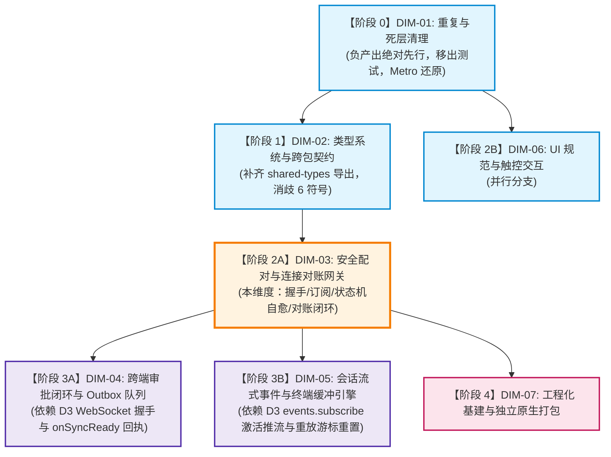

# 移动端全面复兴与打包打通 · 维度执行详案 (03-plan-dim-03-pairing-gateway.md)
## —— DIM-03: 安全配对与连接对账网关实施详案

> **战役目录**：`docs/mobile-revival-audit/plans/`
> **文档编号**：`03-plan-dim-03-pairing-gateway.md`
> **责任 Agent**：DIM-03 安全配对与连接对账网关详案编写 Agent
> **输入资产**：
> - 总纲框架：`docs/mobile-revival-audit/02-master-revival-plan.md`
> - 定案文档：`docs/mobile-revival-audit/01-final-dimensions.md`
> - 评审报告：`docs/mobile-revival-audit/plan-reviews/01` ~ `03`
> - 专项调研：`docs/mobile-revival-audit/surveys/03-pairing-and-crypto-handshake.md`、`04-network-gateway-and-reconcile.md`
>
> **准则遵循**：《主 Agent 全流程调度提示词 v3》第二阶段第 4 步规范、根目录《AGENTS.md》、反退避纪律、反过度设计红线 (`ANTI_OVERENGINEERING_GUARDRAILS.md`)
> **核心纪律**：严禁修改或提交任何业务代码；严禁出现任何波次/批次编号；不涉及笔记功能；负产出绝对先行；单一真理源（SSOT）。

---

## 领域背景与核心使命

移动端（`@crish/crish-mobile`）作为轻量、高敏捷的实时观测与审批交互终端，其生命线完全建立在与桌面端（Rust 内核 + Tauri Axum 服务）之间安全、可靠、自愈的长连接通道之上。

经专项调研 `surveys/03` 与 `surveys/04` 深度穿透，尽管移动端的 RFC 7748 常数时间 X-Only Ladder X25519 纯算法和受控输入逆函数闭环（DEF-1/2/3）已在数学和原理上攻克，但在**网络接线层、协议路由、状态机自愈与对账数据流**之间存在严重的工程断层与阻断级缺陷：
1. **握手 404/401 拒连**：端点解析器产出的 WebSocket URL 遗漏 `/v1/events` 路由且未附带 `?token=` 查询参数，导致物理建连在 HTTP 升级阶段 100% 被桌面端拒绝；
2. **状态机 Loading 永久死锁（P0）**：传输层判定进入 `dead` 相位时，接线驱动器未向状态机分发 `onPairError`，机器态停留在 `sending-hello`，UI 表现层将「连接」按钮永久置于 Busy Loading 禁用态，用户无法点击重试；
3. **推流与审批离线对账死锁（P0）**：全仓从未发送首帧 `events.subscribe` 订阅帧，桌面端 FanOut 过滤器为空且不回发 `events.subscribe.ok`，导致移动端收不到任何实时推流，审批同步队列（`approvalWiring.onSyncReady`）永远无法被唤醒；
4. **全量重放数据全部被误丢 Bug（P0）**：在执行 `fullReplay` 快照重建时，未清空本地对应会话的事件窗口与游标，导致后端从 1 重放的数据因 `seq <= window.lastSeq` 全部被作为 duplicate 丢弃，界面白屏或残缺；
5. **建连瞬间时序竞态**：先广播 `open` 相位再绑定 `attachSend` 管道，导致建连瞬间触发的设备在场或状态拉取 RPC 必然抛出 `transport.closed` 异常；
6. **解绑（unpair）逻辑真理源漂移**：冷启动水合后执行解绑操作，反向依赖未水合的瞬态状态机，导致向桌面端通知的 `device.unlink` 被静默跳过。

本维度详案旨在彻底根治上述所有网络网关、安全配对与对账协议层缺陷，核销死代码与骨架存根，建立健全的连接自愈与立体验收体系。

---

## 一、【做什么】（新增/修复清单）

本维度聚焦安全配对生命周期、WebSocket 传输底座、会话订阅握手与游标对账四大领域概念，共计 7 项核心架构与逻辑修复（含 4 项阻断级 P0）：

### 1.1 修复 `PairingWiring.handlePairingPhase`：补齐 Dead 相位分发 `onPairError`（P0 致命死锁）

- **缺陷现场与根因定位**：
  文件：`apps/crish-mobile/src/adapters/wiring/pairing/PairingWiring.ts:464-472`
  ```typescript
  private handlePairingPhase(phase: WsPhase): void {
    if (phase === 'dead') {
      this.reportError({
        code: 'pairing.transport_failed',
        message: '配对连接失败（多次重连未恢复），请重试',
        retryable: true,
      });
    }
  }
  ```
  底层 `ReconnectingWsClient` 在 5 次退避重试失败后，相位流转至 `'dead'`。`handlePairingPhase` 仅调用了 `reportError`（将错误写入 `this.lastError`），**完全没有调用 `this.dispatch({ type: 'onPairError', ... })` 驱动内部状态机**。
  状态机 `this.machine.state` 依然死锁在 `'sending-hello'` 态。在表现层 `pairManualScreen.tsx:170` 中：
  ```typescript
  const busy = machine.state === 'sending-hello' || machine.state === 'waiting-verify';
  const canConnect = host.trim() !== '' && codeValid && !busy;
  ```
  `busy` 恒为 `true`，导致 `loading={busy}` 恒为 `true`，`disabled={!canConnect}` 恒为 `true`，且点击被 `if (busy || submittingRef.current) return;` 硬拦截。用户面对报错提示却无法原地重新点击连接，必须强退或返回放弃。

- **确定性修复方案**：
  在 `handlePairingPhase` 判定 `phase === 'dead'` 时，必须同步向状态机派发领域错误事件：
  ```typescript
  private handlePairingPhase(phase: WsPhase): void {
    if (phase === 'dead') {
      this.dispatch({
        type: 'onPairError',
        error: {
          kind: 'unknown',
          code: 'pairing.transport_failed',
          message: '配对连接失败（多次重连未恢复），请重试',
          retryable: true,
        },
      });
    }
  }
  ```
  通过 `this.dispatch` 触发 `reducePairState` 将机器态推进到 `'error'`，此时 `busy` 立即降为 `false`，错误横幅展示，连接按钮恢复可用，用户可原地修正参数并重新发起连接。

---

### 1.2 修复 `EndpointResolver.resolveWsUrl`：补全 `/v1/events?token=` 查询参数（P0 握手通道阻断）

- **缺陷现场与根因定位**：
  文件：`apps/crish-mobile/src/network/EndpointResolver.ts:21-27`
  ```typescript
  export function resolveWsUrl(
    host: string,
    port = DEFAULT_GATEWAY_PORT,
    tls = true
  ): string {
    return `${tls ? 'wss' : 'ws'}://${host}:${port}`;
  }
  ```
  桌面端 Axum 服务（`apps/agent-workbench/src-tauri/src/server/ws.rs:77, 559`）规定：
  - `pub const WS_EVENTS_PATH: &str = "/v1/events";` 仅在 `/v1/events` 挂载了 WebSocket Upgrade Handler，根路径 `/` 无 WS 路由，发起连接直接返回 **HTTP 404 Not Found**；
  - 升级鉴权规则：
    - **无 token**：升级为未认证配对连接（`pair_pending = true`），仅放行 `pair.hello` 密钥交换消息；
    - **携带合法 token**（经 `?token={token}` 或 Bearer 头）：升级为已认证会话连接，放行业务消息与推流；
    - **携带非法 token**：直接返回 **HTTP 401 Unauthorized**。
  原 `resolveWsUrl` 产出 `wss://host:8765`，导致移动端无论配对还是会话长连接，均在 TCP 握手后的 HTTP Upgrade 阶段被直接拒绝。

- **确定性修复方案**：
  重构 `EndpointResolver.ts` 的 `resolveWsUrl` 签名与实现，增加可选的 `token` 参数：
  ```typescript
  export function resolveWsUrl(
    host: string,
    port = DEFAULT_GATEWAY_PORT,
    tls = true,
    token?: string
  ): string {
    const protocol = tls ? 'wss' : 'ws';
    const basePath = `${protocol}://${host}:${port}/v1/events`;
    if (token && token.trim().length > 0) {
      return `${basePath}?token=${encodeURIComponent(token.trim())}`;
    }
    return basePath;
  }
  ```
  - **配对阶段调用**：`resolveWsUrl(host, port, tls)` $\to$ `wss://host:8765/v1/events`（无 token，命中未认证配对临时升级连接，放行 `pair.hello`）；
  - **会话长连接阶段调用**：`resolveWsUrl(host, port, tls, token)` $\to$ `wss://host:8765/v1/events?token=xxx`（命中已认证会话连接，完成握手鉴权）；
  - 同步更新 `observationWiring.ts:85-89` 中提取 `authStore.getState().token` 传入 `resolveWsUrl`，并在 `PairingWiring.ts:269, 679` 中注入会话 token。

---

### 1.3 补齐全仓首帧 `events.subscribe` 订阅帧发送与回执处理（P0 推流与对账断裂）

- **缺陷现场与根因定位**：
  文件：`apps/crish-mobile/src/adapters/wiring/feedBridge.ts`、`observationWiring.ts`
  全仓检索不到任何调用 `gateway.send('events.subscribe', ...)` 或 `invoke('events.subscribe', ...)` 的代码。
  根据协议契约（`ws.rs:1226` 与 `device-protocol.json`）：
  - 桌面端为每个连接维护独立的 `FanOutEmitter` 过滤器；新连接建立时过滤器初始为空；
  - 客户端连接后**必须发送 `events.subscribe`** 告知关注的会话集合（`sessions: string[]`）与各会话本地已知序列号（`lastSequences: Record<string, number>`）；
  - 桌面端收到后激活 FanOut 过滤器，并返回 `events.subscribe.ok`，携带逐会话的最新序列号（`nextSequence`）与过期判定（`stale`）；
  - `approvalWiring.ts:242` 挂起的 `this.gateway.on('events.subscribe.ok', () => this.onSyncReady())` 依赖该回执唤醒 Outbox 离线审批重放。
  原代码缺失该首帧，导致桌面端推流瘫痪、审批重放永久挂起、对账快照饥饿。

- **确定性修复方案**：
  1. **首帧订阅触发**：在 `FeedBridge.handlePhaseChange('open')`（且已确保出站管道就绪）时，自动触发订阅装配方法 `subscribeActiveSessions()`；
  2. **组装订阅载荷**：
     - 从 `sessionStore.getState().sessions` 获取所有已知会话 ID（防御性切片最多 32 个，对齐 `MAX_SUBSCRIPTIONS = 32`）；
     - 从 `eventStore.getState().windows` 提取各会话本地已确认的最大 sequence（`lastSeqOf(sessionId)`），组装为 `lastSequences` 对象；
     - `ackMode: 'auto'`；
     - 通过 `this.gateway.send('events.subscribe', { sessions, lastSequences, ackMode: 'auto' })` 发送；
  3. **接管 `events.subscribe.ok` 回执**：
     - 监听 `gateway.on('events.subscribe.ok', (env) => { ... })`；
     - 提取 `cursors = (env.body as SubscribeOk).sessions`（每个元素含 `sessionId`, `nextSequence`, `stale`）；
     - 将各会话游标与本地状态映射为 `ReconcileSnapshot[]`；
     - 调用纯函数 `projectReconnect('open', snapshots, outboxPending)` 产出 `projection`；
     - 调用 `this.handleProjection(projection)` 执行对账收敛；
     - 同步触发全局 `approvalWiring.onSyncReady()`，解除审批队列重放死锁。

---

### 1.4 修复 `FeedBridge.handleProjection`：全量重放前清空窗口与本地游标（P0 数据全部误丢 Bug）

- **缺陷现场与根因定位**：
  文件：`apps/crish-mobile/src/adapters/wiring/feedBridge.ts:164-169`
  文件：`packages/shared-utils/src/event-ring-window.ts:75-78`
  ```typescript
  // feedBridge.ts:164
  for (const sessionId of projection.fullReplay) {
    this.resumeSession(sessionId, RESUME_FROM_ZERO); // afterSequence = 0
  }
  for (const sessionId of projection.fresh) {
    this.resumeSession(sessionId, RESUME_FROM_ZERO);
  }
  ```
  当对账判定进入 `fullReplay`（游标过期 `serverStale=true` 或落后超 5000）或 `fresh` 时，服务端开始从序列号 1 分页回放事件。数据流进入 `eventStore.hydrate` $\to$ `appendFeed`：
  ```typescript
  if (seq <= window.lastSeq) {
    // 重复/回退 seq：已确认过（含被环形淘汰）→ 丢弃
    return 'duplicate';
  }
  ```
  由于 `FeedBridge` 在触发全量重放前**没有清空本地窗口**，本地 `window.lastSeq` 依然保留着历史旧高水位（例如 6000）。服务端推送的 1~6000 序号帧全部满足 `seq <= window.lastSeq`，**100% 被当做 duplicate 丢弃**！全量重建彻底失效，界面停留在过期或白屏状态。

- **确定性修复方案**：
  在 `handleProjection` 处理 `fullReplay` 与 `fresh` 会话集合时，必须在发起 `resumeSession` 之前，先调用 `eventStore.getState().unloadWindow(sessionId)` 彻底重置本地窗口与游标：
  ```typescript
  for (const sessionId of projection.fullReplay) {
    // 关键：必须先清除本地旧游标与条目，否则重放帧 seq <= window.lastSeq 全部被丢弃
    eventStore.getState().unloadWindow(sessionId);
    this.resumeSession(sessionId, RESUME_FROM_ZERO);
  }
  for (const sessionId of projection.fresh) {
    eventStore.getState().unloadWindow(sessionId);
    this.resumeSession(sessionId, RESUME_FROM_ZERO);
  }
  ```
  同时，在连接断开或异常切换（`phase !== 'open'`）时，调用 `this.inflightResume.clear()`，清空在途续传标记锁，杜绝断线后由于在途锁残留导致重连后无法触发续传的次生缺陷。

---

### 1.5 修复 `ReconnectingWsClient.handleOpen` 时序竞态：先绑定管道再广播 Open 相位

- **缺陷现场与根因定位**：
  文件：`apps/crish-mobile/src/network/ReconnectingWsClient.ts:394-405`
  ```typescript
  private handleOpen(ws: WsSocket): void {
    this.cancelReconnectTimer();
    this.retryCountValue = 0;
    this.setPhase('open'); // 错误：立即触发 onPhaseChange 回调
    // 出站接线：发送闭包绑定当前 socket
    this.gateway.attachSend((raw) => {
      if (this.ws === ws) ws.send(raw);
    });
    this.startHeartbeat();
    this.markRx();
    this.driveProjection();
  }
  ```
  `setPhase('open')` 会同步调用 `this.opts.onPhaseChange?.('open')`，上层观察者（`FeedBridge.handlePhaseChange`）在收到 `'open'` 信号后，立即调用 `queryDevicePresence()` 或通过 `gateway.invoke(...)` 发起 RPC。
  但在这一微秒，第 399 行的 `gateway.attachSend` 尚未执行，`WsGateway.sendFn` 仍为 `null`，导致建连瞬间出站的 RPC 请求直接被 reject 报错 `transport.closed: 连接未就绪`。

- **确定性修复方案**：
  调整时序，严格保证**先绑定出站管道，再变更状态机并广播通知**：
  ```typescript
  private handleOpen(ws: WsSocket): void {
    this.cancelReconnectTimer();
    this.retryCountValue = 0;
    // 1. 优先完成出站管道绑定，保证任何下游回调发起出站帧时 sendFn 已可用
    this.gateway.attachSend((raw) => {
      if (this.ws === ws) ws.send(raw);
    });
    // 2. 推进相位并分发 onPhaseChange
    this.setPhase('open');
    // 3. 启动心跳定时器并重置假死计时
    this.startHeartbeat();
    this.markRx();
    // 4. 驱动对账投影
    this.driveProjection();
  }
  ```

---

### 1.6 统一冷启动 `unpair()` 身份真理源：以 `authStore` 为准发送 `device.unlink`

- **缺陷现场与根因定位**：
  文件：`apps/crish-mobile/src/adapters/wiring/pairing/PairingWiring.ts:361-373`
  ```typescript
  async unpair(): Promise<void> {
    if (this.machine.state === 'paired') {
      const obs = getObservationWiring();
      if (obs) {
        void obs.client.gateway
          .invoke('device.unlink', {
            deviceId: this.machine.pendingHello?.deviceId ?? '',
          })
          .catch(() => {});
      }
    }
    await authStore.getState().onUnpaired(this.persist);
    ...
  }
  ```
  应用配对成功后退出；次日冷启动打开应用，`hydrate()` 从底层安全存储读出凭据水合至 `authStore`（`pairState = 'paired'`）。但 `hydrate()` 从未触碰瞬态状态机 `this.machine`（其状态保持在初始态 `'idle'`，`pendingHello` 为 `null`）。
  当用户在设置页点击「移除本机」触发 `unpair()` 时，`this.machine.state === 'paired'` 判定为 `false`，通知桌面端的 `device.unlink` 网络调用被完全跳过！桌面端设备列表永远残留该僵尸设备。

- **确定性修复方案**：
  解绑逻辑彻底摒弃对瞬态状态机 `this.machine` 的反向依赖，统一以持久化真理源 `authStore` 为唯一凭据：
  ```typescript
  async unpair(): Promise<void> {
    const auth = authStore.getState();
    if (auth.pairState === 'paired' && auth.deviceId) {
      const obs = getObservationWiring();
      if (obs) {
        void obs.client.gateway
          .invoke('device.unlink', {
            deviceId: auth.deviceId,
          })
          .catch(() => {
            // 桌面离线/未实现：本地清除权威（M5 §6.2 无论桌面撤销是否成功都清空）
          });
      }
    }
    await auth.onUnpaired(this.persist);
    await Promise.all([
      this.driver.deleteItem(PAIRING_META_DEVICE_ID_KEY),
      this.driver.deleteItem(PAIRING_META_DESKTOP_ID_KEY),
      this.driver.deleteItem(PAIRING_META_HOST_KEY),
    ]);
    this.detachRevokedHandler();
    getObservationWiring()?.client.disconnect();
    this.closePairingConnection();
    this.machine = { ...PAIR_INITIAL_STATE };
    this.lastError = null;
    this.emit();
  }
  ```

---

### 1.7 增加应用层 15s 配对超时熔断机制

- **缺陷现场与根因定位**：
  文件：`apps/crish-mobile/src/adapters/wiring/pairing/PairingWiring.ts:475-480`
  发送 `pair.hello` 后，若桌面端由于后台卡死、配对码并发失效等原因未响应，且底层 TCP 保持连通，客户端将陷入无限等待，机器态永久挂在 `sending-hello`，用户无法感知失败。

- **确定性修复方案**：
  在 `PairingWiring` 中引入应用层配对超时定时器 `pairingTimeoutTimer: ReturnType<typeof setTimeout> | null = null`：
  - 在 `beginPairing` 发出 `pair.hello` 阶段启动 15 秒定时器（`PAIRING_TIMEOUT_MS = 15_000`）；
  - 若 15 秒内未收到 `pair.ok` 或 `pair.error`，定时器触发主动熔断：
    ```typescript
    this.dispatch({
      type: 'onPairError',
      error: {
        kind: 'unknown',
        code: 'pairing.timeout',
        message: '配对请求超时（15 秒未响应），请检查桌面端状态并重试',
        retryable: true,
      },
    });
    this.closePairingConnection();
    ```
  - 在收到 `pair.ok`、`pair.error` 或主动执行 `closePairingConnection()`、`unpair()`、`reset()` 时，立即清除该定时器。

---

## 二、【删什么】（刚性删除与收敛面）

为彻底消除历史包袱与形式主义代码，遵循负产出先行原则，本维度必须执行以下刚性删除：

| 项次 | 目标文件及位置 | 删除/收敛具体内容 | 删除理由与收益 |
| :---: | :--- | :--- | :--- |
| **DEL-01** | `apps/crish-mobile/src/network/ReconnectingWsClient.ts:538-546` | 删除 `setupRoutes` 中的 3 处空监听存根：<br>- `gateway.on('events.subscribe.ok', () => {})`<br>- `gateway.on('events.resume.page', () => {})`<br>- `gateway.on('events.resume.done', () => {})` | 骨架期无用留白。实际事件消费全部在 `FeedBridge.ts` 接入。空函数占用网关分发链路遍历资源，产生无效开销。 |
| **DEL-02** | `apps/crish-mobile/src/network/EndpointResolver.ts:18, 39-45` | 物理删除中继端口与 URL 解析死代码：<br>- 常量 `DEFAULT_RELAY_PORT = 8765`<br>- 函数 `resolveRelayUrl(...)` | 中继网关为未来远期规划，当前全仓零调用，属于典型的过度设计预留死层，直接清理。 |
| **DEL-03** | `apps/crish-mobile/src/db/secureStore.ts:27, 42, 163-182`<br>`apps/crish-mobile/src/db/secureStore.test.ts:124-137` | 清理未引用的 Nonce 读写接口：<br>- `KEYS.EXCHANGE_NONCE`<br>- `ALL_KEY_SLOTS` 中的引用<br>- `saveExchangeNonce`<br>- `loadExchangeNonce`<br>- `clearExchangeNonce` | 业务全仓除其自身测试外 100% 零引用；配对一次性材料全在内存流转，不落安全存储。清理死接口与对应的死单测。 |
| **DEL-04** | `apps/crish-mobile/src/adapters/wiring/pairing/PairingWiring.ts:246-264` | 清除冷启动半截写入的孤儿元数据残留：<br>当 `const cred = await loadPairingCredential(this.driver)` 为 `null` 时，删除磁盘上可能残留的 3 个元数据键（`PAIRING_META_*`） | 修复写半截或强杀进程遗留孤儿数据导致存储污染的问题。 |
| **DEL-05** | `apps/crish-mobile/src/pairing/crypto/keyAgreement.ts:31-48` | 收敛 6 个无外部引用的密码学常量导出：<br>- `CONEX_PAIR_PSK_INFO`<br>- `CONEX_PAIR_MASTER_INFO`<br>- `CONEX_PAIR_IKM_PREFIX`<br>- `CONEX_PAIR_MASTER_SALT_SUFFIX`<br>- `CONEX_PAIR_ENC_KEY_INFO`<br>- `CONEX_PAIR_REFRESH_KEY_INFO` | 外部零模块引用（仅内部及单测引用），改为模块内私有常量，清理多余导出符号污染。 |
| **DEL-06** | `apps/crish-mobile/src/presentation/pair/pairManualScreen.tsx:117-131` | 将 `formatPairCodeDraft` 从表现层抽离下沉至 `src/pairing/cxnCode.ts` | 解决正向格式化（表现层）与逆函数 `extractCodeFromDraft`（领域层）架构割裂问题，使其在领域层内聚并对拍测试。 |

---

## 三、【依赖与逻辑顺序】

### 3.1 跨维度依赖拓扑 (DAG)



- **前置硬性依赖**：
  - **DIM-01**：必须已完成死文件物理删除与 `metro.config.js` 还原，确保测试运行器与打包器不被历史补丁拦截；
  - **DIM-02**：必须已补齐 `@crish/shared-types` 导出（包含 `Subscribe`, `SubscribeOk`, `PairHello`, `PairOk`, `Platform`, `JsonValue` 等），保证本维度代码在严格类型检查下 0 报错。
- **后置解锁能力**：
  - **DIM-04**：本维度的 WebSocket `/v1/events` 鉴权通道打通后，审批 RPC（`remote.approve`/`deny`）与 `events.subscribe.ok` 触发的 `onSyncReady` 重放信号方可生效；
  - **DIM-05**：本维度的首帧订阅与全量重放游标清空打通后，会话列表与终端缓冲引擎方可接收到桌面端的实时推流。

---

### 3.2 维度内部执行因果顺序

内部实施严格按照单向因果链单调推进，每一步完成后均有独立的自检断言：

```
[步骤 1: 负产出与死层清理] ──► 删除 DEL-01~03 (空监听、中继占位、无用 Nonce 读写)
         │
         ▼
[步骤 2: 密码学与输入内聚] ──► 收敛 DEL-05/06 (下沉 formatPairCodeDraft，内聚 cxnCode)
         │
         ▼
[步骤 3: 端点与协议路径修复] ──► 修复 resolveWsUrl，增加 /v1/events 与 ?token=
         │
         ▼
[步骤 4: 网关与时序竞态消除] ──► 调整 ReconnectingWsClient.handleOpen (先 attachSend 后 setPhase)
         │
         ▼
[步骤 5: 配对自愈与超时熔断] ──► 修复 PairingWiring: dead 相位派发 onPairError、15s 超时、unpair 读 authStore
         │
         ▼
[步骤 6: 首帧订阅与对账重放闭环] ──► FeedBridge: 发送 events.subscribe、订阅回执处理、fullReplay 显式清空窗口
```

---

## 四、【唯一文件域】

为防止跨 Agent 协作冲突与文件读写漂移，严格锁定本维度的读写文件清单：

### 4.1 源码实现文件清单（仅限以下 9 个文件）
1. `apps/crish-mobile/src/network/EndpointResolver.ts`（修复 WS URL 拼接，删除中继死代码）
2. `apps/crish-mobile/src/network/ReconnectingWsClient.ts`（时序竞态消除，删除 3 处空监听）
3. `apps/crish-mobile/src/adapters/wiring/pairing/PairingWiring.ts`（修复 dead 相位死锁、15s 超时、unpair 真理源、孤儿元数据清理）
4. `apps/crish-mobile/src/adapters/wiring/feedBridge.ts`（首帧 `events.subscribe` 发送、回执驱动对账、fullReplay 清空游标与窗口）
5. `apps/crish-mobile/src/adapters/wiring/observationWiring.ts`（端点与会话 token 真实装配）
6. `apps/crish-mobile/src/adapters/wiring/pairing/sessionSigning.ts`（统一收敛 `@crish/shared-types` 导入）
7. `apps/crish-mobile/src/db/secureStore.ts`（清理未引用的 Nonce 读写接口与键）
8. `apps/crish-mobile/src/pairing/cxnCode.ts`（合并下沉 `formatPairCodeDraft`，形成受控闭环单一真理）
9. `apps/crish-mobile/src/presentation/pair/pairManualScreen.tsx`（改为从 `cxnCode` 导入格式化函数）

### 4.2 测试资产保护与验证文件清单（仅限以下 7 个文件）
1. `apps/crish-mobile/src/network/__tests__/EndpointResolver.test.ts`（覆盖 `/v1/events` 与 `?token=` 构造）
2. `apps/crish-mobile/src/network/__tests__/ReconnectingWsClient.test.ts`（覆盖 `handleOpen` 先管道后相位时序）
3. `apps/crish-mobile/src/adapters/wiring/pairing/__tests__/pairingWiring.test.ts`（覆盖 dead 相位解死锁、15s 超时与冷启动 unpair）
4. `apps/crish-mobile/src/adapters/wiring/__tests__/feedBridge.test.ts`（覆盖 `events.subscribe` 首帧、回执对账与 fullReplay 窗口清空）
5. `apps/crish-mobile/src/db/secureStore.test.ts`（清理废弃 Nonce 测试，验证凭据读写与清空）
6. `apps/crish-mobile/src/pairing/__tests__/cxnCode.test.ts`（双向互逆属性测试：`extractCodeFromDraft` 与 `formatPairCodeDraft`）
7. `apps/crish-mobile/src/presentation/pair/__tests__/pairManualScreen.test.tsx`（受控输入与按钮可用性验证）

---

## 五、【验收标准】

实施交付必须满足以下立体双向验收断言，零妥协：

### 5.1 P0 缺陷闭环断言（代码级现场验证）
1. **死锁解除断言**：在 `pairingWiring.test.ts` 中模拟配对期网络连接失败进入 `dead` 相位：
   - 断言 `wiring.getState().state === 'error'`；
   - 断言 `wiring.getState().error?.code === 'pairing.transport_failed'`；
   - 断言表现层 `busy` 由 `true` 转变为 `false`，连接按钮处于可点击态；
2. **应用层超时断言**：在发起 `beginPairing` 后保持 socket 不中断但服务端不回包：
   - 推进时间 15 秒后，断言触发超时熔断，状态机转移到 `'error'`（`code: 'pairing.timeout'`），底层连接被主动关闭；
3. **冷启动解绑断言**：模拟冷启动仅通过 `authStore.hydrate` 水合状态：
   - 调用 `wiring.unpair()`，断言网关成功发出 `device.unlink` 且载荷中的 `deviceId` 严格等于持久化的 `authStore.deviceId`；
4. **出站管道时序断言**：在 `ReconnectingWsClient.test.ts` 中监听 `onPhaseChange('open')`：
   - 在回调触发的瞬间调用 `gateway.send(...)`，断言出站帧立即成功通过 socket 发出，未发生任何 `sendFn == null` 丢帧；
5. **重放丢弃根除断言**：在 `feedBridge.test.ts` 中模拟本地会话已存在 5000 条历史事件：
   - 触发 `projection.fullReplay`，断言本地会话窗口被立即 `unloadWindow`，随后重放的 1~5000 序号事件被 100% 成功追加，duplicate 丢弃数为 0；
6. **端点规范断言**：
   - 调用 `resolveWsUrl('192.168.1.5', 8765, true)` 返回 `wss://192.168.1.5:8765/v1/events`；
   - 调用 `resolveWsUrl('192.168.1.5', 8765, true, 'token_xyz')` 返回 `wss://192.168.1.5:8765/v1/events?token=token_xyz`。

### 5.2 双端协议与推流握手断言
1. 移动端与桌面端 Axum WebSocket 在真实/集成环境中成功 Upgrade **HTTP 101 Switching Protocols**；
2. 建连成功瞬间首帧发出 `events.subscribe`，收到桌面端 `events.subscribe.ok`，FanOut 过滤器建立，后续桌面端产生的事件成功推送到移动端；
3. 收到 `events.subscribe.ok` 后，`approvalWiring.onSyncReady()` 被即刻唤醒。

### 5.3 单元测试与门禁全绿
- 运行 `npx vitest run apps/crish-mobile/src/network/` 全绿；
- 运行 `npx vitest run apps/crish-mobile/src/adapters/wiring/` 全绿；
- 运行 `npx vitest run apps/crish-mobile/src/pairing/` 全绿；
- 运行 `npx vitest run apps/crish-mobile/src/db/secureStore.test.ts` 全绿；
- 本维度改动涉及的文件在 `npm run typecheck -w @crish/crish-mobile` 中保持 0 错误。
