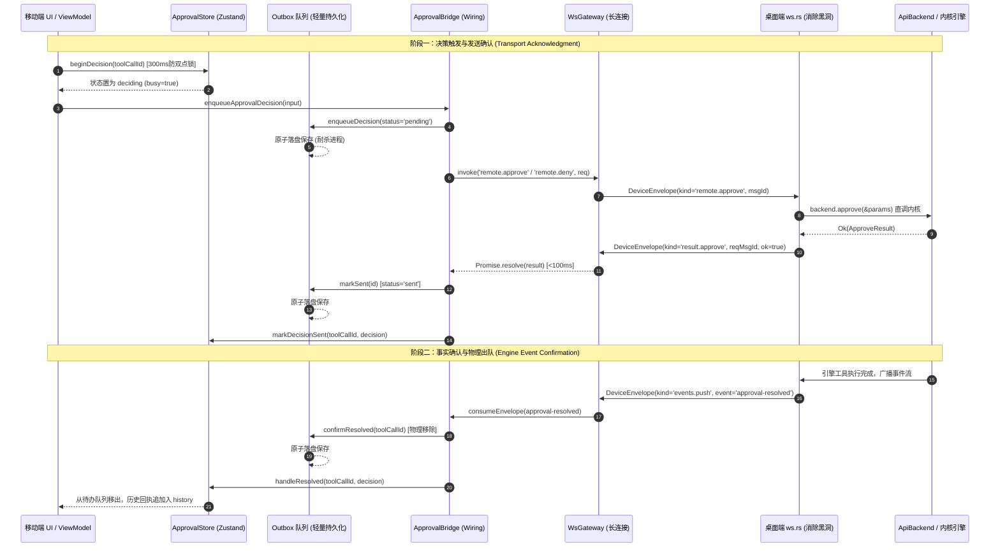
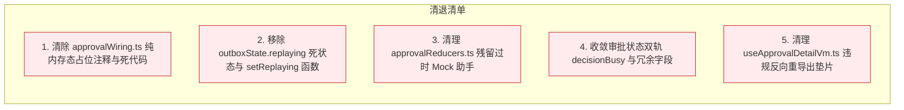
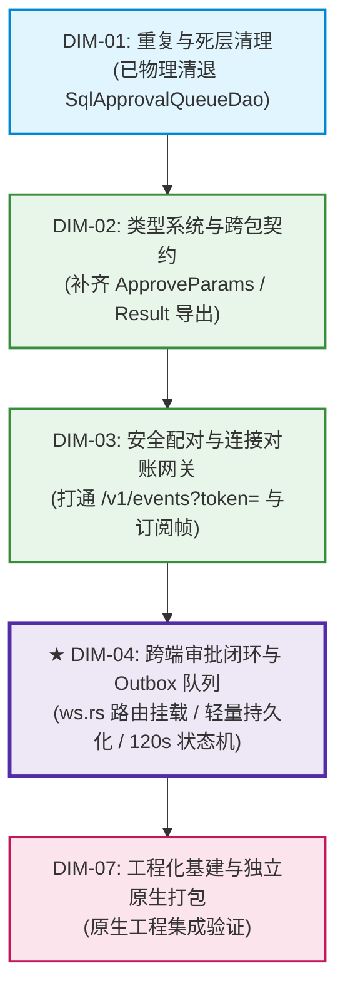

# DIM-04 实施详案：跨端审批闭环与 Outbox 队列 (04-plan-dim-04-approval-outbox.md)

> **战役目录**：`docs/mobile-revival-audit/`
> **文档位置**：`docs/mobile-revival-audit/plans/04-plan-dim-04-approval-outbox.md`
> **负责 Agent**：【DIM-04 跨端审批闭环与 Outbox 队列详案编写 Agent】
> **输入基准**：
> - 总计划框架：`02-master-revival-plan.md`
> - 终审定案：`01-final-dimensions.md`（DIM-04 定案）
> - 评审仲裁：`plan-reviews/`（01 契约分歧仲裁、02 负产出硬审、03 可行性对撞）
> - 专项调研：`surveys/05-approval-center-and-outbox.md`
> **核心准则**：
> - 严守《主 Agent 全流程调度提示词 v3》第二阶段第 4 步规范与根目录《AGENTS.md》；
> - 坚守反退避纪律（`.agents/LOGIC_PLAN_NO_RETREAT.md`）与反过度设计红线（`ANTI_OVERENGINEERING_GUARDRAILS.md`）；
> - 绝对禁止出现任何波次/批次编号；绝对不修改业务代码；不涉及任何笔记功能；
> - 推进单位为领域概念，坚持负产出先行，单一真理源（SSOT），单向无环依赖（DAG）。

---

## 模块架构全景与协议交互拓扑

跨端审批闭环是移动端与桌面端核心安全交互链路（涉及工具调用人机裁决）。整体架构横跨移动端领域数据面、状态面、视图适配面与桌面端 WebSocket/Rust 内核服务端：



---

## 一、【做什么】（新增/修复清单）

针对专项调研 `surveys/05-approval-center-and-outbox.md` 揭露的“远程命令黑洞（P0）”、“零持久化抗杀进程断裂（P0）”以及“120s 倒计时盲区与防双点漂移”，本维度执行以下具体新增与修复：

### 1.1 桌面端 `apps/agent-workbench/src-tauri/src/server/ws.rs` 消除远程命令黑洞（P0）

#### (1) 缺陷机理与定位
- **定位**：[`apps/agent-workbench/src-tauri/src/server/ws.rs:1133-1163`](file:///c:/Software/conex/apps/agent-workbench/src-tauri/src/server/ws.rs#L1133-L1163)；
- **根因**：桌面端 WebSocket 服务端在处理文本帧入站信封时，`match &envelope.kind` 仅匹配了 `PairHello`、`EventsSubscribe`、`EventsSubscribeAll`、`EventsResume`、`Heartbeat`、`EventsAck` 与 `Error`。所有 `MessageKind::Remote(cmd)` 命令帧直接跌入通配分支：
  ```rust
  _ => {
      tracing::debug!(target: "ws", conn_id = ctx.conn_id, kind = %envelope.kind_str(), "R1-05 范围外 kind，忽略");
      Action::Continue
  }
  ```
  服务端静默丢弃移动端发来的所有审批命令，**从不回复任何 `result.*` 帧**。移动端 `WsGateway.invoke` 必将经历 10 秒完整超时（`cmd.timeout`），造成致命的“远程命令黑洞”。

#### (2) 修复实现方案
在 `ws.rs` 消息主分发器中接管 `MessageKind::Remote(cmd)`，挂载专用的命令路由处理器：

1. **路由分发挂载**：
   在 `handle_text` 的 `match &envelope.kind` 中补充分支：
   ```rust
   MessageKind::Remote(cmd) => {
       handle_remote_command_frame(cmd.as_str(), envelope.body, envelope.msg_id.as_str(), ctx).await
   }
   ```

2. **命令解析与直调内核（消除黑洞）**：
   实现异步处理函数 `handle_remote_command_frame`：
   - **后端提取**：检查 `ctx.state.backend`（类型 `Option<Arc<dyn ApiBackend>>`）。若未装配，立即返回 `CommandResult::failure(msg_id, ErrorBody::new(DeviceErrorCode::Internal, "API backend not initialized"))`；
   - **请求反序列化**：将 `body` 反序列化为 `conex_types::device::commands::CommandRequest`，提取 `req.params`；
   - **命令分支路由**：
     - **`cmd == "approve"`**：反序列化参数为 `ApproveParams { tool_call_id, run_id }`，调用 `backend.approve(params).await`；
     - **`cmd == "deny"`**：反序列化参数为 `DenyParams { tool_call_id, run_id, reason }`，调用 `backend.deny(params).await`；
     - **`cmd == "listPendingApprovals"`**：反序列化参数为 `ListPendingApprovalsParams { after_sequence }`，调用 `backend.list_pending_approvals(params).await`；
     - **其他命令**：返回 `CommandResult::failure(msg_id, ErrorBody::new(DeviceErrorCode::CmdNotFound, format!("Unsupported remote command: {cmd}")))`；
   - **回执组装与回发**：
     - 若调用成功，构造 `CommandResult::success(msg_id, serde_json::to_value(res)?)`；
     - 若返回 `ServerError`，根据错误类型精确映射为 `DeviceErrorCode`（如 409 冲突映射为 `cmd.approval_mismatch`），构造 `CommandResult::failure(msg_id, error_body)`；
     - 调用 `send_envelope(ctx, MessageKind::Result(cmd.to_string()), command_result).await` 立即回发出站信封；
   - **性能指标**：命令直接命中 Tauri 内存态审批门，**双端回执响应时间严格保证 $< 100\text{ms}$**，彻底终结 10 秒超时黑洞。

3. **契约同构性对齐**：
   检查 `crates/conex-types/contracts/device-protocol.json` 与 `command_manifest.rs`，确保 `mobile_list_pending_approvals` 的契约注册状态从 `registered: false` 纠正为 `registered: true`，保持跨端同构。

---

### 1.2 移动端 Outbox 队列接入轻量可靠持久化适配器（抗进程强杀）

#### (1) 架构路线决策（清退 SQLite DAO，采纳轻量适配器）
- 依据主控在《01-final-dimensions.md》与《01-contract-and-overlap-review.md》§3.5 的权威裁决：
  - **坚决驳回复活重型 SQLite DAO 的错误倾向**。移动端审批在途队列属于典型的高敏捷、短生命周期（最多 120 秒）、低数据量（通常 1~5 条）瞬态缓存；
  - 为几条瞬态数据维护重型 SQLite 表、复杂 SQL 与 800 行单测属于违背《ANTI_OVERENGINEERING_GUARDRAILS.md》的过度设计；
  - 采纳**轻量异步持久化适配器（`OutboxPersistAdapter`）**，基于移动端已有的安全存储（`SecureStoreDriver`）实现轻量序列化存储，代码量不足 60 行即可 100% 达成“抗强杀水合恢复”要求。

#### (2) 适配器接口与持久化机制
1. **接口定义**（位于 `src/domain/data/outboxPersist.ts`）：
   ```typescript
   export interface OutboxPersistAdapter {
     /** 加载持久化的 Outbox 队列快照 */
     load(): Promise<OutboxItem[]>;
     /** 原子保存当前 Outbox 队列状态 */
     save(items: readonly OutboxItem[]): Promise<void>;
     /** 清空持久化队列（测试隔离/重置） */
     clear(): Promise<void>;
   }
   ```

2. **基于安全存储驱动的默认实现**：
   - 存储键：锁定为单一常量 `crish.mobile.outbox.v1`；
   - 驱动接入：默认使用 `src/db/secureStore.ts` 导出的 `SecureStoreDriver`（生产环境为 `expoSecureStoreDriver()`，单元测试注入 `InMemorySecureStore`）；
   - 容错解析：在 `load()` 时执行 JSON 解码，对缺失字段进行结构校验；若存储内容损坏或反序列化失败，安全回退为空数组并记录告警，绝不导致应用冷启动崩溃。

3. **四处原子落盘触发点（增删改即时同步）**：
   在 `src/adapters/wiring/approvalWiring.ts` 中，在对内存态 `outboxState` 执行纯函数更新后，立即同步触发持久化：
   - **入队/覆盖**：`enqueueDecision` 成功后 $\to$ `await adapter.save(snapshotOutbox(outboxState))`；
   - **阶段一发送确认**：`markSent` 成功后 $\to$ `await adapter.save(snapshotOutbox(outboxState))`；
   - **失败退避记录**：`recordFailure` 记录重试后 $\to$ `await adapter.save(snapshotOutbox(outboxState))`；
   - **阶段二事实确认出队**：`confirmResolved` 移除条目后 $\to$ `await adapter.save(snapshotOutbox(outboxState))`；
   - **超时或手动清理**：`dismissItem` / `pruneExpired` 移除后 $\to$ `await adapter.save(snapshotOutbox(outboxState))`。

4. **冷启动水合重放规程（Hydration & Replay Workflow）**：
   在 `ensureApprovalWiring` 或应用冷启动初始化阶段：
   ```typescript
   // 1. 从轻量安全存储异步读取已持久化条目
   const persistedItems = await persistAdapter.load();
   const now = Date.now();
   // 2. 水合进入内存态模型，自动剔除超过 24h 的废弃条目
   outboxState = hydrateOutbox(persistedItems, now);
   // 3. 同步 Store 状态与角标
   syncOutboxCount();
   // 4. 触发单飞重放，检查是否存在未完成的 pending 或退避到期 failed 条目
   void bridge.flush();
   ```
   **达成效果**：用户离线审批后，即使手机被系统回收或用户强制上划杀进程，再次冷启动打开应用时，离线决策 100% 完整保留，并在长连接就绪后自动重发。

---

### 1.3 完善 120s 倒计时本地心跳到期（markExpired）与 300ms 防双点硬时间锁

#### (1) 120s 倒计时本地心跳到期（markExpired）闭环
- **机理背景**：桌面端引擎审批超时固定为 120 秒（`APPROVAL_TIMEOUT = 120s`），但引擎在超时后**并不主动广播 `approval-resolved(expired)` 事件**。移动端必须具备严密的本地时钟推进与主动超时到期状态机。
- **状态机盲区修复（将 `queued` 态纳入到期裁决）**：
  - 现状缺陷：`useApprovalListVm.ts:72-74` 仅对 `pending` 与 `deciding` 状态执行 `now >= item.expiresAt` 到期检查。如果网络断开，条目进入 Outbox 排队，其状态被标记为 `queued`；若离线长达数小时，卡片永久卡在“待发送 · 网络恢复后自动发送”，倒计时归零却不置灰；
  - 闭环改造：
    - 在 ViewModel 定时心跳中，将到期判定扩展至 `queued`：
      ```typescript
      if (
        (item.status === 'pending' || item.status === 'deciding' || item.status === 'queued') &&
        now >= item.expiresAt
      ) {
        approvalStore.getState().markExpired(item.request.toolCallId, now);
      }
      ```
    - 在 `approvalStore.markExpired` 触发时：
      1. 条目状态迁移至 `status = 'expired'`, `decisionStatus = 'failed'`；
      2. 条目不立即从待办列表抹去，而是置灰保留 24 小时（`FINISHED_RETENTION_MS = 24h`），向用户明确呈现已超时的客观事实；
      3. 自动生成一条渠道为 `'auto'`、决策为 `'expired'` 的审计回执，追加写入历史记录 `history`；
      4. **关键收敛**：调用 `confirmResolved(outboxState, toolCallId)` 将该条目从 Outbox 队列中主动移除并落盘，**禁止在后续网络恢复时向服务端发送必然被 409/expired 拒绝的失效垃圾决策**！
      5. 用户可通过 `dismissExpired(toolCallId)` 手动滑除已过期的条目。

#### (2) 300ms 防双点硬时间锁
- 建立从 UI 到 Reducer 的三级纵深防御体系：
  1. **UI 交互层**：`ApprovalActionBar.tsx` 接收 `busy: boolean` 属性。在 `busy === true` 时，按钮视觉禁用并拦截所有 `onPress` 回调；拒绝二次确认弹窗强制自动关闭；
  2. **ViewModel 层**：`useApprovalDetailVm.ts` 检查目标 `toolCallId` 是否处于全局 busy 状态，命中直接 early return；
  3. **Reducer 领域层刚性时间锁**：
     在 `approvalReducers.ts` 的 `beginDecision` 中施加绝对时间差校验：
     $$\Delta t = \text{nowMs} - \text{item.decisionSentAtMs}$$
     若 $\Delta t < 300\text{ms}$，直接判定为非法连击，拒绝状态转移（返回 `ok: false`），彻底消除多指连击或系统渲染卡顿引发的并发双发。

---

### 1.4 重构 Outbox 重试调度与串行超时雪崩防范

针对专项调研指出的一级定时器饥饿与串行网络阻塞缺陷，实施以下两项调度算法重构：

#### (1) 快速失败防雪崩机制（Rapid Failure Bailout）
- **缺陷**：在 `flushOnce` 中，对于拉取出的批量条目执行串行 `await this.sendOne(item)`。若连接断开，每个条目都等待 10 秒超时，5 个条目将导致重放单飞锁被死锁长达 50 秒，新操作全部被挂起；
- **重构**：在 `flushOnce` 批量重放循环中，一旦首个或某条条目遭遇底层传输断开异常（`err.code === 'transport.closed'`），**立即中断当批剩余条目的串行调用**。未发条目保持在当前状态，单飞锁 `replayInflight` 立即释放，等待网络重连信号（`onSyncReady`）到达时再瞬间唤醒全量重放，杜绝无效串行等待。

#### (2) 动态退避定时器防饥饿重构（Dynamic Backoff Coalescing）
- **缺陷**：现存 `scheduleBackoffRetry` 只要 `this.retryTimer !== null` 就直接 return。若条目 A（第 4 次失败）启动了 60s 定时器，2s 后条目 B（第 1 次失败，退避 1s）进入，将被 60s 定时器无辜拖累近 58 秒；
- **重构**：动态计算当前队列中所有失败条目的最小期望时刻：
  $$\text{earliestMs} = \min_{i \in \text{failed}} \{ i.\text{nextRetryAtMs} \}$$
  当新入队的失败条目产生更早的 `earliestMs` 时，主动 `clearTimeout(this.retryTimer)`，并以最新的最小时间差重新排期定时器，确保首次失败条目在 1 秒后准时重放。

---

## 二、【删什么】（刚性删除面/死代码清理）

遵照主控《01-final-dimensions.md》与《02-negative-output-and-dead-code-review.md》的刚性要求，本维度必须彻底清退以下 5 大死代码与冗余实现：



### 2.1 清理 `approvalWiring.ts` 中的纯内存态占位注释与死代码
1. **核销占位注释**：
   拔除 `src/adapters/wiring/approvalWiring.ts:72` 的历史妥协注释：
   > `// 职责边界：...持久化（D6 §6.6 硬底线）属 db 域后续轮次，本层为内存态占位。`
   替换为真实轻量持久化适配器的装配逻辑。
2. **核销手写重复命令构造函数**：
   删除 `approvalWiring.ts:97-141` 中私自手写的 `buildApproveRequest`、`buildDenyRequest` 与 `buildListPendingApprovalsRequest`。统一改为从 `src/domain/repositories/approvalCommands.ts` 导入单一真理源（SSOT）构造函数，消灭双源维护漂移。

### 2.2 移除 `outboxState.replaying` 死状态
- **死代码事实**：`src/domain/data/outbox.ts:43, 178-183` 定义了 `OutboxState.replaying` 属性与 `setReplaying` 函数。但在接线层 `approvalWiring.ts` 中，并发单飞控制完全由类私有属性 `private replayInflight = false;` 独立承担，从未调用过 `setReplaying`。`outboxState.replaying` 恒为 `false`。
- **刚性删除**：
  - 从 `outbox.ts` 的 `OutboxState` 接口中彻底删除 `replaying: boolean`；
  - 物理删除 `setReplaying(state, replaying)` 函数；
  - 修正 `createOutboxState()`，仅返回 `{ items: [] }`。

### 2.3 清理 `approvalReducers.ts` 中残留的过时 Mock 生成辅助函数
- **死代码事实**：在历史演进中，部分单测与原型期的虚构数据构造辅助函数混入了纯逻辑 Reducer 文件中；
- **刚性删除**：全面清洗 `src/domain/store/approvalReducers.ts`，坚决移除非业务纯逻辑的 Mock 生成代码与历史遗留注释，保证该文件 100% 只包含纯函数状态转移（便于 Jest 极速纯逻辑验证）。

### 2.4 收敛审批状态冗余字段与双轨 `decisionBusy`
- **双轨分裂事实**：
  - 轨 1：`approvalStore.decisionBusy: Record<string, boolean>`（Store 顶层字典）；
  - 轨 2：`ApprovalItem.decisionBusy: boolean`（列表条目内字段）。
  在 `approvalStore.ts:175-183` 的 `markQueued` 动作中，代码更新了 `p.decisionBusy = true`，却漏写了 `s.decisionBusy[toolCallId] = true`，导致双轨状态裂痕。
- **收敛方案**：
  - 确立 `ApprovalItem.status` 与 `ApprovalItem.decisionStatus` 为核心状态轴；
  - 收敛 `decisionBusy` 的真理路径：以 Store 顶层 `decisionBusy: Record<string, boolean>` 作为 UI 防抖查询真理源，`ApprovalItem.decisionBusy` 仅作为只读派生镜像；
  - 严密修复 `markQueued`、`markDecisionFailed` 与 `markDecisionConflict` 中字典与条目状态的同步一致性；
  - 清理 `ApprovalItem` 中与 `status` 语义重叠的死字段。

### 2.5 清理 ViewModel 层的历史兼容导出垫片
- **架构违规事实**：`src/adapters/viewmodels/useApprovalDetailVm.ts:18-25` 反向重导出了本属于 Wiring 层的控制方法：
  ```typescript
  export {
    approvalOutboxCount,
    enqueueApprovalDecision,
    resetApprovalOutboxForTest,
  } from '../wiring/approvalWiring';
  ```
- **刚性删除**：彻底拔除该“兼容出口”。表现层 ViewModel 严禁作为底层基础设施的二次中继站；所有需要调用 Outbox 接线的方法直接由调用方按分层架构引用，划清层级边界。

---

## 三、【依赖与逻辑顺序】

遵照全战役全局单向无环依赖拓扑（DAG），本维度严格遵循以下依赖前置条件与五步推进顺序：

### 3.1 拓扑依赖关系 (DAG)



1. **依赖 DIM-01（基座先行）**：
   - 必须等待 DIM-01 彻底清退 `SqlApprovalQueueDao` 及其单测，清除 SQLite 历史死代码，为 DIM-04 引入轻量持久化适配器扫清道路；
2. **依赖 DIM-02（类型护栏）**：
   - 必须依赖 `@crish/shared-types` 导出健全的 `ApproveParams`、`DenyParams`、`CommandRequest`、`CommandResult` 与严格解析器，确保前后端通信强类型校验；
3. **依赖 DIM-03（长连接载体）**：
   - 必须依赖 WebSocket 端点 `/v1/events?token=` 成功 Upgrade 101，以及 `events.subscribe` 首帧订阅成功建立双向传输信道。

---

### 3.2 逻辑推进五步执行顺序

实施过程严格按以下 5 步递进展开，各步骤环环相扣，零逻辑倒置：

```
┌─────────────────────────────────────────────────────────────┐
│ 步骤 1：桌面端 ws.rs 补齐 Remote 命令分发路由 (消除黑洞)     │
└──────────────────────────────┬──────────────────────────────┘
                               │
                               ▼
┌─────────────────────────────────────────────────────────────┐
│ 步骤 2：移动端 Outbox 接入轻量安全持久化适配器 (抗强杀)      │
└──────────────────────────────┬──────────────────────────────┘
                               │
                               ▼
┌─────────────────────────────────────────────────────────────┐
│ 步骤 3：审批 Store 与 Reducer 状态机闭环 (120s到期与防双点)  │
└──────────────────────────────┬──────────────────────────────┘
                               │
                               ▼
┌─────────────────────────────────────────────────────────────┐
│ 步骤 4：ApprovalBridge 重放调度与防雪崩/防饥饿改造 (接线收口) │
└──────────────────────────────┬──────────────────────────────┘
                               │
                               ▼
┌─────────────────────────────────────────────────────────────┐
│ 步骤 5：ViewModel 层收敛与端到端立体双向集成断言 (全面验收)   │
└─────────────────────────────────────────────────────────────┘
```

#### 步骤 1：桌面端 `ws.rs` 补齐 `Remote` 命令分发路由（消除黑洞）
- 在 `apps/agent-workbench/src-tauri/src/server/ws.rs` 中为 `MessageKind::Remote(...)` 挂载 `handle_remote_command_frame`；
- 对接 `ApiBackend` 的 `approve`、`deny`、`list_pending_approvals`；
- 组装 `CommandResult` 并通过 `send_envelope` 返回 `result.*` 信封；
- 编写 Rust 集成测试验证 `remote.approve` 回执正常下发。

#### 步骤 2：移动端 Outbox 接入轻量安全持久化适配器（抗强杀）
- 清理 `outbox.ts` 中的 `replaying` 死状态；
- 新建 `src/domain/data/outboxPersist.ts`，基于 `SecureStoreDriver` 实现轻量队列落盘与加载；
- 在 `outbox.ts` 中保持纯数据模型，编写持久化适配器单元测试；
- 验证即使强杀进程，水合逻辑亦能无损还原。

#### 步骤 3：审批 Store 与 Reducer 状态机闭环（120s 到期与防双点）
- 清洗 `approvalReducers.ts` 中的过时 Mock 生成辅助函数；
- 在 `beginDecision` 中固化 300ms 硬时间锁；
- 在 `expireApproval` 中增加对 `queued` 态的处理，超时主动置为 `expired` 并触发 Outbox 出队；
- 收敛 `approvalStore.ts` 中的双轨 `decisionBusy`，修复 `markQueued` 状态同步漏洞。

#### 步骤 4：ApprovalBridge 重放调度与防雪崩/防饥饿改造（接线收口）
- 清理 `approvalWiring.ts` 中的占位注释与重复命令构造函数；
- 接入持久化适配器，在入队、发送成功、失败退避、事实确认出队等关键节点触发 `persistAdapter.save()`；
- 在 `ensureApprovalWiring` 挂载冷启动水合重放；
- 改造 `flushOnce` 实现快速失败中断（防雪崩），改造 `scheduleBackoffRetry` 实现动态最小定时器重算（防饥饿）。

#### 步骤 5：ViewModel 层收敛与端到端立体双向集成断言（全面验收）
- 清除 `useApprovalDetailVm.ts` 中的反向重导出垫片；
- 在 `useApprovalListVm.ts` 完善秒级心跳超时触发；
- 运行全量单元测试与双端模拟测试，执行立体化准出断言。

---

## 四、【唯一文件域】

为杜绝多 Agent 协同中的写文件冲突与职能越界，严格锁定本维度的唯一文件操作域：

### 4.1 文件边界与职责矩阵

| 文件相对路径 | 归属模块 | 允许的操作类型 | 核心修改/实现职责 |
| :--- | :--- | :---: | :--- |
| `apps/agent-workbench/src-tauri/src/server/ws.rs` | 桌面服务端 | **修改 (MODIFY)** | 挂载 `MessageKind::Remote` 命令路由分支，直调 `ApiBackend` 并回送 `result.*` 回执 |
| `apps/crish-mobile/src/domain/data/outbox.ts` | 移动端 Domain | **修改 (MODIFY)** | 清理 `replaying` 死状态与死函数，维护纯函数队列模型与快照 |
| `apps/crish-mobile/src/domain/data/outboxPersist.ts` | 移动端 Domain | **新建 (NEW)** | 封装基于 `SecureStoreDriver` 的轻量持久化适配器 `OutboxPersistAdapter` |
| `apps/crish-mobile/src/domain/store/approvalReducers.ts` | 移动端 Domain | **修改 (MODIFY)** | 清理残留 Mock 助手，完善 120s 状态机（支持 queued 到期），固化 300ms 时间锁 |
| `apps/crish-mobile/src/domain/store/approvalStore.ts` | 移动端 Domain | **修改 (MODIFY)** | 收敛双轨 `decisionBusy`，修复 `markQueued` 同步裂痕，支持水合初始化 |
| `apps/crish-mobile/src/domain/types/domain.ts` | 移动端 Domain | **修改 (MODIFY)** | 规范 `ApprovalItem` 契约定义，收敛冗余重合字段 |
| `apps/crish-mobile/src/adapters/wiring/approvalWiring.ts` | 移动端 Adapter | **修改 (MODIFY)** | 移除占位注释与手写重复构造，接线轻量持久化适配器，实现防雪崩与防饥饿重试 |
| `apps/crish-mobile/src/adapters/viewmodels/useApprovalListVm.ts` | 移动端 Adapter | **修改 (MODIFY)** | 完善 120s 秒级倒计时本地心跳到期扫描（覆盖 queued 态） |
| `apps/crish-mobile/src/adapters/viewmodels/useApprovalDetailVm.ts`| 移动端 Adapter | **修改 (MODIFY)** | 移除对 wiring 层的违规反向重导出垫片，规范分层边界 |
| `apps/crish-mobile/src/adapters/wiring/approvalWiring.test.ts` | 移动端测试 | **修改 (MODIFY)** | 补充轻量持久化接入、断线重放、防雪崩快速失败与防饥饿定时器测试 |
| `apps/crish-mobile/src/domain/store/approvalReducers.test.ts` | 移动端测试 | **修改 (MODIFY)** | 覆盖 300ms 刚性防双点锁与 queued 态本地超时的测试用例 |

---

### 4.2 刚性禁止越界文件清单（红线）

- ❌ **严禁触碰 SQLite 历史死层**：不得修改或试图在业务中调用 `src/db/dao/approvalQueueDao.ts`（该文件由 DIM-01 统一执行物理核销）；
- ❌ **严禁侵入会话流与终端模块**：不得修改 `src/adapters/wiring/feedBridge.ts`、`TerminalView.tsx`、`terminalStore.ts`（由 DIM-05 专职负责）；
- ❌ **严禁侵入 UI 原子组件库**：不得在审批卡片中自行发明新 Input 或新 Tooltip（统一由 DIM-06 规范落地）；
- ❌ **严禁修改公共类型包源代码**：不得修改 `packages/shared-types/src/index.ts`（由 DIM-02 统一导出）。

---

## 五、【验收标准】

实施完成后，必须严格履行立体化验收，严禁单一检查冒充验收。各项验收断言指标必须具备可观测物理证据：

### 5.1 静态与类型安全断言（底线）
- [ ] **TypeScript 零报错**：
  ```bash
  npm run typecheck -w @crish/crish-mobile
  ```
  断言执行无任何错误，`outboxPersist.ts` 与收敛后的 `approvalStore.ts` 类型 100% 严密。
- [ ] **Rust 桌面端编译通过**：
  ```bash
  cargo check --package conex-agent-workbench
  ```
  断言 `ws.rs` 中的远程命令分发与信封序列化完全通过 Rust 编译器严格类型检查。

---

### 5.2 单元测试与核心状态机断言（逻辑层）
- [ ] **审批 Reducer 纯逻辑与防双点单测全绿**：
  ```bash
  npm --workspace @crish/crish-mobile run test -- src/domain/store/approvalReducers.test.ts
  ```
  - 断言 `beginDecision` 在 $< 300\text{ms}$ 连击时 100% 返回 `ok: false`；
  - 断言 `expireApproval` 对 `pending`、`deciding`、`queued` 均能正确置为 `expired` 终态并产生审计记录。
- [ ] **审批 Store 状态管理单测全绿**：
  ```bash
  npm --workspace @crish/crish-mobile run test -- src/domain/store/approvalStore.test.ts
  ```
  - 断言 `decisionBusy` 在入队、出队、失败回滚时全局字典与条目状态完全一致。
- [ ] **Wiring 接线与 Outbox 重放单测全绿**：
  ```bash
  npm --workspace @crish/crish-mobile run test -- src/adapters/wiring/approvalWiring.test.ts
  ```
  - 断言两阶段确认时序正常（收到 `result.approve` 迁至 `sent`，收到 `approval-resolved` 彻底出队）；
  - 断言快速失败机制生效（网络断开时当批后续请求瞬间中断，无串行盲等）；
  - 断言动态退避定时器生效（新错误产生更小重试时间时定时器自动前移）。

---

### 5.3 跨端物理通信与时序现场断言（端到端现场）
- [ ] **命令回执 $< 100\text{ms}$ 断言（消除命令黑洞）**：
  - 移动端与桌面端建立 WebSocket 连接后，在移动端触发 `remote.approve`；
  - 桌面端 `ws.rs` 捕获帧并在日志中输出 `handling remote.approve`；
  - 移动端在 **$100\text{ms}$ 以内** 收到 `result.approve`（`ok: true`）信封，Promise 立即 Resolve，消除 10 秒超时挂起。
- [ ] **抗杀进程与冷启动自动水合断言（零丢失）**：
  - 断开桌面端网络模拟离线，在移动端点击“允许执行”，条目进入 Outbox 并标记为 `queued`；
  - 检查设备安全存储，确认已持久化落盘；
  - 强制杀掉移动端 App 进程（模拟 iOS / Android 后台回收终止）；
  - 重新启动应用（冷启动），断言 `hydrateOutbox` 成功从安全存储恢复该待办决策，UI 顶部角标正确呈现待发送计数；
  - 恢复网络连接，长连接重新建立握手（`events.subscribe.ok`）后，`ApprovalBridge` 自动触发 `flushOnce()`，将暂存决策单飞发送至桌面端，桌面端执行后发回 `approval-resolved`，移动端本地条目顺利出队并写入历史。
- [ ] **120s 倒计时超时置灰与防垃圾发送断言**：
  - 保持离线状态使条目倒计时耗尽（越过 `expiresAt`）；
  - 观察本地卡片状态：卡片置灰转为“已过期”，按钮不可点击；
  - 恢复网络，断言 Outbox 队列已被清除，绝不向桌面端补发该过期失效指令。

---

*DIM-04 跨端审批闭环与 Outbox 队列维度详尽实施方案制定完毕，已就绪供主控收录与后续阶段落地执行！*
