# 移动端复兴实施详案 · DIM-05 会话流式事件与终端缓冲引擎 (05-plan-dim-05-session-terminal.md)
## —— 未读红点接线闭环、绝对游标滚底防死锁、条件 24dp 补偿、纯算法下沉与高吞吐流式防爆仓方案

> **战役工作区**：`docs/mobile-revival-audit/`
> **详案编号**：`plans/05-plan-dim-05-session-terminal.md`
> **归属维度**：`DIM-05` 会话流式事件与终端缓冲引擎
> **责任 Agent**：DIM-05 会话流式事件与终端缓冲引擎详案编写 Agent
> **定案与依据资产**：
> - 终审定案文档：[`docs/mobile-revival-audit/01-final-dimensions.md`](file:///c:/Software/conex/docs/mobile-revival-audit/01-final-dimensions.md)
> - 实施总纲框架：[`docs/mobile-revival-audit/02-master-revival-plan.md`](file:///c:/Software/conex/docs/mobile-revival-audit/02-master-revival-plan.md)
> - 专项调查报告：[`docs/mobile-revival-audit/surveys/06-sessions-runs-and-events.md`](file:///c:/Software/conex/docs/mobile-revival-audit/surveys/06-sessions-runs-and-events.md)、[`docs/mobile-revival-audit/surveys/07-terminal-and-line-buffer.md`](file:///c:/Software/conex/docs/mobile-revival-audit/surveys/07-terminal-and-line-buffer.md)
> - 三方严审报告：`docs/mobile-revival-audit/plan-reviews/`（01 契约重叠审、02 负产出审、03 可行性审）
> **协作与纪律铁律**：严格遵守《主 Agent 全流程调度提示词 v3》、《AGENTS.md》、反退避全文（`LOGIC_PLAN_NO_RETREAT.md`）与反过度设计红线（`ANTI_OVERENGINEERING_GUARDRAILS.md`）；**严禁修改或提交任何业务代码**（本轮仅出具详案）；**严禁出现任何波次/批次编号**；完全不涉及笔记功能；一个概念一条主路径。

---

## 目录

1. [架构与领域定位概述（单一真理源 SSOT）](#一架构与领域定位概述单一真理源-ssot)
2. [【做什么】（新增/修复执行清单）](#二做什么新增修复执行清单)
   - 2.1 接线 `sessionStore.applyLatestSeq` 与未读红点闭环（P0）
   - 2.2 彻底根治终端满 5000 行吸底滚底死锁（P0）
   - 2.3 修复 FlatList `getItemLayout` 坐标错位（P0）
   - 2.4 将 `terminalLineBuffer.ts` 纯算法物理下沉至 Domain 层
   - 2.5 实施流式 `message-delta` 动态折叠防 500 条环形缓冲爆仓
   - 2.6 前台正视会话加锁（Foreground Window Guard）
   - 2.7 跨 Chunk ANSI 状态机清洗与控制符防御
   - 2.8 补齐 27 类事件人话摘要、短标签与错误级别
3. [【删什么】（刚性删除与核销清单）](#三删什么刚性删除与核销清单)
   - 3.1 彻底消除 `terminalScreen.tsx` 的双真理 fallback 分支与 $O(N)$ 遍历
   - 3.2 全仓核销死契约 `tool-update`（5 处残留）
   - 3.3 全仓核销死函数（`replaceAllTerminalText`、`stripAnsiDetailed`）
   - 3.4 删除 chunk 边界提前裁剪最旧行的脆弱逻辑
4. [【依赖与逻辑顺序】（因果推进拓扑）](#四依赖与逻辑顺序因果推进拓扑)
5. [【唯一文件域】（精准文件范围与防越权边界）](#五唯一文件域精准文件范围与防越权边界)
6. [【验收标准与立体验证矩阵】（质量门禁）](#六验收标准与立体验证矩阵质量门禁)

---

## 一、架构与领域定位概述（单一真理源 SSOT）

在 Conex / Crish 跨端系统架构中，移动端承担着轻量级、高敏捷、强韧性的实时观测终端职责。作为整个移动端人机交互频次最高的核心中枢，**会话流式事件系统**与**终端输出引擎**直接决定了用户能否准确获取桌面端 Agent 执行进展。

经专项调查报告（`surveys/06`、`surveys/07`）与三方交叉严审确证，当前流式事件与终端模块存在数个严重的**P0 级业务死锁、坐标撕裂与虚假闭环**：
1. **未读红点虚假闭环（P0 业务断层）**：领域层 `sessionReducers.ts` 中设计了完备的未读计数模型（`applyLatestSeq` / `markSessionRead`），但在 WebSocket 事件接线层（`eventMappers.ts`、`ingestRouter.ts`）中，`message-end` 事件被单纯当作普通 feed 帧透传，生产链路从未调用 `applyLatestSeq`。真机运行时未读红点恒为 0，详情页的清零逻辑沦为空转；
2. **满 5000 行吸底滚底死锁（P0 交互死锁）**：`TerminalView.tsx` 的 `useEffect` 将 `lines.length` 作为自动吸底滚动的依赖项。当输出达到 5000 行上限后，随着新行进入旧行淘汰，`lines.length` 恒定等于 5000，`useEffect` 彻底停止触发，用户屏幕定格，后续源源不断的实时输出完全无法自动呈现；
3. **FlatList 24dp 坐标错位撕裂（P0 视觉崩溃）**：当产生行截断时，`TerminalView.tsx` 动态插入了高度为 24dp 的 `ListHeaderComponent` 截断提示栏，但虚拟化配置 `getItemLayout` 硬编码了 `offset = 24 * index`，导致视口内所有行发生 24dp 永久位移错位，滑动至顶部时发生剧烈弹跳与可视区域撕裂；
4. **架构依赖逆向倒置（违反整洁架构）**：位于领域层的 `terminalReducers.ts` 反向直接引用了位于表现层的 `src/presentation/components/terminal/terminalLineBuffer.ts`，严重破坏分层解耦铁律；
5. **Delta 洪峰冲刷与 500 环形缓冲爆仓（高并发隐患）**：Rust 引擎为每个 `message-delta` 赋予递增 sequence，移动端 `appendFeed` 未做增量聚合，普通 300 token 的回复即产生数百条记录，瞬间冲垮 500 条环形缓冲并挤出关键的生命周期与审批事件；
6. **LRU 窗口无锁导致前台正视会话被误杀（前台白屏隐患）**：`feedBridge.ts` 在活跃窗口超过 4 个时仅凭时间戳淘汰，用户前台正在查看的无输入会话会被后台繁忙的会话挤压清空，导致当前屏幕突变为空白；
7. **跨 Chunk ANSI 乱码与 27 类事件摘要缺位**：无状态 `stripAnsi` 在数据分片时导致转义序列泄漏为乱码（如 `2m`、`0m`），同时 57 类事件中有 27 类在时间线上仅显示为生硬的英文 `事件 <type>`。

**DIM-05 核心使命**：以 Plan 04 流式缓冲架构为主骨架，结合 Plan 01/02/03 的严密仲裁，打通未读红点端到端闭环，引入标量绝对游标根治终端 5000 行滚底死锁，实现 FlatList 条件化 24dp 坐标补偿，物理下沉纯算法至 Domain 层，落地 Streaming Delta 折叠与前台正视锁，清洗跨 Chunk ANSI 序列并补齐 57 类事件人话摘要，为移动端筑起工业级的高性能流式观测引擎。

---

## 二、【做什么】（新增/修复执行清单）

### 2.1 接线 `sessionStore.applyLatestSeq` 与未读红点闭环（P0）

#### 1. 问题根因与调用断层锁定
- `apps/crish-mobile/src/domain/store/sessionReducers.ts:159-170` 定义了纯函数 `applyLatestSeq`，在最新 sequence 大于已读游标且该消息属于助手时计算未读差值：
  ```typescript
  export function applyLatestSeq(
    item: SessionSummary,
    latestSeq: number,
    latestIsAssistant: boolean
  ): SessionSummary {
    const unread =
      latestIsAssistant && latestSeq > item.lastReadSequence
        ? latestSeq - item.lastReadSequence
        : 0;
    if (unread === item.unreadCount) return item;
    return { ...item, unreadCount: unread };
  }
  ```
- `apps/crish-mobile/src/domain/store/sessionStore.ts:96-105` 对外暴露了 `applyLatestSeq` 接口；
- **断层所在**：全仓仅单测手工调用该接口。`eventMappers.ts` 处理 `message-end` 时仅产出 `{ kind: 'feed-append' }`，从未提取 `message.role === 'assistant'` 与 `sequence`，`ingestRouter.ts` 亦无对应路由动作，导致运行时会话未读数永远为 0。

#### 2. 接线落地与动作分发改造

##### A. 扩充 `StoreIngestAction` 契约（`eventMappers.ts`）
在 `apps/crish-mobile/src/domain/store/eventMappers.ts` 中新增未读更新动作类型：
```typescript
export type StoreIngestAction =
  | { kind: 'feed-append'; sessionId: string; frame: EventEnvelopeFrame; preview: boolean }
  | { kind: 'feed-hydrate'; sessionId: string; events: readonly EventEnvelopeFrame[]; cursor: number }
  | { kind: 'feed-set-cursor'; sessionId: string; seq: number }
  | { kind: 'session-upsert'; session: SessionIndexEntry }
  | { kind: 'session-remove'; sessionId: string }
  | { kind: 'sessions-refresh' }
  | { kind: 'run-active'; sessionId: string; runId: string }
  | { kind: 'run-terminal'; sessionId: string; runId: string; terminal: string }
  | { kind: 'approval-delta'; sessionId: string; delta: 1 | -1 }
  // 新增：会话未读游标同步动作（P0 接线）
  | {
      kind: 'session-unread-update';
      sessionId: string;
      latestSeq: number;
      isAssistant: boolean;
    }
  | { kind: 'ignore'; reason: string };
```

##### B. 在 `mapIngestFrame` 提取助手消息终结事件（`eventMappers.ts`）
在 `eventMappers.ts` 中针对 `message-end` 进行专门的未读副作用提取：
```typescript
// 在 mapIngestFrame 内部追加针对 message-end 的副作用派生
if (frame.type === 'message-end') {
  const seq = readNumber(frame, 'sequence');
  const message = readRecord(frame['message']);
  const isAssistant = message ? message['role'] === 'assistant' : false;
  if (seq !== undefined && seq > 0) {
    actions.push({
      kind: 'session-unread-update',
      sessionId: frame.sessionId,
      latestSeq: seq,
      isAssistant,
    });
  }
}
```

##### C. 在 `ingestRouter.ts` 派发至 Store
在 `apps/crish-mobile/src/adapters/wiring/ingestRouter.ts:23-74` 的 `dispatchIngestActions` 增加分发分支：
```typescript
case 'session-unread-update':
  sessionStore
    .getState()
    .applyLatestSeq(
      action.sessionId,
      action.latestSeq,
      action.isAssistant
    );
  break;
```

##### D. 详情页触底清零联动（`sessionDetailScreen.tsx`）
`sessionDetailScreen.tsx:80-85` 已包含清零触发器：
```typescript
useEffect(() => {
  if (follow && window.lastSeq > 0) {
    sessionStore.getState().markRead(sessionId, window.lastSeq);
  }
}, [sessionId, follow, window.lastSeq]);
```
当用户进入详情页并处于吸底跟随态（`follow === true`）时，`markSessionRead` 自动将 `lastReadSequence` 前移至 `window.lastSeq` 并清空 `unreadCount`。会话列表项 `SessionRow.tsx:138-149` 即可实现“收到助手新消息点亮红点 -> 进入详情页触底清零红点”的 100% 真实业务闭环！

---

### 2.2 彻底根治终端满 5000 行吸底滚底死锁（P0）

#### 1. 致命缺陷根因分析
在 [`TerminalView.tsx:60-64`](file:///c:/Software/conex/apps/crish-mobile/src/presentation/components/terminal/TerminalView.tsx#L60-L64)：
```tsx
useEffect(() => {
  if (follow && lines.length > 0) {
    targetRef.current?.scrollToEnd({ animated: false });
  }
}, [follow, lines.length, targetRef]);
```
- 当终端累计输出行数到达 `TERMINAL_RING_MAX = 5000` 行之后，环形缓冲区进入饱和态；
- 新行到达时触发旧行淘汰（`commitRow: lines.splice(0, excess)`），`lines.length` 恒定保持为 5000；
- React 对依赖项 `[follow, lines.length, targetRef]` 执行浅比较判定为“未发生任何变更”，**`useEffect` 彻底停止执行**！
- **严重表现**：用户屏幕自动跟随彻底死锁冻结，无法看到第 5001 行及之后的所有新输出。

#### 2. 主控仲裁方案：标量绝对游标（Scalar Absolute Cursor）
采纳主控裁决（Plan 01 与 Plan 04 提出的单调绝对游标机制）：
- 利用单调递增的 `startIndex`（即 `truncatedCount`，代表已被环形淘汰的历史行数）与当前行数求和，合成全局标量绝对行号：
  $$\text{totalLineCursor} = \text{startIndex} + \text{lines.length}$$
- **确定性数学保证**：
  - 在缓冲未满 5000 行时：`startIndex === 0`，`lines.length` 递增，`totalLineCursor` 随之递增；
  - 在缓冲满 5000 行后：`lines.length === 5000` 恒定，但每次新行淘汰都会使 `startIndex` 增加 1，`totalLineCursor` 严格单调递增！
  - 依赖项是纯数字标量，零额外对象分配，不引发任何 GC 抖动。

#### 3. 代码重构（`TerminalView.tsx`）
```tsx
// 计算全局绝对行号（单调递增游标：淘汰行数 + 当前视口行数）
const totalLineCursor = startIndex + lines.length;

// 自动滚底（R2UX-05-03）：跟随态下新行到达滚到底；通过 totalLineCursor 彻底攻克 5000 行吸底死锁
useEffect(() => {
  if (follow && totalLineCursor > 0) {
    targetRef.current?.scrollToEnd({ animated: false });
  }
}, [follow, totalLineCursor, targetRef]);
```

---

### 2.3 修复 FlatList `getItemLayout` 坐标错位（P0）

#### 1. 致命缺陷根因分析
在 [`TerminalView.tsx:87-107`](file:///c:/Software/conex/apps/crish-mobile/src/presentation/components/terminal/TerminalView.tsx#L87-L107)：
- 组件在 `truncatedCount > 0` 时渲染 `ListHeaderComponent`（截断提示栏）：
  ```tsx
  ListHeaderComponent={
    truncatedCount > 0 ? (
      <View testID="terminal-truncated" style={styles.truncatedNotice}>
        <Text style={[styles.truncatedText, { color: theme.textSecondary }]}>
          已截断 {truncatedCount} 行早期输出（环形缓冲上限）
        </Text>
      </View>
    ) : null
  }
  ```
- 但 FlatList 的虚拟化尺寸计算函数 `getItemLayout` 却硬编码为：
  ```tsx
  getItemLayout={(_data, index) => ({
    length: TERMINAL_LINE_HEIGHT,
    offset: TERMINAL_LINE_HEIGHT * index,
    index,
  })}
  ```
- **破坏性后果**：
  1. `truncatedNotice` 包含内边距与字体高度，测量高度恰为 **24dp**；
  2. React Native 虚拟化规范规定：当存在 Header 时，`offset` 必须包含 Header 的实际占据高度；
  3. 未计入 Header 导致所有列表项物理坐标与 FlatList 内部虚拟化引擎产生 **24dp 永久位移差**。滑动至顶部或调用 `scrollToIndex` 时，视口发生严重撕裂、白屏闪烁与弹跳。

#### 2. 主控仲裁方案：条件化 Header 偏移补偿
坚决执行评审红线 4（“严禁无条件硬编码 24dp 偏移”），采纳条件化偏移方案：
$$\text{headerOffset} = \begin{cases} 24, & \text{truncatedCount} > 0 \\ 0, & \text{truncatedCount} = 0 \end{cases}$$

#### 3. 代码重构（`TerminalView.tsx`）
1. 导出高度常量并在样式中明确固定高度：
   ```tsx
   /** 截断提示栏固定布局高度（dp） */
   export const TERMINAL_HEADER_HEIGHT = 24;
   ```
2. 强化 `truncatedNotice` 样式尺寸固定性：
   ```tsx
   truncatedNotice: {
     height: TERMINAL_HEADER_HEIGHT,
     paddingHorizontal: 12,
     justifyContent: 'center',
   },
   ```
3. 使用 `useCallback` 稳定挂载 `getItemLayout`：
   ```tsx
   const getItemLayout = useCallback(
     (_data: unknown, index: number) => {
       const headerOffset = truncatedCount > 0 ? TERMINAL_HEADER_HEIGHT : 0;
       return {
         length: TERMINAL_LINE_HEIGHT,
         offset: headerOffset + TERMINAL_LINE_HEIGHT * index,
         index,
       };
     },
     [truncatedCount]
   );
   ```

---

### 2.4 将 `terminalLineBuffer.ts` 纯算法物理下沉至 Domain 层

#### 1. 架构违规定性
在 [`apps/crish-mobile/src/domain/store/terminalReducers.ts:11-16`](file:///c:/Software/conex/apps/crish-mobile/src/domain/store/terminalReducers.ts#L11-L16)：
```typescript
import {
  appendTerminalChunk,
  createTerminalLineBuffer,
  terminalLinesOf,
  type TerminalLineBufferState,
} from '@/presentation/components/terminal/terminalLineBuffer';
```
- 领域纯函数层 `terminalReducers.ts` 逆向导入了表现层 `src/presentation/` 的模块；
- 严重违反整洁架构（Clean Architecture）依赖单向性规则，触犯根目录《AGENTS.md》§11 第 5 条“分层硬性解耦与禁逆向依赖”。

#### 2. 物理下沉迁移方案
1. **物理移入 Domain**：
   - 将 `apps/crish-mobile/src/presentation/components/terminal/terminalLineBuffer.ts` 物理迁移至：
     `apps/crish-mobile/src/domain/pure/terminalLineBuffer.ts`；
   - 将对应测试 `terminalLineBuffer.test.ts` 物理迁移至：
     `apps/crish-mobile/src/domain/pure/terminalLineBuffer.test.ts`；
2. **导入路径治理**：
   - `terminalReducers.ts`：更新为 `from '@/domain/pure/terminalLineBuffer'`；
   - `terminalStore.ts`：更新为 `from '@/domain/pure/terminalLineBuffer'`；
   - `TerminalView.tsx` 与 `terminalScreen.tsx`：更新为 `from '@/domain/pure/terminalLineBuffer'`；
3. **架构收益**：Domain 层实现完全自洽，Presentation 层单向依赖 Domain 层，彻底根除逆向依赖隐患。

---

### 2.5 实施流式 `message-delta` 动态折叠防 500 条环形缓冲爆仓

#### 1. 爆仓机理与危害
- 引擎端对每个 `message-delta` 分配独立的 `sequence`；
- `packages/shared-utils/src/event-ring-window.ts:61-74` 的 `appendFeed` 仅在 sequence 相同时才执行原地覆盖；
- 当一次普通的 300 token 流式回复推入时，会产生几百条带递增 sequence 的 `message-delta` 帧；
- `FEED_RING_MAX = 500` 环形缓冲在数秒内被大量 token 增量刷屏，导致先前的 `agent-start`、`tool-start`、`approval-requested` 等极为关键的生命周期决策节点被当作“旧行”从数组头部无情丢弃；
- 用户界面上被充斥几十页无意义的“正文增量：xxx”。

#### 2. 流式增量动态折叠方案（Streaming Delta Folding）
在 `packages/shared-utils/src/event-ring-window.ts` 的 `appendFeed` 中引入基于消息流标识的增量折叠机制：
1. **增量判定**：若入站帧为流式增量类型（`frame.type === 'message-delta'`），提取其唯一的消息流标识符 `messageId`（或通过 block 字段提取）；
2. **就地合并**：检查当前 `window.entries` 尾部是否已存在同属一个 `messageId` 的未收口消息条目：
   - 若匹配：将当前增量文本直接追加合并至既有条目的 `text` / `preview` 字段中；
   - 将既有条目的 `sequence` 更新为最新 sequence，更新本地接收时间戳；
   - 推进 `window.lastSeq`；
   - **不向 `entries` 数组 push 新条目**，返回 `'replaced'`；
3. **终结收口**：当 `message-end` 到达时，正式收口该条目；
4. **效果**：将 300 次 token 增量对 500 条环形缓冲的配额消耗从 **300 条骤降为 1 条**，彻底解除爆仓隐患，确保 500 条预算真实完整记录会话全生命周期事件。

---

### 2.6 前台正视会话加锁（Foreground Window Guard）

#### 1. 致命缺陷场景复现
在 `apps/crish-mobile/src/adapters/wiring/feedBridge.ts:233-245`：
```typescript
private unloadExcessWindows(): void {
  const activeCount = this.activity.size;
  if (activeCount <= this.maxWindows) return;
  const candidates = [...this.activity.entries()].sort((a, b) => a[1] - b[1]);
  const excess = activeCount - this.maxWindows;
  for (let i = 0; i < excess; i++) {
    const [sessionId] = candidates[i] ?? [];
    if (sessionId === undefined) break;
    eventStore.getState().unloadWindow(sessionId);
    this.activity.delete(sessionId);
  }
}
```
- 用户正在 `sessionDetailScreen` 中仔细阅读会话 A 的历史事件（无新事件到达，时间戳未更新）；
- 此时后台的会话 B、C、D、E 频繁收到后台任务心跳或状态推送，时间戳被持续刷新；
- `unloadExcessWindows` 触发，会话 A 被判定为“最久未活动”，直接调用 `unloadWindow(sessionId)` 销毁；
- 用户的手机屏幕瞬间变白，所有事件被清空退化为 `EMPTY_WINDOW`（0 条事件）！

#### 2. 前台正视会话锁定方案（Foreground Window Guard）
在淘汰候选集排序前，强制注入正视锁定守卫：
```typescript
private unloadExcessWindows(): void {
  const activeCount = this.activity.size;
  if (activeCount <= this.maxWindows) return;

  // 提取用户当前在前台正视的会话 ID
  const currentSelectedId = sessionStore.getState().selectedSessionId;

  // 严格将当前前台会话排除在淘汰候选集之外，建立无条件安全护栏
  const candidates = [...this.activity.entries()]
    .filter(([sid]) => sid !== currentSelectedId)
    .sort((a, b) => a[1] - b[1]);

  const excess = activeCount - this.maxWindows;
  for (let i = 0; i < excess; i++) {
    const [sessionId] = candidates[i] ?? [];
    if (sessionId === undefined) break;
    eventStore.getState().unloadWindow(sessionId);
    this.activity.delete(sessionId);
  }
}
```
保证无论后台并发多少个会话的高频推送，用户眼前正在查看的会话绝对不会被误卸载。

---

### 2.7 跨 Chunk ANSI 状态机清洗与控制符防御

#### 1. 跨 Chunk 切片泄漏根因
在 TCP/WebSocket 字节流切片时，转义序列极易跨分片截断：
- **Chunk 1**：`"Compiling \x1b[3"`
- **Chunk 2**：`"2mSuccess\x1b[0m\n"`
- 当前 `stripAnsi` 是无状态函数：Chunk 1 末尾由于找不到 Final Byte（`0x40-0x7E`），剥除了 `\x1b[3`；而 Chunk 2 到达时以 `'2'` 开头，`stripAnsi` 将 `'2'` 和 `'m'` 视为普通字符直接放行！最终用户界面泄漏为 `"Compiling 2mSuccess"` 乱码。

#### 2. 状态机改造方案与控制符深度清洗
1. **缓冲状态扩充**：在 `TerminalLineBufferState`（`terminalLineBuffer.ts`）中增加 `ansiResidual: string` 字段，专门维护跨 chunk 未终结的 ESC 序列片段；
2. **分片拼接**：`appendTerminalChunk` 入口拼接上一分片的残余片段：
   ```typescript
   const rawInput = state.ansiResidual + chunk;
   ```
3. **智能扫描与残段提取**：
   改造扫描器，在扫描至字符串尾部时：
   - 若处于未闭合的 ESC / CSI / OSC 序列中间，**不进行盲目截断或丢弃**，而是将未终结的前缀子串存回 `state.ansiResidual`，等待下一数据块到达合并处理；
4. **控制字符防御（防 JNI 截断与 Unicode 钓鱼）**：
   扩充过滤扫描逻辑：
   - 剥除 `0x00` (NUL)：防止穿透到 Android JNI / iOS 底层时引发 C 字符串提前截断；
   - 剥除 `0x08` (BS)：防止在移动端原生 Text 组件中呈现为豆腐块未知字符；
   - 剥除 Unicode Bidi 双向覆盖控制符（`\u202A` ~ `\u202E`、`\u2066` ~ `\u2069`）：彻底防御恶意终端输出反转整行文字方向带来的视觉伪造风险；
   - 仅白名单放行合法的文本控制符：`\n` (0x0A)、`\r` (0x0D)、`\t` (0x09)。

---

### 2.8 补齐 27 类事件人话摘要、短标签与错误级别

#### 1. 现状与缺位清单
当前 `EventRow.tsx` 中的 `summarizeEventFrame` 仅覆盖了 30 类事件，其余 **27 类事件**在时间线上全部回落至保真兜底 `事件 <type>`；短标签 `eventKindLabel` 仅覆盖 22 类；`deriveErrorLevel` 遗漏了关键的 `task-suspicious` 与 `provider-diagnostic`。

#### 2. 全量补齐矩阵落地

在 `apps/crish-mobile/src/presentation/components/blocks/EventRow.tsx` 中全面补齐：

| 引擎事件类型 (`type`) | 人话中文摘要方案 (`summarizeEventFrame`) | 短标签 (`eventKindLabel`) | 错误级别 (`deriveErrorLevel`) |
| :--- | :--- | :--- | :--- |
| `message-start` | `开始生成消息${runNote}` | `消息` | 否 |
| `tool-batch-start` | `批量工具调用启动（共 ${readNumber(frame, 'toolCount') ?? '?'} 项）${runNote}` | `批工具` | 否 |
| `tool-batch-end` | `批量工具调用结束${runNote}` | `批工具` | 否 |
| `provider-diagnostic` | `模型诊断：${clipSummary(readString(frame, 'message') ?? readString(frame, 'diagnostic') ?? '')}` | `诊断` | 是（若携带 error 字段） |
| `runtime-steering` | `运行转向调整：${clipSummary(readString(frame, 'reason') ?? '')}` | `转向` | 否 |
| `checkpoint-created` | `已创建检查点（${readString(frame, 'checkpointId') ?? 'unknown'}）` | `检查点` | 否 |
| `checkpoint-restored` | `已恢复检查点（${readString(frame, 'checkpointId') ?? 'unknown'}）` | `检查点` | 否 |
| `subagent-event` | `协作子任务事件：${clipSummary(readString(frame, 'event') ?? '')}` | `子代理` | 否 |
| `task-heartbeat` | `后台任务心跳（正常运行中）` | `心跳` | 否 |
| `task-suspicious` | `任务疑似卡死（持续无输出）` | `告警` | **是（标红告警）** |
| `timer-cancelled` | `定时器已取消：${clipSummary(readString(frame, 'prompt') ?? '')}` | `定时器` | 否 |
| `recovery-escalated` | `自愈升级：${clipSummary(readString(frame, 'reason') ?? '')}` | `自愈` | 否 |
| `recovery-steering` | `自愈转向：${clipSummary(readString(frame, 'action') ?? '')}` | `自愈` | 否 |
| `recovery-fork` | `自愈分支创建：${clipSummary(readString(frame, 'branchId') ?? '')}` | `自愈` | 否 |
| `recovery-report` | `自愈报告生成：${clipSummary(readString(frame, 'summary') ?? '')}` | `自愈` | 否 |
| `recovery-budget-denied`| `自愈配额耗尽已拒绝` | `自愈` | **是（标红）** |
| `goal-round-started` | `目标轮次启动（第 ${readNumber(frame, 'round') ?? '?'} 轮）` | `目标` | 否 |
| `goal-round-completed` | `目标轮次完成（第 ${readNumber(frame, 'round') ?? '?'} 轮）` | `目标` | 否 |
| `goal-continuation-decided` | `目标继续决策：${readString(frame, 'decision') ?? 'unknown'}` | `目标` | 否 |
| `steering-evaluated` | `策略评估：${clipSummary(readString(frame, 'evaluation') ?? '')}` | `评估` | 否 |
| `control-intent` | `控制意图：${clipSummary(readString(frame, 'intent') ?? '')}` | `意图` | 否 |
| `hook-outcome` | `生命周期钩子执行：${readString(frame, 'hookName') ?? 'unknown'}` | `钩子` | 否 |
| `summary-background` | `后台生成摘要：${clipSummary(readString(frame, 'summary') ?? '')}` | `摘要` | 否 |
| `stage-summary-milestone`| `阶段里程碑摘要：${clipSummary(readString(frame, 'milestone') ?? '')}` | `里程碑` | 否 |
| `nudge-enqueued` | `提醒提示已入队` | `提醒` | 否 |
| `recovery-acknowledged` | `自愈尝试已确认` | `自愈` | 否 |
| `recovery-retry-attempted`| `自愈重试已触发` | `自愈` | 否 |
| `provider-request-anchored`| `模型请求锚定成功` | `请求` | 否 |
| `timeline-truncate` | `时间线回退重置（基准 seq: ${readNumber(frame, 'boundarySeq') ?? '?'}）` | `撤回` | 否 |

---

## 三、【删什么】（刚性删除与核销清单）

### 3.1 彻底消除 `terminalScreen.tsx` 的双真理 fallback 分支与 $O(N)$ 遍历

#### 1. 现状剖析与算力浪费
在 [`apps/crish-mobile/src/presentation/screens/terminalScreen.tsx:68-87`](file:///c:/Software/conex/apps/crish-mobile/src/presentation/screens/terminalScreen.tsx#L68-L87)：
```typescript
const entries = useMemo(() => entriesOfRun(windows, runId), [windows, runId]);
const status = useMemo(
  () => deriveRunStatus(entries, runId),
  [entries, runId]
);
const buffer = useMemo(() => {
  const state = createTerminalLineBuffer();
  for (const chunk of collectRunTerminalChunks(entries)) {
    appendTerminalChunk(state, chunk);
  }
  return state;
}, [entries]);
const { lines: fallbackLines, startIndex: fallbackStartIndex } =
  terminalLinesOf(buffer);
const lines = liveView ? liveView.lines : fallbackLines;
```
- **双重真理路径**：即使 `liveView` 正常命中（`terminalStore` 正在维护镜像），每当 `windows` 发生任何微小事件，组件仍在无条件执行 `entriesOfRun` 遍历所有会话的全部条目并重灌 `buffer`；
- **生命周期闪烁**：当收到 `run-terminal` 时接线层立即清空 `terminalStore`，页面被迫强切至 fallback，引发肉眼可见的界面闪跳与内容重排。

#### 2. 核销与单真理收敛方案
- **彻底删除** `terminalScreen.tsx` 中用于构建 `fallbackLines`、`fallbackStartIndex` 与 `buffer` 的 `useMemo` 逻辑；
- **彻底收敛数据源**：统一以 `terminalStore` 的 `liveView` 为唯一真理；
- 当 `!liveView` 时，仅展示空态说明（“终端输出已收口或尚未产生输出”）；
- 彻底斩断对全局 `windows` 的高开销顶层订阅与 $O(N)$ 遍历计算，为移动端节省持续的 CPU 与内存分配。

---

### 3.2 全仓核销死契约 `tool-update`（5 处残留）

在 Rust 后端架构迭代（战役 R1）中，`tool-update` 已被彻底核销删除（引擎事件变体由 58 类收敛为 57 类）。移动端残留代码构成死契约，必须全量物理核销：
1. `apps/crish-mobile/src/presentation/components/blocks/EventRow.tsx:36`：从 `STREAMING_KINDS` 集合中彻底删除 `'tool-update'`；
2. `apps/crish-mobile/src/presentation/components/blocks/EventRow.tsx:62`：从 `eventKindLabel` 中删除 `case 'tool-update'` 分支；
3. `apps/crish-mobile/src/presentation/components/blocks/EventRow.tsx:124-128`：从 `summarizeEventFrame` 中彻底删除 `case 'tool-update'` 摘要生成分支；
4. `apps/crish-mobile/src/domain/pure/streamingTypes.ts:11`：从 `STREAMING_TYPES` 常量数组中彻底删除 `'tool-update'`；
5. `apps/crish-mobile/src/presentation/components/terminal/terminalEvents.ts:2`：清理文件顶部过时注释中的 `tool-update` 描述；
6. 连带清理 `terminalWiring.ts`、`terminalChunks.ts`、`sessionPreview.ts` 及对应单元测试中的所有 `tool-update` 历史残留分支。

---

### 3.3 全仓核销死函数（`replaceAllTerminalText`、`stripAnsiDetailed`）

1. **核销 `replaceAllTerminalText`**：
   - 物理位置：原 `terminalLineBuffer.ts:83-94`；
   - 理由：设计初衷用于 `tool-end` 终值权威覆盖，但在实际架构中从未被任何业务与接线逻辑调用，仅在单测中孤立存在，属于典型的过度设计死函数，直接物理核销删除。
2. **核销 `stripAnsiDetailed`**：
   - 物理位置：`apps/crish-mobile/src/domain/pure/ansi.ts:61-131`；
   - 理由：返回复杂的分类统计对象，全仓除自身单测外没有任何业务调用，直接核销删除，由状态化高效纯函数 `stripAnsi` 统一替代。

---

### 3.4 删除 chunk 边界提前裁剪最旧行的脆弱逻辑

#### 1. 脆弱代码锁定
在原 [`terminalLineBuffer.ts:74-80`](file:///c:/Software/conex/apps/crish-mobile/src/presentation/components/terminal/terminalLineBuffer.ts#L74-L80)：
```typescript
const overflow =
  state.pending !== '' ? state.lines.length + 1 - state.maxLines : 0;
if (overflow > 0) {
  state.lines.splice(0, overflow);
  state.truncatedCount += overflow;
}
```

#### 2. 脆弱性危害与删除理由
- 当当前 chunk 尾部带有未完成段 `pending` 时，为追求“已提交 + pending ≤ maxLines”，提前对已提交行数组执行了 `splice(0, 1)`；
- 若后续 chunk 开头紧接 `\r`（进度条重置覆盖 pending），或后续出现连续空行折叠导致 pending 未被正式提交为新行，**已被提前裁剪的最旧有效行被不可逆地永久丢弃**！导致总行数跌落至 4999 行，破坏了淘汰幂等性与数据一致性；
- **物理删除**此段提前裁剪代码。行的淘汰仅由 `commitRow` 在新行正式提交入数组时权威裁决，未提交的 `pending` 仅在渲染快照 `terminalLinesOf` 时进行尾部组合展示，确保数据结构绝对稳健。

---

## 四、【依赖与逻辑顺序】（因果推进拓扑）

实施过程严格遵循全局 DAG 因果推进，不设波次编号，按领域概念单调向前演进：

```mermaid
graph TD
    classDef base fill:#e1f5fe,stroke:#0288d1,stroke-width:2px;
    classDef core fill:#e8f5e9,stroke:#388e3c,stroke-width:2px;
    classDef domain fill:#fff3e0,stroke:#f57c00,stroke-width:2px;
    classDef ui fill:#ede7f6,stroke:#512da8,stroke-width:2px;
    classDef test fill:#fce4ec,stroke:#c2185b,stroke-width:2px;

    D_DEP["外部基座就绪<br/>- DIM-01: 负产出与死层清理<br/>- DIM-02: 类型与契约导出<br/>- DIM-03: 长连接与订阅打通"]:::base

    STEP1["【步骤 1: 负产出与死代码刚性核销】<br/>- 全仓核销 tool-update (5 处)<br/>- 核销 replaceAllTerminalText 与 stripAnsiDetailed<br/>- 拔除 chunk 边界提前裁剪脆弱逻辑"]:::core

    STEP2["【步骤 2: 纯算法下沉与状态机重构】<br/>- terminalLineBuffer.ts 物理下沉至 domain/pure/<br/>- 重构跨 Chunk ANSI 状态机与控制符过滤<br/>- 消除 terminalReducers 逆向依赖"]:::core

    STEP3["【步骤 3: 事件窗口与流式防爆仓加固】<br/>- appendFeed 实施 message-delta 就地动态折叠<br/>- feedBridge 注入前台会话锁定 (Foreground Guard)"]:::domain

    STEP4["【步骤 4: 终端视图与虚拟化布局重构】<br/>- TerminalView 引入 totalLineCursor 标量绝对游标<br/>- getItemLayout 引入条件化 24dp Header 补偿"]:::ui

    STEP5["【步骤 5: 单真理收敛与未读红点接线】<br/>- 消除 terminalScreen.tsx 双真理 fallback 与遍历<br/>- eventMappers 提取 message-end 副作用<br/>- ingestRouter 派发 applyLatestSeq 闭环红点"]:::ui

    STEP6["【步骤 6: 展现层人话摘要全量补齐】<br/>- EventRow 补齐 27 类事件人话中文摘要<br/>- 补齐短标签与 task-suspicious 错误标红"]:::ui

    STEP7["【步骤 7: 立体验证与门禁断言】<br/>- 10,000 行超限流式压测<br/>- 坐标零撕裂、红点点亮清零端到端验证<br/>- Vitest 与 TypeScript 零报错准出"]:::test

    D_DEP --> STEP1
    STEP1 --> STEP2
    STEP2 --> STEP3
    STEP3 --> STEP4
    STEP4 --> STEP5
    STEP5 --> STEP6
    STEP6 --> STEP7
```



---

## 五、【唯一文件域】（精准文件范围与防越权边界）

为防止并发冲突与越权侵入，DIM-05 的修改与操作范围严格圈定于以下文件白名单中：

### 1. 跨包公共层（Shared Layer）
- `packages/shared-utils/src/event-ring-window.ts`（增量折叠、去重与游标）
- `packages/shared-utils/src/event-ring-window.test.ts`（增量折叠与 500 上限单测）

### 2. 移动端领域纯逻辑层（Domain Pure Layer）
- `apps/crish-mobile/src/domain/pure/terminalLineBuffer.ts`（由表现层下沉，ANSI 状态机、行提交）
- `apps/crish-mobile/src/domain/pure/terminalLineBuffer.test.ts`（下沉后的缓冲纯函数单测）
- `apps/crish-mobile/src/domain/pure/ansi.ts`（状态化 ANSI 清洗、NUL/BS/Bidi 过滤）
- `apps/crish-mobile/src/domain/pure/ansi.test.ts`（跨分片切片单测）
- `apps/crish-mobile/src/domain/pure/streamingTypes.ts`（清退 `tool-update`）
- `apps/crish-mobile/src/domain/pure/terminalChunks.ts`（清退 `tool-update`）
- `apps/crish-mobile/src/domain/pure/sessionPreview.ts`（清退 `tool-update`）

### 3. 移动端领域状态层（Domain Store Layer）
- `apps/crish-mobile/src/domain/store/terminalReducers.ts`（消除逆向导入，收敛至下沉模块）
- `apps/crish-mobile/src/domain/store/terminalStore.ts`（单真理镜像管理）
- `apps/crish-mobile/src/domain/store/eventMappers.ts`（`StoreIngestAction` 增扩，提取 `message-end`）
- `apps/crish-mobile/src/domain/store/eventMappers.test.ts`（未读动作派生单测）

### 4. 移动端适配与接线层（Adapters Layer）
- `apps/crish-mobile/src/adapters/wiring/ingestRouter.ts`（派发 `session-unread-update` 动作）
- `apps/crish-mobile/src/adapters/wiring/feedBridge.ts`（前台正视会话加锁保护）
- `apps/crish-mobile/src/adapters/wiring/terminalWiring.ts`（清退 `tool-update` 分支）
- `apps/crish-mobile/src/adapters/wiring/terminalWiring.test.ts`（接线单测更新）

### 5. 移动端表现层（Presentation Layer）
- `apps/crish-mobile/src/presentation/components/terminal/TerminalView.tsx`（绝对标量游标、条件 24dp 补偿）
- `apps/crish-mobile/src/presentation/components/terminal/TerminalView.test.tsx`（5000 行吸底与布局单测）
- `apps/crish-mobile/src/presentation/components/terminal/terminalEvents.ts`（清退 `tool-update` 注释与冗余）
- `apps/crish-mobile/src/presentation/screens/terminalScreen.tsx`（消除 fallback 双真理分支）
- `apps/crish-mobile/src/presentation/screens/terminalScreen.test.tsx`（单真理屏幕单测）
- `apps/crish-mobile/src/presentation/components/blocks/EventRow.tsx`（清退 `tool-update`，补齐 27 类事件人话摘要）
- `apps/crish-mobile/src/presentation/components/blocks/EventRow.test.tsx`（57 类事件摘要覆盖单测）

*(注：原 `src/presentation/components/terminal/terminalLineBuffer.ts` 及其测试文件在物理下沉完成后从原路径删除，消除文件孤岛)*

---

## 六、【验收标准与立体验证矩阵】（质量门禁）

### 1. 自动化单元与集成测试命令矩阵
- **公共工具层测试**：
  ```bash
  npx vitest run packages/shared-utils
  ```
  *断言：`event-ring-window.test.ts` 全量通过，流式增量折叠在连续 500 次 delta 推入下数组长度恒等于 1。*
- **纯算法与 ANSI 状态机测试**：
  ```bash
  npm --workspace @crish/crish-mobile run test -- src/domain/pure/terminalLineBuffer.test.ts
  npm --workspace @crish/crish-mobile run test -- src/domain/pure/ansi.test.ts
  ```
  *断言：跨 Chunk 切片测试（`\x1b[3` + `2m`）无碎片字符泄漏，NUL / BS / Unicode Bidi 注入被完全剥离。*
- **终端视图与吸底虚拟化测试**：
  ```bash
  npm --workspace @crish/crish-mobile run test -- src/presentation/components/terminal/TerminalView.test.tsx
  npm --workspace @crish/crish-mobile run test -- src/presentation/screens/terminalScreen.test.tsx
  ```
  *断言：模拟 10,000 行流式压测，满 5000 行后 `totalLineCursor` 稳定递增，`scrollToEnd` 持续触发；`truncatedCount > 0` 时 `getItemLayout.offset` 精确计入 24dp。*
- **未读红点端到端闭环测试**：
  ```bash
  npm --workspace @crish/crish-mobile run test -- src/domain/store/eventMappers.test.ts
  ```
  *断言：输入 `message-end`（`role: 'assistant'`）精确发射 `session-unread-update`，会话列表项未读数自增，进入详情页触底后清零。*
- **57 类事件展现层全覆盖测试**：
  ```bash
  npm --workspace @crish/crish-mobile run test -- src/presentation/components/blocks/EventRow.test.tsx
  ```
  *断言：57 类事件 100% 具备规范中文人话摘要，无任何原始英文类型暴露。*
- **全局类型门禁（底线守则）**：
  ```bash
  npm run typecheck -w @crish/crish-mobile
  ```
  *断言：TypeScript 编译零错误输出，零死契约引用，零逆向导入。*

### 2. 物理与视觉交付现场准出断言
1. **10,000 行流式压测零死锁**：在极限输出下，终端界面平滑滚动吸底，UI 帧率稳定在 55fps 以上，无 JS 线程长时间冻结，无滚动停滞；
2. **虚拟化坐标零跳动**：用户手动向上滑动查看终端早期输出时，顶部截断提示与数据行平滑无缝衔接，零位置跳动，零白屏闪烁；
3. **未读红点端到端闭环**：服务端推送助手消息结束帧时，移动端会话列表项右上角未读红点即刻点亮；用户点击进入该会话并滚动触底，未读红点立即平滑清零；
4. **正视会话零误杀**：前台停留于会话 A，后台并发向会话 B、C、D、E 发送大量实时事件，会话 A 窗口事件完好无损，绝对不发生空白重置。

---
*本详案编制完毕，已正式落盘于指定路径。请主控审阅并作为后续高标准执行推进的权威依据！*
