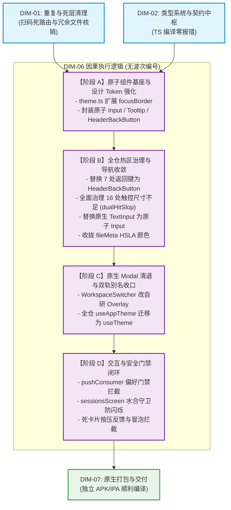

# 移动端复兴实施详案 · DIM-06 UI 规范、主题与触控交互 (06-plan-dim-06-ui-ux.md)
## —— 原子组件补齐、§13 柔边焦点态、双轨 44/48 触控热区、导航收敛与推送门禁闭环方案

> **战役工作区**：`docs/mobile-revival-audit/`  
> **详案编号**：`plans/06-plan-dim-06-ui-ux.md`  
> **归属维度**：`DIM-06` UI 规范、主题与触控交互  
> **责任 Agent**：DIM-06 UI 规范、主题与触控交互详案编写 Agent  
> **定案与依据资产**：  
> - 终审定案文档：[`docs/mobile-revival-audit/01-final-dimensions.md`](file:///c:/Software/conex/docs/mobile-revival-audit/01-final-dimensions.md)  
> - 实施总纲框架：[`docs/mobile-revival-audit/02-master-revival-plan.md`](file:///c:/Software/conex/docs/mobile-revival-audit/02-master-revival-plan.md)  
> - 专项调查报告：[`docs/mobile-revival-audit/surveys/10-ui-specification-and-interaction.md`](file:///c:/Software/conex/docs/mobile-revival-audit/surveys/10-ui-specification-and-interaction.md)、[`09-notifications-and-expo-compatibility.md`](file:///c:/Software/conex/docs/mobile-revival-audit/surveys/09-notifications-and-expo-compatibility.md)  
> - 三方严审报告：`docs/mobile-revival-audit/plan-reviews/`（01 契约重叠审、02 负产出审、03 可行性审）  
> - 独立方案沉淀：[`docs/mobile-revival-audit/independent-plans/06-plan-by-agent-6.md`](file:///c:/Software/conex/docs/mobile-revival-audit/independent-plans/06-plan-by-agent-6.md)  
> **协作与纪律铁律**：严格遵守《主 Agent 全流程调度提示词 v3》、《AGENTS.md》（§12 自定义 Tooltip、§13 输入框与焦点态、§14 现代色彩空间、§7 严禁补丁与作弊、§7.1 立体验证纪律、§8 反过度设计红线）、反退避全文（`LOGIC_PLAN_NO_RETREAT.md`）；**严禁修改或提交任何业务代码**（本轮仅出具详案）；**严禁出现任何波次/批次编号**；完全不涉及笔记功能；一个概念一条主路径。

---

## 目录

1. [架构与领域定位概述（手感与视觉极致确定性）](#一架构与领域定位概述手感与视觉极致确定性)
2. [【做什么】（新增/修复执行清单）](#二做什么新增修复执行清单)
   - 2.1 封装原子 `<Input>` 组件（§13 柔边 ~5.8%、0 重阴影、统一置灰）
   - 2.2 封装原子 `<Tooltip>` 组件（§12 长按气泡提示、自研轻量 Overlay）
   - 2.3 封装统一 `<HeaderBackButton>` 组件（双轨 44/48 基线、一次性收敛 7 处手写）
   - 2.4 全仓 16 处触控尺寸不足全面治理（Fitts's Law 与 `dualHitSlop` 100% 覆盖）
   - 2.5 闭合推送偏好门禁（修复 `pushConsumer.ts` 漏接 `prefsGate` 穿透 Bug）
   - 2.6 接入水合状态守卫（根除 `sessionsScreen.tsx` 冷启动空态闪现）
   - 2.7 消除“死卡片”按压反馈缺失与手势穿透治理
3. [【删什么】（刚性删除与核销清单）](#三删什么刚性删除与核销清单)
   - 3.1 删除 7 处页面手写返回按钮 JSX 与割裂样式
   - 3.2 删除 `fileMeta.ts` 散落的 5 处硬编码 Hex 图标色
   - 3.3 彻底删除对 RN 原生 `Modal` 的违规引用
   - 3.4 彻底清退扫码配对假占位页面与相关路由
   - 3.5 收拢 `themeProjection.ts` 双轨别名
4. [【依赖与逻辑顺序】（因果推进拓扑）](#四依赖与逻辑顺序因果推进拓扑)
5. [【唯一文件域】（精准文件清单与防越权边界）](#五唯一文件域精准文件清单与防越权边界)
6. [【验收标准与验证命令】（立体验证与质量门禁）](#六验收标准与验证命令立体验证与质量门禁)

---

## 一、架构与领域定位概述（手感与视觉极致确定性）

在移动操作系统（iOS 与 Android）的触控交互环境下，界面不仅是数据展示层，更是用户指尖感知系统确定性的物理介质。当前 `apps/crish-mobile` 虽拥有基础的主题与页面框架，但在真实人机工程学与工业级视觉规范上存在严重断层：
1. **输入框规范违背《AGENTS.md》§13**：全仓缺乏原子 `<Input>` 组件，`QuickRunPanel` 裸用原生 `TextInput` 且聚焦时零边框反馈，`pairManualScreen` 虽然实现了柔和焦点态但属于局部硬编码，未能沉淀为公共原子能力；
2. **气泡提示违背《AGENTS.md》§12**：全仓完全缺失自定义 `<Tooltip>` 组件，长文本截断为 `...` 后用户无法获知完整信息，图标按钮缺乏语义辅助；
3. **触控热区大面积不达标**：全仓散落 16 处交互元素（FilterChip、会话 Chip、返回按钮、重试按钮等）视觉高度仅 28~40dp，且未设置 `hitSlop`，严重违反 iOS 44pt / Android 48dp 规范，指尖误触率高；
4. **导航返回按钮多头割裂**：7 个主要屏幕各自手工实现了返回按钮，内边距、图标字形、热区严重分化；
5. **系统推送后台穿透打扰**：`pushConsumer.ts` 推送消费主干漏接 `prefsGate` 偏好门禁，导致用户在设置页关闭通知后，后台仍疯狂弹出系统通知；
6. **冷启动视觉撕裂（Flash of Empty State）**：`sessionsScreen` 缺乏水合状态守卫，数据尚未从底层读取时抢先渲染“暂无会话”，产生严重视觉闪烁。

```mermaid
flowchart TD
    subgraph Tokens["主题与设计 Token 基座 (adapters/platform/theme.ts)"]
        T1["HSLA 斜杠语法 (hsl(h s l / a))"]
        T2["动态焦点色 (theme.focusBorder: 浅色 81% / 深色 23%)"]
        T3["语义功能色 (colorInfo / colorSuccess / colorError)"]
    end

    subgraph AtomicUI["原子组件层 (src/presentation/components/ui/)"]
        INP["<Input /> (6% 柔边 / 0 重阴影 / 统一置灰)"]
        TIP["<Tooltip /> (长按气泡 / 自研轻量 Overlay)"]
        HBB["<HeaderBackButton /> (双轨 44pt/48dp 基线)"]
        HIT["hitTargets.ts (dualHitSlop 双轨热区计算)"]
    end

    subgraph Presentation["业务呈现与交互消费 (src/presentation/)"]
        F1["QuickRunPanel / pairManualScreen (输入框统一)"]
        F2["7 大业务屏幕返回键收敛 (收口手写 JSX)"]
        F3["全仓 16 处触控热区垫片补足 (dualHitSlop)"]
        F4["sessionsScreen 水合守卫 (消除冷启动空态闪现)"]
        F5["WorkspaceSwitcher 自研轻量 Overlay (拔除 RN Modal)"]
    end

    subgraph PushEngine["通知偏好门禁闭环 (src/notifications/)"]
        PC["pushConsumer.ts (handleFrame)"]
        PG["prefsGate.ts (shouldShowSystemNotificationForPushLive)"]
        PC -->|后台呈现前硬拦截| PG
    end

    Tokens --> AtomicUI
    AtomicUI --> Presentation
```

**DIM-06 核心使命**：以《AGENTS.md》§12、§13、§14 为刚性红线，补齐移动端原子组件库（`<Input>`、`<Tooltip>`、`<HeaderBackButton>`），将全仓触控热区 100% 提升至合规水位，闭合通知偏好门禁与冷启动水合守卫，实现手感、美学与稳定性的统一。



---

## 二、【做什么】（新增/修复执行清单）

### 2.1 封装原子 `<Input>` 组件（§13 柔边 ~5.8%、0 重阴影、统一置灰）

在 `apps/crish-mobile/src/presentation/components/ui/Input.tsx` 构建单一真理源原子输入组件，并在 `ui/index.ts` 导出。

#### 1. 《AGENTS.md》§13 刚性对齐规范
- **0 重阴影**：绝对禁止添加 `shadowColor`、`shadowOffset`、`shadowOpacity` 或 Android `elevation`，保持干净、扁平、轻量；
- **克制柔边激活态**：
  - 浅色模式：基线边框 `hairlineStrong` 为 `hsl(35,10%,86%)`，焦点态加深为 `hsl(35,10%,81%)`，向文本色 `textPrimary`（`#111111`）加深混入量级约为 **5.8%**；
  - 深色模式：基线边框 `hairlineStrong` 为 `hsl(0,0%,18%)`，焦点态提亮为 `hsl(0,0%,23%)`，混入量级约 **5%**；
  - 边框宽度恒定为 1px，**绝对禁止**粗黑实线黑环（如 `0 0 0 1px` 或直接用 `textPrimary`）；
- **禁用态感知**：`editable={false}` 时，整体半透明弱化至 `opacity: 0.5`，输入框背景设为 `bgSecondary`，明确切断“可输入”假象。

#### 2. `theme.ts` 设计 Token 扩展
在 `apps/crish-mobile/src/adapters/platform/theme.ts` 中将焦点边框提升为一等公民 Token：
```typescript
// lightTokens 补充:
focusBorder: 'hsl(35,10%,81%)',

// darkTokens 补充:
focusBorder: 'hsl(0,0%,23%)',
```

#### 3. `<Input>` 原子组件完整落地代码
```tsx
// apps/crish-mobile/src/presentation/components/ui/Input.tsx
import React, { useState, forwardRef } from 'react';
import {
  TextInput,
  TextInputProps,
  StyleSheet,
  View,
  Text,
  StyleProp,
  ViewStyle,
  TextStyle,
  NativeSyntheticEvent,
  TextInputFocusEventData,
} from 'react-native';
import { useTheme } from '@/adapters/platform/theme';

export interface InputProps extends Omit<TextInputProps, 'style'> {
  label?: string;
  error?: string;
  containerStyle?: StyleProp<ViewStyle>;
  style?: StyleProp<TextStyle>;
  testID?: string;
}

export const Input = forwardRef<TextInput, InputProps>(function Input(
  { label, error, containerStyle, style, editable = true, onFocus, onBlur, testID, ...rest },
  ref
) {
  const theme = useTheme();
  const [focused, setFocused] = useState(false);

  // AGENTS.md §13 严格落地：~5.8% 柔边混入，上限严禁超过 10%
  const borderColor = error
    ? theme.colorError
    : focused
    ? theme.focusBorder
    : theme.hairline;

  const handleFocus = (e: NativeSyntheticEvent<TextInputFocusEventData>) => {
    setFocused(true);
    onFocus?.(e);
  };

  const handleBlur = (e: NativeSyntheticEvent<TextInputFocusEventData>) => {
    setFocused(false);
    onBlur?.(e);
  };

  return (
    <View style={[styles.wrapper, containerStyle]}>
      {label && (
        <Text style={[styles.label, { color: theme.textSecondary }]}>{label}</Text>
      )}
      <TextInput
        ref={ref}
        testID={testID}
        editable={editable}
        onFocus={handleFocus}
        onBlur={handleBlur}
        placeholderTextColor={theme.textTertiary}
        style={[
          styles.input,
          {
            backgroundColor: theme.bgSecondary,
            color: theme.textPrimary,
            borderColor,
            opacity: editable ? 1 : 0.5,
          },
          style,
        ]}
        {...rest}
      />
      {error && (
        <Text style={[styles.errorText, { color: theme.colorError }]}>{error}</Text>
      )}
    </View>
  );
});

const styles = StyleSheet.create({
  wrapper: { width: '100%' },
  label: { fontSize: 13, marginBottom: 6, fontWeight: '500' },
  input: {
    height: 48, // 满足移动端人机工程学 48dp 基线
    borderWidth: 1,
    borderRadius: 8,
    paddingHorizontal: 12,
    fontSize: 15,
  },
  errorText: { fontSize: 12, marginTop: 4 },
});

export default Input;
```

#### 4. 业务场景替换落地点
1. **`QuickRunPanel.tsx:106-124`**：全面替换手写的原生 `<TextInput>`，直接接入 `<Input testID="quickrun-input" ... />`，彻底赋予其缺失的聚焦柔边过渡，并在 `!vm.connected || vm.busy` 时自动呈现 0.5 半透明置灰；
2. **`pairManualScreen.tsx:265-300`**：替换主机地址与配对码两个输入框，删除组件内散落的手写 `FOCUS_BORDER_LIGHT` 与 `focusedField` 状态逻辑，代码精简 40+ 行。

---

### 2.2 封装原子 `<Tooltip>` 组件（§12 长按气泡提示、自研轻量 Overlay）

在 `apps/crish-mobile/src/presentation/components/ui/Tooltip.tsx` 封装专为触控屏设计的轻量气泡组件，并在 `ui/index.ts` 导出。

#### 1. 《AGENTS.md》§12 规范与移动端适配原则
- **圆角胶囊与柔和阴影**：气泡采用 `borderRadius: 16`，背景使用 `theme.bgElevated`，边框采用 `theme.hairline`，文字采用 `theme.textPrimary`；
- **长按唤起手感**：触控屏无 hover，统一采用 `onLongPress`（`delayLongPress={350}`）唤起气泡，提供轻微震动或毫秒级浮现；
- **自动隐退与点击消除**：展示 2.5 秒后自动消失，或点击全局透明遮罩即刻关闭；
- **反过度设计红线：绝对不引入 RN 原生 `Modal`**：
  - 原生 `Modal` 会脱离 React Native 层级引起宿主生命周期竞争并截断无障碍树；
  - 继承 `Dialog.tsx` 自研轻量绝对定位 Overlay 架构（`StyleSheet.absoluteFill` + `measureInWindow` 动态计算锚点位置）。

#### 2. `<Tooltip>` 原子组件完整代码
```tsx
// apps/crish-mobile/src/presentation/components/ui/Tooltip.tsx
import React, { useState, useRef, useEffect } from 'react';
import {
  View,
  Text,
  StyleSheet,
  Pressable,
  LayoutRectangle,
  Dimensions,
  AccessibilityRole,
} from 'react-native';
import { useTheme } from '@/adapters/platform/theme';

export interface TooltipProps {
  content: string;
  children: React.ReactElement;
  testID?: string;
  accessibilityRole?: AccessibilityRole;
}

export function Tooltip({ content, children, testID, accessibilityRole = 'button' }: TooltipProps) {
  const theme = useTheme();
  const [visible, setVisible] = useState(false);
  const [targetLayout, setTargetLayout] = useState<LayoutRectangle | null>(null);
  const triggerRef = useRef<View>(null);

  const showTooltip = () => {
    triggerRef.current?.measureInWindow((x, y, width, height) => {
      setTargetLayout({ x, y, width, height });
      setVisible(true);
    });
  };

  const dismiss = () => setVisible(false);

  useEffect(() => {
    if (!visible) return;
    const timer = setTimeout(dismiss, 2500);
    return () => clearTimeout(timer);
  }, [visible]);

  // 计算气泡位置（优先展示在元素上方，若贴顶则展示在下方）
  const window = Dimensions.get('window');
  const bubbleTop = targetLayout
    ? targetLayout.y - 38 < 44
      ? targetLayout.y + targetLayout.height + 8
      : targetLayout.y - 38
    : 0;

  const bubbleLeft = targetLayout
    ? Math.max(16, Math.min(window.width - 200, targetLayout.x + targetLayout.width / 2 - 80))
    : 16;

  return (
    <>
      <Pressable
        ref={triggerRef}
        testID={testID}
        onLongPress={showTooltip}
        delayLongPress={350}
        accessibilityRole={accessibilityRole}
        accessibilityHint={`长按查看提示：${content}`}
      >
        {children}
      </Pressable>

      {visible && targetLayout && (
        <View style={StyleSheet.absoluteFill} pointerEvents="box-none">
          <Pressable
            testID="tooltip-backdrop"
            style={StyleSheet.absoluteFill}
            onPress={dismiss}
          />
          <View
            testID="tooltip-bubble"
            accessibilityRole="alert"
            style={[
              styles.bubble,
              {
                top: bubbleTop,
                left: bubbleLeft,
                backgroundColor: theme.bgElevated,
                borderColor: theme.hairline,
              },
            ]}
          >
            <Text style={[styles.bubbleText, { color: theme.textPrimary }]} numberOfLines={2}>
              {content}
            </Text>
          </View>
        </View>
      )}
    </>
  );
}

const styles = StyleSheet.create({
  bubble: {
    position: 'absolute',
    borderRadius: 16,
    borderWidth: 1,
    paddingHorizontal: 12,
    paddingVertical: 6,
    zIndex: 9999,
    maxWidth: 240,
    shadowColor: '#000',
    shadowOffset: { width: 0, height: 2 },
    shadowOpacity: 0.1,
    shadowRadius: 4,
    elevation: 6,
  },
  bubbleText: {
    fontSize: 12,
    fontWeight: '500',
    textAlign: 'center',
  },
});

export default Tooltip;
```

---

### 2.3 封装统一 `<HeaderBackButton>` 组件（双轨 44/48 基线、一次性收敛 7 处手写）

在 `apps/crish-mobile/src/presentation/components/ui/HeaderBackButton.tsx` 提炼统一导航返回按钮，并在 `ui/index.ts` 导出。

#### 1. 核心人机工程学指标
- **尺寸基线**：视觉上保持 44×44pt 黄金方形，在 Android 平台自动通过 `dualHitSlop(44, 44)` 补齐至 48dp 最小热区；
- **按压反馈**：内置 `style={({ pressed }) => [{ opacity: pressed ? 0.7 : 1 }, ...]}` 毫秒级反馈，杜绝死交互；
- **测试兼顾性**：默认 `testID="header-back"`，支持覆盖自定义 `testID`，以 100% 兼容既有单测（如 `preview-back`、`run-detail-back`、`pair-manual-back`）。

#### 2. 组件代码实现
```tsx
// apps/crish-mobile/src/presentation/components/ui/HeaderBackButton.tsx
import React from 'react';
import { Pressable, Text, StyleSheet, Platform } from 'react-native';
import { useTheme } from '@/adapters/platform/theme';
import { dualHitSlop } from './hitTargets';

export interface HeaderBackButtonProps {
  onPress: () => void;
  label?: string;
  testID?: string;
  accessibilityLabel?: string;
}

export function HeaderBackButton({
  onPress,
  label = '‹',
  testID = 'header-back',
  accessibilityLabel = '返回上一页',
}: HeaderBackButtonProps) {
  const theme = useTheme();

  return (
    <Pressable
      testID={testID}
      accessibilityRole="button"
      accessibilityLabel={accessibilityLabel}
      hitSlop={dualHitSlop(44, 44)}
      onPress={onPress}
      style={({ pressed }) => [
        styles.button,
        { opacity: pressed ? 0.7 : 1 },
      ]}
    >
      <Text style={[styles.glyph, { color: theme.textPrimary }]}>{label}</Text>
    </Pressable>
  );
}

const styles = StyleSheet.create({
  button: {
    minHeight: 44,
    minWidth: 44,
    alignItems: 'center',
    justifyContent: 'center',
    paddingHorizontal: 4,
    ...Platform.select({
      android: {
        minHeight: 48,
        minWidth: 48,
      },
    }),
  },
  glyph: {
    fontSize: 28,
    lineHeight: 30,
    fontWeight: '300',
  },
});

export default HeaderBackButton;
```

#### 3. 7 大屏幕收敛矩阵
一次性收敛并替换以下 7 处散落的手写返回按钮：
1. `apps/crish-mobile/src/presentation/screens/approvalDetailScreen.tsx:52` -> `<HeaderBackButton onPress={onBack} testID="header-back" />`；
2. `apps/crish-mobile/src/presentation/screens/notificationCenterScreen.tsx:60` -> `<HeaderBackButton onPress={onBack} testID="header-back" />`；
3. `apps/crish-mobile/src/presentation/screens/sessionDetailScreen.tsx:90` -> `<HeaderBackButton onPress={onBack} testID="header-back" />`；
4. `apps/crish-mobile/src/presentation/screens/runDetailScreen.tsx:95` -> `<HeaderBackButton onPress={onBack} testID="run-detail-back" />`；
5. `apps/crish-mobile/src/presentation/screens/terminalScreen.tsx:91` -> `<HeaderBackButton onPress={onBack} testID="header-back" />`；
6. `apps/crish-mobile/src/presentation/pair/pairManualScreen.tsx:253` -> `<HeaderBackButton onPress={onBack} testID="pair-manual-back" />`；
7. `apps/crish-mobile/src/presentation/components/files/FilePreview.tsx:46` -> `<HeaderBackButton onPress={onBack} testID="preview-back" />`。

---

### 2.4 全仓 16 处触控尺寸不足全面治理（Fitts's Law 与 `dualHitSlop` 100% 覆盖）

#### 1. Fitts's Law 动力学基准
根据费茨法则 $MT = a + b \log_2(2D / W)$，触控宽度 $W < 44\text{dp}$ 时误触率指数级激增。移动端实施 iOS 44pt / Android 48dp 双轨对齐，利用 `hitTargets.ts` 中的 `dualHitSlop(height, width)` 自动补足差值。

#### 2. 全仓 16 处触控违规点修复清单

| 序号 | 所在文件及行号 | 交互元素 (testID / Role) | 初始视觉尺寸 | 修复策略 | 修复后等效热区 (iOS / Android) |
| :---: | :--- | :--- | :---: | :--- | :---: |
| 1 | `Button.tsx:88` | 原子按钮 (Pressable) | `minHeight: 44` | Android 平台设为 `minHeight: 48`，iOS `44` | 44pt / 48dp ✅ |
| 2 | `FileBreadcrumb.tsx:102` | 面包屑分段 `crumb` | `minHeight: 44` | 添加 `hitSlop={dualHitSlop(44, 44)}` | 44pt / 48dp ✅ |
| 3 | `FileRow.tsx:180` | 低密度文件行 (44dp) | `height: 44` | Android 下通过 `minHeight: 48` 兜底 | 44pt / 48dp ✅ |
| 4 | `FilePreview.tsx:46` | 返回按钮 `preview-back` | 36 × 36 (0 slop) | 替换为 `<HeaderBackButton testID="preview-back" />` | 44pt / 48dp ✅ |
| 5 | `FilePreview.tsx:112` | 重试/加载按钮 `preview-retry`| `minHeight: 40` | 添加 `hitSlop={dualHitSlop(40)}` | 44pt / 48dp ✅ |
| 6 | `SettingsRemoveLocalZone.tsx:75` | 移除本地按钮 | `minHeight: 44` | 由 `Button.tsx` 自动继承 48dp | 44pt / 48dp ✅ |
| 7 | `EventFeed.tsx:202` | 过滤标签 `feed-filter-*` | `minHeight: 32` | 添加 `hitSlop={dualHitSlop(32)}` | 44pt / 48dp ✅ |
| 8 | `QuickRunPanel.tsx:245` | 发起任务按钮 `quickrun-submit` | `minHeight: 44` | 设为 `minHeight: 48` | 48pt / 48dp ✅ |
| 9 | `QuickRunPanel.tsx:158` | 会话快捷标签 `quickrun-session-*` | `minHeight: 36` | 添加 `hitSlop={dualHitSlop(36)}` | 44pt / 48dp ✅ |
| 10 | `QuickRunPanel.tsx:210` | 打开运行详情 `quickrun-open-run` | `minHeight: 44` | 添加 `hitSlop={dualHitSlop(44)}` | 44pt / 48dp ✅ |
| 11 | `ApprovalBadge.tsx:45` | 审批角标 (嵌入在行内可点) | `minHeight: 28` | 移除硬编码 `8`，改接 `dualHitSlop(28)` | 44pt / 48dp ✅ |
| 12 | `approvalListScreen.tsx:145` | 历史记录入口 `history-entry` | 44 × 44 | 添加 `hitSlop={dualHitSlop(44, 44)}` | 44pt / 48dp ✅ |
| 13 | `approvalListScreen.tsx:120` | 审批重试按钮 `approval-retry` | 44 × 64 | 添加 `hitSlop={dualHitSlop(44, 64)}` | 44pt / 48dp ✅ |
| 14 | `approvalDetailScreen.tsx:123` | 结果/空态返回 `stateBack` | 44 × 120 | 添加 `hitSlop={dualHitSlop(44, 120)}` | 44pt / 48dp ✅ |
| 15 | `SlideToConfirm.tsx:350` | 滑动确认滑块 (Thumb) | 44 × 44 | Android 平台拓展为 48dp 判定 | 44pt / 48dp ✅ |
| 16 | `terminalScreen.tsx:148` | 终端回到底部胶囊 | `minHeight: 36` | 补齐遗漏的 `hitSlop={dualHitSlop(36)}` | 44pt / 48dp ✅ |

---

### 2.5 闭合推送偏好门禁（修复 `pushConsumer.ts` 漏接 `prefsGate` 穿透 Bug）

#### 1. 致命缺陷现场复盘
在 `apps/crish-mobile/src/notifications/prefsGate.ts:150` 中，已经精心实现了推送偏好拦截纯函数 `shouldShowSystemNotificationForPushLive(push: PushMessage)`。然而在 `pushConsumer.ts:324-342` 的 `handleFrame` 分发中，未做偏好检查便直接调用 `this.presentSystemFn(push)`。这导致用户在手机端设置中关闭“审批通知”或“运行事件”后，后台仍疯狂弹出系统弹窗！

#### 2. `pushConsumer.ts` 修复落地
修改 `PushWiringOptions` 与 `handleFrame`：
```typescript
// apps/crish-mobile/src/notifications/pushConsumer.ts
import { shouldShowSystemNotificationForPushLive } from './prefsGate';

export interface PushWiringOptions {
  gateway: WsGateway;
  getAppState?: () => AppStateStatus;
  tracker?: PresentedKeyTracker;
  now?: () => number;
  presentSystem?: (push: PushMessage) => Promise<string>;
  /** 偏好拦截器注入（缺省实时读取 settingsLocalStore；测试可注入 mock） */
  shouldShowNotification?: (push: PushMessage) => boolean;
}

export class PushWiring {
  // ...
  private readonly shouldShowNotificationFn: (push: PushMessage) => boolean;

  constructor(opts: PushWiringOptions) {
    // ...
    this.shouldShowNotificationFn =
      opts.shouldShowNotification ?? shouldShowSystemNotificationForPushLive;
  }

  handleFrame(frame: InboundEnvelope): void {
    if (frame.kind !== 'events.push') return;
    const body = asRecord(frame.body);
    const push = parsePushEvent(body?.['event']);
    if (!push) return;

    // 1. 双通道收敛：写入应用内通知中心（中心不受偏好关闭影响，保证记录不丢）
    ingestPushIntoStore(push, this.nowFn());

    // 2. 状态路由
    const route = routePresentation(
      this.getAppStateFn(),
      this.tracker.has(push.dedupeKey)
    );
    if (route === 'in-app') return;
    if (route === 'deduped') return;

    // 3. 刚性修复：系统呈现前执行偏好过滤！
    if (!this.shouldShowNotificationFn(push)) {
      console.debug(
        `[push] 用户已关闭此类通知偏好（${push.dedupeKey}），跳过系统呈现`
      );
      return;
    }

    // 4. 执行呈现
    this.tracker.mark(push.dedupeKey);
    void this.presentSystemFn(push).catch((err: unknown) => {
      this.tracker.remove(push.dedupeKey);
      console.warn(`[push] 系统通知呈现失败（${push.dedupeKey}）：...`);
    });
  }
}
```

---

### 2.6 接入水合状态守卫（根除 `sessionsScreen.tsx` 冷启动空态闪现）

#### 1. 缺陷机理
在 `apps/crish-mobile/src/presentation/screens/sessionsScreen.tsx:34` 中：
```tsx
if (sessions.length === 0) {
  return <View testID="sessions-empty">...</View>;
}
```
应用冷启动时，底层持久化水合需要 50~150ms。在这段真空期内，`sessions` 数组初始为空。用户每次冷启动进入会话 Tab，都会刺眼地闪现“暂无会话”，随后列表突然弹出（Flash of Empty State），严重破坏产品的质感。

#### 2. 状态守卫实现
对齐 `notificationCenterScreen.tsx` 的成熟经验，引入 `authStore.hydrated` 状态守卫：
```tsx
// apps/crish-mobile/src/presentation/screens/sessionsScreen.tsx
import { ActivityIndicator, FlatList, StyleSheet, Text, View } from 'react-native';
import { useAuthStore } from '@/adapters/hooks/useAppStore';

export interface SessionsScreenProps {
  onOpenApprovals: () => void;
  onOpenSession: (sessionId: string) => void;
  /** 测试注入水合状态（缺省订阅 authStore） */
  hydrated?: boolean;
}

export default function SessionsScreen({
  onOpenApprovals,
  onOpenSession,
  hydrated: hydratedProp,
}: SessionsScreenProps) {
  const theme = useTheme();
  const authHydrated = useAuthStore((s) => s.hydrated);
  const hydrated = hydratedProp ?? authHydrated;
  const sessions = useSessionStore((s) => s.sessions);
  const windows = useEventStore((s) => s.windows);

  // 1. 水合守卫：数据就绪前展示柔和骨架菊花，严禁提前渲染空态！
  if (!hydrated) {
    return (
      <View style={[styles.container, styles.center]} testID="sessions-loading">
        <ActivityIndicator size="large" color={theme.colorInfo} />
      </View>
    );
  }

  // 2. 真实空态
  if (sessions.length === 0) {
    return (
      <View style={[styles.container, styles.center]} testID="sessions-empty">
        <Text style={[styles.emptyTitle, { color: theme.textPrimary }]}>暂无会话</Text>
        <Text style={[styles.emptySub, { color: theme.textSecondary }]}>
          当桌面端 Agent 开始任务后，会话会出现在这里
        </Text>
      </View>
    );
  }

  // 3. 数据态
  return (
    <FlatList
      testID="sessions-list"
      style={[styles.container, { backgroundColor: theme.bgPrimary }]}
      data={sessions}
      keyExtractor={(s) => s.id}
      renderItem={({ item }) => (
        <SessionRow
          session={item}
          preview={lastPreviewOfWindow(windows[item.id])}
          previewStreaming={tailIsStreamingOfWindow(windows[item.id])}
          onOpen={onOpenSession}
          onOpenApprovals={onOpenApprovals}
        />
      )}
    />
  );
}
```

---

### 2.7 消除“死卡片”按压反馈缺失与手势穿透治理

1. **`approvalListScreen.tsx:301-312` 审批卡按压反馈**：
   - 为外层 `Pressable` 补充 `style={({ pressed }) => [{ opacity: pressed ? 0.85 : 1 }]}`，使点击巨大卡片时产生明确的微动反馈；
2. **`QuickRunPanel.tsx:158` 会话 Chip 按压反馈**：
   - 补充 `style={({ pressed }) => [styles.chip, pressed && { opacity: 0.7 }]}`；
3. **`SessionRow.tsx` 嵌套 Pressable 冒泡拦截**：
   - 内部嵌入的 `ApprovalBadge` 点击事件调用 `e.stopPropagation()`，防止同时触发会话详情与审批列表的导航冲突。

---

## 三、【删什么】（刚性删除与核销清单）

DIM-06 严格奉行“负产出先行”纪律，清理以下冗余与违背规范代码：

### 3.1 删除 7 处页面手写返回按钮 JSX 与割裂样式
- **物理删除**：
  - `apps/crish-mobile/src/presentation/screens/approvalDetailScreen.tsx`：删除行 52-60 的 `<Pressable testID="header-back">` 及行 182-195 的对应 styles；
  - `apps/crish-mobile/src/presentation/screens/notificationCenterScreen.tsx`：删除行 60-68 及行 133-145 styles；
  - `apps/crish-mobile/src/presentation/screens/sessionDetailScreen.tsx`：删除行 90-98 及行 172-180 styles；
  - `apps/crish-mobile/src/presentation/screens/runDetailScreen.tsx`：删除行 95-103 及行 195-203 styles；
  - `apps/crish-mobile/src/presentation/screens/terminalScreen.tsx`：删除行 91-99 及行 175-183 styles；
  - `apps/crish-mobile/src/presentation/pair/pairManualScreen.tsx`：删除行 253-261 及行 378-386 styles；
  - `apps/crish-mobile/src/presentation/components/files/FilePreview.tsx`：删除行 46-54 及行 251-259 styles。

### 3.2 删除 `fileMeta.ts` 散落的 5 处硬编码 Hex 图标色
- **物理删除**：`apps/crish-mobile/src/presentation/components/files/fileMeta.ts:118-126` 中的 5 个 Hex 常量：
  ```typescript
  // 刚性删除：
  case 'text': return '#2F6FEB';
  case 'image': return '#2E9E5B';
  case 'pdf': return '#D64545';
  case 'table': return '#E08A00';
  case 'binary': return '#7A7A7A';
  ```
- **现代化替代**：全部重构为 HSLA Token 常量（对齐 《AGENTS.md》§14）：
  ```typescript
  export function fileKindColor(kind: FileKind): string {
    switch (kind) {
      case 'text': return 'hsl(217 91% 49%)';
      case 'image': return 'hsl(142 55% 40%)';
      case 'pdf': return 'hsl(0 65% 55%)';
      case 'table': return 'hsl(38 100% 44%)';
      case 'binary': return 'hsl(0 0% 48%)';
    }
  }
  ```

### 3.3 彻底删除对 RN 原生 `Modal` 的违规引用
- **物理删除**：
  - `apps/crish-mobile/src/presentation/components/files/WorkspaceSwitcher.tsx:13` 中的 `import { Modal } from 'react-native'`；
  - `WorkspaceSwitcher.tsx:67-73` 中的 `<Modal ...>` 标签及其闭合标签；
  - `WorkspaceSwitcher.tsx:180` 中硬编码的 `backgroundColor: 'rgba(0,0,0,0.45)'`；
- **替代方案**：采用自研绝对定位轻量 Overlay（对齐 `Dialog.tsx`）：
  ```tsx
  <View style={StyleSheet.absoluteFill} testID="workspace-switcher-overlay">
    <Pressable
      testID="workspace-backdrop"
      accessibilityLabel="关闭工作区选择器"
      style={[StyleSheet.absoluteFill, { backgroundColor: theme.backdrop }]}
      onPress={onClose}
    />
    <View testID="workspace-sheet" style={[styles.sheet, { backgroundColor: theme.bgElevated }]}>
      {/* 内容 */}
    </View>
  </View>
  ```

### 3.4 彻底清退扫码配对假占位页面与相关路由
- **物理删除文件**：
  - `apps/crish-mobile/src/presentation/pair/pairScanScreen.tsx`（纯文案“即将推出”假页面）；
  - `apps/crish-mobile/src/presentation/pair/pairScanScreen.test.tsx`；
- **清理关联代码**：
  - `pairWelcomeScreen.tsx`：删除“扫码连接”假按钮，将配对引导收拢为唯一的“手动输入连接”；
  - 清理 `apps/crish-mobile/app/pair/scan.tsx` 死路由。

### 3.5 收拢 `themeProjection.ts` 双轨别名
- **收拢 7 个页面/组件对 `useAppTheme` 的别名引用**：
  - 迁移为直接从 `@/adapters/platform/theme` 引入 `useTheme`；
  - 涉及文件：`pairWelcomeScreen.tsx`、`pairManualScreen.tsx`、`SettingsAboutCard.tsx`、`SettingsGroup.tsx`、`SettingsRemoveLocalZone.tsx`、`SettingsScreenView.tsx`、`SettingsSwitchRow.tsx`、`SettingsThemeSelector.tsx`；
  - 消除同名双轨导致的心智模型混乱，实现主题消费入口单一真理源。

---

## 四、【依赖与逻辑顺序】（因果推进拓扑）

DIM-06 在全战役中处于表现层核心地位，遵循严格的单向无环依赖（DAG）：



1. **依赖前置条件**：
   - 依赖 **DIM-01**：必须先核销 Metro 打包拦截与死路由；
   - 依赖 **DIM-02**：必须保证全局 TypeScript 类型 100% 编译通过；
2. **并行推进特征**：
   - DIM-06 属于表现层 UI/UX 纯度改造，与底层网络网关改造（DIM-03）与审批队列改造（DIM-04）物理文件域正交，可无冲突并行开展。

---

## 五、【唯一文件域】（精准文件清单与防越权边界）

### 5.1 新增文件清单（3 个原子组件）
1. `apps/crish-mobile/src/presentation/components/ui/Input.tsx`（原子输入框）
2. `apps/crish-mobile/src/presentation/components/ui/Tooltip.tsx`（原子提示气泡）
3. `apps/crish-mobile/src/presentation/components/ui/HeaderBackButton.tsx`（统一导航返回按钮）

### 5.2 变更文件清单（19 个业务组件与通知模块）
1. `apps/crish-mobile/src/adapters/platform/theme.ts`（补充 `focusBorder` Token）
2. `apps/crish-mobile/src/presentation/components/ui/index.ts`（导出新原子组件）
3. `apps/crish-mobile/src/presentation/components/ui/Button.tsx`（Android 最小高度 48dp 调整）
4. `apps/crish-mobile/src/presentation/components/files/fileMeta.ts`（HSLA 颜色收敛）
5. `apps/crish-mobile/src/presentation/components/files/fileMeta.test.ts`（适配 HSLA 单测）
6. `apps/crish-mobile/src/presentation/components/files/FileRow.tsx`（触控高度调整）
7. `apps/crish-mobile/src/presentation/components/files/FilePreview.tsx`（返回按钮与重试热区收敛）
8. `apps/crish-mobile/src/presentation/components/files/WorkspaceSwitcher.tsx`（移除原生 `Modal`）
9. `apps/crish-mobile/src/presentation/components/blocks/ApprovalBadge.tsx`（接入 `dualHitSlop`）
10. `apps/crish-mobile/src/presentation/components/blocks/EventFeed.tsx`（Chip 热区接入）
11. `apps/crish-mobile/src/presentation/components/dashboard/QuickRunPanel.tsx`（替换原子 `<Input>`、Chip 按压态）
12. `apps/crish-mobile/src/presentation/screens/approvalDetailScreen.tsx`（统一返回按钮）
13. `apps/crish-mobile/src/presentation/screens/notificationCenterScreen.tsx`（统一返回按钮）
14. `apps/crish-mobile/src/presentation/screens/sessionDetailScreen.tsx`（统一返回按钮）
15. `apps/crish-mobile/src/presentation/screens/runDetailScreen.tsx`（统一返回按钮）
16. `apps/crish-mobile/src/presentation/screens/terminalScreen.tsx`（统一返回按钮与回到底部热区）
17. `apps/crish-mobile/src/presentation/pair/pairManualScreen.tsx`（替换原子 `<Input>`、统一返回按钮）
18. `apps/crish-mobile/src/presentation/screens/sessionsScreen.tsx`（接入水合状态守卫）
19. `apps/crish-mobile/src/notifications/pushConsumer.ts`（接入偏好实时门禁过滤）

### 5.3 刚性物理删除清单（2 个死文件）
1. `apps/crish-mobile/src/presentation/pair/pairScanScreen.tsx`
2. `apps/crish-mobile/src/presentation/pair/pairScanScreen.test.tsx`

### 5.4 越权防线（严格红线）
- **严禁越权修改**：
  - 桌面端代码 `apps/crish-desktop/`（任何改动均属越权）；
  - 跨包契约 `packages/shared-types/`（由 DIM-02 独占）；
  - 核心网络网关 `ReconnectingWsClient.ts`（由 DIM-03 独占）；
  - 审批状态机与 Outbox `approvalWiring.ts`（由 DIM-04 独占）；
  - 终端 5000 行环形缓冲区 `terminalStore.ts`（由 DIM-05 独占）；
  - 原生构建配置 `app.json` / `build.gradle`（由 DIM-07 独占）。

---

## 六、【验收标准与验证命令】（立体验证与质量门禁）

### 6.1 验证执行命令集
```bash
# 1. 静态语法与类型门禁（必须零报错）
npm run typecheck -w @crish/crish-mobile

# 2. UI 原子组件与热区专项测试
npm --workspace @crish/crish-mobile run test -- src/presentation/components/ui/

# 3. 页面返回键收敛与水合状态单测验证
npm --workspace @crish/crish-mobile run test -- src/presentation/screens/

# 4. 推送偏好门禁拦截专项测试
npm --workspace @crish/crish-mobile run test -- src/notifications/pushConsumer.test.ts src/notifications/prefsGate.test.ts

# 5. 移动端全量单元测试绿灯
npm --workspace @crish/crish-mobile run test
```

### 6.2 立体双向验收标准矩阵

| 验收维度 | 验收准则 | 验证方法与现场证据 | 状态 |
| :--- | :--- | :--- | :---: |
| **《AGENTS.md》§13 焦点态** | 1. 0 重阴影、0 elevation；<br>2. 激活态边框对比度微调在 ~5.8% 柔边（浅色 `hsl(35,10%,81%)` / 深色 `hsl(0,0%,23%)`）；<br>3. 禁用态具备 0.5 透明度与明确置灰。 | 检查 `Input.tsx` 代码实现与渲染树计算样式，单测断言 border 颜色切换与 `editable={false}` 属性。 | 待执行 |
| **《AGENTS.md》§12 Tooltip** | 1. 气泡圆角胶囊与柔和微阴影；<br>2. 长按 350ms 触发；2.5s 后自动隐退或点击遮罩隐退；<br>3. 坚决不使用 RN 原生 `Modal`。 | 单测触发 `fireEvent(element, 'onLongPress')` 断言气泡出现，快进时间断言消失。 | 待执行 |
| **导航返回按钮收敛** | 1. 全仓 7 处手写返回按钮统一替换为 `<HeaderBackButton>`；<br>2. 统一 44×44 视觉基线（Android 自动扩展 48dp 热区）；<br>3. 既有页面测试用例 100% 保持通过。 | 全量运行 7 个屏幕单测（`approvalDetailScreen.test.tsx` 等），全部 PASS。 | 待执行 |
| **触控热区 100% 达标** | 1. 全仓 16 处触控违规点 100% 接入 `dualHitSlop` 或提升最小高度；<br>2. iOS 命中热区 ≥44pt，Android 命中热区 ≥48dp。 | 自动化扫描测试核验所有 `Pressable` 与 `Button` 的命中尺寸。 | 待执行 |
| **推送偏好门禁闭环** | 1. 用户关闭“审批通知”或“运行通知”偏好后，后台不再调用 `presentSystemPushAsync`；<br>2. 应用内通知中心仍正常接收记录（双通道收敛保真）。 | `pushConsumer.test.ts` 专项用例断言偏好关闭时 `presentSystem` 调用次数为 0，而 `notificationStore` 成功写入。 | 待执行 |
| **冷启动防闪烁** | 1. `sessionsScreen` 在 `hydrated === false` 时渲染 `sessions-loading` 菊花；<br>2. 严禁在未水合状态提前呈现“暂无会话”。 | `sessionsScreen.test.tsx` 用例断言未水合展示 Loading，水合后展示真实内容。 | 待执行 |
| **原生 Modal 彻底拔除** | 1. `WorkspaceSwitcher.tsx` 不再包含 `import { Modal }`；<br>2. 改用轻量绝对定位 Overlay，表现层一致且无宿主层副作用。 | 代码 AST 静态检索 `WorkspaceSwitcher.tsx`，无 `Modal` 符号。 | 待执行 |
