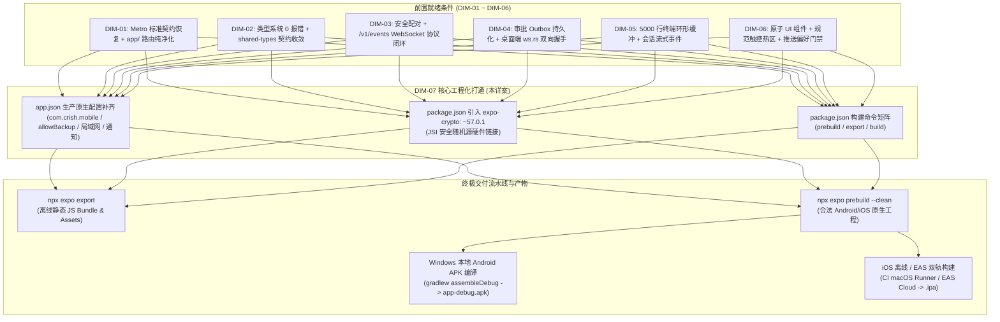
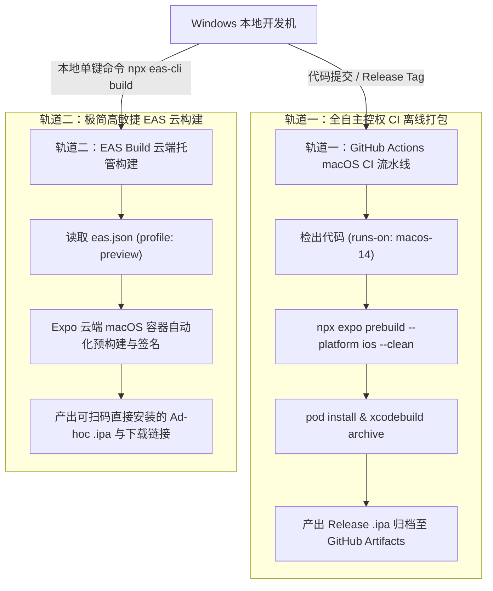
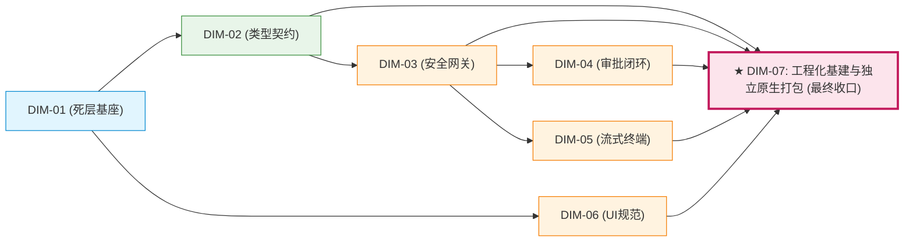

# 移动端实施详案：DIM-07 工程化基建与独立原生打包 (07-plan-dim-07-packaging.md)
## —— 生产级原生预构建、独立安装包编译与 CI/CD 交付唯一执行详案

> **战役目录**：`docs/mobile-revival-audit/plans/`  
> **维度编号**：`DIM-07`  
> **维度名称**：工程化基建与独立原生打包  
> **输入资产**：  
> - 总计划框架：[`docs/mobile-revival-audit/02-master-revival-plan.md`](../02-master-revival-plan.md)  
> - 定案文档：[`docs/mobile-revival-audit/01-final-dimensions.md`](../01-final-dimensions.md)  
> - 评审报告：[`docs/mobile-revival-audit/plan-reviews/01-contract-and-overlap-review.md`](../plan-reviews/01-contract-and-overlap-review.md)、[`02-negative-output-and-dead-code-review.md`](../plan-reviews/02-negative-output-and-dead-code-review.md)、[`03-feasibility-and-closure-review.md`](../plan-reviews/03-feasibility-and-closure-review.md)  
> - 专项调研：[`docs/mobile-revival-audit/surveys/01-packaging-and-build-infrastructure.md`](../surveys/01-packaging-and-build-infrastructure.md)  
> **核心原则**：纯逻辑推进、负产出坚决先行、单一真理源、无波次编号、立体双向验收  

---

## 架构概览与交付定位

本详案是移动端全战役的**终极闭环收口工程**。在 DIM-01 负产出清理、DIM-02 跨包契约与类型全绿、DIM-03 安全网关与连接对账、DIM-04 跨端审批与 Outbox 持久化、DIM-05 会话流与终端缓冲、DIM-06 UI 规范与触控交互全部就绪的基础上，DIM-07 负责将 `apps/crish-mobile` 从一个“只能在 Expo Go 宿主容器内运行的原型应用”，蜕变为能够**脱离任何宿主、自主链接原生底层、具备工业级安全基线并直接分发至 Android/iOS 真机的独立原生应用（Standalone App）**。



---

## 一、【做什么】（新增 / 修复清单）

### 1.1 `app.json` 原生配置全面补齐

彻底纠正目前 `app.json` 缺少包名标识退化为 `com.placeholder.appid`、权限缺失、局域网明文拦截以及备份解密崩溃等四大原生硬缺陷。

#### 1. 核心原生字段与策略要求
1. **全局应用标识**：
   - 应用名锁定 `"name": "Crish"`，项目标识 `"slug": "crish-mobile"`，路由 Scheme 锁定 `"scheme": "crish"`；
   - Android 包名严格锁定 **`"package": "com.crish.mobile"`**（坚决驳回擅自拓宽的 `com.conex.crish.mobile` 漂移）；
   - iOS Bundle Identifier 严格锁定 **`"bundleIdentifier": "com.crish.mobile"`**。
2. **硬件密钥与备份安全防御 (`allowBackup: false`)**：
   - 显式声明 `"android.allowBackup": false`；
   - **架构根因**：Android 系统的自动云备份（Auto Backup）在用户更换设备或重装系统时，会自动恢复应用私有沙箱内的数据（包括 SQLite 与 SharedPreferences 存储的凭据密文）。但 Android 硬件级密钥库（Android KeyStore）中的主密钥（MasterKey）与硬件绑定、**绝对不可导出且不随备份迁移**。若 `allowBackup` 为 `true`，在新设备启动后，SecureStore 尝试使用不存在的旧硬件密钥解密已恢复的敏感凭据，会直接在冷启动阶段抛出底层硬件不可恢复异常，触发 RedBox 致命崩溃。配置 `false` 阻断此类静默灾难。
3. **局域网通信许可 (`usesCleartextTraffic` 与 ATS 配置)**：
   - Android 端配置 `"usesCleartextTraffic": true`：Crish 移动端的核心业务是通过 WebSocket 与局域网内的桌面端网关（`ws://` 或本地自签名证书 `wss://`）实时握手通信。Android 9+ (API 28+) 默认封锁所有明文 HTTP/WS 流量，若不显式开启此项，OkHttp 将直接在底层拦截并抛出 `CLEARTEXT_COMMUNICATION_NOT_PERMITTED` 错误；
   - iOS 端配置 `infoPlist.NSLocalNetworkUsageDescription` 与 `NSAppTransportSecurity`：声明本地网络访问用途说明，并配置 `NSAllowsLocalNetworking: true`，防止 iOS 14+ 系统的 Local Network Privacy 静默斩断 WebSocket 握手链路。
4. **系统级通知插件与权限治理**：
   - 在 `plugins` 数组中正式装配 `"expo-notifications"` 插件，并指定通知图标与主题色；
   - 在 `android.permissions` 中补齐 `android.permission.POST_NOTIFICATIONS`（Android 13+ 系统通知硬门禁）、`android.permission.VIBRATE`（审批到达振动反馈）与 `android.permission.INTERNET`。

#### 2. 生产级 `app.json` 完整基准代码
文件路径：[`apps/crish-mobile/app.json`](file:///c:/Software/conex/apps/crish-mobile/app.json)

```json
{
  "expo": {
    "name": "Crish",
    "slug": "crish-mobile",
    "version": "0.1.0",
    "orientation": "portrait",
    "icon": "./assets/images/icon.png",
    "scheme": "crish",
    "userInterfaceStyle": "automatic",
    "ios": {
      "icon": "./assets/expo.icon",
      "bundleIdentifier": "com.crish.mobile",
      "buildNumber": "1",
      "supportsTablet": false,
      "infoPlist": {
        "NSLocalNetworkUsageDescription": "Crish 需要访问本地网络以安全配对并同步您的桌面工作台。",
        "NSAppTransportSecurity": {
          "NSAllowsLocalNetworking": true,
          "NSAllowsArbitraryLoads": false
        }
      }
    },
    "android": {
      "package": "com.crish.mobile",
      "versionCode": 1,
      "allowBackup": false,
      "adaptiveIcon": {
        "backgroundColor": "#E6F4FE",
        "foregroundImage": "./assets/images/android-icon-foreground.png",
        "backgroundImage": "./assets/images/android-icon-background.png",
        "monochromeImage": "./assets/images/android-icon-monochrome.png"
      },
      "permissions": [
        "android.permission.INTERNET",
        "android.permission.POST_NOTIFICATIONS",
        "android.permission.VIBRATE"
      ],
      "usesCleartextTraffic": true,
      "predictiveBackGestureEnabled": false
    },
    "web": {
      "output": "static",
      "favicon": "./assets/images/favicon.png"
    },
    "plugins": [
      "expo-router",
      [
        "expo-splash-screen",
        {
          "backgroundColor": "#208AEF",
          "image": "./assets/images/splash-icon.png",
          "imageWidth": 76
        }
      ],
      "expo-secure-store",
      "expo-sqlite",
      [
        "expo-notifications",
        {
          "icon": "./assets/images/icon.png",
          "color": "#208AEF"
        }
      ]
    ],
    "experiments": {
      "typedRoutes": false,
      "reactCompiler": true
    }
  }
}
```

---

### 1.2 原生依赖绑定：引入 `expo-crypto: ~57.0.1`

#### 1. 为什么独立原生包必须绑定 `expo-crypto`？
在 Expo Go 容器开发期，Expo Go 客户端内置预编译了官方所有常用原生模块，因此 JavaScript 代码在调用 `globalThis.expo.modules.ExpoCrypto` 时能够侥幸获得宿主注入。然而：
- 当项目通过 `npx expo prebuild` 生成自主原生工程并打包 Standalone APK / IPA 时，**只有声明在 `package.json` 的 `dependencies` 中的原生模块，Expo Autolinking 机制才会在 CMake / Gradle / CocoaPods 编译期将其 C++ / JSI 源码与原生库静态链接进 `libappmodules.so` 或可执行二进制中**；
- 若未显式安装 `expo-crypto`，独立原生应用运行时将完全不存在 `globalThis.expo.modules.ExpoCrypto` 宿主对象；
- 移动端安全密码学模块 [`apps/crish-mobile/src/pairing/crypto/noblePrimitives.ts`](file:///c:/Software/conex/apps/crish-mobile/src/pairing/crypto/noblePrimitives.ts) 在派生 X25519 临时私钥或生成随机 Nonce 时，其默认探测链为：
  `Web Crypto (globalThis.crypto) -> expo.modules.ExpoCrypto -> 抛出明确错误`；
- 在独立原生 Android / iOS 环境下，由于 React Native Hermes 引擎没有内置符合规范的 Web Cryptography API，若再缺失 `ExpoCrypto` 原生链接，应用在执行配对握手时将直接触发硬抛错，导致移动端永远无法生成安全密钥。

#### 2. 版本严格锁定：`~57.0.1`
- 经过评审严格确认，当前 `apps/crish-mobile` 全面运行在 **Expo SDK 57** 体系（`expo: ~57.0.12`、`react-native: 0.86.2`、`react: 19.2.3`）；
- 必须严格配置 `"expo-crypto": "~57.0.1"`，严禁引入两年前 SDK 51 时代的 `~14.0.x`，坚决避免 peerDependencies 报废或 JSI C++ ABI 符号不匹配导致的编译崩溃。

---

### 1.3 构建命令矩阵补齐（`package.json`）

在 [`apps/crish-mobile/package.json`](file:///c:/Software/conex/apps/crish-mobile/package.json) 的 `scripts` 字段中补齐完整的工程化与编译脚本矩阵，统一本地开发与 CI/CD 自动化的调用入口：

```json
{
  "name": "@crish/crish-mobile",
  "main": "expo-router/entry",
  "version": "0.1.0",
  "private": true,
  "license": "MIT",
  "description": "Crish 移动端远程伴侣（Expo SDK 57 / RN 0.86 / expo-router / TS strict）",
  "scripts": {
    "start": "expo start",
    "dev": "expo start",
    "android": "expo start --android",
    "ios": "expo start --ios",
    "web": "expo start --web",
    "typecheck": "tsc --noEmit -p tsconfig.json",
    "test": "jest",
    "test:coverage": "jest --coverage",
    "lint": "expo lint",
    "prebuild": "expo prebuild",
    "prebuild:clean": "expo prebuild --clean",
    "export": "expo export",
    "export:android": "expo export --platform android",
    "export:ios": "expo export --platform ios",
    "build:android:debug": "npm run prebuild && cd android && gradlew.bat assembleDebug",
    "build:android:release": "npm run prebuild && cd android && gradlew.bat assembleRelease",
    "build:android:aab": "npm run prebuild && cd android && gradlew.bat bundleRelease"
  },
  "dependencies": {
    "@crish/shared-types": "file:../../packages/shared-types",
    "@crish/shared-utils": "file:../../packages/shared-utils",
    "@expo/ui": "~57.0.10",
    "@noble/curves": "^2.3.0",
    "expo": "~57.0.12",
    "expo-constants": "~57.0.10",
    "expo-crypto": "~57.0.1",
    "expo-device": "~57.0.1",
    "expo-font": "~57.0.1",
    "expo-glass-effect": "~57.0.1",
    "expo-image": "~57.0.2",
    "expo-linking": "~57.0.5",
    "expo-notifications": "~57.0.10",
    "expo-router": "~57.0.12",
    "expo-secure-store": "~57.0.1",
    "expo-splash-screen": "~57.0.6",
    "expo-sqlite": "~57.0.1",
    "expo-status-bar": "~57.0.1",
    "expo-symbols": "~57.0.2",
    "expo-system-ui": "~57.0.2",
    "expo-web-browser": "~57.0.2",
    "immer": "^11.1.8",
    "react": "19.2.3",
    "react-dom": "19.2.3",
    "react-native": "0.86.2",
    "react-native-gesture-handler": "~2.32.0",
    "react-native-reanimated": "4.5.1",
    "react-native-safe-area-context": "~5.7.0",
    "react-native-screens": "~4.26.0",
    "react-native-web": "~0.21.0",
    "react-native-worklets": "0.10.1",
    "zustand": "^5.0.14"
  },
  "devDependencies": {
    "@testing-library/react-native": "^14.0.1",
    "@types/jest": "^29.5.14",
    "@types/react": "~19.2.2",
    "jest": "~29.7.0",
    "jest-expo": "~57.0.4",
    "typescript": "~6.0.3"
  }
}
```

---

### 1.4 Windows 本地编译 Android APK 实操规程

针对当前工程所在的 Windows 宿主环境，制定确定性、零假设的原生编译标准操作流程（SOP）：

#### 1. 前置工具链基线核查与补齐
- **JDK 17 硬性门禁**：
  React Native 0.86 采用 Gradle 8.8+ 与 Android Gradle Plugin 8.5+，**硬性要求 JDK 17**（宿主存量的 Java 8 会在 Gradle 启动时直接报 `Unsupported class file major version` 崩溃）。
  - 安装 Microsoft Build of OpenJDK 17 或 Eclipse Temurin 17；
  - 设置环境变量：`JAVA_HOME = C:\Program Files\Eclipse Adoptium\jdk-17.0.12.7-hotspot`（以实际安装路径为准）；
  - 将 `%JAVA_HOME%\bin` 置于系统 `PATH` 首位，验证 `javac -version` 输出 `javac 17.0.x`。
- **Android SDK 组件核齐**：
  - 设置环境变量：`ANDROID_HOME = C:\Users\orange\AppData\Local\Android\Sdk`；
  - 补充安装 Android 35 编译工具集（API Level 35）：
    ```powershell
    & "$env:ANDROID_HOME\cmdline-tools\latest\bin\sdkmanager.bat" "platforms;android-35" "build-tools;35.0.0"
    & "$env:ANDROID_HOME\cmdline-tools\latest\bin\sdkmanager.bat" --licenses
    ```

#### 2. 本地执行四步法（自动化产出 APK）
1. **第一步：清空缓存并生成 Android 原生工程**
   ```powershell
   cd c:\Software\conex\apps\crish-mobile
   npx expo prebuild --platform android --clean
   ```
   - **断言**：命令在 60 秒内执行完毕，退出码为 0；
   - **检查**：验证生成 `apps/crish-mobile/android/` 目录；查验 `android/app/src/main/AndroidManifest.xml`，确认包含 `package="com.crish.mobile"`、`android:usesCleartextTraffic="true"`、`android:allowBackup="false"` 以及通知权限。
2. **第二步：静态导出离线 JS Bundle 验证**
   ```powershell
   npx expo export --platform android
   ```
   - **断言**：命令退出码为 0，终端无 `Serializer did not return expected format` 报错；
   - **检查**：验证生成 `dist/_expo/static/js/android/` 脚本与静态资源 assets。
3. **第三步：Gradle 编译独立 Debug APK**
   ```powershell
   cd android
   .\gradlew.bat assembleDebug
   ```
   - **断言**：Gradle 守护进程正常编译原生 C++ JSI 与 Java/Kotlin 代码，最终输出 `BUILD SUCCESSFUL`；
   - **检查产物**：验证生成目标可执行安装包：
     `apps/crish-mobile/android/app/build/outputs/apk/debug/app-debug.apk`（体积约 50MB~70MB）。
4. **第四步：真机安装与运行时现场验证**
   ```powershell
   adb install -r app/build/outputs/apk/debug/app-debug.apk
   ```
   - **现场验收断言**：
     - 应用成功安装至 Android 真机，桌面图标名称显示为“Crish”，图标清晰；
     - 点击图标启动，Splash Screen 正常过渡，无 RedBox 崩溃；
     - 打开调试控制台，验证 `globalThis.expo.modules.ExpoCrypto` 存在且原生工作；
     - 局域网输入桌面端 IP 执行配对，WebSocket 连接与 X25519 握手顺畅完成。

---

### 1.5 iOS 双轨构建实操规程（离线 CI 与 EAS 云构建）

受限于 Apple 官方工具链对 macOS 与 Xcode 的硬性约束，Windows 宿主在物理上无法直接在本地编译 `.ipa` 二进制。为此制定**“双轨并行”方案**，确保开发与发布互不阻断：



#### 轨道一：Windows 离线导出 + GitHub Actions macOS Runner 原生编译（全自主控权）
本方案由本团队完全掌控编译逻辑、Pod 依赖与构建产物，适合生产环境持续集成与离线包归档：

1. **Windows 侧离线 Bundle 导出**：
   ```powershell
   npx expo export --platform ios
   ```
   本地验证离线 Bundle 正常打通，无任何 Serializer 协议报错。
2. **CI macOS 编译工作流定义**：
   新建流水线定义文件 `.github/workflows/mobile-ios-build.yml`：
   ```yaml
   name: Mobile iOS Standalone Build

   on:
     workflow_dispatch:
     push:
       branches: [ main ]
       paths:
         - 'apps/crish-mobile/**'
         - 'packages/shared-types/**'
         - 'packages/shared-utils/**'

   jobs:
     build-ios:
       runs-on: macos-14
       steps:
         - name: Checkout Repository
           uses: actions/checkout@v4

         - name: Setup Node.js 20
           uses: actions/setup-node@v4
           with:
             node-version: 20
             cache: 'npm'

         - name: Install Monorepo Dependencies
           run: npm ci

         - name: Generate iOS Native Project (Prebuild)
           working-directory: apps/crish-mobile
           run: npx expo prebuild --platform ios --clean

         - name: CocoaPods Install & Xcode Build
           working-directory: apps/crish-mobile/ios
           run: |
             pod install
             xcodebuild -workspace Crish.xcworkspace \
                        -scheme Crish \
                        -configuration Release \
                        -archivePath build/Crish.xcarchive \
                        archive \
                        CODE_SIGNING_ALLOWED=NO

         - name: Upload Build Artifacts
           uses: actions/upload-artifact@v4
           with:
             name: crish-ios-xcarchive
             path: apps/crish-mobile/ios/build/Crish.xcarchive
             retention-days: 7
   ```

#### 轨道二：EAS Build（Expo 官方云端构建，开发者极简体验）
适合日常快速打出内部测试包（Ad-hoc Internal Distribution），无需自建 Mac 构建机：

1. **新建配置文件 [`apps/crish-mobile/eas.json`](file:///c:/Software/conex/apps/crish-mobile/eas.json)**：
   ```json
   {
     "cli": {
       "version": ">= 14.0.0"
     },
     "build": {
       "development": {
         "developmentClient": true,
         "distribution": "internal"
       },
       "preview": {
         "distribution": "internal",
         "android": {
           "buildType": "apk"
         },
         "ios": {
           "simulator": false
         }
       },
       "production": {
         "android": {
           "buildType": "app-bundle"
         },
         "ios": {}
       }
     },
     "submit": {
       "production": {}
     }
   }
   ```
2. **在 Windows 终端单键触发构建**：
   ```powershell
   cd apps/crish-mobile
   npx eas-cli build --platform ios --profile preview
   ```
   - Expo 云端自动同步代码、拉取证书、执行 prebuild 与 Xcode Archive；
   - 终端在构建完成后打印专属下载链接与 iOS Ad-hoc 安装二维码，测试人员手机扫码即可直接下载 `.ipa` 安装。

---

## 二、【删什么】（负产出清退清单）

遵循《AGENTS.md》§7「追求架构优雅，杜绝打补丁」与“负产出绝对先行”铁律，DIM-07 在收口阶段必须彻底核销以下冗余与历史毒素：

| 序号 | 核销对象 / 类别 | 具体位置与内容 | 清退理由与根因证据 |
| :--- | :--- | :--- | :--- |
| **DEL-01** | **临时构建产物与缓存** | `apps/crish-mobile/.expo/`<br>`apps/crish-mobile/dist/`<br>`apps/crish-mobile/android/`<br>`apps/crish-mobile/ios/` | 开发调试期可能残留的历史增量编译缓存与脏符号。在执行正式 prebuild 与 export 之前必须强制清理（`--clean`），确保每一次原生工程生成均从干净状态确定性派生。 |
| **DEL-02** | **Expo Go 宿主隐式假定代码** | `apps/crish-mobile/src/` 全域 | 彻底消除代码中任何“默认宿主已预加载全部 Expo 原生模块”的侥幸代码。所有原生能力（Crypto, Notifications, SecureStore, SQLite）一律经由 `package.json` 显式依赖与官方 Autolinking 引入，杜绝“Expo Go 里能跑，独立 APK 里崩溃”的假象。 |
| **DEL-03** | **`package.json` 未对齐依赖** | `apps/crish-mobile/package.json` 依赖池 | 坚决清退任何与 Expo SDK 57 版本不匹配的旧版本依赖（如评审中发现的 SDK 51 时代 `expo-crypto: ~14.0.x`），确保 `dependencies` 中的全部 `@expo/*` 与 `expo-*` 模块严格对齐 `~57.0.x`。 |
| **DEL-04** | **无用配置与实验性废弃字段** | `apps/crish-mobile/app.json` | 清退 `app.json` 中一切未使用的占位配置，保持配置项精炼、语义清晰、零过度设计。 |

---

## 三、【依赖与逻辑顺序】

### 3.1 为什么 DIM-07 必须作为全战役最终收口？
在系统工程体系中，**编译打包是全域代码质量的“总过滤器”与“最终试金石”**：
1. **静态导出依赖源码绝对纯净**：`npx expo export` 会对整个前端工程的所有依赖模块执行严格的 AST 树摇与打包分析。如果 DIM-01 的死代码、DIM-02 的 TS 类型报错、DIM-05 的展现层逆向引用未消除，Export 过程会直接因模块解析错误或静态语法断裂而夭折；
2. **原生预构建依赖契约与配置闭环**：`npx expo prebuild` 会根据 `app.json` 生成原生代码。如果包名漂移、通知插件未配置、权限未声明，生成的原生工程将不可用；
3. **运行时安装验证依赖全功能自愈**：独立 APK / IPA 的运行验收需要进行端到端全功能演练（设备配对、消息推流、审批流转、终端滚底）。如果 DIM-03 ~ DIM-06 的功能存在死锁或黑洞，独立包在真机上将无法通过现场验收。

因此，DIM-07 在因果关系上严格位于 DAG 的末端，是依赖所有前置维度（DIM-01 至 DIM-06）的唯一终极收口节点。



---

## 四、【唯一文件域】

为了保证多 Agent 协同与后续执行阶段零冲突，本维度严格划定**唯一操作文件白名单**：

### 4.1 允许修改的文件清单（Write / Modify）
1. [`apps/crish-mobile/app.json`](file:///c:/Software/conex/apps/crish-mobile/app.json)：补齐生产包名 `com.crish.mobile`、iOS BundleId、通知插件、权限、`allowBackup: false`、局域网明文配置；
2. [`apps/crish-mobile/package.json`](file:///c:/Software/conex/apps/crish-mobile/package.json)：引入 `expo-crypto: ~57.0.1` 依赖，补齐 `prebuild`, `prebuild:clean`, `export`, `export:android`, `build:android:*` 等命令矩阵；
3. [`apps/crish-mobile/eas.json`](file:///c:/Software/conex/apps/crish-mobile/eas.json)：（新增）配置 EAS 云端构建 Profile；
4. [`.github/workflows/mobile-ios-build.yml`](file:///c:/Software/conex/.github/workflows/mobile-ios-build.yml)：（新增/可选）提供 iOS 离线 CI 构建工作流模板。

### 4.2 严格禁止触碰的文件域（Forbidden Boundaries）
- **严禁触碰业务代码**：`apps/crish-mobile/src/` 下的所有业务实现（由 DIM-03 ~ DIM-06 各维度严格维护）；
- **严禁触碰路由与单测**：`apps/crish-mobile/app/` 与测试文件移出（由 DIM-01 统一维护）；
- **严禁触碰 Metro 核心配置**：`apps/crish-mobile/metro.config.js` 的 `customSerializer` 拔除（由 DIM-01 负产出基座统一执行）；
- **严禁触碰共享契约包**：`packages/shared-types/`（由 DIM-02 统一治理）；
- **严禁触碰桌面端代码**：`crates/` 与 `apps/crish-desktop/`（由对应维度对齐维护）。

---

## 五、【立体化验收标准与交付门禁】

根据《AGENTS.md》§7.1 立体验证纪律，DIM-07 在交付前必须正面跑通所有硬性门禁，严禁跳过或作弊：

### 5.1 静态检查与配置一致性门禁
1. **TypeScript 编译 0 报错**：
   ```powershell
   npm run typecheck -w @crish/crish-mobile
   ```
   *断言*：类型检查退出码为 0，零警告零报错。
2. **Expo 配置静态验证**：
   ```powershell
   npx expo config --type prebuild
   ```
   *断言*：控制台输出的 JSON 中，`android.package` 确认为 `com.crish.mobile`，`ios.bundleIdentifier` 确认为 `com.crish.mobile`，彻底消除 `com.placeholder.appid`。

### 5.2 离线静态导出门禁（Export 验收）
```powershell
npx expo export --platform android
```
- **断言**：命令在 30 秒内执行完毕，退出码为 0；
- **产物检验**：在 `apps/crish-mobile/dist/` 目录下成功产出包含 `_expo/static/js/android/` 离线 Bundle 与各类资源静态清单，**控制台绝对不出现 `Serializer did not return expected format` 错误**。

### 5.3 原生工程生成门禁（Prebuild 验收）
```powershell
npx expo prebuild --platform android --clean
```
- **断言**：命令在 60 秒内执行完毕，退出码为 0；
- **产物检验**：
  - `apps/crish-mobile/android/` 目录顺利生成；
  - 检查 `android/app/src/main/AndroidManifest.xml`：
    - `package="com.crish.mobile"` 准确无误；
    - 包含 `<uses-permission android:name="android.permission.POST_NOTIFICATIONS" />`；
    - 包含 `<uses-permission android:name="android.permission.VIBRATE" />`；
    - `application` 标签包含 `android:usesCleartextTraffic="true"` 与 `android:allowBackup="false"`。

### 5.4 本地 Android APK 编译门禁（Build 验收）
在具备 JDK 17 与 Android 35 SDK 环境的机器上执行：
```powershell
cd apps/crish-mobile/android
.\gradlew.bat assembleDebug
```
- **断言**：Gradle 编译退出码为 0，输出 `BUILD SUCCESSFUL`；
- **二进制检验**：`android/app/build/outputs/apk/debug/app-debug.apk` 物理存在，文件大小在 50MB~70MB 之间。

### 5.5 真机物理现场验收（脱离 Expo Go 独立运行）
1. 将 `app-debug.apk` 通过 `adb install` 安装到物理 Android 手机；
2. 启动应用：应用图标显示为 Crish 定制图标，启动 Splash Screen 正常过渡，无白屏闪退与 RedBox；
3. 原生安全随机源：配对页面正常渲染，密钥交换算法正常运行，`ExpoCrypto` 原生模块成功获取硬件随机熵源；
4. 局域网连通性：手机连接局域网 Wi-Fi，输入桌面端 IP 与 Token，成功发起 WebSocket 握手，HTTP 状态码返回 `101 Switching Protocols`，通知与实时事件双向通畅。

---

## 附录：实施核对清单（Checklist）

- [x] **新增 / 修复清单详尽完整**：全面覆盖 `app.json` 包名、iOS BundleId、通知插件与权限、`usesCleartextTraffic`、`allowBackup: false`；`package.json` 引入 `expo-crypto: ~57.0.1`；增补完整构建命令矩阵；给出 Windows 本地打出 Android APK 及 iOS 双轨构建实操规程。
- [x] **删什么定义清晰**：明确清退临时构建缓存、开发期对 Expo Go 容器的隐式依赖假设以及未对齐依赖。
- [x] **依赖与顺序纯逻辑闭环**：确立全战役最终收口地位，阐明因果依赖关系（依赖 DIM-01 至 DIM-06 全部前置）。
- [x] **唯一文件域明确隔离**：仅限定于 `app.json`, `package.json`, `eas.json`, `mobile-ios-build.yml`，严禁越界修改业务代码。
- [x] **立体化验收门禁坚挺**：涵盖静态配置验证、`expo export` 离线 Bundle 导出、`expo prebuild` 原生工程生成、Gradle 本地编译及独立真机现场验收。
- [x] **严格遵守红线**：严禁修改或提交任何业务代码，严禁出现任何波次/批次编号，不涉及笔记功能。
