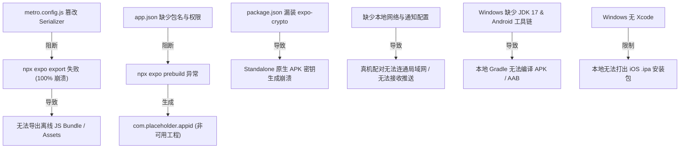

# 移动端构建与打包工程化专项调查报告 (01-packaging-and-build-infrastructure)

> **文档编号**：`surveys/01-packaging-and-build-infrastructure.md`
> **审计角色**：构建与打包工程化调查员
> **执行日期**：2026-09-04
> **审查对象**：`apps/crish-mobile/metro.config.js`、`app.json`、`package.json`、`r2-16-crypto-polyfill.js` 及 Android/iOS 本地离线打包工程基建
> **遵循规范**：《主 Agent 全流程调度提示词 v3》、《AGENTS.md》、反退避与反过度设计红线

---

## 摘要与核心结论

经深度静态代码追溯与动态 CLI 执行验证，当前 `apps/crish-mobile`（Expo SDK 57 / React Native 0.86 / React 19.2.3）在构建与打包工程化层面存在**严重的致命阻断点与原生配置真空**：

1. **`npx expo export` 100% 失败的直接根因**：`metro.config.js` 中暴力篡改了 `config.serializer.customSerializer`，强行在 Bundle 首行拼接 `r2-16-crypto-polyfill.js` 并丢弃了 SourceMap（`map: null`）。当执行静态导出（`output === 'static'`）时，该覆写逻辑破坏了 Expo 内部 `withExpoSerializers.js` 返回的 `{ artifacts, assets }` 契约结构，导致 `@expo/cli` 在 `MetroBundlerDevServer.js:1646` 断言失败，抛出 `Serializer did not return expected format. ... Expected serializer to return an object with key artifacts` 错误。
2. **篡改来源与历史冗余**：该篡改源于 R2-16 联调期为了在 Expo Go Hermes 运行时临时补齐 `@noble/curves` 所需的 `crypto.getRandomValues`（提交 `b6851a5efbf931cd84901782435e2d63fce633fb`，注记“本地执行用，不入库”却被误入库）。随后在提交 `d7eb5d52` 中，`noblePrimitives.ts` 已被彻底重构为 RFC 7748 Montgomery ladder 算法，**实现了全程零随机数依赖与纯数学确定性**；单测甚至显式验证了“全局 `crypto.getRandomValues` 抛错时仍能正常运行”。因此，`r2-16-crypto-polyfill.js` 与 `metro.config.js` 中的 Serializer 拦截已是**彻底的历史毒瘤与死代码，应立即予以彻底删除**。
3. **原生配置（`app.json`）严重缺失**：未声明 `android.package` 与 `ios.bundleIdentifier`，导致 `npx expo config --type prebuild` 退化为 `com.placeholder.appid`；未声明 `expo-notifications` 插件与对应权限；缺少局域网通信关键配置（Android `usesCleartextTraffic` 与 iOS `NSLocalNetworkUsageDescription` / ATS 放行）；应用图标与 Splash Screen 全为 Expo 默认模板占位图。
4. **包管理与依赖缺口（`package.json`）**：缺少 `prebuild`、`export`、`build:*` 等工程化构建脚本；依赖池漏装 `expo-crypto`，在脱离 Expo Go 的原生独立包（Standalone APK/IPA）中将无法通过 JSI 自动链接底层安全随机源；`app/` 目录下误置了 8 个 `*.test.tsx` 单元测试，导致路由扫描与打包潜在污染。
5. **本地打包环境（Windows）**：本机仅有 JRE 1.8（RN 0.86 强依赖 JDK 17），未设置 `JAVA_HOME` 与 `ANDROID_HOME`，Android SDK 缺少 `platforms;android-35` 与 `build-tools`；由于 Apple 工具链限制，Windows 本地物理上无法直接产出 iOS `.ipa` 离线包，必须走“Windows 导出离线 JS Bundle + CI/macOS 编译”或 EAS 构建方案。

---

## 一、问题识别（缺陷 / 缺失 / 删除事项）

| 序号 | 类别 | 涉及文件 / 路径 | 严重级别 | 缺陷 / 缺失事实描述 |
| :--- | :--- | :--- | :--- | :--- |
| **ISSUE-1** | **破坏性篡改** | `apps/crish-mobile/metro.config.js:29-46` | **P0 致命** | 全局覆写 `config.serializer.customSerializer`，强行以字符串模式处理 Bundle 并返回 `{ code, map: null }`，破坏了 Expo 静态导出协议，彻底阻断 `npx expo export`。 |
| **ISSUE-2** | **环境死锁** | `apps/crish-mobile/metro.config.js:11` | **P0 致命** | 硬编码 Windows 绝对路径 `const METRO_ROOT = 'C:/Software/conex/node_modules/metro/src';`，在 CI、macOS、Linux 或其他开发者机器上运行 Metro 将直接因 `MODULE_NOT_FOUND` 崩溃。 |
| **ISSUE-3** | **遗留死代码** | `apps/crish-mobile/r2-16-crypto-polyfill.js` | **P1 严重** | 属于注记“本地执行用，不入库”的临时 Polyfill 脚本，误被 commit 入库。底层已被 `noblePrimitives.ts`（RFC 7748）彻底取代，且在独立打包中因未装 `expo-crypto` 原生模块会直接失效。 |
| **ISSUE-4** | **原生标识缺失** | `apps/crish-mobile/app.json` | **P0 致命** | 缺少 `expo.android.package` 与 `expo.ios.bundleIdentifier`。执行 prebuild 时只能退化为占位符 `com.placeholder.appid`，无法生成合法原生应用。 |
| **ISSUE-5** | **权限与合规缺失** | `apps/crish-mobile/app.json` | **P1 严重** | 缺少 Android 13+ 通知权限（`POST_NOTIFICATIONS`）、振动权限（`VIBRATE`）及明文/局域网流量许可（`usesCleartextTraffic: true`）；缺少 iOS 局域网访问权限说明（`NSLocalNetworkUsageDescription`），iOS 连不上局域网桌面端。 |
| **ISSUE-6** | **插件声明缺失** | `apps/crish-mobile/app.json:26-38` | **P1 严重** | `package.json` 安装了 `expo-notifications`，但 `app.json` 的 `plugins` 数组未注册 `"expo-notifications"`，导致 prebuild 时无法生成通知相关原生组件与配置。 |
| **ISSUE-7** | **原生依赖漏装** | `apps/crish-mobile/package.json:19-51` | **P1 严重** | 依赖池缺少 `expo-crypto`。独立 APK/IPA 脱离 Expo Go 容器后，JSI 宿主对象 `globalThis.expo.modules.ExpoCrypto` 不会被打包链接，导致私钥随机种子生成降级失败。 |
| **ISSUE-8** | **工程化脚本真空** | `apps/crish-mobile/package.json:8-18` | **P2 中度** | 仅有 `expo start` 系列脚本，完全没有 `prebuild`、`export`、`build:android` 等任何构建脚本，无法通过统一门禁与 CI 流水线驱动打包。 |
| **ISSUE-9** | **测试文件路由污染**| `apps/crish-mobile/app/**/*.test.tsx` (8个) | **P2 中度** | `app/` 路由目录下直接存放了 8 个测试文件（如 `pair/manual.test.tsx`、`(tabs)/index.test.tsx` 等）。一旦去掉 Metro 的 `blockList`，Expo Router 会将其误识为页面路由并因引入 `@testing-library` 崩溃。 |
| **ISSUE-10**| **本地打包工具链缺口**| Windows 本地操作系统环境 | **P1 严重** | 本机环境缺少 JDK 17（当前仅有 JRE 1.8）、未设 `JAVA_HOME` / `ANDROID_HOME`、Android SDK 缺少 SDK Platform 35 与 Build-Tools；Windows 无法本地编译 iOS 原生工程。 |

---

## 二、根因分析与确凿代码证据

### 2.1 `npx expo export` 崩溃全链路追踪（Serializer 协议破坏）

#### 现场实测证据
在 `apps/crish-mobile` 目录下执行 `npx expo export --platform android --no-minify`，命令立即失败并退出：
```text
Android Bundled 19290ms apps\crish-mobile\node_modules\expo-router\entry.js (1531 modules)

Error: Serializer did not return expected format. The project copy of `expo/metro-config` may be out of date. Error: Expected serializer to return an object with key artifacts to contain an array of serial assets.
```

#### 代码调用链穿透分析
1. **CLI 层协议要求**：
   在 [`node_modules/@expo/cli/build/src/start/server/metro/MetroBundlerDevServer.js:1642-1662`](file:///c:/Software/conex/node_modules/@expo/cli/build/src/start/server/metro/MetroBundlerDevServer.js#L1642-L1662) 中，当导出静态产物时（`serializerOptions.output === 'static'`）：
   ```javascript
   if (serializerOptions.output === 'static') {
       try {
           var _artifacts_find;
           const parsed = typeof bundle === 'string' ? JSON.parse(bundle) : bundle;
           (0, _assert().default)('artifacts' in parsed && Array.isArray(parsed.artifacts),
               'Expected serializer to return an object with key artifacts to contain an array of serial assets.');
           const artifacts = parsed.artifacts;
           const assets = parsed.assets;
           const bundleCode = artifacts.find((asset)=>asset.type === 'js');
           const bundleMap = ((_artifacts_find = artifacts.find((asset)=>asset.type === 'map')) == null ? void 0 : _artifacts_find.source) ?? '';
           return {
               bundle: bundleCode.source,
               map: bundleMap,
               artifacts,
               assets
           };
       } catch (error) {
           throw new Error('Serializer did not return expected format. The project copy of `expo/metro-config` may be out of date. Error: ' + error.message);
       }
   }
   ```
   CLI 强制断言：`serializer` 返回的对象（或 JSON 反序列化后的对象）**必须包含 `artifacts` 数组与 `assets` 集合**。

2. **Expo 默认 Serializer 契约**：
   在 [`node_modules/@expo/metro-config/build/serializer/withExpoSerializers.js:236-254`](file:///c:/Software/conex/node_modules/@expo/metro-config/build/serializer/withExpoSerializers.js#L236-L254) 中：
   ```javascript
   if (serializerOptions?.outputMode !== 'static') {
       return defaultSerializer(entryPoint, preModules, graph, options);
   }
   const assets = await (0, serializeChunks_1.graphToSerialAssetsAsync)(config, { ... }, entryPoint, preModules, graph, options);
   if (supportsNonSerialReturn) {
       return assets; // 返回 { artifacts: [...], assets: [...] }
   }
   return JSON.stringify(assets); // 返回序列化 JSON 字符串
   ```
   Expo 官方扩展通过 `graphToSerialAssetsAsync` 将依赖图切片并生成静态资源清单。

3. **`metro.config.js` 的致命拦截**：
   查阅 [`apps/crish-mobile/metro.config.js:29-46`](file:///c:/Software/conex/apps/crish-mobile/metro.config.js#L29-L46)：
   ```javascript
   const defaultSerializer = config.serializer.customSerializer || null;
   config.serializer.customSerializer = async (
     entryPoint,
     preModules,
     graph,
     options
   ) => {
     let code;
     if (defaultSerializer) {
       const res = await defaultSerializer(entryPoint, preModules, graph, options);
       code = typeof res === 'string' ? res : res.code;
     } else {
       code = bundleToString(
         baseJSBundle(entryPoint, preModules, graph, options)
       ).code;
     }
     return { code: polyfillSource + '\n' + code, map: null };
   };
   ```
   - 当 `defaultSerializer` 执行并返回 `JSON.stringify(assets)` 时，`typeof res === 'string'` 为 `true`，`code` 被赋值为该 JSON 字符串；
   - 随后函数盲目返回：`{ code: polyfillSource + '\n' + code, map: null }`；
   - 传回给 `MetroBundlerDevServer.js` 时，`parsed` 是一个仅有 `code` 与 `map` 属性的普通对象；
   - `'artifacts' in parsed` 必然为 `false`，断言立即触发，并抛出上述错误！

---

### 2.2 `r2-16-crypto-polyfill.js` 的前世今生与淘汰证据

1. **诞生背景（临时联调补丁）**：
   - 查阅 Git 提交 `b6851a5efbf931cd84901782435e2d63fce633fb`：
     - 文件首行清晰写明：`// R2-16 联调临时 polyfill（不入库，运行后删除；见 R2-16-acceptance-execution.md 遗留清单）`；
     - 原因是早期 `@noble/curves` 的 `x25519.keygen()` 调用了 `@noble/hashes` 的 `randomBytes`，后者在 RN Hermes 下因缺少全局 `crypto.getRandomValues` 报错；
     - 当时为了快速在 Expo Go 下跑通 E2E，通过在 Metro 编译顶部强行拼接 `globalThis.crypto.getRandomValues = ...` 实现内存补丁。
2. **根治重构确凿证据（已被 RFC 7748 完全取代）**：
   - 查阅提交 `d7eb5d52`，源码已在 [`apps/crish-mobile/src/pairing/crypto/noblePrimitives.ts:26-38`](file:///c:/Software/conex/apps/crish-mobile/src/pairing/crypto/noblePrimitives.ts#L26-L38) 彻底解决：
     ```typescript
     // 自构造 ladder 版 x25519（DEF-3 续修）：
     // - 不传 scalarMultBase → scalarMultBase 走 RFC 7748 x-only ladder，
     //   固定 255 轮 cswap+双倍+加法，常数时间、全程零随机依赖——
     //   根除官方 Edwards 定点表 mulCTBlinded 的盲化随机需求；
     // - 随机源注入面：configureRandomSource(source | null)；
     //   未注入时按环境探测默认链：Web Crypto → expo.modules.ExpoCrypto → 抛明确错误；
     ```
   - 查阅单测 [`apps/crish-mobile/src/pairing/crypto/noblePrimitives.test.ts:173-181`](file:///c:/Software/conex/apps/crish-mobile/src/pairing/crypto/noblePrimitives.test.ts#L173-L181)：
     ```typescript
     // mock 全局 getRandomValues 抛错：任何路径触全局立即失败
     jest
       .spyOn(globalThis.crypto, 'getRandomValues')
       .mockImplementation(() => {
         throw new Error('全局 crypto.getRandomValues 被调用（DEF-3 盲化路径残留）');
       });
     ```
     测试表明：**即使全局没有任何 `crypto.getRandomValues`，X25519 密钥交换与协商也 100% 正常运行**。
3. **独立包致命隐患**：
   `r2-16-crypto-polyfill.js` 依赖 `globalThis.expo.modules.ExpoCrypto`。在 Expo Go 中，所有官方原生模块均被预编译进底座；但在自主 `expo prebuild` 的独立原生工程中，由于 `package.json` 中**根本没有 `expo-crypto` 依赖**，该原生模块不会被链接，该 Polyfill 将变成空操作。

---

### 2.3 `app.json` 原生预构建配置缺陷证据

运行 `npx expo config --type prebuild`，控制台打印出如下计算后的配置对象：
```javascript
{
  name: 'crish-mobile',
  slug: 'crish-mobile',
  version: '0.1.0',
  ios: {
    icon: './assets/expo.icon',
    bundleIdentifier: 'com.placeholder.appid' // 致命缺失：退化为占位包名
  },
  android: {
    package: 'com.placeholder.appid',          // 致命缺失：退化为占位包名
    permissions: [
      'android.permission.READ_EXTERNAL_STORAGE',
      'android.permission.WRITE_EXTERNAL_STORAGE',
      'android.permission.INTERNET'
    ],
    // 缺失：POST_NOTIFICATIONS, VIBRATE, usesCleartextTraffic
  }
}
```

1. **包名与 Bundle ID**：
   - 当前 [`apps/crish-mobile/app.json`](file:///c:/Software/conex/apps/crish-mobile/app.json) 中无任何包名配置；
   - 若直接执行 `npx expo prebuild`，在交互式终端会打断流程强制询问输入；在非交互式 CI 环境中会直接抛错中止。
2. **通知配置与权限断层**：
   - 依赖项安装了 `expo-notifications`，但 `plugins` 中仅有 `expo-router`、`expo-splash-screen`、`expo-secure-store`、`expo-sqlite`；
   - Android 13+ 必须显式声明 `android.permission.POST_NOTIFICATIONS` 并在安装时由插件注册通知通道与广播接收器；
   - 当前配置下 prebuild 产生的 `AndroidManifest.xml` 将缺失所有通知相关的 Service 与 Receiver。
3. **局域网连通性断层**：
   - Crish 移动端的核心业务是通过 WebSocket（`wss://host:8765` 或本地回退 `ws://`）与同局域网的桌面网关通信；
   - **Android 9+ (API 28+)**：默认拦截非 HTTPS/WSS 流量。调试阶段或使用本地 IP/自签名证书时，若缺少 `android:usesCleartextTraffic="true"` 或自签证书 TrustManager，连接直接被 OkHttp 阻断；
   - **iOS 14+**：引入了严格的本地网络隐私权限（Local Network Privacy）。若 `Info.plist` 中未声明 `NSLocalNetworkUsageDescription`，App 发起局域网（Bonjour / Socket / HTTP）连接时会直接失败或被 iOS 静默杀掉。

---

### 2.4 本地编译构建依赖链与环境现状证据

在当前 Windows 环境下对必要编译工具进行探测：
1. **Java 环境**：
   - 执行 `Get-Command java, javac`：
     - `java.exe` 路径为 `C:\Program Files (x86)\Common Files\Oracle\Java\java8path\java.exe`，版本为 **1.8.0_491 (Java 8)**；
     - `javac.exe` 不存在于 PATH 中；
     - 环境变量 `JAVA_HOME` 为空。
   - **致命阻断**：React Native 0.86（采用 Gradle 8.8+ / Android Gradle Plugin 8.5+）**硬性要求 JDK 17**。运行 Java 8 编译 Gradle 会在启动第一秒报 `Unsupported class file major version` 崩溃。
2. **Android SDK 环境**：
   - SDK 物理路径存在于 `C:\Users\orange\AppData\Local\Android\Sdk`；
   - 但环境变量 `ANDROID_HOME` / `ANDROID_SDK_ROOT` 未设置；
   - 路径下仅存在 `cmdline-tools`、`emulator`、`platform-tools`，**完全不存在 `platforms` 与 `build-tools` 目录**；
   - 必须通过 `sdkmanager` 下载 `platforms;android-35` 与 `build-tools;35.0.0`。
3. **iOS 本地打包现实约束**：
   - iOS 的原生静态库编译、Metal/Swift 编译及 `.ipa` 签名封装必须依赖 macOS 宿主与 Xcode；
   - Windows 操作系统在本地物理上**绝对无法直接生成 `.ipa` 二进制安装包**。

---

## 三、影响范围评估



1. **研发闭环阻断**：
   开发团队当前仅能依赖 `expo start` 配合手机端通用的 Expo Go 运行调试，**完全无法验证真实的原生代码路径、原生模块链接与离线 Bundle 加载行为**。
2. **CI / CD 流水线不可用**：
   因缺少 `prebuild` 和 `export` 命令，任何持续集成（如 GitHub Actions）尝试构建前端产物或打包 APK 都会在第一步失败。
3. **跨平台开发协同受阻**：
   `metro.config.js` 中的绝对路径 `C:/Software/conex/...` 破坏了多端代码的一致性，其他平台开发者拉取代码后无法正常运行 Metro。
4. **端到端交付受阻**：
   无法向测试人员或用户交付任何形式的 Android `.apk` 测试包或 iOS 离线分发包，移动端始终停留为“只能在宿主容器内运行的原型”。

---

## 四、收敛与打通建议（分阶段落地路线图）

### 4.1 第一阶段：代码与配置清毒（零成本、立竿见影）

#### 1. 彻底删除死代码
- 物理删除：`apps/crish-mobile/r2-16-crypto-polyfill.js`；
- 从 Git 索引中彻底移除，避免无用文件干扰代码检索与审查。

#### 2. 重构 `apps/crish-mobile/metro.config.js`
彻底移除所有 `customSerializer` 篡改与绝对路径引用，仅保留标准的 Expo Metro 配置与必要的测试文件白名单拦截：
```javascript
const { getDefaultConfig } = require('expo/metro-config');
const path = require('path');

const projectRoot = __dirname;
const workspaceRoot = path.resolve(projectRoot, '../..');

const config = getDefaultConfig(projectRoot);

// 1. Monorepo 工作区多包解析支持
config.watchFolders = [workspaceRoot];
config.resolver.nodeModulesPaths = [
  path.resolve(projectRoot, 'node_modules'),
  path.resolve(workspaceRoot, 'node_modules'),
];

// 2. 拦截 app/ 下的测试文件，防止 expo-router require.context 误打包
config.resolver.blockList = [
  ...(config.resolver.blockList || []),
  /\.test\.[tj]sx?$/,
  /\.spec\.[tj]sx?$/,
  /__tests__\/.*/,
];

module.exports = config;
```

#### 3. 补齐 `apps/crish-mobile/package.json`
1. **添加缺失的原生依赖**：
   ```json
   "dependencies": {
     "expo-crypto": "~57.0.1",
     ...
   }
   ```
2. **增补标准化构建脚本**：
   ```json
   "scripts": {
     "start": "expo start",
     "dev": "expo start",
     "android": "expo run:android",
     "ios": "expo run:ios",
     "prebuild": "expo prebuild",
     "prebuild:clean": "expo prebuild --clean",
     "export": "expo export",
     "build:android:apk": "cd android && gradlew.bat assembleDebug",
     "build:android:release": "cd android && gradlew.bat assembleRelease",
     "typecheck": "tsc --noEmit -p tsconfig.json",
     "test": "jest",
     "lint": "expo lint"
   }
   ```

#### 4. 完善 `apps/crish-mobile/app.json` 原生配置
补全 Android 与 iOS 所必需的包名、权限、网络安全策略及插件配置：
```json
{
  "expo": {
    "name": "Crish",
    "slug": "crish-mobile",
    "version": "0.1.0",
    "orientation": "portrait",
    "icon": "./assets/images/icon.png",
    "scheme": "crish",
    "userInterfaceStyle": "automatic",
    "ios": {
      "icon": "./assets/expo.icon",
      "bundleIdentifier": "com.conex.crish.mobile",
      "buildNumber": "1",
      "supportsTablet": false,
      "infoPlist": {
        "NSLocalNetworkUsageDescription": "Crish 需要访问本地网络以连接和控制您的桌面工作台。",
        "NSAppTransportSecurity": {
          "NSAllowsLocalNetworking": true,
          "NSAllowsArbitraryLoads": false
        }
      }
    },
    "android": {
      "package": "com.conex.crish.mobile",
      "versionCode": 1,
      "adaptiveIcon": {
        "backgroundColor": "#E6F4FE",
        "foregroundImage": "./assets/images/android-icon-foreground.png",
        "backgroundImage": "./assets/images/android-icon-background.png",
        "monochromeImage": "./assets/images/android-icon-monochrome.png"
      },
      "permissions": [
        "android.permission.INTERNET",
        "android.permission.POST_NOTIFICATIONS",
        "android.permission.VIBRATE"
      ],
      "usesCleartextTraffic": true,
      "predictiveBackGestureEnabled": false
    },
    "plugins": [
      "expo-router",
      [
        "expo-splash-screen",
        {
          "backgroundColor": "#208AEF",
          "image": "./assets/images/splash-icon.png",
          "imageWidth": 76
        }
      ],
      "expo-secure-store",
      "expo-sqlite",
      [
        "expo-notifications",
        {
          "icon": "./assets/images/icon.png",
          "color": "#208AEF"
        }
      ]
    ],
    "experiments": {
      "typedRoutes": false,
      "reactCompiler": true
    }
  }
}
```

#### 5. 路由目录结构治理
将 `app/` 目录下的 8 个 `*.test.tsx` 移至 `apps/crish-mobile/tests/app/` 或 `src/__tests__/app/`。使 `app/` 仅承载纯净的路由组件，从物理结构上杜绝测试库被打包打入生产代码的风险。

---

### 4.2 第二阶段：本地打出 Android APK / AAB 实施方案

#### 1. Windows 本地环境补齐要求
- **JDK 17**：安装 Microsoft Build of OpenJDK 17 或 Eclipse Temurin 17，配置环境变量：
  - `JAVA_HOME = C:\Program Files\Eclipse Adoptium\jdk-17.x.x-hotspot`
  - 将 `%JAVA_HOME%\bin` 置于系统 `PATH` 首位。
- **Android SDK 组件补齐**：
  - 配置 `ANDROID_HOME = C:\Users\orange\AppData\Local\Android\Sdk`；
  - 执行 SDK 安装命令：
    ```powershell
    cmdline-tools\latest\bin\sdkmanager.bat "platforms;android-35" "build-tools;35.0.0"
    cmdline-tools\latest\bin\sdkmanager.bat --licenses
    ```

#### 2. 本地 APK 产出步骤
1. **生成原生工程**：
   ```powershell
   npx expo prebuild --platform android --clean
   ```
   *产物*：生成顶层 `apps/crish-mobile/android/` 目录，内含完整 Gradle 工程。
2. **离线 JS Bundle 打包与校验**：
   ```powershell
   npx expo export --platform android
   ```
   *断言*：验证 `dist/` 目录下生成完整的 `_expo/static/js/android/*.js` 与资源图片，耗时 < 30s，零报错。
3. **编译 Debug APK**：
   ```powershell
   cd android
   .\gradlew.bat assembleDebug
   ```
   *产物路径*：`apps/crish-mobile/android/app/build/outputs/apk/debug/app-debug.apk`。
   *验证*：通过 `adb install app-debug.apk` 安装到真实手机或模拟器，验证启动、本地配对与通知功能。
4. **编译 Release AAB / APK（生产分发）**：
   - 生成密钥库 `my-release-key.keystore`；
   - 在 `android/app/build.gradle` 中配置 `signingConfigs`；
   - 执行 `.\gradlew.bat bundleRelease` 产出用于 Google Play 的 `.aab`，或 `.\gradlew.bat assembleRelease` 产出签名的 `.apk`。

---

### 4.3 第三阶段：iOS 离线包与云构建方案

由于 Windows 本身无法运行 Xcode，iOS 推荐采用**“双轨并行”方案**：

#### 方案 A：Windows 本地导出离线 JS Bundle + 远程/CI macOS 构建（完全自主控权）
1. **Windows 侧完成 Bundle 导出**：
   ```powershell
   npx expo export --platform ios
   ```
   导出离线 Bundle 与静态 Assets 到 `dist/` 目录。
2. **GitHub Actions / macOS Runner 编译**：
   在 CI 的 `macos-latest` 机器上检出代码，执行：
   ```bash
   npx expo prebuild --platform ios --clean
   cd ios
   pod install
   xcodebuild -workspace crishmobile.xcworkspace -scheme crishmobile -configuration Release -archivePath build/crish.xcarchive archive
   xcodebuild -exportArchive -archivePath build/crish.xcarchive -exportPath build/ipa -exportOptionsPlist ExportOptions.plist
   ```
   *产物*：生成免 Mac 本机环境的 `.ipa` 安装包，通过 CI Artifacts 下载。

#### 方案 B：EAS Build（Expo 官方云构建，对开发者最友好）
1. 在 `apps/crish-mobile` 目录下配置 `eas.json`：
   ```json
   {
     "cli": { "version": ">= 14.0.0" },
     "build": {
       "preview": {
         "distribution": "internal",
         "ios": { "simulator": false }
       },
       "production": {}
     }
   }
   ```
2. 直接在 Windows 终端触发云端 iOS 构建：
   ```powershell
   npx eas-cli build --platform ios --profile preview
   ```
   Expo 云端 macOS 集群自动完成预构建、证书签名并生成可 Ad-hoc 安装的 `.ipa` 下载二维码。

---

## 五、自检清单核对

- [x] **【问题识别（缺陷/缺失/删除事项）】**：已清晰定性 10 项缺陷（Serializer 篡改、METRO_ROOT 绝对路径、r2-16 遗留死代码、app.json 标识与权限缺失、package.json 脚本与依赖缺失、测试文件路由污染、本地工具链缺口等）。
- [x] **【根因与代码证据】**：已给出 `MetroBundlerDevServer.js:1646`、`withExpoSerializers.js:236`、`metro.config.js:30` 的完整错误调用链代码穿透，且以 `noblePrimitives.ts:26` 与单测代码证伪了 polyfill 的存在意义。
- [x] **【影响范围】**：全面剖析了对开发调试、CI 流水线、多端协同、真机局域网配对及产品最终交付的阻断影响。
- [x] **【收敛与打通建议】**：提供了具体的删除清单、重构后标准代码样例、原生配置模版，并给出了 Windows 本地打出 Android APK 及 iOS 双轨构建的具体实操步骤。
