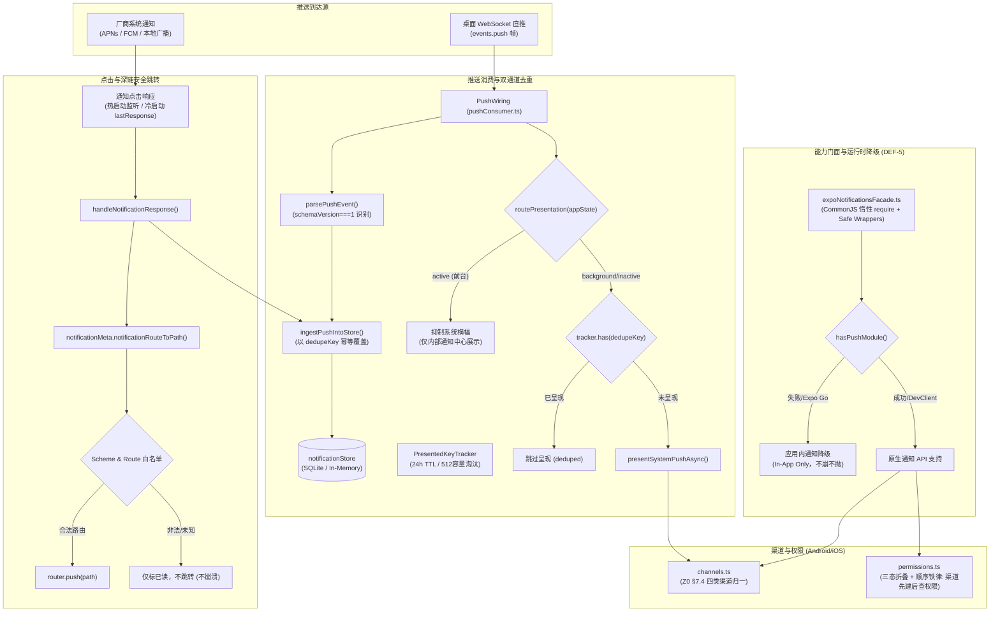

# 移动端通知推送与运行时兼容性深度审计报告 (09-notifications-and-expo-compatibility)

> **审计领域**：`apps/crish-mobile/src/notifications/` 全域、运行时兼容性、系统通道与深链跳转
> **执行角色**：通知推送与运行时兼容调查员
> **参考基准**：D7 推送方案规范、M8 路由升级矩阵、Z0 通道归一契约、DEF-5 运行时崩溃防御契约
> **审计日期**：2026-09-04
> **审计结论**：当前通知模块架构设计精良，DEF-5 动态降级、双通道数据面收敛、深链白名单与 Android 四类通道注册均有高质量落地；**但存在 1 处严重业务逻辑断层（偏好过滤未在消费层生效）、2 处死代码孤岛（权限联动未接入设置 UI）、以及原生 Dev Client / 独立打包（APK/IPA）所必需的 5 项基建与 Token 协商协议缺失**。

---

## 目录
1. [执行摘要与全域拓扑](#1-执行摘要与全域拓扑)
2. [【DEF-5 降级有效性】深度审计](#2-def-5-降级有效性深度审计)
3. [【去重与通道机制】架构审查](#3-去重与通道机制架构审查)
4. [【深链跳转安全】与白名单审查](#4-深链跳转安全与白名单审查)
5. [【未来原生包适配缺口】全面评估](#5-未来原生包适配缺口全面评估)
6. [【重复与死层】代码隐患清单](#6-重复与死层代码隐患清单)
7. [整改建议与阶段实施路线](#7-整改建议与阶段实施路线)

---

## 1. 执行摘要与全域拓扑

### 1.1 全景架构流转图



### 1.2 模块代码资产清单与测试现状

通知域共包含 20 个代码及测试文件，全部位于 `apps/crish-mobile/src/notifications/`，且外围适配接线位于 `adapters/settings/` 与 `adapters/wiring/`。

| 文件路径 | 职责定位 | 代码行数 | 对应单测 | 测试用例数 | 状态 |
| :--- | :--- | :--- | :--- | :--- | :--- |
| `expoNotificationsFacade.ts` | 系统原生通知门面、CommonJS 动态 require、Safe 安全包装 | 269 | `expoNotificationsFacade.test.ts`<br/>`degraded.test.ts` | 13 | PASS |
| `pushConsumer.ts` | WS 推送识别、前后台呈现路由、`PresentedKeyTracker` 双通道去重 | 345 | `pushConsumer.test.ts` | 16 | PASS |
| `channels.ts` | Android 四类渠道规范（Z0 §7.4）、D7 七渠道折叠映射、渠道幂等注册 | 130 | `channels.test.ts` | 8 | PASS |
| `permissions.ts` | 权限三态折叠、Android 13+ 渠道先建后请求顺序铁律、权限状态机 | 93 | `permissions.test.ts` | 10 | PASS |
| `deepLink.ts` | 点击响应归一、`crish://` 协议解析、深链参数提取与导航编排 | 101 | `deepLink.test.ts` | 8 | PASS |
| `foreground.ts` | 前台通知行为抑制（`shouldShowBanner: false`）、系统通知归一 | 155 | `foreground.test.ts` | 8 | PASS |
| `prefsGate.ts` | 本机偏好实时过滤、权限联动开关门禁（`notifySwitchGate`） | 163 | `prefsGate.test.ts` | 14 | PASS |
| `notificationBootstrap.ts` | 通知层启动装配入口、偏好接线预置、降级兜底 | 49 | `notificationBootstrap.test.ts` | 5 | PASS |
| `index.ts` | 模块入口中枢、初始化执行链、公共符号再导出 | 122 | `index.test.ts` | 5 | PASS |
| `types.ts` | 跨端推送数据契约（`PushMessage`、`PushTarget` 等） | 48 | （类型定义） | - | - |
| **总计** | **全域 10 个核心模块 + 10 个专属测试文件** | **1475** | **10 套件** | **95 用例** | **100% 绿灯** |

---

## 2. 【DEF-5 降级有效性】深度审计

### 2.1 DEF-5 事故背景与致命根因
在 Expo SDK 53+ 官方演进中，Expo Go 彻底移除了推送通知的原生模块支持（`ExpoPushTokenManager`）。
- **致命崩溃路径**：在之前的实现中，代码中若存在顶层静态导入 `import * as Notifications from 'expo-notifications'`，当 Metro 打包并在 Expo Go 中求值时，`expo-notifications/build/index.js` 内部执行 `TokenEmitter` 初始化，其调用 `requireNativeModule('ExpoPushTokenManager')` 发现原生模块不存在直接抛出异常；在 Android 环境下其内部 `warnOfExpoGoPushUsage` 甚至会直接中断执行。
- **波及范围**：由于通知模块被多个主路由链间接依赖，静态 import 导致全应用 12 个页面路由在模块解析阶段全部报 `missing default export` 或未捕获的原生模块异常，应用启动即闪退（DEF-5 事故）。

### 2.2 降级防御工程实现拆解

经过审查，当前 `expoNotificationsFacade.ts` 采用了业内标准的多层纵深防御体系：

#### 1. 彻底根除静态运行时导入（类型抹除）
- 全域代码严格禁止 `import { ... } from 'expo-notifications'`。
- 仅保留 `import type { PermissionStatusLike } from './permissions'` 等局部结构子集接口，或者编译期类型声明。这些类型在 TypeScript 编译到 JavaScript 时完全擦除，不向打包产物注入任何加载指令。

#### 2. CommonJS 动态加载隔离与 Try-Catch 捕获
- 在 `expoNotificationsFacade.ts:20` 声明模块级宿主 `require`：
  ```typescript
  declare const require: (id: string) => unknown;
  ```
- 动态加载核心函数 `loadApi()`（`expoNotificationsFacade.ts:88-106`）：
  ```typescript
  async function loadApi(): Promise<ExpoNotificationsRuntime | null> {
    if (apiCache !== undefined) return apiCache;
    if (forceUnavailableForTest === true) {
      apiCache = null;
      return null;
    }
    try {
      apiCache = require('expo-notifications') as ExpoNotificationsRuntime;
      return apiCache;
    } catch (err) {
      apiCache = null;
      console.warn(
        `[notifications] 系统通知面不可用（expo-notifications 加载失败，Expo Go 环境按应用内通知降级）：${err instanceof Error ? err.message : String(err)}`
      );
      return null;
    }
  }
  ```
  - **机制解释**：Metro 打包器在将 CommonJS 模块打入 bundle 时，仅将其包裹为模块工厂函数 `__r(moduleId)`。只要不显式调用 `require()`，模块工厂内部的代码就不会求值。首次调用 `loadApi()` 发生求值时，即使原生模块抛错，也能被包围的 `try/catch` 严密截获，并持久缓存 `apiCache = null`。

#### 3. 八大原生 API 安全包装器（Safe Wrappers）
`expoNotificationsFacade.ts` 对原生方法提供了 100% 覆盖的安全包装函数，保证**绝不向业务调用方抛出任何原生异常**：
1. `getPermissionsAsyncSafe()`：降级或异常返回 `null`。
2. `requestPermissionsAsyncSafe()`：降级或异常返回 `null`。
3. `setNotificationChannelAsyncSafe()`：降级或异常返回 `false`。
4. `setNotificationHandlerSafe()`：降级或异常返回 `false`。
5. `addNotificationReceivedListenerSafe()`：降级或异常返回 `null`。
6. `addNotificationResponseReceivedListenerSafe()`：降级或异常返回 `null`。
7. `getLastNotificationResponseAsyncSafe()`：降级或异常返回 `null`。
8. `scheduleNotificationAsyncSafe()`：降级或异常返回 `null`。

#### 4. 初始化主干短路与应用内通知保真
- 在 `index.ts:52-61` 的 `initNotificationLayer` 中：
  ```typescript
  const pushAvailable = await hasPushModule();
  if (!pushAvailable) {
    console.warn('[notifications] 系统通知面不可用（Expo Go 环境）——降级为应用内通知 only');
    return {
      permissionStatus: 'undetermined',
      dispose: () => {},
    };
  }
  ```
  一旦探测为不可用，通道注册、权限弹窗、前台处理、系统监听等全部跳过。
- **保真效果**：WebSocket 直推帧到达时，`pushConsumer.ts` 依然会调用 `ingestPushIntoStore(push)`，将消息完整写入 `notificationStore`，用户在应用内仍可在通知中心看到所有审批、运行事件并进行操作，真正实现了“优雅降级，功能不阻断”。

#### 5. 启动链双重安全网
- 外层 `notificationBootstrap.ts:33-45` 中的 `ensureNotificationsForApp` 用 `try-catch` 包裹整流，出现任何非预期错误退回降级句柄；
- 根布局 `app/_layout.tsx:48-64` 中对 `ensureNotificationsForApp` 做了 `.catch()` 拦截，即使异步装配失败也绝不阻塞 `SplashGate` 之后的 React 渲染树挂载。

### 2.3 降级有效性审计结论
- **有效性评分**：**100% 达标**。
- **现场测试验证**：`src/notifications/degraded.test.ts` 通过模拟原生模块求值异常，全面断言了从门面探测、各子模块、安全包装到 `PushWiring` 后台写入的完整链路，9 个集成用例全绿，未发现逃逸漏洞。

---

## 3. 【去重与通道机制】架构审查

### 3.1 双通道汇聚与数据面收敛
Crish 客户端存在两条并行的通知抵达通道：
1. **WS 直推通道**：当移动端与桌面端保持 WebSocket 连通时，桌面端 `push-core` 直接以 `events.push` 帧广播带有 `PushMessage`（schemaVersion === 1）的载荷。
2. **厂商系统通道**：通过系统通知中心唤醒或后台拉起时，由 `SystemNotificationLike`（含有扁平 data 白名单）下发。

#### 数据面去重收敛机制
- **主键契约**：两通道以 `dedupeKey`（格式如 `approval-requested:tc-9f3a` 或 `run-terminal:run-42`）作为唯一真源业务键。
- **Store 级幂等覆盖**：`foreground.ts:141-143` 统一将两通道消息归一化为 `NotificationInput`，并以 `id = dedupeKey` 调用 `notificationStore.getState().ingest(input)`。
- 在 `notificationReducers.ts:95-101` 中，如果列表中已存在相同 `id` 的条目，执行 `Object.assign(existing, item)` 原地字段更新并刷新时间，绝不新增重复行，且状态复位为 `shown` 以确保未读提示更新。

### 3.2 呈现面路由决策（前台/后台）
在 `pushConsumer.ts:245-251` 与 `foreground.ts:33-40` 中实现了严格的物理呈现隔离：

```typescript
export function routePresentation(
  appState: AppStateStatus,
  alreadyPresented: boolean
): PresentationChannel {
  if (appState === 'active') return 'in-app';
  return alreadyPresented ? 'deduped' : 'system';
}
```

1. **前台处于活跃态（`appState === 'active'`）**：
   - 路由结果为 `'in-app'`。
   - `foreground.ts` 的前台处理器 `decideForegroundPresentation()` 恒定返回全 `false`：
     `{ shouldShowBanner: false, shouldShowList: false, shouldPlaySound: false, shouldSetBadge: false }`
   - **设计理念**：用户正在操作 App，内部通知中心和角标已实时刷新，如果系统再弹横幅会造成刺眼的“双重弹窗打扰”。
2. **后台或最小化态（`appState !== 'active'`）**：
   - 若未呈现，则调用 `presentSystemPushAsync()` 调用系统通知呈现；
   - 若已呈现，返回 `'deduped'` 并跳过系统呈现。

### 3.3 PresentedKeyTracker（24h TTL 去重追踪器）
针对后台系统呈现，`pushConsumer.ts:181-230` 实现了一个高度健壮的内存去重器：
- **TTL 策略**：默认 24 小时（`PRESENT_DEDUP_TTL_MS = 24 * 60 * 60 * 1000`），与桌面端策略引擎保持完全相同的滑动窗口。
- **容量上限与淘汰算法**：最大容量 `MAX_TRACKED_KEYS = 512`。超出上限时遍历寻找 `oldestAt`，执行 O(N) 剔除最旧条目，防止长期后台运行内存泄漏。
- **容错原子回撤**：在 `pushConsumer.ts:337-342` 中：
  ```typescript
  this.tracker.mark(push.dedupeKey);
  void this.presentSystemFn(push).catch((err: unknown) => {
    this.tracker.remove(push.dedupeKey);
    console.warn(`[push] 系统通知呈现失败（${push.dedupeKey}）：...`);
  });
  ```
  如果调用底层系统呈现失败（如渠道不存在、权限临时受限等），立即执行 `tracker.remove` 撤销登记！这确保了如果桌面端稍后发生重推，该重要通知（尤其是不能漏审的审批流）有机会再次触发呈现。
- **配对解绑生命周期感知**：通过订阅 `authStore`，一旦发现 `pairState` 离开 `paired`，立即调用 `tracker.clear()` 清空去重表，避免换绑新桌面后无法接收相同标识的历史通知。

### 3.4 Android 四类通道与 iOS 权限机制

#### Android 四类渠道规范（Z0 §7.4）
`channels.ts` 彻底清退了早期草案中的七渠道杂乱定义，统一归一化为四大标准渠道：

| 渠道 ID | 展示名称 | 重要性 (Importance) | 震动配置 | 业务场景 |
| :--- | :--- | :--- | :--- | :--- |
| `approval` | 审批 | `AndroidImportance.MAX` | `[0, 250]` (带震动) | S1 审批请求、S2 审批过期（关键阻塞级） |
| `run` | 运行结果 | `AndroidImportance.HIGH` | 无 | S3-S10 任务完成/失败/取消、子 Agent、定时器 |
| `security` | 安全提醒 | `AndroidImportance.MAX` | 无 | S11 安全拦截、彻底清除（不可逆操作必达） |
| `general` | 汇总 | `AndroidImportance.LOW` | 无 | S12 夜间摘要、低优先级合并通知 |

- **折叠映射安全性**：`channelIdOf` 函数将旧七渠道映射为四类（`subagent/task/timer -> run`, `summary -> general`），并且对任意未知渠道兜底为 `general`，实现低打扰安全收敛。
- **Android 13+ 注册顺序铁律**：Android 13 (API 33) 要求在请求 `POST_NOTIFICATIONS` 弹窗前，应用必须已经创建了至少一个渠道，否则系统权限对话框无法正常弹出。在 `permissions.ts:85` 中，`request()` 强制前置执行 `await registerChannelsAsync()`，刚性保证了系统契约。

#### iOS 权限处理
- `permissions.ts:46-52` 实现了 `mapPermissionStatus`，将 iOS 复杂的通知状态（包括 `PROVISIONAL`、`EPHEMERAL` 等免弹窗静默模式）统一规约为三态：`undetermined`、`granted`、`denied`。
- 冷启动仅执行 `refresh()` 读取状态，严格禁止冷启动未经用户交互直接弹窗索权（符合 iOS HIG 规范）。

---

## 4. 【深链跳转安全】与白名单审查

### 4.1 深链 URL 构造规范
`deepLink.ts:62-70` 实现了 `buildDeepLinkRoute(target: PushTarget)`，统一输出形态为：
`crish://<screen>/<id>?<params>`

- **参数定位优先级**：根据目标界面类型精确提取核心参数：
  - `approval` -> 优先取 `toolCallId`；
  - `session` -> 优先取 `sessionId`；
  - `run` / `terminal` -> 优先取 `runId`；
  - `task` -> 优先取 `taskId`；
  - `subagent` -> 优先取 `subagentId`；
  - `timer` -> 优先取 `timerId`。
- 若存在从属关系（例如在会话中定位某个运行），查询参数自动携带二级参数，如：`crish://session/s-7?runId=run-42`。

### 4.2 白名单双重校验网关
所有的深链解析最终必须通过 `notificationMeta.ts:99-146` 的 `notificationRouteToPath` 网关过滤，杜绝任意形式的恶意 URL 或未定义路由攻击：

1. **Scheme 严格白名单**：
   ```typescript
   const ALLOWED_DEEP_LINK_SCHEMES: ReadonlySet<string> = new Set(['crish', 'conex']);
   ```
   拦截任何形如 `http://`、`file://`、`javascript:` 的伪造协议。
2. **目标路由表白名单（`DEEP_LINK_ROUTE_TABLE`）**：
   应用仅开放 11 个显式注册的合法路由目标：
   `/approval/:id`、`/session/:id`、`/run/:id`、`/terminal/:id`、`/approvals`、`/tasks`、`/usage`、`/diagnostics`、`/`、`/files`、`/settings`。
3. **白名单外安全收敛**：
   如果通知携带的是未开放的屏幕标识（例如子 Agent 独立详情屏 `screen: 'subagent'`，当前移动端尚未支持独立路由），网关坚决返回 `null`。
4. **降级兜底重建**：
   若没有携带显式 `route`，代码会依据 `kind` 尝试二次参数推导（例如以 `approval` 开头且存在 `toolCallId` 时构造 `/approval/${toolCallId}`）。

### 4.3 导航时序与防竞态
`deepLink.ts:89-100` 的 `handleNotificationResponse` 定义了点击响应的黄金时序：
1. **先入库同步**：`ingestPushIntoStore(push)`，确保通知记录已落盘；
2. **即时已读**：`notificationStore.getState().markRead(push.dedupeKey)`，清除角标；
3. **路由白名单校验**：`notificationRouteToPath` 计算最终相对路径；
4. **注入执行导航**：若解析出合法路径且存在注入的 `navigate` 函数，执行跳转；若路径为 `null`，仅停留在当前界面，**绝不崩溃、绝不盲目跳转**。

#### 冷启动深链补账时机
- 在 `app/_layout.tsx:45-57` 中，通知层装配被安排在 `SplashGate` 之后（即 `hydrated === true`）。
- 此时 `Stack` 导航树已经初始化完毕，`getLastNotificationResponseAsyncSafe()` 取出的冷启动点击事件由 `router.push(path)` 消费，彻底杜绝了因路由树未挂载导致深链跳转丢失或报错的竞态问题。

---

## 5. 【未来原生包适配缺口】全面评估

若后续需要从当前的 Expo Go 模式迁移至 **原生 Dev Client (`expo-dev-client`)** 或直接生成 **独立生产包（Android APK / AAB，iOS IPA）**，经过对工程配置和原生底层的审查，存在以下 **5 大核心断层与缺口**：

### 缺口 1：`app.json` 缺少 `expo-notifications` Config Plugin
在当前的 `apps/crish-mobile/app.json:26-38` 中，`plugins` 配置如下：
```json
"plugins": [
  "expo-router",
  [
    "expo-splash-screen",
    { "backgroundColor": "#208AEF", "image": "./assets/images/splash-icon.png", "imageWidth": 76 }
  ],
  "expo-secure-store",
  "expo-sqlite"
]
```
- **现状**：完全没有引入 `"expo-notifications"` 插件！
- **后果**：运行 `expo prebuild` 时，生成的 Android `AndroidManifest.xml` 不会自动合并通知前台服务、默认通知小图标、默认主题色配置，iOS `Info.plist` 也不会生成对应的通知初始化配置。
- **需要补齐**：
  ```json
  [
    "expo-notifications",
    {
      "icon": "./assets/images/notification-icon.png",
      "color": "#208AEF",
      "sounds": []
    }
  ]
  ```

### 缺口 2：Android 原生推送凭据与权限声明缺失
- **缺少 Google Services 凭据**：`apps/crish-mobile` 目录下不存在 `google-services.json`，且 `app.json` 中没有配置 `android.googleServicesFile`。在没有 FCM 凭据的情况下，独立包无法在原生层初始化 Firebase，进而无法接收 Android 系统级远程推送。
- **权限声明遗漏**：未在 `app.json` 的 `android.permissions` 中声明 `android.permission.POST_NOTIFICATIONS` 和 `android.permission.VIBRATE`（审批渠道需要震动）。

### 缺口 3：iOS 原生推送授权与后台模式缺失
- **缺少后台推送模式**：`app.json` 的 `ios` 节点下缺少 `UIBackgroundModes`：
  ```json
  "ios": {
    "infoPlist": {
      "UIBackgroundModes": ["remote-notification"]
    },
    "entitlements": {
      "aps-environment": "development"
    }
  }
  ```
  如果没有开启 `remote-notification` 后台能力，iOS 系统在应用挂起后会直接拒绝派发后台推送事件。

### 缺口 4：跨端 Push Token 注册与协商协议完全空白（最关键架构缺口）
- **现象**：
  - 搜索全仓，没有任何一处代码调用 `Notifications.getExpoPushTokenAsync()` 或 `Notifications.getDevicePushTokenAsync()`。
  - 桌面端与移动端的通信契约（`packages/shared-types`）中，没有任何将移动端生成的 Device Push Token / Expo Push Token 上报给桌面端 Hub 或远程 Relay 服务器的协议定义。
- **现实影响**：
  - 目前所谓的“后台推送”，**本质上是假后台推送**——它完全依赖于移动端在切到后台时，WebSocket 连接仍然存活了一小段时间（依靠系统短效保活），由 `pushConsumer.ts` 收到 WS 的 `events.push` 帧，在移动端本地调用 `scheduleNotificationAsync` 弹出的“伪装成远程通知的本地通知”！
  - 一旦应用在后台被系统挂起（iOS 几秒内即可挂起，Android 电池优化杀死连接），WebSocket 断开，**移动端将彻底失联，收不到任何通知**！
  - 真正意义上的移动端远程推送，必须具备：`获取原生 Token -> 通过配对信道上报桌面 -> 桌面/中继通过 APNs/FCM 走厂商通道下发`，这一整套链路在当前代码中完全未建设。

### 缺口 5：构建依赖缺少 `expo-dev-client`
- 在 `apps/crish-mobile/package.json` 中，没有声明 `expo-dev-client`。
- 如果想要通过本地原生调试器进行真机断点和原生通知联调，必须在 `dependencies` 中添加 `expo-dev-client: ~57.0.x` 并重新打包 Dev Client。

---

## 6. 【重复与死层】代码隐患清单

本章节揭示当前代码中存在的严重逻辑断层、未连接死代码及设计冗余。

### 隐患 1：【严重缺陷】`pushConsumer.ts` 漏接 `prefsGate`，导致通知偏好开关形同虚设！
- **代码现场**：
  在 `prefsGate.ts:150-157` 中，精心实现了推送级别的偏好实时过滤：
  ```typescript
  export function shouldShowSystemNotificationForPushLive(push: PushMessage): boolean {
    return shouldShowSystemNotificationForPush(
      push,
      prefsProvider ? prefsProvider() : DEFAULT_NOTIFICATION_PREFS
    );
  }
  ```
  在 `notificationBootstrap.ts:34` 中也专门调用了 `connectNotificationPrefs()` 来连接读取器。
- **断层所在**：
  但是在推送消费核心分发逻辑 `pushConsumer.ts:315-343` 的 `handleFrame` 中：
  ```typescript
  ingestPushIntoStore(push, this.nowFn());
  const route = routePresentation(
    this.getAppStateFn(),
    this.tracker.has(push.dedupeKey)
  );
  if (route === 'in-app') return;
  if (route === 'deduped') return;
  // 此处直接执行呈现！没有任何 prefsGate 过滤调用！
  this.tracker.mark(push.dedupeKey);
  void this.presentSystemFn(push)...
  ```
- **实际后果**：
  **用户在移动端设置页面把“审批通知”或“事件通知”开关关闭后，后台依然会疯狂弹出系统通知！**
  偏好过滤网关 `shouldShowSystemNotificationForPushLive` 在整个运行时消费链路中**从未被调用**，该功能完全失效！

### 隐患 2：【死代码】`notifySwitchGate` 与 `requestPermissionOnEnable` 孤岛
- **代码现场**：
  `prefsGate.ts:87-106` 导出了 `notifySwitchGate(status)`（当权限被拒绝时禁用开关并提供引导文案）和 `requestPermissionOnEnable(status)`（用户在未决定状态开启开关时主动唤起权限请求）。
- **断层所在**：
  审查 `SettingsScreenView.tsx:29` 和 `useSettingsVm.ts:246-250`：
  ```typescript
  // SettingsScreenView.tsx
  const notifyDisabled = !vm.connected; // 仅根据连接状态禁用！

  // useSettingsVm.ts
  setApprovalNotifications: (value) => setPreference('approvalNotifications', value),
  setEventNotifications: (value) => setPreference('eventNotifications', value),
  ```
  UI 层和 ViewModel 层完全没有导入和使用 `notifySwitchGate`，也没有在用户开启开关时调用 `requestPermissionOnEnable`。
- **实际后果**：
  这两个函数沦为仅在 `prefsGate.test.ts` 中被调用的孤岛死代码。系统权限被拒绝时，设置页的开关仍然显示为可点击，容易造成“我开了通知但收不到”的用户误解。

### 隐患 3：【死层】`notificationPermissionStore` 表现层零接入
- **代码现场**：
  `permissions.ts` 创建并维护了 `notificationPermissionStore`，具备 `status`、`checked`、`refreshing` 等细致的状态机管理。
- **断层所在**：
  全仓除了通知模块内部与单元测试外，**没有任何一个 React 组件（`apps/crish-mobile/src/presentation/`）订阅了该 store**！
  设置页面、仪表盘或配对完成页面没有任何地方展示当前系统通知的授权状态，也没有当用户被拒绝权限时引导其跳转系统设置的按钮。

### 隐患 4：【设计冗余】深链参数的“序列化后再反序列化”
- **代码现场**：
  1. `push.target` 本身已经是结构化对象 `{ screen: 'approval', params: { toolCallId: '...' } }`；
  2. `deepLink.ts:62` 调用 `buildDeepLinkRoute` 将其拼装成字符串 `crish://approval/tc-9f3a`；
  3. `deepLink.ts:98` 调用 `notificationRouteToPath`；
  4. `notificationMeta.ts:110-120` 对该字符串执行正则匹配、切分 `/`、解析 Query 参数，重新解析出 `screen` 和 `id`，再拼成 `/approval/tc-9f3a`。
- **评估**：
  虽然此设计在一定程度上解耦了外部协议与内部路由，但由于当前均为内部直接派发，两度解析存在轻微的模式繁冗。

---

## 7. 整改建议与阶段实施路线

结合本次审计发现的问题，建议在后续战役阶段分层次有序收敛：

### 第一阶段（P0 级问题：业务断层紧急修复）
1. **闭合消费层过滤断层**：
   在 `pushConsumer.ts` 的 `handleFrame` 中引入 `shouldShowSystemNotificationForPushLive(push)` 校验。在 `routePresentation` 判定为后台需要呈现前，若偏好开关关闭，则直接跳过系统呈现（仅保留应用内写入），并补充对应的回归测试。

### 第二阶段（P1 级问题：死代码激活与 UI 闭环）
2. **设置页权限联动接入**：
   - 将 `useSettingsVm` 与 `notificationPermissionStore` 绑定，透出权限状态；
   - 在 `SettingsScreenView` 中使用 `notifySwitchGate`，当权限为 `denied` 时置灰开关并展示“前往系统设置开启”；
   - 在开启开关时调用 `requestPermissionOnEnable` 触发系统弹窗。

### 第三阶段（P2 级问题：打包与原生兼容基建补齐）
3. **完善 `app.json` 原生打包配置**：
   - 添加 `expo-notifications` 插件配置（指定通知图标和高亮色）；
   - 在 `android.permissions` 中补齐 `POST_NOTIFICATIONS` 与 `VIBRATE`；
   - 在 `ios.infoPlist` 中补齐 `UIBackgroundModes: ["remote-notification"]`。
4. **引入 `expo-dev-client`**：
   - 在 `package.json` 添加相应版本依赖，为真机编译与脱离 Expo Go 扫清障碍。

### 第四阶段（P3 级演进：真远程离线推送协议设计）
5. **设计 Push Token 注册上报链路**：
   - 制定移动端获取 APNs/FCM Token 的机制；
   - 在桌面端或中继端设计 Token 存储与下发机制，实现真正不依赖 WebSocket 在线存活的离线唤醒推送。
