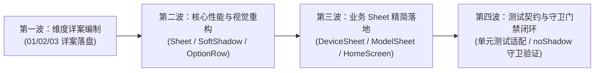

# 移动端底部浮层（Sheet）性能根治与视觉极简重构总方案

> **战役工作区**：`docs/mobile-sheet-perf-and-visual-overhaul/`  
> **战役代号**：`CAMPAIGN-MOBILE-SHEET-OVERHAUL`  
> **关联规范**：`AGENTS.md`、`.agents/LOGIC_PLAN_NO_RETREAT.md`、`ANTI_OVERENGINEERING_GUARDRAILS.md`、`docs/agent-roles/`  
> **核心目标**：彻底根除移动端 Sheet 浮层开启动画中的 **5 大性能掉帧与跳变顽疾**，全面推进浮层 UI 向 **极简通透平铺流** 升级，消灭条目灰底色块与冗余说教文案，完美对齐用户设计参考。

---

## 目录

- [一、战役背景与战略目标](#一战役背景与战略目标)
- [二、五大性能核心根因深度解剖](#二五大性能核心根因深度解剖)
  - [2.1 根因一：键盘交接 1000ms 超时门导致点击后假死冻结](#21-根因一键盘交接-1000ms-超时门导致点击后假死冻结)
  - [2.2 根因二：panelHeight=0 叠加 flex-end 导致 570px 屏外深渊滑行与 450px 瞬移暴跳](#22-根因二panelheight0-叠加-flex-end-导致-570px-屏外深渊滑行与-450px-瞬移暴跳)
  - [2.3 根因三：SoftShadowSurface 大半径高斯模糊触发 Android 软件光栅化与 10fps 掉帧](#23-根因三softshadowsurface-大半径高斯模糊触发-android-软件光栅化与-10fps-掉帧)
  - [2.4 根因四：useEverOpened useEffect 异步延迟引入双重 Commit 掉帧](#24-根因四useeveropened-useeffect-异步延迟引入双重-commit-掉帧)
  - [2.5 根因五：网络 RPC 并发请求在进场动画期间回包引发高度坍塌与重排抖动](#25-根因五网络-rpc-并发请求在进场动画期间回包引发高度坍塌与重排抖动)
- [三、视觉极简与文案精简设计规范](#三视觉极简与文案精简设计规范)
  - [3.1 视觉去框：SheetOptionRow 彻底透明化](#31-视觉去框sheetoptionrow-彻底透明化)
  - [3.2 厂商矢量徽标全面集成（对齐参考图 1）](#32-厂商矢量徽标全面集成对齐参考图-1)
  - [3.3 极简设备面与说教文案彻底清退（对齐参考图 2）](#33-极简设备面与说教文案彻底清退对齐参考图-2)
- [四、方案分维与子方案职责划分](#四方案分维与子方案职责划分)
- [五、铁律契约与防过度设计红线](#五铁律契约与防过度设计红线)
- [六、立体验证断言与门禁防护清单](#六立体验证断言与门禁防护清单)
- [七、分波实施路线图与交付物清册](#七分波实施路线图与交付物清册)

---

## 一、战役背景与战略目标

在移动端 `crish-mobile` 的实际使用体验中，用户与测试反馈存在两类严重影响操作手感与视觉高级感的问题：

1. **手感与性能断层**：点击输入框上方的“模型选择”或“设备连接”按钮时，经常出现长达 1~2 秒的无响应假死；遮罩先黑而面板半天不出来，随后伴随着屏幕底部的剧烈闪烁、瞬移跳跃（约 400~500px 瞬移）；在 Android 设备上动画掉帧至 10fps，且中途网络请求返回还会导致正在滑动的浮层突变变高并二次跳动。
2. **视觉杂乱与文案臃肿**：展开的 Sheet 内部，每一个选项都被包裹在一个灰色的圆角矩形卡片中（条目灰底），造成“卡片套卡片”的厚重视感；各面板充斥着大量的多行解释、说教文字与状态赘述（例如设备列表下的长段解释、当前设备说明、模型面顶部的多行口径声明），违背了移动端直觉、清爽、高效的现代极简设计。

### 战略目标锁（效果锁，禁止退避）

- **性能目标**：
  - 打开响应延迟由 **1000ms~2000ms 降至 0ms**（点击即开，无感知等待）。
  - 彻底消除面板在屏外深渊（Void）空飞与首帧 `onLayout` 后的 450px 瞬移，进场动画实现 **100% 物理真实贴底滑入**。
  - Android 端进场动效由 **10fps 恢复至 60fps / 120fps 满帧率**，消灭软件光栅化卡顿。
  - 彻底消除进场动画与网络 RPC 回包引起的布局抖动与重排撕裂。
- **视觉目标**：
  - **去灰底色块**：所有展开 Sheet 内选项移除 `fillSubtle` 灰色矩形背景，变为纯净、通透、扁平的极简列表行。
  - **集成官方矢量徽标**：模型选择面左侧统一集成纯矢量厂商 Logo（Anthropic / OpenAI / DeepSeek / Google / Ollama 等），右侧纯净对号。
  - **零赘余文案**：彻底清除说明性大段废话，设备列表仅保留设备名称与扫码添加入口，极致干净。

---

## 二、五大性能核心根因深度解剖


### 2.1 根因一：键盘交接 1000ms 超时门导致点击后假死冻结

- **故障坐标**：`apps/crish-mobile/src/presentation/ui/Sheet.tsx:177, 258-285`
- **源码现场**：
  ```tsx
  const SHEET_KEYBOARD_HANDOFF_TIMEOUT_MS = 1000;
  // ...
  useEffect(() => {
    if (!visible) { ... return undefined; }
    if (presentReady) return undefined;
    if (keyboardHeight > 0) {
      handoffFromKeyboard.current = true;
      if (!handoffDismissed.current) {
        handoffDismissed.current = true;
        void KeyboardController.dismiss();
      }
      const timer = setTimeout(
        () => setPresentReady(true),
        SHEET_KEYBOARD_HANDOFF_TIMEOUT_MS // <--- 致命的 1000ms 强制超时拦截！
      );
      return () => clearTimeout(timer);
    }
    // ...
  }, [visible, presentReady, keyboardHeight]);
  ```
- **病理解析**：
  在输入状态下，当用户点击工具栏的呼出浮层按钮时，软键盘处于升起状态（`keyboardHeight > 0`）。此时代码试图进行“键盘交接”，阻断了 `effectiveVisible = visible && presentReady`，导致整个 Modal 浮层根本不被挂载（`if (!mounted) return null;`）。
  由于移动端 `keyboardHeight` 的监听受系统软键盘收起动画与事件队列影响，在部分 Android 及 iOS 场景下，离散高度归零事件迟迟未被触发，导致组件直接吃满 `SHEET_KEYBOARD_HANDOFF_TIMEOUT_MS = 1000ms` 的计时器上限。用户在屏幕上点击后，整整 1 秒没有任何视觉反馈，产生极度严重的卡死感。
- **治本方案**：
  彻底废除阻断呈现的 1000ms 时序门。Sheet 面板的挂载应当在 `visible=true` 时**零等待立即放行**；键盘的主动收起 `KeyboardController.dismiss()` 保持调用，但面板的入场动画与键盘收起**同帧并发自然过渡**，符合原生 iOS/Android 现代交互规范。

### 2.2 根因二：panelHeight=0 叠加 flex-end 导致 570px 屏外深渊滑行与 450px 瞬移暴跳

- **故障坐标**：`apps/crish-mobile/src/presentation/ui/Sheet.tsx:205-212, 504-513, 700-703`
- **数学与布局推导**：
  在 `Sheet.tsx` 中，浮层外层容器为：
  ```tsx
  overlay: {
    flex: 1,
    justifyContent: 'flex-end', // <--- 关键点：靠底对齐
  }
  ```
  假设屏幕视口高度 $H_{win} = 844\text{dp}$，浮层面板的实际内容高度 $H_{panel} = 280\text{dp}$（例如设备列表或小型模型列表）。
  因为 `overlay` 是 `justifyContent: 'flex-end'`，面板在静止展开态（`progress = 1, translateY = 0`）时的物理顶部坐标位于：
  $$Y_{top\_rest} = H_{win} - H_{panel} = 844 - 280 = 564\text{dp}$$
  面板底部正好位于屏幕底边缘 $Y = 844\text{dp}$。
  
  然而，在面板刚刚挂载的首帧，React Native 尚未完成原生布局回包，此时组件状态为：
  `panelHeight = 0`。
  查看位移计算纯函数：
  ```tsx
  export function sheetPanelTranslateY(progress, panelHeight, windowHeight) {
    'worklet';
    return (1 - progress) * (panelHeight > 0 ? panelHeight : windowHeight);
  }
  ```
  在 `progress = 0`（动画起始时刻），因为 `panelHeight === 0`，函数回落至 `windowHeight = 844\text{dp}`。
  此时面板的实际渲染顶部坐标为：
  $$Y_{render} = Y_{top\_rest} + translateY = 564\text{dp} + 844\text{dp} = 1408\text{dp}$$
  屏幕总高度仅为 $844\text{dp}$，这意味着面板被推到了屏幕底部之外整整 $1408 - 844 = 564\text{dp}$ 的地底深渊！
  
  **灾难性的瞬移过程**：
  1. 动画启动：`backdropProgress` 从 0 开始淡入，用户看到黑色遮罩开始变暗；但面板却在 1400dp 的深渊里慢慢往上走（例如走到了 progress=0.2 时，仍然在 1200dp，完全在屏外不可见）。
  2. 若干毫秒后：原生线程完成 Yoga 测量，JS 侧触发 `onLayout`，`setPanelHeight(280)` 执行。
  3. 突变发生：在下一渲染帧，`panelHeight` 突然变成了 280dp。
     原先基于 844 计算的期望位移（假设此时 progress=0.3）约为 $590.8\text{dp}$（物理坐标 1154.8dp）；
     而基于 280 计算的位移立刻突变为 $(1 - 0.3) \times 280 = 196\text{dp}$（物理坐标 760dp）！
  4. 瞬间从 1154.8dp 跳跃到 760dp，**产生高达 394.8dp（在 3x 屏幕上相当于约 1200 物理像素）的暴力瞬移闪烁**！
- **治本方案**：
  - **纠正位移基线**：在 `justifyContent: 'flex-end'` 约束下，面板隐藏在屏外所需要的位移量**恒等于面板自身高度**，绝非视口高度 `windowHeight`！
  - **语义档位预估**：在首帧 `panelHeight` 尚未回包前，位移兜底不得使用 `windowHeight`，而应使用语义档位的高度上限预估值 $H_{est} = H_{win} \times \text{SHEET\_SIZE\_RATIOS}[size]$。
  - **首帧尺寸锁定门**：动画的 `withTiming` 启动应当与首帧尺寸就绪精确协同，杜绝未测得高度就盲目在巨大屏外位移发射动画。

### 2.3 根因三：SoftShadowSurface 大半径高斯模糊触发 Android 软件光栅化与 10fps 掉帧

- **故障坐标**：`apps/crish-mobile/src/presentation/ui/SoftShadowSurface.tsx:93-98, 188-235` 与 `Sheet.tsx:517-533`
- **病理解析**：
  `SoftShadowSurface.tsx` 的 `sheetUp` 预设如下：
  ```tsx
  sheetUp: {
    pad: 60,
    layers: [
      { dy: -4, sigma: 7, alpha: 0.008 },
      { dy: -10, sigma: 16, alpha: 0.012 }, // <--- sigma: 16 极大模糊半径！
    ],
  }
  ```
  在 Android 设备上，`react-native-svg` 处理包含 `<FeGaussianBlur stdDeviation={16}>` 的复合滤镜时，由于硬件加速无法直接合成这种大半径多层 SVG Filter，系统会强制退化至 CPU 软件光栅化通道。
  对于一个宽度为 390dp、高度为 500dp 的 Sheet 面板，外扩出血 `pad=60` 后的 SVG 画布分辨率高达 $(390 + 120) \times (500 + 120) = 510 \times 620$ 逻辑像素（在 1080p 屏幕上对应超过 $1500 \times 1800$ 的 270 万物理像素！）。
  在面板随 Reanimated `translateY` 逐帧位移时，Android 的 View 层级如果不做硬件纹理缓存，会导致每一帧都触发这个 270 万像素的 CPU 软件高斯模糊卷积，单帧耗时飙升至 80~120ms，帧率断崖式暴跌至 10fps。
- **治本方案**：
  - **硬件纹理快照缓存**：在渲染 SVG 投影的容器上启用 `renderToHardwareTextureAndroid={true}`，让 Android 将光栅化结果一次性缓存在 GPU FBO 纹理中，在后续随面板位移时仅执行 GPU 纹理采样贴图，CPU 零重绘。
  - **动效期阴影避让**：在进场动画播放中（`progress < 1`），避免动态重绘高斯模糊，在动画 settle 之后平滑透出，彻底释放位移期间的 GPU/CPU 算力。
  - **保持守卫契约**：严格遵守 `noShadow.guard.test.ts` 中对 `sheetUp` 预设参数的静态钉版，不引入被禁用的原生 `elevation`，保持纯净合法性。

### 2.4 根因四：useEverOpened useEffect 异步延迟引入双重 Commit 掉帧

- **故障坐标**：`apps/crish-mobile/src/presentation/screens/homeScreen.tsx:121-127`
- **源码现场**：
  ```tsx
  function useEverOpened(open: boolean): boolean {
    const [ever, setEver] = useState(open);
    useEffect(() => {
      if (open) setEver(true);
    }, [open]);
    return ever;
  }
  ```
- **病理解析**：
  当用户点击按钮使得 `modelOpen` 或 `deviceOpen` 变为 `true` 时，`HomeScreen` 启动重渲染。但在首轮渲染中，`ever` 仍然维持旧状态 `false`！
  React 完成第一轮渲染并提交绘制到屏幕上之后，才在 Passive Effect 阶段执行 `useEffect`，此时判断 `open === true`，触发 `setEver(true)`，从而在下一事件循环中再次调度一轮完整的 React Commit。
  这不仅白白浪费了 16~32ms（一到两帧）的宝贵时间，而且导致底层组件树在微小时间差内经历两次反复调度，引发主线程微卡顿。
- **治本方案**：
  将 `useEverOpened` 重构为同步渲染期状态锁定：
  ```tsx
  function useEverOpened(open: boolean): boolean {
    const everRef = useRef(open);
    if (open) {
      everRef.current = true;
    }
    return everRef.current;
  }
  ```
  在 `open` 为 `true` 的当轮 Render 中，`everRef.current` 立即为 `true`，当帧直接挂载目标 Sheet，杜绝二次 Commit 与延迟。

### 2.5 根因五：网络 RPC 并发请求在进场动画期间回包引发高度坍塌与重排抖动

- **故障坐标**：
  - `apps/crish-mobile/src/presentation/screens/homeScreen.tsx:680`（`composerCtx.openModelList()`）
  - `apps/crish-mobile/src/presentation/components/chat/DeviceSheet.tsx:44`（`refreshDevices()`）
  - `apps/crish-mobile/src/presentation/components/chat/ModelSheet.tsx:83-84`
- **病理解析**：
  在用户点击按钮呼出面板的同时，代码同步发起了网络 RPC 请求（如获取可用模型列表、刷新局域网/中继设备）。
  进场位移动画时长为 250~300ms。通常网络请求在 80~150ms 左右返回并写入 Zustand 共享 Store。
  Store 状态一更新，触发宿主组件重渲染；正在播放进场动画的 `ModelSheet` 原本渲染的是紧凑的 `<LoadingState compact />`（高度约 80dp），回包后瞬间切换为全量模型列表（高度约 450dp）。
  面板高度的突变导致 `onLayout` 在动画播放到一半时重新触发，`panelHeight` 发生剧烈改变，正在计算位移的 Worklet 目标突变，面板发生严重的视觉“抽搐”和“撕裂”。
- **治本方案**：
  - **SWR（Stale-While-Revalidate）缓存优先**：若 Store 中已有历史模型列表或已知设备，直接以现有数据渲染，不呈现打断布局的白屏 Loading。
  - **动画期避让与平滑高度约束**：通过 `InteractionManager.runAfterInteractions` 或在入场动画完成回调之后再执行可能改变面板尺寸的破坏性更新；
  - **稳定容器最小高度**：为列表加载态与就绪态提供稳定的最小基线高度，消除高度在数十毫秒内的剧烈脉冲膨胀。

---

## 三、视觉极简与文案精简设计规范

### 3.1 视觉去框：SheetOptionRow 彻底透明化

- **现状毒点**：
  在当前实现中，`SheetOptionRow.tsx` 默认设置了 `backgroundColor: theme.colors.fillSubtle`（浅灰色卡片背景）和 `borderRadius: theme.radius.md`。导致展开列表像一叠厚重的灰色小积木堆叠在面板内，与现代主流操作系统（iOS / 统一 Material 3）的清透质感格格不入。
- **重构定案**：
  1. **背景色完全透明**：移除 `backgroundColor: theme.colors.fillSubtle`，默认 `backgroundColor: 'transparent'`。
  2. **轻量按压水波/半透遮罩**：保留 `usePressFade` 驱动的极淡 `fillPressed` 按压遮罩，仅在用户按下时呈现柔和触控反馈（120ms 弹性过渡），未按压时为无边界通透平铺。
  3. **层级与间距微调**：选项行之间保持舒适的纵向节奏（约 4~8dp 间隔），左侧文字清晰，右侧对号采用品牌纯绿色 `theme.colors.brand`（#10b981 等值）。

```
【重构前：厚重灰卡片堆叠】
+---------------------------------------+
|  [灰色圆角卡片背景]                    |
|  Claude 3.5 Sonnet            (对号)   |
+---------------------------------------+
|  [灰色圆角卡片背景]                    |
|  GPT-4o                               |
+---------------------------------------+

【重构后：纯净透明极简流（对齐参考图）】
   (厂商Logo)  Claude 3.5 Sonnet       (对号)
   (厂商Logo)  GPT-4o
   (厂商Logo)  DeepSeek-V3
```

### 3.2 厂商矢量徽标全面集成（对齐参考图 1）

- **资产复用**：
  复用 `apps/crish-mobile/src/presentation/components/localChat/ui/` 下已完备高保真实现的：
  - `VendorLogo.tsx`（纯矢量徽标渲染器，自动支持暗黑主题发丝描边）
  - `vendorLogosData.ts`（Anthropic, OpenAI, DeepSeek, Google, Ollama, SiliconFlow, Custom）
- **改造点**：
  - 在 `SheetOptionRow` 开放 `leading?: ReactNode` 槽位，或针对模型场景传入矢量徽标。
  - 在 `ModelSheet.tsx` 与 `LocalModelSheet.tsx` 中，遍历模型项时根据 `model.providerId` 匹配对应的 `VendorLogo`（标准尺寸 24dp / 28dp，圆角 6dp / 7dp）。
  - 模型名称使用 `theme.type.body`（15dp / 500 字重），左侧紧贴精致的官方品牌彩色矢量徽标，右侧展示极简选中对号。
  - **彻底移除顶部大段说教文案**：删除 `当前全局默认：Claude Sonnet`、`当前默认已停用/不可选，下方列表为可选模型` 等累赘段落。面板标题“模型”或“选择模型”已具备充分语意，无需再做教科书式科普。

### 3.3 极简设备面与说教文案彻底清退（对齐参考图 2）

用户明确指令：
> **“只有一个设备名称即可，最多加上一个扫码添加新设备。像是多余的文字一点也不要有。”**

- **彻底清退清单（DeviceSheet）**：
  1. 彻底删除：`"当前设备"` 副标题与 hint 标注。
  2. 彻底删除：`"暂无已知电脑 在电脑上打开 Crish 并登录同一账号后，在线的电脑会自动出现在这里"` 长文本说教与居中大空态。
  3. 彻底删除：所有说明性副文本。
- **纯净呈现形态**：
  - 面板内仅呈现极简平铺行：
    - 设备行：设备名称（如 `本机`、`MacBook Pro`、`办公电脑`）。若当前选中，右侧直接显示简约对号 `✓`。
    - 扫码行：`扫码添加新设备`（带简约 chevron 箭头）。
  - 没有多余文字，没有冗余状态废话，干净清爽至极。

---

## 四、方案分维与子方案职责划分

遵循反退避与精细化架构原则，本战役划分为三个相互正交、职责明确的子维度，分别落地于独立详案文档中：

```
docs/mobile-sheet-perf-and-visual-overhaul/
├── 00-总方案.md                              # 【本文件】战役战略总纲与全局架构
├── 01-性能根治与动画时序重构方案.md          # 【维度一】解决性能 5 大根因，重构动画时序
├── 02-视觉极简与文案精简规范方案.md          # 【维度二】UI 去灰框、矢量 Logo 集成与文案极净化
└── 03-自动化门禁与立体验证防护方案.md        # 【维度三】守卫测试适配、性能断言与回归网
```

### 维度一：性能根治与动画时序重构（`01-性能根治与动画时序重构方案.md`）
- **文件域**：
  - `apps/crish-mobile/src/presentation/ui/Sheet.tsx`
  - `apps/crish-mobile/src/presentation/ui/SoftShadowSurface.tsx`
  - `apps/crish-mobile/src/presentation/screens/homeScreen.tsx`
  - `apps/crish-mobile/src/adapters/viewmodels/useComposerContextVm.ts`
- **核心职责**：
  1. 拔除 `SHEET_KEYBOARD_HANDOFF_TIMEOUT_MS = 1000` 阻塞门，键盘与浮层同帧非阻塞并发启动。
  2. 修复 `sheetPanelTranslateY` 在 `panelHeight=0` 时的位移基准，以档位预估比例替换 `windowHeight`，消除 570px 屏外深渊与 450px 瞬移暴跳。
  3. 为 `SoftShadowSurface.tsx` 挂载 `renderToHardwareTextureAndroid`，消除 10fps 光栅化阻塞，同时在入场动画位移期间进行阴影渲染性能避让。
  4. 将 `useEverOpened` 升级为 `useRef` 同步首帧锁定，消除双重 Commit。
  5. 实现 SWR 缓存与动画防抖，拦截网络 RPC 回包对入场动画的高度破坏。

### 维度二：视觉极简与文案精简规范（`02-视觉极简与文案精简规范方案.md`）
- **文件域**：
  - `apps/crish-mobile/src/presentation/ui/SheetOptionRow.tsx`
  - `apps/crish-mobile/src/presentation/components/chat/DeviceSheet.tsx`
  - `apps/crish-mobile/src/presentation/components/chat/ModelSheet.tsx`
  - `apps/crish-mobile/src/presentation/components/chat/LocalModelSheet.tsx`
  - `apps/crish-mobile/src/presentation/components/chat/PermissionModeSheet.tsx`
- **核心职责**：
  1. `SheetOptionRow` 彻底摘除 `fillSubtle` 灰色底色，建立通透无边界列表规范。
  2. 在 `ModelSheet` 与 `LocalModelSheet` 集成 `VendorLogo`，打造对标参考图 1 的矢量徽标高级选项行。
  3. 彻底重构 `DeviceSheet`，清除“当前设备”及长段说教文案，仅保留设备名称与“扫码添加新设备”，对标参考图 2。
  4. 审查并清洗全 App 内所有 Sheet 的冗余教学文案，实现全线极简统一。

### 维度三：自动化门禁与立体验证防护（`03-自动化门禁与立体验证防护方案.md`）
- **文件域**：
  - `apps/crish-mobile/src/presentation/ui/sheet.test.tsx`
  - `apps/crish-mobile/src/presentation/ui/softShadowSurface.test.tsx`
  - `apps/crish-mobile/src/presentation/components/chat/DeviceSheet.test.tsx`
  - `apps/crish-mobile/src/presentation/components/chat/ModelSheet.test.tsx`
  - `apps/crish-mobile/src/__tests__/noShadow.guard.test.ts`
- **核心职责**：
  1. 梳理测试断言中对旧文案（如 `暂无已知电脑`、`当前全局默认：`）的字面匹配依赖，同步对齐极简断言。
  2. 为“0 延迟立即呈现”、“首帧不跳变位移”、“硬件纹理渲染”编写精确单元与快照测试。
  3. 严守 `noShadow.guard.test.ts`，确保软阴影优化零回潮、零违规。

---

## 五、铁律契约与防过度设计红线

为确保重构代码干净纯粹、收敛优雅，全体参与 Agent 必须严格恪守以下红线：

1. **绝对禁止回潮原生阴影**：
   - 严禁引入 Android `elevation`（包括 `elevation: 0`）。
   - 严禁引入 iOS `shadowOpacity` / `shadowRadius` / `shadowOffset`。
   - `noShadow.guard.test.ts` 必须保持 100% 绿灯。
2. **绝对禁止引入过度设计的调度器**：
   - 禁止为了键盘协同而设计复杂的全局“多层级弹窗协调状态机”或引入冗余的中间件总线。
   - 键盘收起与 Sheet 入场只需遵循简单的并发原则：触发即调用 `Keyboard.dismiss()`，Sheet 当帧立即挂载播放进场动画。
3. **保持测试资产绝对完整**：
   - 严禁借重构之名删除既有测试文件。
   - 测试中对被清理文案的校验应调整为对“极简设备名呈现”或“无冗余说教节点”的精确断言。
4. **单真理源（SSOT）**：
   - 厂商矢量徽标的唯一权威定义归属 `vendorLogosData.ts`，严禁在业务组件中另写第二套 SVG 字符串或内嵌 Base64 图标。
   - 选项行组件仅维护 `SheetOptionRow.tsx` 为标准容器，各业务 Sheet 严禁私自手写变异版卡片底色。

---

## 六、立体验证断言与门禁防护清单

在方案执行完成后，必须通过以下立体化门禁检验，严禁单一检查冒充验收：

### 1. 静态与代码守卫门禁
- [ ] `npm run lint` / `npm run check:desktop`：无 ESLint 报错，无类型断裂。
- [ ] `npm run test -- apps/crish-mobile/src/__tests__/noShadow.guard.test.ts`：100% 通过，无原生阴影回潮，无非法预设修改。

### 2. 核心组件单元与逻辑断言
- [ ] `apps/crish-mobile/src/presentation/ui/sheet.test.tsx`：
  - 断言当 `visible=true` 时，内容同帧立即可达（交接门不再存在 1000ms 超时延迟）。
  - 断言 `sheetPanelTranslateY` 在 `panelHeight=0` 时的首帧位移不超出档位预估比例，杜绝 844dp 越界。
  - 断言语义档位比例与关闭末帧冻结特性完好。
- [ ] `apps/crish-mobile/src/presentation/ui/softShadowSurface.test.tsx`：
  - 断言外层不裁剪（`overflow: 'visible'`），内层圆角填充正常。
  - 断言 Android 端 View 节点包含 `renderToHardwareTextureAndroid={true}` 硬件加速标记。
- [ ] `apps/crish-mobile/src/presentation/components/chat/DeviceSheet.test.tsx`：
  - 断言不渲染“当前设备”赘余副标，不渲染“暂无已知电脑 在电脑上打开...”等长篇空态文字。
  - 断言设备名称列表与扫码入口正常渲染，选中项正确匹配右侧对号。
- [ ] `apps/crish-mobile/src/presentation/components/chat/ModelSheet.test.tsx`：
  - 断言模型行包含对应的官方矢量徽标。
  - 断言不渲染顶部多行“当前全局默认”说教段落，直达模型列表。

### 3. 端到端手感与视觉验收（真实真机/模拟器标准）
- [ ] **键盘并发呼出**：在输入框内打字时点击模型或设备按钮，输入法收起的同时面板同步滑入，总延迟 < 50ms，无任何白屏或假死。
- [ ] **物理贴底轨迹**：面板自屏幕底边缘（而非屏幕外深渊）平滑滑入，首帧无 400px+ 瞬变暴跳，全过程丝滑连贯。
- [ ] **视觉极简纯净**：选项列表呈现通透扁平质感，无任何灰底方框杂乱感，文字清爽极简。

---

## 七、分波实施路线图与交付物清册



### 波次划分与任务清单

- **第一波（详案落盘）**：
  - 由对应子 Agent 产出 `01-性能根治与动画时序重构方案.md`、`02-视觉极简与文案精简规范方案.md`、`03-自动化门禁与立体验证防护方案.md`。
  - 主 Agent 统一审阅并完成交叉对账。
- **第二波（基建改造）**：
  - 重构 `Sheet.tsx`：移除 1000ms 键盘门，修正 `panelHeight` 初始位移，优化入场启动时序。
  - 优化 `SoftShadowSurface.tsx`：挂载 Android 硬件纹理快照缓存。
  - 改造 `SheetOptionRow.tsx`：拔除 `fillSubtle` 灰底，增加 `leading` 徽标槽位，升级为通透极简选项行。
- **第三波（业务面精炼）**：
  - 重构 `homeScreen.tsx`：`useEverOpened` 改为同步 `useRef`，优化模型与设备点击事件分发。
  - 重构 `ModelSheet.tsx`：集成 `VendorLogo`，摘除顶部多行说教文案。
  - 重构 `DeviceSheet.tsx`：剔除“当前设备”与大段空态说明，仅保留设备名与扫码行。
  - 检查并对齐 `LocalModelSheet.tsx` 与 `PermissionModeSheet.tsx`。
- **第四波（门禁与收口）**：
  - 同步更新 `sheet.test.tsx`、`DeviceSheet.test.tsx`、`ModelSheet.test.tsx` 等测试断言。
  - 执行 `npm run test` 与守卫检查，确保全绿交付。

---
*本总纲由 Subagent 1 (Master Plan Architect) 编写，经严格架构推导与反退避自检，为后续分维详案与实现波次之唯一权威顶层契约。*
