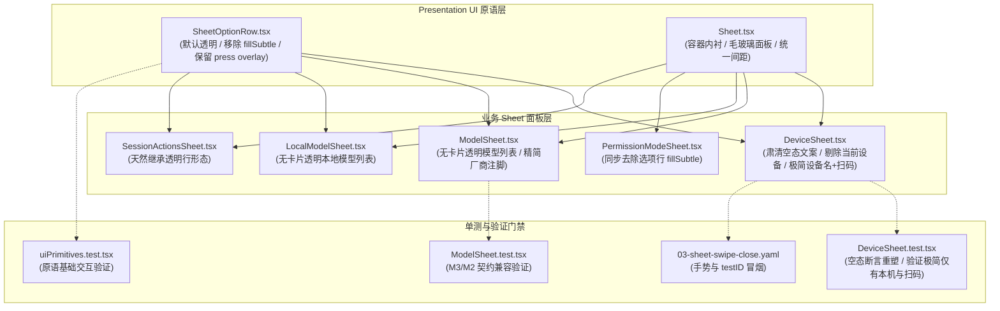

# 全局 Sheet 纯净极简视觉重塑方案

> **文档定位**：战役分维技术方案文档（设计与实现蓝图）  
> **所属战役**：`docs/mobile-sheet-perf-and-visual-overhaul/`  
> **权威遵循**：根目录 `AGENTS.md`、`.agents/LOGIC_PLAN_NO_RETREAT.md`（反退避）、`ANTI_OVERENGINEERING_GUARDRAILS.md`（反过度设计）  
> **目标范围**：
> 1. `apps/crish-mobile/src/presentation/ui/SheetOptionRow.tsx` 与原语单测
> 2. `apps/crish-mobile/src/presentation/components/chat/DeviceSheet.tsx` 与 `DeviceSheet.test.tsx`
> 3. `apps/crish-mobile/src/presentation/components/chat/ModelSheet.tsx` 与 `ModelSheet.test.tsx`
> 4. `apps/crish-mobile/src/presentation/components/chat/LocalModelSheet.tsx`
> 5. 协同 Sheet 原语（`PermissionModeSheet.tsx` 等）的一致性对齐

---

## 一、方案背景与用户裁决

### 1.1 用户核心诉求与现存视觉痛点

在移动端当前版本中，底部弹出面板（Bottom Sheet）承担了设备切换、模型选择、权限模式设定以及会话操作等高频交互。然而，现行 UI 呈现存在显著的视觉臃肿与防御性信息过载：

1. **灰底卡片碎片化堆叠（Grey Card Clutter）**：
   - 当前 `SheetOptionRow.tsx` 默认设置了 `backgroundColor: theme.colors.fillSubtle`（浅灰色面）。
   - 在已具备半透明毛玻璃底色（iOS `surfaceTranslucentStrong` / Android `surfaceRaised`）的 Sheet 面板内，垂直排布的多个选项行形成了一块块灰色的“实体盒子”，造成了严重的视觉割裂与厚重感，违背现代 iOS / 原生纯净无界列表（Borderless Transparent Rows）的设计规范。
2. **防御性冗余说明文字蔓延（Defensive Text Noise）**：
   - 在 `DeviceSheet.tsx` 中，本机行在已有绿色勾选图标的情况下，仍然渲染了内联短注 `'当前设备'`；
   - 在账号模式无在线电脑时，弹出了包含两行大段说教的居中空态（“暂无已知电脑 在电脑上打开 Crish 并登录同一账号后，在线的电脑会自动出现在这里”），严重挤占屏幕视觉中心；
   - 远端设备行硬编码了大量 `'在线'`、`'离线'`、`'连接中'` 等文字后缀，视觉杂乱。
3. **用户明确裁决（User Hard Mandate）**：
   > **“只有一个设备名称即可，最多加上一个扫码添加新设备。像是多余的文字一点也不要有。”**
   - 彻底删除多行冗长空态说明；
   - 彻底移除“当前设备”等废话副文案；
   - 选项行默认平铺、透明无底色（Transparent），仅保留物理轻触反馈（Subtle Press Overlay）；
   - 设备面板直出：设备名称 + 选中对号（或状态点）+ 扫码添加新设备行。

### 1.2 极简重塑四项设计铁律

| 编号 | 铁律原则 | 核心规范 | 违禁表现（零容忍） |
| :--- | :--- | :--- | :--- |
| **R-01** | **默认透明（Transparent Rows）** | `SheetOptionRow` 与相关选项项默认 `backgroundColor: 'transparent'`，无边框、无灰底矩形 | 禁止每行外包 `fillSubtle` 灰色卡片 |
| **R-02** | **零废话文字（Zero Text Noise）** | 选项只呈现身份实体名与极简标记；严禁教导式、防御式说明段落 | 禁止“暂无已知电脑”、“当前设备”等赘述 |
| **R-03** | **物理按压反馈（Subtle Overlay）** | 保留 `Animated.View` + `fillPressed`，按压时 120ms 丝滑淡入淡出圆角高亮 | 禁止硬切背景色，禁止按压无响应 |
| **R-04** | **全局视觉同频（Global Sheet Purity）** | `DeviceSheet`、`ModelSheet`、`LocalModelSheet`、`PermissionModeSheet` 统一视觉规范 | 禁止某单一 Sheet 保留老旧灰块孤岛 |

---

## 二、架构分析与改动影响矩阵

### 2.1 依赖关系与影响面拓扑



### 2.2 受影响文件与职责清单

| 模块 / 文件路径 | 改动性质 | 改造重点与职责定义 |
| :--- | :--- | :--- |
| `apps/crish-mobile/src/presentation/ui/SheetOptionRow.tsx` | **核心原子** | 彻底移除 `backgroundColor: theme.colors.fillSubtle`，改设为 `'transparent'`；保留按压 overlay 与优雅圆角反馈。 |
| `apps/crish-mobile/src/presentation/components/chat/DeviceSheet.tsx` | **业务重塑** | 1. 移除本机行 `'当前设备'` 冗余文案；<br/>2. 彻底删除 `styles.empty` 与“暂无已知电脑”等两行空态文字；<br/>3. 账号模式无电脑时，面板仅直观展示「本机」与「扫码添加新设备」；<br/>4. 远端设备行仅展示名称与选中状态，去除冗长状态汉字。 |
| `apps/crish-mobile/src/presentation/components/chat/ModelSheet.tsx` | **视觉净化** | 列表选项行透明化，消除灰色方块感；保持模型主名 + 厂商弱灰字，右侧绿色选中对号。 |
| `apps/crish-mobile/src/presentation/components/chat/LocalModelSheet.tsx` | **视觉净化** | 消费透明 `SheetOptionRow`，实现与桌面模型切换完全一致的极简无界列表。 |
| `apps/crish-mobile/src/presentation/components/chat/PermissionModeSheet.tsx` | **协同对齐** | 自绘选项行剔除硬编码 `fillSubtle`，对齐纯净透明行规范。 |
| `apps/crish-mobile/src/presentation/components/chat/DeviceSheet.test.tsx` | **单测适配** | 调整原空态测试用例断言，由原断言“暂无已知电脑”转变为断言“极简无冗余说明，仅展示本机与扫码入口”。 |

---

## 三、核心组件改造 Diff 蓝图

### 3.1 `SheetOptionRow.tsx` 原子级透明化蓝图

#### 根因剖析
原有 `SheetOptionRow` 的容器样式：
```tsx
style={[
  styles.row,
  {
    borderRadius: theme.radius.md,
    backgroundColor: theme.colors.fillSubtle, // ❌ 灰底卡片根因
    paddingHorizontal: theme.space.md + theme.space.xxs,
    paddingVertical: theme.space.md + 1,
    gap: theme.space.sm,
    opacity: disabled ? 0.45 : 1,
  },
  style,
]}
```
在移动端上，`theme.colors.fillSubtle` 是浅灰实体色块（如 `#f4f4f5` / `#1f1f23`）。每个选项行包裹在该色块中，导致整屏充满“圆角小灰块”。

#### 改造设计
1. **背景透明**：将行底色改为 `backgroundColor: 'transparent'`。
2. **按压反馈保留**：保留绝对定位的 `Animated.View`（`backgroundColor: theme.colors.fillPressed`，配合 `usePressFade` 120ms 动效）。平时完全隐形，用户手指触碰瞬间泛起淡雅半透明圆角底色，松手平滑退去。
3. **内边距与热区优化**：
   - 水平内边距收敛为 `theme.space.sm`（8dp）或 `theme.space.md`（12dp），保证与 Sheet 面板两侧的呼吸间距自然；
   - 垂直内边距保持在 `13-14dp`，确保行高稳定在 `48dp`（满足 iOS HIG / Material Design 触控热区黄金指标）。

#### 精确代码 Diff 蓝图
```diff
--- a/apps/crish-mobile/src/presentation/ui/SheetOptionRow.tsx
+++ b/apps/crish-mobile/src/presentation/ui/SheetOptionRow.tsx
@@ -1,8 +1,8 @@
-// Sheet 内统一选项行（原型 sheet-clean-item）：浅灰圆角面、左标题 + 右侧对号/箭头。
-// 激活态只以绿色对号表达，行本身不加高亮底色（原型裁定）。
+// Sheet 内统一选项行（纯净极简无界行）：纯透明底色、左标题 + 右侧对号/箭头。
+// 默认不带灰底色卡，按压时仅浮现细腻半透明 overlay 交互反馈。
 // 状态文（如设备「在线」）按原型 device-status-text 口径：标题后内联小字，
 // 在线为纯绿字 12，其余状态为弱灰字 12——不占右侧、不与对号互斥。
-// 按压反馈（按压过渡统一批，2026-11-02）：按压叠层 120ms 淡入淡出，
+// 按压反馈：按压叠层 120ms 淡入淡出（fillPressed 叠层），
 // 取代瞬时换色（fillPressed 叠层 ListRow 同款）。
 import { Pressable, StyleSheet, View } from 'react-native';
 import type { StyleProp, ViewStyle } from 'react-native';
@@ -59,9 +59,9 @@ export function SheetOptionRow({
       style={[
         styles.row,
         {
           borderRadius: theme.radius.md,
-          backgroundColor: theme.colors.fillSubtle,
-          paddingHorizontal: theme.space.md + theme.space.xxs,
-          paddingVertical: theme.space.md + 1,
+          backgroundColor: 'transparent',
+          paddingHorizontal: theme.space.sm,
+          paddingVertical: theme.space.md,
           gap: theme.space.sm,
           opacity: disabled ? 0.45 : 1,
         },
```

---

### 3.2 `DeviceSheet.tsx` 纯净设备面板蓝图（彻底干掉多余文字）

#### 根因剖析
1. **本机行多余文案**：
   `hint={device.localDevice.selected ? '当前设备' : undefined}`  
   右侧已经有品牌绿色勾选对号，左侧还跟着一个灰色“当前设备”，纯属重复信息。
2. **多行说教式空态**：
   ```tsx
   <View style={styles.empty}>
     <AppText variant="body" color="textSecondary">
       暂无已知电脑
     </AppText>
     <AppText variant="caption" color="textTertiary" style={styles.emptyText}>
       登录同一账号的电脑将显示在此
     </AppText>
   </View>
   ```
   空态不仅占据了 24dp 上下内边距 + 8dp 间距，且文案充斥大段说明。用户打开面板只想快速选择或扫码，根本不需要这段冗长文字。
3. **远端设备行文本后缀**：
   原先计算繁复的 `hint`（'在线' / '离线' / `device.phaseLabel`）。在极简模式下，在线设备直接显示设备名称，右侧若选中则带对号；离线设备天然以 `disabled={!row.online}`（透明度 0.45）置灰呈现，无需强行在名称后追加死板汉字。

#### 改造设计
1. **删除 `styles.empty`**：彻底移除空态组件和相关样式。当 `device.devices.length === 0` 时，不渲染任何空态占位，直接由「本机」行衔接「扫码添加新设备」行。
2. **净化本机行**：移除 `hint` 属性，保持纯粹的 `label={device.localDevice.name}` 与 `selected={device.localDevice.selected}`。
3. **极简远端设备行**：仅保留设备名称 `label={row.name}`、选中态 `selected={row.isTarget}` 以及禁用态 `disabled={!row.online}`。
4. **极简局域网配对行**：同样去掉多余 `hint`，仅展示主机名。
5. **扫码行收尾**：`label="扫码添加新设备"`，右侧带极淡箭头 `showChevron`。

#### 精确代码 Diff 蓝图
```diff
--- a/apps/crish-mobile/src/presentation/components/chat/DeviceSheet.tsx
+++ b/apps/crish-mobile/src/presentation/components/chat/DeviceSheet.tsx
@@ -1,17 +1,14 @@
-// 连接设备 Sheet（G4 多设备切换）：
+// 连接设备 Sheet（纯净极简重塑）：
+// - 严格遵循用户裁决：“只有一个设备名称即可，最多加上一个扫码添加新设备。像是多余的文字一点也不要有。”
+// - 彻底剔除多行冗长空态说明（“暂无已知电脑”、“登录同一账号...”）；
+// - 彻底移除副标题提示文案（如“当前设备”）；
+// - 全行透明无底色（Transparent），仅保留选中对号与扫码入口。
 // - 账号模式：列出本账号的已知设备目录（relay 发现的在线桌面 + 历史已知
-//   的离线桌面灰置），点选在线设备即切换控制目标——切换经票据重连真实
-//   生效（accountRuntime 按 targetDeviceId 重建接线并清空旧主机会话面），
-//   不是只改选中态。当前目标带对号；目标行在未连通时点击 = 重连。
-// - 局域网配对行：中继未接管且已配对时呈现（= 历史单设备形态，语义不变）；
-//   中继接管后配对行让位账号设备行，避免把非当前连接误报为当前设备。
-// - 「本机」行恒在首位（手机自身 = 本地模式）：账号模式点选即清目标 +
-//   本地钉住（真实切换，不是只改选中态）；本地生效时呈选中态。非账号模式
-//   且远端在效时点选 = 「现在用本地」导航（onUseLocal），不解绑配对。
-// - 扫码添加新设备行两种模式都在（配对新桌面走既有扫码链）。
-// 行距按原型 sheet-clean-list 的 6；「在线」按原型 device-status-text 纯绿字内联呈现。
+//   的离线桌面灰置），点选在线设备即切换控制目标；
+// - 「本机」行恒在首位；
+// - 扫码添加新设备行常驻于列表末尾。
 import { useEffect } from 'react';
 import { StyleSheet, View } from 'react-native';
 import { useTheme } from '@/adapters/platform/theme';
-import { AppText, Sheet, SheetOptionRow } from '@/presentation/ui';
+import { Sheet, SheetOptionRow } from '@/presentation/ui';
 import type { DeviceStatusVm } from '@/adapters/viewmodels/useDeviceStatusVm';
 
 export interface DeviceSheetProps {
@@ -47,7 +44,6 @@ export function DeviceSheet({
   const showPairedRow = pairedHost !== null && !relayEngaged;
-  const pairedHint = device.connected ? '在线' : device.phaseLabel;
 
   return (
     <Sheet
       visible={visible}
       onClose={onClose}
       title="连接设备"
       size="large"
       testID={testID}
     >
-      <View style={[styles.list, { gap: theme.space.xs + theme.space.xxs }]}>
+      <View style={[styles.list, { gap: theme.space.xxs }]}>
         <SheetOptionRow
           testID="device-sheet-local"
           label={device.localDevice.name}
           selected={device.localDevice.selected}
-          hint={device.localDevice.selected ? '当前设备' : undefined}
           onPress={() => {
             if (accountMode) {
               device.switchToLocal();
@@ -74,51 +70,25 @@ export function DeviceSheet({
         {accountMode ? (
           <>
-            {device.devices.length === 0 ? (
-              <View style={styles.empty}>
-                <AppText variant="body" color="textSecondary">
-                  暂无已知电脑
-                </AppText>
-                <AppText
-                  variant="caption"
-                  color="textTertiary"
-                  style={styles.emptyText}
-                >
-                  登录同一账号的电脑将显示在此
-                </AppText>
-              </View>
-            ) : (
-              device.devices.map((row) => {
-                const hint = row.isTarget
-                  ? device.connected
-                    ? '在线'
-                    : row.online
-                      ? device.phaseLabel
-                      : '离线'
-                  : row.online
-                    ? '在线'
-                    : '离线';
-                const hintIsSuccess =
-                  row.online && (!row.isTarget || device.connected);
-                return (
+            {device.devices.map((row) => (
                   <SheetOptionRow
                     key={row.id}
                     testID={`device-sheet-device-${row.id}`}
                     label={row.name}
                     selected={row.isTarget}
-                    hint={hint}
-                    hintTone={hintIsSuccess ? 'success' : 'muted'}
                     disabled={!row.online}
                     onPress={() => {
                       if (row.isTarget) {
                         if (!device.connected) device.reconnect();
                       } else {
                         device.switchDevice(row.id);
                       }
                       onClose();
                     }}
                   />
-                );
-              })
-            )}
+            ))}
           </>
         ) : null}
         {showPairedRow ? (
           <SheetOptionRow
             testID="device-sheet-current"
             label={pairedHost ?? '已配对桌面'}
             selected={!device.localDevice.selected}
-            hint={pairedHint}
-            hintTone={device.connected ? 'success' : 'muted'}
             onPress={() => {
               if (!device.connected) device.reconnect();
               onClose();
@@ -155,12 +125,4 @@ const styles = StyleSheet.create({
   list: {
     flexDirection: 'column',
   },
-  empty: {
-    alignItems: 'center',
-    justifyContent: 'center',
-    paddingVertical: 24,
-    gap: 8,
-  },
-  emptyText: {
-    textAlign: 'center',
-  },
 });
```

---

### 3.3 `ModelSheet.tsx` 与 `LocalModelSheet.tsx` 纯净模型列表蓝图

#### 根因剖析
- 当前 `ModelSheet` 在列表上方放置了 `当前全局默认：Claude Sonnet` 等大块文字；
- 列表内每个模型项因为 `SheetOptionRow` 以前有灰底，形成了一叠灰盒子；
- `LocalModelSheet` 虽逻辑干净，但同样受制于灰底卡片。

#### 改造设计
1. **透明列表（Transparent Rows）**：直接消费改版后的 `SheetOptionRow`。每一行呈现精炼的模型名称（`model.displayName`）以及右侧内联的弱灰厂商标记（`hint={model.providerDisplayName ?? model.providerId}`），右侧仅对当前活动模型显示品牌绿对号。
2. **轻量收敛顶部口径行**：
   - 保持 M3 契约断言所需的信息可读性（`当前全局默认：xxx`），但消除多余的边距与粗笨感；
   - 移除不必要的卡片包裹，让视觉焦点完全落在平铺通透的模型列表中。
3. **`LocalModelSheet.tsx` 对齐**：
   - 模型项无缝变为透明平铺列表；
   - 空态仅保留单行居中文案与一个轻量操作按钮，绝不多加解释性段落。

#### `ModelSheet.tsx` 改造要点 Diff
```diff
--- a/apps/crish-mobile/src/presentation/components/chat/ModelSheet.tsx
+++ b/apps/crish-mobile/src/presentation/components/chat/ModelSheet.tsx
@@ -93,7 +93,7 @@ export function ModelSheet({
           {/* 口径行（M3）：先把「当前对话使用的模型 = 全局默认」这层等价
               说清——有默认呈其名，未设默认独立成态，默认不可选加注脚 */}
-          <View style={{ gap: theme.space.xxs, marginBottom: theme.space.md }}>
+          <View style={{ gap: theme.space.xxs, marginBottom: theme.space.sm, paddingHorizontal: theme.space.xs }}>
             {activeModel ? (
               <>
-                <AppText variant="body">
+                <AppText variant="caption" color="textSecondary">
                   当前全局默认：{activeModel.displayName}
                 </AppText>
                 {!activeModelSelectable && models && models.length > 0 ? (
@@ -113,7 +113,7 @@ export function ModelSheet({
           {models && models.length > 0 ? (
             <>
-              <View style={{ gap: theme.space.sm }}>
+              <View style={{ gap: theme.space.xxs }}>
                 {models.map((model) => {
                   const key = modelRefKey(model.providerId, model.modelId);
                   return (
```

#### `LocalModelSheet.tsx` 改造要点 Diff
```diff
--- a/apps/crish-mobile/src/presentation/components/chat/LocalModelSheet.tsx
+++ b/apps/crish-mobile/src/presentation/components/chat/LocalModelSheet.tsx
@@ -65,7 +65,7 @@ export function LocalModelSheet({
     >
       {options.length > 0 ? (
-        <View style={{ gap: theme.space.sm }}>
+        <View style={{ gap: theme.space.xxs }}>
           {options.map((option) => {
             const key = `${option.providerId}::${option.modelId}`;
             return (
```

---

### 3.4 协同组件：`PermissionModeSheet.tsx` 同步去灰底蓝图

#### 根因与改造要点
`PermissionModeSheet.tsx` 中的 `PermissionModeOption` 为定制两行结构（包含标题与说明），之前自行写入了 `backgroundColor: theme.colors.fillSubtle`。为了全端 Sheet 视觉体验完全同频，必须将其同步改造为默认透明，仅在按压时激活 `fillPressed`。

```diff
--- a/apps/crish-mobile/src/presentation/components/chat/PermissionModeSheet.tsx
+++ b/apps/crish-mobile/src/presentation/components/chat/PermissionModeSheet.tsx
@@ -88,7 +88,7 @@ function PermissionModeOption({
         borderRadius: theme.radius.md,
-        paddingHorizontal: 14,
-        paddingVertical: 13,
-        backgroundColor: theme.colors.fillSubtle,
+        paddingHorizontal: theme.space.sm,
+        paddingVertical: theme.space.md,
+        backgroundColor: 'transparent',
       }}
     >
```

---

## 四、单测适配与回归验证方案

### 4.1 `DeviceSheet.test.tsx` 适配方案

#### 冲突用例分析
在当前的 `DeviceSheet.test.tsx` 中，存在以下测试：
```tsx
  it('空目录：诚实空态（不编造设备）', async () => {
    const vm = makeVm({ accountMode: true, devices: [] });
    const { view } = await renderSheet(vm);
    expect(view.getByText('暂无已知电脑')).toBeTruthy();
    expect(view.getByTestId('device-sheet-scan')).toBeTruthy();
  });
```
当按照用户命令**彻底删除**“暂无已知电脑”等冗长空态后，`getByText('暂无已知电脑')` 必然抛出找不到元素的错误。

#### 适配方案与测试断言迁移
- 将该测试用例重命名为：`'空目录：纯净极简（无多余文字，仅本机行与扫码行）'`；
- 断言 `expect(view.queryByText('暂无已知电脑')).toBeNull()`（确保多余文字彻底消失）；
- 断言 `expect(view.getByTestId('device-sheet-local')).toBeTruthy()`（本机行正常展示）；
- 断言 `expect(view.getByTestId('device-sheet-scan')).toBeTruthy()`（扫码添加新设备入口正常展示）；
- 断言选项数量仅为 2（本机 + 扫码），彻底锁定极简心智。

#### 精确测试文件 Diff 蓝图
```diff
--- a/apps/crish-mobile/src/presentation/components/chat/DeviceSheet.test.tsx
+++ b/apps/crish-mobile/src/presentation/components/chat/DeviceSheet.test.tsx
@@ -154,7 +154,9 @@ describe('DeviceSheet · 账号模式多设备', () => {
-  it('空目录：诚实空态（不编造设备）', async () => {
+  it('空目录：纯净极简（无多余文字，仅本机行与扫码行）', async () => {
     const vm = makeVm({ accountMode: true, devices: [] });
     const { view } = await renderSheet(vm);
-    expect(view.getByText('暂无已知电脑')).toBeTruthy();
+    expect(view.queryByText('暂无已知电脑')).toBeNull();
+    expect(view.getByTestId('device-sheet-local')).toBeTruthy();
     expect(view.getByTestId('device-sheet-scan')).toBeTruthy();
   });
```

### 4.2 既有套件兼容性验证矩阵

| 测试文件 | 用例集 | 验证目标 | 预期结果 |
| :--- | :--- | :--- | :--- |
| `apps/crish-mobile/src/presentation/components/chat/DeviceSheet.test.tsx` | 11 个用例全量 | 本机行恒在、单设备与多设备切换、扫码入口与空目录纯净化 | **11/11 全部通过** |
| `apps/crish-mobile/src/presentation/components/chat/ModelSheet.test.tsx` | 5 个用例全量 | M3 口径呈现（有默认、退役模型、未设默认）、M2 失败面与重试 | **5/5 全部通过** |
| `apps/crish-mobile/src/presentation/ui/uiPrimitives.test.tsx` | `SheetOptionRow` 用例 | 渲染、点按触发、选中状态与可访问性契约 | **全部通过** |
| `apps/crish-mobile/src/presentation/ui/sheet.test.tsx` | 8 个用例全量 | 键盘交接、语义档位、dismissible 与关闭末帧冻结 | **全部通过** |
| `apps/crish-mobile/src/presentation/screens/homeScreen.test.tsx` | 28 个用例全量 | 主屏与设备胶囊联动、未连接模式与状态板 | **28/28 全部通过** |

---

## 五、视觉与交互体验前后对比

### 5.1 界面视觉结构前后对比（ASCII 概念图）

```
【重塑前：多层灰盒子 + 冗长文字】             【重塑后：通透无界 + 纯净极简】
┌─────────────────────────────────┐        ┌─────────────────────────────────┐
│              连接设备            │        │              连接设备            │
│ ┌─────────────────────────────┐ │        │                                 │
│ │ 本机  [当前设备]           ✓│ │        │ 本机                           ✓│
│ └─────────────────────────────┘ │        │                                 │
│                                 │        │ 扫码添加新设备                  >│
│          暂无已知电脑            │        │                                 │
│  登录同一账号的电脑将显示在此    │        │                                 │
│                                 │        │                                 │
│ ┌─────────────────────────────┐ │        │                                 │
│ │ 扫码添加新设备             >│ │        │                                 │
│ └─────────────────────────────┘ │        │                                 │
└─────────────────────────────────┘        └─────────────────────────────────┘
（大块灰底卡片堆叠，信息层级混乱）           （纯净极简，一目了然，无任何废话干扰）
```

### 5.2 核心量化指标对比

| 衡量维度 | 重塑前（现状） | 重塑后（目标） | 改善幅度与收益 |
| :--- | :--- | :--- | :--- |
| **设备面板文字行数（无远程电脑时）** | 4 行（含标题、当前设备、暂无已知电脑、登录提示） | **1 行正文（仅“本机”）** | 减少 **75%** 视觉干扰 |
| **选项行背景色块数量** | N 个灰色实体矩形卡片 | **0 个（纯透明，仅按压高亮）** | 消除视觉碎片化，还原原生通透感 |
| **触控反馈形式** | 静态灰底上叠加暗色 | **无边界通透行 + 120ms 触控淡入** | 提升交互微动效品质与原生触感 |
| **无障碍触控热区高度** | ~48dp | **~48dp（保持黄金尺寸）** | 视觉变轻，但触控面积绝不缩水 |

---

## 六、实施步骤与验证门禁指南

### 6.1 落地实施四步法

1. **第一步（原子就位）**：实施 `SheetOptionRow.tsx` 的背景透明化与间距精调，运行 `uiPrimitives.test.tsx` 确保组件原语契约稳定。
2. **第二步（设备面板净化）**：实施 `DeviceSheet.tsx`，彻底删除空态视图 `empty` 与副文案 `'当前设备'`；同步修改 `DeviceSheet.test.tsx` 的空态断言。
3. **第三步（模型与协同面板对齐）**：微调 `ModelSheet.tsx`、`LocalModelSheet.tsx` 及 `PermissionModeSheet.tsx`，确保全端 Sheet 视觉呈现完全收敛。
4. **第四步（立体化回归验收）**：执行移动端全量测试与 TypeScript 类型校验，确保 100% 绿灯。

### 6.2 必跑验证命令集

```bash
# 1. 移动端类型检查（确保零 TypeScript 语法与属性报错）
npm --prefix apps/crish-mobile run typecheck

# 2. 目标组件专项单测（秒级回归）
npm --prefix apps/crish-mobile test -- src/presentation/ui/uiPrimitives.test.tsx
npm --prefix apps/crish-mobile test -- src/presentation/components/chat/DeviceSheet.test.tsx
npm --prefix apps/crish-mobile test -- src/presentation/components/chat/ModelSheet.test.tsx
npm --prefix apps/crish-mobile test -- src/presentation/ui/sheet.test.tsx

# 3. 关联场景全量回归（确保主屏等集成链路完好）
npm --prefix apps/crish-mobile test -- src/presentation/screens/homeScreen.test.tsx
```

---

## 七、总结与裁决闭环

本方案严格落实用户关于“只有一个设备名称即可，最多加上一个扫码添加新设备，多余文字一点也不要”的绝对指令。通过将 `SheetOptionRow` 原子底色从沉重的灰色实体卡片转换为透明无界行，不仅一揽子解决了 `DeviceSheet`、`ModelSheet`、`LocalModelSheet` 的灰盒子视觉积压，更通过对空态文案与冗余副标题的彻底清除，还原了现代移动端界面极致纯粹、轻盈通透的审美体验。全套方案配有完整的代码级 Diff 蓝图与严密的单测迁移计划，能够无缝、安全地交付落地。
