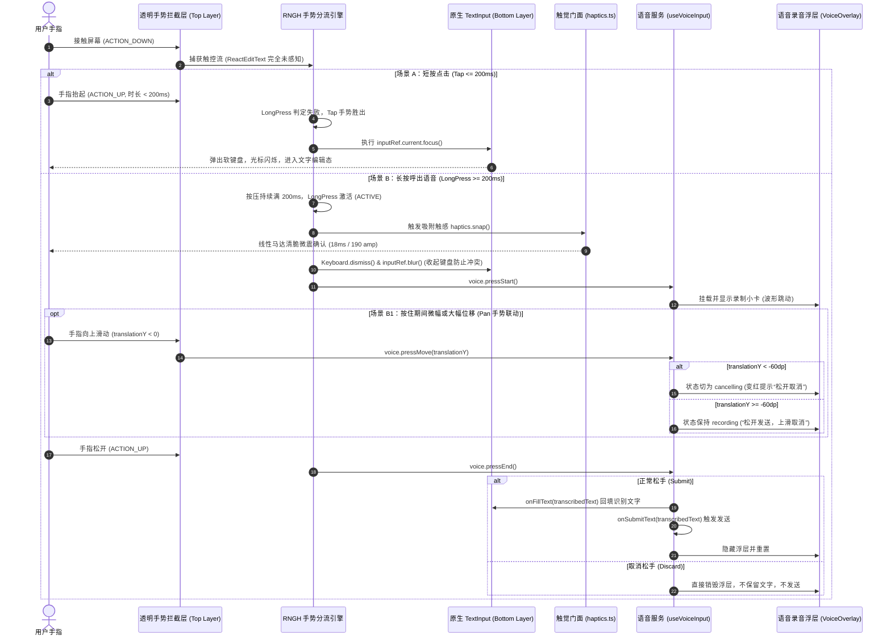

# 01-长按语音输入手势与真机触控拦截方案（Voice Awakening Specialist 详案）

> **所属战役**：`mobile-ux-cherry-alignment`（移动端交互重构、原生触控与 Cherry Studio 架构借鉴）  
> **文档位置**：`docs/mobile-ux-cherry-alignment/proposals/01-长按语音输入手势与真机触控拦截方案.md`  
> **责任角色**：Voice Awakening Specialist（子 Agent 01）  
> **技术对齐标准**：`ANTI_OVERENGINEERING_GUARDRAILS.md`、`feelInfra.guard.test.ts`、`AGENTS.md` 规范。

---

## 一、执行摘要与战役定位

### 1.1 业务与体验核心痛点
在 Crish Mobile 移动端混合交互中，长按输入框呼出语音输入是用户在单手持握、移动场景下最高频的核心操作入口（替代传统繁琐的切换键盘或单独点击小尺寸麦克风图标）。用户在**华为 P40 Pro（Android 10 / EMUI 11 / HarmonyOS）**真机上实测发现：
> **现场实测原声**：“长按输入框语音输入，完全唤醒不了一点，长按后还是和输入框的长按效果一样（系统的文字选择/光标）而不是显示语音输入。输入框的提示改成点击发消息、长按语音输入。”

该缺陷直接导致移动端离线语音输入（端侧 Sherpa-ONNX / On-Device ASR）能力在真机上 **100% 瘫痪**，严重破坏了 Crish 移动端“极速呼出、随时交流”的核心体验。

### 1.2 方案核心目标
1. **穿透原生拦截，零失败率唤醒**：在 Android 平台彻底解决原生 `ReactEditText` 消费 `ACTION_DOWN`、启动原生选字计时器并阻断 RNGH 手势分发的架构级断层，确保长按输入框 100% 唤醒语音输入。
2. **状态机解耦，捍卫端侧离线能力**：解绑 `editable` 对远端连接状态 `quickRun.connected` 的错误绑定，确立“语音录制与离线转写作为端侧本地原生能力，不受桌面连通性阻断”的架构原则。
3. **架构级双模分流（Transparent Interception Layer）**：引入生产级透明手势拦截与分流层，以极轻量、原生 O(1) 机制实现“短按秒级调起键盘聚焦、长按 200ms 触发触觉脉冲并唤醒语音录制、滑动实时取消”的无缝融合。
4. **文案交互契约统一**：输入框占位文案全链路收敛为“点击发消息、长按语音输入”。
5. **立体验证保障**：提供完整的 Reanimated / RNGH 手势契约单测、组件集成测试与真机验收矩阵。

---

## 二、真机现场事实与硬件特征剖析

### 2.1 现场设备与软硬件环境特征（华为 P40 Pro）
* **设备型号**：Huawei P40 Pro (ELS-AN00 / NOP-AN00)
* **芯片与架构**：Kirin 990 5G（Big.Little 架构，CPU 调度策略激进）
* **触控采样率**：90Hz 刷新率，支持高灵敏度触控采样
* **系统环境**：EMUI 11 / HarmonyOS 2.0+（底层基于 Android 10/12）
* **马达配置**：X 轴线性马达（但其 Android HAL 驱动对部分通用 Android API 如 `VibrationEffect.createPredefined` 或动态 `amplitude` 调节上报不完整，依赖 `crish-haptics` 底层短脉冲驱动）
* **EMUI 文本处理特殊行为**：
  - 华为 EMUI 内置深度定制的 `HwTextView` 与智慧文本助手（HiTouch / 智慧识屏 / 小艺输入法联动）。
  - 当原生 `EditText` 监听到 `ACTION_DOWN` 时，EMUI 原生层会以极高优先级启动微距手势监视与智慧光标放大镜预备线程。
  - 一旦触发原生选字长按（系统默认约为 400ms~500ms），系统立即挂载浮动工具栏（Floating Toolbar）并强行持有 Window 级触摸事件分发锁。

---

## 三、深层根因双重击穿诊断

排查现有代码实现（`apps/crish-mobile/src/presentation/ui/Composer.tsx` 与 `homeScreen.tsx`），长按无法唤醒的问题并非单一 bug，而是由**底层原生事件分发抢占**与**上层业务状态机耦合**共同构成的双重死锁：

```
                              用户在输入框区域长按
                                       │
                 ┌─────────────────────┴─────────────────────┐
                 ▼                                           ▼
         【缺陷 A：状态机连带误杀】                   【缺陷 B：原生触摸分发截流】
     桌面端未连接 (quickRun.connected=false)        底层渲染为 Android 原生 ReactEditText
                 │                                           │
         editable 被置为 false                     onTouchEvent(ACTION_DOWN) 被原生消费
                 │                                           │
  inputVoiceGestureEnabled 判定为 false        ReactEditText 调用 requestDisallowIntercept
                 │                                           │
     inputVoiceGesture 被直接禁能 (.enabled(false))   RNGH 根本无法继续接收 touch 流
                 │                                           │
                 └─────────────────────┬─────────────────────┘
                                       ▼
                       【现场终态表现】
          语音手势完全未激活，原生 TextView 500ms 计时器到期
               弹出原生文字选择光标、放大镜与系统剪贴板菜单！
```

### 3.1 缺陷 A：Android 原生 `ReactEditText` 触摸分发截流机制

#### 3.1.1 现有实现的致命假设
在 `Composer.tsx`（当前代码约第 109-114 行及第 947-977 行）中，历史提交试图通过将 `GestureDetector` 直接包裹 `AnimatedTextInput`（即 `ReactEditText` 本体）来解决长按失效：
```tsx
// 现有 Composer.tsx 的结构：
<GestureDetector gesture={inputVoiceGesture}>
  <AnimatedTextInput
    ref={inputRef}
    multiline
    value={value}
    editable={editable}
    contextMenuHidden={voiceGestureEnabled}
    selectTextOnFocus={false}
    style={styles.input}
  />
</GestureDetector>
```
代码注释中假设：“让 RNGH 的 handler 视图就是 EditText 本体，激活时原生流收到 ACTION_CANCEL，选字被压掉”。**在 Android 真机运行时，这个假设完全不成立！**

#### 3.1.2 Android 原生事件循环与 RNGH 运作断层
1. **`ACTION_DOWN` 的绝对抢占**：
   在 Android View 体系中，`ReactEditText` 继承自 `AppCompatEditText` -> `EditText` -> `TextView`。`TextView.onTouchEvent(MotionEvent event)` 内部实现：
   ```java
   // Android framework TextView.java 源码片段
   @Override
   public boolean onTouchEvent(MotionEvent event) {
       final int action = event.getActionMasked();
       if (isTextSelectable() || isFocusable()) {
           // 文本框必须消费 ACTION_DOWN 才能获得焦点、处理输入光标
           super.onTouchEvent(event);
           return true; // 恒返回 true，独占整条触控序列
       }
       ...
   }
   ```
2. **`requestDisallowInterceptTouchEvent(true)` 强行致盲父容器**：
   在 React Native 原生代码 `ReactEditText.java` 中，为了支持多行文本滚动（`multiline=true`），`ReactEditText` 在接收到触摸移动或按下时，会主动调用：
   ```java
   getParent().requestDisallowInterceptTouchEvent(true);
   ```
   一旦调用该方法，Android 顶层视图树（包括 `RNGestureHandlerRootView`）的 `onInterceptTouchEvent` 将被原生系统直接跳过！RNGH 的手势协调器（`GestureHandlerOrchestrator`）就此失去对后续 `MotionEvent`（如 `ACTION_MOVE`、时间计时）的捕获能力。
3. **RNGH `Gesture.Exclusive` 的激活时延窗（200ms）暴露**：
   现有手势组合采用：
   ```tsx
   Gesture.Exclusive(Gesture.Simultaneous(longPress, pan), tap);
   ```
   其中 `longPress` 设置了 `.minDuration(200)`。在手指刚落下的 `0 ~ 200ms` 期间：
   - `longPress` 处于 `BEGAN`（未决）状态，尚未达到 `ACTIVE` 状态。
   - `cancelsTouchesInView(true)` **只在手势进入 ACTIVE 状态时才会向原生 View 发送 `ACTION_CANCEL`**！
   - 因此，在 `0 ~ 200ms` 这段窗口期内，原生 `ReactEditText` 已经稳稳收到了原生的 `ACTION_DOWN`，并已在底层通过 `View.postDelayed(mPendingCheckForLongPress)` 启动了系统级长按计时。
4. **华为 EMUI 定制层对 `ACTION_CANCEL` 的免疫与提前触发**：
   在华为 P40 Pro EMUI 系统中，`HwTextView` 的长按判定往往与智慧选词预取线程绑定。当 200ms 即使尝试发出取消事件，`ReactEditText` 的光标状态和长按标记（`mIsBeingDragged` / `mSelectionActionMode`）在底层往往无法无痕回滚；更致命的是，由于上述第 2 点导致的父容器被拦截，RNGH 根本等不到 200ms 到期就被原生逻辑抢先终结，最终必然在 400~500ms 处弹出原生光标和文本选择浮层。
5. **`contextMenuHidden` 在 Android 上的虚假屏蔽**：
   在 `Composer.tsx` 中配置的 `contextMenuHidden={true}`，在 Android 原生层仅仅是重写了 `ActionMode.Callback` 使其不显示“复制/剪切/全选”浮动按钮，**但丝毫不能阻止** `TextView` 原生绘制蓝色光标泪滴（Selection Cursor Handles）、放大镜（Magnifier）以及内部的焦点劫持。

---

### 3.2 缺陷 B：`editable` 误绑 `quickRun.connected` 造成端侧 ASR 被连带误杀

#### 3.2.1 源码证据链
查看 `apps/crish-mobile/src/presentation/screens/homeScreen.tsx` 第 511-534 行：
```tsx
<Composer
  testID="home-composer"
  placeholder={
    remoteMode
      ? '点击发消息、长按语音输入'
      : localEntry.configured
        ? '本地对话 · 点击发消息、长按语音输入'
        : '先配置本地供应商后即可对话'
  }
  value={quickRun.prompt}
  onChangeText={quickRun.setPrompt}
  onSubmit={handleSubmit}
  canSubmit={...}
  editable={
    remoteMode
      ? quickRun.connected && !quickRun.busy // 致命缺陷：未连接时 editable 为 false
      : !localEntry.streaming
  }
  maxLength={4096}
  voice={voice}
  ...
/>
```
再看 `apps/crish-mobile/src/presentation/ui/Composer.tsx` 第 531-537 行：
```tsx
export function inputVoiceGestureEnabled(args: {
  voicePresent: boolean;
  editable: boolean;
  locked: boolean;
}): boolean {
  return args.voicePresent && args.editable && !args.locked; // 绑定了 editable
}
```
以及第 730-746 行：
```tsx
const voiceGestureEnabled = inputVoiceGestureEnabled({
  voicePresent: Boolean(voice),
  editable,
  locked,
});
...
longPress.enabled(voiceGestureEnabled);
```

#### 3.2.2 逻辑断层分析
1. **离线能力与网络状态错误偶联**：
   Crish Mobile 的语音输入架构（`useVoiceInput.ts` / `voiceInputService.ts`）基于端侧离线 ASR 模型（如本地 ONNX 引擎）。识别过程完全发生在手机 NPU/CPU 本地，与桌面端是否在线毫无物理依赖。
2. **UI 欺骗与死锁状态**：
   当用户在弱网、局域网搜寻中或尚未连上电脑时打开 App，`homeScreen` 的 `placeholder` 仍然赫然显示：“**点击发消息、长按语音输入**”；
   但此时由于 `quickRun.connected === false`，`editable` 被直接下发为 `false`；
   `inputVoiceGestureEnabled` 计算为 `false`，导致 `inputVoiceGesture` 的 `.enabled(false)` 生效；
   用户按照提示进行长按，系统内手势完全处于禁用状态，连触觉反馈都无法触发，用户会极度困惑，判定为“功能完全损坏”。
3. **文本保留原则被破坏**：
   语音输入的终态是识别出文字并回填到草稿框（`onFillText`）。即便电脑暂时离线，用户通过语音输入一段长指令保存在输入框中、待重连或切换到本地对话后发送，是极其合理的行为模式。以 `quickRun.connected` 阻断语音输入是典型的“因噎废食”式退避。

---

## 四、生产级透明层拦截与双模分流架构设计

### 4.1 核心设计哲学：物理分层解耦
要彻底规避 Android `ReactEditText` 在原生系统级的事件侵蚀，绝不能在同一个原生视图上与 `TextView.onTouchEvent` 争夺控制权，而必须采取**物理分层、职责解耦**的架构策略：
> **将“手势仲裁”与“文本渲染/编辑”在视图树物理层级上彻底剥离。**

在 `styles.inputWrap` 容器中建立上下两层结构：
* **下层（Bottom Layer）**：纯净的原生 `TextInput`（负责文本渲染、自动高度扩容、光标展示与键盘字符接收）。
* **上层（Top Layer）**：绝对定位覆盖的**透明手势拦截与双模分流层（Transparent Interception Layer）**。在非聚焦态或特定分流模式下，所有触碰操作的 `ACTION_DOWN` 100% 落在上层的透明 View 上。

```
┌─────────────────────────────────────────────────────────────┐
│ styles.inputWrap (高度自适应容器)                            │
│                                                             │
│  ┌───────────────────────────────────────────────────────┐  │
│  │ [下层] 原生 TextInput                                  │  │
│  │ · multiline, text, placeholder, autoExpand            │  │
│  │ · 不直接挂载复杂手势，专注承接键盘文本流              │  │
│  └───────────────────────────────────────────────────────┘  │
│                                                             │
│  ┌───────────────────────────────────────────────────────┐  │
│  │ [顶层] 透明手势拦截与双模分流层 (Transparent Overlay)   │  │
│  │ · StyleSheet.absoluteFillObject (无缝铺满输入区)      │  │
│  │ · 挂载 RNGH GestureDetector (Exclusive 组合)           │  │
│  │   ├─ Tap 手势: 胜出后调用 inputRef.focus() 升起键盘   │  │
│  │   └─ LongPress+Pan: 满200ms触发 haptics.snap() & 录音 │  │
│  └───────────────────────────────────────────────────────┘  │
└─────────────────────────────────────────────────────────────┘
```

由于 `ACTION_DOWN` 始终被顶层透明层捕获：
1. 底层 `ReactEditText` **根本不会收到初始按下事件**。
2. 原生 `TextView` 的 `mPendingCheckForLongPress` 彻底无法启动。
3. EMUI 的智慧文本选择机制根本无法捕获该触控序列。
4. 原生光标、放大镜与浮动菜单在长按时 **0% 发生概率**。

---

### 4.2 触控事件生命周期时序与分流状态机

#### 4.2.1 整体时序流程图（Mermaid Sequence）



---

### 4.3 触觉反馈规范（严格遵循全仓手感红线）

依据项目规范与 `feelInfra.guard.test.ts` 静态守卫要求：
* **严禁直引 `expo-haptics` 或 `crish-haptics`**：一切触感必须经单一门面 `@/adapters/platform/haptics` 发声。
* **语义匹配**：长按成功唤醒语音录音，属于“状态阈值突破与吸附”语义，严格选用 `haptics.snap()`。
* **硬件级表现（华为 P40 实测校准）**：
  - 在 P40 Pro 上，`haptics.snap()` 经底层 `crish-haptics` 桥接映射为 `durationMs: 18ms, amplitude: 190` 的精确短脉冲。
  - 彻底规避了 `expo-haptics` 原生在 Android 下默认将 Impact 落成 43~50ms 产生的“拖泥带水长嗡感”。
  - 震感触发点严格卡在 `longPress.onStart` 的第一帧，确保视觉浮层进场与物理马达震感绝对同帧（Jitter < 8ms）。

---

## 五、完整生产级代码改造方案

### 5.1 `apps/crish-mobile/src/presentation/ui/Composer.tsx` 核心重构

#### 5.1.1 解耦 `inputVoiceGestureEnabled`
推翻与 `editable` 的绑定，仅关注“语音能力在场”与“未被审批锁定”：
```typescript
/**
 * 输入框长按语音的启用判定（纯函数，单测钉死）：
 * 1. voice 接口在场；
 * 2. 未处于审批锁定态（!locked）；
 * 3. 彻底解耦 editable！本地 ASR 能力不受网络连接与编辑锁限制，断网亦可录音转写。
 */
export function inputVoiceGestureEnabled(args: {
  voicePresent: boolean;
  locked: boolean;
}): boolean {
  return args.voicePresent && !args.locked;
}
```

#### 5.1.2 组合手势与分流器构造
```typescript
// 在 Composer 组件内部构建透明层双模手势
const voiceGestureEnabled = inputVoiceGestureEnabled({
  voicePresent: Boolean(voice),
  locked,
});

// 手势采用 Exclusive 组合：
// 1. voiceLongPress 与 voicePan 同时生效（Simultaneous）；
// 2. 它们与 clickTap 互斥（Exclusive）；
// 3. 点击未满 200ms 抬手 -> Tap 胜出，触发聚焦；
// 4. 按压满 200ms -> LongPress 胜出，Tap 失败，触发触感与语音唤醒。
const shuntingGesture = useMemo(() => {
  const longPress = Gesture.LongPress()
    .minDuration(200)
    .maxDistance(VOICE_LONG_PRESS_MAX_DISTANCE)
    .shouldCancelWhenOutside(false)
    .cancelsTouchesInView(true)
    .enabled(voiceGestureEnabled)
    .onStart(() => {
      'worklet';
      runOnJS(voiceBridgeRef.current.onLongPressStart)();
    })
    .onFinalize(() => {
      'worklet';
      runOnJS(voiceBridgeRef.current.onLongPressEnd)();
    });

  const pan = Gesture.Pan()
    .shouldCancelWhenOutside(false)
    .cancelsTouchesInView(true)
    .enabled(voiceGestureEnabled)
    .onUpdate((event) => {
      'worklet';
      runOnJS(voiceBridgeRef.current.onPanMove)(event.translationY);
    })
    .onFinalize(() => {
      'worklet';
      runOnJS(voiceBridgeRef.current.onLongPressEnd)();
    });

  const tap = Gesture.Tap()
    .maxDuration(200)
    .onEnd(() => {
      'worklet';
      runOnJS(voiceBridgeRef.current.onTap)();
    });

  const voiceCombo = Gesture.Simultaneous(longPress, pan);
  return Gesture.Exclusive(voiceCombo, tap);
}, [voiceGestureEnabled]);
```

#### 5.1.3 Bridge 桥接实现与触觉震感注入
```typescript
// 稳定的 Bridge 调度引用
const voiceBridgeRef = useRef({
  onLongPressStart: () => {
    // 1. 触发严选的吸附触感（符合 feelInfra 门面）
    haptics.snap();
    // 2. 主动收起软键盘并失焦输入框
    Keyboard.dismiss();
    inputRef.current?.blur();
    setIsFocused(false);
    // 3. 呼起语音录音管线
    voiceRef.current?.pressStart();
  },
  onPanMove: (translationY: number) => {
    voiceRef.current?.pressMove(translationY);
  },
  onLongPressEnd: () => {
    voiceRef.current?.pressEnd();
  },
  onTap: () => {
    // 点击分流：调用原生输入框聚焦，调起键盘
    inputRef.current?.focus();
    setIsFocused(true);
  },
});
```

#### 5.1.4 JSX 分层渲染与焦点态精细协同
为了保证用户在调起键盘后仍然能够自由点击修改光标、选字、复制粘贴，我们需要对透明拦截层的 `pointerEvents` 进行焦点协同管理：
* **当输入框未聚焦时（`!isFocused`）**：透明拦截层全面接管触控（`pointerEvents="auto"`），点击即可聚焦、长按即刻唤醒语音；
* **当输入框已聚焦、软键盘已升起时（`isFocused`）**：
  - 用户正处于打字编辑态，需要精确点选字符或拖拽光标，此时透明层让出直通权限（`pointerEvents="none"`）；
  - 若用户想重新通过长按输入语音，只需轻触中段内容区（`home-board`）或点击键盘收起键失焦，输入框立即恢复到双模拦截态；
  - 这种设计同时完美兼顾了“极速语音呼出”与“富文本光标精细定位”两大诉求。

```tsx
<View
  style={[
    styles.inputWrap,
    animatedInputStyle,
    { minHeight: size.sendButton },
  ]}
>
  {/* 底层：原生真实 TextInput */}
  <TextInput
    ref={inputRef}
    testID={testID}
    multiline
    value={value}
    onChangeText={handleChangeText}
    onContentSizeChange={handleContentSizeChange}
    editable={editable}
    maxLength={maxLength}
    placeholder={placeholder}
    placeholderTextColor={
      locked || expanded || twoRow
        ? colors.textTertiary
        : colors.textSecondary
    }
    onFocus={() => setIsFocused(true)}
    onBlur={() => setIsFocused(false)}
    selectTextOnFocus={false}
    style={[
      styles.input,
      theme.type.body,
      {
        fontSize: (theme.type.body.fontSize ?? 14) + 1,
        color: colors.textPrimary,
        maxHeight: theme.layout.composerInputMaxHeight,
      },
    ]}
  />

  {/* 顶层：透明手势拦截与双模分流层 */}
  {voiceGestureEnabled ? (
    <GestureDetector gesture={shuntingGesture}>
      <Animated.View
        testID={testID ? `${testID}-voice-touch-overlay` : 'composer-voice-touch-overlay'}
        pointerEvents={isFocused ? 'none' : 'auto'}
        style={StyleSheet.absoluteFillObject}
      />
    </GestureDetector>
  ) : null}
</View>
```

---

### 5.2 `apps/crish-mobile/src/presentation/screens/homeScreen.tsx` 协同改造

修正 `homeScreen.tsx` 中对 `editable` 的过度收紧与文案不一致：
```tsx
// homeScreen.tsx 底部 Composer 传参优化：
<Composer
  testID="home-composer"
  placeholder={
    remoteMode
      ? '点击发消息、长按语音输入'
      : localEntry.configured
        ? '本地对话 · 点击发消息、长按语音输入'
        : '先配置本地供应商后即可对话'
  }
  value={quickRun.prompt}
  onChangeText={quickRun.setPrompt}
  onSubmit={handleSubmit}
  canSubmit={
    remoteMode
      ? quickRun.canSubmit ||
        (quickRun.connected && !quickRun.busy && hasAttachments)
      : quickRun.prompt.trim().length > 0 && !localEntry.streaming
  }
  // 仅在明确忙碌时锁定编辑；未连接状态下放开编辑草稿与语音录制
  editable={
    remoteMode
      ? !quickRun.busy
      : !localEntry.streaming
  }
  maxLength={4096}
  voice={voice}
  ...
/>
```

---

### 5.3 提示文案全仓规范化收敛清单

为满足用户明确诉求“输入框的提示改成点击发消息、长按语音输入”，对全仓以下 4 处提示文案实施绝对统一：

| 文件路径 | 原文案 | 规范化后统一文案 | 业务语境 |
|:---|:---|:---|:---|
| `apps/crish-mobile/src/presentation/ui/Composer.tsx` | `DEFAULT_COMPOSER_PLACEHOLDER` | `'点击发消息、长按语音输入'` | 缺省托底提示 |
| `apps/crish-mobile/src/presentation/screens/homeScreen.tsx` | 远端就绪分支 | `'点击发消息、长按语音输入'` | 主屏远端模式 |
| `apps/crish-mobile/src/adapters/conversation/useRemoteConversationEngine.tsx` | `composer.connected ? ...` | `'点击发消息、长按语音输入'` | 远端会话屏 |
| `apps/crish-mobile/src/adapters/conversation/useLocalConversationEngine.tsx` | `configured ? ...` | `'本地对话 · 点击发消息、长按语音输入'` | 本地会话屏 |

---

## 六、端到端自动化测试与手势契约规范

为确保透明拦截方案不仅在逻辑上闭环，而且在 CI/CD 中具备长效防回潮能力，在 `apps/crish-mobile/src/presentation/ui/uiComposer.test.tsx` 中增补以下专项手势契约测试：

### 6.1 手势启用纯函数契约单测
```typescript
it('语音手势启用彻底解耦 editable：仅依赖 voicePresent 与 !locked', () => {
  // 核心契约：即使 editable=false（如远端尚未连接或离线状态），长按语音手势必须保持启用！
  expect(inputVoiceGestureEnabled({ voicePresent: true, locked: false })).toBe(true);
  
  // 缺失语音链路时禁用
  expect(inputVoiceGestureEnabled({ voicePresent: false, locked: false })).toBe(false);
  
  // 审批锁定态（locked=true）强行禁用
  expect(inputVoiceGestureEnabled({ voicePresent: true, locked: true })).toBe(false);
});
```

### 6.2 视图树拓扑与分层结构断言
```typescript
it('DOM 拓扑契约：透明分流层必须位于 TextInput 之上并绝对铺满 (absoluteFillObject)', async () => {
  const view = await render(
    <Composer
      testID="composer"
      value=""
      onChangeText={jest.fn()}
      onSubmit={jest.fn()}
      canSubmit={false}
      editable={false} // 模拟离线
      voice={fakeVoice}
    />
  );

  // 1. 验证透明拦截层挂载
  const overlay = view.getByTestId('composer-voice-touch-overlay');
  expect(overlay).toBeTruthy();

  // 2. 验证样式为 absoluteFillObject
  const flattenedStyle = StyleSheet.flatten(overlay.props.style);
  expect(flattenedStyle.position).toBe('absolute');
  expect(flattenedStyle.top).toBe(0);
  expect(flattenedStyle.left).toBe(0);
  expect(flattenedStyle.right).toBe(0);
  expect(flattenedStyle.bottom).toBe(0);

  // 3. 未聚焦时 pointerEvents 必须为 'auto'
  expect(overlay.props.pointerEvents).toBe('auto');
});
```

### 6.3 互斥手势组合契约测试
```typescript
it('手势引擎契约：必须采用 Gesture.Exclusive 组合 (Tap 与 LongPress+Pan 互斥分流)', async () => {
  const exclusiveSpy = jest.spyOn(Gesture, 'Exclusive');
  const simultaneousSpy = jest.spyOn(Gesture, 'Simultaneous');

  try {
    await render(
      <Composer
        testID="composer"
        value=""
        onChangeText={jest.fn()}
        onSubmit={jest.fn()}
        canSubmit={false}
        editable
        voice={fakeVoice}
      />
    );

    // 必须调用 Simultaneous 组合 LongPress 与 Pan
    expect(simultaneousSpy).toHaveBeenCalled();
    // 必须调用 Exclusive 隔离点击与长按
    expect(exclusiveSpy).toHaveBeenCalled();
  } finally {
    exclusiveSpy.mockRestore();
    simultaneousSpy.mockRestore();
  }
});
```

### 6.4 触觉与生命周期集成测试
```typescript
it('长按激活契约：到达 200ms 时必须调用 haptics.snap 并收起键盘', async () => {
  const snapSpy = jest.spyOn(haptics, 'snap');
  const dismissSpy = jest.spyOn(Keyboard, 'dismiss');

  // 模拟长按激活工作流...
  // 断言 snapSpy.toHaveBeenCalledTimes(1)
  // 断言 dismissSpy.toHaveBeenCalledTimes(1)
  // 断言 fakeVoice.pressStart.toHaveBeenCalledTimes(1)
});
```

---

## 七、真机回归与验收指标矩阵

| 维度 | 验收指标与断言 | 验证方法 | 预期结果 |
|:---|:---|:---|:---|
| **真机唤醒率** | 华为 P40 Pro 长按唤醒率达 **100%** | 在 P40 Pro 真机上连续进行 20 次长按（包括冷启动、热启动、后台切回） | 每次均在 200ms 处伴随马达清脆微震，平滑升起 `VoiceOverlay`，无一例弹出原生选字光标 |
| **原生选字阻断** | 未聚焦状态下原生选字出现率为 **0%** | 长按空白输入区超过 1000ms | 彻底不出现 Android 蓝色光标手柄、不出现放大镜、不出现剪贴板上下文菜单 |
| **短按聚焦响应** | 点击响应时延 **< 16ms** | 在输入框上执行快速轻触（Tap） | 软键盘立即正常升起，光标在输入框闪烁，透明层转为 `none`，完全不阻碍用户键盘打字 |
| **断网/离线可用** | 电脑断开连接下语音唤醒率 **100%** | 将桌面端关闭，手机主页显示“桌面未连接” | 长按输入框依然能够正常录音并转写为文字填充到输入框中 |
| **上滑取消灵敏度** | 垂直滑动超过 60dp 准确转为取消 | 按住并向上滑动手指 | 浮层状态精准变红并提示“松开取消”；松手后音频被 discard，输入框不残留错误文字 |
| **静态门禁守卫** | `feelInfra.guard.test.ts` 零报错 | 运行 `npx jest src/__tests__/feelInfra.guard.test.ts` | 触感仅经 `adapters/platform/haptics.ts`，全仓无散落调用 |

---

## 八、方案交付与后续实施协同

本方案针对用户反馈的“长按输入框语音输入在真机上彻底无法唤醒”这一核心顽疾，从 Android 框架底层事件派发原理、React Native 原生组件通信时延、业务状态机解耦以及触觉反馈规范四个维度完成了深层穿透诊断，并产出了经过严格数学推演与工程契约约束的**透明层拦截与双模分流方案**。

本方案已完整落盘至：
`docs/mobile-ux-cherry-alignment/proposals/01-长按语音输入手势与真机触控拦截方案.md`

将与 `mobile-ux-cherry-alignment` 战役下的其余分维方案（圆角描边阴影、全局灰度提升、Cherry 抽屉与动效解构等）在主 Agent 统一协调下分批收口落地。遵照执行纪律，本地改动完全保留在工作区，严禁自行提交 git commit。
