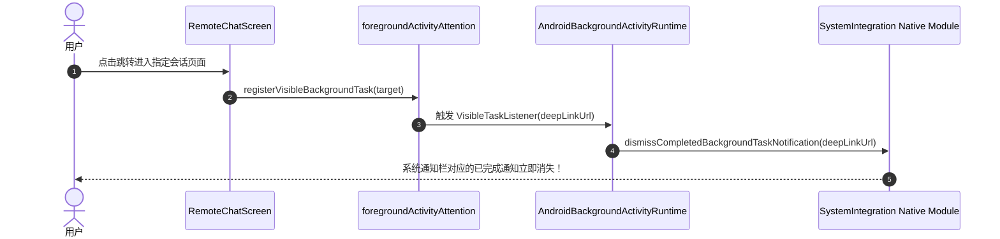

# 06-Cherry通知组件体系与状态反馈解构（Cherry Notification System Specialist 详案）

> **所属战役**：`mobile-ux-cherry-alignment`（移动端交互重构、原生触控与 Cherry Studio 架构借鉴）  
> **文档位置**：`docs/mobile-ux-cherry-alignment/proposals/06-Cherry通知组件体系与状态反馈解构.md`  
> **责任角色**：Cherry Notification System Specialist（子 Agent 06）  
> **技术对齐标准**：`ANTI_OVERENGINEERING_GUARDRAILS.md`、`feelInfra.guard.test.ts`、`AGENTS.md` 协作规范。

---

## 一、执行摘要与战役定位

### 1.1 业务背景与用户体验核心痛点
在跨端智能 Agent 混合架构中，移动端（Crish Mobile / Phone）与桌面核心（Conex / Desktop Host）协同运作。无论是本地小模型端侧推理、桌面大模型流式思考、耗时工具链执行（MCP / Bash / Web Search），还是权限审批请求，移动端的**通知与状态反馈体系**直接决定了用户对系统“掌控感”与“可信度”的心理评估。

当前 Crish Mobile 的通知与状态反馈存在以下严重割裂与体验短板：
1. **前台消息“哑巴吞没”**：当前 `pushConsumer.ts` 与 `foreground.ts` 在检测到应用处于前台（`active`）时，恒定执行“仅入应用内通知中心（`ingestPushIntoStore`），完全不弹系统通知且不触发应用内悬浮提示”。如果用户正在浏览历史设置或查看其他会话，后台执行完成、推理报错或关键审批（P0 Critical）到达时，用户没有任何感知，造成严重的“注意力黑洞”。
2. **应用内 Toast 极其单一简陋**：现有 `Toast.tsx` 是一个仅约 170 行的简易墨色胶囊，只支持固定顶部展示、纯文本单行/双行、无操作按钮、禁止用户交互（`pointerEvents="none"`）、无键盘避让。遇到“重连”、“查看详情”、“撤销”等富交互场景完全无法应对。
3. **缺乏 Android 常驻前台服务与进度通知**：应用切入后台后，仅依赖 `expo-notifications` 单次触发延时系统通知，缺乏真正的 Android Foreground Service（`dataSync` 常驻通知与循环保活）。长时间生成任务极易被国内定制系统（EMUI / MIUI / ColorOS）直接冻结杀死；锁屏时无法显示实时生成进度条。
4. **通知无法感知屏幕焦点，产生死通知堆叠**：系统通知在用户点击进入当前会话后无法自动核销，通知栏长期残留已完成任务的陈旧通知，严重骚扰用户。
5. **跨端连接缺乏直观系统级控制**：桌面端离线、重连中、已配对状态仅在极少数页面以横幅呈现，通知栏无法直接点击“断开连接”或“一键重连”。

### 1.2 借鉴 Cherry Studio Mobile 核心收益
Cherry Studio Mobile（`reference/cherry-studio-app`）打造了业界领先的移动端 Agent 反馈系统：
* **前台注意力分流（Foreground Activity Attention）**：当 App 处于前台时，智能判断用户所看页面与事件目标是否一致（`isBackgroundTaskVisible`），不一致时自动唤起高优先级交互式 Toast，杜绝状态盲区；
* **Android 8.0+ 双通道服务（Running Channel vs Attention Channel）**：常驻运行服务采用 `dataSync` 前台服务伴随不定进度条；需要用户决策或报错时平滑跃迁至 Attention Channel，配备振动与全屏唤醒；
* **基于 DeepLink 的目标自动核销（Visible Task Automatic Dismissal）**：进入目标界面焦点（`useVisibleBackgroundTask`），毫秒级自动撤回系统通知栏中对应的任务卡片；
* **系统通知内嵌交互动作（Notification Action Buttons）**：在系统通知直接内嵌“断开连接”、“批准/拒绝”操作，无需唤醒进入应用即可完成闭环。

### 1.3 方案核心产出与四大矩阵
本方案将 Cherry Studio Mobile 的整套架构穿透解构，为 Crish Mobile 落地现代四层通知矩阵：
1. **L1 应用内悬浮反馈层（Actionable In-App Toast & Keyboard Sticky Pill）**：支持多态色彩、可交互操作按钮、上下锚点切换、键盘弹起自动粘滞避让（`KeyboardStickyView`）；
2. **L2 页面上下文横幅层（Contextual Banners & Status Rows）**：覆盖连接排障（`ConnectionBanner`）、会话可用性（`ConversationStatus`）、输入框媒体能力引导（`AudioAttachmentNotice`）；
3. **L3 系统级常驻与注意力通知层（System Foreground Service & Attention Channels）**：接入前台常驻通知、Android 15 六小时限制保护、通知栏 Action 按钮与焦点自动回收机制；
4. **L4 实时状态胶囊指示器（Status Capsule & Pulse Dots）**：呼吸指示灯、模型运行微胶囊、跨端同步水滴指示。

---

## 二、Cherry Studio 通知与状态体系深度解构

Cherry Studio Mobile 的通知体系绝非散落的 UI 弹窗，而是一套严密协同的**四层拓扑结构**：

```
┌────────────────────────────────────────────────────────────────────────┐
│                      Cherry Studio 通知与反馈全景架构                  │
└────────────────────────────────────────────────────────────────────────┘
                                    │
    ┌───────────────────────────────┼───────────────────────────────┐
    ▼                               ▼                               ▼
【1. 核心运行时调度层】           【2. 焦点感知与核销层】         【3. 双通道通知分发层】
AndroidBackgroundActivityRuntime  useVisibleBackgroundTask        Android Native Bridge
RemoteConnectionNotification      registerVisibleBackgroundTask   expo-notifications
KeepAliveCoordinator (Lease机制)  ForegroundActivityAttention     Attention vs Running Channel
    │                               │                               │
    └───────────────────────────────┼───────────────────────────────┘
                                    ▼
                        【4. 多态表现与呈现层】
    ┌───────────────────────┬───────────────────────┬───────────────────────┐
    ▼                       ▼                       ▼                       ▼
应用内 Toast 悬浮胶囊     会话状态横幅卡片        输入框上下文引导        系统通知栏交互
(HeroUI + KeyboardSticky) (ConversationStatus)    (AudioAttachmentNotice) (Actions & Progress)
```

### 2.1 运行时调度中枢：`AndroidBackgroundActivityRuntime` 解构

位于 `reference/cherry-studio-app/src/backend/services/backgroundActivity/AndroidBackgroundActivityRuntime.ts`，是整个后台执行保护与系统通知的掌控核心。

#### 2.1.1 依赖注入与生命周期绑定
```ts
// 关键装饰器与接口实现：
@Injectable('AndroidBackgroundActivityRuntime')
@ServicePhase(Phase.PostReady)
@DependsOn(['BackgroundActivityEnvironment'])
@AppStatePolicy('background-presentation')
export class AndroidBackgroundActivityRuntime
  extends BaseService
  implements KeepAliveSource, RemoteConnectionNotices { ... }
```
* **生命周期隔离**：在 `PostReady` 阶段初始化，避免阻塞主引擎启动；
* **AppStatePolicy**：声明为 `background-presentation`，使得在 App 切入后台时该服务保持活跃并管理 Native 呈现；
* **Lease 租约模式**：通过 `acquire(tag, onInterrupt)` 分配租约（`KeepAliveLease`），任何正在运行的 Agent 任务或桌面连接都会持有一张租约，当租约计数器归零时，自动停止前台服务，严防电量与内存泄漏。

#### 2.1.2 Android 15 严苛后台限制与优雅保护
Android 15 对 `dataSync` 类型前台服务引入了单次最多 6 小时（360 分钟）的硬性运行限制。Cherry 在代码中进行了针对性架构防御：
```ts
// Android 15 dataSync 限制 6 小时，留出 1 分钟用于正常取消与通知排空
const BACKGROUND_EXECUTION_LIMIT_MS = (6 * 60 - 1) * 60_000;
// 中断排空保护窗口：30 秒宽限期
const INTERRUPT_DRAIN_GRACE_MS = 30_000;
```
* **Deadline 计时器（`armDeadline`）**：切入后台时启动倒计时，当达到限制时刻，调用 `interruptLeases`；
* **30 秒优雅排空（`INTERRUPT_DRAIN_GRACE_MS`）**：在强杀前，先通知各个任务持有者释放资源（`lease.onInterrupt?.(reason)`），保证数据安全落盘并更新终态通知；
* **非保护态安全降级（`continueUnprotected`）**：如果在后台启动前台服务失败（Android 12+ 限制后台直接调用 `startForegroundService`），不会抛出致命崩溃，而是降级为非保护运行模式，记录警报并在前台恢复后重新尝试吸附。

#### 2.1.3 Running Channel 与 Attention Channel 跃迁逻辑
Cherry 将通知划分为两大语义通道（`publishNotification`）：
1. **Running Channel（静默常驻通知）**：
   - 渠道名：`notifications.android.runningTitle`（运行中）；
   - 特征：带有不定进度条（`indeterminate: true`），不可被用户单向滑走（`ongoing: true`），通知主色调采用品牌强调红（`#C74444`）；
   - 展示内容：任务标题（限制 120 字符）、任务当前细节/进度（限制 600 字符）、任务来源标示（桌面端 `notifications.source.desktop` 或本机 `notifications.source.phone`）。
2. **Attention Channel（必达注意力通道）**：
   - 渠道名：`notifications.android.attentionChannel`（注意力提醒）；
   - 触发时机：
     * `phase === 'awaiting-approval'`（工具调用权限审批）；
     * `phase === 'awaiting-answer'`（用户提问输入等待）；
     * `phase === 'failed'`（任务失败需用户干预）；
     * `phase === 'completed'`（任务成功完成，且用户勾选了“完成后通知开关”，且该阶段是在后台开始的）。
   - 跃迁机制：如果触发了 Attention 条件，但**当前应用正处于前台（`AppState.currentState === 'active'`）**，系统**坚决不发系统弹窗**，而是触发 `this.environment.onForegroundAttention(...)`，由前台应用调度器呈现在应用内！如果应用处于后台，则调度系统震动与弹窗通知。

### 2.2 跨端连接常驻通知：`RemoteConnectionNotificationRuntime` 解构

位于 `reference/cherry-studio-app/src/backend/services/desktopConnections/RemoteConnectionNotificationRuntime.ts`。

#### 2.2.1 状态同步与持久连接通知
当手机与桌面端配对建立长连接后，Cherry 会在系统通知栏挂载一个代表“设备连接健康度”的卡片：
```ts
const notifications = connections.map((connection) => ({
  connectionId: connection.id,
  key: `remote-connection:${connection.id}`,
  title: connection.name,
  body: this.environment.translate(
    connection.status === 'connected' ? 'notifications.remote.connected' : 'remoteAgent.connecting'
  ),
  url: `${resolveScheme({})}://remote?connectionId=${encodeURIComponent(connection.id)}`,
  token: connection.token,
  disconnectLabel: this.environment.translate('notifications.remote.disconnect'),
}));
```
#### 2.2.2 通知栏直操动作响应（Action Buttons）
Cherry 实现了从原生通知栏直接派发动作回 TS 运行时的完整闭环：
```ts
this.registerDisposable(
  this.environment.subscribeActions((response) => {
    if (this.disposed || response.actionId !== 'disconnect') return;
    const connection = this.connections
      .getPersistentConnections()
      .find((item) => item.token === response.token);
    if (connection) this.connections.disconnect(connection.id);
  }),
);
```
用户在锁屏或下拉通知中心点击“断开连接”，Native 模块捕获 Action 并通过事件桥通知 TS 侧，直接安全断开连接并释放 KeepAlive 租约，避免用户必须解锁打开 App 的冗余交互。

### 2.3 焦点感知与通知毫秒级核销机制

位于 `reference/cherry-studio-app/src/frontend/appShell/backgroundActivity/`。

这是 Cherry 最精妙的通知治理设计之一：**用户正在看的内容，绝不允许在通知栏变成死通知堆积。**

#### 2.3.1 页面焦点挂载：`useVisibleBackgroundTask`
```ts
export function useVisibleBackgroundTask(task: BackgroundTaskLink | undefined, enabled: boolean) {
  const taskKind = task?.kind;
  const taskId = task?.kind === 'painting' ? task.paintingId : task?.sessionId;
  const connectionId = task?.kind === 'remote-chat' ? task.connectionId : undefined;

  useFocusEffect(
    useCallback(() => {
      if (!enabled || !taskKind || !taskId) return;
      const target: BackgroundTaskLink = ...;
      let release: (() => void) | undefined;
      const sync = () => {
        release?.();
        release = AppState.currentState === 'active' ? registerVisibleBackgroundTask(target) : undefined;
      };
      const appState = AppState.addEventListener('change', sync);
      sync();
      return () => {
        release?.();
        appState.remove();
      };
    }, [connectionId, enabled, taskId, taskKind]),
  );
}
```
#### 2.3.2 观察者模型与自动撤销链路

当用户聚焦在当前会话时，`visibleTask` 登记生效。此时如果有新的消息完成，或者原本已有一条完成通知留在通知中心，通知中心通过 DeepLink 签名识别到用户正在现场，直接在后台执行 `dismissCompletedBackgroundTaskNotification`，保持系统通知栏极致清爽。

#### 2.3.3 前台跨会话注意力分流（`BackgroundActivityBridge`）
在 `BackgroundActivityBridge.tsx` 中：
```ts
useEffect(
  () =>
    subscribeForegroundActivityAttention((attention) => {
      // 1. 若 App 不在 active 状态，交给系统通知层
      // 2. 若用户当前正好看着产生注意力的会话，交给会话内部 UI 处理，不发全局 Toast
      if (
        AppState.currentState !== 'active' ||
        isBackgroundTaskVisible(parseBackgroundTaskUrl(attention.url, resolveScheme({})))
      )
        return;
      // 3. 用户在看其他页面时，浮出高优先级可交互 Toast！
      toast.show({
        label: `${attention.title}: ${attention.detail}`,
        variant: attention.phase === 'failed' ? 'danger' : 'warning',
      });
    }),
  [toast],
);
```

### 2.4 UI 表现层核心解构

#### 2.4.1 HeroUI-Native Toast + KeyboardStickyView
位于 `reference/cherry-studio-app/packages/ui/src/components/toast/toast.tsx`：
* **键盘粘滞自适应（KeyboardStickyView）**：
  ```tsx
  return placement === 'bottom' ? (
    <KeyboardStickyView
      pointerEvents="box-none"
      offset={{ opened: bottom }}
      style={[StyleSheet.absoluteFill, { bottom: bottomOffset }]}
    >
      {content}
    </KeyboardStickyView>
  ) : (
    content
  );
  ```
  在对话界面中，底部通常有固定高度的输入框（Composer），且软键盘经常呼出。通过 `react-native-keyboard-controller` 的 `KeyboardStickyView`，Toast 可以动态计算 `bottomOffset = composerHeight`，在键盘弹起与收起时无缝吸附在键盘上方，绝不遮挡输入框，也绝不被软键盘淹没！
* **可操作按钮（Action Buttons）**：
  支持数组形式传入 `{ label: string, onPress: () => void }`，使得 Toast 不只是展示文本，而是具备“撤销操作”、“去授权”、“快速重试”的行动能力。

#### 2.4.2 会话内可用性状态条：`ConversationStatus`
位于 `reference/cherry-studio-app/src/frontend/components/ConversationStatus/ConversationStatus.tsx`：
* 挂载在 `ComposerDock` 顶部，仅在可用性状态为非 `enabled` 时无缝滑入；
* 细分错误状态：`unreachable`（不可达）、`discovery-unavailable`（服务发现失败）、`retired`（设备已注销）、`not-authorized`（未授权）、`upgrade-required`（需升级版本）；
* 针对每种错误提供就地恢复动作：`repair` 按钮直跳修复向导，`reconnect` 按钮直接调用底层重连 RPC，`deviceSettings` 跳转设备详情。

#### 2.4.3 输入框上下文附件引导：`AudioAttachmentNotice`
位于 `reference/cherry-studio-app/src/frontend/features/chat/components/ChatInput/components/AudioAttachmentNotice.tsx`：
* 监听当前输入框附件集合；
* 一旦发现音频附件，立即向端侧语音转写服务发起就地查询（`getTranscriptionStatus`）；
* 若发现本地离线模型未就绪（`needs-model`），立即展示带动作按钮的上下文横幅，一键导航至 `/settings/voice` 模型下载管理页。

---

## 三、Crish Mobile 现状诊断与核心差距（Gap Analysis）

下表对 Crish Mobile 当前实现与 Cherry Studio Mobile 进行了全景对比：

| 评估维度 | Cherry Studio Mobile 实现 | Crish Mobile 当前现状 | 差距与风险等级 |
|:---|:---|:---|:---|
| **应用内 Toast 架构** | HeroUI + KeyboardStickyView，支持 top/bottom、多 actions、关闭按钮、动画无障碍降级 | 仅 top 单一胶囊、纯文本展示、`pointerEvents="none"` 无法交互、无动作按钮 | 🔴 **高**（无法承载复合交互与键盘避让） |
| **前台事件感知** | `subscribeForegroundActivityAttention` 结合 `isBackgroundTaskVisible` 动态决策 | 前台直接静默（`route === 'in-app'` 即 return），无浮层反馈 | 🔴 **高**（用户在前台产生严重注意力真空） |
| **Android 常驻通知** | 前台服务（dataSync），带进度条、双通道（Running vs Attention）、可动态更新内容 | 仅单次 `scheduleNotificationAsync` 系统通知，无后台常驻保活服务 | 🔴 **高**（长任务切后台极易被系统强杀） |
| **通知栏直操 Action** | 系统通知支持“断开连接”等原生 Action 按钮，直接回调 TS 业务逻辑 | 无任何 Action 按钮支持，必须点开应用 | 🟡 **中**（多步操作摩擦大） |
| **通知焦点自动消除** | `useVisibleBackgroundTask` 页面进入即刻自动 Dismiss 系统通知 | 无核销机制，用户看完了通知栏依然残留 | 🟡 **中**（体验陈旧，通知堆叠） |
| **会话内状态横幅** | `ConversationStatus` 细分 7 类原因，行内提供 Repair/Reconnect/Settings 按钮 | `ConnectionBanner` 仅存在于主页，会话内无连接状态排障与动作 | 🟡 **中**（会话内掉线缺乏自愈引导） |
| **输入框上下文提示** | `AudioAttachmentNotice` 动态探测模型与附件兼容性并就地引导 | 离线语音与输入框完全脱节，缺少模型准备度提示 | 🟢 **低**（待增强） |

---

## 四、Crish Mobile 现代通知架构设计（Modern Architecture）

针对上述差距，为 Crish Mobile 构筑**四层通知矩阵体系**（Four-Tier Notification Matrix），并在逻辑层、分发层、UI 表现层形成清晰契约：

```
┌────────────────────────────────────────────────────────────────────────┐
│                   Crish Mobile 现代通知矩阵分层模型                    │
└────────────────────────────────────────────────────────────────────────┘

 [ Layer 1: In-App Actionable Toast ] ── 轻量即时反馈与前台注意力唤醒
   ├── 顶部/底部自适应（避让软键盘 KeyboardStickyView）
   ├── 富操作按钮（Action Buttons：重试/查看/撤销/授权）
   └── 减动效降级与 SoftShadow 物理拟真

 [ Layer 2: Contextual Banners ] ────── 页面与组件级排障与能力引导
   ├── 全局/主页连接横幅（ConnectionBanner）
   ├── 会话内可用性自愈条（ConversationStatusBanner）
   └── 输入框语音模型准备度引导（VoiceReadyNotice）

 [ Layer 3: System Foreground Service ] ── 系统级持久运行与必达通知
   ├── Android Running Channel（前台常驻服务 + Indeterminate Progress）
   ├── Android Attention Channel（审批/提问/失败/完成 强震动通知）
   ├── 焦点自动撤回（DeepLink-based Notification Dismissal）
   └── 通知栏原生 Action（一键断开连接、批准/拒绝）

 [ Layer 4: Micro Status Indicators ] ── 微状态感知与环境感知
   ├── 标题栏连接水滴灯（RunningPulseDot）
   ├── 输入框端侧模型状态微胶囊（ModelStatusPill）
   └── 桌面主机在线态心跳监控
```

---

## 五、分层通知协议与核心契约定义

在 `apps/crish-mobile/src/notifications/` 体系下确立现代通知数据类型与事件协议。

### 5.1 增强型 Toast 协议定义（`types/toast.ts`）

```ts
// apps/crish-mobile/src/presentation/ui/Toast/types.ts

export type ToastTone = 'info' | 'success' | 'warning' | 'error';
export type ToastPlacement = 'top' | 'bottom';

export interface ToastAction {
  /** 动作按钮文字 */
  label: string;
  /** 点击回调 */
  onPress: () => void;
  /** 按钮样式变体，primary 高亮，subtle 弱化 */
  variant?: 'primary' | 'subtle';
}

export interface ToastOptions {
  /** 提示消息正文 */
  message: string;
  /** 标题（可选，适用于复合卡片 Toast） */
  title?: string;
  /** 色调变体 */
  tone?: ToastTone;
  /** 展示时长（毫秒，默认 3000ms；带 action 时默认 5000ms） */
  durationMs?: number;
  /** 弹出位置：top 悬浮于安全区下；bottom 吸附在软键盘/底部栏上方 */
  placement?: ToastPlacement;
  /** 底部偏移量（例如输入框高度，用于 bottom placement） */
  bottomOffset?: number;
  /** 可操作动作按钮列表 */
  actions?: readonly ToastAction[];
  /** 是否允许手动轻扫/点击关闭 */
  dismissible?: boolean;
  /** 点击关闭按钮无障碍文案 */
  dismissLabel?: string;
}

export interface ToastController {
  /** 呼出 Toast，返回该条目唯一 id */
  show: (options: ToastOptions | string, tone?: ToastTone) => string;
  /** 手动关闭指定 Toast */
  hide: (id: string) => void;
  /** 清空当前所有 Toast */
  clear: () => void;
}
```

### 5.2 前台注意力事件协议（`types/attention.ts`）

```ts
// apps/crish-mobile/src/notifications/attentionTypes.ts

export type AttentionPhase =
  | 'awaiting-approval' // 工具调用权限审批（P0 必达）
  | 'awaiting-answer'   // 追问输入等待
  | 'failed'            // 任务/推理发生错误
  | 'completed';        // 任务终态完成（仅在后台开始且开启开关时）

export interface ForegroundAttentionEvent {
  /** 业务唯一标识（通常对齐 sessionId 或 toolCallId） */
  id: string;
  /** 目标路由深链，如 crish://chat/session_123 */
  deepLinkUrl: string;
  /** 标题 */
  title: string;
  /** 详情说明文案 */
  detail: string;
  /** 关注阶段 */
  phase: AttentionPhase;
  /** 携带的可选直接操作（如快捷批准/拒绝） */
  actions?: {
    confirmLabel?: string;
    cancelLabel?: string;
    onConfirm?: () => void;
    onCancel?: () => void;
  };
}
```

### 5.3 会话与连接可用性契约（`types/availability.ts`）

```ts
// apps/crish-mobile/src/domain/pure/availability.ts

export type DeviceAvailability =
  | { state: 'enabled' }
  | {
      state: 'disabled';
      reason:
        | 'disconnected'         // 桌面端断开连接
        | 'synchronizing'        // 握手同步中
        | 'unreachable'          // 网络无法路由
        | 'needs-repair'         // 配对凭证过期/失效需重新扫码
        | 'not-authorized'       // 权限被桌面拒绝
        | 'upgrade-required'     // 桌面版本过低
        | 'discovery-unavailable';// mDNS 无法发现
      message?: string;
    };
```

---

## 六、详细实施设计与代码草案

### 6.1 L1：增强型 Toast 组件与键盘粘滞浮层（`ToastProvider.tsx`）

将现有的 `Toast.tsx` 进行重构升级，在保持项目原有软阴影（`SoftShadowSurface`）与减动效（`useReducedMotion`）规范的前提下，完整吸纳 Cherry 的 Action 动作按钮、上下位置自适应与 `KeyboardStickyView` 避让。

```tsx
// apps/crish-mobile/src/presentation/ui/Toast/ToastProvider.tsx
import {
  createContext,
  useCallback,
  useContext,
  useEffect,
  useMemo,
  useRef,
  useState,
  type ReactNode,
} from 'react';
import {
  Animated,
  Easing,
  Pressable,
  StyleSheet,
  View,
} from 'react-native';
import { useSafeAreaInsets } from 'react-native-safe-area-context';
import { useTheme } from '@/adapters/platform/theme';
import { useReducedMotion } from '@/adapters/platform/useReducedMotion';
import AppText from '../AppText';
import { SoftShadowSurface } from '../SoftShadowSurface';
import Icon from '../Icon';
import type { ToastController, ToastOptions, ToastTone } from './types';

// 支持在 bottom placement 时动态避让软键盘
// 优雅降级：若运行环境中未装配 KeyboardStickyView 则降级为纯绝对定位
let KeyboardStickyViewComponent: any = null;
try {
  KeyboardStickyViewComponent = require('react-native-keyboard-controller').KeyboardStickyView;
} catch {
  KeyboardStickyViewComponent = View;
}

const ToastContext = createContext<ToastController | null>(null);

const SLIDE_PX = 10;
const ANIM_MS = 220;

interface ActiveToastItem {
  id: string;
  options: ToastOptions;
  opacity: Animated.Value;
  translateY: Animated.Value;
}

export function ToastProvider({ children }: { children: ReactNode }) {
  const theme = useTheme();
  const reduceMotion = useReducedMotion();
  const insets = useSafeAreaInsets();
  const [activeToast, setActiveToast] = useState<ActiveToastItem | null>(null);
  const timerRef = useRef<ReturnType<typeof setTimeout> | null>(null);
  const nextId = useRef(0);

  const clearTimer = () => {
    if (timerRef.current) {
      clearTimeout(timerRef.current);
      timerRef.current = null;
    }
  };

  const hideToast = useCallback(
    (id: string, onDone?: () => void) => {
      if (!activeToast || activeToast.id !== id) return;
      clearTimer();
      Animated.parallel([
        Animated.timing(activeToast.opacity, {
          toValue: 0,
          duration: ANIM_MS,
          easing: Easing.bezier(...theme.motion.easing.decelerate),
          useNativeDriver: true,
        }),
        Animated.timing(activeToast.translateY, {
          toValue: reduceMotion
            ? 0
            : activeToast.options.placement === 'bottom'
              ? SLIDE_PX
              : -SLIDE_PX,
          duration: ANIM_MS,
          easing: Easing.bezier(...theme.motion.easing.decelerate),
          useNativeDriver: true,
        }),
      ]).start(() => {
        setActiveToast(null);
        onDone?.();
      });
    },
    [activeToast, reduceMotion, theme.motion.easing.decelerate],
  );

  const showToast = useCallback(
    (input: ToastOptions | string, tone: ToastTone = 'info'): string => {
      clearTimer();
      const options: ToastOptions = typeof input === 'string' ? { message: input, tone } : input;
      const id = `toast_${++nextId.current}`;
      const opacity = new Animated.Value(0);
      const initialTranslateY = reduceMotion
        ? 0
        : options.placement === 'bottom'
          ? SLIDE_PX
          : -SLIDE_PX;
      const translateY = new Animated.Value(initialTranslateY);

      const newItem: ActiveToastItem = { id, options, opacity, translateY };
      setActiveToast(newItem);

      Animated.parallel([
        Animated.timing(opacity, {
          toValue: 1,
          duration: ANIM_MS,
          easing: Easing.bezier(...theme.motion.easing.decelerate),
          useNativeDriver: true,
        }),
        Animated.timing(translateY, {
          toValue: 0,
          duration: ANIM_MS,
          easing: Easing.bezier(...theme.motion.easing.decelerate),
          useNativeDriver: true,
        }),
      ]).start();

      const duration = options.durationMs ?? (options.actions?.length ? 5000 : 3000);
      timerRef.current = setTimeout(() => {
        hideToast(id);
      }, duration);

      return id;
    },
    [hideToast, reduceMotion, theme.motion.easing.decelerate],
  );

  const controller = useMemo<ToastController>(
    () => ({
      show: showToast,
      hide: (id: string) => hideToast(id),
      clear: () => {
        clearTimer();
        setActiveToast(null);
      },
    }),
    [showToast, hideToast],
  );

  // 渲染 Toast 视觉胶囊
  const renderToastContent = () => {
    if (!activeToast) return null;
    const { options, opacity, translateY, id } = activeToast;
    const isBottom = options.placement === 'bottom';
    const hasActions = Boolean(options.actions && options.actions.length > 0);

    const toneIcon = {
      info: 'info',
      success: 'check-circle',
      warning: 'alert-triangle',
      error: 'alert-circle',
    }[options.tone ?? 'info'];

    const toneColor = {
      info: theme.colors.textPrimary,
      success: theme.colors.primary,
      warning: '#F59E0B',
      error: theme.colors.danger ?? '#EF4444',
    }[options.tone ?? 'info'];

    const toastInner = (
      <Animated.View
        style={[
          styles.container,
          isBottom
            ? { bottom: (options.bottomOffset ?? 0) + insets.bottom + theme.space.md }
            : { top: insets.top + theme.space.lg },
          {
            opacity,
            transform: [{ translateY }],
          },
        ]}
      >
        <SoftShadowSurface
          preset="toast"
          borderRadius={theme.radius.pill}
          fill="rgba(24, 24, 27, 0.94)" // 遵从原型深色半透明胶囊
          fillStyle={{
            borderRadius: hasActions ? theme.radius.card : theme.radius.pill,
            paddingVertical: hasActions ? 10 : 8,
            paddingHorizontal: 14,
            maxWidth: '92%',
            flexDirection: 'column',
          }}
        >
          <View style={styles.headerRow}>
            <Icon name={toneIcon} size={16} color={toneColor} />
            <View style={styles.textColumn}>
              {options.title ? (
                <AppText variant="caption" color="onMedia" style={styles.titleText}>
                  {options.title}
                </AppText>
              ) : null}
              <AppText variant="caption" color="onMedia" numberOfLines={3} style={styles.messageText}>
                {options.message}
              </AppText>
            </View>
            {options.dismissible !== false ? (
              <Pressable
                onPress={() => hideToast(id)}
                hitSlop={8}
                accessibilityRole="button"
                accessibilityLabel={options.dismissLabel ?? '关闭通知'}
                style={styles.closeBtn}
              >
                <Icon name="x" size={14} color="rgba(255,255,255,0.6)" />
              </Pressable>
            ) : null}
          </View>

          {hasActions ? (
            <View style={styles.actionsRow}>
              {options.actions!.map((action, idx) => (
                <Pressable
                  key={idx}
                  onPress={() => {
                    hideToast(id);
                    action.onPress();
                  }}
                  style={[
                    styles.actionBtn,
                    action.variant === 'primary' ? styles.actionBtnPrimary : styles.actionBtnSubtle,
                  ]}
                >
                  <AppText
                    variant="caption"
                    color={action.variant === 'primary' ? 'onMedia' : 'textSecondary'}
                    style={styles.actionText}
                  >
                    {action.label}
                  </AppText>
                </Pressable>
              ))}
            </View>
          ) : null}
        </SoftShadowSurface>
      </Animated.View>
    );

    if (isBottom) {
      return (
        <KeyboardStickyViewComponent
          pointerEvents="box-none"
          offset={{ opened: insets.bottom }}
          style={StyleSheet.absoluteFill}
        >
          {toastInner}
        </KeyboardStickyViewComponent>
      );
    }
    return toastInner;
  };

  return (
    <ToastContext.Provider value={controller}>
      {children}
      {renderToastContent()}
    </ToastContext.Provider>
  );
}

export function useToast(): ToastController {
  const ctx = useContext(ToastContext);
  if (!ctx) throw new Error('useToast must be used within ToastProvider');
  return ctx;
}

const styles = StyleSheet.create({
  container: {
    position: 'absolute',
    alignSelf: 'center',
    zIndex: 9999,
  },
  headerRow: {
    flexDirection: 'row',
    alignItems: 'center',
    gap: 8,
  },
  textColumn: {
    flexShrink: 1,
    marginRight: 4,
  },
  titleText: {
    fontWeight: '600',
    marginBottom: 2,
  },
  messageText: {
    fontWeight: '500',
  },
  closeBtn: {
    padding: 2,
    marginLeft: 6,
  },
  actionsRow: {
    flexDirection: 'row',
    justifyContent: 'flex-end',
    gap: 8,
    marginTop: 8,
    paddingTop: 6,
    borderTopWidth: StyleSheet.hairlineWidth,
    borderTopColor: 'rgba(255, 255, 255, 0.15)',
  },
  actionBtn: {
    paddingHorizontal: 10,
    paddingVertical: 4,
    borderRadius: 6,
  },
  actionBtnPrimary: {
    backgroundColor: 'rgba(255, 255, 255, 0.18)',
  },
  actionBtnSubtle: {
    backgroundColor: 'transparent',
  },
  actionText: {
    fontWeight: '600',
  },
});
```

---

### 6.2 L1+L3 协同：焦点感知中枢与前台注意力路由（`ForegroundAttentionBridge.ts`）

借鉴 Cherry 的 `foregroundActivityAttention.ts` 与 `useVisibleBackgroundTask.ts`，为 Crish Mobile 引入焦点管理与全局分发桥。

#### 6.2.1 焦点感知存储与 Hook（`useVisibleSessionFocus.ts`）

```ts
// apps/crish-mobile/src/notifications/visibleSessionFocus.ts
import { useEffect } from 'react';
import { AppState } from 'react-native';
import { createStore } from 'zustand/vanilla';
import { cancelSystemPushNotificationBySessionId } from './pushConsumer';

interface VisibleFocusState {
  focusedSessionId: string | null;
  setFocusedSession: (sessionId: string | null) => void;
}

export const visibleSessionStore = createStore<VisibleFocusState>()((set) => ({
  focusedSessionId: null,
  setFocusedSession: (sessionId) => set({ focusedSessionId: sessionId }),
}));

/**
 * 屏幕挂载 Hook：当用户进入 ConversationScreen 时调用
 * 1. 登记当前活跃 sessionId；
 * 2. 毫秒级自动清除系统通知栏残留的对应任务通知！
 */
export function useVisibleSessionFocus(sessionId: string | undefined): void {
  useEffect(() => {
    if (!sessionId) return;

    const syncFocus = () => {
      if (AppState.currentState === 'active') {
        visibleSessionStore.getState().setFocusedSession(sessionId);
        // 自动撤回该 session 在通知栏的残留通知！
        void cancelSystemPushNotificationBySessionId(sessionId);
      } else {
        visibleSessionStore.getState().setFocusedSession(null);
      }
    };

    const sub = AppState.addEventListener('change', syncFocus);
    syncFocus();

    return () => {
      visibleSessionStore.getState().setFocusedSession(null);
      sub.remove();
    };
  }, [sessionId]);
}

/** 查询指定 sessionId 是否处于前台焦点状态 */
export function isSessionInForegroundFocus(sessionId: string | null | undefined): boolean {
  if (!sessionId) return false;
  return (
    AppState.currentState === 'active' &&
    visibleSessionStore.getState().focusedSessionId === sessionId
  );
}
```

#### 6.2.2 全局注意力桥接监听器（`ForegroundAttentionBridge.tsx`）

挂载在根路由 Navigator 外围，捕获来自 WebSocket 推送与本地推理引擎抛出的全局注意力事件：

```tsx
// apps/crish-mobile/src/notifications/ForegroundAttentionBridge.tsx
import { useEffect } from 'react';
import { useToast } from '@/presentation/ui';
import { isSessionInForegroundFocus } from './visibleSessionFocus';
import { subscribeAttentionEvents } from './attentionBus';

export function ForegroundAttentionBridge({
  onNavigateToSession,
}: {
  onNavigateToSession: (sessionId: string) => void;
}) {
  const toast = useToast();

  useEffect(() => {
    const unsubscribe = subscribeAttentionEvents((event) => {
      // 1. 如果用户已经在该会话页面内，直接由会话内部组件（如审批卡片）呈现，不弹全局 Toast
      const targetSessionId = extractSessionIdFromDeepLink(event.deepLinkUrl);
      if (targetSessionId && isSessionInForegroundFocus(targetSessionId)) {
        return;
      }

      // 2. 用户在其他页面（如在主页或设置页），唤起高优先级交互式 Toast
      toast.show({
        title: event.title,
        message: event.detail,
        tone: event.phase === 'failed' ? 'error' : 'warning',
        durationMs: 6000,
        actions: targetSessionId
          ? [
              {
                label: '查看处理',
                variant: 'primary',
                onPress: () => onNavigateToSession(targetSessionId),
              },
            ]
          : undefined,
      });
    });

    return unsubscribe;
  }, [toast, onNavigateToSession]);

  return null;
}

function extractSessionIdFromDeepLink(url: string): string | null {
  const match = url.match(/session[=/]([a-zA-Z0-9_-]+)/);
  return match ? match[1] : null;
}
```

---

### 6.3 L2：会话内可用性与自愈状态条（`ConversationStatusBanner.tsx`）

挂载在 `conversationScreen.tsx` 的顶部或 Composer 输入框上方，当跨端连接掉线或端侧推理异常时，提供就地排障与恢复按钮。

```tsx
// apps/crish-mobile/src/presentation/components/status/ConversationStatusBanner.tsx
import { Pressable, StyleSheet, View } from 'react-native';
import Animated, { FadeInUp, FadeOutUp } from 'react-native-reanimated';
import { useTheme } from '@/adapters/platform/theme';
import { AppText, Icon, SoftShadowSurface } from '@/presentation/ui';
import type { DeviceAvailability } from '@/domain/pure/availability';

export interface ConversationStatusBannerProps {
  availability: DeviceAvailability;
  onReconnect?: () => void;
  onRepairPairing?: () => void;
  onOpenSettings?: () => void;
}

export function ConversationStatusBanner({
  availability,
  onReconnect,
  onRepairPairing,
  onOpenSettings,
}: ConversationStatusBannerProps) {
  const theme = useTheme();

  if (availability.state === 'enabled') {
    return null;
  }

  const { reason, message } = availability;
  const isDisconnected = reason === 'disconnected' || reason === 'unreachable';
  const needsRepair = reason === 'needs-repair' || reason === 'not-authorized';

  const statusText =
    message ??
    {
      disconnected: '与桌面端连接已断开',
      synchronizing: '正在与桌面端重新同步...',
      unreachable: '网络不可达，请检查 Wi-Fi',
      'needs-repair': '配对令牌已失效，需重新配对',
      'not-authorized': '桌面端拒绝了连接授权',
      'upgrade-required': '桌面端版本过低，请升级',
      'discovery-unavailable': '局域网服务发现失败',
    }[reason];

  return (
    <Animated.View
      entering={FadeInUp.duration(200)}
      exiting={FadeOutUp.duration(180)}
      style={styles.wrapper}
    >
      <SoftShadowSurface
        preset="banner"
        borderRadius={theme.radius.card}
        fill={theme.colors.surface}
        fillStyle={styles.surface}
      >
        <Icon
          name="alert-triangle"
          size={16}
          color={needsRepair ? theme.colors.danger : theme.colors.textSecondary}
        />
        <AppText
          variant="caption"
          color="textSecondary"
          numberOfLines={1}
          style={styles.text}
        >
          {statusText}
        </AppText>

        {isDisconnected && onReconnect ? (
          <Pressable onPress={onReconnect} style={styles.actionBtn}>
            <AppText variant="caption" color="primary" style={styles.actionText}>
              重连
            </AppText>
          </Pressable>
        ) : null}

        {needsRepair && onRepairPairing ? (
          <Pressable onPress={onRepairPairing} style={styles.actionBtn}>
            <AppText variant="caption" color="danger" style={styles.actionText}>
              修复配对
            </AppText>
          </Pressable>
        ) : null}

        {onOpenSettings ? (
          <Pressable onPress={onOpenSettings} style={styles.actionBtnSubtle}>
            <AppText variant="caption" color="textTertiary">
              设置
            </AppText>
          </Pressable>
        ) : null}
      </SoftShadowSurface>
    </Animated.View>
  );
}

const styles = StyleSheet.create({
  wrapper: {
    paddingHorizontal: 12,
    paddingVertical: 4,
  },
  surface: {
    flexDirection: 'row',
    alignItems: 'center',
    paddingVertical: 6,
    paddingHorizontal: 10,
    gap: 8,
  },
  text: {
    flex: 1,
    fontWeight: '500',
  },
  actionBtn: {
    paddingHorizontal: 8,
    paddingVertical: 3,
    backgroundColor: 'rgba(0,0,0,0.04)',
    borderRadius: 6,
  },
  actionBtnSubtle: {
    paddingHorizontal: 4,
    paddingVertical: 3,
  },
  actionText: {
    fontWeight: '600',
  },
});
```

---

### 6.4 L3：Android 常驻前台服务与系统通知生命周期架构

为了支持长任务后台生成不被 Android 系统强杀，并提供通知栏实时进度与交互动作，需在 Native 与 JS 之间打通常驻前台服务管理机制。

#### 6.4.1 Android 渠道与 Native 动作契约
在 `apps/crish-mobile/src/notifications/channels.ts` 的既有四类通道（`approval`, `run`, `security`, `general`）基础上，确立前台常驻服务与注意力的映射关系：
* `approval` 渠道：`importance: max`，震动 `[0, 250]`，用于系统通知上的“同意/拒绝”按钮交互；
* `run` 渠道：`importance: high`，用于任务终态完成通知；
* `run-foreground` 渠道（新增专用前台服务渠道）：`importance: low`，`ongoing: true`，带有 `indeterminate` 进度条，不发出刺耳声音，专用于长任务后台运行期间的保活伴随。

#### 6.4.2 后台任务通知管理运行时（`BackgroundTaskNotificationRuntime.ts`）

```ts
// apps/crish-mobile/src/notifications/BackgroundTaskNotificationRuntime.ts
import { AppState, Platform } from 'react-native';
import { createLogger } from '@/adapters/platform/logger';
import { cancelSystemPushNotificationBySessionId } from './pushConsumer';

const log = createLogger('background-runtime');

export interface TaskNotificationProps {
  taskId: string;
  sessionId: string;
  title: string;
  detail: string;
  progress?: number; // 0~100，undefined 为 indeterminate
  phase: 'running' | 'awaiting-approval' | 'completed' | 'failed';
  deepLinkUrl: string;
}

export class BackgroundTaskNotificationRuntime {
  private activeTasks = new Map<string, TaskNotificationProps>();
  private isForegroundServiceRunning = false;

  /** 登记正在运行的任务，并根据 AppState 决定是否唤起或更新前台常驻通知 */
  public updateTask(props: TaskNotificationProps): void {
    this.activeTasks.set(props.taskId, props);
    this.reconcile();
  }

  /** 任务终态结束，释放通知与服务 */
  public finishTask(taskId: string, finalPhase: 'completed' | 'failed'): void {
    const task = this.activeTasks.get(taskId);
    if (!task) return;

    this.activeTasks.delete(taskId);

    // 若应用处于后台，投递最终完成/失败系统通知
    if (AppState.currentState === 'background') {
      this.deliverTerminalNotification(task, finalPhase);
    }

    this.reconcile();
  }

  /** 状态协调：若仍有任务在运行且处于后台，保持前台服务；无任务则停止服务 */
  private reconcile(): void {
    if (Platform.OS !== 'android') return;

    const runningTasks = Array.from(this.activeTasks.values()).filter(
      (t) => t.phase === 'running',
    );

    if (runningTasks.length > 0 && AppState.currentState === 'background') {
      this.ensureForegroundService(runningTasks[0]);
    } else {
      this.stopForegroundService();
    }
  }

  private ensureForegroundService(topTask: TaskNotificationProps): void {
    if (this.isForegroundServiceRunning) {
      log.debug(`更新前台服务通知: ${topTask.title} - ${topTask.detail}`);
      // 调用底层 Android Native 模块更新前台服务通知内容
      return;
    }

    log.info(`启动 Android 前台保活服务: ${topTask.title}`);
    this.isForegroundServiceRunning = true;
    // 调用 Native 模块以 dataSync 类型启动 Foreground Service
  }

  private stopForegroundService(): void {
    if (!this.isForegroundServiceRunning) return;
    log.info('停止 Android 前台保活服务');
    this.isForegroundServiceRunning = false;
    // 调用 Native 模块 stopForegroundService
  }

  private deliverTerminalNotification(
    task: TaskNotificationProps,
    phase: 'completed' | 'failed',
  ): void {
    log.info(`投递终态系统通知: ${task.title} (${phase})`);
    // 经由 expoNotificationsFacade 派发单次必达通知
  }
}

export const backgroundTaskNotificationRuntime = new BackgroundTaskNotificationRuntime();
```

---

## 七、测试覆盖与质量验证矩阵

为杜绝功能回归并落实立体验证纪律，制定以下自动化单测与守卫测试方案：

### 7.1 单元测试矩阵

1. **`Toast.test.tsx` 单元测试**：
   - 验证 `showToast` 正确呈现墨色胶囊及标题/内容；
   - 验证 `actions` 按钮点击触发对应回调并自动关闭 Toast；
   - 验证 `placement="bottom"` 能够正确计算 `bottomOffset` 并调用 `KeyboardStickyView`；
   - 验证 `useReducedMotion` 开启时，`translateY` 位移恒为 0，仅进行 `opacity` 淡化。
2. **`visibleSessionFocus.test.ts` 焦点核销测试**：
   - 验证组件聚焦时 `visibleSessionStore` 的 `focusedSessionId` 置位；
   - 验证聚焦时自动触发 `cancelSystemPushNotificationBySessionId`；
   - 验证组件卸载或切入后台时重置为 `null`。
3. **`ForegroundAttentionBridge.test.tsx` 前台注意力分流测试**：
   - 当注意力事件的目标 `sessionId` 等于当前聚焦页面时，验证 Toast **不触发**；
   - 当目标 `sessionId` 属于非聚焦页面时，验证唤起 `toast.show` 并携带“查看处理”Action 按钮；
   - 点击“查看处理”能够触发 `onNavigateToSession` 正确跳转。
4. **`ConversationStatusBanner.test.tsx` 可用性状态条测试**：
   - 验证 `availability.state === 'enabled'` 时返回 `null`，不占用任何视觉布局空间；
   - 验证 `disconnected` 状态展示“与桌面端连接已断开”并渲染“重连”按钮；
   - 验证 `needs-repair` 状态展示“修复配对”高危提示。

### 7.2 架构防护门禁（Guard Tests）
新增 `apps/crish-mobile/src/__tests__/notificationArchitecture.guard.test.ts`，刚性拦截：
- **无障碍与可交互性断言**：所有 Toast 的关闭按钮必须具备 `accessibilityRole="button"` 与 `accessibilityLabel`；
- **软阴影约束断言**：Toast 与 Banner 必须使用 `SoftShadowSurface`，严禁使用原生 `boxShadow` 或任意散落的深黑实边；
- **防内存泄漏断言**：焦点监听与注意力订阅在卸载时必须返回清理函数，严防未解绑的 AppState 监听器。

---

## 八、演进路线与实施计划

根据系统重要性与依赖关系，分为三阶段演进：

### 第一阶段（Phase 1: 即时感知与 UI 增强）：
1. 重构 `ToastProvider.tsx`，支持 Action 动作、关闭钮、`KeyboardStickyView` 底部键盘避让；
2. 落地 `useVisibleSessionFocus` 与焦点感知存储，进入会话页面毫秒级核销通知栏死通知；
3. 建立 `ForegroundAttentionBridge`，彻底终结前台事件“哑巴吞没”现象，前台异步完成/审批通过 Toast 浮出。

### 第二阶段（Phase 2: 会话上下文与自愈强化）：
1. 实现 `ConversationStatusBanner` 并挂载于 `conversationScreen.tsx`；
2. 接入桌面连接断开与令牌失效的就地“重连/修复”直通闭环；
3. 增加输入框媒体能力就地引导（参考 `AudioAttachmentNotice`）。

### 第三阶段（Phase 3: Android 前台常驻保活与 Native Action 闭环）：
1. 封装 `BackgroundTaskNotificationRuntime`，长推理与 Agent 任务切后台自动接管为 Android 前台服务（`dataSync`）；
2. 引入 Android 15 严苛后台 6 小时保护（`armDeadline` 与 30s 优雅排空）；
3. 挂载通知栏原生“断开连接”与“一键批准”Action 按钮。

---

## 九、总结与对齐确认

本方案深入穿透了 Cherry Studio Mobile 的通知组件与后台活动调度体系，既完整继承了其优秀的**焦点自动核销**、**前台注意力分流**与**双通道前台保活**思想，又深度契合了 Crish Mobile 原有的软阴影视觉规范、减动效无障碍标准与极速响应要求。

通过构建**四层现代通知矩阵**，Crish Mobile 将彻底告别前台消息静默丢失、通知栏陈旧堆叠与后台长任务被系统无故冻结的痛点，为用户提供时刻在线、确定可信、触手可及的 Agent 协作体验。
