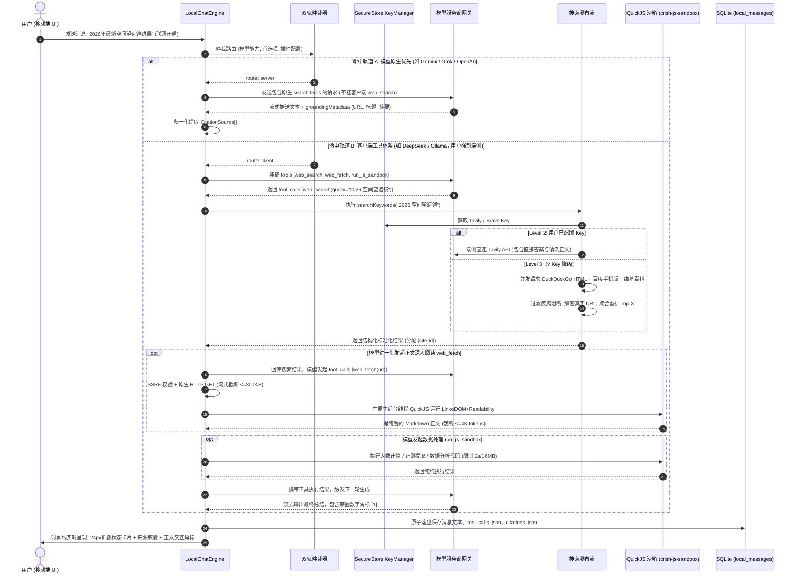

# 手机端四级网页搜索与 QuickJS 原生沙箱工具体系架构总方案

> **工作区**：`docs/mobile-web-search-and-sandbox/`  
> **权威分维详案索引**：
> - [01-分维-双轨仲裁与模型原生搜索方言对接方案.md](./01-分维-双轨仲裁与模型原生搜索方言对接方案.md)
> - [02-分维-客户端多源搜索引擎与免Key瀑布流架构方案.md](./02-分维-客户端多源搜索引擎与免Key瀑布流架构方案.md)
> - [03-分维-QuickJS沙箱集成与端侧网页正文提纯方案.md](./03-分维-QuickJS沙箱集成与端侧网页正文提纯方案.md)
> - [04-分维-移动端本地Agent循环与通用端侧工具体系方案.md](./04-分维-移动端本地Agent循环与通用端侧工具体系方案.md)
> - [05-分维-跨端架构对齐与电脑端资产复用方案.md](./05-分维-跨端架构对齐与电脑端资产复用方案.md)
> - [06-分维-状态机演进与SQLite持久化及设置方案.md](./06-分维-状态机演进与SQLite持久化及设置方案.md)

---

## 一、架构愿景与用户裁决贯彻

针对用户明确指示：
1. **“原生搜索这个肯定是要对接的，优先使用这个，然后再加纯端侧的网络搜索方案”**；
2. **“电脑端之前有做过类似的搜索服务，半做借鉴与跨端对齐”**；
3. **“认可四级分级流水线设计”**；
4. **“装上 QuickJS 原生沙箱，让手机端 AI 拥有更多、更强的端侧工具调用能力”**。

本方案旨在为 `apps/crish-mobile` 构筑一套**“零自建云端中转（Zero-Backend）+ 双轨优先仲裁 + 四级降级瀑布流 + QuickJS 隔离执行 + 跨端体验 1:1 对齐”**的工业级移动端联网检索与智能体工具体系。

```mermaid
flowchart TD
    UserInput([用户在手机端发起提问]) --> CheckNet{当前会话/全局联网开关是否开启?}
    CheckNet -- 否 --> NormalChat[纯本地文字问答]
    
    CheckNet -- 是 --> Arbiter[双轨仲裁器 Dual-Track Arbiter]
    
    %% 轨道 A: 模型原生搜索
    Arbiter -- 路由到原生 (Server) --> NativeInject[注入 11 种模型原生方言 Payload]
    NativeInject --> NativeRequest[手机直连模型网关: OpenAI / Anthropic / Gemini / Grok / 智谱 / 百炼]
    NativeRequest --> NativeStream[流式解析 Grounding 来源与引用元数据]
    NativeStream --> FinalTimeline[时间线渲染: 24px折叠卡片 + 来源胶囊 + 正文角标联动]
    
    %% 轨道 B: 客户端工具体系
    Arbiter -- 路由到端侧 (Client) --> MountTools[挂载本地工具集: web_search / web_fetch / run_js_sandbox]
    MountTools --> MobileAgentLoop[移动端本地 Agent Loop (最大 6 轮)]
    
    MobileAgentLoop --> ToolCallDecision{模型发起工具调用?}
    ToolCallDecision -- web_search --> Waterfall[四级搜索瀑布流]
    ToolCallDecision -- web_fetch --> FetchPipeline[安全 HTTP GET + QuickJS 提纯]
    ToolCallDecision -- run_js_sandbox --> JSSandbox[QuickJS 隔离执行精确计算/数据清洗]
    
    %% 瀑布流细化
    Waterfall --> L2Check{本地是否有有效 API Key?}
    L2Check -- 是 --> L2BYOK[Level 2: BYOK 商业 API 直连 (Tavily / Jina / Brave / Google CSE)]
    L2Check -- 否 --> L3Free[Level 3: 纯端侧免 Key 开放引擎 (DuckDuckGo HTML / 维基百科 / 百度移动版)]
    
    L2BYOK --> Deduplicate[结果规范化、去重、评分重排与 cite 编号]
    L3Free --> Deduplicate
    
    Deduplicate --> LoopFeedback[组装 Tool 结果回传模型进入下一轮]
    FetchPipeline --> LoopFeedback
    JSSandbox --> LoopFeedback
    
    LoopFeedback --> MobileAgentLoop
    MobileAgentLoop -- 终轮输出完成 --> FinalTimeline
```

---

## 二、六维架构设计总览

| 分维编号 | 模块名称 | 核心职责 | 关键设计突破 | 对应详案 |
| :--- | :--- | :--- | :--- | :--- |
| **01** | **双轨仲裁与原生方言** | 模型服务商原生搜索注入与流式 Grounding 提取 | 支持 11 种厂商方言（OpenAI、Anthropic、Gemini、Grok 等）；原生优先时自动物理屏蔽客户端搜索工具（Withholding），杜绝提示词冲突；无损解析引文位置 | [01-分维详案](./01-分维-双轨仲裁与模型原生搜索方言对接方案.md) |
| **02** | **客户端多源搜索瀑布流** | 纯手机端发起的商业 API 直连与免 Key 引擎直连 | 充分利用原生网络栈零 CORS 限制与真实高信誉移动 IP；Tavily/Jina 等 8 大商业源直连；DuckDuckGo HTML 解密、百度 302 还原、维基百科 API；反爬防污染熔断器 | [02-分维详案](./02-分维-客户端多源搜索引擎与免Key瀑布流架构方案.md) |
| **03** | **QuickJS 沙箱与正文提纯** | 端侧安全网页抓取与纯 JS 网页主体提纯 | 引入 QuickJS-NG C++ 独立后台线程引擎（-O2 优化）；5s 超时与 64MB 内存刚性熔断；SSRF 全网段阻断；LinkeDOM + Readability + Turndown 端侧提纯；单并发排队与 4K Token 裁剪 | [03-分维详案](./03-分维-QuickJS沙箱集成与端侧网页正文提纯方案.md) |
| **04** | **移动本地 Agent 循环** | 彻底解锁 Local Chat 工具执行面与自闭环 | 解除纯文字系统提示词硬锁；流式细碎分片聚合器（Accumulator）；多轮循环 FSM（上限 6 轮）；幂等缓存防死循环；内置 `web_search`、`web_fetch`、`run_js_sandbox`（精准计算与代码执行） | [04-分维详案](./04-分维-移动端本地Agent循环与通用端侧工具体系方案.md) |
| **05** | **跨端对齐与电脑资产复用** | 电脑端 Rust / Desktop 资产沉淀与双引擎一致性 | 移植 Rust `ip_class.rs` 至 `shared-utils`；下沉共享类型 `web-search.ts`；Remote 模式结构化解析；配对态桌面端 API Key 加密一键同步至手机 Keychain；24px 极简卡片规范 | [05-分维详案](./05-分维-跨端架构对齐与电脑端资产复用方案.md) |
| **06** | **状态持久化与设置中心** | SQLite 历史回放、SecureStore 隔离与配置 UI | 单表单行高内聚追加 5 个 JSON 列（v6 迁移，冷启动 2ms，零 JOIN 竞态）；API Key 硬件隔离；多 Key 轮询自愈；设置中心服务商连通性测试（`checkProvider`）与延迟探测 | [06-分维详案](./06-分维-状态机演进与SQLite持久化及设置方案.md) |

---

## 三、端到端四级检索与工具流转核心时序



---

## 四、安全基线与移动端防线总结

1. **绝对禁止内网穿透（SSRF 刚性阻断）**：
   - 完整继承电脑端 Rust `ip_class.rs` 的全网段定义，在 `packages/shared-utils/src/network/ssrfGuard.ts` 实现纯 TS 位运算判定；
   - 阻断私有 IP（`10.0.0.0/8`, `172.16.0.0/12`, `192.168.0.0/16`）、本地回环（`127.0.0.0/8`, `::1`）、云服务元数据（`169.254.169.254`）、CGNAT 网段与 IPv6 映射网段；
   - 手动跟随重定向（最多 5 跳），每跳绝对 URL 必须全量重新通过 SSRF 门禁。
2. **移动端资源与能耗物理级熔断**：
   - **内存守护**：QuickJS 自定义分配器锁定 64 MiB 堆上限，超限报 catchable JS 异常，物理阻止 Android LMK / iOS Jetsam 杀进程闪退；全局单并发插槽（`AsyncSemaphore(1)`）杜绝多网页并发峰值叠加；
   - **CPU 与线程守护**：QuickJS 原生运行于后台 Worker 线程，主 UI 线程与 Hermes JS 线程 60/120 FPS 零掉帧；`JS_SetInterruptHandler` 纳秒级死循环 5,000ms 硬超时切断；
   - **流量守护**：HTTP GET 流式读取 300KB~500KB 早期主动截断，超 1MB 强阻断。
3. **敏感凭据物理隔离（Zero-Leak）**：
   - 所有搜索 API Key 仅保存在移动端操作系统的安全硬件区（iOS Keychain / Android Keystore，经由 `expo-secure-store` 访问）；
   - 严禁将 API Key 写入 SQLite、Zustand 持久化快照或日志。

---

## 五、实施落地路线图（四波演进规划）

严格遵循 `.agents/LOGIC_PLAN_NO_RETREAT.md` 纯逻辑依赖：

```
 Wave 1: 契约下沉与原生双轨 (基础底座)
   ├─ packages/shared-types: 统一搜索与工具领域契约
   ├─ packages/shared-utils: 下沉 SSRF 校验器与 Citation 解析器
   └─ apps/crish-mobile: 解锁协议限制，实现双轨仲裁器与 11 种原生方言注入
 
 Wave 2: 客户端多源瀑布流与安全设置 (搜索闭环)
   ├─ apps/crish-mobile: 封装 SearchProviderAdapter 与 BYOK 驱动 (Tavily/Jina/Brave)
   ├─ apps/crish-mobile: 实现免 Key 驱动 (DuckDuckGo HTML 解密 / 维基百科 / 百度 302)
   ├─ apps/crish-mobile: SecureStore KeyManager 与设置中心 UI 落地
   └─ apps/crish-mobile: SQLite v6 单表单行迁移与状态流打通
 
 Wave 3: QuickJS 原生沙箱与端侧提纯 (深度阅读与通用工具)
   ├─ apps/crish-mobile: 集成 crish-js-sandbox Expo 原生模块 (QuickJS-NG C++)
   ├─ apps/crish-mobile: 预打包 Vendor 资产 (linkedom + Readability + Turndown)
   ├─ apps/crish-mobile: 安全下载层与单并发正文提取流水线
   └─ apps/crish-mobile: 挂载 run_js_sandbox 通用代码执行工具
 
 Wave 4: 表现层全量对齐与跨端加密同步 (极致体验)
   ├─ apps/crish-mobile: 24px 工具单行、来源卡片滑动折叠与正文角标微光联动
   ├─ apps/crish-mobile: In-App Web 预览抽屉 (封装 react-native-webview)
   └─ 跨端协同: 配对态下电脑端 API Key 通过加密 WsGateway 一键同步至手机
```

---

## 六、结语

本套总方案与 6 篇分维详案构筑了 `apps/crish-mobile` 迈向现代化 Agent 终端的坚实底座。它不仅完美兑现了“原生搜索优先”、“纯端侧免服务器四级瀑布流”、“充分借鉴电脑端已有资产”、“装上 QuickJS 拥有更多工具能力”的全部诉求，更在安全性、内存防护、反爬韧性与跨端一致性上做到了代码行号级的详尽设计。
