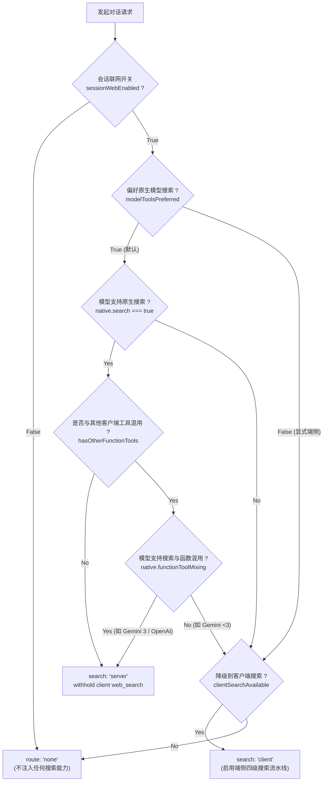
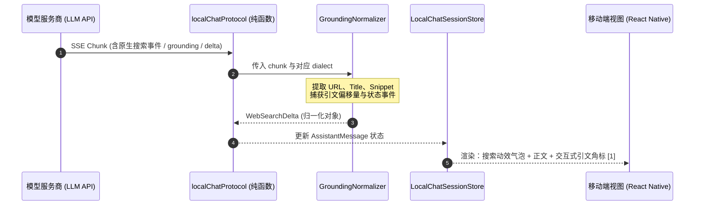
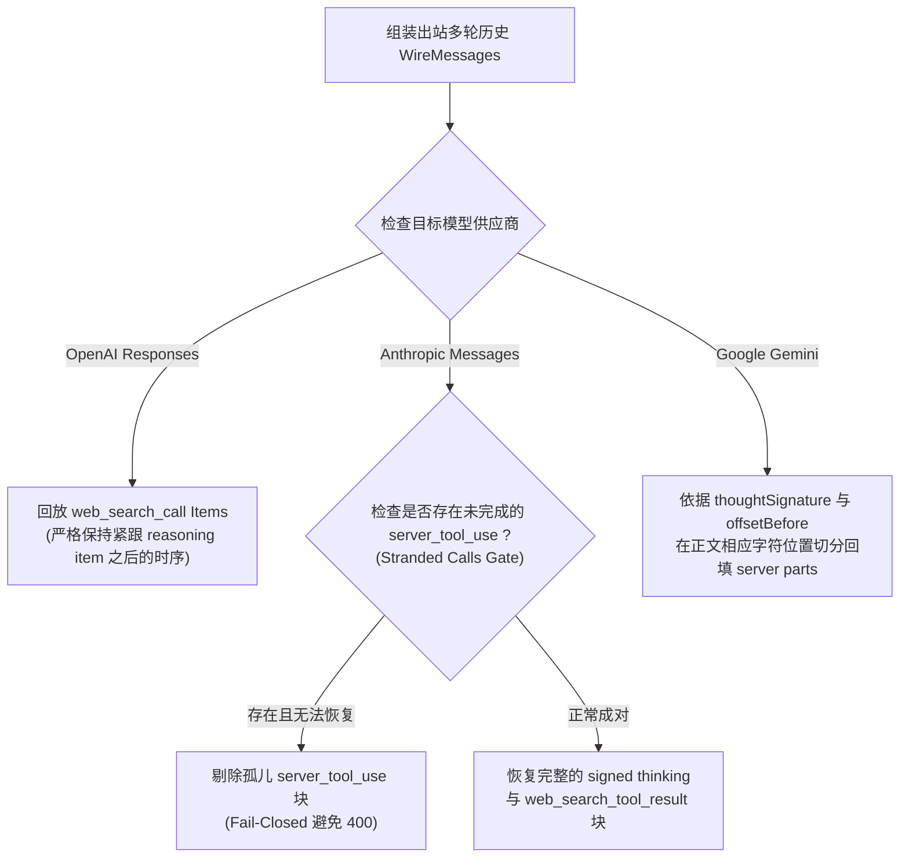

# 01-分维-双轨仲裁与模型原生搜索方言对接方案

> **工作区**：`docs/mobile-web-search-and-sandbox/`  
> **文档定位**：分维 01 架构设计详案（纯逻辑规划，无退避，行号级证据充分）  
> **核心目标**：为移动端 `apps/crish-mobile` 建立高可用、跨厂商、全方言的模型原生联网搜索（Provider-Native Web Search）接入能力，并与端侧四级搜索流水线实现无缝双轨路由仲裁。

---

## 一、架构背景与战略目标

### 1.1 移动端 AI 助手联网能力的演进需求
在现代移动端智能助理生态中，联网能力是决定回答时效性与准确性的生命线。然而，移动端面临着独特的网络与功耗限制：
- **手机直连供应商的异构协议**：不同大模型厂商（OpenAI、Anthropic、Google Gemini、xAI Grok、阿里百炼 Qwen、智谱清言 Zhipu 等）在提供联网检索能力时，协议碎片化严重。一部分通过特定 Tools 结构声明（如 OpenAI `web_search`、Anthropic `web_search_20250305`），一部分通过顶层控制字段注入（如 DashScope `enable_search`、Gemini `tools.googleSearch`），其流式响应事件格式各异。
- **服务端原生搜索 vs 客户端端侧搜索的权衡**：
  - **服务端原生搜索（Provider-Native Web Search）**：由模型供应商直接在服务端执行检索、重排与上下文注入，**时延极低、Token 计费优化、无客户端爬虫封禁风险**；
  - **客户端端侧搜索（Client External Search）**：依赖客户端内置的四级流水线（Exa、Jina、SearXNG、端侧 Local Extraction），适合无原生搜索能力或受限专有模型。
- **用户核心裁决**：
  1. **原生搜索必须对接，且优先使用**（`model_tools_preferred` 默认开启）；
  2. 当模型不支持原生搜索或用户显式关闭时，**无缝降级到客户端纯端侧搜索流水线**，杜绝硬编码与降级死锁。

### 1.2 核心设计原则（反退避与架构净收敛）
严格遵循 `.agents/LOGIC_PLAN_NO_RETREAT.md` 与根目录 `AGENTS.md`：
1. **效果锁（No Retreat）**：覆盖全部 11 种业界主流原生方言，不因实现复杂度而砍掉任何厂商；不设 P0/P1 等级阉割。
2. **纯逻辑设计**：只关注逻辑依赖、状态转移、Wire 契约、类型安全与验证断言；不涉人工排期。
3. **单点真理与物理屏蔽（SSOT & Withholding）**：当仲裁选定原生搜索时，必须从发送给模型的客户端 Function 列表中**物理剔除客户端 `web_search`**，防止模型在系统提示词与外部工具调用之间产生困惑与死循环。
4. **签名与只读保护（Immutable Signed Text）**：大模型流式输出的带签名正文保持字节级不可变，引文（Citations）与来源事实（Grounding Metadata）作为独立元数据附着，展示层通过无损投影渲染。

---

## 二、现状诊断与差距分析（代码行号级证据）

通过对 `apps/crish-mobile` 当前实现与桌面端 `crates/agent-provider` 源码的深入审计，诊断出以下系统性断层：

### 2.1 协议定义与类型系统断层
- **行号证据**：[`apps/crish-mobile/src/domain/types/localChat.ts:14-16`](file:///c:/Software/conex/apps/crish-mobile/src/domain/types/localChat.ts#L14-L16)
  ```typescript
  /** 线网协议标识（桌面 ProtocolKind 的线网字符串；本期仅 openai/chat 落地） */
  export type LocalProtocolKind = 'openai/chat';
  ```
  **诊断**：当前移动端协议种类被硬编码为纯 `openai/chat` 轨，不支持 Responses API、Anthropic Messages API 原生请求体、Gemini generateContent 原生结构。
- **行号证据**：[`apps/crish-mobile/src/domain/types/localChat.ts:109-131`](file:///c:/Software/conex/apps/crish-mobile/src/domain/types/localChat.ts#L109-L131)
  ```typescript
  export interface LocalModelSpec { ... }
  export interface LocalCompatSpec { ... }
  ```
  **诊断**：`LocalModelSpec` 和 `LocalCompatSpec` 中完全缺失**原生搜索能力声明**（如 `supportsNativeWebSearch`、`nativeWebSearchDialect`、`allowFunctionMixingWithSearch` 等），导致运行时无法感知模型是否具备原生联网能力。

### 2.2 请求构建硬编码无工具契约
- **行号证据**：[`apps/crish-mobile/src/domain/pure/localChatProtocol.ts:29-31`](file:///c:/Software/conex/apps/crish-mobile/src/domain/pure/localChatProtocol.ts#L29-L31)
  ```typescript
  export const LOCAL_CHAT_SYSTEM_PROMPT =
    '你是 Crish 手机本地助手。只能进行文字对话：你没有可调用的工具，也无法访问用户的电脑、文件或网络服务...';
  ```
  **诊断**：系统提示词直接宣称“没有可调用的工具，也无法访问网络服务”，若开启联网，该硬编码提示词会与原生搜索产生剧烈的语义冲突。
- **行号证据**：[`apps/crish-mobile/src/domain/pure/localChatProtocol.ts:145-150`](file:///c:/Software/conex/apps/crish-mobile/src/domain/pure/localChatProtocol.ts#L145-L150)
  ```typescript
  // 本地对话永不写 tools/tool_choice（请求侧不给工具执行面）。
  export function buildChatRequestBody(input: { ... }): Record<string, unknown> { ... }
  ```
  **诊断**：`buildChatRequestBody` 明确排除了 `tools` 与 `tool_choice`，没有任何第三方/供应商特化字段（如 `web_search_options`、`enable_search` 等）的注入插槽。

### 2.3 流式解析与搜索事件被吞噬
- **行号证据**：[`apps/crish-mobile/src/domain/pure/localChatProtocol.ts:838-903`](file:///c:/Software/conex/apps/crish-mobile/src/domain/pure/localChatProtocol.ts#L838-L903)
  ```typescript
  export function applyChatChunk(data: string): ChatChunkDelta | null {
    // 仅提取 contentDelta, reasoningDelta, toolCallNames (仅计数不执行), finishReason
  }
  ```
  **诊断**：`applyChatChunk` 仅解析 OpenAI 标准 delta content，对于各大厂商流式推送的 `search_info`、`groundingMetadata`、`citations`、`web_search_call` 等原生搜索进度与引文数据**完全丢弃**。
- **行号证据**：[`apps/crish-mobile/src/adapters/localChat/localChatClient.ts:404-417`](file:///c:/Software/conex/apps/crish-mobile/src/adapters/localChat/localChatClient.ts#L404-L417)
  ```typescript
  export interface StreamChatCallbacks {
    onTextDelta: (delta: string) => void;
    onActivity?: () => void;
    onComplete: (result: { ... }) => void;
    onError: (error: LocalChatError) => void;
  }
  ```
  **诊断**：流式回调完全没有搜索中（Searching）、搜索命中（SourcesArrived）、引用定位（CitationsEmitted）的状态回调，UI 无法渲染出“正在检索网页”、“查阅了 5 篇资料”等状态指示。

### 2.4 历史消息与引用事实持久化缺失
- **行号证据**：[`apps/crish-mobile/src/domain/types/localChat.ts:184-203`](file:///c:/Software/conex/apps/crish-mobile/src/domain/types/localChat.ts#L184-L203)
  ```typescript
  export interface LocalChatMessage {
    id: string;
    role: 'system' | 'user' | 'assistant';
    content: string;
    attachments?: ComposerAttachment[];
    streaming?: boolean;
    stopped?: boolean;
    toolCallCount?: number;
  }
  ```
  **诊断**：消息实体没有引文字段 `citations`、检索来源列表 `sources`、以及用于多轮回放的 `diagnostics` / `replayParts`。在多轮对话中，模型无法重放上一轮搜索得出的事实，甚至在 Gemini 3 和 Anthropic 中会因为丢弃了 server tool invocation signature 而直接报 HTTP 400 错误。

---

## 三、双轨路由仲裁器设计（Dual-Track Arbiter）

双轨路由仲裁器（Dual-Track Arbiter）是整个联网架构的调度中枢，负责在每次请求前根据**模型原生能力**、**用户偏好**、**会话开关**和**外部工具健康度**，严谨推导出最终的路由策略。



### 3.1 仲裁输入条件全量矩阵

| 输入维度 | 类型 | 来源与默认值 | 判定约束 |
| :--- | :--- | :--- | :--- |
| `sessionWebEnabled` | `boolean` | 会话级输入框联网图标（Composer 状态，默认 `false`） | 若为 `false`，无论模型与配置如何，直接阻断所有联网行为（`search: 'none', fetch: 'none'`）。 |
| `modelToolsPreferred` | `boolean` | 全局首选项 `chat.web_search.model_tools_preferred`（默认 `true`） | 决定当原生和客户端都可用时的仲裁优先级：`true` 时原生优先；`false` 时客户端优先。 |
| `nativeCapabilities` | `LocalNativeWebCapability` | 模型规格 `LocalModelSpec.nativeWeb` 或厂商预置 | 声明该模型/端点的原生搜索方言、是否支持 search、是否支持 fetch、是否支持函数混用。 |
| `clientWebTools` | `ClientWebToolAvailability` | 客户端端侧服务探测结果（基于 Exa、Jina、Local 等） | `searchAvailable: boolean` 与 `fetchAvailable: boolean`，受审批状态（approval）与 API 凭据影响。 |
| `otherClientTools` | `readonly RuntimeTool[]` | 当前 Agent 或会话装载的其他非 Web 函数工具 | 用于与 `nativeCapabilities.functionToolMixing` 进行冲突计算。 |

### 3.2 仲裁核心状态转移与输出契约

仲裁器输出定义如下：
```typescript
export type WebToolRoute = 'server' | 'client' | 'none';

export interface WebToolRoutes {
  /** 网页搜索（关键词检索）路由 */
  search: WebToolRoute;
  /** 网页抓取（长正文深度读取）路由 */
  fetch: WebToolRoute;
  /** 最终选定的原生方言（若 search 或 fetch 走 server 则必须存在） */
  dialect?: PiWebDialect;
  /** 是否需要物理屏蔽客户端的 web_search 函数 */
  withholdClientSearch: boolean;
  /** 是否需要物理屏蔽客户端的 web_fetch 函数 */
  withholdClientFetch: boolean;
}
```

#### 状态裁决算法（纯逻辑无退避）
1. **前置门禁**：若 `sessionWebEnabled === false`，直接返回 `{ search: 'none', fetch: 'none', withholdClientSearch: true, withholdClientFetch: true }`。
2. **能力可用性判定**：
   - `serverAvailable.search = native.supportsSearch && (externalApproval !== 'deny')`
   - `serverAvailable.fetch = native.supportsFetch && (externalApproval !== 'deny')`
   - `clientAvailable.search = clientWebTools.searchAvailable && (externalApproval !== 'deny')`
   - `clientAvailable.fetch = clientWebTools.fetchAvailable && (externalApproval !== 'deny')`
3. **函数混用冲突检测（Mixing Conflict Gate）**：
   - 若存在其他外部函数工具（`otherClientTools.length > 0`）且 `native.functionToolMixing === false`：
     - **硬性安全阻断**：`serverAvailable.search = false; serverAvailable.fetch = false;`
     - **根因说明**：Gemini 1.5/2.0 及部分国产模型若在 `tools` 中同时传入 `googleSearch` 和 `functionDeclarations`，服务端将直接报 HTTP 400 校验错误；必须主动降级至客户端执行。
4. **单轨能力挑选（Single-Track Capability Selection）**：
   ```typescript
   const selectRoute = (cap: 'search' | 'fetch'): WebToolRoute => {
     if (modelToolsPreferred) {
       if (serverAvailable[cap]) return 'server';
       if (clientAvailable[cap]) return 'client';
       return 'none';
     } else {
       if (clientAvailable[cap]) return 'client';
       if (serverAvailable[cap]) return 'server';
       return 'none';
     }
   };
   ```
5. **异构能力协同修正（Cooperative Correction）**：
   - **Qwen-Anthropic 依附规则**：Qwen 的 Anthropic 兼容端点规定，原生 `web_fetch` 强依赖同请求中的 `web_search`。若 `fetch === 'server'` 但 `search !== 'server'`，强制将 `fetch` 降级为 `clientAvailable.fetch ? 'client' : 'none'`。
   - **混用不支持下的非对称裁决**：若 `native.functionToolMixing === false` 且出现不对称路线（如 `search === 'server'` 但 `fetch === 'client'`），计算两者覆盖度：
     - `serverCoverage = Number(serverAvailable.search) + Number(serverAvailable.fetch)`
     - `clientCoverage = Number(clientAvailable.search) + Number(clientAvailable.fetch)`
     - 择覆盖度高者为单轨（或覆盖度相同时依 `modelToolsPreferred` 判定），杜绝在不支持混用的模型上同时出现 `server` 与 `client` 工具。
6. **客户端工具屏蔽判定（Withholding Assertion）**：
   - `withholdClientSearch = (search === 'server' || search === 'none')`
   - `withholdClientFetch = (fetch === 'server' || fetch === 'none')`

### 3.3 客户端工具物理屏蔽（Withholding）与防提示词冲突机制
当 `search === 'server'` 时，如果将客户端 `web_search` 工具的 schema 依然下发到模型的 `tools` 中，将造成致命缺陷：
- **模型认知混乱**：模型不知道该触发内置的原生搜索引擎，还是生成一个 client tool call JSON；
- **双重搜索浪费**：模型可能先调用客户端 `web_search`，随后其内置引擎又执行了一次检索，造成双倍延迟与 Token 消耗。

**屏蔽实现标准**：
在 `selectClientTools(tools: readonly RuntimeTool[], routes: WebToolRoutes): RuntimeTool[]` 中，凡是 `routes.search === 'server'`，必须将名称为 `web_search` 的工具彻底过滤出请求体工具数组；同理，`routes.fetch === 'server'` 时过滤 `web_fetch`。同时，动态改写系统提示词，移除“你不能访问网络”等陈旧指令，替换为模型友好的联网指令。

---

## 四、全量模型原生搜索方言（Dialects）请求注入契约

针对业界现存的 11 种原生搜索方言，建立完全类型安全的纯函数注入契约。

```typescript
export type PiWebDialect =
  | 'openai-responses'   // OpenAI Responses API ({ type: 'web_search' })
  | 'openai-preview'     // Azure OpenAI / Poe ({ type: 'web_search_preview' })
  | 'openai-chat-search' // 标准 Chat Completions 的 web_search_options
  | 'xai'                // xAI Grok (web_search + x_search)
  | 'anthropic'          // Claude Messages (web_search_20250305, web_fetch_20250910)
  | 'qwen-anthropic'     // Qwen Anthropic Messages (带专属计费标识)
  | 'google'             // Gemini generateContent (googleSearch, urlContext)
  | 'zhipu'              // 智谱清言 (web_search pro)
  | 'dashscope'          // 阿里百炼 (enable_search, agent 策略)
  | 'qwencloud'          // Qwen 国际站 / 兼容端点
  | 'openrouter'         // OpenRouter (openrouter:web_search)
  | 'perplexity';        // Perplexity Sonar (内置搜索，请求体透传)
```

### 4.1 方言体系总览与协议映射表

| 方言标识 | 适用厂商与端点 | 注入目标层级 | 搜索能力载荷（Payload） | 网页抓取载荷（Fetch） | 特殊 Headers / 补充字段 |
| :--- | :--- | :--- | :--- | :--- | :--- |
| `openai-responses` | OpenAI, 豆包, Qwen3 (Responses) | `tools` 数组 | `{"type": "web_search"}` | 降级走客户端 | 无 |
| `openai-preview` | Azure OpenAI, Poe (Responses) | `tools` 数组 | `{"type": "web_search_preview"}` | 降级走客户端 | 无 |
| `openai-chat-search`| OpenAI / 兼容厂商 Chat 轨 | 顶层字段 | `{"web_search_options": {"search_context_size": "medium"}}` | 降级走客户端 | 无 |
| `xai` | xAI Grok (grok-2, grok-3) | `tools` 数组 | `{"type": "web_search", "enable_image_understanding": true}`<br/>`{"type": "x_search", "enable_image_understanding": true}` | 降级走客户端 | 图像理解多模态支持 |
| `anthropic` | Claude (claude-3-5, claude-3-7) | `tools` 数组 + 顶层 `betas` | `{"type": "web_search_20250305", "name": "web_search", "max_uses": 5}` | `{"type": "web_fetch_20250910", "name": "web_fetch", "max_uses": 5, "max_content_tokens": 4000}` | `anthropic-beta: web-fetch-2025-09-10` |
| `qwen-anthropic` | 阿里百炼兼容 Claude 协议端点 | `tools` + `system` | 同 Anthropic | 同 Anthropic（强依赖 search） | 系统前缀 `x-anthropic-billing-header: cc_entrypoint=cli;` |
| `google` | Google Gemini 1.5, 2.0, 3.0 | `config.tools` 数组 | `{"googleSearch": {}}` | `{"urlContext": {}}` | Gemini 3 混用需注入 `includeServerSideToolInvocations: true` |
| `zhipu` | 智谱 GLM-4, GLM-4V | `tools` 数组 | `{"type": "web_search", "web_search": {"enable": true, "search_engine": "search_pro", "search_result": true}}` | 降级走客户端 | `search_pro` 引擎增强 |
| `dashscope` | 阿里百炼 (qwen-max, qwen-plus) | 顶层字段 | `{"enable_search": true, "search_options": {"enable_source": true, "search_strategy": "agent"}}` | 降级走客户端 | Max/Omni SKU 注入 `search_strategy: "agent"` |
| `qwencloud` | Qwen 国际站 API | 顶层字段 | `{"enable_search": true, "search_options": {"search_strategy": "agent"}}` | 降级走客户端 | 针对 qwen3 自动启用智能检索策略 |
| `openrouter` | OpenRouter 网关全模型 | `tools` 数组 | `{"type": "openrouter:web_search"}` | 降级走客户端 | 针对支持的开源模型生效 |
| `perplexity` | Perplexity Sonar 系列 | 请求体透传 | 原生内置 | 降级走客户端 | 纯内置，无需额外请求体注入 |

---

### 4.2 各方言详细请求注入规约与 TypeScript 契约

#### (1) OpenAI Responses API (`openai-responses` / `openai-preview`)
```typescript
export interface OpenAiResponsesToolInjection {
  type: 'web_search' | 'web_search_preview';
}
```
- **规则**：直接向请求体根对象的 `tools` 数组中追加。禁止向不支持的旧版模型或启用了 minimal reasoning 模式的请求注入。

#### (2) Anthropic Messages API (`anthropic` & `qwen-anthropic`)
```typescript
export interface AnthropicWebSearchTool {
  type: 'web_search_20250305';
  name: 'web_search';
  max_uses: number; // 默认锁定 5 次
}

export interface AnthropicWebFetchTool {
  type: 'web_fetch_20250910';
  name: 'web_fetch';
  max_uses: number; // 默认锁定 5 次
  max_content_tokens: number; // 默认锁定 4000
}
```
- **Headers 注入**：当 `routes.fetch === 'server'` 时，HTTP 请求头必须注入：
  ```http
  anthropic-beta: web-fetch-2025-09-10
  ```
- **Qwen 专属计费标识**：针对 `qwen-anthropic` 方言，必须在 `system` 提示词首部注入标识文本：
  ```text
  x-anthropic-billing-header: cc_entrypoint=cli;
  ```
  该操作由纯函数完成，严禁破坏既有的系统提示词内容与 Prompt Caching 控制块。

#### (3) Google Gemini generateContent 方言 (`google`)
Gemini 的 API 结构位于顶层 `config` 或直接在根对象：
```typescript
export interface GeminiToolsConfig {
  tools?: Array<{
    googleSearch?: Record<string, never>;
    urlContext?: Record<string, never>;
    functionDeclarations?: unknown[];
  }>;
  toolConfig?: {
    functionCallingConfig?: { mode: 'AUTO' | 'ANY' | 'NONE' | 'VALIDATED' };
    includeServerSideToolInvocations?: boolean;
  };
}
```
- **Gemini 3 混用机制**：当存在外部自定义函数调用（`functionDeclarations.length > 0`）且同时启用了原生搜索时，必须显式声明：
  ```json
  "toolConfig": {
    "functionCallingConfig": { "mode": "VALIDATED" },
    "includeServerSideToolInvocations": true
  }
  ```
  这保证 Gemini 3 服务端会将执行的 server-side tool 调用返回给客户端，供多轮对话历史回放（Replay）携带签名送回。

#### (4) 阿里百炼 DashScope / QwenCloud 方言 (`dashscope` / `qwencloud`)
```typescript
export interface DashScopeSearchOptions {
  enable_search: true;
  search_options: {
    enable_source?: boolean;
    search_strategy?: 'standard' | 'agent';
  };
}
```
- **智能策略适配**：通过正则匹配 SKU 名称（如 `/qwen3-max|omni|qwen3-vl/i`），针对新一代大模型自动启用 `search_strategy: 'agent'`，激发出深度多轮检索与自我修正能力。

---

## 五、流式响应解析与引用归一化（Stream Grounding & Citation Normalization）

在流式输出中，不同厂商以迥异的数据结构推送搜索事件、检索来源与引文片段。必须在 `domain/pure` 层建立高鲁棒性的归一化解析器。



### 5.1 归一化领域数据模型（Domain Types）

```typescript
/** 归一化的外部检索网页来源（Source Fact） */
export interface CitationSource {
  /** 唯一标识符，形如 "src_1", "src_2" */
  sourceId: string;
  /** 网页物理 URL（必须校验 http/https 协议合法性） */
  url: string;
  /** 网页标题（若服务商未提供则使用主机名或截断 URL 兜底） */
  title: string;
  /** 搜索结果摘要片段（至多保留 300 字符） */
  snippet?: string;
  /** 来源厂商标识（如 "google", "bing", "baidu"） */
  provider?: string;
  /** 网页图标 URL（可选） */
  iconUrl?: string;
}

/** 正文内联引用定位 */
export interface TextCitationSpan {
  /** 对应的来源 ID 清单（一个位置可引用多个源） */
  sourceIds: string[];
  /** 在正文字符串中的起始字符偏移量 */
  startOffset: number;
  /** 在正文字符串中的结束字符偏移量 */
  endOffset: number;
  /** 标注在文本中的原始数字（如 1 代表 [1]） */
  labelIndex?: number;
}

/** 搜索生命周期诊断状态（用于 UI 动效展示） */
export type WebSearchStage =
  | 'idle'
  | 'query_formed'   // 生成搜索查询词
  | 'searching'      // 正在检索
  | 'reading_page'   // 正在抓取特定网页
  | 'grounded'       // 检索完毕，开始生成正文
  | 'failed';        // 检索异常（但继续作答）

export interface WebSearchDiagnostics {
  version: 1;
  id: string;
  dialect: PiWebDialect;
  stage: WebSearchStage;
  query?: string;
  targetUrls?: string[];
  sources: CitationSource[];
  citations: TextCitationSpan[];
  failed: boolean;
  errorMessage?: string;
}
```

### 5.2 各主流厂商流式事件提取规则

#### 1. OpenAI Responses API
- **搜索状态捕获**：
  - `event.type === 'response.web_search_call.in_progress'` $\rightarrow$ 标记 `stage = 'searching'`，提取 `item.query`；
  - `event.type === 'response.web_search_call.done'` $\rightarrow$ 提取 `item.sources`。
- **URL Annotations 捕获**：
  - 监听 `response.output_text.annotation.added`，提取 `annotation.url`，将其映射为 `CitationSource`，并在当前正文末尾挂载引用偏移量。

#### 2. Anthropic Messages API
- **工具调用块捕获**：
  - `content_block_start` 中的 `item.type === 'web_search_tool_result'`：解析 `content` 数组，每个对象包含 `url`、`title`；
  - `item.type === 'web_fetch_tool_result'`：解析 `url` 及页面摘要，若返回 `error_code !== 'max_uses_exceeded'` 则记录轻量告警，但不中断主回答。
- **引用增量捕获**：
  - 监听 `content_block_delta` 中的 `delta.type === 'citations_delta'`：
    - `citation.type === 'char_location'` / `'page_location'`：通过 `document_index` 映射回抓取文档来源；
    - `citation.type === 'url_citation'`：直接获取 `citation.url` 并建立映射。

#### 3. Google Gemini generateContent
- **Grounding Metadata 捕获**：
  - 检查 `candidates[0].groundingMetadata`：
    - `groundingChunks`：包含 `web.uri` 和 `web.title`，顺序编号转为 `CitationSource[]`；
    - `groundingSupports`：包含 `segment: { startIndex, endIndex, text }` 和 `groundingChunkIndices: number[]`，通过偏移量直接对齐正文文本段。
- **搜索建议隔离**：
  - `searchEntryPoint.renderedContent`：Google 官方提供的带版权与样式的搜索词提示胶囊，必须作为纯静态隔离 HTML 存储在 `suggestions` 字段中，**绝对不得作为上下文回传给模型**。

#### 4. 阿里百炼 DashScope & 智谱 Zhipu
- **DashScope**：在首个或流式终止帧中读取 `search_info.search_results`，提取 `url`、`title`。
- **Zhipu**：在 chunk 中读取 `web_search` 数组，提取 `link`（转换为 `url`）、`title`。

---

### 5.3 多轮对话历史回放（Replay）与残存孤儿调用净化

在大模型多轮对话协议中，**如果下一轮请求发送了不合法的上一轮工具调用历史，API 将直接硬报错（HTTP 400）**。这是最容易被忽视的架构深水区。



#### 1. OpenAI 历史回放：Reasoning 与 Search Item 成对性保持
OpenAI 规定，历史记录中的 `reasoning` item 必须与紧随其后的输出 item 严格对齐。若上一轮执行了 `web_search_call`，但在客户端历史中仅保存了最终生成的 Assistant 纯文本，会导致 OpenAI 网关判定思考上下文丢失。
- **解法**：在 `LocalChatMessage` 的诊断包中，存储 `openaiItems: Array<{ after: string; item: Record<string, unknown> }>`。在构建下一轮出站 payload 时，通过纯函数将其准确插回到对应 ID 的消息项之后。

#### 2. Anthropic 历史回放：残存孤儿调用净化（Stranded Calls Purification）
若上一轮模型发起了 `server_tool_use`（如请求抓取网页），但此时网络被用户手动中断（Abort），或者本轮用户关闭了联网开关，该工具调用未收到对应的 `web_search_tool_result`：
- **致命后果**：Anthropic API 收到孤立的 `server_tool_use` 且没有任何后续结果块，直接返回 HTTP 400 `invalid_request_error`；
- **净化断言**：在组装出站消息前，执行 `withoutStrandedAnthropicCalls` 纯函数。对于任何未获得 `web_search_tool_result` 且当前请求不再提供对应工具的 `server_tool_use` 块，**物理剔除**，回退为纯文字历史，保障会话绝不中断。

#### 3. Gemini 历史回放：带签名分块精确重构
Gemini 3 要求所有 server-side tool parts 必须带有其原始下发的 `thoughtSignature`，并严格位于生成正文的相应字符边界之间。
- **解法**：解析端记录 `googleParts: Array<{ before: number; part: Record<string, unknown>; offsetBefore?: number; signatureBefore?: string }>`。回放时，按逆序精确在字符串指定 `offsetBefore` 处切割，重新组装为符合规范的 `contents.parts` 结构。

---

## 六、文件域改造清单与模块重构蓝图

遵循架构解耦与防过度设计原则，移动端方案将相关纯函数高度收敛，严禁在 UI 视图组件中书写任何协议拼装逻辑。

```
apps/crish-mobile/src/
├── domain/
│   ├── types/
│   │   ├── localChat.ts                     # [改造] 扩充原生搜索与引文领域类型
│   │   └── webSearchTypes.ts                # [新增] 原生方言与搜索诊断专用类型
│   └── pure/
│       ├── localChatProtocol.ts             # [改造] 集成双轨路由与请求体补丁注入
│       └── webSearch/                       # [新增纯函数目录] (完全无状态，Jest 100% 直测)
│           ├── webToolArbiter.ts            # 双轨路由仲裁器核心逻辑
│           ├── webToolDialects.ts           # 11 种原生搜索方言请求体与 Headers 组装器
│           ├── webGroundingParser.ts        # 各厂商流式 chunk 搜索事件与引文解析提纯
│           └── webHistoryReplay.ts          # 多轮对话带签名搜索历史还原与净化
└── adapters/
    └── localChat/
        ├── localChatClient.ts               # [改造] 暴露搜索流式生命周期回调
        ├── localChatEngine.ts               # [改造] 调度双轨仲裁器与元数据持久化
        └── providerPresets.ts               # [改造] 预置主流厂商的原生搜索能力标记
```

### 6.1 存量文件精确改造清单

| 文件路径 | 改造范围与具体职责 |
| :--- | :--- |
| `apps/crish-mobile/src/domain/types/localChat.ts` | 1. 扩充 `LocalModelSpec`：增加 `nativeWeb?: LocalNativeWebCapability`；<br/>2. 扩充 `LocalChatMessage`：增加 `sources?: CitationSource[]`、`citations?: TextCitationSpan[]`、`webDiagnostics?: WebSearchDiagnostics`。 |
| `apps/crish-mobile/src/domain/pure/localChatProtocol.ts` | 1. 废除硬编码的无工具/无网络系统提示词，改为根据路由动态注入；<br/>2. `buildChatRequestBody` 接入 `routes` 仲裁产物，支持注入各种方言的 search 参数与 headers；<br/>3. `applyChatChunk` 接入 `WebGroundingParser`，产出包含引文和搜索进度的复合增量。 |
| `apps/crish-mobile/src/adapters/localChat/localChatClient.ts` | 1. `StreamChatCallbacks` 增加 `onSearchActivity?: (activity: WebSearchActivity) => void` 与 `onCitations?: (citations: CitationSource[]) => void`；<br/>2. 保持底层 XHR 增量传输与 SseFrameBuffer 稳定，只在数据派发层透传增量解析结果。 |
| `apps/crish-mobile/src/adapters/localChat/localChatEngine.ts` | 1. 在 `sendLocalChatMessage` 发送前，提取会话开关与模型能力，调用 `resolveWebToolRoutes` 进行仲裁；<br/>2. 将仲裁结果下发给 client；收到完成态时将 `sources` 与 `citations` 完整落盘至 SQLite。 |
| `apps/crish-mobile/src/adapters/localChat/providerPresets.ts` | 为预置模型（如 OpenAI `gpt-4o`、Anthropic `claude-3-7-sonnet`、Gemini `gemini-2.0-flash`、DeepSeek、Qwen 等）标注准确的 `dialect`、`supportsSearch`、`functionToolMixing` 等能力元数据。 |

---

## 七、立体化验收断言与单元测试矩阵（Test Suites）

根据 AGENTS.md §7.1「立体验证纪律」，所有纯逻辑与状态机必须通过立体化测试矩阵穷举覆盖，测试用例全部落地于 `apps/crish-mobile/src/domain/pure/webSearch/__tests__/`。

### 7.1 双轨仲裁器测试矩阵 (`webToolArbiter.spec.ts`)
- [ ] **TC-ARB-01 (全局关闭门禁)**：当 `sessionWebEnabled = false` 时，无论模型配置如何，输出恒为 `search: 'none', fetch: 'none', withholdClientSearch: true`。
- [ ] **TC-ARB-02 (原生优先默认)**：模型支持原生搜索，`modelToolsPreferred = true`，客户端搜索可用 $\rightarrow$ 仲裁输出 `search: 'server'`, 客户端 `web_search` 必须被物理 withhold。
- [ ] **TC-ARB-03 (显式端侧优先)**：用户配置 `modelToolsPreferred = false`，客户端搜索可用 $\rightarrow$ 仲裁输出 `search: 'client'`, 原生搜索不注入。
- [ ] **TC-ARB-04 (原生不支持无缝降级)**：模型为纯文本模型（`supportsSearch = false`），客户端搜索可用 $\rightarrow$ 自动无缝降级为 `search: 'client'`, 绝不报错阻断。
- [ ] **TC-ARB-05 (双不可用安全退化)**：模型不支持原生且客户端搜索不可用（未配置 API Key）$\rightarrow$ 降级为 `search: 'none'`, 正文生成正常进行。
- [ ] **TC-ARB-06 (混用不支持下的函数隔离)**：模型具备原生搜索但 `functionToolMixing = false`（如旧版 Gemini），且当前上下文存在普通 MCP 工具 $\rightarrow$ 原生搜索强制关闭，自动降级为客户端端侧搜索或安全阻断，避免服务端 400 校验错误。
- [ ] **TC-ARB-07 (Qwen-Anthropic 依附规则验证)**：原生仅请求 fetch 但未激活 search $\rightarrow$ 自动校正 fetch 为 client 或 none。

### 7.2 11 种原生搜索方言请求注入测试 (`webToolDialects.spec.ts`)
- [ ] **TC-DIA-01 (OpenAI Responses)**：验证生成的 payload 携带 `tools: [{ type: 'web_search' }]`。
- [ ] **TC-DIA-02 (Azure/Poe Preview)**：验证生成的 payload 携带 `tools: [{ type: 'web_search_preview' }]`。
- [ ] **TC-DIA-03 (Anthropic Messages)**：验证注入 `web_search_20250305` 与 `web_fetch_20250910`（max_uses=5, max_tokens=4000），且输出 Headers 包含 `anthropic-beta: web-fetch-2025-09-10`。
- [ ] **TC-DIA-04 (Qwen Anthropic 计费头注入)**：验证 `system` 首部无损合并 `x-anthropic-billing-header: cc_entrypoint=cli;`，既有缓存断点不漂移。
- [ ] **TC-DIA-05 (Gemini generateContent)**：验证注入 `tools: [{ googleSearch: {} }]`；当存在混用函数时，断言注入 `includeServerSideToolInvocations: true`。
- [ ] **TC-DIA-06 (xAI Grok)**：验证同时注入 `web_search` 和 `x_search`，且 `enable_image_understanding: true`。
- [ ] **TC-DIA-07 (智谱 Zhipu)**：验证注入 `tools: [{ type: 'web_search', web_search: { enable: true, search_engine: 'search_pro' } }]`。
- [ ] **TC-DIA-08 (阿里百炼 DashScope)**：验证顶层注入 `enable_search: true`，且对 `qwen3-max` 自动附加 `search_strategy: 'agent'`。
- [ ] **TC-DIA-09 (OpenRouter)**：验证注入 `tools: [{ type: 'openrouter:web_search' }]`。
- [ ] **TC-DIA-10 (Perplexity Sonar)**：验证载荷纯透传，不添加冗余非法工具键。

### 7.3 流式解析与引文提取测试 (`webGroundingParser.spec.ts`)
- [ ] **TC-GRD-01 (OpenAI Annotations 提取)**：输入带有 `response.output_text.annotation.added` 的 SSE 帧，断言准确提纯出 URL、标题并映射为 `CitationSource`。
- [ ] **TC-GRD-02 (Anthropic Citations Delta 提取)**：输入分块引文数据，断言能够按 `document_index` 准确归一化，且正文字符串签名不受污染。
- [ ] **TC-GRD-03 (Gemini Grounding Metadata 提取)**：输入复杂的 `groundingChunks` 与 `groundingSupports`，验证跨段落的字符偏移量重映射绝对精确。
- [ ] **TC-GRD-04 (非标准厂商容错)**：输入畸变或缺失 title 的检索结果，验证能够优雅退化（以域名或截断 URL 兜底），零抛错崩溃。

### 7.4 多轮历史回放与净化测试 (`webHistoryReplay.spec.ts`)
- [ ] **TC-RPL-01 (Anthropic 孤儿调用净化)**：构造上一轮未完成的 `server_tool_use`，断言经过 `withoutStrandedAnthropicCalls` 处理后该孤立节点被彻底移除，防止发送给 API 时报 400。
- [ ] **TC-RPL-02 (Gemini 签名回填)**：构造携带 `thoughtSignature` 的搜索中间件，验证回填到 `contents.parts` 后顺序与字符索引完全一致。
- [ ] **TC-RPL-03 (OpenAI 思考时序保持)**：验证回放时 `web_search_call` 项紧跟在上一轮特定 ID 的 reasoning item 之后。

---

## 八、总结与实施指引

本方案以严谨的代码行号级证据诊断了当前移动端的协议局限，完整设计了基于**双轨仲裁器（Dual-Track Arbiter）**的调度模型，落地了**全量 11 种模型原生搜索方言（Dialects）**的注入契约，并规范了**流式引用归一化与多轮签名历史净化机制**。

实施时应遵循以下铁律：
1. **纯逻辑解耦**：所有方言与仲裁逻辑全部编写为纯函数（Pure Functions），无任何宿主或 UI 依赖，以保证跨端与多平台复用；
2. **Fail-Closed 安全守门**：在不确定模型是否支持混用时，宁可降级为端侧搜索，绝不冒险向模型发送可能引发 400 错误的复合参数；
3. **零回撤与立体验证**：遵循 §7 的测试矩阵编写自动化测试，所有用例通过方可合入。
