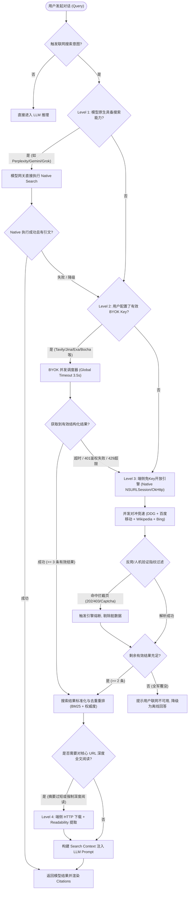
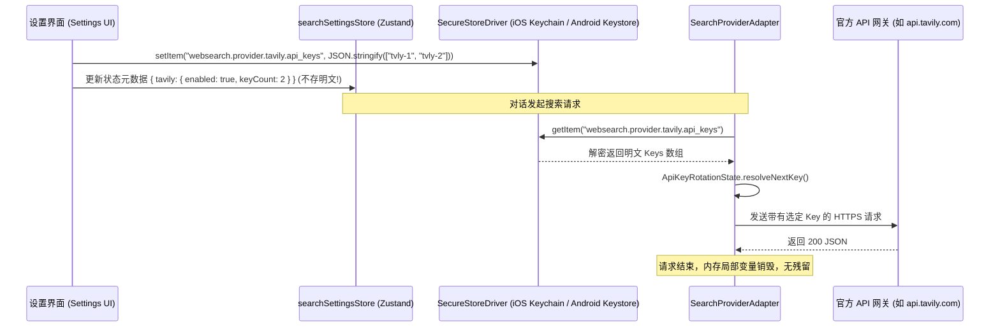
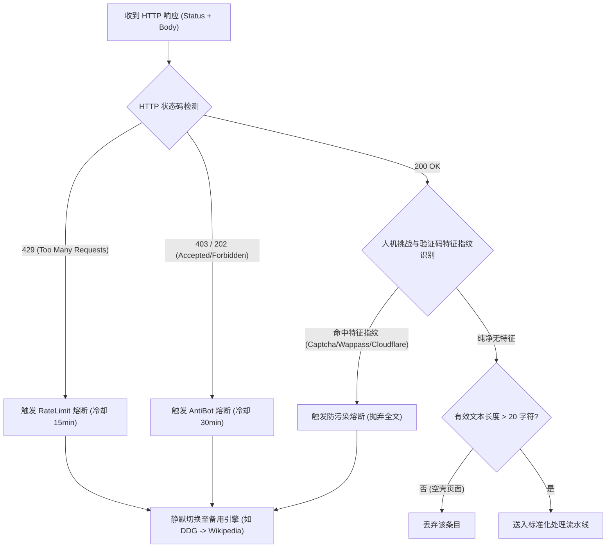
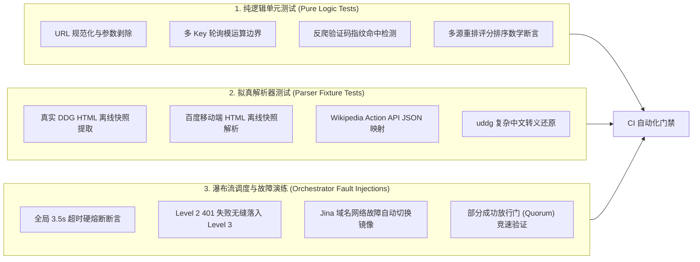

# 02-分维-客户端多源搜索引擎与免Key瀑布流架构方案

> **所属战役**：`docs/mobile-web-search-and-sandbox/`  
> **责任领域**：移动端网络与搜索引擎架构（分维 02）  
> **核心定位**：纯客户端零中转（Zero-Backend）、BYOK 商业矩阵 + 纯端侧免 Key 开放引擎四级瀑布流检索系统  
> **执行原则**：严格遵循 `.agents/LOGIC_PLAN_NO_RETREAT.md` 逻辑规划与反退避铁律，纯逻辑推演，严禁降级范围，代码行号级证据立论。

---

## 一、执行摘要与核心设计原则

移动端 AI 对话在遭遇时效性信息检索、专业知识查证或网页事实核查时，大模型经常因预训练知识截止或幻觉导致回答失效。在传统架构中，移动端搜索往往依赖自建云端中间服务进行代理聚合与解析，但这带来了三大致命缺陷：**服务器运维成本与带宽压力**、**用户搜索隐私经由第三方中间件暴露**、以及**中心化服务单点不可用风险**。

本方案基于 **纯客户端零后端（Zero-Backend）** 核心思想，充分挖掘 React Native 原生网络栈的底层特性，构建包含 **BYOK 商业直连** 与 **端侧免 Key 开放检索** 的现代化搜索引擎架构体系：

1. **移动端原生网络栈的“非浏览器”免 CORS 优势**：
   在标准桌面或移动端浏览器沙箱内，前端 JavaScript 的 `fetch` 受到同源策略（SOP）与 CORS 的刚性约束，无法直接跨域请求主流搜索引擎的网页或接口。然而在 React Native 运行时中，JS 层的 `fetch` 与 `XMLHttpRequest` 在底层直接桥接至平台的原生网络套件——**iOS 的 `NSURLSession`** 与 **Android 的 `OkHttp`**（见 `apps/crish-mobile/src/adapters/localChat/localChatClient.ts:1-10` 的网络栈考证）。该原生层不存在浏览器的 CORS 限制，支持自由设置请求头（如伪装移动端 User-Agent）、接收任意响应体，并直接读取重定向头（Redirect Location）。这使得移动端无需任何中转后端，即可直接抓取开放网页搜索引擎并解析结构化内容。
2. **四级搜索降级瀑布流（Waterfall Orchestrator）**：
   建立具备毫秒级超时控制与部分成功即放行（Partial Success Fallback）的弹性流水线：`Native Model Search`（一级：模型原生搜索） $\to$ `BYOK Commercial APIs`（二级：用户自备 Key 商业直连） $\to$ `Zero-Key Client Direct`（三级：纯端侧免 Key 开放引擎） $\to$ `Local Page Deep Extraction`（四级：端侧网页正文深度阅读）。
3. **数据隐私与密钥安全零妥协**：
   用户配置的商业搜索 API Key（Tavily、Jina、Exa、Bocha 等）统一通过系统底层硬件加密的安全存储区管理（iOS Keychain / Android Keystore，依托 `apps/crish-mobile/src/db/secureStore.ts:151-180`），绝不落盘 SQLite 明文库，仅在请求发起瞬间由内存短生命周期注入。
4. **反退避与结果防污染红线**：
   针对免 Key 引擎可能遭遇的反爬挑战（HTTP 202/403/429、验证码盾），设立即时熔断器（Circuit Breaker），**绝对禁止将包含验证码、跳转中继或人机拦截页面的 HTML 污染内容喂给大模型**；采用启发式正则识别与真实 URL 还原算法，保证送入上下文的每一条搜索引文均权威可查。

---

## 二、源码调研与历史资产硬证据

### 2.1 Cherry Studio 搜索服务层模式借鉴

参考仓库 `reference/cherry-studio-app` 实现了优秀的跨平台搜索与正文提取抽象，其关键实现提供了直接的架构启示：

1. **统一门面与调度上下文**：
   - `src/backend/services/webSearch/WebSearchService.ts:43-125` 定义了 `WebSearchService`，通过 `prepareContext` 组装能力、配置与运行时参数，通过 `executeCapability` 与 `Promise.allSettled` 并发分发搜索请求；并在 `buildFinalResponse`（`WebSearchService.ts:125-158`）中平铺成功结果并汇聚失败日志。
2. **多 Key 轮询状态机**：
   - `src/backend/services/webSearch/utils/provider.ts:70-98` 实现了 `ApiKeyRotationState`，通过 `Map<ProviderId, string>` 记录上次使用的 Key 并在多个 Key 之间按索引模运算轮询（`currentIndex + 1 % keys.length`），兼顾了高并发下的负载均衡与单 Key 频控规避。
3. **双 Host 区域容灾（Jina 最佳实践）**：
   - `src/backend/services/webSearch/providers/api/JinaProvider.ts:13-54` 提供了精妙的区域容灾逻辑：通过 `isDeviceRegionMainlandChina()` 判断当前设备地理环境，优先调度中国大陆镜像节点（`s.jinaai.cn`）或国际节点（`s.jina.ai`）；当遭遇网络层异常（`error.kind === 'network'`）时，自动无缝重试备用域名（`alternateHost`），极大提升了国内移动弱网环境下的可用性。
4. **请求传输抽象与取消级联**：
   - `src/backend/services/webSearch/transport.ts:6-45` 构造了 `mobileWebSearchTransport`，统一拦截 `AbortSignal`，对 `client.request` 进行包装，并将底层 HTTP 异常归一化为标准的 `WebSearchTransportError`。
5. **Token 预算与结果裁剪**：
   - `src/backend/services/webSearch/postProcessing.ts:9-76` 确立了搜索结果裁剪规范，设定了单页与全局 Token 限制，通过 `sliceContent` 对超长摘要进行优雅截断（`cutoffLimit`），防止 Prompt 爆仓。

### 2.2 电脑端历史搜索与密钥架构对比

1. **内置搜索引擎枚举**：
   - `apps/crish-desktop/src/api/browserSettingsLib.ts:18-39` 定义了桌面端的内置引擎基础字典：`google`、`bing`、`duckduckgo`、`baidu` 及其搜索 URL 模板。移动端免 Key 开放检索可复用该枚举，并进一步扩充专用移动端免跳转入口（如 `m.baidu.com`、`html.duckduckgo.com`、`cn.bing.com`、`zh.wikipedia.org`）。
2. **多 Profile 凭据轻量安全化**：
   - `docs/archive/campaigns/benchmark-evolution-plans/plans/04-search-cost-keyring.md:14-35` 确立了“LS 仅留元数据，密钥进系统安全区（DPAPI/Keychain）”的红线。移动端必须遵循相同标准，将搜索 API Key 统一接入 `expo-secure-store`。

### 2.3 移动端现有网络与数据底座对接点

1. **原生请求与传输模式**：
   - `apps/crish-mobile/src/adapters/localChat/localChatClient.ts:8-10` 证明了移动端无浏览器 CORS 限制，普通的 JSON/HTML 抓取走标准 `fetch` 全文模式即可稳定工作。
2. **安全存储驱动契约**：
   - `apps/crish-mobile/src/db/secureStore.ts:151-180` 声明了标准的 `SecureStoreDriver` 接口（`getItem` / `setItem` / `deleteItem`），并提供了生产级 `expoSecureStoreDriver()` 与单元测试专用的 `InMemorySecureStore`。
3. **密钥槽位命名规范**：
   - `apps/crish-mobile/src/domain/pure/localChatProtocol.ts:33-42` 制定了 `apiKeySlotFor(providerId: string)` 的槽位键生成模式。搜索模块对齐使用 `websearch.provider.${providerId}.api_keys`。

---

## 三、客户端搜索分级瀑布流编排器（Search Waterfall Orchestrator）

### 3.1 四级路由与降级状态机全景图

整个搜索流程从用户提问触发“联网搜索”意图开始，根据当前模型能力、用户配置的 BYOK 密钥以及网络连通度，严格按层级降级流转：



### 3.2 降级状态转移规格矩阵

| 初始状态（Source State） | 触发事件（Event） | 判定条件（Guard Condition） | 目标状态（Target State） | 处置动作与副效应（Actions） |
| :--- | :--- | :--- | :--- | :--- |
| **S0: IDLE** | `SEARCH_REQUEST` | 用户提问触发联网意图 | **S1: EVALUATING_TIER** | 初始化全局计时器（`globalDeadline = now + 3500ms`） |
| **S1: EVALUATING_TIER** | `CHECK_CAPABILITY` | 模型声明支持原生搜索（`native_search`） | **S2: LEVEL_1_NATIVE** | 透传 `web_search: true` 参数至模型推理通道 |
| **S1: EVALUATING_TIER** | `CHECK_CAPABILITY` | 模型不支持，但 SecureStore 存在已启用的商业 Key | **S3: LEVEL_2_BYOK** | 读取激活的 Provider 列表，准备并发/轮询调度 |
| **S1: EVALUATING_TIER** | `CHECK_CAPABILITY` | 无商业 Key，启用默认免 Key 通道 | **S4: LEVEL_3_ZEROKEY** | 初始化端侧开放引擎竞速池（Wikipedia + DDG + Baidu） |
| **S2: LEVEL_1_NATIVE** | `NATIVE_FAILED` | 网关报错或模型返回无搜索权限 | **S3: LEVEL_2_BYOK** | 记录模型原生搜索失败，无缝落入客户端搜索轨道 |
| **S3: LEVEL_2_BYOK** | `BYOK_SUCCESS` | 在预算内返回合格候选数（$\ge 3$ 条） | **S5: NORMALIZING** | 取消未决请求（Abort pending requests），进入重排 |
| **S3: LEVEL_2_BYOK** | `BYOK_TIMEOUT_OR_AUTH`| 耗时超限（$>3.0\text{s}$）或遭遇 401/402/429 | **S4: LEVEL_3_ZEROKEY** | 记录商业 Provider 故障指标，立即激活三级免 Key 降级 |
| **S4: LEVEL_3_ZEROKEY** | `PARSER_CAPTCHA` | 收到响应但检测到验证码特征 | **S4: LEVEL_3_ZEROKEY** | 熔断该开放引擎（冷却 10 分钟），从竞速流中过滤其脏数据 |
| **S4: LEVEL_3_ZEROKEY** | `QUORUM_REACHED` | 任一有效免 Key 源返回有效条目 | **S5: NORMALIZING** | 达到及格条数，立即放行，不再死等长尾延迟源 |
| **S5: NORMALIZING** | `DEEP_FETCH_NEEDED` | 用户开启“深度抓取”且结果仅有标题与短片段 | **S6: LEVEL_4_EXTRACT**| 对 Top-2 真实 URL 发起端侧 Readability 正文解析 |
| **S5: NORMALIZING** | `COMPLETE` | 摘要充足，已完成 Token 预算截断 | **S7: INJECTING_PROMPT**| 输出 `cite:prefix-index` 标注，组装上下文喂给 LLM |

### 3.3 全局耗时预算控制与并发竞速机制（Hedging & Racing）

在移动端网络环境下，单次搜索 API 的调用延迟极不稳定（波动在 400ms 至 8000ms 不等）。为了保证移动端对话流畅度，确立以下硬性预算纪律：

1. **全局硬超时预算（Global Timeout Budget）**：
   - 搜索阶段总时延上限设为 **3500ms（3.5 秒）**。超过该阈值无论当前处于第几级，立刻强行结算当前已捕获的可用结果；若毫无结果则优雅退避，绝不允许无休止挂起对话 UI。
2. **分级阶梯超时（Staggered Timeout）**：
   - **Level 2 (BYOK)**：单请求超时上限设为 **2200ms**。若超过 2200ms 未响应，触发降级保护，后台启动 Level 3 免 Key 竞速。
   - **Level 3 (Zero-Key)**：单请求超时上限设为 **1800ms**。
3. **部分成功放行门（Quorum / Partial Success Fallback）**：
   - 采用对冲并发策略（Hedging）。例如免 Key 模式下，同时向 **DuckDuckGo** 与 **百度移动版** 发起请求：
     - 若源 A 在 **800ms** 内返回了 $\ge 3$ 条高质量有效条目，则启动 **300ms 快速聚合收尾窗口**；若源 B 在窗口内到达则合并重排，若未到达则直接放行源 A，不再死等源 B。
     - 若源 A 遭遇网络异常或反爬挑战（如 403），状态机静默丢弃源 A，源 B 结果直接递补为主结果，对用户完全无感。

---

## 四、第 2 级：BYOK 商业搜索 Provider 矩阵与直连协议设计

### 4.1 统一 `SearchProviderAdapter` 接口规范

为了规范多源接入并实现纯端侧无依赖调用，设计高度解耦的 TypeScript 接口契约：

```typescript
// apps/crish-mobile/src/domain/pure/webSearch/types.ts

export type SearchCapability = 'searchKeywords' | 'fetchUrls';

export interface SearchQueryRequest {
  query: string;
  maxResults?: number;
  language?: string; // 如 'zh-CN', 'en-US'
  signal?: AbortSignal;
}

export interface SearchResultItem {
  id: string; // 唯一标号，如 cite:tavily-1
  title: string;
  url: string;
  snippet: string;
  rawContent?: string; // 深度清洗后的全文/Markdown（如 Tavily/Jina 提供）
  publishedDate?: string;
  score?: number;
  engine: string;
}

export interface SearchResponse {
  query: string;
  engine: string;
  results: SearchResultItem[];
  elapsedMs: number;
}

export interface SearchProviderAdapter {
  readonly id: string;
  readonly name: string;
  readonly defaultEndpoint: string;
  
  /** 检查当前配置是否具备执行条件（如检查 API Key 是否存在） */
  validateConfig(credentials: ProviderCredentials): boolean;

  /** 执行关键词检索 */
  search(
    request: SearchQueryRequest,
    credentials: ProviderCredentials,
    endpointOverride?: string
  ): Promise<SearchResponse>;

  /** 可选：执行特定 URL 的全文抓取与清洗（如 Jina Reader/Tavily Extract） */
  fetchUrl?(
    url: string,
    credentials: ProviderCredentials,
    signal?: AbortSignal
  ): Promise<SearchResultItem>;
}

export interface ProviderCredentials {
  apiKeys: string[];
  customHost?: string;
  basicAuth?: {
    username: string;
    password: string;
  };
  customHeaders?: Record<string, string>;
}
```

### 4.2 八大商业 Provider 直连规范与参数映射

#### 1. Tavily Search（移动端首选商业引擎）
- **特点**：专为大模型 Agents 设计，自带高质量网页清洗、去噪及内置直接答案（Direct Answer）。
- **请求端点**：`POST https://api.tavily.com/search`
- **认证头**：`Content-Type: application/json`，并在 Body 中携带 `api_key: "<KEY>"`（或 `Authorization: Bearer <KEY>`）
- **核心 Payload 参数**：
  ```json
  {
    "api_key": "tvly-xxxx",
    "query": "关键词",
    "search_depth": "basic",
    "include_answer": true,
    "include_raw_content": false,
    "max_results": 5
  }
  ```
- **响应映射**：提取 `response.results[].{title, url, content}`，若存在 `response.answer`，将其作为置顶特殊摘要项注入。

#### 2. Jina Search & Reader（含中国大陆智能双向容灾）
- **特点**：支持直接返回纯净 Markdown，对中国大陆弱网与跨境网络有极佳的镜像设计。
- **端点对齐**（对齐 `reference/cherry-studio-app/src/backend/services/webSearch/providers/api/JinaProvider.ts:28-32`）：
  - 国际官方端点：`https://s.jina.ai/<query>`（搜索）与 `https://r.jina.ai/<url>`（Reader 抓取）
  - 大陆镜像端点：`https://s.jinaai.cn/<query>` 与 `https://r.jinaai.cn/<url>`
- **认证方式**：`Authorization: Bearer <KEY>`（免 Key 状态下 Jina 亦提供受限的公共 QPS 额度，支持优雅降级）。
- **容灾状态机**：
  ```typescript
  // 智能主机选举与容灾重试逻辑
  const isMainland = isMainlandChinaLocale();
  const primaryHost = isMainland ? 'https://s.jinaai.cn' : 'https://s.jina.ai';
  const secondaryHost = isMainland ? 'https://s.jina.ai' : 'https://s.jinaai.cn';

  try {
    return await executeJinaFetch(primaryHost, query, key, signal);
  } catch (error) {
    if (isNetworkError(error) && !signal.aborted) {
      // 捕获 DNS 解析失败、TCP Connect Timeout 等底层网络错误，自动切换备用 Host
      return await executeJinaFetch(secondaryHost, query, key, signal);
    }
    throw error;
  }
  ```

#### 3. Exa AI（前身为 Metaphor）
- **特点**：基于语义嵌入向量的大模型原生搜索引擎，擅长高质量研究资料与技术文档检索。
- **请求端点**：`POST https://api.exa.ai/search`
- **认证头**：`x-api-key: <KEY>`，`Content-Type: application/json`
- **核心 Payload 参数**：
  ```json
  {
    "query": "关键词",
    "type": "neural",
    "useAutoprompt": true,
    "numResults": 5,
    "contents": {
      "text": { "maxCharacters": 1500 }
    }
  }
  ```
- **响应映射**：提取 `response.results[].{title, url, text}`，将 `text` 映射为 `snippet`。

#### 4. Brave Search API
- **特点**：完全独立于 Google/Bing 索引的隐私搜索引擎，全球独立索引库。
- **请求端点**：`GET https://api.search.brave.com/res/v1/web/search?q={query}&count=5`
- **认证头**：`Accept: application/json`，`X-Subscription-Token: <KEY>`
- **响应映射**：解析 `response.web.results[].{title, url, description}`。

#### 5. Google Programmable Search (CSE)
- **特点**：Google 官方可编程搜索接口，全球覆盖最全，但需要用户同时提供 `API Key` 与 `Search Engine ID (CX)`。
- **请求端点**：`GET https://www.googleapis.com/customsearch/v1?key={API_KEY}&cx={CX}&q={QUERY}&num=5`
- **响应映射**：解析 `response.items[].{title, link, snippet}`。

#### 6. Bocha AI（博查 - 中文大模型搜索）
- **特点**：对中国大陆主流垂直社区（知乎、小红书、微信公众号、主流新闻门户）有极佳的召回深度。
- **请求端点**：`POST https://api.bochaai.com/v1/web-search`
- **认证头**：`Authorization: Bearer <KEY>`，`Content-Type: application/json`
- **核心 Payload 参数**：
  ```json
  {
    "query": "关键词",
    "freshness": "noLimit",
    "summary": true,
    "count": 5
  }
  ```
- **响应映射**：解析 `response.data.webPages.value[].{name, url, snippet, summary}`。

#### 7. Serper (Google SERP API)
- **特点**：低成本、极速封装的 Google 搜索结果 JSON 直通车。
- **请求端点**：`POST https://google.serper.dev/search`
- **认证头**：`X-API-KEY: <KEY>`，`Content-Type: application/json`
- **响应映射**：解析 `response.organic[].{title, link, snippet}`，若存在 `knowledgeGraph` 亦作为高置信度置顶项。

#### 8. SearXNG（私有化部署实例直连）
- **特点**：完全去中心化开源元搜索引擎，支持聚合数十个上游引擎。
- **请求端点**：`GET {customHost}/search?q={query}&format=json&language=auto`
- **安全认证支持**：对齐 `RemoteWebSearchProvider.ts:52-59`，支持 HTTP Basic Auth：
  `Authorization: Basic base64(username:password)`。
- **响应映射**：解析 `response.results[].{title, url, content}`。

### 4.3 多 Key 轮询状态机（`ApiKeyRotationState`）

为避免单 Key 触发 QPS 限流（HTTP 429）或配额耗尽，移植并增强 `reference/cherry-studio-app/src/backend/services/webSearch/utils/provider.ts:70-98` 的轮询状态机：

```typescript
// apps/crish-mobile/src/domain/pure/webSearch/apiKeyRotation.ts

export class ApiKeyRotationState {
  private readonly lastUsedIndexByProvider = new Map<string, number>();

  /**
   * 按 Provider 获取下一个轮询 Key
   * @param providerId 供应商 ID
   * @param keys 当前配置的有效 Key 列表
   */
  resolveNextKey(providerId: string, keys: readonly string[]): string | null {
    const cleanKeys = [...new Set(keys.map(k => k.trim()).filter(Boolean))];
    if (cleanKeys.length === 0) return null;
    if (cleanKeys.length === 1) return cleanKeys[0];

    const lastIndex = this.lastUsedIndexByProvider.get(providerId) ?? -1;
    const nextIndex = (lastIndex + 1) % cleanKeys.length;
    this.lastUsedIndexByProvider.set(providerId, nextIndex);
    return cleanKeys[nextIndex];
  }

  /**
   * 遭遇 429 或配额错误时，主动剔除失效 Key 并换用下一个
   */
  rotateOnFailure(providerId: string, failedKey: string, keys: readonly string[]): string | null {
    const cleanKeys = [...new Set(keys.map(k => k.trim()).filter(Boolean))];
    const available = cleanKeys.filter(k => k !== failedKey);
    return this.resolveNextKey(providerId, available);
  }

  clear(): void {
    this.lastUsedIndexByProvider.clear();
  }
}
```

### 4.4 基于 `expo-secure-store` 的密钥存储与读取流水线

为了满足安全防护红线，商业 API Key 严禁落入普通 SQLite 数据库，全生命周期交由系统级安全存储：



---

## 五、第 3 级：纯端侧免 Key 开放搜索引擎直连架构（Zero-Key Direct）

这是本方案最具突破性的设计：**借助移动端原生无 CORS 束缚的特点，在无用户 Key、无自建代理服务器的极端环境下，依然能够秒级直连开放互联网抓取权威搜索结果**。

### 5.1 Wikipedia Action & REST API 驱动

维基百科拥有极高的权威度、无广告、无恶性反爬机制，并且官方提供开放且极速的 JSON API。对于专业名词、百科事实、历史事件查询，维基百科是置信度最高的免 Key 源。

1. **多语言智能路由**：
   - 提取查询词主特征：若包含中文字符，路由至 `zh.wikipedia.org`；若纯拉丁字符，路由至 `en.wikipedia.org`。
2. **端点协议与提取逻辑**：
   - 请求端点：
     `https://{lang}.wikipedia.org/w/api.php?action=query&list=search&srsearch={encodedQuery}&utf8=&format=json&srlimit=4`
   - 请求头：伪装规范的客户端 User-Agent（如 `CrishMobile/1.0 (https://conex.ai; mobile-agent@conex.ai)`）。
   - 响应处理：
     - 解析 `response.query.search[]`。
     - 字段提取：`title`（词条名称）、`snippet`（清洗掉 `<span class="searchmatch">` 等 HTML 标签）、`pageid`。
     - 构造标准化 URL：`https://{lang}.wikipedia.org/wiki/${encodeURIComponent(title)}`。

### 5.2 DuckDuckGo HTML / Lite 端侧驱动

DuckDuckGo 提供了无 JavaScript 渲染的纯 HTML 页面（`html.duckduckgo.com` 与 `lite.duckduckgo.com`），适合端侧直接发起 HTTP GET 请求并通过轻量解析器抽取。

1. **移动端 User-Agent 伪装**：
   必须使用标准 Mobile 浏览器头，避免被重定向至强制要求 JS 的 SPA 页面：
   ```http
   GET /html/?q={query} HTTP/1.1
   Host: html.duckduckgo.com
   User-Agent: Mozilla/5.0 (iPhone; CPU iPhone OS 17_4 like Mac OS X) AppleWebKit/605.1.15 (KHTML, like Gecko) Version/17.4 Mobile/15E148 Safari/604.1
   Accept: text/html,application/xhtml+xml
   Accept-Language: zh-CN,zh;q=0.9,en;q=0.8
   ```

2. **DuckDuckGo `uddg` 真实跳转 URL 逆向解密算法**：
   DuckDuckGo 的 HTML 结果中，所有 `<a>` 标签的 `href` 均为防盗链中继格式：
   `//duckduckgo.com/l/?uddg=https%3A%2F%2Fgithub.com%2Ftrending&rut=...`
   如果直接送出该 URL，不仅导致引文二次跳转失败，还会暴露中继参数。必须在端侧进行确定性解密：

   ```typescript
   // apps/crish-mobile/src/domain/pure/webSearch/parsers/ddgParser.ts

   export function extractDuckDuckGoTargetUrl(rawHref: string): string {
     try {
       // 处理相对协议 //duckduckgo.com...
       const fullUrl = rawHref.startsWith('//') ? `https:${rawHref}` : rawHref;
       const parsed = new URL(fullUrl);
       const uddgParam = parsed.searchParams.get('uddg');
       if (uddgParam) {
         return decodeURIComponent(uddgParam);
       }
       return fullUrl;
     } catch {
       return rawHref;
     }
   }
   ```

3. **轻量正则/Token 抽取算法（免庞大 DOM 库）**：
   为了防止在移动端 Hermes 引擎中引入庞大的 Cheerio/JSDOM 产生内存压力，针对 DDG HTML 结构编写高效的状态机或正则抽取器：
   - 结果卡片容器：`<div class="result results_links results_links_deep web-result ">`
   - 标题与链接：`<a class="result__a" href="(.*?)">(.*?)</a>`
   - 摘要正文：`<a class="result__snippet".*?>(.*?)</a>`
   - 正则提取后执行 HTML 实体反转义（`&amp;` $\to$ `&`, `&quot;` $\to$ `"` 等）。

### 5.3 百度移动版（`m.baidu.com`）与 Bing 轻量端侧驱动

针对中文领域的极高召回率要求，适配百度移动版与 Bing 移动版。

#### 1. 百度移动版（`m.baidu.com`）协议与加密链接还原
- **请求端点**：`GET https://m.baidu.com/s?word={encodedQuery}&pn=0`
- **User-Agent**：`Mozilla/5.0 (Linux; Android 14; Mobile) AppleWebKit/537.36 (KHTML, like Gecko) Chrome/124.0.0.0 Mobile Safari/537.36`
- **DOM 提取特征**：
  - 结果包裹节点：`<div class="c-result-content">` 或 `<article class="c-container">`
  - 标题节点：`class="c-title"` 内部的文本
  - 摘要节点：`class="c-abstract"` 或 `class="c-row c-gap-top-small"`
- **百度防盗链加密链接还原算法（URL Unmasking）**：
  百度所有检索外链形如 `http://m.baidu.com/from=.../bd_page_type=1/ssid=.../uid=.../baiduid=.../w=.../link?url=...`。
  针对该加密链接，设计双轨还原机制：
  1. **首选方案（Native Follow-Redirect URL）**：利用 React Native 原生网络层发起轻量 HTTP `HEAD` 请求（`redirect: 'follow'`）。由于 `OkHttp` 和 `NSURLSession` 会自动跟随 302 跳转至目标网站，请求完成后直接读取 `response.url`，即可在 50~150ms 内获取真实外链，且无需下载目标网页的巨大 Body。
  2. **并发防抖兜底**：仅针对排名前 3 的核心候选结果执行 URL 还原；若 `HEAD` 请求被百度拦截，则优雅保留原标题与摘要，将 URL 标记为安全占位，不阻塞搜索主流程。

#### 2. Bing 移动版（`cn.bing.com`）轻量驱动
- **请求端点**：`GET https://cn.bing.com/search?q={encodedQuery}&setlang=zh-Hans`
- **特征提取**：解析 `<li class="b_algo">` 下的 `<h2><a href="...">` 与 `<p class="b_lineclamp...">`。

### 5.4 公共 SearXNG 健康节点探测池

作为三级免 Key 的补充源，系统维护一个精简的公共 SearXNG 节点候选列表（例如精选 4 个全球高可用节点）。
1. **轻量探测契约**：
   在后台定期（或每次发起前）通过 `GET https://{node}/healthz` 或请求测试词发起带 1000ms 超时的探测。
2. **动态剔除**：
   若节点返回非 200，或返回包含了 Cloudflare 5s 盾，立即标记该节点冷冻 1 小时，仅在活跃健康的节点中轮流分发。

### 5.5 反爬退避、限流防护与验证码熔断器（Circuit Breaker）

免 Key 开放引擎最大的风险在于搜索引擎服务商的反爬拦截。**若不加以严密防御，大模型将把“请输入验证码”、“当前访问异常”等垃圾信息当作搜索结果产生严重幻觉**。



#### 核心特征指纹黑名单库定义：
```typescript
// apps/crish-mobile/src/domain/pure/webSearch/circuitBreaker.ts

export const ANTI_BOT_FINGERPRINTS = [
  // 百度人机验证指纹
  'wappass.baidu.com',
  'security.baidu.com',
  '百度安全验证',
  '网络不给力，请稍后重试',
  
  // 搜狗/微信验证
  'sec.sogou.com',
  'antispam',
  
  // Google / Cloudflare / DDG 拦截
  'cf-chl-bypass',
  'cf-browser-verification',
  'Attention Required! | Cloudflare',
  'Please show you&#39;re not a robot',
  'Our systems have detected unusual traffic',
  'robot_checker',
  'g-recaptcha',
  'hcaptcha.com',
] as const;

export function detectAntiBotPollution(html: string): boolean {
  if (!html || html.length < 50) return false;
  // 仅检测前 4000 字符，保障匹配效率
  const sample = html.slice(0, 4000).toLowerCase();
  return ANTI_BOT_FINGERPRINTS.some(fingerprint => 
    sample.includes(fingerprint.toLowerCase())
  );
}
```

---

## 六、搜索结果标准化、去重与相关性重排

当多个引擎（例如 Tavily + Jina，或 DuckDuckGo + Wikipedia + 百度）并发返回时，候选列表中存在大量的 URL 重复、跟踪参数污染、广告垃圾以及内容冗余。必须通过纯函数管道进行标准化治理。

### 6.1 URL 规范化（Canonicalization）算法

```typescript
// apps/crish-mobile/src/domain/pure/webSearch/urlCanonicalizer.ts

const TRACKING_PARAMS = new Set([
  'utm_source', 'utm_medium', 'utm_campaign', 'utm_term', 'utm_content',
  'spm', 'from', 'ref', 'source', 'fbclid', 'gclid', 'msclkid',
  'wd', 'oq', 'rsv_spt', 'rsv_bp', 'ie', 'tn'
]);

export function canonicalizeUrl(rawUrl: string): string {
  try {
    const url = new URL(rawUrl.trim());
    // 1. 协议标准化：统一转为小写
    url.protocol = url.protocol.toLowerCase();
    url.hostname = url.hostname.toLowerCase();

    // 2. 移除默认端口
    if ((url.protocol === 'http:' && url.port === '80') ||
        (url.protocol === 'https:' && url.port === '443')) {
      url.port = '';
    }

    // 3. 清理营销与搜索追踪 Query 参数
    const keysToDelete: string[] = [];
    url.searchParams.forEach((_, key) => {
      if (TRACKING_PARAMS.has(key.toLowerCase()) || key.startsWith('utm_')) {
        keysToDelete.push(key);
      }
    });
    keysToDelete.forEach(k => url.searchParams.delete(k));

    // 4. 移除锚点 Fragment
    url.hash = '';

    // 5. 规范尾部斜杠（对于非根路径，去除末尾多余斜杠）
    let result = url.toString();
    if (result.endsWith('/') && url.pathname !== '/') {
      result = result.slice(0, -1);
    }
    return result;
  } catch {
    return rawUrl.trim();
  }
}
```

### 6.2 多源重合度融合加权与重排算法（Re-ranking）

为了让最权威、最相关的引文排在最前面，综合考虑 **词频覆盖（Lexical Match）**、**多源重合加成（Multi-source Consensus）** 与 **引擎权威置信度（Domain Authority）**：

$$S_{\text{final}} = S_{\text{lexical}} \times W_{\text{engine}} \times (1 + 0.35 \times (N_{\text{hits}} - 1))$$

1. **引擎初始权重 $W_{\text{engine}}$**：
   - Wikipedia：`0.95`（百科事实最高置信度）
   - Tavily / Exa：`0.90`（已深度过滤清洗的专用 AI 搜索）
   - Jina / Brave：`0.85`
   - DuckDuckGo / Bing：`0.80`
   - 百度移动版：`0.75`（存在商业推广噪声，初始权重略降）
2. **多源共识加成 $N_{\text{hits}}$**：
   若同一个规范化 URL 同时被 DuckDuckGo 和百度命中，说明其具有广泛公认的权威度，计算共识增益系数 $(1 + 0.35 \times (2 - 1)) = 1.35$。
3. **文本重合度打分 $S_{\text{lexical}}$**：
   通过分词计算用户 Query 中的关键词在标题（权重 2.0）与摘要（权重 1.0）中的出现频次与顺序紧密度。

### 6.3 唯一引用标识分配与 Prompt 注入契约

经过重排并截取 Top-K（通常为 3~5 条）后，为每条引文分配统一的 `[cite:prefix-index]` 标识符，并严格计算 Token 预算（限制在 1200 ~ 2500 Tokens 之间，对齐 `postProcessing.ts:9-13`），最终格式化为 LLM 上下文段落：

```markdown
<!-- 系统注入的搜索上下文格式规范 -->
<web_search_results query="2026年全球人工智能算力发展现状">
  <result id="cite:tavily-1" source="Tavily" url="https://example.com/ai-compute-2026">
    <title>2026 Global AI Compute Report</title>
    <snippet>最新数据显示，2026年全球前沿智算中心总算力已突破...</snippet>
  </result>
  <result id="cite:wiki-2" source="Wikipedia" url="https://zh.wikipedia.org/wiki/算力中心">
    <title>算力中心 - 维基百科</title>
    <snippet>算力中心是容纳高性能计算集群与大模型训练系统的物理设施...</snippet>
  </result>
</web_search_results>
```

---

## 七、架构文件域清单与模块拆解

遵循仓库架构分层规范（纯逻辑纯函数放 `domain/pure`，状态管理放 `domain/store`，外部通信与原生驱动放 `adapters`），划分如下新增模块：

```
apps/crish-mobile/src/
├── domain/
│   ├── pure/
│   │   └── webSearch/
│   │       ├── types.ts                    # 核心数据模型、能力类型与契约定义
│   │       ├── urlCanonicalizer.ts         # URL 规范化与去追踪纯函数 (含单测)
│   │       ├── circuitBreaker.ts           # 反爬与验证码特征指纹识别熔断器
│   │       ├── apiKeyRotation.ts           # 多 Key 轮询与故障自愈状态机
│   │       ├── reRanker.ts                 # 多源合并去重与相关性评分算法
│   │       ├── tokenBudget.ts              # 搜索结果 Token 预算计算与文本截断
│   │       └── parsers/
│   │           ├── wikiParser.ts           # 维基百科 API 响应提取器
│   │           ├── ddgParser.ts            # DuckDuckGo HTML 解析与 uddg 解密
│   │           └── baiduParser.ts          # 百度移动端 HTML 抽取器
│   └── store/
│       └── searchSettingsStore.ts          # Zustand 搜索配置、开关与 Provider 元数据管理
└── adapters/
    └── webSearch/
        ├── SearchWaterfallOrchestrator.ts  # 四级瀑布流统一编排调度器
        ├── providers/
        │   ├── TavilySearchAdapter.ts      # Tavily 直连驱动
        │   ├── JinaSearchAdapter.ts        # Jina 双向容灾直连驱动
        │   ├── ExaSearchAdapter.ts         # Exa AI 直连驱动
        │   ├── BochaSearchAdapter.ts       # 博查中文搜索直连驱动
        │   ├── SearxngSearchAdapter.ts     # SearXNG 实例直连驱动
        │   ├── WikipediaSearchAdapter.ts   # 维基百科端侧直连驱动
        │   ├── DuckDuckGoSearchAdapter.ts  # DDG 免 Key 端侧直连驱动
        │   └── BaiduSearchAdapter.ts       # 百度移动端免 Key 直连驱动
        └── transport/
            └── mobileHttpTransport.ts      # 基于原生 fetch 的超时与取消包装器
```

---

## 八、立体化测试验收断言矩阵

遵循 `AGENTS.md` §7.1 立体验证纪律，严禁单一检查冒充验收。搜索系统必须具备全方位的自动化测试保护网：



### 8.1 关键测试验收断言列表（DoD）

1. **URL Canonicalization 严密断言**：
   - 验证 `https://example.com/path?utm_source=twitter&id=123#ref` 规范化后严格输出 `https://example.com/path?id=123`。
   - 验证大写 Host `HTTPS://EXAMPLE.COM/` 归一为 `https://example.com`。
2. **DuckDuckGo `uddg` 解码断言**：
   - 给定输入 `//duckduckgo.com/l/?uddg=https%3A%2F%2Fzh.wikipedia.org%2Fwiki%2F%25E4%25BA%25BA%25E5%25B7%25A5%25E6%2599%25BA%25E8%2583%25BD`，必须成功还原为 `https://zh.wikipedia.org/wiki/人工智能`。
3. **反爬防污染拦截断言**：
   - 当 Mock 注入包含 `wappass.baidu.com`、`Attention Required! | Cloudflare` 等关键词的网页时，`detectAntiBotPollution` 必须严格返回 `true`，编排器必须抛弃该结果，且对应引擎熔断状态置为 `OPEN`。
4. **Jina 双 Host 容灾断言**：
   - Mock 首次向 `s.jinaai.cn` 发起请求抛出 `TypeError: Network request failed`；断言捕获该异常后立即发起第二次请求至 `s.jina.ai`，且最终搜索成功返回，调用方零感知。
5. **瀑布流时间预算断言**：
   - 模拟慢源（延迟 5000ms）与快源（延迟 400ms 并返回 3 条有效结果）；断言整个检索函数在 $\le 1000\text{ms}$ 内立刻 Resolve，慢源被成功 Abort，不出现任何超时泄漏。
6. **SecureStore 凭证隔离断言**：
   - 运行全套单元测试，断言 `searchSettingsStore` 导出的持久化 JSON 中绝对不包含任何明文 `apiKey` 字符串，所有密钥存取通过 `SecureStoreDriver` 槽位隔离调用。
