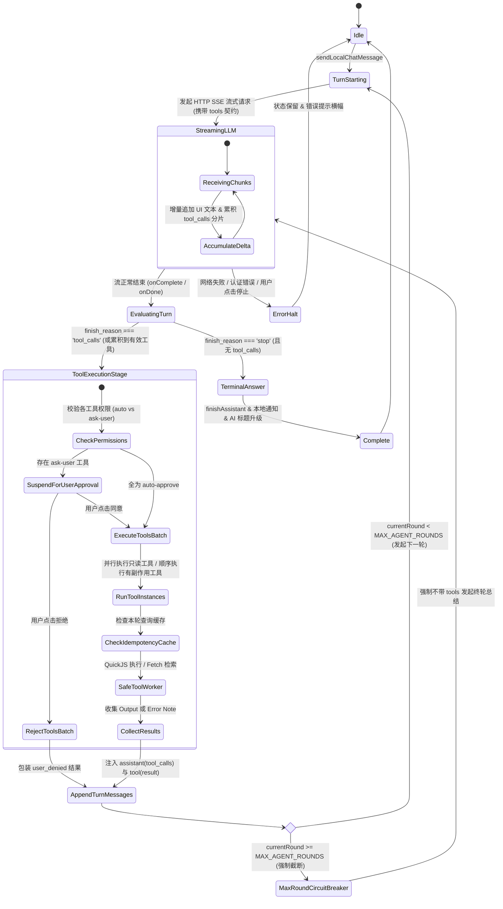

# 移动端本地 Agent 循环与通用端侧工具体系方案（分维 04）

> **所属战役**：`docs/mobile-web-search-and-sandbox/`  
> **文档定位**：移动端（`apps/crish-mobile`）本地 Agent 对话循环（Local Agent Loop）与通用端侧工具体系（Mobile Tool System）演进详案  
> **对应分维**：分维 04（架构核心：协议锁解除、流式 Tool Call 聚合、多轮自主循环调度、端侧内置工具注册表与 QuickJS 沙箱接入）  
> **约束准则**：遵循 `.agents/LOGIC_PLAN_NO_RETREAT.md` 反退避铁律，纯逻辑规划，同权设计，严禁降级为无工具或死循环退避。

---

## 一、现状审查与协议锁代码行号级证据

### 1.1 现状审查与问题定义

在 `apps/crish-mobile` 的现有架构中，移动端本地对话引擎（Local Chat Engine）被设计为一个“单程、纯文本、无工具调用”的封闭模型。当用户提出需要联网、读取网页或执行复杂计算的需求时，移动端无法自主调用任何工具，只能以文字回复“我没有可调用的工具”。

更为严峻的是，不仅在系统提示层面进行了人为限制，整个协议层与流式解析器都在代码逻辑上对 `tools` 与 `tool_calls` 实施了“协议级锁定”：即便大模型自主返回了工具调用意图，协议解析器也仅仅是增加计数，随后直接截断收尾，永不执行。

经过对 `apps/crish-mobile` 核心源码的逐行审计，锁定位点与断层证据如下：

#### 证据 1：系统提示词的硬编码能力阉割（`localChatProtocol.ts:30-31`）
```typescript
// apps/crish-mobile/src/domain/pure/localChatProtocol.ts:30-31
/** 本地对话系统提示（定位：纯对话助手，无工具执行能力——与请求不声明 tools 一致） */
export const LOCAL_CHAT_SYSTEM_PROMPT =
  '你是 Crish 手机本地助手。只能进行文字对话：你没有可调用的工具，也无法访问用户的电脑、文件或网络服务；被要求执行操作时，请说明这一点并给出可行的文字建议。回答简洁、直接。';
```
- **影响**：无论后端连接的模型（DeepSeek-V3 / GPT-4o / Claude-3.5-Sonnet / Qwen-2.5 等）本身具备多强的 Function Calling 能力，系统级 Prompt 直接剥夺了其工具调用认知，诱导模型直接输出委婉拒绝的纯文本。

#### 证据 2：请求体构建中绝对禁止携带 `tools` 字段（`localChatProtocol.ts:146-192`）
```typescript
// apps/crish-mobile/src/domain/pure/localChatProtocol.ts:146-150, 160-192
/**
 * Chat Completions 请求体（compactObject：只写已设字段）：
 * { model, messages, stream }；stream=false 时不写 stream 键以外的任何流式
 * 字段；本地对话永不写 tools/tool_choice（请求侧不给工具执行面）。
 * 可选融入思考推理方言（OpenAI reasoning_effort、DeepSeek thinking 等）。
 */
export function buildChatRequestBody(input: {
  model: string;
  messages: readonly LocalWireMessage[];
  stream: boolean;
  maxTokens?: number;
  temperature?: number;
  thinkingFormat?: LocalThinkingFormat;
  thinkingTier?: LocalThinkingTier;
}): Record<string, unknown> {
  const body: Record<string, unknown> = {
    model: input.model,
    messages: input.messages.map(...),
    stream: input.stream,
  };
  // 严格只写 max_tokens, temperature, thinkingPatch，绝无 tools 参数入口！
  return body;
}
```
- **影响**：请求体入参类型 `input` 根本没有 `tools` 或 `tool_choice` 属性；输出对象经过 `compactObject` 口径，彻底阻断了向供应商网关声明 Function Schema 的可能。

#### 证据 3：Wire 消息出站时过滤丢弃工具链路（`localChatProtocol.ts:114-143`）
```typescript
// apps/crish-mobile/src/domain/pure/localChatProtocol.ts:118-123
export function buildWireMessages(
  history: readonly LocalChatMessage[],
  visionSupported = false
): LocalWireMessage[] {
  const out: LocalWireMessage[] = [
    { role: 'system', content: LOCAL_CHAT_SYSTEM_PROMPT },
  ];
  for (const m of history) {
    if (m.streaming) continue;
    if (m.role !== 'user' && m.role !== 'assistant') continue; // 关键阻断：只保留 user 和 assistant
    if (m.content.trim() === '') continue;
    ...
```
- **影响**：标准 OpenAI 协议要求多轮工具调用时，历史消息序列必须能回放带有 `tool_calls` 的 `assistant` 消息以及紧随其后的 `role: 'tool'` 消息。现行逻辑不仅过滤掉了任何 `tool` 角色消息，而且当 `assistant` 消息的正文为空（纯发 `tool_calls`）时，会被 `m.content.trim() === ''` 直接跳过！导致后续轮次无法构建正确的上下文链条。

#### 证据 4：流式解析器对 `tool_calls` 只计数、丢参数、不聚合（`localChatProtocol.ts:867-903`）
```typescript
// apps/crish-mobile/src/domain/pure/localChatProtocol.ts:867-903
  const out: ChatChunkDelta = {
    contentDelta: '',
    reasoningDelta: '',
    toolCallNames: [],
    finishReason:
      typeof choice.finish_reason === 'string' ? choice.finish_reason : null,
  };
  ...
    const toolCalls = source.tool_calls;
    if (Array.isArray(toolCalls)) {
      for (const raw of toolCalls) {
        const call = asRecord(raw);
        const fn = call ? asRecord(call.function) : null;
        const name = fn?.name;
        out.toolCallNames.push(typeof name === 'string' ? name : '');
      }
    }
  return out;
```
- **影响**：SSE 流中增量推送的 `delta.tool_calls` 通常是按 `index` 聚合的分片数据（首个 chunk 带有 `id` 和 `name`，随后的 chunks 持续推送 `arguments` 文本碎片）。现行代码把每个 chunk 里的名称粗暴推进 `toolCallNames` 字符串数组，完全丢弃了 `index`、`id` 与 `arguments`，导致上层根本无法还原完整的工具入参 JSON！

#### 证据 5：引擎层单轮流式后直接宣告完成收尾（`localChatEngine.ts:216-220`）
```typescript
// apps/crish-mobile/src/adapters/localChat/localChatEngine.ts:216-220
  onComplete: ({ toolCallCount }) => {
    handles.delete(threadId);
    localChatSessionStore.getState().finishAssistant(assistantId, {
      ...(toolCallCount > 0 ? { toolCallCount } : {}),
    });
    notifyLocalThreadTerminal({ ... });
    maybeGenerateAiTitle(threadId);
  },
```
- **影响**：收到 `onComplete` 时，即使检测到 `toolCallCount > 0`，也是直接调用 `finishAssistant` 把消息关闭，然后触发终态通知和生成标题。完全没有启动工具执行、更没有多轮 Agent Loop 状态机的跳转机制！

### 1.2 架构演进目标

针对上述断层，本方案秉持**“彻底解锁端侧 Agent 自主能力、保持单机运行高韧性、兼具安全与性能”**的目标，推进五大核心改造：

1. **协议层与解析器解锁（Protocol Unlocking）**：
   - 彻底废除写死的纯文本提示词，构建支持工具描述、联网引用格式、系统时间环境注入的动态提示词生成器；
   - 扩展请求体构建器 `buildChatRequestBody`，支持声明标准 OpenAI 兼容的 `tools` Schema 与 `tool_choice: 'auto'`；
   - 扩展消息转换器 `buildWireMessages`，支持 `role: 'tool'` 消息与带有 `tool_calls` 的 assistant 消息的无损往返；
   - 重构 `applyChatChunk` 与引入流式工具调用累加器（`StreamingToolCallAccumulator`），精确按 `index` 聚合流式分片，重构 `arguments` 字符串并校验 JSON 完整性。

2. **移动端本地 Agent 循环编排器（Local Agent Loop Engine）**：
   - 将 `localChatEngine.ts` 单程发送逻辑升级为有限状态机（FSM）驱动的多轮 Agent 循环：
     `User Submit -> Turn N LLM Streaming -> Tool Calls Detected -> Parallel/Serial Tool Execution -> Tool Results Injection -> Turn N+1 LLM Streaming -> Final Answer`；
   - 引入硬性护栏：最大轮数限制 `MAX_AGENT_ROUNDS = 6`、单轮幂等与防重复查询缓存、网络/沙箱错误熔断保护指令、全链路级联 `AbortSignal` 传递。

3. **内置端侧通用工具体系（Built-in Mobile Tool Registry）**：
   - **`web_search`**：接入分维 02 的多引擎瀑布流搜索，返回标准化摘要并注入 `[cite:id]` 规范；
   - **`web_fetch`**：接入分维 03 的移动端网页正文提取（含安全 SSRF 防护与 Token 预算截断）；
   - **`run_js_sandbox`**：根据用户特别指示“quickjs我们也是可以装上的，让ai可以更多一些工具调用的能力吧”，设计基于 QuickJS 的纯净端侧安全计算沙箱，让大模型在手机本地执行精确浮点计算、大数运算、复杂 JSON/CSV 转换、日期推算与正则匹配；
   - **移动端设备级扩展工具**：`get_device_context`（时间/时区/电量/网络）、`read_clipboard` / `write_clipboard`（剪贴板交互）。

4. **轻量权限门控与用户体验（Mobile Tool Permission Gate）**：
   - 划分 `auto-approve`（只读无副作用工具静默放行）与 `ask-user`（有副作用/隐私操作挂起等待确认）；
   - 完善超时释放与优雅降级。

---

## 二、解除 Local Chat 协议锁与流式 Tool Call 解析器改造

### 2.1 动态系统提示词生成器（`buildLocalChatSystemPrompt`）

彻底废除静态常量 `LOCAL_CHAT_SYSTEM_PROMPT`，在 `apps/crish-mobile/src/domain/pure/localChatProtocol.ts` 中引入动态系统提示词装配纯函数。

#### 提示词架构结构
动态系统提示词包含 5 个正交模块：
1. **Core Identity**：移动端智能助手基础定位；
2. **Context Environment**：注入当前客户端本地时间、时区、网络制式（WiFi/蜂窝网络），赋予模型时间与现实感知力；
3. **Tool Capability Instructions**：遍历当前已启用的工具注册表，动态注入工具能力说明与使用准则；
4. **Citation & Sourcing Rules**：如果启用了 `web_search` / `web_fetch`，强制注入单轮引用规范（必须使用 `[cite:id]` 标记来源于特定工具的陈述）；
5. **Circuit Breaker Guidance**：防死循环指引（如果工具返回失败或无结果，禁止用相同参数盲目重试，必须根据现有信息回答或向用户如实说明）。

#### 规范实现（纯函数契约）

```typescript
export interface SystemPromptContext {
  /** 当前客户端本地时间 ISO 字符串或本地格式 */
  nowIsoString: string;
  /** 本地时区名（例如 "Asia/Shanghai"） */
  timeZone: string;
  /** 网络状态描述（例如 "WiFi", "Cellular", "Offline"） */
  networkKind?: string;
  /** 已启用的工具摘要列表（若为空则退化为纯文本助手） */
  enabledTools?: Array<{ name: string; description: string }>;
}

export function buildLocalChatSystemPrompt(context: SystemPromptContext): string {
  const parts: string[] = [];

  // 1. 核心定位
  parts.push(
    '你是 Crish 手机端本地智能助理。你具备高度自主的问题解决能力，在用户提问时根据需要直接利用端侧工具获取信息或执行计算。回答保持专业、严谨、排版清晰。'
  );

  // 2. 环境与时间感知
  parts.push(
    `当前设备时间：${context.nowIsoString}，时区：${context.timeZone}` +
      (context.networkKind ? `，网络环境：${context.networkKind}。` : '。')
  );

  // 3. 工具使用规范
  if (context.enabledTools && context.enabledTools.length > 0) {
    const toolListStr = context.enabledTools
      .map((t) => `- ${t.name}: ${t.description}`)
      .join('\n');
    parts.push(
      `你可以使用以下端侧工具来辅助完成任务：\n${toolListStr}\n` +
        '工具调用准则：\n' +
        '1. 遇到需要即时信息、新闻事实、精确数学计算、日期推算、格式转换时，优先调用对应工具，不要凭空编造；\n' +
        '2. 如果无需工具即可确切回答的问题（如通识知识、语言润色），直接作答，不要发起非必要的工具调用；\n' +
        '3. 支持单轮内发起多个工具调用（例如同时搜索多个关键词或并行获取多个网页）。'
    );

    // 4. 联网搜索与引用规范
    const hasWebSearch = context.enabledTools.some((t) => t.name === 'web_search');
    if (hasWebSearch) {
      parts.push(
        '【引用格式规范】：当你根据 web_search 或 web_fetch 的结果作答时，引用的事实必须使用 [cite:id] 格式紧跟在陈述后（id 必须与工具返回结果中的 id 完全一致，例如 [cite:3f2a-1]）。禁止自行发明不存在的引用标识。'
      );
    }

    // 5. 错误熔断与自愈
    parts.push(
      '【容错与熔断纪律】：若工具调用返回错误或未查到结果，绝对禁止在下一轮使用相同的参数再次盲目重试！你应该向用户解释获取信息失败的原因，并基于已有知识和上下文尽可能给出有价值的分析。'
    );
  } else {
    parts.push(
      '当前未启用任何外部工具。请直接使用已有知识与上下文进行文字对话，回答简洁直接。'
    );
  }

  return parts.join('\n\n');
}
```

### 2.2 出站请求与消息模型重构（OpenAI / Anthropic / Gemini Wire 兼容）

#### 2.2.1 扩展 `LocalChatMessage` 与 `LocalWireMessage` 领域类型

在 `apps/crish-mobile/src/domain/types/localChat.ts` 中演进消息类型，使其具备完整的工具调用元数据持久化能力：

```typescript
/** 工具调用声明（对齐 OpenAI Function Calling Wire 格式） */
export interface LocalWireToolCall {
  id: string;
  type: 'function';
  function: {
    name: string;
    arguments: string; // JSON 字符串
  };
}

/** 扩展出站 Wire 消息：支持 system, user, assistant(with tool_calls), tool */
export type LocalWireMessage =
  | { role: 'system'; content: string }
  | { role: 'user'; content: string | LocalWireContentPart[] }
  | {
      role: 'assistant';
      content: string | null;
      tool_calls?: LocalWireToolCall[];
    }
  | {
      role: 'tool';
      tool_call_id: string;
      content: string;
    };

/** 本地会话消息扩展字段（存储于 Session Store） */
export interface LocalChatMessageToolCall {
  id: string;
  name: string;
  arguments: string; // 原始 JSON 字符串
  parsedArgs?: Record<string, unknown>; // 解析后的对象（容错）
  state: 'pending' | 'executing' | 'success' | 'failed' | 'denied';
  result?: string; // 工具执行输出（JSON 或纯文本）
  error?: string; // 错误信息
  durationMs?: number; // 耗时
}

// 在 LocalChatMessage 中增加字段：
export interface LocalChatMessage {
  id: string;
  role: 'system' | 'user' | 'assistant' | 'tool';
  content: string;
  attachments?: ComposerAttachment[];
  streaming?: boolean;
  stopped?: boolean;
  /** 本条助手消息发起的工具调用清单 */
  toolCalls?: LocalChatMessageToolCall[];
  /** 当 role === 'tool' 时，对应的 tool_call_id */
  toolCallId?: string;
  /** 兼容旧版仅计数提示 */
  toolCallCount?: number;
}
```

#### 2.2.2 重构 `buildWireMessages`：保证 OpenAI 时序不变量

OpenAI 官方规范有一条严格的校验红线：**如果 `assistant` 消息包含 `tool_calls`，其下一条紧邻的消息必须是对应 `tool_call_id` 的 `tool` 消息；且所有声明的 `tool_calls` 必须全数被对应的 `tool` 消息响应，否则 API 报 400 Bad Request**。

重构后的 `buildWireMessages` 不仅支持 `tool` 消息，还内置“时序守卫（Sequence Guard）”：

```typescript
export function buildWireMessages(
  history: readonly LocalChatMessage[],
  options: {
    visionSupported?: boolean;
    systemPrompt?: string;
  } = {}
): LocalWireMessage[] {
  const systemPrompt = options.systemPrompt ?? LOCAL_CHAT_SYSTEM_PROMPT;
  const out: LocalWireMessage[] = [{ role: 'system', content: systemPrompt }];

  for (let i = 0; i < history.length; i++) {
    const m = history[i]!;
    if (m.streaming) continue; // 跳过进行中的流式占位

    // 1. 处理用户消息（含图片视觉回放）
    if (m.role === 'user') {
      if (m.content.trim() === '' && (!m.attachments || m.attachments.length === 0)) {
        continue;
      }
      if (options.visionSupported && m.attachments?.length) {
        const parts: LocalWireContentPart[] = [{ type: 'text', text: m.content }];
        for (const a of m.attachments) {
          if (a.kind === 'image' && a.dataUrl) {
            parts.push({
              type: 'image_url',
              image_url: { url: a.dataUrl, detail: 'auto' },
            });
          }
        }
        if (parts.length > 1) {
          out.push({ role: 'user', content: parts });
          continue;
        }
      }
      out.push({ role: 'user', content: m.content });
      continue;
    }

    // 2. 处理助手消息（支持纯文本或带 tool_calls）
    if (m.role === 'assistant') {
      const hasToolCalls = Array.isArray(m.toolCalls) && m.toolCalls.length > 0;
      if (!hasToolCalls && m.content.trim() === '') {
        continue; // 既无文字又无工具调用的空消息不发
      }

      if (hasToolCalls) {
        out.push({
          role: 'assistant',
          content: m.content || null,
          tool_calls: m.toolCalls!.map((tc) => ({
            id: tc.id,
            type: 'function',
            function: {
              name: tc.name,
              arguments: tc.arguments,
            },
          })),
        });
      } else {
        out.push({ role: 'assistant', content: m.content });
      }
      continue;
    }

    // 3. 处理工具响应消息
    if (m.role === 'tool' && m.toolCallId) {
      out.push({
        role: 'tool',
        tool_call_id: m.toolCallId,
        content: m.content || '',
      });
      continue;
    }
  }

  // 时序安全兜底：检查末尾是否存在孤立的 assistant(tool_calls) 尚未收到 tool 响应
  // 若存在（例如应用异常退出后重连），自动合成 mock tool 响应，防止 API 400
  repairOrphanedToolCalls(out);

  return out;
}

function repairOrphanedToolCalls(messages: LocalWireMessage[]): void {
  for (let i = 0; i < messages.length; i++) {
    const msg = messages[i];
    if (msg.role === 'assistant' && msg.tool_calls && msg.tool_calls.length > 0) {
      const expectedIds = new Set(msg.tool_calls.map((tc) => tc.id));
      let j = i + 1;
      while (j < messages.length && messages[j].role === 'tool') {
        expectedIds.delete((messages[j] as { tool_call_id: string }).tool_call_id);
        j++;
      }
      if (expectedIds.size > 0) {
        // 为缺失的工具调用补齐合成的取消消息
        for (const missingId of expectedIds) {
          messages.splice(j, 0, {
            role: 'tool',
            tool_call_id: missingId,
            content: JSON.stringify({ error: 'Tool execution was cancelled or interrupted' }),
          });
          j++;
        }
      }
    }
  }
}
```

#### 2.2.3 重构 `buildChatRequestBody`：动态注入 `tools` 契约

```typescript
export interface LocalWireTool {
  type: 'function';
  function: {
    name: string;
    description: string;
    parameters: Record<string, unknown>; // JSON Schema
    strict?: boolean;
  };
}

export function buildChatRequestBody(input: {
  model: string;
  messages: readonly LocalWireMessage[];
  stream: boolean;
  maxTokens?: number;
  temperature?: number;
  thinkingFormat?: LocalThinkingFormat;
  thinkingTier?: LocalThinkingTier;
  /** 动态工具集声明 */
  tools?: readonly LocalWireTool[];
  /** 工具选择策略：缺省有工具时传 'auto' */
  toolChoice?: 'auto' | 'none' | 'required' | { type: 'function'; function: { name: string } };
}): Record<string, unknown> {
  const body: Record<string, unknown> = {
    model: input.model,
    messages: input.messages.map((m) => {
      if (m.role === 'tool') {
        return {
          role: 'tool',
          tool_call_id: m.tool_call_id,
          content: m.content,
        };
      }
      if (m.role === 'assistant' && m.tool_calls) {
        return {
          role: 'assistant',
          content: m.content,
          tool_calls: m.tool_calls,
        };
      }
      return {
        role: m.role,
        content:
          typeof m.content === 'string'
            ? m.content
            : (m.content ?? []).map((part) =>
                part.type === 'text'
                  ? { type: 'text' as const, text: part.text }
                  : {
                      type: 'image_url' as const,
                      image_url: {
                        url: part.image_url.url,
                        detail: part.image_url.detail,
                      },
                    }
              ),
      };
    }),
    stream: input.stream,
  };

  if (input.maxTokens !== undefined) body.max_tokens = input.maxTokens;
  if (input.temperature !== undefined) body.temperature = input.temperature;

  // 严格 compactObject 口径：tools 存在且非空时才写入 tools 与 tool_choice
  if (input.tools && input.tools.length > 0) {
    body.tools = input.tools;
    body.tool_choice = input.toolChoice ?? 'auto';
  }

  if (input.thinkingTier !== undefined && input.thinkingTier !== 'off') {
    const patch = buildThinkingRequestBodyPatch({
      format: input.thinkingFormat,
      tier: input.thinkingTier,
    });
    Object.assign(body, patch);
  }

  return body;
}
```

### 2.3 流式 Tool Calls 分片聚合器（Streaming Tool Call Accumulator）

在真实网络环境下，各大模型通过 SSE 传输 `tool_calls` 的分片行为极度细碎。例如 DeepSeek、OpenAI 或 Ollama 的典型流式 chunk 序列为：
- Chunk 1: `choices[0].delta = { tool_calls: [{ index: 0, id: "call_abc", type: "function", function: { name: "web_search", arguments: "" } }] }`
- Chunk 2: `choices[0].delta = { tool_calls: [{ index: 0, function: { arguments: "{\"qu" } }] }`
- Chunk 3: `choices[0].delta = { tool_calls: [{ index: 0, function: { arguments: "ery\":\"React" } }] }`
- Chunk 4: `choices[0].delta = { tool_calls: [{ index: 0, function: { arguments: " Native\"}" } }] }`
- Chunk 5: `choices[0].finish_reason = "tool_calls"`

如果仅靠无状态的单 chunk 提取，根本无法得到完整结果。因此必须在协议层设立**分片增量结构**与**流式聚合状态机**。

#### 2.3.1 扩展 `ChatChunkDelta` 结构（`localChatProtocol.ts`）

```typescript
export interface LocalToolCallChunkDelta {
  index: number;
  id?: string;
  name?: string;
  argumentsDelta?: string;
}

export interface ChatChunkDelta {
  contentDelta: string;
  reasoningDelta: string;
  /** 本 chunk 包含的流式工具分片 */
  toolCallDeltas: LocalToolCallChunkDelta[];
  /** 保留向后兼容 */
  toolCallNames: string[];
  finishReason: string | null;
}
```

#### 2.3.2 改造 `applyChatChunk` 纯函数实现

```typescript
export function applyChatChunk(data: string): ChatChunkDelta | null {
  let json: unknown;
  try {
    json = JSON.parse(data) as unknown;
  } catch {
    return null;
  }
  if (json === null || typeof json !== 'object') return null;
  const choices = (json as { choices?: unknown }).choices;
  if (!Array.isArray(choices) || choices.length === 0) return null;
  const choice = choices[0] as Record<string, unknown>;

  const out: ChatChunkDelta = {
    contentDelta: '',
    reasoningDelta: '',
    toolCallDeltas: [],
    toolCallNames: [],
    finishReason:
      typeof choice.finish_reason === 'string' ? choice.finish_reason : null,
  };

  const delta = asRecord(choice.delta);
  const message = asRecord(choice.message);
  const source = delta ?? message;

  if (source) {
    if (typeof source.content === 'string') out.contentDelta = source.content;

    for (const key of [
      'reasoning_content',
      'reasoning',
      'thinking',
      'thinking_delta',
      'thought',
    ]) {
      const v = source[key];
      if (typeof v === 'string' && v !== '') {
        out.reasoningDelta = v;
        break;
      }
    }

    const toolCalls = source.tool_calls;
    if (Array.isArray(toolCalls)) {
      for (let i = 0; i < toolCalls.length; i++) {
        const raw = toolCalls[i];
        const call = asRecord(raw);
        if (!call) continue;

        const index = typeof call.index === 'number' ? call.index : i;
        const id = typeof call.id === 'string' ? call.id : undefined;
        const fn = asRecord(call.function);
        const name = fn && typeof fn.name === 'string' ? fn.name : undefined;
        const argsDelta =
          fn && typeof fn.arguments === 'string' ? fn.arguments : undefined;

        out.toolCallDeltas.push({
          index,
          id,
          name,
          argumentsDelta: argsDelta,
        });

        if (name) {
          out.toolCallNames.push(name);
        }
      }
    }
  }

  return out;
}
```

#### 2.3.3 引入流式工具累加器 `StreamingToolCallAccumulator`

纯函数只负责解析单帧，状态聚合由 `StreamingToolCallAccumulator` 类（位于 `localChatProtocol.ts`，纯内存、jest 直测）完成：

```typescript
export interface AccumulatedToolCall {
  index: number;
  id: string;
  name: string;
  arguments: string;
  isValidJson: boolean;
  parsedArgs: Record<string, unknown>;
}

export class StreamingToolCallAccumulator {
  private map = new Map<
    number,
    { id: string; name: string; arguments: string }
  >();

  /** 摄入单个 chunk 的 toolCallDeltas */
  pushDeltas(deltas: readonly LocalToolCallChunkDelta[]): void {
    for (const d of deltas) {
      const existing = this.map.get(d.index) ?? {
        id: '',
        name: '',
        arguments: '',
      };
      if (d.id) existing.id = d.id;
      if (d.name) existing.name += d.name; // 容错兼容名称分块推送的模型
      if (d.argumentsDelta) existing.arguments += d.argumentsDelta;
      this.map.set(d.index, existing);
    }
  }

  /** 是否已累积到工具调用 */
  hasToolCalls(): boolean {
    return this.map.size > 0;
  }

  /** 获取最终整理校验后的工具调用列表 */
  finalize(): AccumulatedToolCall[] {
    const list: AccumulatedToolCall[] = [];
    const sortedIndices = Array.from(this.map.keys()).sort((a, b) => a - b);

    for (const index of sortedIndices) {
      const entry = this.map.get(index)!;
      let isValidJson = false;
      let parsedArgs: Record<string, unknown> = {};

      const trimmedArgs = entry.arguments.trim();
      if (trimmedArgs === '') {
        isValidJson = true; // 无入参函数
        parsedArgs = {};
      } else {
        try {
          parsedArgs = JSON.parse(trimmedArgs) as Record<string, unknown>;
          isValidJson = parsedArgs !== null && typeof parsedArgs === 'object';
        } catch {
          isValidJson = false;
        }
      }

      list.push({
        index,
        // 若模型漏发 id 则自动生成兜底 id
        id: entry.id || `call_${Date.now()}_${index}`,
        name: entry.name,
        arguments: entry.arguments,
        isValidJson,
        parsedArgs,
      });
    }

    return list;
  }
}
```

---

## 三、移动端本地多轮 Agent Loop 编排器设计

### 3.1 状态流转状态机（Agent Loop FSM）

将 `apps/crish-mobile/src/adapters/localChat/localChatEngine.ts` 从“一次性流式生成”演进为“多轮自主循环调度器”。



### 3.2 运行护栏与防死锁设计（Safety Guardrails）

移动端设备的电池、算力与网络条件受限，必须设置坚固的防退避、防死锁护栏：

#### 护栏 1：硬性轮数上限（`MAX_AGENT_ROUNDS = 6`）
- **判定机制**：单次用户输入触发的 Agent 循环最多运行 6 轮交互；
- **熔断策略**：当 `currentRound === MAX_AGENT_ROUNDS` 时，编排器在出站请求中**强制剔除 `tools` 声明**，并向消息末尾注入一条系统提示：“已达到最大推理轮数，请立即根据已掌握的所有信息，整理出最完整、最准确的最终答案，禁止再申请任何工具”。这样模型在最后一轮必须输出正文终答，绝对不会出现无限递归。

#### 护栏 2：单轮查询与计算幂等缓存（`createLookupRunner`）
参考 Cherry Studio `webLookup.ts:104-123` 的精妙设计，在单次 Agent Run 的生命周期内建立瞬态内存缓存：
- 相同的 `web_search query` 在同一轮或后续几轮中直接复用 Promise 结果；
- 相同的 `web_fetch url` 直接复用抓取内容；
- 相同的 `run_js_sandbox code` 直接复用计算结果；
- **收益**：即便 LLM 发生注意力漂移产生重复调用，也能在 0ms 内直接返回已有数据，零额外网络流量消耗。

#### 护栏 3：错误注入与反复读熔断指令（Circuit Breaker Note）
当端侧工具执行发生错误（如搜索无网络、页面 404、QuickJS 语法报错）时：
- 工具返回值必须明确标记失败，并附带针对模型的防御指令：
  ```json
  {
    "status": "error",
    "error": "Failed to fetch https://example.com: Network timeout",
    "system_note": "此 URL 访问超时。本轮会话中禁止再次尝试请求该 URL！请向用户说明该网页无法访问，并尝试搜索其他替代信源或直接作答。"
  }
  ```
- 借助清晰的系统指令切断大模型“报错-重试-再报错”的复读机死循环。

#### 护栏 4：级联中止控制链（Cascade AbortSignal）
移动端必须确保用户随时能“一键打断”：
- `localChatEngine` 为每个 Run 创建一个根 `AbortController`；
- 当用户在 UI 界面点击“停止生成”或退出页面时，根 Controller 调用 `abort()`；
- **三层级联响应**：
  1. **传输层**：终止正在收发数据的 XHR Stream 连接；
  2. **工具层**：向正在执行的 `fetch` 传递 `signal`，立即中断网络 I/O；
  3. **沙箱层**：向 QuickJS 运行时的 C++ 实例发出中断信号，立即终止正在执行的 JavaScript 虚拟机并回收内存。

---

## 四、移动端内置工具集（Built-in Mobile Tool Registry）全景架构

### 4.1 统一的端侧工具抽象契约

在 `apps/crish-mobile/src/domain/tools/types.ts` 中建立契约体系（对齐桌面 `crates/agent-tools` 与 universal `builtinTools.ts`）：

```typescript
export type ToolApprovalPolicy = 'auto' | 'ask-user';
export type ToolConcurrencyMode = 'parallel' | 'serial';

export interface MobileToolContext {
  /** 当前运行 ID */
  runId: string;
  /** 级联取消信号 */
  signal: AbortSignal;
  /** 宿主环境能力注入（时区、存储等） */
  extraContext?: Record<string, unknown>;
}

export interface MobileToolResult {
  /** 是否成功 */
  success: boolean;
  /** 返回给大模型的内容（通常为 JSON 字符串或格式化纯文本） */
  content: string;
  /** 可选的用户界面展示摘要（用于在折叠卡片上高亮显示） */
  displaySummary?: string;
  /** 耗时 */
  durationMs: number;
}

export interface MobileToolDefinition {
  /** 全局唯一名称 */
  name: string;
  /** 工具人读描述（送往大模型 Prompt） */
  description: string;
  /** 入参 JSON Schema */
  parameters: Record<string, unknown>;
  /** 权限策略：默认 'auto' */
  approval: ToolApprovalPolicy;
  /** 并发执行模式：只读并行，写入串行 */
  concurrency: ToolConcurrencyMode;
  /** 单次执行超时时间（ms） */
  timeoutMs: number;
}

export interface MobileTool {
  definition: MobileToolDefinition;
  execute: (
    args: Record<string, unknown>,
    context: MobileToolContext
  ) => Promise<MobileToolResult>;
}
```

### 4.2 工具 1：`web_search`（端侧瀑布流联网搜索工具）

- **职责**：实时联网检索新闻、事实、最新数据。
- **依赖接口**：由分维 02（`MobileWebSearchService`）提供的多引擎瀑布流搜索驱动。
- **Schema 契约**：
  ```json
  {
    "type": "object",
    "properties": {
      "query": {
        "type": "string",
        "description": "自包含的搜索关键词，请勿使用代词。如 \"React Native 0.86 新特性\"。"
      }
    },
    "required": ["query"]
  }
  ```
- **关键设计点**：
  - **输入消毒**：将多余空白折叠，截断在 200 字符内；
  - **引用分配**：为每个搜索结果分配唯一的单轮 Citation ID（例如 `3f2a-1`, `3f2a-2`），与模型 Prompt 的 `[cite:id]` 规则形成闭环；
  - **优雅降级**：若搜索无网络或供应商耗尽，返回标准错误并附加 `WEB_LOOKUP_ERROR_NOTE`。

### 4.3 工具 2：`web_fetch`（端侧网页安全提取工具）

- **职责**：提取指定 HTTP(S) URL 的正文内容与结构化 Markdown。
- **依赖接口**：由分维 03（`MobileWebFetchService`）提供的安全下载与正文提取驱动。
- **Schema 契约**：
  ```json
  {
    "type": "object",
    "properties": {
      "urls": {
        "type": "array",
        "items": { "type": "string" },
        "description": "需要抓取正文的网页绝对 URL 列表，一次最多 5 个。"
      }
    },
    "required": ["urls"]
  }
  ```
- **关键设计点**：
  - **SSRF 安全检查**：在下载前通过 DNS 预检拒绝私有 IP、本地回环（`127.0.0.1`, `192.168.x.x`, `10.x.x.x`）以及内网服务探测；
  - **Token 预算裁剪**：限制单个 URL 返回的最大字符数（如 4000 字符），超出部分标明 `truncated: true`，避免挤爆移动端上下文。

### 4.4 工具 3：`run_js_sandbox`（基于 QuickJS 的端侧计算与代码执行工具）

> **用户特别指令**：“**quickjs我们也是可以装上的，让ai可以更多一些工具调用的能力吧**”。

#### 4.4.1 为什么需要在手机端本地部署 QuickJS？
大语言模型本质是概率文本生成器，在处理以下任务时极易产生幻觉和计算错误：
1. **精确浮点与高精度计算**：如复利计算、汇率与税率换算、大数阶乘；
2. **日期与时区复杂运算**：如“计算两个日期之间相隔多少个工作日”、“推算下个月第三个星期二的 UTC 时间戳”；
3. **数据清洗与格式转换**：将复杂的 JSON、CSV 文本进行聚合、过滤、分组与排序；
4. **正则表达式匹配与文本提纯**：从大段杂乱文本中准确抽取出所有邮箱、手机号或特定结构；
5. **离线算法与逻辑模拟**：图遍历、排序、哈希校验等。

借助轻量、极速（冷启动毫秒级）、内存占用极低（仅几百 KB）的 **QuickJS** 引擎，我们在移动端赋予 AI 一个原生的安全代码运行沙箱，将大模型的思考（Thinking）与确定性计算（Deterministic Execution）彻底分离！

#### 4.4.2 Schema 契约设计

```json
{
  "type": "object",
  "properties": {
    "code": {
      "type": "string",
      "description": "待在端侧 QuickJS 沙箱中执行的 JavaScript (ES2023) 代码。可以使用标准内置对象（Math, Date, JSON, RegExp, BigInt 等）。最后一条表达式的值或 return 的结果将作为工具返回值；也可以使用 console.log 输出调试信息。"
    },
    "timeoutMs": {
      "type": "number",
      "description": "最大运行超时毫秒数，默认 2000ms，硬顶 5000ms。"
    }
  },
  "required": ["code"]
}
```

#### 4.4.3 沙箱隔离与安全屏障设计（Security Sandbox）

QuickJS 在移动端执行不受信任的 AI 代码时，必须实施军工级安全隔离：

```
+-----------------------------------------------------------------+
|                   移动端原生环境 (React Native Host)              |
|  [Expo SecureStore] [文件系统] [原生网络栈] [原生 UI Bridge]        |
+-----------------------------------------------------------------+
                                |  严格阻断 (Air-Gapped)
                                X  无任何 NativeModules 暴露
                                X  无 fetch / XMLHttpRequest
+-----------------------------------------------------------------+
|               QuickJS 独立隔离运行时 (Isolated Runtime)           |
|                                                                 |
|  - 内存配额硬限制：Memory Limit = 16MB                           |
|  - CPU 循环看门狗：JS_SetInterruptHandler (Tick Watchdog)        |
|  - 运行超时熔断：Max Timeout = 2000ms (Hard Cap 5000ms)          |
|                                                                 |
|  +-----------------------------------------------------------+  |
|  |           受限标准环境 (Pure White-listed Globals)         |  |
|  |  - 纯计算：Math, Number, BigInt, Boolean, String         |  |
|  |  - 集合：Array, Object, Map, Set, TypedArrays            |  |
|  |  - 格式化：JSON, RegExp, Date                             |  |
|  |  - 辅助：console.log (内存截获), TextEncoder/Decoder      |  |
|  |  - 剔除：eval (禁用), Function 构造器 (禁用),             |  |
|  |          setTimeout/setInterval (禁用异步悬挂)             |  |
|  +-----------------------------------------------------------+  |
+-----------------------------------------------------------------+
```

1. **零原生 I/O 暴露**：沙箱内部绝不挂载任何网络请求（`fetch`, `XHR`, `WebSocket`）、文件读写、剪贴板或 React Native NativeModules，杜绝任何提权与数据泄露隐患；
2. **死循环看门狗（Tick Watchdog）**：
   - AI 代码常常写出 `while(true)`。通过 QuickJS 的 `JS_SetInterruptHandler`，在每次执行字节码计数（Tick）时检查已耗费时间与取消信号；一旦超过 `timeoutMs` 或检测到 `signal.aborted`，直接在 C++ 层面抛出 `InternalError: Script execution timed out`，彻底打断执行；
3. **内存耗尽防护（OOM Guard）**：
   - 限制 QuickJS Runtime 内存使用上限为 16MB（`JS_SetMemoryLimit(rt, 16 * 1024 * 1024)`）。一旦发生内存溢出，引擎安全捕获异常，不会导致手机 App 闪退；
4. **输出捕获与格式化**：
   - 截获 `console.log` 输出到内存缓冲数组；
   - 自动获取最后一条表达式的求值结果，序列化为安全 JSON 返回给模型。

#### 4.4.4 代码实现方案（`runJsSandbox.ts`）

```typescript
import { MobileTool, MobileToolContext, MobileToolResult } from './types';
import { getQuickJsEngine } from '@/adapters/sandbox/quickjsWiring';

export const runJsSandboxTool: MobileTool = {
  definition: {
    name: 'run_js_sandbox',
    description:
      '在手机本地安全沙箱中运行 JavaScript 代码执行精确计算、数据清洗、日期推算或正则匹配。' +
      '纯离线运行，支持 ES2023 标准内置对象（Math, Date, JSON, RegExp, BigInt 等）。' +
      '最后一条表达式的值作为输出结果。',
    parameters: {
      type: 'object',
      properties: {
        code: {
          type: 'string',
          description: '要执行的 JavaScript 源码字符串',
        },
        timeoutMs: {
          type: 'number',
          description: '超时时间毫秒数，默认 2000，最大 5000',
        },
      },
      required: ['code'],
    },
    approval: 'auto', // 纯计算无副作用，自动放行
    concurrency: 'parallel',
    timeoutMs: 5000,
  },

  async execute(args, context: MobileToolContext): Promise<MobileToolResult> {
    const started = Date.now();
    const code = typeof args.code === 'string' ? args.code : '';
    if (code.trim() === '') {
      return {
        success: false,
        content: JSON.stringify({ error: 'Code parameter cannot be empty' }),
        durationMs: 0,
      };
    }

    const requestedTimeout =
      typeof args.timeoutMs === 'number' && Number.isFinite(args.timeoutMs)
        ? Math.min(Math.max(500, args.timeoutMs), 5000)
        : 2000;

    try {
      const qjs = await getQuickJsEngine();
      const output = await qjs.evalWithTimeout({
        code,
        timeoutMs: requestedTimeout,
        signal: context.signal,
      });

      const durationMs = Date.now() - started;
      if (output.error) {
        return {
          success: false,
          content: JSON.stringify({
            status: 'error',
            error: output.error,
            logs: output.logs,
          }),
          displaySummary: `JS 执行失败: ${output.error}`,
          durationMs,
        };
      }

      return {
        success: true,
        content: JSON.stringify({
          status: 'success',
          result: output.result,
          logs: output.logs,
        }),
        displaySummary: `JS 计算完成 (${durationMs}ms)`,
        durationMs,
      };
    } catch (err: any) {
      return {
        success: false,
        content: JSON.stringify({
          status: 'error',
          error: err?.message || 'QuickJS engine failure',
        }),
        durationMs: Date.now() - started,
      };
    }
  },
};
```

### 4.5 移动端设备级实用工具扩展契约

为了进一步发挥手机端侧的场景优势，设计设备级扩展工具接口：

#### 4.5.1 `get_device_context`（设备现实上下文）
- **功能**：让大模型获取当前手机的现实环境参数；
- **参数**：无；
- **返回值**：
  ```json
  {
    "currentTime": "2026-11-04T18:30:00+08:00",
    "dayOfWeek": "Wednesday",
    "timeZone": "Asia/Shanghai",
    "batteryLevel": 0.85,
    "isCharging": true,
    "networkState": "WiFi",
    "colorScheme": "dark"
  }
  ```
- **价值**：大模型无需猜测时间与现实环境，回答更具上下文亲和力。

#### 4.5.2 `read_clipboard` / `write_clipboard`（受控剪贴板）
- `write_clipboard`：AI 将生成的代码段、摘要一键复制到用户手机剪贴板；
- `read_clipboard`：安全读取用户复制的内容（受 `ask-user` 权限门控保护，防止隐私窃取）。

---

## 五、轻量权限门控系统（Mobile Tool Permission Policy）

### 5.1 权限策略分级矩阵

对齐桌面端 `crates/agent-tools/src/permission.rs` 的哲学，但在移动端触屏场景做轻量极速化适配：

| 工具名称 | 权限等级 | 判定理由 | 执行行为 |
| :--- | :--- | :--- | :--- |
| **`web_search`** | `auto` | 只读、无系统副作用、高频使用 | 静默即时执行，UI 仅渲染进度指示 |
| **`web_fetch`** | `auto` | 只读、受 SSRF 守卫防护 | 静默即时执行，UI 仅渲染抓取状态 |
| **`run_js_sandbox`** | `auto` | 纯内存计算、无网络/文件 I/O、有超时与内存硬配额 | 静默即时执行，毫秒级得出计算结果 |
| **`get_device_context`** | `auto` | 只读、无敏感个人信息 | 静默即时执行 |
| **`write_clipboard`** | `auto` / `ask` | 改变系统剪贴板，支持在用户设置中切换 | 默认 auto 写入，并给出 Toast 提示 |
| **`read_clipboard`** | `ask-user` | 涉及用户潜在敏感文本 | 必须在界面弹出授权确认卡片 |

### 5.2 移动端交互闭环（Suspend & Resume）

当遇到 `approval: 'ask-user'` 工具时：
1. **Loop 状态机挂起**：将当前正在执行的工具状态置为 `pending_approval`，将当前 Agent Loop 的挂起句柄暂存；
2. **UI 渲染交互审批卡片**：在聊天流中以卡片展示即将调用的工具名、参数预览与安全提示，呈现【允许】与【拒绝】按钮；
3. **用户操作响应**：
   - 用户点击【允许】：工具继续执行，状态机无缝恢复；
   - 用户点击【拒绝】：向模型注入 `{ error: "User denied permission to execute this tool" }`，模型调整策略；
4. **超时自动收敛**：若用户离开页面或 120 秒未做决定，自动收敛为 `approval_expired`，释放资源，避免多轮 Loop 无限悬挂。

---

## 六、涉及新增与改造的文件域清单与行号级映射

本方案在保持架构纯粹性、单一真理路径（SSOT）的前提下，精确规划以下文件域的改造与新增：

### 6.1 现有文件改造清单

| 文件路径 | 现存行号 | 改造职责与设计内容 |
| :--- | :--- | :--- |
| `apps/crish-mobile/src/domain/types/localChat.ts` | L184-202 | **消息领域类型扩展**：在 `LocalChatMessage` 中增加 `toolCalls?: LocalChatMessageToolCall[]`、`toolCallId?: string`，`role` 扩展支持 `'tool'`；新增 `LocalWireToolCall` 契约。 |
| `apps/crish-mobile/src/domain/pure/localChatProtocol.ts` | L30-31 | **废除硬编码系统提示**：废除静态纯文本 `LOCAL_CHAT_SYSTEM_PROMPT`，引入动态装配函数 `buildLocalChatSystemPrompt`。 |
| `apps/crish-mobile/src/domain/pure/localChatProtocol.ts` | L114-143 | **Wire 消息组装改造**：重构 `buildWireMessages`，支持无损保留与回放 `role: 'tool'` 消息和带有 `tool_calls` 的 `assistant` 消息，内置孤立 tool_calls 修复守卫。 |
| `apps/crish-mobile/src/domain/pure/localChatProtocol.ts` | L146-192 | **请求体支持 Tools**：在 `buildChatRequestBody` 中增加 `tools` 与 `toolChoice` 参数，保持 compactObject 规范，有工具时写入标准 JSON Schema。 |
| `apps/crish-mobile/src/domain/pure/localChatProtocol.ts` | L838-903 | **流式解析与聚合器**：改造 `ChatChunkDelta` 与 `applyChatChunk`，引入 `StreamingToolCallAccumulator`，支持按 `index` 精确聚合分片与 arguments 校验。 |
| `apps/crish-mobile/src/adapters/localChat/localChatClient.ts` | L404-423 | **客户端流式回调升级**：`StreamChatCallbacks` 增加 `onToolCallsDetected?: (toolCalls: AccumulatedToolCall[]) => void` 回调，传递完整校验后的工具对象。 |
| `apps/crish-mobile/src/adapters/localChat/localChatEngine.ts` | L184-250 | **编排器多轮 Agent Loop 改造**：重写 `sendLocalChatMessage`，引入状态机、多轮调度循环、防死锁护栏、单轮查询缓存与级联 Abort 传递。 |

### 6.2 新增文件清单

| 文件路径 | 所属分层 | 职责定位 |
| :--- | :--- | :--- |
| `apps/crish-mobile/src/domain/tools/types.ts` | 领域类型层 | 端侧工具定义契约（`MobileToolDefinition`, `MobileTool`, `MobileToolResult`, `MobileToolContext`）。 |
| `apps/crish-mobile/src/domain/tools/registry.ts` | 领域纯逻辑层 | 端侧工具注册表管理器（注册、检索、条件过滤、Schema 导出）。 |
| `apps/crish-mobile/src/domain/tools/builtin/webSearchTool.ts` | 内置工具域 | `web_search` 工具实现，包装分维 02 搜索服务与 Citation 注入。 |
| `apps/crish-mobile/src/domain/tools/builtin/webFetchTool.ts` | 内置工具域 | `web_fetch` 工具实现，包装分维 03 抓取服务与正文裁剪。 |
| `apps/crish-mobile/src/domain/tools/builtin/runJsSandboxTool.ts` | 内置工具域 | `run_js_sandbox` 工具实现，包装 QuickJS 沙箱引擎与受限执行。 |
| `apps/crish-mobile/src/domain/tools/builtin/deviceContextTool.ts` | 内置工具域 | `get_device_context` 现实环境上下文获取工具。 |
| `apps/crish-mobile/src/adapters/sandbox/quickjsWiring.ts` | 适配层 | QuickJS 原生绑定适配器（结合分维 01 运行时，提供 `evalWithTimeout` 接口）。 |

---

## 七、立体化测试验证与验收断言（三层防护体系）

为防止任何回归与协议降级，必须建立三层立体验证断言（遵循本仓库《通用协作纪律》§7.1）：

### 7.1 第一层：纯函数协议与聚合器单元测试（Jest 直测，无 I/O）

测试文件：`apps/crish-mobile/src/domain/pure/localChatProtocol.test.ts`

- **断言 1：请求体 tools 动态注入与向后兼容**
  - 当未传入 `tools` 时，`buildChatRequestBody` 输出对象严格不包含 `tools` 与 `tool_choice` 键；
  - 当传入 `tools: [webSearchToolDefinition]` 时，输出对象包含格式完全合规的 `tools` 数组与 `tool_choice: "auto"`。
- **断言 2：Wire 消息多轮时序回放与孤立修复**
  - 构造包含 `user` -> `assistant(tool_calls)` -> `tool` -> `assistant` 的历史序列，`buildWireMessages` 输出与输入角色与内容完全一致；
  - 构造异常序列（`assistant` 发起了 tool_call 但缺失对应的 `tool` 消息），断言自动注入合成的取消消息，防止模型网关 400 阻断。
- **断言 3：流式 chunk 分片极细聚合（魔鬼用例）**
  - 模拟真实模型输出：首帧推送 `tool_calls[0].function.name = "run_js_sandbox"`，随后 5 个连续帧逐字符推送 `arguments`（`"{"` -> `"\"code\""` -> `":"` -> `"\"1+1\""` -> `"}"`）；
  - 断言 `StreamingToolCallAccumulator` 最终产出的 `arguments` 为 `{"code":"1+1"}`，且 `isValidJson === true`，`parsedArgs` 能够正确解析出 `{ code: "1+1" }`。

### 7.2 第二层：Agent Loop 状态机与护栏集成测试（Mock Client）

测试文件：`apps/crish-mobile/src/adapters/localChat/__tests__/localChatAgentLoop.test.ts`

- **断言 4：多轮闭环流转（Two-turn Loop）**
  - 第一轮 Mock 返回 `finish_reason: "tool_calls"` 并调用 `run_js_sandbox`（计算 123 * 456）；
  - 工具执行器返回计算结果 `56088`；
  - 引擎自动触发第二轮请求，将工具结果喂入；
  - 第二轮 Mock 返回普通文本答案；
  - 断言整个过程 UI store 收到连续的 delta 更新，且最终消息状态正常关闭，标题正常升级。
- **断言 5：最大轮数硬拦截（Anti-infinite Loop）**
  - 模拟极端恶意的 LLM 连续 7 轮无限返回 `tool_calls`；
  - 断言在第 6 轮结束后，编排器强制剔除 `tools` 声明并注入熔断指令，迫使模型终结；循环绝对不在第 7 轮继续。
- **断言 6：单轮缓存命中（Idempotency Guard）**
  - 同一轮对话内 LLM 重复发出两次完全相同的 `web_search(query: "expo 57")`；
  - 断言底层网络请求只发出 1 次，第 2 次直接复用缓存 Promise。
- **断言 7：级联取消（Abort Cascade）**
  - 在工具执行阶段触发 `handle.abort()`；
  - 断言当前在途的网络 fetch 与 QuickJS 沙箱立即接收到 `abort` 信号并中止，不产生悬挂任务。

### 7.3 第三层：真实移动端现场验收断言（端侧实机环境）

- **断言 8：QuickJS 沙箱死循环安全打断**
  - 在移动设备上执行恶意代码 `while(true) {}`；
  - 断言在 2000ms 超时到达时，看门狗成功打断执行，抛出超时异常，应用界面不卡死、无闪退。
- **断言 9：无网络沙箱隔离验证**
  - 在沙箱内执行 `typeof fetch`、`typeof XMLHttpRequest`、`typeof window`；
  - 断言返回值全为 `"undefined"`，彻底杜绝越权逃逸。
- **断言 10：端到端搜索与计算联动验证**
  - 用户在手机端输入：“请帮我搜索今年诺贝尔物理学奖得主，并用 JS 计算他们年龄的平均值”；
  - 模型先调用 `web_search` 获取得主与生年，再调用 `run_js_sandbox` 运行数组求平均，最后在正文中使用 `[cite:id]` 严谨给出带有准确计算结果的终答。
