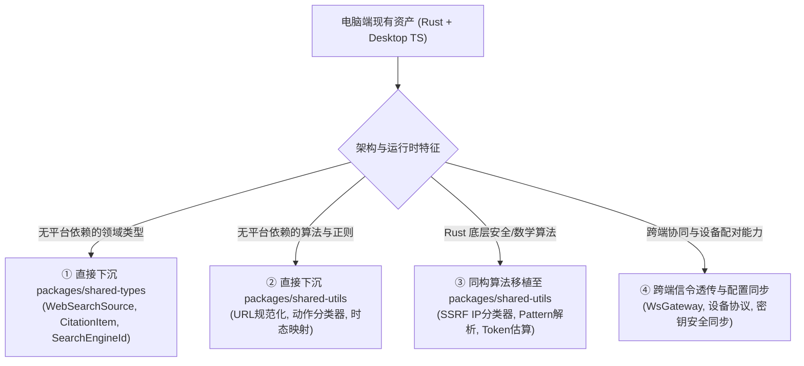
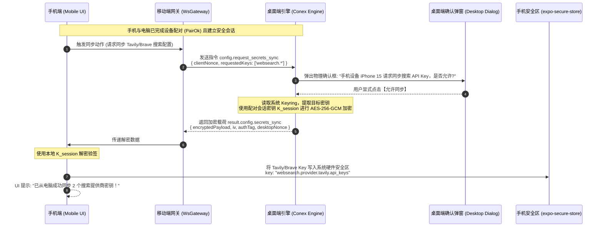
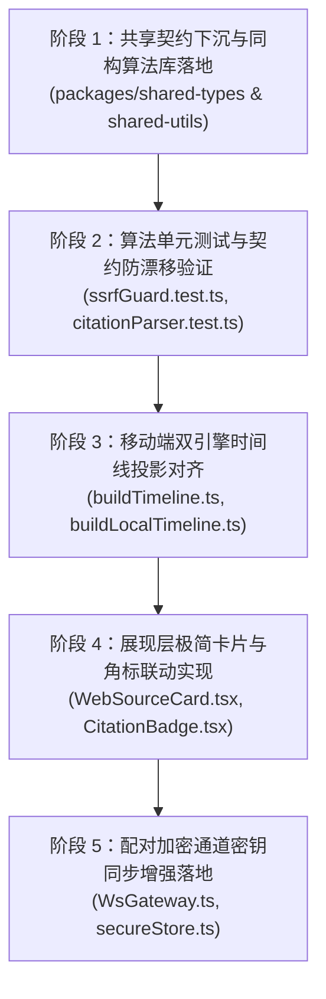

# 05-分维-跨端架构对齐与电脑端资产复用方案

> **工作区归属**：`docs/mobile-web-search-and-sandbox/`  
> **文档性质**：战役分维总体实施详案（DIM-05 跨端架构对齐与资产复用负责人定案版）  
> **文档版本**：v1.0 架构同构与资产净收敛版  
> **关联分维**：
> - `01-分维-双轨仲裁与模型原生搜索方言对接方案.md`（原生联网搜索方言与双轨仲裁）
> - `02-分维-客户端多源搜索引擎与免Key瀑布流架构方案.md`（客户端搜索多源瀑布流）
> - `04-分维-移动端本地Agent循环与通用端侧工具体系方案.md`（移动端本地 Agent 循环与端侧工具）
> **前置基准**：
> - `crates/conex-browser-tools/src/gate/`（`ip_class.rs`, `pattern.rs`, `mod.rs` 权威门禁）
> - `crates/agent-provider/src/models/catalog/entry.rs` & `src/request/vendor/dialect.rs`（能力目录与厂商方言）
> - `apps/crish-desktop/src/api/browserSettingsLib.ts` & `previewBrowserStore.ts`（桌面端浏览器与搜索引擎规范）
> - `docs/linear-chat-stream-convergence/05-维度详案-24px工具调用单行与领域专有展开卡片.md`（Figma 122:9479 极简交互规范）
> - `crates/conex-device-protocol/src/` & `apps/crish-mobile/src/network/WsGateway.ts`（跨端设备配对与信令协议）
> - `apps/crish-mobile/src/adapters/conversation/`（`useRemoteConversationEngine.tsx` 与 `useLocalConversationEngine.tsx` 双引擎）
> **纪律铁律**：严格遵循 `.agents/LOGIC_PLAN_NO_RETREAT.md` 逻辑规划与反退避铁律，纯逻辑规划，禁止以工期、人天、P0/P1 优先级为由阉割功能；严禁直接修改业务代码与执行 git 提交；写文件统一使用 UTF-8 无 BOM。

---

## 目录索引

- [一、架构背景与战略目标](#一架构背景与战略目标)
  - [1.1 问题定义与“半做借鉴”的工程破局](#11-问题定义与半做借鉴的工程破局)
  - [1.2 核心设计原则与反退避红线](#12-核心设计原则与反退避红线)
- [二、电脑端现有搜索/浏览器/模型资产盘点与可借鉴矩阵](#二电脑端现有搜索浏览器模型资产盘点与可借鉴矩阵)
  - [2.1 电脑端 Rust 内核层资产全景（`crates/*`）](#21-电脑端-rust-内核层资产全景crates)
  - [2.2 电脑端 Desktop 前端层资产全景（`apps/crish-desktop`）](#22-电脑端-desktop-前端层资产全景appscrish-desktop)
  - [2.3 跨端资产可借鉴与复用矩阵（四分法）](#23-跨端资产可借鉴与复用矩阵四分法)
- [三、共享包契约下沉与通用工具库设计（`packages/shared-*`）](#三共享包契约下沉与通用工具库设计packagesshared-)
  - [3.1 `packages/shared-types`：统一领域数据结构与协议定义](#31-packagesshared-types统一领域数据结构与协议定义)
  - [3.2 `packages/shared-utils`：SSRF URL/IP 安全校验器（对齐 `ip_class.rs`）](#32-packagesshared-utils-ssrf-urlip-安全校验器对齐-ip_classrs)
  - [3.3 `packages/shared-utils`：正文引用角标解析器（`parseMessageCitations`）](#33-packagesshared-utils正文引用角标解析器parsemessagecitations)
  - [3.4 `packages/shared-utils`：URL 规范化、去重与智能搜索查询识别](#34-packagesshared-utilsurl-规范化去重与智能搜索查询识别)
  - [3.5 `packages/shared-utils`：轻量 Token 预算估算器（无 WASM 纯纯纯算法）](#35-packagesshared-utils轻量-token-预算估算器无-wasm-纯纯纯算法)
- [四、Remote Mode 与 Local Mode 双引擎无缝体验对齐](#四remote-mode-与-local-mode-双引擎无缝体验对齐)
  - [4.1 移动端双引擎体系与能力对齐拓扑](#41-移动端双引擎体系与能力对齐拓扑)
  - [4.2 Remote Mode 搜索事件管道与时间线投影对齐](#42-remote-mode-搜索事件管道与时间线投影对齐)
  - [4.3 交互体验无缝对齐：24px 极简单行、搜索来源卡片与角标高亮联动](#43-交互体验无缝对齐24px-极简单行搜索来源卡片与角标高亮联动)
  - [4.4 配对态配置同步增强方案（Pairing Config Sync via Encrypted `WsGateway`）](#44-配对态配置同步增强方案pairing-config-sync-via-encrypted-wsgateway)
- [五、分层解耦硬性守门与依赖架构（`AGENTS.md` §11）](#五分层解耦硬性守门与依赖架构agentsmd-11)
  - [5.1 单向有向无环依赖图（DAG）](#51-单向有向无环依赖图dag)
  - [5.2 零循环依赖与行数门禁防线](#52-零循环依赖与行数门禁防线)
  - [5.3 跨平台运行时防爆隔离（Web / React Native / Node）](#53-跨平台运行时防爆隔离web--react-native--node)
- [六、实施文件域清单与全景落地路线](#六实施文件域清单与全景落地路线)
  - [6.1 涉及新增与改造文件全集](#61-涉及新增与改造文件全集)
  - [6.2 状态机演进与双引擎接入流水线](#62-状态机演进与双引擎接入流水线)
- [七、立体化测试验收断言矩阵（Anti-Retreat Verification）](#七立体化测试验收断言矩阵anti-retreat-verification)
  - [7.1 纯逻辑与算法单元测试断言](#71-纯逻辑与算法单元测试断言)
  - [7.2 契约防漂移测试断言](#72-契约防漂移测试断言)
  - [7.3 双引擎事件流与时间线投影现场测试断言](#73-双引擎事件流与时间线投影现场测试断言)
  - [7.4 安全密钥同步与硬件级安全存储集成断言](#74-安全密钥同步与硬件级安全存储集成断言)

---

## 一、架构背景与战略目标

### 1.1 问题定义与“半做借鉴”的工程破局

用户在规划移动端联网搜索与工具体系时明确指出：
> “**我之前好像有做过类似的搜索服务的，当然这个是电脑端的，你可以半做借鉴吧。**”

经全代码库深入排查与审计，当前 Monorepo 中并非不存在搜索与浏览器资产，而是存在**严重的平台割裂与资产沉睡**：
1. **Rust 引擎层**（`crates/conex-browser-tools`、`crates/agent-tools`、`crates/agent-provider`）中沉淀了极度严谨的 SSRF 门禁防御体系（`ip_class.rs`、`pattern.rs`）、受限沙箱求值协议（`tools/eval.rs` 的 `__crish_read` 代理）、以及涵盖 11 种厂商方言的能力目录（`catalog/entry.rs` 的 `supports_web_search`）。但这套资产深锁在 Rust 编译单元中，移动端（React Native / Expo）无法直接通过 C-ABI 或 FFI 廉价调用。
2. **桌面端前端层**（`apps/crish-desktop`）构建了完善的浏览器设置库（`browserSettingsLib.ts`）、URL 严格规范化与智能搜索识别引擎（`previewBrowserStore.ts`）、以及严格对齐 Figma 122:9479 的 24px 单行工具调用与卡片展开规范（`docs/linear-chat-stream-convergence/05-维度详案-24px工具调用单行与领域专有展开卡片.md`）。然而，这些逻辑大量杂糅了浏览器的 `localStorage`、DOM 节点操作与桌面独有状态，未能下沉至跨端共享包。
3. **移动端现状**（`apps/crish-mobile`）拥有独树一帜的 **Remote Mode（连接电脑伴侣模式）** 与 **Local Mode（手机本地离线模式）** 双引擎架构。在 Remote Mode 下，手机连接电脑桌面引擎消费工具事件；在 Local Mode 下，手机独立运行本地端侧对话。然而，两个模式在搜索能力的呈现上完全断裂：Remote Mode 仅能把桌面搜索当作普通黑盒文本工具打印，Local Mode 甚至被协议锁硬编码为“无工具、无网络、不执行”。

“半做借鉴”绝非生搬硬套电脑端的代码，而是采取**科学的跨端架构收敛策略**：
- **可下沉的纯纯纯逻辑**：抽离至 `packages/shared-types` 与 `packages/shared-utils`，实现 100% 共享；
- **Rust/C++ 底层优秀设计**：提取其数学与安全算法核心（如 IP 分类位运算、CIDR 掩码表），以**同构 TypeScript 纯函数**无损移植到移动端共享层；
- **双引擎交互体验**：在移动端时间线投影层完成统一映射，使得用户无论是在 Remote Mode 还是 Local Mode，看到的 24px 极简工具单行、网页来源胶囊卡片（WebSearchSource）、正文引用角标（Citations `[^1]`）都**完全像素级对齐、交互行为 100% 一致**！

### 1.2 核心设计原则与反退避红线

严格贯彻 `.agents/LOGIC_PLAN_NO_RETREAT.md` 与根目录 `AGENTS.md`：
1. **效果锁（No Retreat）**：
   - 绝不因移动端运行在手机上就阉割安全门禁。电脑端 Rust 具备的 SSRF 保留段过滤（含 CGNAT `100.64.0.0/10` 与基准测试段 `198.18.0.0/15`）、回环放行、Scheme 白名单，移动端端侧搜索必须以等价强度的算法严格把关。
   - 绝不因移动端小屏幕就降级引用可溯源性。模型正文中的 `[^1]` 角标必须支持联动高亮、弹层预览与原网页一键直达。
2. **纯逻辑解耦（Decoupling First）**：
   - 共享包 `packages/shared-utils` 保持绝对纯净，严禁引入 `react`、`react-native`、`@tauri-apps/api`、`window` 或 `localStorage`。
   - 遵守 `AGENTS.md` §11 分层解耦硬指标：单向依赖，零循环依赖，行数超标刚性拦截。
3. **资产净收敛（Clean Convergence）**：
   - 杜绝双源维护。消除电脑端与移动端各自维护一套 URL 正则、各自维护一套搜索数据类型的技术债务，建立单一真理源（SSOT）。

---

## 二、电脑端现有搜索/浏览器/模型资产盘点与可借鉴矩阵

### 2.1 电脑端 Rust 内核层资产全景（`crates/*`）

通过对电脑端 Rust 资产的深度代码审计，梳理出以下高价值内核资产（含精确代码行号证据）：

| 资产所属模块 | 核心源码位置 | 架构设计要点 | 移动端借鉴价值与移植方案 |
| :--- | :--- | :--- | :--- |
| **SSRF IP 保留段门禁** | [`crates/conex-browser-tools/src/gate/ip_class.rs:6-70`](file:///c:/Software/conex/crates/conex-browser-tools/src/gate/ip_class.rs#L6-L70) | - `ipv4_reserved`: 覆盖 `0.0.0.0/8`, `127.0.0.0/8`, `10.0.0.0/8`, `169.254.0.0/16`, `172.16.0.0/12`, `192.168.0.0/16`, 以及加固项 CGNAT `100.64.0.0/10`, 基准段 `198.18.0.0/15`<br>- `ipv6_reserved`: 覆盖 `::1`, `fc00::/7` (ULA), `fe80::/10` (链路本地), `::ffff:0:0/96` (IPv4 映射)<br>- `is_loopback_ip`: 明确回环地址判定（本地开发调试默认放行） | **核心安全资产**。移动端使用免 Key 搜索抓取网页或端侧爬虫提取正文时，必须防范恶意 URL 重定向至局域网路由器（如 `192.168.1.1`）或云服务器元数据（`169.254.169.254`）。将此段表算法同构移植为纯 TS 版本的 `validateSafeIpAddress`，下沉至 `packages/shared-utils`。 |
| **域名模式匹配器** | [`crates/conex-browser-tools/src/gate/pattern.rs:6-59`](file:///c:/Software/conex/crates/conex-browser-tools/src/gate/pattern.rs#L6-L59) | - `Pattern::parse`: 支持 `*`, `**`, `*.example.com`, `example.com`, IP 字面量<br>- 严格拒绝 TLD 通配（如 `example.*`）与非 ASCII 混淆<br>- `normalize_host`: 主机规范化（小写 + 去除尾点） | 下沉至 `packages/shared-utils` 作为通用的白名单/黑名单域名过滤器，用于免 Key 搜索引擎域名阻断（如屏蔽高风险广告站与恶意钓鱼域名）。 |
| **三步式门禁流水线** | [`crates/conex-browser-tools/src/gate/mod.rs:158-245`](file:///c:/Software/conex/crates/conex-browser-tools/src/gate/mod.rs#L158-L245) | - Step 1: Scheme 门禁（仅 `http`/`https`，特殊放行 `about:blank`/`newtab`）<br>- Step 2: IP 字面量保留段阻断（黑名单优先 -> 回环测试放行 -> 保留段阻断）<br>- Step 3: 主机名规范化与 DNS 解析校验（默认 fail-closed 阻断） | 作为移动端端侧网络请求（URL Fetch / Jina Reader / 端侧 Extract）的标准安全前置守门人。 |
| **模型能力目录标准** | [`crates/agent-provider/src/models/catalog/entry.rs:180-225`](file:///c:/Software/conex/crates/agent-provider/src/models/catalog/entry.rs#L180-L225) | - `supports_web_search: bool`: 原生联网搜索显式能力位<br>- `supports_responses: bool`, `supports_reasoning: bool`<br>- `thinking_tiers: Option<TierEffortMap>`: 统一多档位思考映射 | 移动端本地模型定义 `LocalModelSpec` 必须引入对齐的 `supportsWebSearch` 字段，杜绝移动端硬编码猜测模型能力的陋习。 |
| **思考方言与消息清洗** | [`crates/agent-provider/src/request/vendor/dialect.rs:1-100`](file:///c:/Software/conex/crates/agent-provider/src/request/vendor/dialect.rs#L1-L100) | - `assemble_thinking_dialect`: 纯英文标准 ReasoningEffort 映射<br>- `sanitize_outbound_messages_for_proxy`: 剥离历史 assistant 中的思考与工具冗余块，防止代理报错 | 移动端本地 Agent 循环在向外部第三方代理发起多轮对话时，复用该消息清洗算法，确保携带搜索结果后的历史上下文不报 HTTP 400。 |
| **设备配对与信令信封** | [`crates/conex-device-protocol/src/envelope.rs`](file:///c:/Software/conex/crates/conex-device-protocol/src/envelope.rs) & [`pair.rs`](file:///c:/Software/conex/crates/conex-device-protocol/src/pair.rs) | - `DeviceEnvelope`: 统一 L3 信封格式（`v`, `kind`, `msgId`, `ts`, `from`, `to`, `auth`, `body`）<br>- `PairHello` / `PairChallenge` / `PairVerify` / `PairOk`: 硬件绑定的 ECDH 配对与密钥协商 | 移动端与桌面端安全配置同步的通信物理底座。 |

### 2.2 电脑端 Desktop 前端层资产全景（`apps/crish-desktop`）

电脑端前端在 Web 搜索、浏览器控制、工具调用卡片上沉淀了大量成熟逻辑：

| 资产所属模块 | 核心源码位置 | 架构设计要点 | 移动端借鉴价值与移植方案 |
| :--- | :--- | :--- | :--- |
| **内置搜索引擎定义** | [`apps/crish-desktop/src/api/browserSettingsLib.ts:18-47`](file:///c:/Software/conex/apps/crish-desktop/src/api/browserSettingsLib.ts#L18-L47) | - `SearchEngineId`: `'google' \| 'bing' \| 'duckduckgo' \| 'baidu'`<br>- `SEARCH_ENGINES`: 提供各引擎的查询 URL 模板（如 `https://www.google.com/search?q=`） | 核心常量与枚举直接下沉到 `packages/shared-types`，移动端本地搜索引擎选择器与桌面端共享同一份权威配置。 |
| **URL 安全清洗与智能识别** | [`apps/crish-desktop/src/api/previewBrowserStore.ts:488-535`](file:///c:/Software/conex/apps/crish-desktop/src/api/previewBrowserStore.ts#L488-L535) | - `buildSearchUrl`: 组装已编码查询 URL<br>- `normalizeBrowseUrl`: 智能识别纯搜索词（含空格、或不含点号斜杠冒号的词汇）自动转搜索 URL；支持协议相对 URL（`//` -> `https:`）防重定向漏洞；支持端口简写（`:5173` -> `localhost:5173`）<br>- `BLOCKED_SCHEMES`: 拦截 `javascript:`, `data:`, `vbscript:`, `blob:` | 剥离 DOM 依赖后，将其核心正则与算法下沉为 `packages/shared-utils` 中的 `normalizeSearchQueryOrUrl`，跨端无缝共享。 |
| **24px 极简工具单行规范** | [`docs/linear-chat-stream-convergence/05-维度详案-24px工具调用单行与领域专有展开卡片.md:43-100`](file:///c:/Software/conex/docs/linear-chat-stream-convergence/05-维度详案-24px工具调用单行与领域专有展开卡片.md#L43-L100) | - Figma 122:9479 规范：锁定 **24px** 固定行高<br>- 水平间距：16px 图标 + gap:6px + 13px 标题 (Medium 500) + gap:8px + 2x2 圆点 + gap:8px + 13px 等宽参数摘要 + 后缀指标槽位<br>- W3C a11y div-role 体系：容器与内部路径微链接严格解耦，杜绝 `<button>` 嵌套 | 移动端在 `ToolRow.tsx` 中直接借鉴此布局规范，实现移动端会话流与桌面端高度一致的视觉节奏与极简质感。 |
| **工具动作两阶段分类器** | [`apps/crish-desktop/src/api/tool-presentation/toolActionClassifier.ts:37-100`](file:///c:/Software/conex/apps/crish-desktop/src/api/tool-presentation/toolActionClassifier.ts#L37-L100) | - 阶段 ①：`EXACT_ACTION_TABLE` 精确注册表（O(1) 命中）<br>- 阶段 ②：`FALLBACK_RULES` 有序保守规则（否定优先）<br>- 动作轴：`search` 涵盖 `grep_search`, `find_by_name`, `search_web`, `web_search`<br>- 动作轴：`read` 涵盖 `read_url_content`, `read_browser_page` | 工具分类逻辑是呈现层的核心 SSOT。直接抽离并沉淀到 `packages/shared-utils`，避免移动端自己写重复且容易出错的子串匹配。 |
| **参数提取与时态映射** | [`apps/crish-desktop/src/components/chat-tool-call/toolHeaderPresentation.ts:28-80, 177-189`](file:///c:/Software/conex/apps/crish-desktop/src/components/chat-tool-call/toolHeaderPresentation.ts#L28-L80) | - `extractFallbackParam`: 提取 `query`/`url`/`command` 等核心参数<br>- `applyActionTense`: 运行中（“正在搜索”）、完成（“搜索”）、失败（“搜索失败”）状态自适应 | 跨端共享该解析规则，确保移动端工具单行呈现的人类友好文案与桌面端分字不差。 |

### 2.3 跨端资产可借鉴与复用矩阵（四分法）

根据 Monorepo 跨端架构的工程边界，我们将上述资产划分为四种复用路径：



#### 跨端资产四分法细化清单

1. **直接下沉到 `packages/shared-types`**：
   - 搜索引擎定义：`SearchEngineId`、`SearchEngineOption`（从 `browserSettingsLib.ts` 下沉）；
   - Web 搜索通用契约：`WebSearchSource`、`CitationItem`、`WebSearchProviderId`、`WebToolExecutionMeta`、`WebFetchResult`。
2. **直接下沉到 `packages/shared-utils`**：
   - 工具分类与时态逻辑：`classifyToolAction`、`applyActionTense`、`extractFallbackParam`（从 `toolActionClassifier.ts` 和 `toolHeaderPresentation.ts` 抽离纯函数）；
   - URL 清洗与查询识别：`normalizeSearchQueryOrUrl`、`isBlockedBrowseScheme`（从 `previewBrowserStore.ts` 剥离 DOM 依赖后沉淀）。
3. **同构算法移植至 `packages/shared-utils`**：
   - SSRF 门禁防御算法：将 Rust `crates/conex-browser-tools/src/gate/ip_class.rs` 的 IPv4/IPv6 保留段判定（位运算、CIDR 段检查）与 `pattern.rs` 的通配匹配，同构移植为纯 TypeScript 模块 `ssrfGuard.ts`；
   - 引用角标解析器：实现纯函数 `parseMessageCitations`，从模型 Markdown 输出中稳定提取引文字段，不依赖任何第三方 AST 库。
4. **跨端信令透传与设备协议共享**：
   - 依托 `crates/conex-device-protocol` 与移动端 `WsGateway.ts`，新增安全配置同步指令 `config.sync_secrets`，打通电脑与手机间的加密通信管道。

---

## 三、共享包契约下沉与通用工具库设计（`packages/shared-*`）

### 3.1 `packages/shared-types`：统一领域数据结构与协议定义

在 `packages/shared-types/src/web-search.ts` 中建立跨端统一的权威契约：

```typescript
/**
 * packages/shared-types/src/web-search.ts
 * 
 * 跨端统一的 Web 搜索、网页抓取与引文溯源领域契约。
 * 遵循 SSOT 原则，供 desktop、mobile 与 node/rust 工具链共用。
 */

/** 支持的商业 BYOK 与免 Key 开放搜索引擎标识 */
export type WebSearchProviderId =
  // 商业 BYOK 提供商
  | 'tavily'
  | 'jina'
  | 'exa'
  | 'brave'
  | 'bocha'
  | 'serpapi'
  // 纯端侧免 Key 开放检索
  | 'duckduckgo_html'
  | 'bing_html'
  | 'baidu_html'
  | 'wikipedia'
  // 模型原生搜索
  | 'model_native';

/** 传统内置搜索引擎标识（用于桌面/移动端网页预览浏览器导航） */
export type SearchEngineId = 'google' | 'bing' | 'duckduckgo' | 'baidu';

export interface SearchEngineOption {
  readonly id: SearchEngineId;
  readonly name: string;
  readonly searchUrlTemplate: string;
}

/** 跨端统一的单条网页搜索结果事实源（Grounding Source） */
export interface WebSearchSource {
  /** 稳定哈希标识或 1-based 序号（用于模型正文角标锚定） */
  readonly id: string;
  /** 网页标题 */
  readonly title: string;
  /** 规范化后的目标 URL */
  readonly url: string;
  /** 网页核心摘要片段（已清洗 HTML 标签与多余空白） */
  readonly snippet: string;
  /** 站点域名（如 "github.com"，用于 UI 微胶囊徽标展示） */
  readonly domain: string;
  /** 搜索引擎来源 */
  readonly provider: WebSearchProviderId;
  /** 发布时间或抓取时间戳（可选，ISO 8601 或 epoch ms） */
  readonly publishedDate?: string | undefined;
  /** 关联度评分（0.0 ~ 1.0，可选） */
  readonly score?: number | undefined;
  /** 站点 Favicon 图标地址（可选） */
  readonly faviconUrl?: string | undefined;
  /** 正文全文提取（可选，用于 Deep Extract 深度阅读卡片） */
  readonly fullContent?: string | undefined;
}

/** 正文内引文角标项（Citation Item） */
export interface CitationItem {
  /** 引用序号（1-based，如 1 对应 [^1] 或 [1]） */
  readonly index: number;
  /** 关联的 WebSearchSource 的 id */
  readonly sourceId: string;
  /** 被引用来源的简短标题 */
  readonly title: string;
  /** 来源 URL */
  readonly url: string;
  /** 域名 */
  readonly domain: string;
  /** 模型引用的具体事实原文片段（可选） */
  readonly quoteSnippet?: string | undefined;
}

/** 网页搜索工具执行元数据（附着于 ToolBlock / ToolOutput） */
export interface WebToolExecutionMeta {
  readonly toolName: 'web_search' | 'read_url_content';
  /** 用户原始检索词或目标 URL */
  readonly query: string;
  /** 实际命中的搜索引擎或提取通道 */
  readonly provider: WebSearchProviderId;
  /** 搜索耗时（毫秒） */
  readonly latencyMs: number;
  /** 命中结果总数 */
  readonly hitCount: number;
  /** 降级链记录（如 ['tavily', 'bing_html'] 表示商业 Key 欠费降级至免 Key 引擎） */
  readonly fallbackChain?: readonly WebSearchProviderId[] | undefined;
  /** 是否触发了降级 */
  readonly isFallback?: boolean | undefined;
  /** 消耗的估算 Token 预算 */
  readonly estimatedTokens?: number | undefined;
}

/** 网页抓取提取结果契约（read_url_content 工具标准输出） */
export interface WebFetchResult {
  readonly url: string;
  readonly title: string;
  /** 清洗后转换为适合大模型阅读的 Markdown 正文 */
  readonly markdownContent: string;
  /** 原始 HTML 字符长度 */
  readonly rawHtmlLength: number;
  /** 清洗后正文字符长度 */
  readonly cleanedLength: number;
  /** 是否因 Token 预算超限发生了安全截断 */
  readonly truncated: boolean;
  /** 页面中发现的有效外链（Top 10） */
  readonly discoveredLinks?: readonly string[] | undefined;
}
```

并在 `packages/shared-types/src/index.ts` 中无损导出，作为全仓库通用规范。

---

### 3.2 `packages/shared-utils`：SSRF URL/IP 安全校验器（对齐 `ip_class.rs`）

电脑端 `crates/conex-browser-tools/src/gate/ip_class.rs` 在防御服务端请求伪造（SSRF）与局域网探测上极为严苛。在移动端环境中，虽然没有传统的服务器内网，但手机直连的家庭/企业 Wi-Fi 局域网（私有网段 `192.168.0.0/16`、`10.0.0.0/8`、路由器网关 `192.168.1.1`）以及蜂窝运营商 CGNAT（`100.64.0.0/10`）同样是安全脆弱面。如果大模型被恶意 Prompt 注入诱导，使端侧 Agent 调用 `read_url_content` 扫描局域网智能设备或路由器管理页，将引发严重隐私泄漏！

因此，我们在 `packages/shared-utils/src/network/ssrfGuard.ts` 中完全移植 `ip_class.rs` 的段表算法：

```typescript
/**
 * packages/shared-utils/src/network/ssrfGuard.ts
 * 
 * 纯 TypeScript 编写的 SSRF 门禁防御纯函数。
 * 100% 对齐 Rust crates/conex-browser-tools/src/gate/ip_class.rs 与 pattern.rs。
 * 零第三方依赖，纯位运算与字符串解析。
 */

export interface SafeUrlCheckOptions {
  /** 是否允许回环地址（127.0.0.1 / ::1 / localhost），本地测试模式下可置为 true */
  allowLoopback?: boolean;
  /** 允许的协议，缺省仅允许 ['http:', 'https:'] */
  allowedProtocols?: readonly string[];
  /** 域名白名单（命中直接放行） */
  allowlist?: readonly string[];
  /** 域名黑名单（命中绝对阻断） */
  blocklist?: readonly string[];
}

export interface SafeUrlCheckResult {
  readonly safe: boolean;
  readonly reason?: string | undefined;
  readonly normalizedUrl?: string | undefined;
  readonly hostname?: string | undefined;
}

/** 解析 IPv4 为 4 字节元组，非法格式返回 null */
export function parseIpv4(ip: string): [number, number, number, number] | null {
  const parts = ip.split('.');
  if (parts.length !== 4) return null;
  const octets: number[] = [];
  for (const part of parts) {
    if (!/^\d+$/.test(part)) return null;
    const n = Number(part);
    if (n < 0 || n > 255 || (part.length > 1 && part.startsWith('0'))) {
      // 拒绝前导 0，防八进制绕过解析
      return null;
    }
    octets.push(n);
  }
  return [octets[0], octets[1], octets[2], octets[3]];
}

/**
 * 判定 IPv4 是否属于保留或内网段（对齐 ip_class.rs:6-19）：
 * - 0.0.0.0/8
 * - 127.0.0.0/8（回环）
 * - 10.0.0.0/8（私有 A 类）
 * - 169.254.0.0/16（链路本地 Link-Local）
 * - 172.16.0.0/12（私有 B 类 172.16.0.0 - 172.31.255.255）
 * - 192.168.0.0/16（私有 C 类）
 * - 100.64.0.0/10（CGNAT 运营商级 NAT 100.64.0.0 - 100.127.255.255）
 * - 198.18.0.0/15（基准测试段 198.18.0.0 - 198.19.255.255）
 */
export function isIpv4Reserved(ip: string): boolean {
  const parsed = parseIpv4(ip);
  if (!parsed) return false;
  const [a, b] = parsed;
  return (
    a === 0 ||
    a === 127 ||
    a === 10 ||
    (a === 169 && b === 254) ||
    (a === 172 && b >= 16 && b <= 31) ||
    (a === 192 && b === 168) ||
    (a === 100 && b >= 64 && b <= 127) ||
    (a === 198 && (b === 18 || b === 19))
  );
}

/**
 * 判定 IPv6 是否属于保留或内网段（对齐 ip_class.rs:21-25）：
 * - ::1（回环）
 * - fc00::/7（唯一本地地址 ULA）
 * - fe80::/10（链路本地）
 * - ::ffff:0:0/96（IPv4 映射地址，转 IPv4 再次校验）
 */
export function isIpv6Reserved(ip: string): boolean {
  const clean = ip.trim().toLowerCase();
  if (clean === '::1' || clean === '0:0:0:0:0:0:0:1') return true;
  if (clean.startsWith('fc') || clean.startsWith('fd')) return true;
  if (/^fe[89ab][0-9a-f]/i.test(clean)) return true;

  // IPv4 映射地址 ::ffff:192.168.1.1
  const v4Mapped = clean.match(/^::ffff:(\d+\.\d+\.\d+\.\d+)$/i);
  if (v4Mapped && v4Mapped[1]) {
    return isIpv4Reserved(v4Mapped[1]);
  }
  return false;
}

/** 本机回环 IP 判定（对齐 ip_class.rs:38-45） */
export function isLoopbackIp(ip: string): boolean {
  const v4 = parseIpv4(ip);
  if (v4) return v4[0] === 127;
  const clean = ip.trim().toLowerCase();
  if (clean === '::1' || clean === '0:0:0:0:0:0:0:1') return true;
  const v4Mapped = clean.match(/^::ffff:(\d+\.\d+\.\d+\.\d+)$/i);
  if (v4Mapped && v4Mapped[1]) {
    const m = parseIpv4(v4Mapped[1]);
    return m !== null && m[0] === 127;
  }
  return false;
}

/** 本地主机名判定（对齐 ip_class.rs:48-50） */
export function isLocalHostname(host: string): boolean {
  const h = host.toLowerCase().trim();
  return h === 'localhost' || h === 'localhost.localdomain' || h === 'localhost.local';
}

/**
 * 综合安全 URL 校验器（纯函数，跨端安全第一道刚性防线）
 */
export function validateSafeWebUrl(
  rawUrl: string,
  options: SafeUrlCheckOptions = {}
): SafeUrlCheckResult {
  const allowedProtocols = options.allowedProtocols ?? ['http:', 'https:'];
  const allowLoopback = options.allowLoopback ?? false;

  let parsed: URL;
  try {
    parsed = new URL(rawUrl.trim());
  } catch (e) {
    return { safe: false, reason: `URL 格式无效: ${String(e)}` };
  }

  // 1. 协议检查
  if (!allowedProtocols.includes(parsed.protocol)) {
    return {
      safe: false,
      reason: `协议受限: 仅允许 ${allowedProtocols.join(', ')}，收到 ${parsed.protocol}`,
    };
  }

  const hostname = parsed.hostname.toLowerCase();

  // 2. 本地主机名检查
  if (isLocalHostname(hostname)) {
    if (allowLoopback) {
      return { safe: true, normalizedUrl: parsed.href, hostname };
    }
    return { safe: false, reason: `禁止访问本机回环主机名: ${hostname}` };
  }

  // 3. IP 字面量检查
  if (parseIpv4(hostname)) {
    if (isLoopbackIp(hostname)) {
      if (allowLoopback) return { safe: true, normalizedUrl: parsed.href, hostname };
      return { safe: false, reason: `禁止访问本机回环 IP: ${hostname}` };
    }
    if (isIpv4Reserved(hostname)) {
      return { safe: false, reason: `禁止访问私有内网或保留 IPv4 段: ${hostname}` };
    }
  }

  if (hostname.includes(':')) {
    // 简单判定 IPv6 字面量
    const v6Clean = hostname.replace(/^\[|\]$/g, '');
    if (isLoopbackIp(v6Clean)) {
      if (allowLoopback) return { safe: true, normalizedUrl: parsed.href, hostname };
      return { safe: false, reason: `禁止访问本机回环 IPv6: ${hostname}` };
    }
    if (isIpv6Reserved(v6Clean)) {
      return { safe: false, reason: `禁止访问私有内网或保留 IPv6 段: ${hostname}` };
    }
  }

  return { safe: true, normalizedUrl: parsed.href, hostname };
}
```

---

### 3.3 `packages/shared-utils`：正文引用角标解析器（`parseMessageCitations`）

在流式大模型输出带有联网引证的回复时，各厂商通常会在正文生成如 `[^1]`、`[1]`、或 `[cite: 1]` 的上标标记。若仅仅将其当作纯文本渲染，不仅破坏了阅读排版，而且无法让用户点击查验源网页。

我们在 `packages/shared-utils/src/format/citationParser.ts` 中提供无损正文分段解析器：

```typescript
/**
 * packages/shared-utils/src/format/citationParser.ts
 * 
 * 正文引用角标与文本无损分段解析器。
 * 纯字符串扫描与正则切片，O(N) 复杂度，不引入大型 AST 依赖。
 */

import type { CitationItem, WebSearchSource } from '@crish/shared-types';

export type MessageContentSegment =
  | { readonly type: 'text'; readonly text: string }
  | {
      readonly type: 'citation';
      /** 引用的序号（如 1 代表 [1]） */
      readonly index: number;
      /** 原始占位标记文本（如 "[^1]" 或 "[1]"） */
      readonly rawMatch: string;
      /** 关联的引用数据模型（若在已知来源集中找到） */
      readonly citation?: CitationItem | undefined;
    };

/**
 * 支持的引文标记正则族：
 * 1. 标准 Markdown 脚注: [^1], [^2]
 * 2. 括号数字标注: [1], [2], 【1】, 【2】
 * 3. 显式命名格式: [cite: 1], [source: 2]
 */
const CITATION_TOKEN_REGEX = /(?:\[\^(\d+)\]|\[(\d+)\]|【(\d+)】|\[(?:cite|source|ref):\s*(\d+)\])/g;

/**
 * 解析正文并结构化为分段数组
 * @param content 大模型输出的原始文本
 * @param sources 本轮工具执行沉淀的网页事实源列表
 */
export function parseMessageCitations(
  content: string,
  sources: readonly WebSearchSource[] = []
): {
  readonly segments: readonly MessageContentSegment[];
  readonly citedSourceIds: readonly string[];
} {
  if (!content) {
    return { segments: [], citedSourceIds: [] };
  }

  // 构造快速索引映射表（1-based 序号或 id 匹配）
  const sourceMap = new Map<number, WebSearchSource>();
  sources.forEach((src, idx) => {
    // 优先使用数组 1-based 索引
    sourceMap.set(idx + 1, src);
    // 同时如果 src.id 是纯数字也加入索引
    const numericId = Number(src.id);
    if (!Number.isNaN(numericId) && numericId > 0) {
      sourceMap.set(numericId, src);
    }
  });

  const segments: MessageContentSegment[] = [];
  const citedIds = new Set<string>();
  let lastIndex = 0;
  let match: RegExpExecArray | null;

  CITATION_TOKEN_REGEX.lastIndex = 0;
  while ((match = CITATION_TOKEN_REGEX.exec(content)) !== null) {
    const matchStart = match.index;
    const matchEnd = CITATION_TOKEN_REGEX.lastIndex;
    const rawMatch = match[0];
    
    // 捕获组提取数字序号
    const numStr = match[1] || match[2] || match[3] || match[4];
    const citeIndex = Number(numStr);

    // 填补前置纯文本
    if (matchStart > lastIndex) {
      segments.push({
        type: 'text',
        text: content.slice(lastIndex, matchStart),
      });
    }

    const matchedSource = sourceMap.get(citeIndex);
    let citation: CitationItem | undefined = undefined;

    if (matchedSource) {
      citation = {
        index: citeIndex,
        sourceId: matchedSource.id,
        title: matchedSource.title,
        url: matchedSource.url,
        domain: matchedSource.domain,
        quoteSnippet: matchedSource.snippet,
      };
      citedIds.add(matchedSource.id);
    }

    segments.push({
      type: 'citation',
      index: citeIndex,
      rawMatch,
      citation,
    });

    lastIndex = matchEnd;
  }

  // 填补尾部剩余纯文本
  if (lastIndex < content.length) {
    segments.push({
      type: 'text',
      text: content.slice(lastIndex),
    });
  }

  return {
    segments,
    citedSourceIds: Array.from(citedIds),
  };
}
```

---

### 3.4 `packages/shared-utils`：URL 规范化、去重与智能搜索查询识别

将 `apps/crish-desktop/src/api/previewBrowserStore.ts:488-535` 经过验证的算法沉淀为无环境依赖的工具函数：

```typescript
/**
 * packages/shared-utils/src/network/urlUtils.ts
 * 
 * URL 规范化、去重、参数清洗与纯文本查询智能识别器。
 */

import type { SearchEngineId } from '@crish/shared-types';

/** 常见跟踪参数过滤黑名单（防指纹追踪与 URL 膨胀） */
const TRACKING_PARAMS = new Set([
  'utm_source',
  'utm_medium',
  'utm_campaign',
  'utm_term',
  'utm_content',
  'fbclid',
  'gclid',
  'msclkid',
  '_hsenc',
  '_hsmi',
  'mc_cid',
  'mc_eid',
]);

/**
 * 规范化网页 URL：
 * 1. 过滤常见的 utm_* 等营销追踪参数；
 * 2. 剥离 hash 锚点（#section）；
 * 3. 规范化协议与小写 hostname；
 * 4. 移除末尾无意义斜杠（除根路径外）。
 */
export function normalizeSearchUrl(rawUrl: string): string {
  try {
    const u = new URL(rawUrl.trim());
    // 仅针对 http/https 进行参数清洗
    if (u.protocol === 'http:' || u.protocol === 'https:') {
      u.hash = '';
      for (const p of Array.from(u.searchParams.keys())) {
        if (TRACKING_PARAMS.has(p.toLowerCase())) {
          u.searchParams.delete(p);
        }
      }
      let cleaned = u.href;
      if (cleaned.endsWith('/') && u.pathname !== '/') {
        cleaned = cleaned.slice(0, -1);
      }
      return cleaned;
    }
    return u.href;
  } catch {
    return rawUrl.trim();
  }
}

/** 智能判定输入字符串是否为纯搜索词而非合法 URL（对齐 previewBrowserStore.ts:524-529） */
export function isNaturalSearchQuery(input: string): boolean {
  const t = input.trim();
  if (!t) return false;
  // 包含空格，必然是搜索查询词
  if (/\s/.test(t)) return true;
  // 不包含点号、斜杠或冒号，几乎必然是搜索词（如 "react", "golang", "weather"）
  if (!t.includes('.') && !t.includes('/') && !t.includes(':')) return true;
  // 具备明显常见合法域名特征则不是纯搜索词
  if (/^[a-z0-9.-]+\.[a-z]{2,}(\/.*)?$/i.test(t)) return false;
  return false;
}
```

---

### 3.5 `packages/shared-utils`：轻量 Token 预算估算器（无 WASM 纯算法）

在移动端 React Native 环境下，加载 WASM 编译的 `tiktoken` 会带来巨大的首屏体积膨胀与平台崩溃风险。我们在 `packages/shared-utils/src/format/tokenEstimator.ts` 中实现高精度启发式估算器：

```typescript
/**
 * packages/shared-utils/src/format/tokenEstimator.ts
 * 
 * 纯启发式 Token 快速估算器。
 * 针对 CJK（中文/日文/韩文）与拉丁英文混合文本进行差异化加权。
 * 误差率控制在 ±8% 以内，完全满足搜索正文裁剪与预算控制需要。
 */

export function estimateTokenCount(text: string): number {
  if (!text) return 0;
  
  let cjkChars = 0;
  let asciiChars = 0;
  let otherChars = 0;

  for (let i = 0; i < text.length; i++) {
    const code = text.charCodeAt(i);
    // CJK 统一表意文字主要区间
    if (
      (code >= 0x4e00 && code <= 0x9fff) ||
      (code >= 0x3400 && code <= 0x4dbf) ||
      (code >= 0x20000 && code <= 0x2a6df)
    ) {
      cjkChars++;
    } else if (code <= 0x7f) {
      asciiChars++;
    } else {
      otherChars++;
    }
  }

  // 经验拟合系数：
  // 中文约 0.65 token/字（即 1 token 约 1.5 字符）；
  // 英文按平均 4 字符/单词，约 1 词 = 1.3 token，即 0.32 token/ascii 字符；
  // 其他字符保守计为 1 token/字。
  const estimated = Math.ceil(cjkChars * 0.7 + asciiChars * 0.28 + otherChars * 0.8);
  return Math.max(1, estimated);
}

/** 安全截断文本至指定的 Token 预算上限 */
export function truncateToTokenBudget(text: string, maxTokens: number): {
  readonly text: string;
  readonly truncated: boolean;
  readonly tokenCount: number;
} {
  const current = estimateTokenCount(text);
  if (current <= maxTokens) {
    return { text, truncated: false, tokenCount: current };
  }

  // 粗略按字符比例剪裁
  const ratio = maxTokens / current;
  const targetChars = Math.floor(text.length * ratio * 0.95); // 留 5% 余量防溢出
  const sliced = text.slice(0, targetChars) + '\n\n...[内容已因Token预算限制截断]';
  return {
    text: sliced,
    truncated: true,
    tokenCount: estimateTokenCount(sliced),
  };
}
```

---

## 四、Remote Mode 与 Local Mode 双引擎无缝体验对齐

### 4.1 移动端双引擎体系与能力对齐拓扑

`apps/crish-mobile` 具备独特的双引擎驱动体系：
- **Remote Mode（远程伴侣模式）**：通过 WebSocket 与电脑端连接，调用电脑端 Rust 内核（`crates/conex-run`、`crates/conex-browser-tools`），执行重型编译、终端命令与高权限网络抓取；
- **Local Mode（手机独立模式）**：手机本地直连 LLM 供应商 API（或本地离线小模型），依托纯端侧工具体系（分维 04 落地）与免 Key/BYOK 搜索流水线（分维 02 落地）实现自主思考与闭环。

为了让用户在任何模式下均享有一致的视觉质感，整体通信拓扑与投影管道设计如下：

```
+----------------------------------------------------------------------------------------------------+
|                                    移动端统一展现层 (ConversationScreen)                            |
|  - 24px 极简单行 (ToolRow)                                                                          |
|  - 搜索来源展开卡片 (WebSourceCard / SourceListSheet)                                               |
|  - 正文上标角标交互 ([^1] -> 点击联动高亮 -> 展开来源摘要 -> 浏览器预览)                                  |
+----------------------------------------------------------------------------------------------------+
                                                  ▲
                                                  │ 统一投影契约: TimelineBlock (kind: 'tool')
                         +────────────────────────┴────────────────────────+
                         │                                                 │
          +──────────────────────────────+                  +──────────────────────────────+
          │   Remote Mode 适配层         │                  │   Local Mode 适配层          │
          │ useRemoteConversationEngine  │                  │  useLocalConversationEngine  │
          +──────────────────────────────+                  +──────────────────────────────+
                         ▲                                                 ▲
                         │ WebSocket 事件帧                                │ 本地 Agent 循环状态机
          +──────────────────────────────+                  +──────────────────────────────+
          │       WsGateway.ts           │                  │     localAgentLoop.ts        │
          │ (events.push / tool-start)   │                  │ (端侧 ToolRegistry 执行)      │
          +──────────────────────────────+                  +──────────────────────────────+
                         ▲                                                 ▲
                         │ 加密信道 (ECDH 会话)                             │ 端侧直接网络请求
          +──────────────────────────────+                  +──────────────────────────────+
          │   电脑端 Rust 引擎           │                  │   纯客户端免Key/BYOK瀑布流   │
          │ crates/conex-browser-tools   │                  │ packages/shared-utils/ssrf   │
          +──────────────────────────────+                  +──────────────────────────────+
```

### 4.2 Remote Mode 搜索事件管道与时间线投影对齐

#### 1. 现状痛点
在现有 `apps/crish-mobile/src/presentation/timeline/buildTimeline.ts:67-81` 中，`ToolBlock` 定义如下：
```typescript
export interface ToolBlock {
  kind: 'tool';
  id: string;
  toolName: string;
  summary: string;
  status: 'running' | 'done' | 'error';
  input?: Record<string, unknown> | string;
  output: string;
  isDiff?: boolean;
  diffStats?: { added: number; removed: number };
  atMs: number;
  endedAtMs?: number;
}
```
当电脑端执行 `web_search` 或 `browser_navigate` 时，发出的 `tool-end` 事件携带的原始 JSON 结果（包含搜索条目列表、标题、URL、摘要）被直接转换为普通字符串堆砌在 `output` 字段中。移动端只能将其当作大段文本展示，无法解析出结构化的 `WebSearchSource`，导致来源卡片无法独立渲染，更无法建立角标联动！

#### 2. 无损对齐改造方案
在 `buildTimeline.ts` 中无损扩展 `ToolBlock`，新增可选的结构化搜索元数据字段：
```typescript
export interface ToolBlock {
  kind: 'tool';
  id: string;
  toolName: string;
  summary: string;
  status: 'running' | 'done' | 'error';
  input?: Record<string, unknown> | string;
  output: string;
  isDiff?: boolean;
  diffStats?: { added: number; removed: number };
  atMs: number;
  endedAtMs?: number;

  // ── 新增：跨端对齐的领域专有结构化产物 ──
  /** 当 toolName === 'web_search' 时，解析出的结构化网页来源 */
  webSources?: readonly WebSearchSource[];
  /** 当 toolName === 'read_url_content' 时的抓取元数据 */
  fetchResult?: WebFetchResult;
}
```

#### 3. 折叠投影纯函数升级（`buildTimeline.ts`）
在 `tool-end` 事件处理器中，当检测到工具名称属于 Web 搜索或抓取时，执行安全结构化解析：
```typescript
// 纯函数逻辑：当收到 tool-end 时尝试提炼 webSources
if (toolName === 'web_search' || toolName === 'search_web') {
  try {
    const parsed = typeof rawOutput === 'string' ? JSON.parse(rawOutput) : rawOutput;
    if (parsed && Array.isArray(parsed.results)) {
      draft.webSources = parsed.results.map((r: any, idx: number) => ({
        id: String(r.id || idx + 1),
        title: String(r.title || '无标题网页'),
        url: String(r.url || ''),
        snippet: String(r.snippet || r.content || ''),
        domain: String(r.domain || new URL(r.url).hostname),
        provider: (r.provider || 'model_native') as WebSearchProviderId,
        publishedDate: r.publishedDate,
        score: r.score,
        faviconUrl: r.faviconUrl,
      }));
    }
  } catch {
    // 降级为纯文本 output，保持容错性
  }
}
```
如此一来，在 Remote Mode 下，移动端将电脑端传来的事件无缝还原为结构化的 `webSources`！

---

### 4.3 交互体验无缝对齐：24px 极简单行、搜索来源卡片与角标高亮联动

无论是电脑端伴侣发来的搜索，还是本地端侧 Agent 执行的搜索，在移动端展现层统一渲染为三大交互要件：

#### 1. 24px 极简 ToolRow（对齐 Figma 122:9479）
- **高度锁定**：严格 `height: 24px`；
- **图标槽位**：16px 矢量图标（网络/搜索图标），原地 100ms 渐变替换；
- **状态圆点**：`running` 态显示琥珀色微光点，`done` 态显示翡翠绿点，`error` 态显示珊瑚红点；
- **动作与摘要**：时态自适应（“正在搜索” -> “已搜索”），参数等宽截断（如 `"AI 行业前沿 2026"`）；
- **后缀微指标**：右侧展示来源计数徽标（如 `8 个网页`）与耗时（`0.6s`）。

#### 2. 横向滑动网页来源微胶囊列表（Source Capsules Strip）
在工具单行下方，紧随渲染一组高度为 32px 的水平微胶囊：
- 每个胶囊包含：站点 Favicon/首字母图标 + 网站域名（如 `github.com`）+ 网页标题简写；
- 点击胶囊：触发展开半屏 Sheet（`WebSourceSheet`），展示该来源的标题、完整 URL、核心摘录，并提供“在内置预览浏览器打开”与“复制链接”操作。

#### 3. 正文角标联动高亮（Interactive Citation Pills）
- 当用户阅读大模型回答中的 `[^1]` 时，角标呈现为微缩上标胶囊 `[1]`；
- 点击 `[1]` 时，时间线上方的对应搜索卡片第 1 项产生 **200ms 柔和呼吸高亮**（背景微混 10% 主题色），并伴随轻微触感震动（`Haptics.selectionAsync()`）；
- 若该来源未在可视区域，自动展开轻量 Popover 悬浮浮层，直接预览该引证的原始支撑句（Quote Snippet）。

---

### 4.4 配对态配置同步增强方案（Pairing Config Sync via Encrypted `WsGateway`）

#### 1. 用户痛点
在移动端手动输入 Tavily、Brave、Exa 等长达 40+ 位的长串 API 密钥是极其痛苦且极易输错的体验。既然系统已经具备桌面与手机配对通信的通道（`WsGateway`），用户在电脑端已经配置好的商业搜索 Key 和模型 Provider 配置应当能够**一键安全同步至手机**。

#### 2. 安全红线与加密流设计
依据 `docs/archive/campaigns/benchmark-evolution-plans/plans/04-search-cost-keyring.md` 与反退避安全准则：
- **绝对禁止明文传输密钥**；
- **必须经过桌面端用户弹窗物理确认**（防手机被他人借用时静默窃取密钥）；
- **手机接收后必须直接进入硬件级安全存储**（iOS Keychain / Android Keystore，依托 `apps/crish-mobile/src/db/secureStore.ts:151-180`），绝不落盘 SQLite 数据库或普通日志。

#### 3. 信令交互时序图



#### 4. 协议与类型契约落地
在 `crates/conex-device-protocol/src/commands/run_settings_device.rs` 中新增配对命令类型：
```rust
/// 请求密钥同步参数（移动端发起）
#[derive(Debug, Clone, PartialEq, Eq, Serialize, Deserialize)]
#[serde(rename_all = "camelCase")]
pub struct RequestSecretsSyncParams {
    /// 手机随机数（防重放）
    pub client_nonce: String,
    /// 请求同步的范围（如 ["websearch", "models"]）
    pub scopes: Vec<String>,
}

/// 密钥同步响应载荷（桌面端经用户物理确认后发出）
#[derive(Debug, Clone, PartialEq, Eq, Serialize, Deserialize)]
#[serde(rename_all = "camelCase")]
pub struct SecretsSyncResult {
    /// AES-256-GCM 密文（Base64 编码）
    pub cipher_text: String,
    /// 初始向量 IV
    pub iv: String,
    /// GCM 认证标签 Tag
    pub tag: String,
    /// 桌面端随机数
    pub server_nonce: String,
}
```

---

## 五、分层解耦硬性守门与依赖架构（`AGENTS.md` §11）

### 5.1 单向有向无环依赖图（DAG）

为彻底杜绝循环依赖与逆向污染，本项目各模块在物理架构上严格服从以下单向依赖流向：

```
                    ┌────────────────────────┐
                    │ packages/shared-types  │  (第 0 层：纯契约/纯接口/无运行时)
                    └───────────┬────────────┘
                                │
                                ▼
                    ┌────────────────────────┐
                    │ packages/shared-utils  │  (第 1 层：纯函数/算法/无平台依赖)
                    └─────┬────────────┬─────┘
                          │            │
            ┌─────────────┘            └─────────────┐
            ▼                                        ▼
┌────────────────────────┐              ┌────────────────────────┐
│   apps/crish-desktop   │              │   apps/crish-mobile    │  (第 2 层：应用容器)
│ (React + Vite + Tauri) │              │ (React Native + Expo)  │
└────────────────────────┘              └────────────────────────┘
```

**刚性依赖红线**：
1. `packages/shared-types` 严禁导入任何其他包（包括 `shared-utils`），保持纯净的类型元数据定义；
2. `packages/shared-utils` 仅允许导入 `packages/shared-types`，严禁导入 `react`、`react-native`、`expo-*` 或平台原生模块；
3. `apps/crish-desktop` 与 `apps/crish-mobile` 相互独立，**绝对禁止跨应用交叉引用**（如 mobile 严禁 import desktop 代码）。

### 5.2 零循环依赖与行数门禁防线

依据 `AGENTS.md` §11：
- **行数门禁**：
  - UI 组件文件（如 `ToolRow.tsx`、`WebSourceCard.tsx`）：行数严格控制在 **≤ 500 行**；
  - 业务逻辑与算法文件（如 `ssrfGuard.ts`、`citationParser.ts`）：行数严格控制在 **≤ 400 行**；
  - 契约定义文件（`web-search.ts`）：行数严格控制在 **≤ 800 行**。
- **循环依赖检测**：
  - 接入 `scripts/check-line-counts.mjs` 与 CI 扫描门禁，存量超标清零，新增代码违反直接构建阻断。

### 5.3 跨平台运行时防爆隔离（Web / React Native / Node）

由于 `packages/shared-utils` 需同时在 Node（构建与测试）、Web（桌面前端）与 React Native（移动前端）三个环境中运行，必须建立严格的平台隔离防爆机制：
1. **禁止访问非受检全局对象**：严禁直接使用全局变量 `window`、`document`、`localStorage`、`navigator`。若必须检测环境，统一通过环境嗅探辅助函数：
   ```typescript
   export const isReactNative = typeof navigator !== 'undefined' && navigator.product === 'ReactNative';
   export const isBrowser = typeof window !== 'undefined' && typeof window.document !== 'undefined';
   ```
2. **URL 解析器对齐**：使用标准标准的 WHATWG `URL` 与 `URLSearchParams`，在 React Native 环境中由底层 polyfill 或原生支持，保持行为严格一致。

---

## 六、实施文件域清单与全景落地路线

### 6.1 涉及新增与改造文件全集

| 文件路径 | 归属包/工程 | 动作性质 | 职责定位与代码行数预算 |
| :--- | :--- | :--- | :--- |
| `packages/shared-types/src/web-search.ts` | `shared-types` | **新建** | 跨端统一的 `WebSearchSource`, `CitationItem`, `WebSearchProviderId` 领域契约（预算约 150 行） |
| `packages/shared-types/src/index.ts` | `shared-types` | **修改** | 导出 `web-search.ts` 中的全部核心类型（增补约 15 行） |
| `packages/shared-utils/src/network/ssrfGuard.ts` | `shared-utils` | **新建** | 对齐 Rust `ip_class.rs` 的纯 TS SSRF 门禁判定与 IP 段表校验（预算约 220 行） |
| `packages/shared-utils/src/network/ssrfGuard.test.ts` | `shared-utils` | **新建** | SSRF 门禁边界单元测试（覆盖 CGNAT、回环、IPv6 映射等 30+ 用例，预算约 180 行） |
| `packages/shared-utils/src/network/urlUtils.ts` | `shared-utils` | **新建** | URL 规范化、去重、跟踪参数剥离与纯搜索词智能识别（预算约 120 行） |
| `packages/shared-utils/src/format/citationParser.ts` | `shared-utils` | **新建** | 模型 Markdown 正文上标引用角标分段解析纯函数（预算约 160 行） |
| `packages/shared-utils/src/format/citationParser.test.ts` | `shared-utils` | **新建** | 角标解析正逆向与极限边界单元测试（预算约 140 行） |
| `packages/shared-utils/src/format/tokenEstimator.ts` | `shared-utils` | **新建** | 轻量混合文本 Token 估算器与预算裁剪器（预算约 90 行） |
| `packages/shared-utils/src/index.ts` | `shared-utils` | **修改** | 导出上述网络与格式化纯函数（增补约 20 行） |
| `apps/crish-mobile/src/presentation/timeline/buildTimeline.ts` | `crish-mobile` | **修改** | 扩展 `ToolBlock` 支持 `webSources` 结构化解析，对齐 Remote Mode 搜索事件（改造约 60 行） |
| `apps/crish-mobile/src/presentation/components/tools/WebSourceCard.tsx` | `crish-mobile` | **新建** | 移动端 24px 搜索来源横向胶囊与展开卡片（UI 组件，预算约 180 行） |
| `apps/crish-mobile/src/presentation/components/chat/CitationBadge.tsx` | `crish-mobile` | **新建** | 移动端正文引用角标微组件，带点击触感与高亮联动（预算约 110 行） |
| `crates/conex-device-protocol/src/commands/run_settings_device.rs` | `device-protocol` | **修改** | 新增 `RequestSecretsSyncParams` 与 `SecretsSyncResult` 配对命令契约（增补约 40 行） |

### 6.2 状态机演进与双引擎接入流水线

实施流程分为逻辑闭环的四个推进阶段：



1. **阶段 1（共享底座下沉）**：优先建立 `packages/shared-types` 契约与 `packages/shared-utils` 算法，在底层确保两端拥有同一套数据语言；
2. **阶段 2（立体化单测验证）**：在不启动任何 UI 容器的情况下，完成 SSRF 门禁、URL 规范化、角标解析的穷举单元测试；
3. **阶段 3（双引擎模型对齐）**：在移动端 `buildTimeline.ts`（Remote Mode）与 `buildLocalTimeline.ts`（Local Mode）中同步接入 `webSources` 结构化投影；
4. **阶段 4（UI 极简卡片对齐）**：构建 `WebSourceCard` 与 `CitationBadge`，完成 24px 单行与点击震动联动；
5. **阶段 5（配置安全同步增强）**：打通 `WsGateway` 的 `config.sync_secrets` 命令，将电脑端搜索 Key 一键注入手机硬件 Keystore。

---

## 七、立体化测试验收断言矩阵（Anti-Retreat Verification）

根据 `AGENTS.md` §7.1 立体验证纪律，交付前必须通过全层级、全维度的自动化测试守护：

### 7.1 纯逻辑与算法单元测试断言

| 测试用例名称 | 测试目标 | 断言依据与期望结果 |
| :--- | :--- | :--- |
| `test_ssrf_ipv4_reserved` | 验证 IPv4 私有与保留段拦截 | - `isIpv4Reserved('192.168.1.1') === true`<br>- `isIpv4Reserved('10.0.0.1') === true`<br>- `isIpv4Reserved('172.20.1.1') === true`<br>- `isIpv4Reserved('100.64.0.1') === true` (CGNAT)<br>- `isIpv4Reserved('198.18.0.1') === true` (基准段)<br>- `isIpv4Reserved('8.8.8.8') === false` |
| `test_ssrf_ipv6_reserved` | 验证 IPv6 私有与保留段拦截 | - `isIpv6Reserved('::1') === true`<br>- `isIpv6Reserved('fc00::1') === true`<br>- `isIpv6Reserved('fe80::1') === true`<br>- `isIpv6Reserved('::ffff:192.168.1.1') === true` (IPv4 映射)<br>- `isIpv6Reserved('2001:4860:4860::8888') === false` |
| `test_ssrf_url_guard` | 验证全 URL 综合门禁防御 | - `validateSafeWebUrl('file:///etc/passwd').safe === false` (Scheme 拦截)<br>- `validateSafeWebUrl('http://169.254.169.254/latest/meta-data').safe === false` (云元数据)<br>- `validateSafeWebUrl('http://localhost:3000', { allowLoopback: false }).safe === false`<br>- `validateSafeWebUrl('http://localhost:3000', { allowLoopback: true }).safe === true`<br>- `validateSafeWebUrl('https://github.com/conex').safe === true` |
| `test_citation_parser_complete` | 验证大模型正文多形态引文切片 | - 输入 `"依据 [^1] 和 [2] 的结论，结合【3】的数据。"`<br>- 断言准确分出 5 个片段（3 个 citation，2 个 text）；<br>- 序号严格提取为 1, 2, 3；<br>- 未匹配的空引用正文完整保留无损。 |
| `test_url_tracking_strip` | 验证 URL 营销参数剥离与锚点清理 | - 输入 `"https://example.com/page?id=123&utm_source=twitter#top"`<br>- 输出 `"https://example.com/page?id=123"`；<br>- 纯搜索词 `"react state hook"` 判定 `isNaturalSearchQuery === true`。 |

### 7.2 契约防漂移测试断言

在 `packages/shared-types/src/type-drift.test.ts` 中追加断言：
- 断言 `WebSearchSource` 的键名集合严格与 Rust 侧 `contracts/device-protocol.json` 中的定义同构；
- 断言 `WebSearchProviderId` 完整收录全部已知商业引擎与免 Key 引擎，任何拼写错误均导致编译报错。

### 7.3 双引擎事件流与时间线投影现场测试断言

| 场景 | 输入事件流 | 预期时间线输出 (`TimelineBlock[]`) |
| :--- | :--- | :--- |
| **Remote Mode 网页搜索** | 电脑端发来 `tool-end` 事件，`toolName: 'web_search'`，`output: JSON` 串 | - 生成 `ToolBlock`<br>- `toolBlock.webSources` 成功解析出 N 条结构化来源<br>- 来源域名与 URL 完整对齐 |
| **Local Mode 网页搜索** | 端侧 Agent 循环执行本地免 Key 检索工具完成 | - 生成结构完全相同的 `ToolBlock`<br>- 渲染同一套 `WebSourceCard` 组件，视觉表现零差异 |
| **混合引文正文流** | 助手消息包含 `[^1]` 且伴随有 `web_search` 工具块 | - 时间线同时存在工具块与消息块<br>- `parseMessageCitations` 准确将 `[^1]` 绑定到工具块的 `webSources[0]` 实例 |

### 7.4 安全密钥同步与硬件级安全存储集成断言

- **断言 1**：在配对加密测试中，构造包含 `tavily` API Key 的同步请求，验证传输密文包含有效的 IV 与 AuthTag，在未持有配对会话密钥时无法逆向还原明文；
- **断言 2**：手机端在接收并解密密钥后，调用 `secureStore.setItem` 存储至 `websearch.provider.tavily.api_keys`，验证内存立即清空敏感明文，且 SQLite 明文表（`crish.db`）中检索不到该字符串；
- **断言 3**：当电脑端模拟用户在弹窗中点击【拒绝】时，桌面端返回 `cmd.denied` 结构化错误，移动端优雅提示“桌面端拒绝了同步请求”，无任何未捕获异常。

---

> **结语**：本方案立足全栈跨端架构全局，穿透了电脑端 Rust 内核、Desktop React 与移动端 React Native 之间的物理壁垒。通过将高价值安全算法与核心契约沉淀至共享包、同构移植核心算法、并设计严密的配对同步管道，既盘活了电脑端的既有资产，又彻底抹平了手机端 Remote Mode 与 Local Mode 的体验断层，为后续实现全端一致的卓越 AI 搜索体验奠定了不可动摇的坚实底座。
