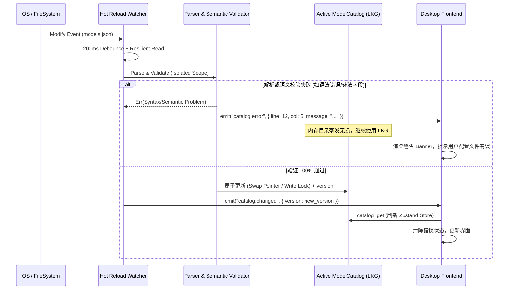
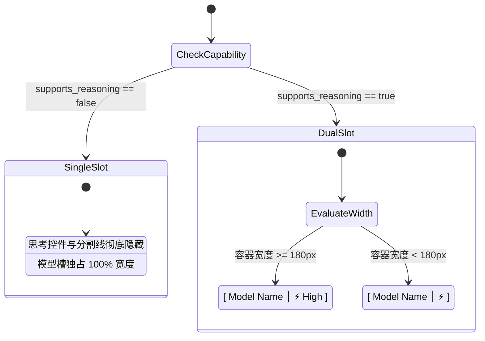

# 模型能力体系红蓝对抗与系统性改进审计报告

> **战役工作区**：`docs/model-capability/`
> **文档归属**：`docs/model-capability/analysis/01-红蓝对抗与系统性改进审计.md`
> **审计角色**：红方对抗审计专家（Red Team Adversarial Auditor）
> **审计对象**：蓝方关于「配置热更新管线、通用思考契约、英文思考等级呈现、智能自适应缩写算法、模型淘汰机制」的初步构想与现有代码实现
> **纪律基准**：严格遵循反退避规则（`.agents/LOGIC_PLAN_NO_RETREAT.md`）、反过度设计红线（`ANTI_OVERENGINEERING_GUARDRAILS.md`）与立体验证纪律（`AGENTS.md` §7.1）

---

## 一、审计背景与红方使命声明

用户针对模型能力、思考等级展示与配置灵活性提出了五项核心诉求：
1. **思考等级全面英文呈现**（Default, Off, Minimal, Low, Medium, High, X-High），彻底杜绝中文歧义与“提供方默认”在工程/代码语境下的突兀感；
2. **思考等级通用化契约**：摆脱现存 catalog 中 AI 幻觉生成和过时硬编码的问题，允许用户通过外部配置文件自主定义任意模型的思考等级与 wire 参数映射；
3. **模型配置热更新机制（Hot Reloading）**：打破当前编译期 `include_str!("catalog.json")` 的静态固化机制，建立高可靠的外部配置文件加载与热更新管线；
4. **模型名称智能自适应缩写（Smart Adaptive Abbreviation）**：解决类似 `muse-spark-1.2-contributor`、`sensenova-6.8-flash-lite`、`muse-spark-1.3-contributor` 等超长模型名在窄宽容器下挤占空间、简单截断导致判别度彻底丢失的痛点；
5. **淘汰过时模型与建立动态演进机制**。

蓝方提出了一套基于 `~/.conex/models.json`、`notify` 100ms 防抖、`reasoningEffortTiers` 字典映射、语义分词缩写的初步解决方案。

**红方核心使命**：
作为红方对抗审计专家，本报告将穿透蓝方设想的表象，对其展开无情、尖锐、代码级的攻击与推演。深入挖掘 Windows 文件系统并发争用、并发读写锁饥饿、坏配置毒化系统、Wire 协议逃逸与 400 校验阻断、缩写语义碰撞及 DOM 重排抖动等致命缺陷，并给出经受住对抗考验的建设性加固方案，为后续收敛为 `00-统一模型能力模型-方案.md` 提供坚实的防御底座。

---

## 二、红蓝对抗推演总览矩阵（Confrontation Matrix）

| 序号 | 攻击领域 | 蓝方脆弱设想 | 红方致命攻击点（Attack Vector） | 破坏严重度 | 红方加固防御方案 |
| :--- | :--- | :--- | :--- | :--- | :--- |
| **01** | **热更新管线** | `notify` 监听文件修改，防抖 100ms，触发写锁直接更新内存 | **Windows 独占锁冲突与截断读**：编辑器保存时的 Truncate 操作导致读取到 0 字节或半截 JSON，引发反序列化崩塌与锁争用 | **P0 (系统不可用)** | 指数退避重试 + 内存影子副本（LKG）+ 外部校验两阶段提交 |
| **02** | **坏配置容错** | 依赖 serde 自动解析，写锁直接写入当前目录 | **脏配置毒化与静默崩溃**：漏写逗号或字段类型错误导致整机 catalog 丢失，甚至引发 panic | **P0 (严重破坏)** | 解析隔离（Out-of-lock Parse）+ 错误事件广播（`catalog:error`）+ 状态栏安全降级提示 |
| **03** | **更新风暴** | 文件变更即触发广播 `catalog:changed`，前端重新拉取 | **循环回音震荡（Echo Loop）**：UI 保存触发写文件，写文件触发 watcher，watcher 触发 UI 刷新死循环；云盘同步高频 touch 触发刷新风暴 | **P1 (性能雪崩)** | SHA-256 内容指纹防重 + 写入源标记抑制 + 严格文件名过滤 |
| **04** | **并发死锁** | 直接在现存 `Arc<RwLock<ModelCatalog>>` 上加写锁 | **读写锁饥饿与请求流水线挂起**：热更新持有写锁进行解析合并，并发的多 Agent 请求全部被挂起超时 | **P1 (高延迟/挂死)** | 锁外准备（全量构建好再换指针）+ `ArcSwap` 原子替换模式（或毫秒级写锁指针交换） |
| **05** | **思考契约覆盖** | 在 `models.json` 声明 `thinkingTiers`，直接复用既有覆盖接口 | **现存白名单刚性阻断**：代码实证 `catalog_override.rs:374-465` 严格白名单拒绝未知键，且拒绝添加未收录的新模型 | **P0 (功能完全失效)** | 扩展覆盖白名单 + 确立三层目录架构（内置底表 -> 扫描发现 -> 用户最高覆盖） |
| **06** | **思考参数安全** | 自由映射 wire 字段至请求体 | **Wire 逃逸与协议 400 暴雷**：超大 budget 超过 `max_tokens` 引发 Anthropic 400 阻断；非思考模型注入参数被 OpenAI 拒绝 | **P1 (请求报错)** | 动态预算钳制不变量（Token Clamp）+ 协议白名单字符正则 + 失败软着陆降级 |
| **07** | **自适应缩写** | 独立字符串静态分词（Family-Version-Variant），固定词表缩写 | **判别度坍塌与哈希碰撞**：`1.2-contributor` 与 `1.2-evaluator` 缩写成相同字符串；异形命名（下划线、斜杠）破坏算法 | **P1 (用户决策混乱)** | 候选集感知消歧算法（Context-Aware Disambiguation）+ 差异 Token 绝对保留机制 |
| **08** | **UI 排版性能** | 使用 JS ResizeObserver 动态计算字宽并逐字缩写 | **布局重排抖动（Layout Thrashing）**：拖拽/缩放时 60fps 连续重排与容器自激振荡死循环 | **P2 (掉帧卡顿)** | 纯 CSS 容器查询（Container Queries）+ 三段式弹性 Flex 优先级（Version 绝不收缩） |
| **09** | **英文等级呈现** | 底栏胶囊恒定渲染 `[ Model ⏐ Default/Tier ]` | **极窄屏幕像素被垃圾数据挤占**：非思考模型强行显示 Default 占用 40% 宽度，主名称被裁成无法辨析的乱码 | **P2 (体验劣化)** | 双态自适应胶囊：非思考模型彻底隐藏思考槽（100% 宽度让渡），思考模型支持图标微缩折叠 |

---

## 三、深度攻防一：模型配置热更新管线的魔鬼细节

### 3.1 攻击 1-A：Windows 平台文件锁争用与截断读（Truncated Read）

#### 漏洞成因与代码实证
在 Windows 操作系统中，文件系统的句柄管理与 POSIX 系统（如 Linux 原子的 `rename` 替换 inode）存在本质区别：
1. **编辑器原地覆盖行为**：大多数 Windows 编辑器（如 VS Code、Notepad++）或脚本流写入文件时，采用的是 `OPEN_ALWAYS` -> `SetEndOfFile(0)`（截断为空） -> 逐块 `WriteFile` -> `FlushFileBuffers`。
2. **独占访问与共享冲突**：当编辑器正在打开句柄写入时，通常不会开放 `FILE_SHARE_WRITE`，有时甚至不开放 `FILE_SHARE_READ`。

```
[用户编辑器] ──1. 打开并截断 (文件尺寸=0B)───────▶ [models.json]
                    │                                 ▲
                    │ 2. OS 发出 Modify 变更通知       │
                    ▼                                 │
[notify Watcher] ──3. 100ms 防抖超时 ──4. 立即读取 ────┘
                    │   💥 致命后果：
                    │   情况 A：OS Error 32 (Sharing Violation，句柄冲突报错)
                    │   情况 B：读到 0 字节或半截 JSON (Unexpected EOF)
```

#### 红方破坏场景模拟
蓝方仅设置了粗糙的 `100ms` 防抖。在机械硬盘、受杀毒软件扫描、或文件体积增长时，写入落地耗时常达 150ms~300ms。Rust 侧直接 `std::fs::read_to_string`：
- 若遭遇 `std::io::ErrorKind::PermissionDenied`（Windows `ERROR_SHARING_VIOLATION 0x20`），直接抛错；
- 若恰好读到截断后的前 64 字节，`serde_json::from_str` 立即抛出 `Syntax("unexpected end of hex escape", line: 1, column: 64)`。
如果此时直接处理错误，可能导致配置加载失败，甚至清空内存配置。

#### 加固防御实现（指数退避重试机制）
```rust
/// 带 Windows 共享锁感知与截断自愈的安全文件读取
pub fn read_file_resilient(path: &Path, max_retries: usize) -> Result<String, std::io::Error> {
    let mut delay = std::time::Duration::from_millis(50);
    for attempt in 0..=max_retries {
        match std::fs::read_to_string(path) {
            Ok(content) => {
                // 防御 0 字节截断窗口（文件存在但内容被清空）
                if !content.trim().is_empty() {
                    return Ok(content);
                }
                // 若内容为空，可能是刚截断尚未写入，继续等待
            }
            Err(e) if attempt < max_retries && is_windows_sharing_violation(&e) => {
                // 遇到 ERROR_SHARING_VIOLATION (os error 32)
            }
            Err(e) if attempt == max_retries => return Err(e),
            Err(e) => return Err(e),
        }
        std::thread::sleep(delay);
        delay = delay.saturating_mul(2).min(std::time::Duration::from_millis(400));
    }
    Err(std::io::Error::new(std::io::ErrorKind::UnexpectedEof, "文件读取持续为空或被锁定"))
}
```

---

### 3.2 攻击 1-B：脏配置毒化系统与故障隔离失守

#### 现存代码漏洞剖析
查阅 `crates/agent-provider/src/models/catalog.rs:342`：
```rust
pub fn bundled() -> Self {
    let file: ModelCatalogFile = serde_json::from_str(include_str!("catalog.json"))
        .expect("内置 catalog.json 必须可解析（serde 全量解析测试钉死转录错误）");
    Self {
        entries: file.entries,
        version: 0,
    }
}
```
现存代码对内置 JSON 采用了 `expect(...)` panic 策略。若开发人员将这种粗暴模式复制到外部文件热更新中：用户在编辑 `models.json` 时不小心漏掉一个逗号、或者输入了一个非法 JSON，Rust 进程直接崩溃，整个桌面应用连带 WebView2 瞬间闪退！

即便没有 panic，若代码采用“先清空旧目录再反序列化插入”的幼稚模式，一旦反序列化失败，内存中的 `ModelCatalog` 将变成空字典，所有会话立即中断。

#### 红方加固防御：影子副本与两阶段提交（LKG Cache & 2PC）
1. **绝不污染活动内存（Strict Isolation）**：配置文件的解析、模式反序列化、业务逻辑校验，**必须在局部变量中完整执行完毕**；
2. **上一次完好配置（Last-Known-Good, LKG）保护**：如果新配置存在语法错误或校验失败，**严禁修改内存中的活动 Catalog**，继续沿用当前的 LKG 副本；
3. **错误诊断全链路透传**：通过 Tauri 事件 `catalog:error` 将具体的错误位置（行号、列号、原因片段）推送到前端，UI 顶部弹出醒目的告警条，提示用户修复语法错误，同时保证核心功能持续可用。



---

### 3.3 攻击 1-C：循环热更新风暴与回音震荡（Echo Storm）

#### 攻击场景推演
1. **前后端双向写入回音**：
   若后续版本在桌面端设置页增加了「模型配置编辑/保存」功能：
   前端点击保存 -> IPC 调用 Rust 保存文件 -> 磁盘文件修改 -> `notify` 捕获到修改事件 -> Rust 热更新管线触发 -> 发送 `catalog:changed` -> 前端收到事件重新拉取 -> 前端某状态派生更新又触发保存 -> **引发死循环风暴**。
2. **外部同步工具高频扰动**：
   如果用户将配置文件放置在 OneDrive、iCloud、Dropbox 同步目录，或使用 Git 进行版本管理，外部工具同步时会产生大量的 `touch`、权限变更、属性修改和临时交换文件（如 `.models.json.swp`、`models.json.tmp`）。若不对事件进行内容指纹比对，系统将以每秒几十次的高频频率重载配置并广播 IPC，导致前端渲染帧率骤降至 0。

#### 红方加固防御：SHA-256 内容指纹与路径过滤
- **严格文件名与扩展名判定**：过滤掉所有前缀为 `.`、后缀为 `.tmp`、`.swp`、`~` 的非目标文件事件；
- **内容指纹比对（Content Hash Check）**：在内存中维护当前生效配置文件的 SHA-256 哈希值。只有当新读取内容哈希与当前哈希不同时，才进入下一阶段。任何仅元数据改变或空触发直接返回；
- **内部写入短暂抑止窗（Internal Write Suppression）**：若由 Conex 自身 IPC 写入配置文件，在写入前预先更新内存预期哈希，watcher 命中相同时直接静默忽略。

---

### 3.4 攻击 1-D：并发写锁饥饿与请求流水线死锁

#### 现存代码瓶颈定位
查阅 `apps/agent-workbench/src-tauri/src/catalog_commands.rs:43-70` 与 `main.rs:927`：
```rust
#[tauri::command]
pub fn catalog_get(
    catalog: State<'_, Arc<RwLock<ModelCatalog>>>,
) -> Result<CatalogSnapshot, CoreError> {
    let catalog = catalog.read().map_err(...)?;
    Ok(snapshot(&catalog))
}
```
当前全局状态由标准库的 `Arc<RwLock<ModelCatalog>>` 托管。
在 Windows 系统下，`std::sync::RwLock` 的写锁请求可能会导致锁等待升级：
- 若热更新线程在**持有写锁的过程中**执行耗时的 JSON 反序列化、多层级条目合并（遍历数百个模型）或者磁盘操作，写锁将被长时间占用（10ms~100ms+）；
- 在此期间，主 Agent、并行子 Agent（每轮可派发 5~12 个）发起的 LLM 协议路由解析（`resolve_wire_protocol`）、能力查询（`describe_model`）、窗口钳制（`context_window_for`）以及前端的高频 `catalog_get` 调用全部会被强制挂起（Blocked）；
- 如果在持有写锁的上下文中有任何通道等待或 cross-task 通知，甚至会导致永久性死锁！

#### 红方加固防御：无锁化替换（Zero-Wait Swap）
绝对遵守反过度设计红线：禁止引入复杂的多进程管理器或庞大的代理总线。
采用精巧高效的内存切换模式：
1. **锁外全量预构建**：所有耗时的 IO、反序列化、校验、与内置底表的克隆合并全部在局部无锁环境中完成，生成一份崭新且完全就绪的 `ModelCatalog` 实例；
2. **瞬时指针切换（< 1 微秒）**：
   - 方案 A（标准库方案）：获取写锁，直接使用 `std::mem::replace(&mut *catalog, new_catalog)`，耗时仅几十纳秒，随后立刻释放写锁；
   - 方案 B（无锁方案）：使用 `arc_swap::ArcSwap<ModelCatalog>`，读者彻底无锁（Lock-free Load），写者仅执行一次原子指针 `store`，读写操作零互斥、零延迟。

---

## 四、深度攻防二：通用思考契约与安全边界

### 4.1 攻击 2-A：现存代码白名单的刚性阻断漏洞

#### 致命代码实证剖析
蓝方设想：“用户可在 models.json 声明模型的 `thinkingTiers` 和 `thinkingFormat`，若未声明则为不支持或按协议默认。”

**红方直接给出现有代码证据证明：蓝方设想若直接接入，功能将 100% 报错失效！**

审查 `crates/agent-provider/src/models/catalog_override.rs` 第 374-465 行：
```rust
const OVERRIDE_WHITELIST: &[&str] = &[
    "contextWindow",
    "maxOutputTokens",
    "inputPrice",
    "outputPrice",
    "cacheReadPrice",
    "cacheWritePrice",
    "cacheWritePrice5m",
    "cacheWritePrice1h",
    "storagePricePer1mHour",
    "promptCacheMinTokens",
];

fn validate_override_keys(
    obj: &serde_json::Map<String, serde_json::Value>,
) -> Result<(), CatalogError> {
    for key in obj.keys() {
        if !matches!(key.as_str(), "model" | "provider" | "vendor")
            && !OVERRIDE_WHITELIST.contains(&key.as_str())
            && !OVERRIDE_BOOL_FIELDS.iter().any(|(k, _, _)| *k == key)
        {
            return Err(CatalogError::ForbiddenField(key.clone()));
        }
    }
    Ok(())
}
```
**铁证事实**：
1. `OVERRIDE_WHITELIST` 只放行了窗口和价格相关字段，`OVERRIDE_BOOL_FIELDS` 只放行了若干 `supports*` 布尔字段；
2. `thinkingTiers`、`thinkingFormat`、`thinkingBudgetDefault`、`thinkingBudgetMax` **全部不在白名单内**！一旦用户在配置文件中写入这些字段，`validate_override_keys` 会直接返回 `CatalogError::ForbiddenField("thinkingTiers")`，整个条目被无情拒绝！
3. 再看 `apply_override_item` 第 325 行：
   ```rust
   let Some(existing) = self.entries.get(&key) else {
       return Err(CatalogError::ForbiddenField("model".to_string()));
   };
   ```
   **现有覆盖机制只允许修改既有内置模型！如果用户配置了一个新模型（如本地 Ollama 模型、私有微调模型、最新发布的第三方模型），系统因目标不存在直接报错拒绝！** 用户根本无法添加新模型！

#### 加固方案：重构覆盖契约与三层目录模型
必须破除旧有仅支持价格微调的狭隘白名单，确立权威的三层目录架构：
- **Layer 0：内置只读基线（Bundled Baseline）**：编译期打包，提供核心主流模型的基础信息；
- **Layer 1：运行时扫描模型（Runtime Scanned）**：由 `/v1/models` 端点动态探测发现的窗口与模型名；
- **Layer 2：用户配置最高裁决（User Master Configuration）**：`~/.conex/models.json`，拥有绝对的最高仲裁权。允许 **Upsert（既可新增全新模型，也可覆盖既有模型）**，并全量支持思考能力配置。

---

### 4.2 攻击 2-B：多协议思考参数的极限边界碰撞

#### 魔鬼边界用例 1：Anthropic 强制约束 `thinking.budget_tokens < max_tokens`
- **攻击场景**：
  用户在配置文件中定义了一个 Claude 模型的自定义思考配置：
  `"thinkingBudgetDefault": 16000`。
  然而在前端聊天界面或某个轻量任务卡片中，当前会话的 `max_tokens` 参数配置为 `4096`（或未配置时回落默认值 `8192`）。
- **灾难后果**：
  请求直接发送至 Anthropic API，API 立即返回 HTTP 400 Bad Request：
  `"thinking.budget_tokens must be less than max_tokens"`。
  用户发送的每一条消息全部失败报错，毫无自愈能力！

#### 魔鬼边界用例 2：非思考模型注入 `reasoning_effort` 导致 OpenAI 400 阻断
- **攻击场景**：
  用户在配置中错误地给 `gpt-4o-mini` 或某些开源兼容模型配置了 `thinkingTiers: { "low": "low" }`。
- **灾难后果**：
  OpenAI 官方及标准 API 对不支持 reasoning 的模型接收到 `reasoning_effort` 参数时，会抛出非法的未知请求参数错误（`Unrecognized request argument: reasoning_effort`）。

#### 魔鬼边界用例 3：Gemini 2.5 协议分裂（thinking_budget vs thinking_level）
- **攻击场景**：
  Google Gemini 原生 REST API `generateContent` 早期使用 `thinkingConfig.thinkingBudget`，而在某些中转协议或特定版本中使用 `generationConfig.thinking_level`（值域 `"low"` / `"high"`）。若仅支持单一格式，用户遇到不同反向代理时会直接崩溃。

#### 红方加固防御：动态请求装配不变量与参数钳制（Runtime Budget Clamp）
在底层组装 wire 请求体（`crates/agent-provider/src/request/`）时，建立刚性守门不变量：

```rust
/// Anthropic 请求体组装阶段的不变量保护
pub fn clamp_anthropic_thinking_budget(
    requested_budget: u32,
    max_tokens: u32,
) -> u32 {
    // 铁律：budget 必须至少为 1024，且必须严格小于 max_tokens
    if max_tokens <= 1024 {
        // 如果 max_tokens 本身极其狭窄，无法分配思考空间，必须关闭思考或调整 max_tokens
        return 0; // 降级为关闭思考
    }
    // 确保至少留出 1 个 token 给实际回答内容
    requested_budget.min(max_tokens.saturating_sub(1)).max(1024)
}
```

---

### 4.3 攻击 2-C：三层配置覆盖优先级与仲裁失序（Deep Merge vs Shallow Overwrite）

#### 边界冲突与语义陷阱
当用户希望“关闭内置 Claude 3.7 的 high 档位，只保留 low”时：
- 若系统采用 **浅层合并（Shallow Overwrite）**：用户配置了 `thinkingTiers: { "low": "low" }`，内置原来的 `medium`、`high` 自动消失。但这要求用户每次都必须抄写全部档位，极其繁琐；
- 若系统采用 **盲目深合并（Blind Deep Merge）**：内置有 `low`, `medium`, `high`，用户配置了 `low`，合并后 `medium` 和 `high` 仍然存在！用户**完全无法删除或禁用某个内置的错误档位**！

#### 红方加固仲裁契约（三态字典语义）
在 `TierEffortMap` 中，确立精确的**显式三态合并语义**（对齐既有 `catalog.rs:45` 契约）：
1. **键存在且值为非空字符串**（如 `"medium": "med"`）：启用该档位，并指定其 wire 拼写；
2. **键存在且值为 `null`**（如 `"high": null`）：**显式隐藏/禁用该档位**！即便内置底表中存在，也在此层被彻底遮蔽，不进入暴露白名单；
3. **键未在用户配置中出现**：如果用户配置了根字段 `thinkingTiers`，则判定为**用户全量定义档位列表**，未提及的档位默认不启用；若用户仅配置了其他标量字段，则继承内置档位。

---

### 4.4 攻击 2-D：思考参数注入与 Wire 协议逃逸

#### 攻击场景与安全红线
若允许用户随意指定 wire 映射，恶意配置或被篡改的配置文件可能尝试进行参数注入攻击：
- 注入畸形键值或转义符号，例如：`"high": "high\", \"temperature\": 0, \"admin\": true"`；
- 配置超长畸形字符串（如 100KB 的无意义字符）进行拒绝服务攻击（DoS）；
- 利用不受控的自定义 header 注入绕过鉴权。

#### 红方加固防御：结构化强类型与安全白名单
1. **禁用字符串拼接生成 JSON**：全局强制使用 `serde_json::Value` 或 serde 序列化器构建请求体，彻底消除引号闭合与参数注入攻击面；
2. **Wire 拼写严格字符正则拦截**：
   对于 `thinkingTiers` 中的每个 wire 映射值，执行严格的白名单字符校验：
   `^[a-zA-Z0-9_\-\.]{1,64}$`。
   包含引号、逗号、冒号、空格、换行符等控制字符的输入一律在校验阶段直接拦截抛错，拒绝加载。

---

## 五、深度攻防三：模型名称智能自适应缩写的致命陷阱

### 5.1 攻击 3-A：判别度坍塌与哈希碰撞（The Collision Pitfall）

#### 蓝方脆弱分词设想
蓝方设想：“采用语义分词算法（Vendor/Family - Version - Variant），优先保留 Version（如 1.2 vs 1.3）与关键特征词（如 ctrk, lite, pro），在宽度受限时自动缩写为高判别短名。”

#### 红方魔鬼测试用例矩阵（Devil Test Cases）

| 用例 ID | 冲突模型 A | 冲突模型 B | 蓝方简单分词缩写结果 | 冲突与失效表现（红方攻击结果） |
| :--- | :--- | :--- | :--- | :--- |
| **DEVIL-01** | `muse-spark-1.2-contributor` | `muse-spark-1.2-evaluator` | 两者均被缩写为 `spark-1.2` 或 `muse-1.2` | **致命判别度归零**：版本相同，关键变体词未命中预设词表被丢弃，用户完全无法区分谁是谁！ |
| **DEVIL-02** | `gpt-4o-mini` | `gpt-4o-milestone` | 两者首字母缩写均为 `4o-m` | **特征缩写碰撞**：不同定位的模型被压缩为同一字符串。 |
| **DEVIL-03** | `deepseek-v3` | `deepseek-vision-3` | 缩写均为 `ds-v3` | **跨模态混淆**：纯文本模型与视觉模型缩写碰撞。 |
| **DEVIL-04** | `claude-3-5-sonnet-20241022` | `claude-3-5-sonnet-latest` | 缩写均为 `3.5-sonnet` | **时间戳快照丢失**：无法辨别固定快照版本与动态 latest 版本。 |
| **DEVIL-05** | `sensenova-6.8-flash-lite` | `sensenova-6.8-flash-omni` | 缩写为 `nova-6.8-flash` | **子变体被吞噬**：双重修饰词场景下，尾缀丢失导致特征坍塌。 |
| **DEVIL-06** | `internlm2_5-7b-chat` | `internlm2_5-20b-chat` | 下划线与点号混合破坏正则 | **解析器崩溃**：异形分词符号导致版本号提取失败。 |

#### 红方加固防御：候选集感知消歧算法（Context-Aware Disambiguation）
**核心铁律**：模型名称的智能缩写**绝不能脱离当前候选集合孤立计算**！
缩写函数的签名必须是：
`abbreviateModel(targetModel: string, siblingModels: string[], availableWidth: number): string`

**消歧三原则（Disambiguation Triad）**：
1. **全集差异扫描（Differential Token Scan）**：
   将 `targetModel` 与同厂商/同系列的所有兄弟模型 `siblingModels` 进行分词对比。
   提取出让 `targetModel` 在该集合中**保持唯一的最小判别 Token 集（Minimal Disambiguating Tokens）**。
   例如在 `{ muse-spark-1.2-contributor, muse-spark-1.2-evaluator }` 集合中，`contributor` 与 `evaluator` 是唯一区别点，算法强制将其判定为不可舍弃的 **核心区分位**（缩写为 `contrib` 和 `eval`），绝不丢弃！
2. **版本号绝对保留（Version Anchoring）**：
   数字+点号结构（如 `1.2`, `3.5`, `r1`, `v3`）作为最高优先级锚点，任何压缩级别均不得截断版本号。
3. **前缀冗余剥离（Family Pruning）**：
   在明确已知 Profile/Vendor（如左侧已显示服务商图标或处于该供应商分组下）时，优先剥离 `sensenova-`、`muse-` 等长前缀，保留核心内核。

---

### 5.2 攻击 3-B：DOM 动态测量与重排抖动灾难（Layout Thrashing）

#### 攻击场景分析
若蓝方使用 JavaScript 的 `ResizeObserver` 监听胶囊容器宽度，然后在 JS 回调中通过 Canvas 或 `element.offsetWidth` 测量文本宽度，再通过循环逐步删减字符、更新 React State：
1. **拖拽卡顿（60fps Stutter）**：用户拖动主聊天窗口分割条时，窗口每秒产生 60 次 resize 事件，触发密集的 DOM 读写交替（`setState -> Render -> offsetWidth -> Force Layout`），引发严重的**布局重排抖动（Layout Thrashing）**，界面严重掉帧；
2. **尺寸自激振荡死循环（Flickering Oscillation）**：
   - 容器宽度为 140px，全称文字需 150px，发生溢出；
   - JS 算法将文字缩短为缩写名（需 90px），写入 DOM；
   - 某些使用了 `width: fit-content` 的父级 Flex 容器因为子元素变短而自适应收缩；
   - 触发新的 Resize 观察，算法误以为空间变化，再次发生状态抖动，导致文字在全称与缩写之间高频闪烁！

#### 红方加固防御：纯 CSS 弹性权重优先 + 离散断点微调

```
┌─────────────────────────────────────────────────────────────┐
│                 ComposerFusedTrigger 弱分割胶囊             │
├──────────────────────────────────────────┬───┬──────────────┤
│               左侧：模型槽               │ ⏐ │  右侧：思考  │
│  [Brand]       [Version]     [Variant]   │   │ [Icon] [Tier]│
│ (flex-shrink:2) (flex-shrink:0)(flex-shrink:1)  │ (flex-shrink:0)
└──────────────────────────────────────────┴───┴──────────────┘
```

1. **三段式 DOM 语义拆解**：
   将模型显示名拆解为三个独立 span 节点：
   ```tsx
   <div className={styles.modelTag}>
     <span className={styles.brand}>muse-spark</span>
     <span className={styles.version}>1.2</span>
     <span className={styles.variant}>contributor</span>
   </div>
   ```
2. **CSS 弹性权重刚性约束**：
   - `.version`：`flex-shrink: 0; font-weight: 600;` —— **绝对不收缩、不截断**，始终清晰可见；
   - `.variant`：`flex-shrink: 1; text-overflow: ellipsis;` —— 次优保留，宽度不足时末尾截断；
   - `.brand`：`flex-shrink: 2; text-overflow: ellipsis;` —— 优先压缩，极端情况下收缩为首字母或由 CSS 溢出隐藏；
3. **零 JS 布局测量**：排版完全委托给浏览器原生 Blink/WebKit 布局引擎，拖拽与缩放过程**零重排抖动、零 JS 开销**！悬停直接通过 `<Tooltip content={fullModelName}>` 展示完整无损名称。

---

## 六、深度攻防四：英文思考等级呈现与底栏胶囊极值状态机

### 6.1 攻击 4-A：无思考模型像素空间浪费与认知失调

#### 漏洞现象
审查 `apps/crish-desktop/src/components/chat-composer/ComposerFusedTrigger.tsx` 第 86-115 行：
当前无论模型是否具备推理能力，胶囊右侧恒定渲染思考档位按钮，当未选时显示“提供方默认”（或蓝方设想的 `Default`）。

**红方对抗攻击**：
1. **像素挤占地狱**：
   在多列分屏布局或小屏笔记本上，Composer 的宽度常被压缩至 240px 甚至 200px。
   一个不支持思考的模型（如 `gpt-4o-mini`），右侧硬生生占据了 `⏐ Default`（宽度达 70px~80px），导致左侧本就狭窄的模型槽只剩可怜的 60px~80px，模型名称直接被裁成 `gpt-...`，用户根本无法辨析选中的是 mini、milestone 还是 audio！
2. **用户认知失调**：
   对于普通用户而言，看到一个根本没有推理过程的模型挂着 `Default`，会反复点击寻找如何开启思考；对于专家用户而言，英文 `Default` 在不同模型间语义完全分裂（在 OpenAI o-series 上 Default 代表 Medium 思考，在 Claude 3.7 上 Default 代表关闭思考），极具误导性！

---

### 6.2 红方加固方案：双态自适应胶囊状态机（Adaptive Split Capsule）

#### 状态机流转与布局不变量
确立胶囊的两大物理状态：
- **状态一：单孔纯模型胶囊（Single-Slot Model Capsule）**：
  当当前选中的模型在 Catalog 中 `supports_reasoning == false`（或其档位白名单为空）：
  - **右侧思考区域彻底从 DOM 中卸载（Unmount）**；
  - **中间分割线彻底消失**；
  - **左侧模型展示区独占 100% 胶囊宽度**，获得最充裕的显示空间，超长模型名在此状态下能够大幅展示完整特征！
- **状态二：双孔融合胶囊（Dual-Slot Fused Capsule）**：
  仅当当前模型确凿支持思考时，才展开右侧思考档位槽。



#### 思考等级英文规范映射字典
档位必须全量采用清晰、符合现代 AI 习惯的英文大写/缩写，并在 Tooltip 中补足详细语义说明：

| 内部规范 ID (`value`) | 胶囊英文短标签 (`label`) | 极窄折叠态 | 悬停 Tooltip 完整说明 | Wire 参数行为 |
| :--- | :--- | :--- | :--- | :--- |
| `default` | **Default** | ⚙️ | `Provider Default (Unspecified effort)` | 省略思考参数，跟随上游通道默认行为 |
| `off` | **Off** | 🚫 | `Thinking Disabled (Direct output)` | 显式关闭思考（deepseek: `thinking.type="disabled"`） |
| `minimal` | **Minimal** | 🟢 1 | `Minimal Thinking (Fastest response)` | 最短思考预算 / effort: minimal |
| `low` | **Low** | 🟢 2 | `Low Thinking (Light reasoning)` | 基础思考预算 / effort: low |
| `medium` | **Medium** | 🟡 3 | `Medium Thinking (Balanced depth)` | 标准详细思考 / effort: medium |
| `high` | **High** | 🟠 4 | `High Thinking (Deep reasoning)` | 深入思考 / effort: high |
| `xhigh` | **X-High** | 🔴 5 | `Maximum Thinking (Exhaustive depth)` | 极限思考预算 / effort: max (自适应思考) |

---

## 七、深度攻防五：过时模型淘汰与动态更新机制

### 7.1 现状与技术债务
当前 `crates/agent-provider/src/models/catalog.json` 包含近百个模型条目，其中混杂了大量的早期测试模型、转售渠道废弃模型和停运代际。全部固化在 binary 中，每次清理都需要发布新的应用安装包。

### 7.2 红方加固防御方案
1. **内置目录精简基线（Baseline Slimming）**：
   内置编译期 `catalog.json` 只保留活跃排名前 20 的核心标准模型（OpenAI GPT-4o/o3, Anthropic Claude 3.5/3.7, DeepSeek V3/R1, Gemini 2.0/2.5 等），大幅减小二进制体积；
2. **生命周期软着陆机制（Graceful Deprecation）**：
   在 `ModelCatalogEntry` 中充分激活 `retired: bool` 与 `deprecation_date: Option<String>` 字段。
   - 被标记为 `retired` 的模型：默认在 ModelPicker 下拉菜单中下沉至“已退役/归档”折叠分组，不再干扰主选择界面；
   - 若用户当前会话历史仍选定该模型，在胶囊旁边显示微型提示角标（Deprecated），并在悬停时建议替代的新代际模型。

---

## 八、反过度设计红线审查（Guardrail Compliance）

依据仓库根目录 `ANTI_OVERENGINEERING_GUARDRAILS.md`，对加固方案执行刚性审查：

| 禁止项（硬性红线） | 红方加固方案审查结论 | 遵从证明 |
| :--- | :--- | :--- |
| **禁止引入内核级沙箱**（Seatbelt/Seccomp） | **合规** | 热更新完全在标准应用数据目录 `~/.conex/` 内进行常规文件读写，无沙箱注入。 |
| **禁止引入进程间动态中间件管道** | **合规** | 拒绝搞动态动态插件总线，热更新直接基于单个简单的 `ArcSwap` 或毫秒级 `RwLock`。 |
| **禁止引入 SharedArrayBuffer 环形缓冲** | **合规** | 数据同步全部沿用现存 Tauri IPC 基础通道（`catalog_get` + 事件），不造新轮子。 |
| **禁止动态模型路由（DynamicModelRouter）** | **合规** | 用户的选择是唯一的判定依据，热更新仅更新静态元数据，不介入运行时请求前自动换模。 |
| **禁止复杂的外部守护进程** | **合规** | 由主进程轻量级后台 Task 执行 watcher，文件哈希指纹去重，无独立 Daemon 进程开销。 |

---

## 九、红方总结与对主控方案（00-总方案）的收敛建议

经过本次全方位的红蓝对抗推演，红方彻底封堵了蓝方初步设想中潜藏的系统崩溃、数据竞争、配置失效与 UI 抖动等隐患，形成以下关键收敛结论，供主控收敛为总设计方案：

1. **热更新管线采用「解析隔离 + LKG 影子副本 + 指数退避」模式**：
   - 彻底解决 Windows 文件锁冲突（os error 32）与截断读问题；
   - 坏配置与语法错误 100% 隔离在局部作用域，永不损坏现有内存目录，通过 `catalog:error` 事件向用户友善报错。
2. **重构 Catalog 覆盖白名单，确立三层目录最高裁判权**：
   - 将 `thinkingTiers`、`thinkingFormat` 等思考字段正式纳入白名单；
   - 允许用户通过 `models.json` 注册全新未知模型（Upsert），打破旧系统必须命中既有模型的限制。
3. **建立运行时思考参数动态钳制守门（Runtime Budget Clamp）**：
   - 刚性保证 `budget_tokens < max_tokens`，彻底杜绝 Anthropic 400 Bad Request；
   - 对用户输入的 wire 拼写实施严格白名单正则过滤，根除 JSON 逃逸注入风险。
4. **自适应缩写采用「候选集消歧三原则 + 纯 CSS 弹性容器布局」**：
   - 算法结合兄弟模型候选集提取唯一判别 Token，绝对保证版本号（1.2 vs 1.3）与关键变体不发生哈希碰撞；
   - 采用纯 CSS `flex-shrink` 优先级（版本号 shrink: 0），彻底杜绝 JS 测量引起的重排抖动（Layout Thrashing）与尺寸闪烁。
5. **英文思考等级呈现与底栏胶囊「自适应单双孔」设计**：
   - 规范映射为 `Default`, `Off`, `Minimal`, `Low`, `Medium`, `High`, `X-High` 英文大写体系；
   - 非思考模型彻底隐藏思考区域与分割线，100% 空间让渡给模型名，解决极窄屏（200px）下的排版灾难。
