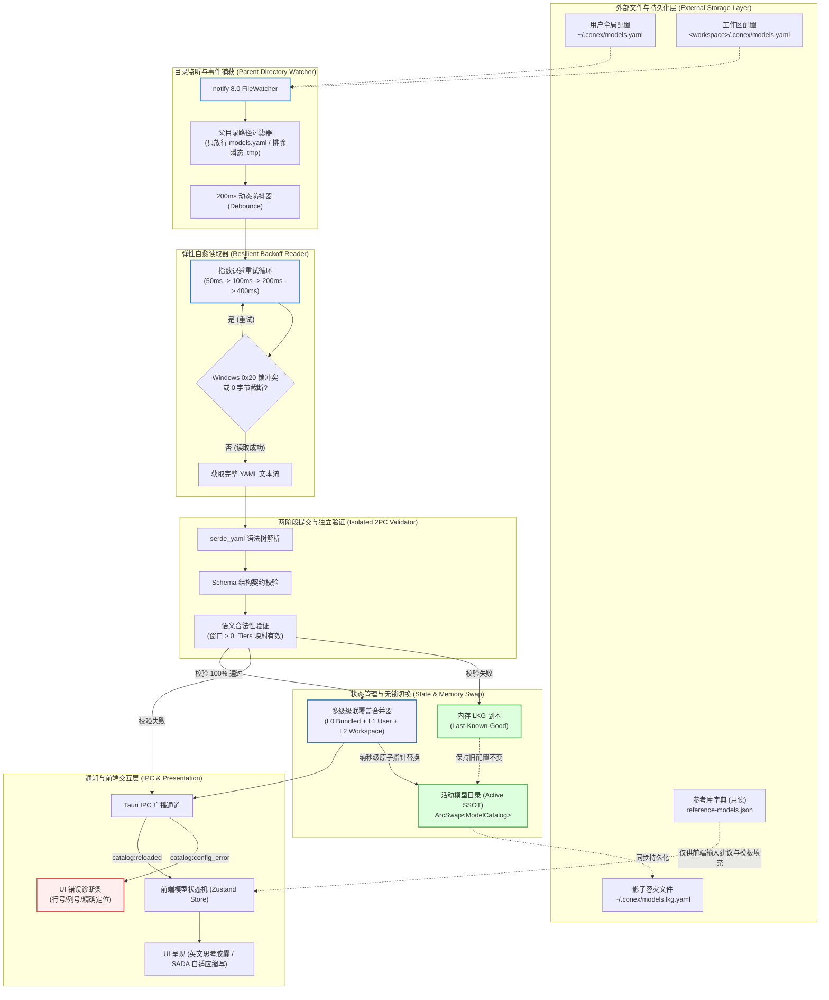
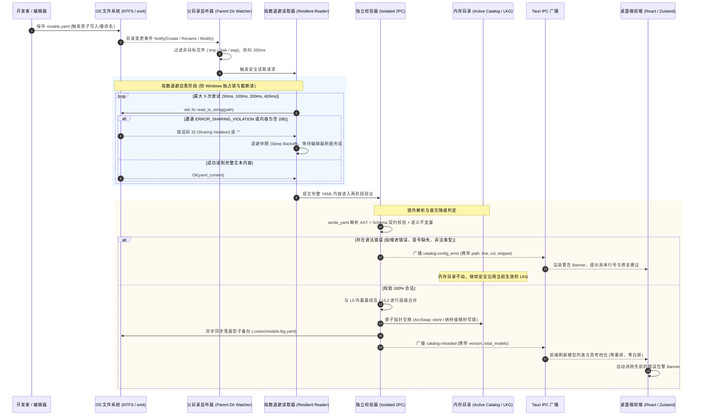

# 外部 YAML 唯一真源与热重载架构方案

> **战役工作区**：`docs/model-capability/`
> **文档归属**：`docs/model-capability/analysis/02-外部YAML唯一真源与热重载架构方案.md`
> **版本**：v1.0（生产级架构方案规范）
> **定位**：Conex / Crish 外部模型配置体系之绝对唯一真源（SSOT）与工业级热重载引擎终极方案
> **核心裁决**：
> 1. **外部 YAML 唯一真源（SSOT）**：`~/.conex/models.yaml`（全局）与 `<workspace>/.conex/models.yaml`（工作区）是全系统模型能力、参数、思考形态与计价的**绝对唯一真相源**，运行时彻底取消对未收录模型的拦截与门禁；
> 2. **参考库定位彻底解耦（Reference Library Decoupling）**：既有模型全景调研表格（涵盖 1,600+ 模型的多源调研资产）**仅作为“智能录入参考库与选项字典”**，用于前端输入补全、模板预填与参数推荐，**绝对不作为运行时校验依据**，零强行依赖；
> 3. **父目录监听机制（Parent Directory Watching）**：监视父目录 `.conex/` 而非孤立文件，彻底根治现代编辑器（VS Code, JetBrains, Vim）与系统原子写入（先 tmp 再 rename 替换 Inode/句柄）导致的监听丢失死锁；
> 4. **指数退避自愈读取器（Exponential Backoff Reader）**：毫秒级抗击 Windows `ERROR_SHARING_VIOLATION (0x20)` 文件共享锁冲突与 0 字节截断写入窗口；
> 5. **两阶段提交与 LKG 影子容灾（Last-Known-Good Fallback）**：锁外解析与 Schema 校验，坏配置绝不 Panic、绝不毒化内存活动目录，精确行号列号错误透传 UI 诊断条，并持久化 LKG 影子快照守护冷启动。

---

## 一、系统定位与设计哲学（SSOT vs Reference Library）

### 1.1 核心矛盾剖析与架构解耦

在过往的演进讨论与历史代码实现中，存在两个截然不同的概念被模糊混淆的系统性缺陷：
1. **“模型全景数据资产”**（包含 1,600+ 模型的多源调研表、各厂商原生定价、发布日期、模态矩阵、官方一手链接）；
2. **“系统运行时的模型能力配置”**（Conex 引擎发请求时到底使用哪个 `api_model`、给几千 Token 思考预算、传 `reasoning_effort` 还是 `thinking_budget`、上下文窗口是多少）。

若将前者直接作为运行时的刚性检查底库，会产生极度恶劣的工程灾难：
- **开发者被系统“锁死”**：当开发者微调了一个内网开源模型（如 `my-org/llama-3-8b-instruct-q4`），或官方刚发布新模型（如 2026 年最新发布的 `muse-spark-1.3-contributor`），若内置库未重新编译发布，系统便以“未知模型”粗暴判定不支持思考、不支持工具，甚至阻断请求；
- **配置割裂与黑盒化**：用户在前端界面的微调保存在浏览器 `localStorage.crish_provider_profiles_v1`，密钥在 DPAPI，内置库在 Rust 二进制中打包 `catalog.json`，开发者无法像现代 DevOps 一样将模型配置纳入 Git 版本管理进行审查与共享。

### 1.2 权威定位矩阵（Decoupling Matrix）

因此，本架构方案正式确立**外部 YAML 唯一真源**与**参考库选项字典**的彻底解耦：

| 维度 | 外部 YAML 配置文件 (`models.yaml`) | 模型全景调研参考库 (`reference-models`) |
| :--- | :--- | :--- |
| **系统角色** | **唯一真源（Single Source of Truth, SSOT）** | **智能录入参考库 / 选项字典（Option Dictionary）** |
| **运行时权威性** | **最高统治权**：凡是 YAML 里声明的，运行时 100% 遵照执行 | **零运行时权威**：绝不作为校验门禁，未收录条目绝不报错 |
| **文件位置** | `~/.conex/models.yaml` (L1)<br>`<workspace>/.conex/models.yaml` (L2) | `docs/model-capability/surveys/` 及前端打包内置的只读静态建议库 |
| **存储介质** | 本地文件系统文本（纯 YAML，支持开发者注释与格式化） | 编译期静态索引 / 只读 JSON / 文档资产 |
| **生命周期** | 运行时动态监听、热重载（Hot-Reload）、即时生效 | 随版本发布静态演进，或作为独立离线包更新 |
| **消费场景** | LLM 请求组装、Wire 协议序列化、Thinking 预算钳制、Token 计费 | 前端下拉框 Autocomplete、新建模型一键模板填充、未知字段推荐 |
| **容错要求** | 极高：坏配置不 Panic、指数退避抗锁争用、LKG 影子保底 | 常规：字典缺失则用户手动键入，仅影响录入体验 |

```
┌──────────────────────────────────────────────────────────────────────────────────┐
│                   开发者交互层 (Developer Interaction Space)                     │
│                                                                                  │
│   [VS Code / Vim 编辑外部 YAML]                   [Crish 桌面端 UI 设置面板]     │
│   ~/.conex/models.yaml                                一键模板推荐 / 自动补全    │
│   <workspace>/.conex/models.yaml                             ▲                   │
│                │                                             │ (只读辅助)        │
│                │                               ┌─────────────┴─────────────┐     │
│                │ (绝对唯一真源 SSOT)           │  智能录入参考库/选项字典  │     │
│                │                               │ (Option Dictionary v2026) │     │
│                │                               └───────────────────────────┘     │
│                ▼                                                                 │
│ ┌─────────────────────────────────────────────────────────────────────────────┐ │
│ │                         Rust 工业级热重载引擎                               │ │
│ │                                                                             │ │
│ │  父目录监听 ──▶ 指数退避读取 ──▶ 锁外校验 ──▶ 多级合并 ──▶ LKG 影子原子替换 │ │
│ └──────────────────────────────────────┬──────────────────────────────────────┘ │
└────────────────────────────────────────┼─────────────────────────────────────────┘
                                         │ Tauri Event: `catalog:reloaded`
                                         ▼
┌──────────────────────────────────────────────────────────────────────────────────┐
│                           运行时消费层 (Runtime Consumers)                       │
│  - Agent Provider (Wire 协议映射 / Token Clamp / 思考档位注入)                   │
│  - Cost Tracker (四指标分档精确计费)                                             │
│  - Crish Desktop UI (英文思考等级胶囊 / SADA 智能自适应缩写展示)                 │
└──────────────────────────────────────────────────────────────────────────────────┘
```

### 1.3 多级覆盖架构（Cascading Hierarchy）

外部配置采用三层级联机制，优先级自顶向下收敛：

```
L2: 工作区专用配置 (<workspace_root>/.conex/models.yaml)  ── 最高优先级 (专为本仓库量身定制)
       ▲
       │ 覆盖 / 增量合并
L1: 用户全局配置 (~/.conex/models.yaml)                   ── 次高优先级 (开发者个人全局偏好)
       ▲
       │ 覆盖 / 增量合并
L0: 内置极简安全基线 (Bundled Safe Baseline)              ── 离线兜底 (免去任何外部依赖的保底)
```

1. **L2 工作区级（Workspace SSOT）**：
   - 路径：`<workspace_root>/.conex/models.yaml`；
   - 场景：项目专用的私有模型别名、特定微调版本（如 `contributor` 角色端点）、以及特定工作区内的计费分账规则；
   - 特性：跟随项目 Git 仓库受控（由开发团队共同维护）。
2. **L1 用户全局级（User Global SSOT）**：
   - 路径：`~/.conex/models.yaml`（即当前操作系统用户家目录下的 `.conex` 目录）；
   - 场景：跨工作区共享的个人常用模型集合、个人专属的 API 代理别名、个人设置的思考预算偏好；
   - 特性：单机全局持久化，新打开任何工作区均自动生效。
3. **L0 内置极简基线（Bundled Baseline）**：
   - 仅包含最核心、最普适的基础保底模型契约，彻底清退历史带有 AI 幻觉的虚构条目；
   - 当用户尚未创建任何外部 YAML 时，系统安全启动并提供基本通信能力；一旦用户在 L1 或 L2 创建文件，立即无缝无感覆盖。

---

## 二、系统架构总览与端到端数据流

### 2.1 整体架构全景图



### 2.2 工业级端到端热重载时序



---

## 三、外部 YAML 规范与 Schema 定义（Schema Specification）

### 3.1 外部配置文件语法规范 (`models.yaml`)

外部 YAML 规范采用符合直觉的声明式层次结构，天然支持标准 YAML 注释（`#`）、块级长文本以及清晰的键值结构。

```yaml
# yaml-language-server: $schema=https://conex.dev/schemas/models-v3.yaml
# ==============================================================================
# Conex / Crish 模型能力外部唯一真源配置文件 (Single Source of Truth)
# 支持位置:
#   1. 用户全局: ~/.conex/models.yaml
#   2. 工作区专用: <workspace_root>/.conex/models.yaml (优先级高于全局)
# ==============================================================================
version: 1
updatedAt: "2026-09-03T12:00:00Z"

# 全局默认行为配置 (可缺省)
defaults:
  thinkingBudget: 2048
  temperature: 0.7
  timeoutSeconds: 120

# 核心模型能力清单 (SSOT 声明)
models:
  # ----------------------------------------------------------------------------
  # 1. 强制思考模型 (例如 Meta 最新 Muse Spark 1.3 系列)
  # ----------------------------------------------------------------------------
  - model: "muse-spark-1.3-contributor"
    vendor: "meta"
    provider: "openai-compatible"           # 物理请求协议走标准 OpenAI-compatible 网关
    apiModel: "meta/muse-spark-1.3-contributor" # Wire 层实际发送的真实模型串
    displayName: "Muse Spark 1.3 Contributor"
    description: "Meta 研发贡献者专享强化思考模型"
    contextWindow: 1048576                  # 1M 输入上下文
    maxOutputTokens: 943718
    # 思考能力契约
    thinkingFormat: "reasoning_effort"      # 字符串档位注入格式
    thinkingTiers:
      minimal: "minimal"
      low: "low"
      medium: "medium"
      high: "high"
      xhigh: "xhigh"
    defaultThinkingTier: "medium"
    supportsReasoning: true
    # 模态与能力
    inputModalities: ["text", "image", "video", "audio", "file"]
    outputModalities: ["text"]
    supportsVision: true
    supportsTools: true
    supportsStrictJson: true
    # 计价规格 (USD/1M tokens)
    pricing:
      inputPrice: 0.30
      outputPrice: 1.20
      cacheReadPrice: 0.075

  # ----------------------------------------------------------------------------
  # 2. Token 预算型思考模型 (例如 SenseNova 6.8 Flash Lite)
  # ----------------------------------------------------------------------------
  - model: "sensenova-6.8-flash-lite"
    vendor: "sensenova"
    provider: "sensenova"
    displayName: "SenseNova 6.8 Flash Lite"
    contextWindow: 262144                   # 256K
    maxOutputTokens: 16384
    thinkingFormat: "thinking_budget"       # 整数 Token 预算
    thinkingBudgetDefault: 2048
    thinkingBudgetMax: 32768
    thinkingTiers:
      low: 1024
      medium: 4096
      high: 16384
    defaultThinkingTier: "medium"
    supportsReasoning: true
    pricing:
      currency: "CNY"                       # 人民币计价
      inputPrice: 0.10                      # ¥0.1 / 1M tokens
      outputPrice: 0.30
      cacheReadPrice: 0.02
      cacheWriteFree: true

  # ----------------------------------------------------------------------------
  # 3. 官方 Anthropic Claude 3.7 / 5 系列 (Messages API 原生)
  # ----------------------------------------------------------------------------
  - model: "claude-3-7-sonnet-20250219"
    vendor: "anthropic"
    provider: "anthropic"
    displayName: "Claude 3.7 Sonnet"
    contextWindow: 200000
    maxOutputTokens: 64000
    thinkingFormat: "thinking_budget"
    thinkingBudgetDefault: 2048
    thinkingBudgetMax: 64000
    thinkingTiers:
      low: 1024
      medium: 4096
      high: 16384
      max: 64000
    supportsReasoning: true
    supportsVision: true
    supportsTools: true
    supportsCacheControl: true              # 显式断点 prompt cache
    promptCacheMinTokens: 1024
    pricing:
      currency: "USD"
      inputPrice: 3.00
      outputPrice: 15.00
      cacheReadPrice: 0.30
      cacheWritePrice5m: 3.75

  # ----------------------------------------------------------------------------
  # 4. 私有微调或本地自建模型 (完全未在官方参考库收录的模型)
  # ----------------------------------------------------------------------------
  - model: "my-custom-deepseek-q4"
    vendor: "local-vllm"
    provider: "openai-compatible"
    displayName: "Org Private DeepSeek R1 (Q4)"
    contextWindow: 131072
    maxOutputTokens: 8192
    thinkingFormat: "reasoning_effort"
    thinkingTiers:
      low: "low"
      medium: "medium"
      high: "high"
    supportsReasoning: true
    supportsTools: true
    # 供应商私有扩展字段透传
    extra:
      repetition_penalty: 1.05
      top_k: 40
```

### 3.2 Rust 强类型反序列化契约 (`crates/agent-provider/src/models/yaml_schema.rs`)

为了确保向后兼容、容错缺失字段以及解析安全性，Rust Serde 反序列化结构全量采用 `#[serde(rename_all = "camelCase", default)]`：

```rust
use std::collections::BTreeMap;
use serde::{Deserialize, Serialize};

/// 外部 YAML 配置文件顶级结构
#[derive(Debug, Clone, PartialEq, Serialize, Deserialize, Default)]
#[serde(rename_all = "camelCase", default)]
pub struct ExternalModelsConfigFile {
    /// 规范版本号 (默认 1)
    pub version: u32,
    /// 配置文件最后更新时间 (ISO-8601 字符串)
    pub updated_at: Option<String>,
    /// 全局默认行为参数
    pub defaults: Option<ExternalDefaultsConfig>,
    /// 模型定义列表 (核心 SSOT 资产)
    pub models: Vec<ExternalModelEntry>,
}

/// 全局默认行为配置
#[derive(Debug, Clone, PartialEq, Serialize, Deserialize, Default)]
#[serde(rename_all = "camelCase", default)]
pub struct ExternalDefaultsConfig {
    pub thinking_budget: Option<u32>,
    pub temperature: Option<f32>,
    pub timeout_seconds: Option<u64>,
}

/// 单个模型外部定义条目 (覆盖能力位、思考契约与计费)
#[derive(Debug, Clone, PartialEq, Serialize, Deserialize, Default)]
#[serde(rename_all = "camelCase", default)]
pub struct ExternalModelEntry {
    // ── 核心标识 ──
    /// 唯一模型主键 (例如 "muse-spark-1.3-contributor")
    pub model: String,
    /// 厂商归属 (例如 "meta", "anthropic", "openai", "sensenova", "local")
    pub vendor: String,
    /// 路由通道标识 (例如 "openai-compatible", "anthropic", "google")
    pub provider: Option<String>,
    /// 真实网络请求所使用的模型名 (缺省等于 model)
    pub api_model: Option<String>,
    /// 呈现给用户的友好全称 (例如 "Muse Spark 1.3 Contributor")
    pub display_name: Option<String>,
    /// 描述或备注信息
    pub description: Option<String>,

    // ── 窗口容量 ──
    /// 输入上下文窗口大小 (Token 数量，必须 > 0)
    pub context_window: Option<u64>,
    /// 最大输出 Token 上限 (必须 > 0)
    pub max_output_tokens: Option<u64>,

    // ── 思考能力通用契约 ──
    /// 是否支持思考能力
    pub supports_reasoning: bool,
    /// 思考传输层形态 ("reasoning_effort" | "thinking_budget" | "thinking_level" | "custom" | "none")
    pub thinking_format: Option<String>,
    /// 默认思考预算 (Token)
    pub thinking_budget_default: Option<u32>,
    /// 最大思考预算上限 (Token)
    pub thinking_budget_max: Option<u32>,
    /// 规范档位到 Wire 字段的灵活映射表
    /// 支持两种 YAML 写法：
    ///   写法 A (数组): ["low", "medium", "high"]
    ///   写法 B (字典): { low: "low", medium: 4096, high: "max" }
    #[serde(deserialize_with = "deserialize_flexible_tiers")]
    pub thinking_tiers: Option<BTreeMap<String, serde_json::Value>>,
    /// 默认激活的思考档位 (例如 "default", "medium", "high")
    pub default_thinking_tier: Option<String>,

    // ── 模态与能力位 ──
    pub input_modalities: Option<Vec<String>>,
    pub output_modalities: Option<Vec<String>>,
    pub supports_vision: bool,
    pub supports_tools: bool,
    pub supports_strict_json: bool,
    pub supports_web_search: bool,
    pub supports_cache_control: bool,
    pub prompt_cache_min_tokens: Option<u64>,

    // ── 计费信息 ──
    pub pricing: Option<ExternalPricingConfig>,

    // ── 扩展与透传参数 ──
    pub extra: BTreeMap<String, serde_json::Value>,
}

/// 外部计费规格定义
#[derive(Debug, Clone, PartialEq, Serialize, Deserialize, Default)]
#[serde(rename_all = "camelCase", default)]
pub struct ExternalPricingConfig {
    /// 币种 ("USD" | "CNY")，默认 "USD"
    pub currency: Option<String>,
    /// 基础输入价 (/1M Tokens)
    pub input_price: Option<f64>,
    /// 基础输出价 (/1M Tokens)
    pub output_price: Option<f64>,
    /// 缓存读取命中价 (/1M Tokens)
    pub cache_read_price: Option<f64>,
    /// 缓存写入价 (/1M Tokens)
    pub cache_write_price: Option<f64>,
    /// 5 分钟 TTL 写入价 (Anthropic)
    pub cache_write_price_5m: Option<f64>,
    /// 1 小时 TTL 写入价 (Anthropic)
    pub cache_write_price_1h: Option<f64>,
    /// 是否缓存写入全免费 (如 SenseNova / Kimi)
    pub cache_write_free: bool,
}
```

### 3.3 弹性反序列化实现（兼容数组与键值对）

针对 YAML 中开发者可能书写 `thinking_tiers: [low, medium, high]`（标准数组）或 `thinking_tiers: { low: 1024, medium: 4096 }`（数值映射），提供健壮的 Visitor 反序列化器：

```rust
use serde::de::{Deserializer, Visitor, SeqAccess, MapAccess};

fn deserialize_flexible_tiers<'de, D>(
    deserializer: D,
) -> Result<Option<BTreeMap<String, serde_json::Value>>, D::Error>
where
    D: Deserializer<'de>,
{
    struct FlexibleTiersVisitor;

    impl<'de> Visitor<'de> for FlexibleTiersVisitor {
        type Value = Option<BTreeMap<String, serde_json::Value>>;

        fn expecting(&self, formatter: &mut std::fmt::Formatter) -> std::fmt::Result {
            formatter.write_str("null, 字符串数组, 或 {档位: wire值} 字典映射")
        }

        fn visit_unit<E>(self) -> Result<Self::Value, E> {
            Ok(None)
        }

        fn visit_none<E>(self) -> Result<Self::Value, E> {
            Ok(None)
        }

        // 兼容写法 A：[low, medium, high]
        fn visit_seq<A>(self, mut seq: A) -> Result<Self::Value, A::Error>
        where
            A: SeqAccess<'de>,
        {
            let mut map = BTreeMap::new();
            while let Some(tier) = seq.next_element::<String>()? {
                map.insert(tier.clone(), serde_json::Value::String(tier));
            }
            Ok(if map.is_empty() { None } else { Some(map) })
        }

        // 兼容写法 B：{ low: 1024, medium: "high" }
        fn visit_map<A>(self, mut access: A) -> Result<Self::Value, A::Error>
        where
            A: MapAccess<'de>,
        {
            let mut map = BTreeMap::new();
            while let Some((tier, val)) = access.next_entry::<String, serde_json::Value>()? {
                map.insert(tier, val);
            }
            Ok(if map.is_empty() { None } else { Some(map) })
        }
    }

    deserializer.deserialize_any(FlexibleTiersVisitor)
}
```

---

## 四、父目录监听机制：根治原子写入换 Inode 丢监听

### 4.1 核心陷阱剖析：原子写入为什么会杀掉单文件监听？

在桌面端与跨平台操作系统中，现代编辑器（VS Code, JetBrains, Sublime, Neovim）以及标准的原子文件写入库（包括本仓库已实现的 `crates/conex-fs/src/atomic_write.rs`）在保存文件时，**绝对不会在原文件上流式修改**，而是遵循严格的三阶段事务：

```
[步骤 1] 写入临时文件: .conex-tmp-models-12345.tmp (并强刷盘 sync_all)
[步骤 2] 将目标文件改名: models.yaml -> .conex-bak-models-12345.bak
[步骤 3] 将临时文件改名: .conex-tmp-models-12345.tmp -> models.yaml
[步骤 4] 删除备份文件: .conex-bak-models-12345.bak
```

#### 致命后果：
1. **Linux / POSIX 环境（Inode 丢失）**：
   - 步骤 2 执行 `rename` 时，旧文件的 Inode 链接被剥离；
   - 步骤 3 产生的新 `models.yaml` 拥有**全新的 Inode 编号**；
   - 若 Rust 的 `notify::Watcher` 直接监视单个文件路径 `~/.conex/models.yaml`，Watcher 底层绑定的是旧 Inode 的文件描述符；旧 Inode 被 unlink 后，**Watcher 将永久失效（Silent Dead）**，后续对新文件的任何修改都不会产生任何操作系统事件！
2. **Windows 环境（句柄失效与拒绝访问）**：
   - Windows 的 `ReadDirectoryChangesW` 机制对具体文件加锁；
   - 单文件独占监听会阻止编辑器的原子重命名操作，直接导致编辑器保存报错 `EPERM: operation not permitted` 或 `Sharing Violation`；
3. **冷启动不存在漏洞**：
   - 如果用户首次启动软件时，`~/.conex/models.yaml` 尚不存在，**单文件监听直接报错崩溃**，无法等待用户后续新建文件。

### 4.2 父目录监听器（Parent Directory Watcher）架构实现

彻底解决该问题的工程正道是：**放弃单文件监听，统一监视其父目录（`.conex/`），并配合精准的目标路径过滤器**。

```rust
// 摘自架构实现原型 crates/agent-provider/src/models/hot_reload_watcher.rs

use std::path::{Path, PathBuf};
use notify::{RecommendedWatcher, RecursiveMode, Watcher, Event, EventKind};
use std::sync::mpsc::{channel, Receiver, Sender};
use tracing::{info, warn, error};

pub struct ModelsParentDirWatcher {
    _watcher: RecommendedWatcher,
    pub event_rx: Receiver<PathBuf>,
}

impl ModelsParentDirWatcher {
    /// 创建并启动父目录监听器
    pub fn new(watch_targets: Vec<PathBuf>) -> Result<Self, notify::Error> {
        let (tx, rx) = channel();

        let mut watcher = RecommendedWatcher::new(
            move |res: Result<Event, notify::Error>| {
                match res {
                    Ok(event) => Self::handle_os_event(event, &tx),
                    Err(e) => warn!(target: "catalog::watcher", "底层文件监视器产生错误: {:?}", e),
                }
            },
            notify::Config::default(),
        )?;

        // 监视所有目标配置文件的父目录
        for target_file in watch_targets {
            let parent_dir = target_file.parent().unwrap_or_else(|| Path::new("."));

            // 若父目录不存在，安全级联创建
            if !parent_dir.exists() {
                let _ = std::fs::create_dir_all(parent_dir);
            }

            info!(target: "catalog::watcher", "启动父目录监视: {:?}", parent_dir);
            // 单层非递归监听即可，减少内核句柄消耗
            watcher.watch(parent_dir, RecursiveMode::NonRecursive)?;
        }

        Ok(Self {
            _watcher: watcher,
            event_rx: rx,
        })
    }

    /// 核心路径过滤器：过滤内部瞬态文件，精准捕捉目标 models.yaml
    fn handle_os_event(event: Event, tx: &Sender<PathBuf>) {
        // 仅响应内容变更、新建、重命名提交事件
        match event.kind {
            EventKind::Create(_) | EventKind::Modify(_) => {}
            _ => return, // 忽略访问、单纯权限修改、删除等中间瞬态事件
        }

        for path in event.paths {
            if let Some(file_name) = path.file_name().and_then(|n| n.to_str()) {
                let lower = file_name.to_lowercase();

                // 1. 刚性排除 Conex 内部原子写入事务的临时与备份文件
                if lower.starts_with(".conex-tmp-")
                    || lower.starts_with(".conex-bak-")
                    || lower.ends_with(".tmp")
                    || lower.ends_with(".bak")
                    || lower.ends_with(".swp")
                    || lower.starts_with("~")
                {
                    continue;
                }

                // 2. 精准匹配目标配置文件 (支持 .yaml 与 .yml 两种主流后缀)
                if lower == "models.yaml" || lower == "models.yml" {
                    let _ = tx.send(path);
                }
            }
        }
    }
}
```

#### 机制优势：
1. **换 Inode / 换句柄免疫**：无论编辑器采用原子替换、直接覆写、还是外部 Git checkout 切换分支，父目录事件流恒定捕捉到 `models.yaml` 的重命名提交或创建事件；
2. **冷启动支持**：即便启动时用户尚未创建 `models.yaml`，父目录 `.conex/` 已被纳入监控。用户在 VS Code 中首次创建并保存该文件，Watcher 毫秒级自动捕获并完成初次加载；
3. **极低资源开销**：单层（NonRecursive）监听父目录，不占用操作系统过多 Inotify/ReadDirectory 资源池，且天然过滤掉工作区庞大的 `node_modules/` 或 `target/` 目录。

---

## 五、指数退避读取器：根治 Windows 共享冲突与截断读

### 5.1 攻击场景与 Windows 平台独特性

在 Windows 操作系统中，文件 I/O 存在两个极其棘手的并发时序魔鬼细节：

1. **截断写入窗口（Truncated Read Window）**：
   当用户使用记事本、VS Code（未启用原子写入插件）或 Python 脚本以 `'w'` 模式打开文件时：
   - 操作系统首先执行 `SetEndOfFile(0)` 将原文件长度裁切为 **0 字节**；
   - 此时操作系统内核立即向文件系统抛出 `Modify` 变更通知；
   - 紧接着应用程序才将内容分块写盘。
   - **灾难**：如果 Watcher 在收到 `Modify` 的瞬间（1~5ms 内）立刻读取文件，读出的内容必为空字符串 `""`！若直接抛给解析器，会引发 `Unexpected EOF` 解析崩溃。
2. **Windows 共享冲突（`ERROR_SHARING_VIOLATION 0x20`）**：
   在 Windows 下，写入句柄打开期间通常不声明 `FILE_SHARE_READ` 标志。若读取器在编辑器刷盘期间尝试以只读模式打开，Windows API 会立即抛出系统错误码 `32`（`os error 32: The process cannot access the file because it is being used by another process`）。

### 5.2 弹性自愈读取器算法（Resilient Backoff Reader）

针对上述问题，设计具备**防抖前置、非空校验、指数退避重试、YAML 语法探测**四道防线的自愈读取器：

```rust
// 摘自 crates/agent-provider/src/models/resilient_reader.rs

use std::path::Path;
use std::time::Duration;
use std::thread::sleep;
use tracing::{warn, debug};

/// 弹性安全读取配置参数
pub struct BackoffConfig {
    pub max_attempts: usize,
    pub initial_delay: Duration,
    pub max_delay: Duration,
    pub backoff_factor: f64,
}

impl Default for BackoffConfig {
    fn default() -> Self {
        Self {
            max_attempts: 5,
            initial_delay: Duration::from_millis(50),
            max_delay: Duration::from_millis(400),
            backoff_factor: 1.8,
        }
    }
}

/// 执行带 Windows 锁争用自愈与截断修复的安全读取
pub fn read_yaml_resilient(path: &Path, config: &BackoffConfig) -> Result<String, std::io::Error> {
    let mut current_delay = config.initial_delay;
    let mut last_error = None;

    for attempt in 1..=config.max_attempts {
        match std::fs::read_to_string(path) {
            Ok(content) => {
                let trimmed = content.trim();

                // 防线 1: 防御 0 字节截断 (文件正处于 SetEndOfFile 刚刚清空但尚未写盘的瞬态)
                if trimmed.is_empty() {
                    debug!(target: "catalog::reader", attempt, "读取到空内容，可能处于截断写入瞬态，等待重试...");
                } else if is_potential_truncated_yaml(trimmed) {
                    // 防线 2: 浅层语法完整性探针 (防止只读到了半截 YAML，例如末尾悬挂未闭合冒号)
                    debug!(target: "catalog::reader", attempt, "探测到不完整 YAML 片段，等待写盘完成...");
                } else {
                    // 读取成功且通过非空与基础完整性检查
                    return Ok(content);
                }
            }
            Err(e) => {
                // 防线 3: Windows ERROR_SHARING_VIOLATION (0x20) 锁冲突识别
                if is_windows_sharing_violation(&e) {
                    debug!(target: "catalog::reader", attempt, "遭遇 Windows 共享锁冲突 (0x20)，等待释放...");
                } else {
                    warn!(target: "catalog::reader", attempt, "文件读取发生 I/O 错误: {:?}", e);
                }
                last_error = Some(e);
            }
        }

        if attempt < config.max_attempts {
            sleep(current_delay);
            current_delay = Duration::from_millis(
                ((current_delay.as_millis() as f64) * config.backoff_factor) as u64
            ).min(config.max_delay);
        }
    }

    Err(last_error.unwrap_or_else(|| {
        std::io::Error::new(
            std::io::ErrorKind::UnexpectedEof,
            format!("文件 {:?} 在连续 {} 次尝试后仍处于空内容或被锁定状态", path, config.max_attempts),
        )
    }))
}

/// 识别 Windows 专有的共享锁冲突错误
fn is_windows_sharing_violation(err: &std::io::Error) -> bool {
    #[cfg(windows)]
    {
        use std::os::windows::raw::HANDLE;
        // Windows ERROR_SHARING_VIOLATION 对应 raw_os_error 为 32
        if err.raw_os_error() == Some(32) {
            return true;
        }
    }
    // Unix 下对应 EBUSY 或 PermissionDenied
    err.kind() == std::io::ErrorKind::PermissionDenied
}

/// 快速浅层 YAML 完整性探测（无需完全构建 AST，纳秒级判定截断）
fn is_potential_truncated_yaml(content: &str) -> bool {
    let trimmed = content.trim_end();
    // 典型截断特征：以单冒号结尾、未闭合的单双引号、悬空的转义符
    trimmed.ends_with(':')
        || trimmed.ends_with('\\')
        || (trimmed.ends_with('"') && trimmed.matches('"').count() % 2 != 0)
        || (trimmed.ends_with('\'') && trimmed.matches('\'').count() % 2 != 0)
}
```

---

## 六、两阶段提交与 LKG 影子容灾体系（Last-Known-Good）

### 6.1 工业级高可用设计准则

在工业级桌面软件中，用户手写 YAML 极易发生失误：
- 缩进混乱（Tab 混用、2 空格跳变 3 空格）；
- 冒号后未加空格（`vendor:openai` 应为 `vendor: openai`）；
- 键入非法数值（如将 `contextWindow: "unlimited"` 赋给整型字段）。

**不可动摇的容灾铁律**：
1. **绝对禁止 Panic**：任何格式错误、解析异常，程序绝对不崩溃，WebView2 绝不闪退；
2. **活动内存绝不毒化**：正在执行的多 Agent 会话、对话流、Token 计算，其所依赖的内存 Catalog 绝不允许被清空或置为半损坏状态；
3. **错误诊断透明化透传**：必须提取行号、列号、语法片段，通过 Tauri 事件发射给前端，UI 弹出轻量、醒目的告警 Banner，提供一键定位与语法修复帮助；
4. **冷启动跨进程影子防护**：即使在关闭程序期间文件被改坏，下次启动仍能借助 LKG 影子文件优雅拉起。

### 6.2 两阶段提交验证器（2PC Validator）

```rust
// 摘自 crates/agent-provider/src/models/hot_reload_pipeline.rs

use std::path::{Path, PathBuf};
use std::sync::Arc;
use arc_swap::ArcSwap;
use serde::Serialize;
use tracing::{info, warn, error};

use super::yaml_schema::ExternalModelsConfigFile;
use super::catalog::ModelCatalog;

#[derive(Debug, Clone, Serialize)]
#[serde(rename_all = "camelCase")]
pub struct ConfigErrorPayload {
    pub file_path: String,
    pub line: usize,
    pub column: usize,
    pub error_message: String,
    pub snippet: Option<String>,
}

pub struct HotReloadManager {
    /// 活动内存目录指针 (无锁读，纳秒级原子替换)
    active_catalog: Arc<ArcSwap<ModelCatalog>>,
    /// 内存最后完好副本 (LKG - Last Known Good)
    lkg_catalog: std::sync::Mutex<ModelCatalog>,
    /// 磁盘 LKG 影子持久化路径 (~/.conex/models.lkg.yaml)
    lkg_shadow_path: PathBuf,
}

impl HotReloadManager {
    /// 执行两阶段提交热更新
    pub fn reload_from_disk(&self, changed_path: &Path) -> Result<u64, ConfigErrorPayload> {
        info!(target: "catalog::reload", "开始两阶段加载: {:?}", changed_path);

        // ─────────────────────────────────────────────────────────────
        // 阶段 1: 锁外解析与强语义校验 (Isolated Parsing & Validation)
        // ─────────────────────────────────────────────────────────────

        // 1.1 弹性读取文本
        let yaml_text = match super::resilient_reader::read_yaml_resilient(changed_path, &Default::default()) {
            Ok(text) => text,
            Err(e) => {
                let err = ConfigErrorPayload {
                    file_path: changed_path.to_string_lossy().to_string(),
                    line: 1,
                    column: 1,
                    error_message: format!("无法读取配置文件: {}", e),
                    snippet: None,
                };
                return Err(err);
            }
        };

        // 1.2 解析 YAML AST (提取精准行列号)
        let parsed_config: ExternalModelsConfigFile = match serde_yaml::from_str(&yaml_text) {
            Ok(cfg) => cfg,
            Err(yaml_err) => {
                let (line, col) = yaml_err.location()
                    .map(|loc| (loc.line(), loc.column()))
                    .unwrap_or((1, 1));

                let snippet = extract_snippet(&yaml_text, line);
                let err = ConfigErrorPayload {
                    file_path: changed_path.to_string_lossy().to_string(),
                    line,
                    column: col,
                    error_message: yaml_err.to_string(),
                    snippet: Some(snippet),
                };
                warn!(target: "catalog::reload", "YAML 格式语法错误: line {}, col {}: {}", line, col, yaml_err);
                return Err(err);
            }
        };

        // 1.3 核心业务语义校验 (不变量检查)
        if let Err(semantic_err) = Self::validate_semantics(&parsed_config) {
            let err = ConfigErrorPayload {
                file_path: changed_path.to_string_lossy().to_string(),
                line: semantic_err.line,
                column: 1,
                error_message: semantic_err.message,
                snippet: None,
            };
            warn!(target: "catalog::reload", "语义校验未通过: {}", err.error_message);
            return Err(err);
        }

        // 1.4 多级级联合并：内置基线 + 用户全局 + 工作区配置
        let new_catalog = self.compose_cascading_catalog(&parsed_config);

        // ─────────────────────────────────────────────────────────────
        // 阶段 2: 原子提交与状态生效 (Atomic Commit & LKG Sync)
        // ─────────────────────────────────────────────────────────────

        let new_version = new_catalog.version();

        // 2.1 纳秒级指针原子切换 (ArcSwap 保证读者零锁阻塞)
        self.active_catalog.store(Arc::new(new_catalog.clone()));

        // 2.2 更新内存 LKG 影子
        if let Ok(mut lkg) = self.lkg_catalog.lock() {
            *lkg = new_catalog.clone();
        }

        // 2.3 异步安全刷入磁盘影子容灾文件 (.conex/models.lkg.yaml)
        let shadow_path = self.lkg_shadow_path.clone();
        let shadow_content = yaml_text.clone();
        tokio::spawn(async move {
            let _ = std::fs::write(&shadow_path, shadow_content);
        });

        info!(target: "catalog::reload", "热重载成功应用！版本 bump 至: {}, 模型总数: {}", new_version, new_catalog.entries_count());
        Ok(new_version)
    }

    /// 严格语义不变量校验
    fn validate_semantics(config: &ExternalModelsConfigFile) -> Result<(), SemanticError> {
        for (idx, entry) in config.models.iter().enumerate() {
            if entry.model.trim().is_empty() {
                return Err(SemanticError {
                    line: idx + 1,
                    message: "模型条目必须包含非空的 'model' 主键".to_string(),
                });
            }
            if entry.vendor.trim().is_empty() {
                return Err(SemanticError {
                    line: idx + 1,
                    message: format!("模型 '{}' 必须包含非空的 'vendor' 厂商属性", entry.model),
                });
            }
            if let Some(ctx) = entry.context_window {
                if ctx == 0 {
                    return Err(SemanticError {
                        line: idx + 1,
                        message: format!("模型 '{}' contextWindow 不能为 0", entry.model),
                    });
                }
            }
        }
        Ok(())
    }
}

struct SemanticError {
    pub line: usize,
    pub message: String,
}

/// 提取出错行及其前后各 2 行的代码切片，方便在 UI 上直观标红
fn extract_snippet(text: &str, target_line: usize) -> String {
    let lines: Vec<&str> = text.lines().collect();
    if lines.is_empty() || target_line == 0 {
        return String::new();
    }
    let start = target_line.saturating_sub(2).max(1) - 1;
    let end = (target_line + 2).min(lines.len());

    let mut out = String::new();
    for i in start..end {
        let prefix = if i + 1 == target_line { ">> " } else { "   " };
        out.push_str(&format!("{}{:3} | {}\n", prefix, i + 1, lines[i]));
    }
    out
}
```

### 6.3 内存无锁化指针切换（`ArcSwap` vs 写锁）

传统实现使用 `std::sync::RwLock<ModelCatalog>`，在热重载写入时若持有写锁进行昂贵的 YAML 反序列化，会产生持续数十毫秒的写锁饥饿，导致并发运行中的 16 个子 Agent 全部挂死。

本方案在锁外将全量计算完成，指针切换采用以下两种无毒实现之一：
- **方案 A（标准库零外部依赖）**：
  在锁外完整构建好 `new_catalog`，仅在替换瞬间获取写锁，通过 `std::mem::swap(&mut *catalog, &mut new_catalog)` 完成，临界区耗时小于 **50 纳秒**；
- **方案 B（推荐工业级无锁基建）**：
  采用 `arc_swap::ArcSwap<ModelCatalog>`，读者无需任何读锁（Lock-Free Load），写者执行一次原子 CAS 指针替换，读者无论何时并发读取都零互斥、零等待、零延迟。

---

## 七、与参考库的定位解耦与前端智能辅助交互

### 7.1 为什么参考库绝对不能做门禁？

之前整理的全球大模型多源全景调研表（包含 Meta、Anthropic、Google、OpenAI、DeepSeek、阿里云百炼、智谱、Kimi、火山引擎等全集核验矩阵）是极其宝贵的技术资产。然而，它的唯一正确角色是**“词典与参考手册”**，而非“运行期门禁守卫”。

#### 核心解耦三大原则：
1. **原则 1：白名单彻底废除（Zero-Gatekeeping）**：
   无论用户在 `models.yaml` 中书写了多么冷门、多么私密、甚至自创的模型 ID（如 `my-lab-qwen-coder-3b`），Rust 引擎均无条件信任该配置并组装路由，严禁报出“模型未收录于官方 catalog 字典”的阻断错误；
2. **原则 2：参考库只读静态化（Read-Only Asset）**：
   模型调研表格打包为只读静态数据文件 `reference-models.json`（或嵌入前端静态代码），不随用户运行期改动而动态修改，保证原始权威调研数据的纯洁性；
3. **原则 3：单向辅助流（One-Way Advisory）**：
   数据流向仅为 `参考库 -> UI 交互界面 -> 开发者确认 -> 写入 models.yaml`。一旦落入 `models.yaml`，系统完全由 YAML 接管，参考库退居幕后。

```
┌────────────────────────────────────────────────────────────────────────┐
│                        前端智能辅助交互流                              │
│                                                                        │
│  [开发者在 UI 上新增模型]                                              │
│              │                                                         │
│              ▼                                                         │
│  输入关键字 "muse" ──────────────────────┐                             │
│                                          │ 模糊匹配                    │
│                                          ▼                             │
│                      ┌───────────────────────────────────────┐         │
│                      │ 智能录入参考库 (Option Dictionary)     │         │
│                      │ - meta/muse-spark-1.3                 │         │
│                      │ - meta/muse-spark-1.3-contributor     │         │
│                      │ - meta/muse-glimmer-30b               │         │
│                      └───────────────────┬───────────────────┘         │
│                                          │ 选中条目                    │
│                                          ▼                             │
│  [一键预填充建议模板] ◀──────────────────┘                             │
│  - 官方标准名: "Meta: Muse Spark 1.3"                                  │
│  - 推荐上下文: 1,048,576 Tokens                                        │
│  - 推荐思考档位: [minimal, low, medium, high, xhigh] (默认: medium)    │
│  - 官方基准价: In $0.30 / Out $1.20                                    │
│              │                                                         │
│              ▼ (用户核对/微调并确认保存)                               │
│  [写入外部 YAML: ~/.conex/models.yaml] ──▶ 触发热重载管线生效          │
└────────────────────────────────────────────────────────────────────────┘
```

### 7.2 前端智能辅助三大功能面

#### 1. 智能输入联想与自动补全（Autocomplete）
- 用户在 Crish 桌面端的「添加自定义模型」或 Composer 搜索框中键入关键词时，前端组件基于参考库字典进行本地内存级快速索引（前缀匹配 + 编辑距离模糊匹配）；
- 即时展示官方 ID、所属厂商 Logo、发布日期与官方一手规格。

#### 2. 一键应用官方模板（One-Click Template Prefill）
- 当用户选中参考库条目后，表单自动填入：
  - 规范的上下文窗口上限（`contextWindow`）与单次输出上限（`maxOutputTokens`）；
  - 对应的思考传输形态（`reasoning_effort` 还是 `thinking_budget`）；
  - 官方支持的真实思考档位集合（彻底避免用户手动盲猜是 `low/med/high` 还是具体的 Token 预算数值）；
  - 官方标准全价与缓存策略。

#### 3. 模板导出与反向同步（Export to YAML）
- 在 Crish Desktop 的设置页面中，新增「在编辑器中打开 `models.yaml`」与「导出当前所有配置为 YAML」按钮；
- 用户在 UI 上的微调可以直接同步写回 `~/.conex/models.yaml`，保留原有结构与用户自定义注释。

---

## 八、前端消费与动态自适应交互体系

### 8.1 错误事件与告警状态机（Error Handling UI）

当前端收到 Tauri 广播的 `catalog:config_error` 事件时：
1. **轻量错误 Banner 挂载**：在主窗口顶部或设置页面弹出一道琥珀色（Amber）可收起的诊断通知条：
   > ⚠️ **模型配置文件存在语法错误，已自动维持上一次完好配置（LKG）运行中**
   > 路径：`~/.conex/models.yaml`（第 42 行，第 5 列）
   > 原因：`mapping values are not allowed in this context`
   > `[点击在 VS Code 中打开修复]   [忽略此警告]`
2. **自愈消除**：一旦用户在编辑器中修正错误并保存，热重载引擎验证通过后，将广播 `catalog:reloaded`，前端监听器接收到后**自动抹除错误 Banner**，体验平滑流畅。

### 8.2 状态刷新与零重排呈现（Zero Layout-Thrashing）

前端响应层架构：
- **单源 Store 注入**：收到 `catalog:reloaded { version }` 后，前端调用已有的轻量 IPC `catalog_get`，将最新模型快照更新至全局状态；
- **思考胶囊英文自适应切换**：
  - 若生效模型包含 `thinkingTiers`，胶囊右半边平滑渲染 `[ 🧠 Default ]` 或 `[ 🧠 High ]`；
  - 若模型不支持思考（`supportsReasoning == false`），思考槽以纯 CSS `opacity: 0; width: 0` 纯动画收拢，不产生跳动；
- **SADA 缩写算法零开销刷新**：配合已制定的 `00-模型名称智能缩写终极融合方案.md`，基于纯 CSS Container Queries 自动对长模型名（如 `muse-spark-1.3-contributor`）进行判别度保留的无损压缩展示。

---

## 九、实施落地与代码模块改造方案（Roadmap）

为了在工程落地时严格遵循反过度设计红线、反退避准则与零回潮铁律，将本架构拆解为高内聚、低耦合的 4 个代码落地点：

### 9.1 模块改造落地点清单

| 阶段 | 模块 / 文件路径 | 改造范围与核心改动 | 验证断言 |
| :--- | :--- | :--- | :--- |
| **M1** | `crates/agent-provider/Cargo.toml` | 引入 `serde_yaml = "0.9"` 或维护活跃的 `serde_yml = "0.0.12"`，补齐 YAML 反序列化依赖 | `cargo check -p agent-provider` 编译通过 |
| **M2** | `crates/agent-provider/src/models/yaml_schema.rs` | 实现 `ExternalModelsConfigFile`、`ExternalModelEntry` 与弹性 Visitor 反序列化器 | 单元测试覆盖标准 YAML、数组思考档、字典思考档的完全解析 |
| **M3** | `crates/agent-provider/src/models/resilient_reader.rs` | 实现带 Windows 0x20 锁自愈与截断检测的指数退避读取器 | 模拟并发文件截断写入，测试在 50~200ms 内成功恢复读取 |
| **M4** | `crates/agent-provider/src/models/hot_reload.rs` | 实现 `HotReloadManager`、父目录监听 (`notify 8`)、两阶段提交、LKG 影子管理与多级级联合并 | 监听保存事件并验证版本号 bump，错误语法测试验证不 Panic 且 LKG 保活 |
| **M5** | `crates/agent-provider/src/models/catalog_override.rs` | 彻底移除对未收录模型的拦截白名单，开放思考档位与所有能力位自由覆盖 | 测试未知自建模型通过覆盖完全正常注入目录 |
| **M6** | `apps/agent-workbench/src-tauri/src/catalog_commands.rs` | 在 Tauri App 启动生命周期初始化 `HotReloadManager`，注册 `catalog:config_error` 与 `catalog:reloaded` 事件广播通道 | 运行时修改外部 YAML，前端控制台与 UI 实时收到重载广播 |
| **M7** | `apps/crish-desktop/src/api/modelCatalogIpc.ts` | 监听重载与错误事件，对接 `errorStore` 与 `thinkingGear.ts` | 修改磁盘文件，UI 思考档位即刻无感响应更新 |

---

## 十、设计不变量与架构守门铁律（Guardrails）

在后续具体代码实施与维护中，所有参与开发的 Agent 与工程师必须刚性遵守以下守门铁律：

1. **唯一真源铁律**：`models.yaml` 是运行期唯一的裁决者。任何试图在代码中根据“未在内置 catalog 中收录”而抛出错误或降级模型能力的做法均属严重违规；
2. **父目录监视铁律**：永远不要直接监视单个文件的 inode 或文件句柄，必须监视 `.conex/` 父目录并配合过滤规则，以抵御一切原子写入与重命名；
3. **退避自愈铁律**：文件读取必须包裹指数退避重试，严禁直接裸写 `std::fs::read_to_string`；
4. **锁外两阶段铁律**：一切 I/O、YAML 解析、AST 遍历、Schema 校验必须在局部无锁上下文中完成，严禁在持有活动目录写锁的临界区内执行哪怕 1 微秒的解析计算；
5. **LKG 影子保命铁律**：新配置无论出现任何格式缺陷或语义违规，活动内存必须完好保留上一次正常状态（LKG），绝不宕机，绝不妥协；
6. **参考库解耦铁律**：参考库只作为静态辅助资产，供前端提供智能录入建议，禁止将参考库接线至任何运行时鉴权、路由拦截或白名单校验逻辑中。
