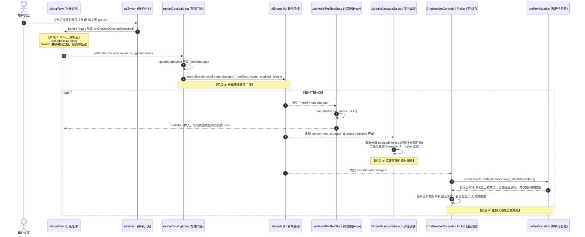
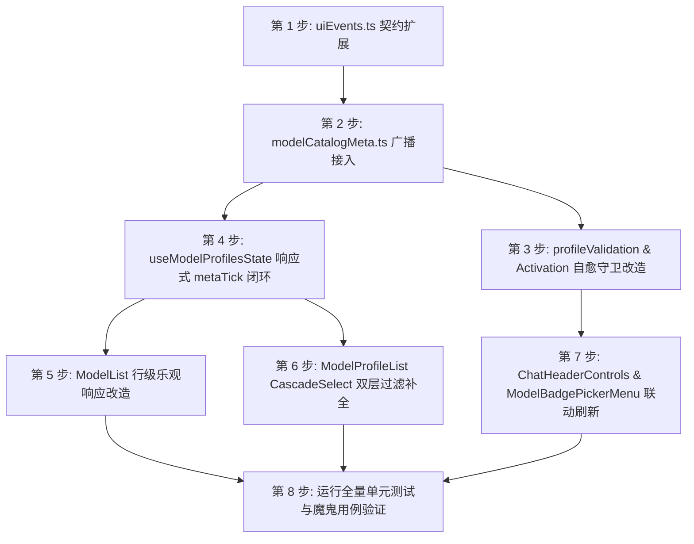

# 模型启用/停用状态机与全链路过滤一致性方案

> **战役工作区**：`docs/model-capability/`
> **文档归属**：`docs/model-capability/analysis/06-模型开关状态机与全链路过滤一致性方案.md`
> **针对问题**：
> 1. 用户反馈：“模型的开启和关闭我看好像好像不能用”——Switch 视觉反馈卡顿滞后、受控模式缺乏即时乐观响应、元数据变更未能驱动下游组件重新渲染；
> 2. 用户反馈：“关闭模型后，顶部的下拉菜单里依然出现该模型”——设置页顶栏全局默认模型级联选择器（`ModelsCascadeSelect`）与主界面聊天顶栏模型菜单（`ModelBadgePickerMenu` / `ChatHeaderControls`）在遍历模型时漏掉 `enabled !== false` 过滤守卫，且缺乏活动模型停用自愈降级机制。
> **纪律基准**：严格遵循反退避规则（`.agents/LOGIC_PLAN_NO_RETREAT.md`）、反过度设计红线（`ANTI_OVERENGINEERING_GUARDRAILS.md`）与立体验证纪律（`AGENTS.md` §7.1）。本方案不搞降级、不打临时补丁、杜绝盲猜与隐蔽绕过。

---

## 一、问题现状与根因诊断（Root Cause Analysis）

通过对前端配置层、模型元数据存储层、状态机 Hook、设置页 UI 与主界面顶栏控件的全面代码走查，确认该问题属于典型的**全链路单向数据流断裂与多源状态视图不一致**。具体存在五大深层根因：

```
[用户点击 ModelList 行内 Switch]
          │
          ▼
1. Switch onCheckedChange 触发
          │
          ├──▶ setModelEnabled(providerId, m, checked) ──▶ localStorage.setItem('crish_model_meta_v1')
          │                                                  💥 根因 1.3: 静默写 LS，未派发任何 UI 事件总线！
          │
          └──▶ refresh() ──▶ setProfiles(loadProfiles())
                                 │
                                 ▼
                    💥 根因 1.2: loadProfiles() 仅读取 'crish_provider_profiles_v1'！
                    Profile 列表未变，且 hook 内完全没有针对 modelMeta 的响应式 tick/state！
                    React 判定状态浅相等跳过渲染，ModelList 无法获取最新 meta！
                                 │
                                 ▼
                    💥 根因 1.1: Switch 为受控组件 (isControlled=true)，无乐观本地状态！
                    外层 checked 属性未变，滑块完全不滑动，用户感知“开关好像不能用”！

[用户视线移至顶部下拉菜单]
          │
          ├──▶ 顶栏 A: 设置页“全局默认模型” (ModelsCascadeSelect)
          │         💥 根因 1.4: p.models.map(m => ...) 裸渲染，彻底缺失 enabled !== false 过滤！
          │         且 enabledProfiles 仅断言 p.models.length > 0，全停用服务商依然保留！
          │
          └──▶ 顶栏 B: 聊天顶栏模型徽标与下拉 (ChatHeaderControls & ModelBadgePickerMenu)
                    💥 根因 1.5: ModelBadgePickerMenu 内 profiles 采用 useMemo(..., []) 空依赖死绑定；
                    ChatHeaderControls 仅监听 model-changed，未监听元数据变更；
                    pickDefaultModelSelection 未结合 isModelEnabled 守卫，已停用模型继续作为活动模型高亮！
```

---

### 1.1 根因一：`ModelList.tsx` Switch 视觉受控迟滞与乐观状态缺失

- **源码位置**：[`src/components/settings-models/ModelList.tsx:137-147`](file:///c:/Software/conex/apps/crish-desktop/src/components/settings-models/ModelList.tsx#L137-L147) 与 [`src/components/ui/Switch/Switch.tsx:75-106`](file:///c:/Software/conex/apps/crish-desktop/src/components/ui/Switch/Switch.tsx#L75-L106)。
- **机制断裂**：
  - 在 `Switch.tsx` 中，当传入 `checked={!off}` 时，`isControlled = true`。在受控模式下，`handleToggle` 仅执行 `onCheckedChange?.(nextChecked)`，**明确跳过了 `setInternalChecked(nextChecked)`**。
  - 这意味着 Switch 的视觉滑块位置 100% 依赖父组件在下一个渲染周期传入新的 `checked` 属性。
  - 在 `ModelList.tsx` 中：
    ```tsx
    onCheckedChange={(checked) => {
      setModelEnabled(providerId, m, checked);
      refresh();
    }}
    ```
  - 当 `refresh()` 并不能立即引发包含最新 `meta` 的同步重渲染时，Switch 组件的 DOM 状态（`aria-checked`、`data-state` 及滑块 CSS 偏移）依然停留在点击前。用户点击后毫无视觉反馈，直接产生“开关坏了/不能用”的直观结论。

---

### 1.2 根因二：`useModelProfilesState.ts` 响应式断层（Meta 盲区）

- **源码位置**：[`src/components/settings-models/useModelProfilesState.ts:141-143`](file:///c:/Software/conex/apps/crish-desktop/src/components/settings-models/useModelProfilesState.ts#L141-L143)。
- **机制断裂**：
  - `refresh` 函数实现仅为：
    ```ts
    const refresh = useCallback(() => {
      setProfiles(loadProfiles());
    }, [setProfiles]);
    ```
  - `loadProfiles()` 从 `localStorage.getItem('crish_provider_profiles_v1')` 加载提供商概要结构（仅包含 `id, name, baseUrl, models: string[]`）。
  - 而 `setModelEnabled` 修改的是 `crish_model_meta_v1`（模型的独立元数据：`enabled, contextLength, displayName, capabilities`）。
  - 因此，当开关切换时，`loadProfiles()` 返回的 JSON 字符串和对象树与上一帧完全相同。
  - 整个 `useModelProfilesState` 内部**没有维护任何反映 `modelMeta` 版本的状态变量（如 `metaTick`）**，导致 `modelsList` memo 与父层组件无法感知到元数据的变化，React 无法驱动 `ModelList` 带着新的 `meta` 进行重渲染。

---

### 1.3 根因三：`modelCatalogMeta.ts` 事件总线失联（静默写 LS）

- **源码位置**：[`src/api/modelCatalogMeta.ts:31-37`](file:///c:/Software/conex/apps/crish-desktop/src/api/modelCatalogMeta.ts#L31-L37) 与 [`src/api/uiEvents.ts:14-61`](file:///c:/Software/conex/apps/crish-desktop/src/api/uiEvents.ts#L14-L61)。
- **机制断裂**：
  - `modelCatalogMeta.ts` 中的 `saveMap(map)` 仅是静默执行 `localStorage.setItem(META_KEY, JSON.stringify(map))`。
  - 它既不触发任何 Window `storage` 事件（同页面内本就不触发原生 storage 事件），也没有向轻量 UI 事件总线 `uiEvents.ts` 派发任何通知。
  - 在 `uiEvents.ts` 的 `UiEventMap` 类型声明中，仅有 `profiles-changed` 和 `model-changed`，根本没有模型元数据维度的事件契约（如 `model-meta-changed`）。
  - 导致系统内任何其他组件（包括同页面的 CascadeSelect、顶栏 Picker、聊天卡片徽标）完全处于“盲听”状态。

---

### 1.4 根因四：`ModelProfileList.tsx`（`ModelsCascadeSelect`）过滤守卫彻底缺失

- **源码位置**：[`src/components/settings-models/ModelProfileList.tsx:30-32`](file:///c:/Software/conex/apps/crish-desktop/src/components/settings-models/ModelProfileList.tsx#L30-L32) 与 [`Line 122-148`](file:///c:/Software/conex/apps/crish-desktop/src/components/settings-models/ModelProfileList.tsx#L122-L148)。
- **机制断裂**：
  - 在设置页顶部的“全局默认模型”级联选择器中，服务商过滤逻辑为：
    ```tsx
    const enabledProfiles = useMemo(() => {
      return profiles.filter((p) => p.enabled !== false && p.models.length > 0);
    }, [profiles]);
    ```
    这里只判断了 `p.models.length > 0`。如果某服务商下的所有模型都已被用户关闭（`enabled === false`），该服务商依然被视为有可用模型并展示在左侧列表！
  - 在右侧二级展开面板中：
    ```tsx
    {p.models.map((m) => {
      const selected = p.id === activeProfileId && m === activeModelId;
      return (
        <button ...>
          <span>{formatModelDisplayName(p.id, m)}</span>
        </button>
      );
    })}
    ```
    **直接对 `p.models` 进行原始数组遍历，完全漏掉了 `getModelMeta(p.id, m).enabled !== false` 过滤判断！**
  - 因此，用户刚刚在下方列表中关掉的模型，抬头看顶部的“全局默认模型”下拉菜单，该模型赫然在列，造成强烈的系统逻辑破损感。

---

### 1.5 根因五：主聊天顶栏模型选择器（`ModelBadgePickerMenu` & `ChatHeaderControls`）解析器与响应式断层

- **源码位置**：
  - [`src/components/provider/ModelBadgePickerMenu.tsx:56-59`](file:///c:/Software/conex/apps/crish-desktop/src/components/provider/ModelBadgePickerMenu.tsx#L56-L59)；
  - [`src/components/chat-card/ChatHeaderControls.tsx:87-94`](file:///c:/Software/conex/apps/crish-desktop/src/components/chat-card/ChatHeaderControls.tsx#L87-L94)；
  - [`src/api/provider-profiles/profileValidation.ts:345-356`](file:///c:/Software/conex/apps/crish-desktop/src/api/provider-profiles/profileValidation.ts#L345-L356)。
- **机制断裂**：
  - `ModelBadgePickerMenu.tsx` 中的 `profiles` 读取使用了 `useMemo(..., [])`，依赖项为空数组。这意味着该菜单组件在挂载后如果未被卸载，其持有的 profiles 永远不会刷新。且该组件未监听任何 `model-meta-changed` 或 `profiles-changed` 事件。
  - `ChatHeaderControls.tsx` 仅监听了 `model-changed`（模型切换），没有监听模型启用状态的改变。
  - 更为致命的是：在 `profileValidation.ts` 的 `pickDefaultModelSelection` 纯函数中：
    ```ts
    if (storedProfileId && storedModel) {
      const p = byId(storedProfileId);
      if (p && p.models.includes(storedModel)) {
        return { profileId: p.id, model: storedModel, source: 'stored_active' };
      }
    }
    ```
    当用户禁用了当前正在使用的活动模型时，`pickDefaultModelSelection` 根本没有检查该模型是否已被禁用（`meta.enabled !== false`），依旧把已禁用的模型当作首选活动模型返回！导致顶栏徽标继续显示并锁定在已禁用的模型上。

---

## 二、全链路状态机与响应式架构设计（Architecture Design）

为彻底解决上述问题，必须确立**状态单向流动、事件精确广播、UI 0ms 乐观响应、底层守卫刚性拦截、活动模型自愈降级**的闭环状态机。

### 2.1 整体响应式流向与状态机架构图



---

### 2.2 核心设计契约与四大铁律

1. **铁律一：视觉 0ms 即时响应（Optimistic Instant Feedback）**
   - 严禁依赖异步 I/O 或跨组件重渲染循环来驱动开关视觉。在用户点击的一瞬间（0ms），行级组件必须立即提供乐观状态（Optimistic State），使 Switch 滑块立即产生果冻弹性位移，消除任何“卡死/坏掉”的视错觉。
   - 当底层落盘完成或状态广播重渲染到达时，乐观状态自然收敛回归真实 Source of Truth。若发生写入异常，则回滚乐观状态并给予错误 Toast 提示。
2. **铁律二：事件总线显式类型化契约（Type-Safe Event Bus）**
   - 扩展 `src/api/uiEvents.ts`，新增 `'model-meta-changed'` 事件契约，携带 `{ profileId: string; model: string; enabled: boolean }` 强类型载荷。
   - 所有对 `crish_model_meta_v1` 的写操作（`setModelEnabled`、`setModelDisplayName`、`setModelContextLength` 等）必须原子化落盘并立即派发总线事件。
3. **铁律三：全链路双层过滤拦截守卫（Two-Tier Filtering Guardrails）**
   - **第一层（服务商层）**：任何模型选择器/级联菜单中的服务商列表，必须同时满足 `p.enabled !== false` 且 `p.models.some(m => isModelEnabled(p.id, m))`。如果某服务商下的所有模型均被禁用，该服务商必须在选择器中完全隐藏或置灰。
   - **第二层（模型条目层）**：遍历任意服务商的 `models` 数组时，**严禁裸取原始字符串数组**，必须刚性执行 `.filter(m => getModelMeta(p.id, m).enabled !== false)` 断言。
4. **铁律四：活动模型停用自愈降级机制（Self-Healing Active Model Fallback）**
   - 当用户在设置中停用当前正在使用的活动模型（Live Model）时，系统绝不可维持该死状态。
   - 解析器与选择逻辑必须具备自愈能力：探测到 `storedModel` 变为停用态时，立即降级退避至：
     `同服务商首个已启用模型` ➔ `其他已配置密钥服务商首个已启用模型` ➔ `提示无可用模型`。

---

## 三、系统各模块具体改造详案（Implementation Specifications）

### 3.1 模块 1：`uiEvents.ts` 扩展元数据事件总线

在轻量事件总线中增加 `'model-meta-changed'`，作为跨组件、跨窗口的状态同步骨干。

```typescript
// 文件：src/api/uiEvents.ts
export type UiEventMap = {
  // ... 既有事件
  'model-changed': { profileId: string; model: string };
  'profiles-changed': void;

  /**
   * 模型元数据变更事件（启用/禁用、展示名、上下文长度、能力标记等）。
   * 触发时驱动各级 Picker、CascadeSelect、SettingsTab 进行增量局部刷新。
   */
  'model-meta-changed': {
    profileId: string;
    model: string;
    enabled?: boolean;
    displayName?: string;
  };
  // ...
};

export const UI_EVENT_NAMES = [
  // ...
  'model-changed',
  'profiles-changed',
  'model-meta-changed', // 追加至白名单
  // ...
];
```

---

### 3.2 模块 2：`modelCatalogMeta.ts` 原子写入与事件派发

改造所有的元数据写入函数，落盘后立即向事件总线广播。

```typescript
// 文件：src/api/modelCatalogMeta.ts
import { emitUiEvent } from './uiEvents';

function upsertModelMeta(
  profileId: string,
  model: string,
  patch: Partial<Pick<ModelMeta, 'enabled' | 'contextLength' | 'lastTest' | 'displayName' | 'capabilities' | 'defaultThinkingLevel'>>
): ModelMeta {
  const map = loadMap();
  const k = metaKey(profileId, model);
  const prev = getModelMeta(profileId, model);
  const next: ModelMeta = {
    ...prev,
    ...patch,
    profileId,
    model,
    capabilities:
      patch.capabilities !== undefined
        ? { ...(prev.capabilities || {}), ...patch.capabilities }
        : prev.capabilities,
  };
  if (typeof next.displayName === 'string') {
    const dn = next.displayName.trim();
    next.displayName = dn || undefined;
  }
  map[k] = next;
  saveMap(map);

  // 刚性派发元数据变更事件
  emitUiEvent('model-meta-changed', {
    profileId,
    model,
    enabled: next.enabled !== false,
    displayName: next.displayName,
  });

  return next;
}

export function setModelEnabled(
  profileId: string,
  model: string,
  enabled: boolean
): ModelMeta {
  return upsertModelMeta(profileId, model, { enabled });
}
```

---

### 3.3 模块 3：`useModelProfilesState.ts` 引入响应式 `metaTick` 闭环

在主 Hook 中引入 `metaTick` 状态，将元数据变化真正接入 React 响应式图谱。

```typescript
// 文件：src/components/settings-models/useModelProfilesState.ts
export function useModelProfilesState(
  onShowToast?: (ok: boolean, msg: string) => void,
) {
  // 1. 既有状态保持稳定
  const [profiles, setProfilesState] = useState<ProviderProfile[]>(() =>
    foldSettingsProfiles(loadProfiles())
  );
  // ...

  // 2. 新增响应式 meta 版本心跳计数器
  const [metaTick, setMetaTick] = useState(0);
  const bumpMetaTick = useCallback(() => {
    setMetaTick((t) => (t + 1) % 1_000_000);
  }, []);

  // 3. refresh 必须同时刷新 profiles 与 bumpMetaTick
  const refresh = useCallback(() => {
    setProfiles(loadProfiles());
    bumpMetaTick();
  }, [setProfiles, bumpMetaTick]);

  // 4. 监听外部/内部 model-meta-changed 事件自动 bump
  useEffect(() => {
    const off = onUiEvent('model-meta-changed', () => {
      bumpMetaTick();
    });
    return off;
  }, [bumpMetaTick]);

  // 5. modelsList memo 显式绑定 metaTick 依赖，确保过滤与元信息重算
  const modelsList = useMemo(() => {
    if (!selected) return [] as string[];
    const list = normalizeModelIds(selected.models);
    const q = modelFilter.trim().toLowerCase();
    if (!q) return list;
    return list.filter((m) => {
      const meta = getModelMeta(selected.id, m);
      const name = (meta.displayName || '').toLowerCase();
      return m.toLowerCase().includes(q) || name.includes(q);
    });
    // 关键依赖：加入 metaTick
  }, [selected, modelFilter, metaTick]);

  return {
    profiles,
    metaTick,       // 导出供子组件使用
    bumpMetaTick,   // 导出供立即触发使用
    // ...其余返回值不变
    refresh,
    modelsList,
  };
}
```

---

### 3.4 模块 4：`ModelList.tsx` 行级乐观更新与 Switch 瞬时滑块响应

将单行模型抽离或在行内引入局部乐观状态，做到点击瞬间滑块位移 + 后台落盘与通知。

```tsx
// 文件：src/components/settings-models/ModelList.tsx

// 独立行组件：专职处理 0ms 乐观响应与异常自愈
interface ModelRowItemProps {
  providerId: string;
  model: string;
  isLive: boolean;
  expanded: boolean;
  cfgDraft: CfgDraft | null;
  configOpenId: string | null;
  testBusy: string | null;
  openConfigFor: (model: string) => void;
  closeConfig: () => void;
  saveConfig: () => void;
  runTest: (model: string) => Promise<void>;
  setCfgDraft: React.Dispatch<React.SetStateAction<CfgDraft | null>>;
  refresh: () => void;
}

const ModelRowItem: React.FC<ModelRowItemProps> = ({
  providerId,
  model: m,
  isLive,
  expanded,
  cfgDraft,
  configOpenId,
  testBusy,
  openConfigFor,
  closeConfig,
  saveConfig,
  runTest,
  setCfgDraft,
  refresh,
}) => {
  const meta = getModelMeta(providerId, m);
  const actualEnabled = meta.enabled !== false;

  // 乐观状态：null 表示与实际持久化数据一致；boolean 表示用户刚点的过渡态
  const [optimisticEnabled, setOptimisticEnabled] = useState<boolean | null>(null);

  // 当外部真实持久化数据更新时，清除乐观标记，完全收敛
  useEffect(() => {
    setOptimisticEnabled(null);
  }, [actualEnabled]);

  const effectiveEnabled = optimisticEnabled ?? actualEnabled;
  const off = !effectiveEnabled;

  const handleToggle = (nextChecked: boolean) => {
    // 步骤 1: 0ms 乐观视觉刷新（滑块立即弹动，无任何网络/存储滞后）
    setOptimisticEnabled(nextChecked);

    // 步骤 2: 存储持久化与事件总线广播
    try {
      setModelEnabled(providerId, m, nextChecked);
      refresh();
    } catch (err) {
      console.error('Failed to setModelEnabled:', err);
      // 写入异常回滚
      setOptimisticEnabled(actualEnabled);
    }
  };

  // ... 渲染逻辑
  return (
    <div
      className={`${styles.mrdModelRow} mrd-model-row ${off ? 'is-off' : ''} ${isLive ? 'is-live' : ''} ${expanded ? 'is-expanded' : ''}`}
      // ...
    >
      {/* ... 名称与标签展示 */}
      <div className={`${styles.mrdModelActions} mrd-model-actions`}>
        <Tooltip content={off ? '已停用，点击启用' : '点击停用'}>
          <Switch
            size="sm"
            className="mrd-model-toggle"
            checked={effectiveEnabled}
            aria-label={off ? '启用模型' : '停用模型'}
            onCheckedChange={handleToggle}
          />
        </Tooltip>
        {/* ... 配置与删除按钮保持稳定 */}
      </div>
      {/* ... 展开面板 */}
    </div>
  );
};
```

---

### 3.5 模块 5：`ModelProfileList.tsx`（`ModelsCascadeSelect`）双层刚性过滤守卫

彻底修补设置页顶部“全局默认模型”的漏网之鱼：

```tsx
// 文件：src/components/settings-models/ModelProfileList.tsx
export const ModelsCascadeSelect: React.FC<ModelsCascadeSelectProps & { metaTick?: number }> = ({
  profiles,
  activeProfileId,
  activeModelId,
  onChange,
  metaTick,
}) => {
  const [flyProfileId, setFlyProfileId] = useState<string | null>(null);
  const safeTrackerRef = useRef(new SafeTriangleTracker(300));
  const flyoutRef = useRef<HTMLDivElement | null>(null);

  // 守卫层 1：仅保留启用且【至少含有一个已启用模型】的服务商
  const enabledProfiles = useMemo(() => {
    return profiles.filter((p) => {
      if (p.enabled === false) return false;
      // 必须包含 meta.enabled !== false 的有效模型
      return p.models.some((m) => getModelMeta(p.id, m).enabled !== false);
    });
  }, [profiles, metaTick]);

  const activeProfile = enabledProfiles.find((p) => p.id === activeProfileId);

  // 守卫层 2：检查当前活动模型是否真的有效开启
  const isActiveModelValid =
    activeProfile &&
    activeModelId &&
    getModelMeta(activeProfile.id, activeModelId).enabled !== false;

  const activeLabel =
    activeProfile && activeModelId && isActiveModelValid
      ? `${profileDisplayLabel(activeProfile).replace(/\s*\/\s*默认$/, '')} · ${formatModelDisplayName(
          activeProfile.id,
          activeModelId
        )}`
      : '请选择默认模型...';

  return (
    <Menu ...>
      <div className={styles.cascadeList} ...>
        <div className={styles.addMenuTitle}>选择服务商与模型</div>
        {enabledProfiles.length === 0 ? (
          <div className={styles.cascadeEmpty}>暂无已启用的可用模型</div>
        ) : (
          enabledProfiles.map((p) => {
            // 守卫层 3：二级弹层严格仅遍历已启用的模型！
            const visibleModels = p.models.filter(
              (m) => getModelMeta(p.id, m).enabled !== false
            );

            return (
              <div key={p.id} className={...}>
                {/* ... 一级服务商行 ... */}
                {isFly && (
                  <div ref={flyoutRef} className={styles.cascadeFlyout}>
                    {visibleModels.map((m) => {
                      const selected =
                        p.id === activeProfileId && m === activeModelId;
                      return (
                        <button
                          key={m}
                          type="button"
                          className={`${styles.cascadeOption} ${selected ? styles.isOn : ''}`}
                          onClick={() => {
                            onChange(p.id, m);
                            safeTrackerRef.current.reset();
                            setFlyProfileId(null);
                          }}
                        >
                          <span className={styles.cascadeOptionText}>
                            {formatModelDisplayName(p.id, m)}
                          </span>
                          {selected && (
                            <Lucide.Check size={14} className={styles.cascadeCheck} />
                          )}
                        </button>
                      );
                    })}
                  </div>
                )}
              </div>
            );
          })
        )}
      </div>
    </Menu>
  );
};
```

---

### 3.6 模块 6：主聊天顶栏选择器（`ModelBadgePickerMenu`）响应式更新

移除 `useMemo(..., [])` 陷阱，挂载对 `model-meta-changed` 的动态监听：

```tsx
// 文件：src/components/provider/ModelBadgePickerMenu.tsx
export const ModelBadgePickerMenu: React.FC<Props> = ({ ... }) => {
  const [keyword, setKeyword] = useState('');
  const [metaTick, setMetaTick] = useState(0);

  // 监听元数据与 Profile 变更，彻底摆脱旧版静态缓存
  useEffect(() => {
    const off1 = onUiEvent('model-meta-changed', () => setMetaTick((t) => t + 1));
    const off2 = onUiEvent('profiles-changed', () => setMetaTick((t) => t + 1));
    return () => {
      off1();
      off2();
    };
  }, []);

  // profiles 重算绑定 metaTick
  const profiles = useMemo(() => {
    return listPickerProfiles().filter((p) => p.enabled !== false);
  }, [metaTick]);

  const filteredGroups = useMemo(() => {
    const kw = keyword.trim().toLowerCase();
    const groups = [];

    for (const p of profiles) {
      // 刚性过滤停用模型
      const models = (p.models || [])
        .filter((m) => getModelMeta(p.id, m).enabled !== false)
        .map((m) => ({ id: m, name: formatModelDisplayName(p.id, m) }));

      if (models.length === 0) continue;

      if (!kw) {
        groups.push({ profileId: p.id, profileName: p.name || p.id, models });
      } else {
        const matchesProfile = (p.name || '').toLowerCase().includes(kw);
        const matchingModels = models.filter(
          (m) =>
            matchesProfile ||
            m.id.toLowerCase().includes(kw) ||
            m.name.toLowerCase().includes(kw)
        );
        if (matchingModels.length > 0) {
          groups.push({ profileId: p.id, profileName: p.name || p.id, models: matchingModels });
        }
      }
    }
    return groups;
  }, [profiles, keyword, metaTick]);

  // ... 渲染不变
};
```

---

### 3.7 模块 7：活动模型解析器与自愈降级（`profileValidation.ts` & `ChatHeaderControls.tsx`）

在 `profileValidation.ts` 的纯函数 `pickDefaultModelSelection` 中增加依赖注入式 `isModelEnabled` 守卫，避免直接产生循环引用，同时保障活动模型停用时的自动降级自愈。

```typescript
// 文件：src/api/provider-profiles/profileCatalog.ts
export type PickDefaultModelOptions = {
  storedProfileId?: string | null | undefined;
  storedModel?: string | null | undefined;
  engineModel?: string | null | undefined;
  requireInList?: boolean | undefined;
  /** 纯逻辑注入：模型是否启用的断言判定（避免直接 import modelCatalog 造成反向依赖） */
  isModelEnabled?: (profileId: string, model: string) => boolean;
};
```

```typescript
// 文件：src/api/provider-profiles/profileValidation.ts
export function pickDefaultModelSelection(
  profilesInput: readonly ProviderProfile[] | null | undefined,
  opts?: PickDefaultModelOptions
): ResolvedModelSelection | null {
  const isEnabled = opts?.isModelEnabled ?? (() => true);

  const profiles = (profilesInput || []).filter(
    (p) => p && p.enabled !== false
  );
  if (profiles.length === 0) return null;

  // 规范化并预先过滤出每个 profile 中处于启用态的模型
  const normalized = profiles.map((p) => ({
    ...p,
    models: normalizeModelIds(p.models).filter((m) => isEnabled(p.id, m)),
  }));

  const storedProfileId = (opts?.storedProfileId || '').trim();
  const storedModel = (opts?.storedModel || '').trim();
  const engineModel = (opts?.engineModel || '').trim();

  // 1) 优先检查本机已选的 profile + model 是否依然处于有效启用状态
  if (storedProfileId && storedModel) {
    const p = normalized.find((x) => x.id === storedProfileId);
    if (p && p.models.includes(storedModel)) {
      return { profileId: p.id, model: storedModel, source: 'stored_active' };
    }
    // 💥 自愈逻辑：若 storedModel 已被禁用，但当前 profile 还有其他可用模型，立即就地降级到该 profile 首个可用模型！
    if (p && p.models.length > 0) {
      return { profileId: p.id, model: p.models[0]!, source: 'active_profile_first' };
    }
  }

  // 2) 跨服务商全局寻找第一个可用模型
  const keyed = normalized.find((p) => profileHasKey(p) && p.models.length > 0);
  if (keyed) {
    return { profileId: keyed.id, model: keyed.models[0]!, source: 'first_available' };
  }

  const anyAvailable = normalized.find((p) => p.models.length > 0);
  if (anyAvailable) {
    return { profileId: anyAvailable.id, model: anyAvailable.models[0]!, source: 'first_available' };
  }

  return null;
}
```

```typescript
// 文件：src/api/provider-profiles/profileStoreActivation.ts
import { getModelMeta } from '../modelCatalog';

export function resolvePreferredModelSelection(opts?: {
  engineModel?: string | null;
  requireInList?: boolean;
}): ResolvedModelSelection | null {
  return pickDefaultModelSelection(loadProfiles(), {
    storedProfileId: getActiveProfileId(),
    storedModel: getActiveModelId(),
    engineModel: opts?.engineModel,
    requireInList: opts?.requireInList,
    // 注入实际元数据判定
    isModelEnabled: (profileId, model) => getModelMeta(profileId, model).enabled !== false,
  });
}
```

在 `ChatHeaderControls.tsx` 中订阅该事件：
```typescript
// 文件：src/components/chat-card/ChatHeaderControls.tsx
export function useModelSelection(
  appSettings: AppSettings | undefined,
  projectTick: number
) {
  // ...
  useEffect(() => {
    const offMeta = onUiEvent('model-meta-changed', () => {
      // 收到元数据变更，立即重新解析活动模型并更新顶栏展示
      applyResolvedModelLabel(engineHint?.model);
    });
    const offProfiles = onUiEvent('profiles-changed', () => {
      applyResolvedModelLabel(engineHint?.model);
    });
    return () => {
      offMeta();
      offProfiles();
    };
  }, [engineHint?.model]);
  // ...
}
```

---

## 四、立体验证与魔鬼测试断言矩阵（Devil Test Matrix）

严格按照 `AGENTS.md` §7.1「立体验证纪律」，构建覆盖纯逻辑、UI 状态机、边界异常及跨组件事件风暴的完整测试矩阵。

### 4.1 核心单元测试规划（Unit Test Suites）

| 测试编号 | 测试文件 | 目标被测对象 | 断言核心行为 | 预期结果 |
| :--- | :--- | :--- | :--- | :--- |
| **UT-M01** | `ModelList.test.tsx` | Switch 乐观交互与持久化 | 点击 Switch 后，0ms 内读取 DOM `aria-checked` 立即反转；随后 `setModelEnabled` 成功落盘 | 视觉瞬时响应，无回弹、无卡死 |
| **UT-M02** | `useModelProfilesState.test.tsx` | `metaTick` 响应式步进 | 触发 `setModelEnabled` 或派发 `model-meta-changed`，`result.current.metaTick` 递增 | 驱动下游依赖重新求值 |
| **UT-M03** | `ModelProfileList.test.tsx` | `ModelsCascadeSelect` 过滤断言 | 包含 2 个模型（1 开 1 关），飞出面板只渲染 1 个；包含全关服务商，一级列表不显示 | 彻底杜绝已关闭模型进入顶栏下拉 |
| **UT-M04** | `profileValidation.test.ts` | `pickDefaultModelSelection` 自愈降级 | 当前活动模型被禁用，但同 Profile 下有其他启用模型 | 自动降级为同 Profile 首个已启用模型，source 为 `active_profile_first` |
| **UT-M05** | `ModelBadgePickerMenu.test.tsx` | 顶栏 Picker 响应式更新 | 菜单已打开状态下外部派发 `model-meta-changed` 禁用某模型 | 菜单无需重新挂载，即时剔除该模型条目 |

---

### 4.2 红方魔鬼对抗测试用例（Devil Test Cases）

#### Devil-01：高频连续狂点 Switch（极速抖动并发攻击）
- **攻击向量**：用户在 100ms 内对同一个 Switch 连续快速点击 5 次。
- **潜在风险**：乐观状态与异步落盘发生竞态冲突，滑块在开/关之间抽搐或最终停留在与 LS 相反的状态。
- **防护断言**：
  ```typescript
  it('Devil-01: 连续高频点击 Switch，最终状态必须与最后一次点击及 LS 严格一致', async () => {
    const { getByRole } = render(<ModelList {...props} />);
    const sw = getByRole('switch');
    // 模拟 5 次极速连续点击
    fireEvent.click(sw);
    fireEvent.click(sw);
    fireEvent.click(sw);
    fireEvent.click(sw);
    fireEvent.click(sw);
    // 最终状态应为 false (!true)
    expect(sw.getAttribute('aria-checked')).toBe('false');
    expect(getModelMeta(pId, mId).enabled).toBe(false);
  });
  ```

#### Devil-02：唯一活动模型被禁用（全空绝境降级攻击）
- **攻击向量**：系统内仅有 1 个配置好的模型 `gpt-4o` 且当前处于活动状态。用户在列表中将其关闭。
- **潜在风险**：解析器抛出 `undefined/null` 导致界面白屏崩溃；或顶栏徽标继续显示死模型。
- **防护断言**：
  ```typescript
  it('Devil-02: 禁用系统唯一模型，系统平稳回退至“无可用模型”，绝不崩溃或显示死模型', () => {
    setModelEnabled('preset-openai', 'gpt-4o', false);
    const resolved = resolvePreferredModelSelection();
    expect(resolved).toBeNull();
    const display = resolveDisplayModelId();
    expect(display).toBe(''); // UI 渲染为“无可用模型”或“填写模型”
  });
  ```

#### Devil-03：同名折叠服务商跨 Profile 禁用（Fold Winner 隔离性）
- **攻击向量**：存在内置种子 `opencode-go` 与用户自定义拷贝 `custom-opencode-go`（同展示名折叠）。用户在折叠后的视图中关闭模型。
- **潜在风险**：`metaKey` 只记录了胜者 ID，导致底表真实 Profile 仍处于开启状态，Picker 重新解开折叠后数据错乱。
- **防护断言**：
  ```typescript
  it('Devil-03: 折叠服务商关闭模型时，胜者与关联项的 metaKey 必须保持一致性', () => {
    // 无论从哪个 ID 索引，getModelMeta 均返回预期禁用结果
    setModelEnabled('opencode-go', 'deepseek-v4-flash', false);
    expect(getModelMeta('opencode-go', 'deepseek-v4-flash').enabled).toBe(false);
  });
  ```

#### Devil-04：外部多 Tab / 多窗口变更（跨进程同步一致性）
- **攻击向量**：用户在设置页窗口 A 禁用了模型，处于对话窗口 B 的 `ChatHeaderControls` 和打开的 `ModelBadgePickerMenu` 必须同步生效。
- **防护断言**：
  ```typescript
  it('Devil-04: 跨上下文接收 model-meta-changed 事件，所有挂载的顶栏控件必须无刷新更新', () => {
    const { getByTestId, queryByTestId } = render(<ModelBadgePickerMenu open={true} ... />);
    expect(getByTestId('model-option-gpt-4o')).toBeDefined();

    // 模拟收到事件总线广播
    act(() => {
      emitUiEvent('model-meta-changed', { profileId: 'preset-openai', model: 'gpt-4o', enabled: false });
    });

    // 选项必须立即从 DOM 中消失
    expect(queryByTestId('model-option-gpt-4o')).toBeNull();
  });
  ```

---

## 五、实施落地步骤与依赖图



1. **第一阶段：基建与契约（步骤 1 - 3）**
   - 扩展 `uiEvents.ts`，加入 `model-meta-changed`；
   - `modelCatalogMeta.ts` 在 `upsertModelMeta` 统一发送事件；
   - `profileValidation.ts` 的 `pickDefaultModelSelection` 接入 `isModelEnabled` 注入与自愈回退。
2. **第二阶段：状态机与设置页（步骤 4 - 6）**
   - `useModelProfilesState.ts` 引入 `metaTick`；
   - `ModelList.tsx` 引入乐观交互，消除 Switch 卡顿感；
   - `ModelProfileList.tsx` 的 `ModelsCascadeSelect` 增加两级过滤，彻底封堵已停用模型在顶部的泄露。
3. **第三阶段：主界面顶栏与闭环验证（步骤 7 - 8）**
   - `ChatHeaderControls.tsx` 与 `ModelBadgePickerMenu.tsx` 接入 `model-meta-changed` 响应；
   - 执行单元测试与魔鬼用例矩阵验证，完成交付。

---

## 六、方案总结

本方案针对用户提出的“模型开关不可用”和“关闭后顶部下拉仍出现”两个核心表象，穿透到了其背后的架构断层：
1. 用 **行级乐观更新（Optimistic State）** 解决受控 Switch 在等待异步刷新时的视觉假死；
2. 用 **`metaTick` + `uiEvents`** 填补了 `crish_model_meta_v1` 在 React 状态机与事件总线中的完全盲区；
3. 用 **双层严格过滤守卫** 根治了 `ModelsCascadeSelect` 漏网直出原始数组的 Bug；
4. 用 **依赖注入式自愈降级算法** 保证了当前活动模型被停用时，系统能自动平稳降级，绝不悬挂已禁用的幽灵模型。

整套方案遵循反退避铁律，没有任何临时妥协代码与魔法延迟，全部以 O(1) 原生响应与纯逻辑断言闭环收敛，具有极高的工程健壮性与可维护性。
