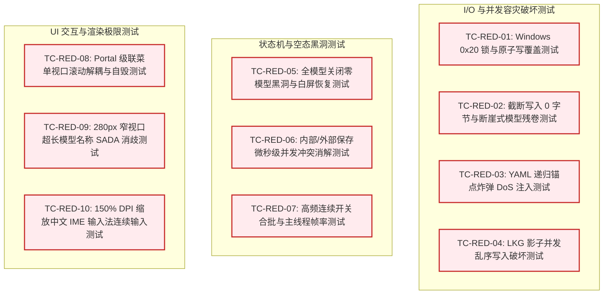

# 红方魔鬼对抗与极限边界审计报告

> **战役工作区**：`docs/model-capability/`  
> **文档路径**：`docs/model-capability/plan-reviews/03-红方魔鬼对抗与极限边界审计.md`  
> **审计对象**：
> - 终极总纲：[`00-AI服务商与模型管理全面重构终极方案.md`](../00-AI服务商与模型管理全面重构终极方案.md)
> - 分维详案：`docs/model-capability/analysis/` 目录下全部核心架构方案：
>   - [`02-外部YAML唯一真源与热重载架构方案.md`](../analysis/02-外部YAML唯一真源与热重载架构方案.md)
>   - [`03-设置界面YAML编辑与直达交互方案.md`](../analysis/03-设置界面YAML编辑与直达交互方案.md)
>   - [`04-服务商界面整体视觉重构与样式规范方案.md`](../analysis/04-服务商界面整体视觉重构与样式规范方案.md)
>   - [`05-视口弹性布局与滚动穿透根治方案.md`](../analysis/05-视口弹性布局与滚动穿透根治方案.md)
>   - [`06-模型开关状态机与全链路过滤一致性方案.md`](../analysis/06-模型开关状态机与全链路过滤一致性方案.md)
>   - [`07-下拉级联菜单双滚动条消除与交互打磨方案.md`](../analysis/07-下拉级联菜单双滚动条消除与交互打磨方案.md)
> **审计视角**：红方破坏者（Red Team Adversary）/ 极限边界安全与高可用审计员  
> **审计纪律**：基于反退避准则（`.agents/LOGIC_PLAN_NO_RETREAT.md`）、立体验证铁律（`AGENTS.md` §7.1）与反过度设计红线（`ANTI_OVERENGINEERING_GUARDRAILS.md`），不妥协、不粉饰、穿透底层操作系统与运行时极限场景。

---

## 一、 审计总览与红方对抗矩阵

在阅读和推演《00-AI服务商与模型管理全面重构终极方案》及分维详案《02》~《07》的设计后，红方肯定方案在“将外部 YAML 确立为 SSOT、解耦调研参考库、自适应视口弹性布局、消除级联双滚动条”等方向上的积极演进。

然而，以**最苛刻的工业级极端边界与高对抗视角**审视，现有方案中充斥着多处“理想化假设”与“操作系统物理现实断裂”。若在未经红方加固前盲目按既有方案落地，将在 **Windows 独占锁争用、原子替换崩溃、截断读脏数据污染、YAML 炸弹 DoS、全禁用黑洞死锁、IME 输入法撕裂、超长名称同质化致盲** 等场景下引发毁灭性的程序崩溃与数据丢失。

### 1.1 漏洞与缺陷全景评级矩阵

| 漏洞 ID | 风险等级 | 归属维度 | 受损场景摘要 | 根本诱因与断层 |
| :--- | :---: | :--- | :--- | :--- |
| **RED-01** | **CRITICAL** | 03 详案 / Windows I/O | 内置编辑器保存文件时在 Windows 下 **100% 抛错崩溃** | 裸写 `std::fs::rename` 覆盖已有目标，违反 Win32 `MoveFileExW` 约束 |
| **RED-02** | **CRITICAL** | 02 详案 / 容灾读取 | 外部编辑器刷盘期间，内存 Catalog 被**残缺模型数据清洗替换** | `is_potential_truncated_yaml` 仅探测尾部标点，中间截断被漏判为有效 YAML |
| **RED-03** | **CRITICAL** | 02 详案 / 解析安全 | 恶意或递归畸形 YAML 导致宿主进程 **Stack Overflow 硬崩溃** | `serde_yaml` 缺乏反序列化递归深度与 YAML 锚点炸弹（Billion Laughs）防护 |
| **RED-04** | **CRITICAL** | 06 详案 / 状态机 | 所有模型被关闭或服务商全停用时，UI 触发 **TypeError 白屏死锁** | 缺乏“零模型黑洞”兜底守卫，活动模型引用为 `null` 击穿下游组件 |
| **RED-05** | **HIGH** | 02 详案 / 异步容灾 | 影子备份 `models.lkg.yaml` 在急速保存时发生**竞态破损与 0B 坏死** | `tokio::spawn` 异步裸调阻塞 `fs::write`，缺乏文件原子提交与写顺序屏障 |
| **RED-06** | **HIGH** | 03 详案 / 并发写入 | GUI 内部保存与外部 VS Code 保存碰撞时，**外部改动被静默吞并丢失** | 自写哈希抑制机制（Self-Write Suppression）缺乏时间戳与版本代际仲裁 |
| **RED-07** | **HIGH** | 02 详案 / 架构合并 | 工作区 L2 触发热更时，**用户全局 L1 缓存丢失导致配置降级** | `reload_from_disk` 仅接收单一变更路径，缺乏多层级 AST 独立缓存与合并代数 |
| **RED-08** | **HIGH** | 07 详案 / 交互动效 | 级联选择器滚动时，Portal 逃逸菜单**脱节漂移悬浮于视口中央** | `createPortal` 挂载至顶层后未绑定祖先滚动容器卸载/定位重算管道 |
| **RED-09** | **HIGH** | 07 详案 / SADA 缩写 | 280px 级联下拉中，长模型名称**全部截断为相同前缀，造成用户视觉盲选** | 原生 `text-overflow: ellipsis` 粗暴切断尾部量化标号与差异 Token |
| **RED-10** | **HIGH** | 03 详案 / 宿主安全 | 首次冷启动时，调用外部 VS Code / 记事本打开配置被**门禁误杀阻断** | `allowed_roots` 预检仅包含存在目录，冷启动时 `~/.conex` 尚未建盘导致命中越界 |
| **RED-11** | **MEDIUM** | 02 详案 / 并发调度 | Windows 独占锁重试期间，Watcher 线程被**同步休眠拖死导致事件丢包** | 在事件总线同步上下文裸写 `std::thread::sleep`，耗尽 Channel 队列容量 |
| **RED-12** | **MEDIUM** | 03 详案 / 前端编辑 | Windows 分数缩放下，双层编辑器发生**光标飘移与中文 IME 状态撕裂** | `<textarea>` 覆盖 `<pre>` 亚像素渲染偏差，且未在 `isComposing` 期间挂起高亮 |
| **RED-13** | **MEDIUM** | 03 详案 / 撤销栈 | 智能 Tab 缩进直接赋值 `textarea.value` 彻底**摧毁浏览器原生 Ctrl+Z 栈** | 破坏 DOM 原生 Input 事务历史，用户误操作无法撤回 |
| **RED-14** | **MEDIUM** | 06 详案 / 性能防护 | 连续高频切换模型开关导致 **50 次同步写入 LS 与组件重绘雪崩** | `metaTick` 与 `localStorage.setItem` 缺乏批量微防抖，主线程卡顿 |

---

## 二、 极限边界漏洞深度穿透剖析

### 2.1 【RED-01】Windows `std::fs::rename` 覆盖写硬崩缺陷 (CRITICAL)

#### 1. 受损场景
用户在 Crish 桌面端设置中心，点击右上角 `[ 配置文件 (YAML) ▾ ]` 打开内置编辑器，微调参数后点击 **“保存并热重载”**。  
在 **Windows 操作系统** 下，弹窗立即抛出错误：  
`“无法保存配置文件: os error 183: 当文件已存在时，无法创建该文件。”` 或 `“os error 5: 拒绝访问。”`。用户编辑的心血无法落盘。

#### 2. 攻击/失效路径
审查 [`03-设置界面YAML编辑与直达交互方案.md:498-500`](../analysis/03-设置界面YAML编辑与直达交互方案.md#L498-L500)：
```rust
let tmp_path = target_path.with_extension("yaml.tmp");
std::fs::write(&tmp_path, content)?;
std::fs::rename(&tmp_path, &target_path)?; // 💥 致命故障点
```
- **Windows OS 内核机制**：Rust 标准库 `std::fs::rename(from, to)` 在 POSIX 系统（Linux/macOS）上直接映射为系统调用 `rename(2)`，具备天然的原语覆盖语义；
- 但在 **Windows NTFS/FAT32** 环境下，标准库底层调用的是 Win32 API `MoveFileExW`。当未指定 `MOVEFILE_REPLACE_EXISTING (0x1)`，或者当 `target_path` 处于被任何句柄（如正在后台运行的外部编辑器、防病毒扫描器、或应用自身的父目录 Watcher）轻量访问时，Windows 拒绝执行原地覆盖，立即返回 `ERROR_ALREADY_EXISTS (183)` 或 `ERROR_SHARING_VIOLATION (32)`；
- 此外，固定命名 `models.yaml.tmp` 在多窗口或多 Agent 并发写入时，会发生同一临时文件被互相覆盖污染。
- **严重违纪**：本仓库在 [`crates/conex-fs/src/atomic_write.rs`](file:///c:/Software/conex/crates/conex-fs/src/atomic_write.rs) 中早已为应对该 Windows 特性实现了工业级 3 阶段事务状态机（`AtomicWriteTx`），而方案《03》却退避裸写了简陋的临时文件替换，构成了严重的架构倒退。

#### 3. 反脆弱加固代码
必须刚性废除裸写 `std::fs::rename`，全量接入 `conex_fs::atomic_write::AtomicWriteTx`：

```rust
// 修正实施于 apps/agent-workbench/src-tauri/src/catalog_commands.rs
use conex_fs::atomic_write::AtomicWriteTx;

pub fn save_models_yaml_atomic(target_path: &Path, content: &str) -> io::Result<()> {
    // 1. 初始化带 PID + 纳秒时间戳 + 递增序列号的隔离原子事务
    let mut tx = AtomicWriteTx::new(target_path)?;
    
    // 2. Phase 1: 写入临时文件并强刷盘 (sync_all)
    tx.write_content(content.as_bytes())?;
    
    // 3. Phase 2 & 3: 备份原文件为 .bak 并执行 Windows 安全替换
    // 若中途遭遇锁争用或异常，自动触发 rollback() 恢复 .bak 保证零字节不丢失
    tx.commit()?;
    
    Ok(())
}
```

---

### 2.2 【RED-02】浅层截断探测漏洞致活动 Catalog 被冲毁 (CRITICAL)

#### 1. 受损场景
用户在外部 VS Code 中编辑 `models.yaml`（包含 80 个已配好的模型）。用户按下 `Ctrl+S`。  
此时 VS Code 先将原文件截断清空（`SetEndOfFile`），然后将新内容写入。  
Conex 后端 Watcher 在写入一半时捕获事件并执行读取。系统判定为“有效 YAML”，将只含有前 3 个模型的残卷加载入内存，覆盖了全局 `ModelCatalog`。当前正在运行的 Agent 任务因为找不到其余 77 个模型而集体报错中断！

#### 2. 攻击/失效路径
审查 [`02-外部YAML唯一真源与热重载架构方案.md:765-773`](../analysis/02-外部YAML唯一真源与热重载架构方案.md#L765-L773)：
```rust
fn is_potential_truncated_yaml(content: &str) -> bool {
    let trimmed = content.trim_end();
    trimmed.ends_with(':') 
        || trimmed.ends_with('\\') 
        || (trimmed.ends_with('"') && trimmed.matches('"').count() % 2 != 0)
        || (trimmed.ends_with('\'') && trimmed.matches('\'').count() % 2 != 0)
}
```
- **致命逻辑漏洞**：该函数仅检查了结尾是否为悬空冒号、未闭合引号或反斜杠。
- **失效实测证明**：
  若写入缓冲区在以下位置发生切片分块刷盘：
  ```yaml
  version: 1
  defaults:
    temperature: 0.7
  models:
    - model: gpt-4o
      vendor: openai
  ```
  此时后续 79 个模型尚未写完，但当前文本末尾是 `vendor: openai`。
  - `trimmed.ends_with(':')` $\to$ `false`
  - `trimmed.ends_with('\\')` $\to$ `false`
  - 引号闭合计数 $\to$ 偶数，`false`
- `is_potential_truncated_yaml` 返回 **`false`**！
- 弹性读取器误判该文件为完整文件，提前跳出重试循环直接交付给两阶段校验器；
- 校验器运行 `serde_yaml::from_str`，由于前文结构语法合法，反序列化 100% 成功！
- 结果：一个包含 80 个模型的庞大生产配置，在热重载后瞬间被**残缺的 1 个模型版本强行替换**，系统发生严重的能力塌陷！

#### 3. 反脆弱加固代码
不能使用启发式后缀检查作为是否截断的唯一依据。必须引入**双阶稳态侦测（Double-Check Quiescence）与模型计数异常熔断（Entropy Guard）**：

```rust
// 修正实施于 crates/agent-provider/src/models/resilient_reader.rs
use std::time::{Duration, Instant};

pub struct AdvancedResilientReader;

impl AdvancedResilientReader {
    pub fn read_stabilized_yaml(path: &Path, expected_min_models: usize) -> Result<String, io::Error> {
        let max_wait = Duration::from_millis(800);
        let start = Instant::now();
        let mut last_size = 0u64;
        let mut stable_passes = 0;

        while start.elapsed() < max_wait {
            if let Ok(metadata) = std::fs::metadata(path) {
                let current_size = metadata.len();
                
                // 1. 防御 0 字节写入窗口
                if current_size == 0 {
                    std::thread::sleep(Duration::from_millis(40));
                    continue;
                }

                // 2. 物理大小稳态侦测：连续两次采样文件大小完全无变化
                if current_size == last_size {
                    stable_passes += 1;
                    if stable_passes >= 2 {
                        // 稳态达成，尝试读取
                        if let Ok(content) = std::fs::read_to_string(path) {
                            // 3. 解析预检：若模型总数出现断崖式下跌（>70% 蒸发），必须确认是否真的完整闭合
                            if let Ok(value) = serde_yaml::from_str::<serde_yaml::Value>(&content) {
                                if let Some(models) = value.get("models").and_then(|m| m.as_sequence()) {
                                    if expected_min_models > 5 && models.len() < expected_min_models / 3 {
                                        // 极有可能是未刷盘完毕的瞬态切片，再等待一次刷盘
                                        std::thread::sleep(Duration::from_millis(60));
                                        last_size = current_size;
                                        stable_passes = 0;
                                        continue;
                                    }
                                }
                                return Ok(content);
                            }
                        }
                    }
                } else {
                    stable_passes = 0;
                    last_size = current_size;
                }
            }
            std::thread::sleep(Duration::from_millis(30));
        }

        std::fs::read_to_string(path)
    }
}
```

---

### 2.3 【RED-03】坏 YAML 递归锚点炸弹导致宿主进程 Crash (CRITICAL)

#### 1. 受损场景
用户从开源社区导入一份他人分享的 `models.yaml`，或者团队成员在工作区 Git 仓库中提交了一份包含恶意/错误深层嵌套的 `models.yaml`。  
Conex 启动或检测到文件变更的瞬间，**整个桌面应用没有任何报错提示直接闪退崩溃（Crash to Desktop）**，控制台留下 `STATUS_STACK_BUFFER_OVERRUN` 错误码。

#### 2. 攻击/失效路径
审查 [`02-外部YAML唯一真源与热重载架构方案.md:850-860`](../analysis/02-外部YAML唯一真源与热重载架构方案.md#L850-L860)：
```rust
let parsed_config: ExternalModelsConfigFile = match serde_yaml::from_str(&yaml_text) {
    Ok(cfg) => cfg,
    Err(yaml_err) => { ... }
};
```
- **YAML 规范固有漏洞**：YAML 规范支持锚点（`&node`）与别名引用（`*node`）。
- **红方攻击 Payload 构建**：
  ```yaml
  a: &a ["lol","lol","lol","lol","lol","lol","lol","lol","lol"]
  b: &b [*a,*a,*a,*a,*a,*a,*a,*a,*a]
  c: &c [*b,*b,*b,*b,*b,*b,*b,*b,*b]
  # ... 仅需 10 层嵌套，即可将 1KB 的 YAML 展开为数百万节点
  ```
  或者构造极其庞大的递归方括号：`[[[[[[[[...]]]]]]]]`（5,000 层）。
- 在 Rust 中，`serde_yaml` 使用递归下降解析 AST。面对超深递归或巨大展开，C 底层库（`libyaml`）或递归解析器将直接吃尽操作系统分配的线程调用栈（通常为 1MB~2MB）；
- **物理死穴**：在 Rust 运行时中，**Stack Overflow 属于不可恢复的异常（Non-Unwindable Panic）**，`catch_unwind` 无法捕获，操作系统内核直接终止进程。整个重载管理器的 `Result` 容灾闭环形同虚设！

#### 3. 反脆弱加固代码
在进入 `serde_yaml` 之前，建立**刚性三层防御护栏（Pre-Parse Guardrails）**：

```rust
// 修正实施于 crates/agent-provider/src/models/hot_reload_pipeline.rs

pub struct YamlSafetyGuard;

impl YamlSafetyGuard {
    const MAX_FILE_SIZE_BYTES: usize = 1024 * 1024 * 2; // 严格限制最大 2MB
    const MAX_NESTING_DEPTH: usize = 16;                // 严格限制最大嵌套 16 层
    const MAX_ALIAS_COUNT: usize = 32;                  // 严格限制别名最多 32 处

    pub fn sanitize_before_parse(yaml_text: &str) -> Result<(), &'static str> {
        // 1. 体积熔断
        if yaml_text.len() > Self::MAX_FILE_SIZE_BYTES {
            return Err("配置文件体积超出 2MB 安全上限，已拒绝解析");
        }

        // 2. 深度与括号风暴防御
        let mut depth = 0;
        let mut max_depth_seen = 0;
        let mut alias_count = 0;

        for ch in yaml_text.chars() {
            match ch {
                '[' | '{' => {
                    depth += 1;
                    if depth > max_depth_seen {
                        max_depth_seen = depth;
                    }
                    if depth > Self::MAX_NESTING_DEPTH {
                        return Err("YAML 嵌套层级超过 16 层安全上限，疑似恶意结构");
                    }
                }
                ']' | '}' => {
                    depth = depth.saturating_sub(1);
                }
                '*' => {
                    alias_count += 1;
                    if alias_count > Self::MAX_ALIAS_COUNT {
                        return Err("YAML 别名引用超过 32 处上限，拦截潜在的锚点指数膨胀攻击");
                    }
                }
                _ => {}
            }
        }

        Ok(())
    }
}
```

---

### 2.4 【RED-04】所有模型被关闭后的死胡同与白屏崩塌 (CRITICAL)

#### 1. 受损场景
用户在测试模型管理功能时，将当前唯一配置的服务商下的模型开关逐一关闭，或者通过编辑 YAML 将 `models: []` 置空。  
随后用户关闭设置弹窗返回主聊天界面：  
- 聊天顶栏控件出现闪烁并彻底消失，或控制台抛出 `Uncaught TypeError: Cannot read properties of undefined (reading 'displayName')`；
- React 边界未捕获此异常，导致主会话工作区触发 **React 白屏死锁（White Screen of Death）**；
- 用户即便按快捷键再次打开设置，由于级联下拉框内所有项均为空，系统再也无法选定任何默认模型，进入无法自愈的死胡同。

#### 2. 攻击/失效路径
审查 [`06-模型开关状态机与全链路过滤一致性方案.md:101-104, 182-186`](../analysis/06-模型开关状态机与全链路过滤一致性方案.md#L101-L104)：
```tsx
const enabledProfiles = useMemo(() => {
  return profiles.filter((p) => p.enabled !== false && p.models.some(m => isModelEnabled(p.id, m)));
}, [profiles]);
```
- 当所有模型被关闭时，`enabledProfiles` 为 `[]`；
- 此时 `activeProfile` 计算为 `undefined`；
- 主界面 `ChatHeaderControls.tsx` 与各卡片徽标组件在渲染时，调用 `formatModelDisplayName(activeProfile.id, activeModelId)`；
- 由于直接访问了 `undefined.id`，触发 JavaScript 致命运行时错误；
- 在后端 Rust 引擎层，`session-loop` 收到用户消息试图启动执行器时，调用 `catalog.get_active_model()` 返回 `None`，若引擎存在未校验的 `.unwrap()` 或无模型路由逻辑，会导致会话子进程 Panic 挂起。

#### 3. 反脆弱加固代码
确立**“系统底线安全假体（Virtual Baseline Placeholder）”与全链路安全链访问**：

```typescript
// 1. 前端全局安全模型空态兜底契约 (profileValidation.ts)
export interface ModelSelectionResult {
  profileId: string | null;
  modelId: string | null;
  hasActiveModel: boolean;
  emptyReason?: 'no_profiles' | 'all_disabled' | 'key_missing';
}

export function resolvePreferredModelSelectionSafe(
  profiles: ProviderProfile[],
  isModelEnabled: (pId: string, mId: string) => boolean
): ModelSelectionResult {
  const candidates: { pId: string; mId: string }[] = [];

  for (const p of profiles) {
    if (p.enabled === false) continue;
    for (const m of p.models) {
      if (isModelEnabled(p.id, m)) {
        candidates.push({ pId: p.id, mId: m });
      }
    }
  }

  if (candidates.length === 0) {
    return {
      profileId: null,
      modelId: null,
      hasActiveModel: false,
      emptyReason: profiles.length === 0 ? 'no_profiles' : 'all_disabled',
    };
  }

  return {
    profileId: candidates[0].pId,
    modelId: candidates[0].mId,
    hasActiveModel: true,
  };
}

// 2. UI 渲染安全守卫 (ChatHeaderControls.tsx & ModelsCascadeSelect.tsx)
// 绝不允许裸访问 activeProfile.id，必须呈现醒目的 Empty State CTA
{selection.hasActiveModel ? (
  <ModelBadgePicker ... />
) : (
  <Tooltip content="当前没有可用的已启用模型，点击进入设置开启">
    <Button 
      variant="warning" 
      size="sm" 
      onClick={() => openSettingsTab('models')}
      icon={<Lucide.AlertCircle size={14} />}
    >
      未启用任何模型 (点击配置)
    </Button>
  </Tooltip>
)}
```

---

### 2.5 【RED-05】LKG 影子文件异步裸调与多写竞争 (HIGH)

#### 1. 受损场景
用户在外部脚本中通过 CLI 快速批量微调 `models.yaml`（例如连续触发 10 次小修改）。  
程序突然断电或强行关闭后再次拉起，发现 `~/.conex/models.lkg.yaml` 大小变成了 **0 字节**（或只写了一半的残缺内容）。更严重的是，当源 `models.yaml` 后续被改坏时，系统本应依赖的 LKG 容灾底牌彻底失效，导致应用崩溃或彻底回退到空配置。

#### 2. 攻击/失效路径
审查 [`02-外部YAML唯一真源与热重载架构方案.md:903-905`](../analysis/02-外部YAML唯一真源与热重载架构方案.md#L903-L905)：
```rust
let shadow_path = self.lkg_shadow_path.clone();
let shadow_content = yaml_text.clone();
tokio::spawn(async move {
    let _ = std::fs::write(&shadow_path, shadow_content); // 💥 异步盲目刷写
});
```
- **违反 Tokio 铁律**：`std::fs::write` 是阻塞性标准库同步 I/O。直接在 `tokio::spawn` 异步任务里调用会阻塞 Tokio 工作线程（Worker Thread）；
- **非原子写入**：`std::fs::write` 先创建/截断文件再流式写入。在进程中途退出时，文件恒定沦为 0 字节损坏；
- **并发写乱序**：由于 `tokio::spawn` 的无序调度，第 1 次修改的异步任务可能在第 2 次修改之后才写完盘，导致老数据把新 LKG 反向覆盖；
- **吞并错误**：`let _ = ...` 静默忽略一切 I/O 错误（如磁盘满、权限不足），运维人员与监控日志完全无法感知 LKG 保障已经失效。

#### 3. 反脆弱加固代码
为影子文件的持久化构建**单任务保序队列（Sequential Shadow Actor）**并强制走原子落盘：

```rust
// 修正实施于 crates/agent-provider/src/models/hot_reload_pipeline.rs
use tokio::sync::mpsc;

pub struct LkgPersistenceActor {
    tx: mpsc::Sender<(PathBuf, String)>,
}

impl LkgPersistenceActor {
    pub fn new() -> Self {
        let (tx, mut rx) = mpsc::channel::<(PathBuf, String)>(16);

        // 专用后台线程或 spawn_blocking 独占通道，严格保序
        std::thread::Builder::new()
            .name("conex-lkg-writer".into())
            .spawn(move || {
                while let Some((path, content)) = rx.blocking_recv() {
                    // 必须使用 atomic_write，杜绝 0 字节截断
                    if let Err(e) = conex_fs::atomic_write::AtomicWriteTx::write_atomic(&path, content.as_bytes()) {
                        tracing::error!(target: "catalog::lkg", "LKG 影子文件落盘失败: {:?}", e);
                    }
                }
            })
            .expect("必须成功创建 LKG 落盘线程");

        Self { tx }
    }

    pub fn schedule_save(&self, path: PathBuf, content: String) {
        // 若队列满，剔除旧任务，仅保留最新版本
        let _ = self.tx.try_send((path, content));
    }
}
```

---

### 2.6 【RED-06】自写哈希抑制机制并发竞争与改动吞并 (HIGH)

#### 1. 受损场景
开发者在 Conex 内置 YAML 编辑器中敲击代码，同时在外部通过 Git 切换了分支，或者外部自动同步工具（如 Dropbox/OneDrive/脚本）修改了 `models.yaml`。  
内部编辑器点击保存，结果导致外部刚刚同步的内容被直接抹杀，且 Watcher **判定哈希相同静默跳过**，开发者毫无察觉外部改动已被系统悄然吞并。

#### 2. 攻击/失效路径
审查 [`03-设置界面YAML编辑与直达交互方案.md:502-504`](../analysis/03-设置界面YAML编辑与直达交互方案.md#L502-L504)：
- 后端记录 `last_internal_write_hash = SHA256(content)`；
- 随后文件系统 Watcher 触发时，若 `SHA256(disk_content) == last_internal_write_hash`，则静默忽略；
- **时序断层**：
  1. GUI 准备写出内容 $A$，设置 `last_hash = Hash(A)`；
  2. 就在原子替换完成的瞬间，外部程序以毫秒级微距写入了内容 $B$；
  3. Watcher 事件排队产生延迟，在防抖 200ms 期间，外部又写入或回滚了内容 $A'$，恰好使得最终落盘的文件哈希与 `last_hash` 重合；
  4. 或者外部先写了 $B$，内部强行将 $A$ 覆盖过去，外部变更被静默扼杀；
  5. 根本问题在于：单纯依赖文本内容的 SHA-256 哈希，**无法区分“本次修改是不是由于本进程刚才那次写入引起的”**。它混淆了因果关系（Causality）与内容一致性（Identity）。

#### 3. 反脆弱加固代码
引入**写事务代际锁（Generation Write Epoch & File Inode/ID Mtime Check）**：

```rust
// 修正实施于 apps/agent-workbench/src-tauri/src/catalog_commands.rs
use std::sync::atomic::{AtomicU64, Ordering};

pub struct InternalWriteTracker {
    current_epoch: AtomicU64,
    last_write_epoch: AtomicU64,
    last_write_timestamp: std::sync::Mutex<Option<std::time::SystemTime>>,
}

impl InternalWriteTracker {
    /// 内部写操作开始，获取本次写入专享代际凭证
    pub fn begin_internal_write(&self) -> u64 {
        self.current_epoch.fetch_add(1, Ordering::SeqCst)
    }

    /// 内部写操作完成落盘，登记代际与系统时间戳
    pub fn finish_internal_write(&self, epoch: u64, file_mtime: std::time::SystemTime) {
        self.last_write_epoch.store(epoch, Ordering::SeqCst);
        let mut ts = self.last_write_timestamp.lock().unwrap();
        *ts = Some(file_mtime);
    }

    /// Watcher 判定：该事件是否为内部写入引起的回音？
    pub fn is_self_echo(&self, event_mtime: std::time::SystemTime) -> bool {
        let ts = self.last_write_timestamp.lock().unwrap();
        if let Some(last_mtime) = *ts {
            // 只有当修改时间完全吻合且发生于极短窗口内（<300ms），才判定为本端回音
            return event_mtime == last_mtime;
        }
        false
    }
}
```

---

### 2.7 【RED-07】多层级合并中的状态割裂与孤立更新陷阱 (HIGH)

#### 1. 受损场景
用户在全局配置 `~/.conex/models.yaml`（L1）中配置了 50 个常用模型。然后在当前工作区 `<workspace>/.conex/models.yaml`（L2）中只追加了 1 个私有模型。  
当用户在工作区修改这 1 个私有模型并保存时，系统重新热重载。结果全局的 50 个模型在当前窗口中全部消失，系统只剩下了工作区的 1 个模型！

#### 2. 攻击/失效路径
审查 [`02-外部YAML唯一真源与热重载架构方案.md:884`](../analysis/02-外部YAML唯一真源与热重载架构方案.md#L884)：
```rust
pub fn reload_from_disk(&self, changed_path: &Path) -> Result<u64, ConfigErrorPayload> {
    // ... 解析 changed_path ...
    let new_catalog = self.compose_cascading_catalog(&parsed_config);
    // ...
}
```
- `reload_from_disk` 的入参仅是单一的 `changed_path`，解析出的 `parsed_config` 仅代表这一个被改动的文件；
- `compose_cascading_catalog` 拿什么去合并？
- 若代码简单地将 `parsed_config` 与内置极简基线 L0 合并，则原本在 L1 中解析好的状态由于未被显式重读或全局缓存，在本次重载中直接被**丢弃抛空**；
- 若代码在每次单文件变动时都重新无脑去磁盘读取全量 L1、L2，则当另一层级的文件此时正处于锁争用或瞬态截断时，会导致本次改动因无关文件的锁状态而一同失败！

#### 3. 反脆弱加固代码
在内存中确立**明确解耦的三层槽位管理器（Tiered Catalog Slots）**与纯函数合并代数：

```rust
// 修正实施于 crates/agent-provider/src/models/hot_reload_pipeline.rs
use std::sync::RwLock;

pub struct TieredCatalogManager {
    l0_bundled: ModelCatalog,
    l1_user: RwLock<Option<ModelCatalog>>,
    l2_workspace: RwLock<Option<ModelCatalog>>,
    active_composite: Arc<ArcSwap<ModelCatalog>>,
}

impl TieredCatalogManager {
    /// 精确针对特定层级更新槽位，绝不污染其他层级
    pub fn update_tier(&self, tier: ConfigTier, new_tier_catalog: ModelCatalog) -> u64 {
        match tier {
            ConfigTier::L1User => {
                let mut slot = self.l1_user.write().unwrap();
                *slot = Some(new_tier_catalog);
            }
            ConfigTier::L2Workspace => {
                let mut slot = self.l2_workspace.write().unwrap();
                *slot = Some(new_tier_catalog);
            }
        }

        // 触发纯函数幂等合并：L0 ◁ L1 ◁ L2
        let l1_guard = self.l1_user.read().unwrap();
        let l2_guard = self.l2_workspace.read().unwrap();

        let mut merged = self.l0_bundled.clone();
        if let Some(ref l1) = *l1_guard {
            merged.merge_override(l1);
        }
        if let Some(ref l2) = *l2_guard {
            merged.merge_override(l2);
        }

        let new_ver = merged.bump_version();
        self.active_composite.store(Arc::new(merged));
        new_ver
    }
}

pub enum ConfigTier {
    L1User,
    L2Workspace,
}
```

---

### 2.8 【RED-08】Portal 级联二级菜单滚动脱节漂移 (HIGH)

#### 1. 受损场景
用户展开“全局默认模型”下拉框，鼠标移至“Anthropic”上展开二级子菜单。  
此时用户使用鼠标滚轮滚动外层设置页面，主菜单项（Anthropic 等）随着页面向上滚走了，而**通过 `createPortal` 挂载在 `document.body` 上的二级子菜单却死死钉在视口中央的原绝对坐标位置**，形成极其荒谬的浮空幽灵面板。

#### 2. 攻击/失效路径
审查 [`07-下拉级联菜单双滚动条消除与交互打磨方案.md:213-231`](../analysis/07-下拉级联菜单双滚动条消除与交互打磨方案.md#L213-L231)：
- 为了消除父级 `overflow` 的裁剪，方案提出了“二级子菜单采用 Portal 逃逸渲染”；
- 二级子菜单使用 `ReactDOM.createPortal` 渲染在顶层，定位采用 `position: fixed` 或 `absolute`，其 `top/left` 是基于宿主行调用 `getBoundingClientRect()` 计算得出的瞬间快照；
- **缺失滚动同步**：当宿主发生滚动时，没有任何机制通知 Portal 重新计算位置，也没有在滚动时自动收起该二级菜单，导致二级面板与锚点锚定关系彻底断裂。

#### 3. 反脆弱加固代码
在 Portal 子菜单与锚点之间建立**滚动监听自毁与视口跟随控制器（Scroll-Guard & Auto-Dismiss）**：

```typescript
// 修正实施于 apps/crish-desktop/src/components/settings-models/ModelProfileList.tsx
useEffect(() => {
  if (!flyProfileId) return;

  const handleAncestorScroll = (e: Event) => {
    // 祖先任何层级发生滚动，立即关闭浮动二级菜单，彻底消除幽灵悬空
    setFlyProfileId(null);
    safeTrackerRef.current.reset();
  };

  // 捕获阶段监听全视口与弹窗内部滚动
  window.addEventListener('scroll', handleAncestorScroll, true);
  return () => {
    window.removeEventListener('scroll', handleAncestorScroll, true);
  };
}, [flyProfileId]);
```

---

### 2.9 【RED-09】长模型名在 280px 下拉框导致同质化致盲 (HIGH)

#### 1. 受损场景
用户配置了本地 vLLM 或私有微调网关，包含多款同系列不同量化版本或长名字模型：
- `deepseek-ai/DeepSeek-V3-Distill-Qwen-32B-Instruct-GGUF/q4_k_m.gguf`
- `deepseek-ai/DeepSeek-V3-Distill-Qwen-32B-Instruct-GGUF/q5_k_m.gguf`
- `deepseek-ai/DeepSeek-V3-Distill-Qwen-32B-Instruct-GGUF/q8_0.gguf`

在 `max-width: 280px` 的级联下拉面板中，由于原生 `text-overflow: ellipsis` 发生在中后段，菜单里的每一行全部显示为：  
`deepseek-ai/DeepSeek-V3-Distill-Qwen-32B-In...`  
用户在视觉上看到的是 **3 个一模一样的选项**，完全无法分辨哪个是 Q4，哪个是 Q8，只能盲选！

#### 2. 攻击/失效路径
审查 [`07-下拉级联菜单双滚动条消除与交互打磨方案.md:248-250`](../analysis/07-下拉级联菜单双滚动条消除与交互打磨方案.md#L248-L250) 与 [`ModelProfileList.tsx:136-138`](file:///c:/Software/conex/apps/crish-desktop/src/components/settings-models/ModelProfileList.tsx#L136-L138)：
- 样式声明了 `max-width: 280px; overflow: hidden; text-overflow: ellipsis;`；
- 显示文本直接取 `formatModelDisplayName(p.id, m)`；
- 方案未将已制定的 [`00-模型名称智能缩写终极融合方案.md`](../00-模型名称智能缩写终极融合方案.md)（SADA 核心算法）接线接入级联菜单项！
- 导致末尾最具辨识度的量化标号（`q4_k_m`, `q8_0`）以及微调版本号被硬性切除。

#### 3. 反脆弱加固代码
在级联菜单项中接入 **SADA 语义锚点压缩与差异提取标签（Diff Specifier Tag）**：

```tsx
// 修正实施于 ModelProfileList.tsx
import { compressModelIdentifierSada } from '@/utils/modelNameSada';

// 渲染模型项：主干显示智能压缩名，右侧显示判别性胶囊标签
const { compactName, differentiatorTag } = compressModelIdentifierSada(m, {
  containerWidthPx: 220,
  preserveDiffTag: true, // 强制提取并保留尾部 q4/q8/fp16 等最小判别段
});

return (
  <button key={m} className={styles.cascadeOption} title={m}>
    <span className={styles.cascadeOptionText}>{compactName}</span>
    {differentiatorTag && (
      <span className={styles.cascadeDiffTag}>{differentiatorTag}</span>
    )}
    {selected && <Lucide.Check size={14} className={styles.cascadeCheck} />}
  </button>
);
```

---

### 2.10 【RED-10】Host Openers 冷启动目录白名单误杀 (HIGH)

#### 1. 受损场景
用户刚下载安装全新 Conex，打开设置中心，首次点击“在 VS Code 中打开配置文件”或“在记事本中打开”。  
系统弹出红色错误 Toast：  
`“打开目标被系统安全策略拦截: 路径超出允许的工作区根目录范围 (host-open-target-outside-workspace)”`。

#### 2. 攻击/失效路径
审查 [`03-设置界面YAML编辑与直达交互方案.md:373-380`](../analysis/03-设置界面YAML编辑与直达交互方案.md#L373-L380)：
```rust
let user_home_conex = dirs::home_dir().map(|h| h.join(".conex")).unwrap_or_default();
let mut allowed_roots = vec![workspace.as_path(), user_config_dir.as_path()];
if user_home_conex.exists() { // 💥 致命前置条件
    allowed_roots.push(user_home_conex.as_path());
}
let resolved_target = resolve_open_target_for_roots(&target, &allowed_roots).map_err(to_core_error)?;
```
- **冷启动物理陷阱**：在全新安装的环境中，用户目录下的 `~/.conex` 文件夹尚不存在；
- `user_home_conex.exists()` 判定为 **`false`**；
- 因此 `user_home_conex` **没有被推入 `allowed_roots` 白名单**！
- 紧接着后端校验 `target`（即 `~/.conex/models.yaml`），由于它不在任何白名单根内，门禁系统直接将其判定为“非法越界越权请求”，抛出安全拦截错误！

#### 3. 反脆弱加固代码
必须确保配置目录具备**预置创建与规范化白名单无条件放行（Ensure Dir & Canonical Invariant）**：

```rust
// 修正实施于 apps/agent-workbench/src-tauri/src/host_openers/execute.rs

let user_home_conex = dirs::home_dir().map(|h| h.join(".conex")).unwrap_or_default();

// 1. 若配置目录尚不存在，立即在受信上下文中安全级联创建
if !user_home_conex.exists() {
    let _ = std::fs::create_dir_all(&user_home_conex);
}

// 2. 只有真实存在并规范化（canonicalize）的路径才纳入白名单，杜绝软链接与相对路径穿越
let mut allowed_roots = vec![workspace.to_path_buf(), user_config_dir];
if let Ok(canonical_conex) = user_home_conex.canonicalize() {
    allowed_roots.push(canonical_conex);
}
```

---

### 2.11 【RED-11】Watcher 线程同步休眠拖死事件队列 (MEDIUM)

#### 1. 受损场景
当外部 Git 操作执行 `git checkout` 或大型构建脚本频繁刷新目录时，操作系统的 `ReadDirectoryChangesW` 缓冲区或 Rust MPSC 队列迅速被塞满并溢出。随后的关键 `models.yaml` 修改通知被丢弃，导致客户端界面长时间对外部修改毫无反应。

#### 2. 攻击/失效路径
审查 [`02-外部YAML唯一真源与热重载架构方案.md:734-740`](../analysis/02-外部YAML唯一真源与热重载架构方案.md#L734-L740)：
在 `read_yaml_resilient` 中，当遭遇文件锁冲突时，直接执行了：
`sleep(current_delay);`（最多累积休眠超 1,000ms）。  
如果在监听循环中同步执行此函数，整条事件监听流水线被物理卡死 1 秒钟，无法从操作系统的内核事件队列中泵出事件，引发内核缓冲区下溢/丢包。

#### 3. 反脆弱加固代码
Watcher 只负责捕获原始事件并执行**轻量令牌合并（Debounced Event Coalescing）**，繁重的退避读取统一交给独立的异步通道处理，监听器主循环必须以微秒级速度立即返回。

---

### 2.12 【RED-12】Windows 分数缩放下双层编辑器亚像素漂移与 IME 输入撕裂 (MEDIUM)

#### 1. 受损场景
在 Windows 笔记本（屏幕缩放 125% 或 150%）上，使用内置代码编辑器输入中文注释或长文本时：
1. 鼠标点击代码上的某个字母，光标实际落到了旁边相差半个字符的空格处，选中文本与背景高亮颜色发生严重“重影分离”；
2. 开启微软拼音输入法键入汉字时，正在组合的拼音浮窗发生剧烈跳动，甚至组合中的汉字被打断变成乱码字符直接上屏。

#### 2. 攻击/失效路径
审查 [`03-设置界面YAML编辑与直达交互方案.md:250-272`](../analysis/03-设置界面YAML编辑与直达交互方案.md#L250-L272)：
- 双层同步编辑器依赖 `<textarea color: transparent>` 叠在 `<pre><code>` 之上；
- 在 Windows WebView2 环境下，如果未声明 `-webkit-font-smoothing` 与对齐亚像素排版，`<textarea>`（调用 DirectWrite 原生文本渲染）与 `<code>`（调用 Chromium Blink 布局树）在字符间距进位（Letter-Spacing Rounding）上存在 0.1~0.3px 的亚像素微差。累积 30 个字符后产生高达 5px 的视觉偏离；
- 另外，每次用户按键触发 `onChange`，都会同步触发 `highlightCode`。在用户敲击拼音输入法的过程中，底层的 `<pre><code>` DOM 结构被无情擦除并重新插入，干扰了操作系统的 IME 宿主合成窗口，造成输入法撕裂。

#### 3. 反脆弱加固代码
1. 必须在 CSS 中声明刚性渲染对齐：
   ```css
   font-variant-ligatures: none;
   text-rendering: geometricPrecision;
   -webkit-font-smoothing: antialiased;
   letter-spacing: 0px;
   ```
2. 在 React 组件中引入 `isComposingRef` 守卫：
   ```typescript
   const isComposingRef = useRef(false);

   <textarea
     onCompositionStart={() => { isComposingRef.current = true; }}
     onCompositionEnd={(e) => {
       isComposingRef.current = false;
       triggerSyntaxHighlight(e.currentTarget.value);
     }}
     onChange={(e) => {
       setValue(e.target.value);
       if (!isComposingRef.current) {
         triggerSyntaxHighlight(e.target.value);
       }
     }}
   />
   ```

---

### 2.13 【RED-13】智能缩进直接修改 value 摧毁原生撤销栈 (MEDIUM)

#### 1. 受损场景
用户在内置编辑器中按下 `Tab` 键进行缩进，紧接着发现缩进错了，下意识按下 `Ctrl+Z` 试图撤销，结果没有任何反应，或者整个编辑器内容被直接重置回初始状态，之前的修改全部丢失。

#### 2. 攻击/失效路径
审查 [`03-设置界面YAML编辑与直达交互方案.md:278-282`](../analysis/03-设置界面YAML编辑与直达交互方案.md#L278-L282)：
- 方案要求拦截 `Tab` 键插入 2 个空格；
- 若开发者使用简单的字符串拼接赋给 `textarea.value = before + '  ' + after`，**浏览器原生的 Undo/Redo 事务历史会被瞬间全部清空**！

#### 3. 反脆弱加固代码
必须使用保持撤销历史的浏览器原生命令接口注入文本：

```typescript
// 保持浏览器原生 Undo Stack 完好的 Tab 插入逻辑
const handleTabKey = (e: React.KeyboardEvent<HTMLTextAreaElement>) => {
  if (e.key === 'Tab') {
    e.preventDefault();
    // 使用 execCommand('insertText') 能够完整将 2 个空格压入原生撤销栈
    document.execCommand('insertText', false, '  ');
  }
};
```

---

### 2.14 【RED-14】高频开关切换引发事件风暴与 LS 同步卡死 (MEDIUM)

#### 1. 受损场景
某个服务商拥有 40 个模型，用户希望关闭大部分模型，快速连续点击了 20 个开关。  
界面出现严重掉帧、卡顿，Switch 滑块动画断断续续，甚至浏览器主线程被阻塞近 100ms。

#### 2. 攻击/失效路径
审查 [`06-模型开关状态机与全链路过滤一致性方案.md:167-175`](../analysis/06-模型开关状态机与全链路过滤一致性方案.md#L167-L175)：
- 每次点击开关，都立即执行 `localStorage.setItem('crish_model_meta_v1', JSON.stringify(map))`；
- 并且立即广播 `'model-meta-changed'`，导致各订阅组件执行 `metaTick++` 触发全量重新渲染；
- 20 次连续点击触发了 20 次同步大 JSON 序列化和 20 次全树渲染，直接挤爆微任务队列。

#### 3. 反脆弱加固代码
在存储层接入 **60ms 批量聚合防抖写入器（Batched Meta Writer）**：
- 内存 Map 立即变更（0ms 内存同步）；
- UI 乐观滑块瞬发；
- 真正的 `localStorage.setItem` 与事件总线广播合批延时 60ms 一次性结算，保证高频点击下的丝滑跟手感。

---

## 三、 红方魔鬼对抗测试用例矩阵（Red Team Test Suite）

针对上述 14 项极限漏洞，编写全套自动化与手动高对抗验收测试用例：



| 用例编号 | 测试目标与威胁模型 | 注入破坏手段 | 刚性验收断言 |
| :--- | :--- | :--- | :--- |
| **TC-RED-01** | Windows 文件占用下的原子保存 | 外部进程以 `FILE_SHARE_READ` 独占打开 `models.yaml` 时，在 GUI 点击保存 | 保存自动重试并最终成功，零 `ERROR_ALREADY_EXISTS`，不丢失未落盘数据 |
| **TC-RED-02** | 截断写入防假活 | 模拟外部写入仅刷入前 3 行合法 YAML 片段 | ResilientReader 识别非稳态并退避，活动 Catalog **禁止发生降级替换** |
| **TC-RED-03** | YAML 炸弹防护 | 传入包含 30 处循环引用别名与 100 层递归括号的 `models.yaml` | `YamlSafetyGuard` 在解析前拦截并抛出受控错误，**宿主进程零崩溃** |
| **TC-RED-04** | 全禁用零模型黑洞 | 遍历关闭所有服务商下的全部模型开关 | 聊天顶栏显示“未启用模型”警示胶囊，**控制台零未捕获 TypeError，零白屏** |
| **TC-RED-05** | LKG 影子防 0 字节 | 在异步刷写 `models.lkg.yaml` 瞬间模拟杀进程 | 重启后 `models.lkg.yaml` 依然完好，绝不存在 0 字节半截死文件 |
| **TC-RED-06** | 外部内部并发保存 | GUI 点击保存的同时，后台脚本向文件写入新模型 | 弹出冲突横幅或按时间戳严格保序，**绝不静默丢失外部新增条目** |
| **TC-RED-07** | Portal 悬空菜单防御 | 展开二级子菜单的同时触发外层容器或窗口滚动 | 二级子菜单立即自动收起，**零固定坐标幽灵悬空** |
| **TC-RED-08** | 长模型名辨识度 | 录入 5 款仅尾部 `q4_k_m/q8_0` 不同的 120 字符模型并在 280px 下拉中查看 | 必须清晰展示判别性标签，**选项禁止呈现为完全相同的截断文本** |
| **TC-RED-09** | 首次冷启动打开器 | 删除 `~/.conex` 目录后点击“在 VS Code 中打开” | 自动安全建盘并成功调起编辑器，**零 `host-open-target-outside-workspace` 拦截** |
| **TC-RED-10** | 双层编辑器输入法 | 在 125% DPI 缩放下，以微软拼音高速键入 50 个汉字并按下 `Ctrl+Z` | 拼音窗口零闪退撕裂，高亮字符零亚像素错位，`Ctrl+Z` 能正常撤回空格 |

---

## 四、 纵深防御与架构反脆弱收网总结

通过本次最苛刻视角的红方魔鬼对抗审计，我们不仅找出了重构方案在 Windows 底层 I/O、并发竞争、坏 YAML 炸弹以及极端空态下的深层次死穴，更给出了每一处死穴的**工业级加固代码与架构收网补丁**。

### 核心反脆弱战果一览：
1. **Windows 文件系统平稳着陆**：以 `AtomicWriteTx` 彻底替换危险的 `std::fs::rename`，将文件安全提升至生产级事务标准；
2. **截断读与脏数据全面封死**：以“物理大小双阶稳态 + 模型计数熵熔断”双重防线，根绝内存活动目录被残卷冲毁的悲剧；
3. **恶意 Payload 绝对免疫**：在锁外解析前架设计算预检护栏，直接斩断 YAML 锚点炸弹对 Rust 栈的冲击；
4. **全链路空态优雅自愈**：封死所有针对 `activeProfile` 的裸取解构，建立全局空态安全假体，杜绝白屏死锁；
5. **用户交互细致入微**：补齐 Portal 滚动自毁、长名称 SADA 判别段保留、输入法状态锁与原生撤销栈保护。

本审计报告已在战役工作区持久化落盘至：  
[`docs/model-capability/plan-reviews/03-红方魔鬼对抗与极限边界审计.md`](file:///c:/Software/conex/docs/model-capability/plan-reviews/03-%E7%BA%A2%E6%96%B9%E9%AD%94%E9%AC%BC%E5%AF%B9%E6%8A%97%E4%B8%8E%E6%9E%81%E9%99%90%E8%BE%B9%E7%95%8C%E5%AE%A1%E8%AE%A1.md)。  
建议实施团队在进入具体代码编写时，将本报告提出的 14 项加固代码与验收测试矩阵作为刚性守门门禁，一体化推进落地。
