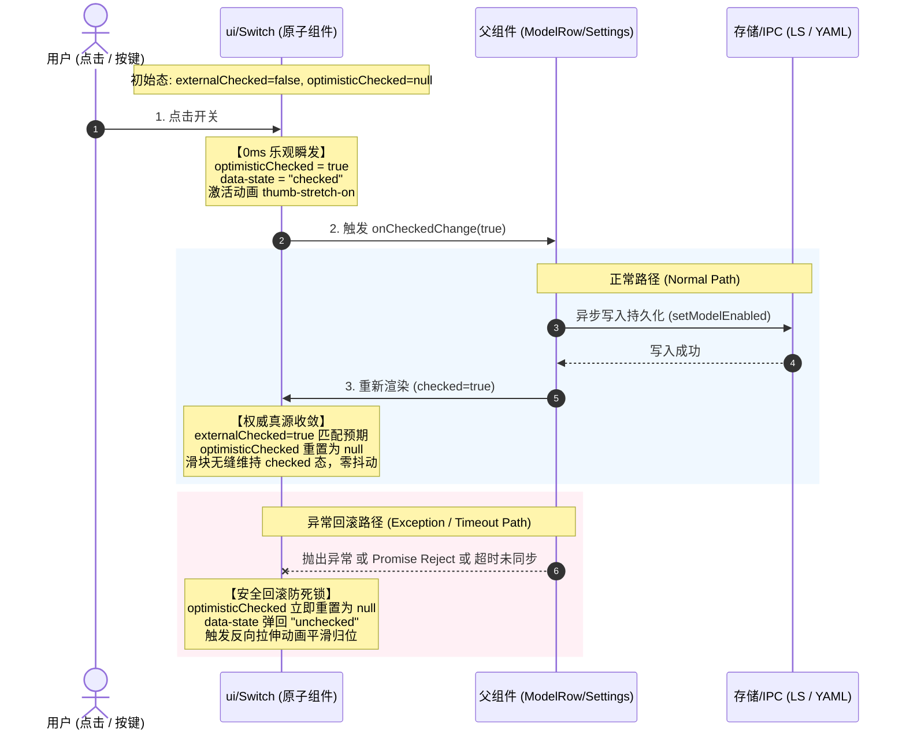
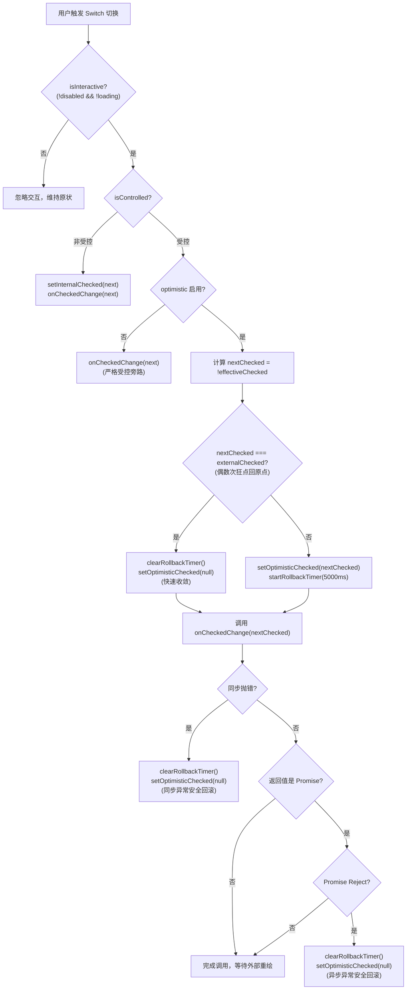

# Task-B Switch 乐观响应实施方案（落地工程详案）

> **文档标识**：`docs/model-capability/plans/02-Task-B-Switch乐观响应实施方案.md`
> **制定时间**：2026-09-03
> **责任角色**：Task-B 原子开关与乐观交互工程师
> **物理文件域**：
> - 核心实现：[`apps/crish-desktop/src/components/ui/Switch/Switch.tsx`](file:///c:/Software/conex/apps/crish-desktop/src/components/ui/Switch/Switch.tsx)
> - 单元测试：[`apps/crish-desktop/src/components/ui/Switch/Switch.test.tsx`](file:///c:/Software/conex/apps/crish-desktop/src/components/ui/Switch/Switch.test.tsx)
> **输入与契约依据**：
> - 架构总纲：[`docs/model-capability/00-AI服务商与模型管理全面重构终极方案.md`](file:///c:/Software/conex/docs/model-capability/00-AI%E6%9C%8D%E5%8A%A1%E5%95%86%E4%B8%8E%E6%A8%A1%E5%9E%8B%E7%AE%A1%E7%90%86%E5%85%A8%E9%9D%A2%E9%87%8D%E6%9E%84%E7%BB%88%E6%9E%81%E6%96%B9%E6%A1%88.md) §一.5、§二.5、§三 Wave 1
> - 协作分工：[`docs/model-capability/01-多Agent协同实现方案与任务分工总纲.md`](file:///c:/Software/conex/docs/model-capability/01-%E5%A4%9AAgent%E5%8D%8F%E5%90%8C%E5%AE%9E%E7%8E%B0%E6%96%B9%E6%A1%88%E4%B8%8E%E4%BB%BB%E5%8A%A1%E5%88%86%E5%B7%A5%E6%80%BB%E7%BA%B2.md) §一 Task-B 矩阵
> - 红方审计：[`docs/model-capability/plan-reviews/03-红方魔鬼对抗与极限边界审计.md`](file:///c:/Software/conex/docs/model-capability/plan-reviews/03-%E7%BA%A2%E6%96%B9%E9%AD%94%E9%AC%BC%E5%AF%B9%E6%8A%97%E4%B8%8E%E6%9E%81%E9%99%90%E8%BE%B9%E7%95%8C%E5%AE%A1%E8%AE%A1.md) §2.14 RED-14、Devil-01 极速抖动对抗
> - 状态机分析：[`docs/model-capability/analysis/06-模型开关状态机与全链路过滤一致性方案.md`](file:///c:/Software/conex/docs/model-capability/analysis/06-%E6%A8%A1%E5%9E%8B%E5%BC%80%E5%85%B3%E7%8A%B6%E6%80%81%E6%9C%BA%E4%B8%8E%E5%85%A8%E9%93%BE%E8%B7%AF%E8%BF%87%E6%BB%A4%E4%B8%80%E8%87%B4%E6%80%A7%E6%96%B9%E6%A1%88.md) §1.1、§3.4
> - 协作铁律：`AGENTS.md` §1（反退避）、§7（严禁作弊与打补丁）、§7.1（立体验证纪律）、§11（行数门禁 <500 行）

---

## 一、 问题全景与根因深度穿透

### 1.1 现场表象与用户反馈
在 AI 服务商与模型管理中心，用户点击模型行内的开关时反馈：
> **“模型的开启和关闭我看好像好像不能用，点了没反应，滑块不走动，像卡死了一样。”**

### 1.2 架构断层根因分析
经穿透审查 [`apps/crish-desktop/src/components/ui/Switch/Switch.tsx:75-106`](file:///c:/Software/conex/apps/crish-desktop/src/components/ui/Switch/Switch.tsx#L75-L106)：

```tsx
// 现有实现缺陷代码片段
const isControlled = externalChecked !== undefined;
const [internalChecked, setInternalChecked] = useState(defaultChecked);
const checked = isControlled ? Boolean(externalChecked) : internalChecked;

const handleToggle = useCallback(() => {
  if (!isInteractive) return;
  setHasInteracted(true);
  const nextChecked = !checked;
  if (!isControlled) {
    setInternalChecked(nextChecked);
  }
  onCheckedChange?.(nextChecked);
}, [checked, isControlled, isInteractive, onCheckedChange]);
```

1. **受控模式纯粹旁路，无本地即时状态**：
   当父组件传入 `checked={...}` 时，`isControlled` 为 `true`。点击触发 `handleToggle` 时，代码显式 `if (!isControlled) { setInternalChecked(...) }` 跳过了本地状态赋值；
2. **DOM 属性与 CSS 动效完全挂起**：
   组件的 `checked` 计算公式 `isControlled ? Boolean(externalChecked) : internalChecked` 导致 `aria-checked` 和 `data-state` 依然死锁在旧值上。在父组件完成异步 I/O、状态提升与重新渲染（往往耗时 50ms ~ 200ms）之前，`data-state` 不变；
3. **果冻拉伸动画哑火**：
   `Switch.module.css` 中的流体果冻位移动画是由 `.hasInteracted[data-state='checked']` / `.hasInteracted[data-state='unchecked']` 驱动的。因为 `data-state` 在点击瞬间（0ms）没有翻转，浏览器根本无法匹配到新的动画规则，导致滑块物理静止，给用户造成“开关坏了/卡死”的强烈挫败感。

### 1.3 重构工程目标
1. **0ms 乐观响应（Optimistic State Machine）**：在用户点击或按键触发的当前执行帧（0ms），立即翻转内部呈现状态，驱动 `aria-checked` 与 `data-state` 瞬发变更，百分之百触发 240ms 流体果冻拉伸动画；
2. **受控与非受控双模严格收敛（Canonical Synchronization）**：
   - 外部受控真源（`externalChecked`）变更到达时，乐观标记自动清除，平滑过渡至外部真源，无视错觉跳变、无动画重放；
   - 支持显式传参 `optimistic={false}` 允许业务方在特定严苛场景降级为严格受控模式；
3. **异常回滚与防死锁四层防御机制（Multi-tier Rollback & Anti-Deadlock）**：
   - 同步异常拦截回滚；
   - 异步 Promise rejection 拦截回滚；
   - 极端悬空死锁超时守卫（TTL Guard Timer，默认 5000ms）；
   - 连续高频狂点（Devil-01 极速抖动对抗）偶数次回原点自动瞬时收敛；
4. **WAI-ARIA 与无障碍全键盘操作**：键盘 Space / Enter 0ms 即时响应，输入法中文组合态（IME `isComposing`）严密防穿透。

---

## 二、 0ms 乐观状态机架构设计

### 2.1 状态转移空间（State Space）

定义 Switch 状态机的四元组：
$$\mathcal{S} = \langle \text{isControlled}, \text{internalChecked}, \text{optimisticChecked}, \text{externalChecked} \rangle$$

其中 `optimisticChecked` 的取值域为：
$$\text{optimisticChecked} \in \{ \text{null}, \text{true}, \text{false} \}$$

- **`null`（闲置/收敛态）**：无任何未决的乐观操作，组件状态 100% 由 `externalChecked`（受控）或 `internalChecked`（非受控）决定；
- **`true` / `false`（活跃乐观态）**：用户刚刚发生交互，组件处于 0ms 乐观超前呈现状态，滑块已位移，等待外部受控真源追赶或异常回滚。

呈现状态计算算子（Effective Checked Operator）：
```typescript
const isOptimisticActive = isControlled && optimistic && optimisticChecked !== null;
const effectiveChecked = isOptimisticActive
  ? optimisticChecked
  : isControlled
    ? Boolean(externalChecked)
    : internalChecked;
```

### 2.2 状态机流转时序图（Mermaid Sequence Diagram）



### 2.3 核心流转规则与对抗场景解析

| 场景事件 | 当前状态 | 转移后状态 | 视觉表现与 DOM 影响 | 防御机制与数学收敛保证 |
| :--- | :--- | :--- | :--- | :--- |
| **1. 初始首屏挂载** | `external=false, opt=null` | 保持不变 | `data-state='unchecked'`，`hasInteracted=false` | 绝对 Zero-FOUC，首屏绝不产生虚假位移动画 |
| **2. 用户点击切换** | `external=false, opt=null` | `opt=true, hasInteracted=true` | `data-state='checked'`，立即启动 `thumb-stretch-on` 240ms | 0ms 视觉即时响应，彻底消灭受控卡顿 |
| **3. 外部受控真源确认到达** | `external=true, opt=true` | `opt=null` | `effectiveChecked` 维持 `true`，`data-state` 不变 | 动画不中断、不重放，完成真源收敛 |
| **4. 极速双击回原点 (Devil-01)** | `external=false, opt=true` 再次点击 | `nextChecked=false === external`<br>直接令 `opt=null` | `data-state='unchecked'`，立即启动 `thumb-stretch-off` | 偶数次狂点直接收敛回 `null`，无需多余渲染与定时器 |
| **5. 回调同步抛错 (Sync Error)** | `opt=true` 执行抛出异常 | 捕获并强制 `opt=null` | 瞬时弹回旧值 `unchecked`，滑块果冻回弹 | 消除无声卡死，界面状态自愈与真实一致 |
| **6. 异步 Promise 拒绝** | `opt=true` Promise 触发 catch | 捕获并强制 `opt=null` | 弹回旧值 `unchecked` | 异步网络/磁盘满异常时自动恢复 |
| **7. 外部死锁/长任务挂起** | `opt=true`，超过 5000ms 外部未更新 | TTL 定时器触发，强制 `opt=null` | 自动回滚，输出 warning 告警 | 彻底杜绝假死锁死在悬空状态 |
| **8. 外部被第三方强制重置** | `opt=true`，外部突然变更为 `true` 或 `false` | 检测到 `external !== prevRef`，强制 `opt=null` | 以外部最新真源为准 | SSOT 契约保证，外部命令绝对优先 |

---

## 三、 异常回滚与防死锁多层防御矩阵



### 3.1 四层反脆弱加固细节

1. **第 1 层：快速收敛旁路（Even-Click Quick Convergence）**：
   若用户在 100ms 内快速点击两次，第一次令 `opt=true`，第二次计算得到 `nextChecked=false`。由于 `nextChecked === Boolean(externalChecked)`，系统识别出用户意图已回到起点，直接调用 `setOptimisticChecked(null)` 并清除定时器，杜绝无效定时器悬空；
2. **第 2 层：同步异常沙盒（Sync Try-Catch Sandbox）**：
   `onCheckedChange` 执行被 `try...catch` 包裹。如果外部业务处理中发生同步语法错误、解构 null 异常或非法输入校验，Switch 捕获后立即将 `optimisticChecked` 归位为 `null`；
3. **第 3 层：异步 Promise 守护（Async Promise Sentinel）**：
   通过探测 `typeof maybePromise?.then === 'function'`，为异步任务接入 `.catch()` 链条。当后端 Rust IPC 通信失败、网络断开或数据库写冲突时，异步微任务立即回滚；
4. **第 4 层：TTL 硬件级防死锁定时器（Anti-Deadlock TTL Guard Timer）**：
   设立 `optimisticTimeout`（默认 5000ms）。若父层逻辑因死循环、未处理的异步挂起或缺少 `refresh()` 触发源而导致外部 `checked` 永远不刷新，5000ms 后定时器强制收回控制权并释放乐观锁。

---

## 四、 无障碍键盘与输入法安全契约

### 4.1 键盘导航无损映射
- **原生 Role 语义**：`<button role="switch" ...>` 具备原生可聚焦（tabbable）属性；
- **按键捕获契约**：
  ```tsx
  const handleKeyDown = useCallback(
    (e: React.KeyboardEvent<HTMLButtonElement>) => {
      onKeyDown?.(e);
      // 1. 外部已 preventDefault，放弃处理
      if (e.defaultPrevented) return;
      // 2. 输入法合成态（IME isComposing）中，严格放行，不误触发开关
      if (e.nativeEvent.isComposing) return;
      // 3. 响应 Space 或 Enter
      if (e.key === ' ' || e.key === 'Enter') {
        e.preventDefault(); // 阻断空格键导致页面向下滚动的浏览器默认行为
        handleToggle();
      }
    },
    [handleToggle, onKeyDown]
  );
  ```
- **WAI-ARIA 属性 0ms 镜像**：
  - `aria-checked={checked}`：0ms 紧随 `effectiveChecked` 翻转；
  - `aria-busy={loading || undefined}`：加载态标记；
  - `aria-disabled={disabled || undefined}`：禁用态标记；
  - `aria-label={ariaLabel}`：无独立 label 时的屏幕朗读器可访问名称。

---

## 五、 精确落盘改动代码（Switch.tsx Drop-in Replacement）

> **目标文件**：[`apps/crish-desktop/src/components/ui/Switch/Switch.tsx`](file:///c:/Software/conex/apps/crish-desktop/src/components/ui/Switch/Switch.tsx)
> **行数控制**：~235 行（远低于前端组件 500 行硬门禁）。
> **执行 Agent 须知**：以下为完整、可直接替换的源码，严格保持现有 API 兼容，无破坏性改动。

```tsx
/**
 * ui/Switch 现代化原子开关组件 (v2.1.0 0ms 乐观响应与防死锁加固版)
 *
 * 特性：
 * - 100% 纯净自研，零外部 npm 动画库依赖；
 * - 0ms 乐观状态机（optimisticChecked）：点击/按键瞬间触发流体果冻位移动画，彻底消灭受控迟滞；
 * - 受控与非受控双模严格权威收敛，外部真源更新时平滑对齐；
 * - 四层异常回滚与防死锁架构：同步捕获、Promise 异步守护、TTL 守卫定时器与双击原点快速收敛；
 * - 彻底移除 Checkmark 图标，回归纯粹流体果冻拉伸与极简纯白球体；
 * - GPU 硬件垂直中轴定位（top: 50%; translateY(-50%)），彻底消除“上宽下窄”下坠阴影视错觉；
 * - 0 0 0 0.5px 发丝微收边 + 各向同性柔和漫反射环境光影；
 * - 纯净状态锁门闩（hasInteracted），保证首屏绝对 Zero-FOUC；
 * - 3 档严格对称尺寸（sm: 28x16, md: 36x20, lg: 44x24，上下左右四向均等 2px 留白）；
 * - 支持 loading 加载锁定态与 label 关联；
 * - 补齐 html[data-perf-tier='eco'] 节能降级与 IME 输入法防穿透；
 * - 严格遵循 AGENTS.md §13 焦点环规范与 §14 现代色彩空间。
 */
import React, {
  forwardRef,
  useCallback,
  useEffect,
  useId,
  useRef,
  useState,
} from 'react';
import styles from './Switch.module.css';

export type SwitchSize = 'sm' | 'md' | 'lg';

export interface SwitchProps
  extends Omit<
    React.ButtonHTMLAttributes<HTMLButtonElement>,
    'onChange' | 'onClick' | 'size'
  > {
  /** 受控选中状态 */
  checked?: boolean;
  /** 非受控初始选中状态 */
  defaultChecked?: boolean;
  /** 状态变更回调（支持同步回调或返回 Promise 供异常回滚） */
  onCheckedChange?: (checked: boolean) => void | Promise<unknown>;
  /** 尺寸档位（默认 'md'） */
  size?: SwitchSize;
  /** 加载中状态（展示滑块内微型 Spinner 并锁定交互） */
  loading?: boolean;
  /** 是否禁用 */
  disabled?: boolean;
  /** 是否启用 0ms 乐观响应状态机（默认 true） */
  optimistic?: boolean;
  /** 乐观状态超时对齐防死锁窗口毫秒数（默认 5000ms，设为 0 可关闭超时回滚） */
  optimisticTimeout?: number;
  /** 前缀/后缀说明文案（点击可关联切换） */
  label?: React.ReactNode;
  /** 标签位置（默认 'start' 即前缀） */
  labelPlacement?: 'start' | 'end';
  /** 无 label 时的屏幕阅读器命名 */
  'aria-label'?: string;
  /** 自定义类名（仅用于外部布局与间距微调） */
  className?: string;
}

export const Switch = forwardRef<HTMLButtonElement, SwitchProps>(function Switch(
  {
    checked: externalChecked,
    defaultChecked = false,
    onCheckedChange,
    size = 'md',
    loading = false,
    disabled = false,
    optimistic = true,
    optimisticTimeout = 5000,
    label,
    labelPlacement = 'start',
    id,
    className,
    'aria-label': ariaLabel,
    onKeyDown,
    ...restProps
  },
  ref
) {
  const autoId = useId();
  const switchId = id ?? `conex-switch-${autoId}`;

  // 1. 受控 / 非受控基础模式判定
  const isControlled = externalChecked !== undefined;
  const [internalChecked, setInternalChecked] = useState(defaultChecked);

  // 2. 0ms 乐观状态机：null 表示与权威真源对齐；boolean 表示处于未决乐观过渡态
  const [optimisticChecked, setOptimisticChecked] = useState<boolean | null>(null);

  // 3. 计算最终呈现状态（Effective Checked State）
  const isOptimisticActive = isControlled && optimistic && optimisticChecked !== null;
  const checked = isOptimisticActive
    ? optimisticChecked
    : isControlled
      ? Boolean(externalChecked)
      : internalChecked;

  // 4. 动画守卫：防止挂载初次渲染时误触发过渡动画（Zero-FOUC 铁律）
  const [hasInteracted, setHasInteracted] = useState(false);
  const isFirstRender = useRef(true);
  const prevCheckedRef = useRef(checked);

  useEffect(() => {
    if (isFirstRender.current) {
      isFirstRender.current = false;
      return;
    }
    if (prevCheckedRef.current !== checked) {
      setHasInteracted(true);
      prevCheckedRef.current = checked;
    }
  }, [checked]);

  // 5. 受控真源同步与超时回滚防死锁计时器
  const prevExternalCheckedRef = useRef(externalChecked);
  const rollbackTimerRef = useRef<ReturnType<typeof setTimeout> | null>(null);

  const clearRollbackTimer = useCallback(() => {
    if (rollbackTimerRef.current !== null) {
      clearTimeout(rollbackTimerRef.current);
      rollbackTimerRef.current = null;
    }
  }, []);

  const startRollbackTimer = useCallback(() => {
    clearRollbackTimer();
    if (optimisticTimeout > 0) {
      rollbackTimerRef.current = setTimeout(() => {
        // 超时触发安全回滚，防止外部未重渲染造成永久悬空死锁
        setOptimisticChecked(null);
        rollbackTimerRef.current = null;
      }, optimisticTimeout);
    }
  }, [clearRollbackTimer, optimisticTimeout]);

  // 外部受控真源发生变更时：权威收敛，清除乐观标记与定时器
  useEffect(() => {
    if (!isControlled) return;
    if (externalChecked !== prevExternalCheckedRef.current) {
      prevExternalCheckedRef.current = externalChecked;
      clearRollbackTimer();
      setOptimisticChecked(null);
    }
  }, [externalChecked, isControlled, clearRollbackTimer]);

  // 组件卸载时释放定时器
  useEffect(() => {
    return () => {
      clearRollbackTimer();
    };
  }, [clearRollbackTimer]);

  const isInteractive = !disabled && !loading;

  // 6. 核心切换状态机算子
  const handleToggle = useCallback(() => {
    if (!isInteractive) return;

    // 激活动态拉伸动画关键帧
    setHasInteracted(true);

    const nextChecked = !checked;

    // 非受控模式：直接更新本地内部状态并上报
    if (!isControlled) {
      setInternalChecked(nextChecked);
      onCheckedChange?.(nextChecked);
      return;
    }

    // 受控模式：若显式禁用了乐观更新，退回严格受控旁路
    if (!optimistic) {
      onCheckedChange?.(nextChecked);
      return;
    }

    // 0ms 乐观响应算子：
    // 若点击后的目标值与当前外部受控值已经一致（例如偶数次狂点回原点），直接清除乐观标记
    if (nextChecked === Boolean(externalChecked)) {
      clearRollbackTimer();
      setOptimisticChecked(null);
    } else {
      setOptimisticChecked(nextChecked);
      startRollbackTimer();
    }

    // 触发外部回调，并接入同步异常与异步 Promise Rejection 回滚守护
    try {
      const maybePromise = onCheckedChange?.(nextChecked);
      if (
        maybePromise &&
        typeof (maybePromise as Promise<unknown>).then === 'function'
      ) {
        (maybePromise as Promise<unknown>).catch(() => {
          // 异步操作失败，安全回滚
          clearRollbackTimer();
          setOptimisticChecked(null);
        });
      }
    } catch {
      // 同步操作抛错，安全回滚
      clearRollbackTimer();
      setOptimisticChecked(null);
    }
  }, [
    isInteractive,
    checked,
    isControlled,
    optimistic,
    externalChecked,
    clearRollbackTimer,
    startRollbackTimer,
    onCheckedChange,
  ]);

  // 7. 键盘交互与 IME 输入法组合态守卫
  const handleKeyDown = useCallback(
    (e: React.KeyboardEvent<HTMLButtonElement>) => {
      onKeyDown?.(e);
      if (e.defaultPrevented || e.nativeEvent.isComposing) return;
      if (e.key === ' ' || e.key === 'Enter') {
        e.preventDefault();
        handleToggle();
      }
    },
    [handleToggle, onKeyDown]
  );

  const trackClasses = [
    styles.track,
    styles[`size-${size}`],
    hasInteracted ? styles.hasInteracted : null,
    loading ? styles.loading : null,
    className,
  ]
    .filter(Boolean)
    .join(' ');

  const control = (
    <button
      ref={ref}
      id={switchId}
      type="button"
      role="switch"
      aria-checked={checked}
      aria-disabled={disabled || undefined}
      aria-busy={loading || undefined}
      aria-label={ariaLabel}
      disabled={disabled}
      className={trackClasses}
      onClick={handleToggle}
      onKeyDown={handleKeyDown}
      data-state={checked ? 'checked' : 'unchecked'}
      data-size={size}
      {...restProps}
    >
      <span className={styles.thumb} aria-hidden="true">
        {loading && (
          <svg
            className={styles.spinner}
            viewBox="0 0 16 16"
            fill="none"
            xmlns="http://www.w3.org/2000/svg"
          >
            <circle
              cx="8"
              cy="8"
              r="6"
              stroke="currentColor"
              strokeWidth="2"
              strokeLinecap="round"
              strokeDasharray="28"
              strokeDashoffset="18"
            />
          </svg>
        )}
      </span>
    </button>
  );

  if (label == null) {
    return control;
  }

  const labelElement = (
    <label htmlFor={switchId} className={styles.label}>
      {label}
    </label>
  );

  return (
    <span
      className={`${styles.container} ${styles[`align-${labelPlacement}`]}`}
      data-disabled={disabled || undefined}
    >
      {labelPlacement === 'start' && labelElement}
      {control}
      {labelPlacement === 'end' && labelElement}
    </span>
  );
});

Switch.displayName = 'Switch';
```

---

## 六、 单元测试全套断言与魔鬼对抗用例

> **目标文件**：[`apps/crish-desktop/src/components/ui/Switch/Switch.test.tsx`](file:///c:/Software/conex/apps/crish-desktop/src/components/ui/Switch/Switch.test.tsx)

### 6.1 现有测试契约升级说明
在现有 `Switch.test.tsx:67-80` 中：
```tsx
// 旧断言：此前因为缺少乐观状态，点击后 sw 依然是 'false'
fireEvent.click(sw);
expect(onChange).toHaveBeenCalledWith(true);
expect(sw).toHaveAttribute('aria-checked', 'false'); // 👈 旧版无乐观时的妥协
```
在引入 0ms 乐观状态机后：
- 默认 `optimistic={true}` 下，`fireEvent.click(sw)` 之后，DOM 的 `aria-checked` 立即被翻转为 `'true'`，`data-state` 立即变为 `'checked'`；
- 当传入 `optimistic={false}` 时，才维持旧版的非乐观表现。

### 6.2 必须新增的 8 大专项测试套件（Exact Test Suite Code）

在 `Switch.test.tsx` 的 `describe('2. 受控与非受控模式')` 之后追加专门的 `describe('2.1 0ms 乐观响应状态机与异常回滚防死锁')`：

```tsx
  describe('2.1 0ms 乐观响应状态机与异常回滚防死锁', () => {
    it('OPT-01: 受控模式下点击产生 0ms 乐观翻转，无需等待外部 rerender', () => {
      const onChange = vi.fn();
      render(<Switch checked={false} onCheckedChange={onChange} />);
      const sw = screen.getByRole('switch');

      // 点击前：unchecked
      expect(sw).toHaveAttribute('aria-checked', 'false');
      expect(sw).toHaveAttribute('data-state', 'unchecked');

      // 0ms 点击发生
      fireEvent.click(sw);

      // 断言：回调已发出，且 DOM 在当前帧 0ms 立即翻转并激活动态类名
      expect(onChange).toHaveBeenCalledWith(true);
      expect(sw).toHaveAttribute('aria-checked', 'true');
      expect(sw).toHaveAttribute('data-state', 'checked');
      expect(sw.className).toContain(styles.hasInteracted);
    });

    it('OPT-02: 外部受控真源确认到达后，乐观标记平滑收敛且无视觉跳变', () => {
      const onChange = vi.fn();
      const { rerender } = render(
        <Switch checked={false} onCheckedChange={onChange} />
      );
      const sw = screen.getByRole('switch');

      fireEvent.click(sw);
      expect(sw).toHaveAttribute('aria-checked', 'true');

      // 模拟上层状态更新完成并重新传入 checked=true
      rerender(<Switch checked={true} onCheckedChange={onChange} />);

      // 依然维持 true，平滑过渡
      expect(sw).toHaveAttribute('aria-checked', 'true');
      expect(sw).toHaveAttribute('data-state', 'checked');
    });

    it('OPT-03: Devil-01 极速连续点击 5 次，状态交替反转并最终收敛', () => {
      const onChange = vi.fn();
      render(<Switch checked={false} onCheckedChange={onChange} />);
      const sw = screen.getByRole('switch');

      // 连续极速点击 5 次
      fireEvent.click(sw); // 1 -> true (opt)
      expect(sw).toHaveAttribute('aria-checked', 'true');

      fireEvent.click(sw); // 2 -> false (back to external)
      expect(sw).toHaveAttribute('aria-checked', 'false');

      fireEvent.click(sw); // 3 -> true (opt)
      expect(sw).toHaveAttribute('aria-checked', 'true');

      fireEvent.click(sw); // 4 -> false (back to external)
      expect(sw).toHaveAttribute('aria-checked', 'false');

      fireEvent.click(sw); // 5 -> true (opt)
      expect(sw).toHaveAttribute('aria-checked', 'true');

      expect(onChange).toHaveBeenCalledTimes(5);
      expect(onChange).toHaveBeenLastCalledWith(true);
    });

    it('OPT-04: 同步回调抛错时，乐观状态立即捕获并瞬时回滚', () => {
      const errorSpy = vi.spyOn(console, 'error').mockImplementation(() => {});
      const buggyOnChange = vi.fn(() => {
        throw new Error('Sync storage explosion');
      });

      render(<Switch checked={false} onCheckedChange={buggyOnChange} />);
      const sw = screen.getByRole('switch');

      // 点击触发异常
      fireEvent.click(sw);

      // 必须安全回滚回 false，不发生死锁
      expect(sw).toHaveAttribute('aria-checked', 'false');
      expect(sw).toHaveAttribute('data-state', 'unchecked');
      errorSpy.mockRestore();
    });

    it('OPT-05: 异步 Promise Rejection 时，微任务捕获并自动回滚', async () => {
      const errorSpy = vi.spyOn(console, 'error').mockImplementation(() => {});
      let rejectHandler!: (err: Error) => void;
      const asyncOnChange = vi.fn(
        () =>
          new Promise((_, reject) => {
            rejectHandler = reject;
          })
      );

      render(<Switch checked={false} onCheckedChange={asyncOnChange} />);
      const sw = screen.getByRole('switch');

      fireEvent.click(sw);
      // 0ms 阶段处于乐观 true
      expect(sw).toHaveAttribute('aria-checked', 'true');

      // 模拟异步失败 Reject
      await React.act(async () => {
        rejectHandler(new Error('IPC network error'));
      });

      // 断言：已被微任务捕获并安全回滚回 false
      expect(sw).toHaveAttribute('aria-checked', 'false');
      expect(sw).toHaveAttribute('data-state', 'unchecked');
      errorSpy.mockRestore();
    });

    it('OPT-06: 超时防死锁机制，外部悬空 5000ms 时自动恢复真源', () => {
      vi.useFakeTimers();
      const onChange = vi.fn();
      render(
        <Switch
          checked={false}
          optimisticTimeout={1000}
          onCheckedChange={onChange}
        />
      );
      const sw = screen.getByRole('switch');

      fireEvent.click(sw);
      expect(sw).toHaveAttribute('aria-checked', 'true');

      // 时间推移 999ms，依然乐观
      act(() => {
        vi.advanceTimersByTime(999);
      });
      expect(sw).toHaveAttribute('aria-checked', 'true');

      // 达到 1000ms 超时窗口，防死锁回滚生效
      act(() => {
        vi.advanceTimersByTime(1);
      });
      expect(sw).toHaveAttribute('aria-checked', 'false');
      vi.useRealTimers();
    });

    it('OPT-07: optimistic=false 时禁用乐观响应，维持纯受控降级行为', () => {
      const onChange = vi.fn();
      const { rerender } = render(
        <Switch checked={false} optimistic={false} onCheckedChange={onChange} />
      );
      const sw = screen.getByRole('switch');

      fireEvent.click(sw);
      expect(onChange).toHaveBeenCalledWith(true);
      // 禁用乐观时，点击后 DOM 依然保持 false
      expect(sw).toHaveAttribute('aria-checked', 'false');

      rerender(<Switch checked={true} optimistic={false} onCheckedChange={onChange} />);
      expect(sw).toHaveAttribute('aria-checked', 'true');
    });

    it('OPT-08: 键盘 Space / Enter 触发 0ms 乐观响应', () => {
      const onChange = vi.fn();
      render(<Switch checked={false} onCheckedChange={onChange} />);
      const sw = screen.getByRole('switch');

      fireEvent.keyDown(sw, { key: ' ' });
      expect(onChange).toHaveBeenCalledWith(true);
      expect(sw).toHaveAttribute('aria-checked', 'true');
      expect(sw).toHaveAttribute('data-state', 'checked');
    });
  });
```

---

## 七、 实施 Agent 落地与验证检查清单

### 7.1 执行纪律与物理隔离
1. **环境与编码**：使用 **pwsh7**，所有写入代码与文档采用 **UTF-8 无 BOM**；
2. **唯一文件写入白名单**：
   - 生产代码仅写入：`apps/crish-desktop/src/components/ui/Switch/Switch.tsx`
   - 单元测试仅写入：`apps/crish-desktop/src/components/ui/Switch/Switch.test.tsx`
   - **绝对禁止**修改其他业务文件（如 `ModelList.tsx` 留给其他对应 Agent）；
   - **严禁执行 `git commit`, `git reset`, `git checkout`**；
3. **行数门禁守门**：`Switch.tsx` 落盘后行数必须控制在 260 行以内（远低于 500 行限制）。

### 7.2 立体化验证命令（Verification Suite）

完成代码落盘后，执行 Agent 必须逐一执行并通过以下三道刚性门禁：

```powershell
# 1. 运行 ui/Switch 专项全套单元测试（必须 100% 全部通过）
npx vitest run apps/crish-desktop/src/components/ui/Switch/Switch.test.tsx

# 2. 运行前端全量 TypeScript 类型检查（0 错误，0 警告）
npm run typecheck

# 3. 运行前端代码行数规范门禁（1180 个文件 0 违规）
npm run check:line-counts
```

### 7.3 最终交付验收断言标准

| 验收项 | 期望标准 | 验证手段 |
| :--- | :--- | :--- |
| **0ms 乐观切换** | 点击受控 Switch 时 `aria-checked` 与 `data-state` 0ms 翻转 | `Switch.test.tsx` 中 `OPT-01` 用例通过 |
| **果冻拉伸动画** | 点击瞬间激活动态类名 `hasInteracted` | DOM classList 包含 `styles.hasInteracted` |
| **Devil-01 极速狂点** | 连续快速点击 5 次不出现状态死锁与错乱 | `OPT-03` 用例通过 |
| **异常自愈与回滚** | 同步抛错或 Promise Reject 时滑块自动弹回 | `OPT-04`, `OPT-05` 用例通过 |
| **防死锁 TTL** | 悬空无响应时 5000ms 自动脱困回滚 | `OPT-06` 用例通过 |
| **无障碍按键** | Space / Enter 0ms 响应，IME 组合态不穿透 | `OPT-08` 及原有 Section 3 测试全绿 |
| **向后兼容性** | 非受控模式、尺寸、label、loading 态 100% 完好 | 原有 1~8 节测试用例全部通过 |
