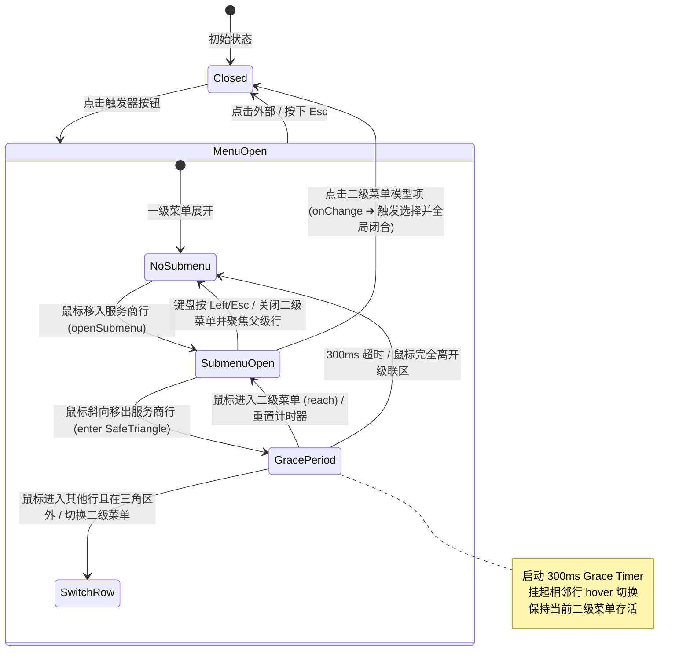

# Task-C 级联菜单与 Portal 逃逸实施方案

> **文档标识**：`docs/model-capability/plans/03-Task-C-级联菜单与Portal逃逸实施方案.md`
> **任务代号**：`Task-C`（级联菜单与 Portal 逃逸工程师）
> **制定时间**：2026-09-03
> **输入基线**：
> - [`00-AI服务商与模型管理全面重构终极方案.md`](file:///c:/Software/conex/docs/model-capability/00-AI服务商与模型管理全面重构终极方案.md)
> - [`01-多Agent协同实现方案与任务分工总纲.md`](file:///c:/Software/conex/docs/model-capability/01-多Agent协同实现方案与任务分工总纲.md)
> - [`05-DOM几何渲染与滚动隔离深度审计.md`](file:///c:/Software/conex/docs/model-capability/plan-reviews/05-DOM几何渲染与滚动隔离深度审计.md)
> - [`03-红方魔鬼对抗与极限边界审计.md`](file:///c:/Software/conex/docs/model-capability/plan-reviews/03-红方魔鬼对抗与极限边界审计.md)
> **物理文件域白名单（本任务严格限写以下 1 个文件）**：
> - `apps/crish-desktop/src/components/settings-models/ModelProfileList.tsx`
> **执行纪律**：遵循 `AGENTS.md` §1 反退避原则、§2 协作纪律与 §7 严禁打补丁；只修改物理白名单文件；严禁执行 git 提交。

---

## 一、 方案执行目标与核心攻坚点

本方案聚焦于重构 `apps/crish-desktop/src/components/settings-models/ModelProfileList.tsx` 中的 **`ModelsCascadeSelect`（全局默认模型级联选择器）** 与 **`ModelProfileList`（左侧服务商轨栏）**，彻底消除用户现场反馈的以下严重交互与视觉缺陷：

1. **禁用模型“阴魂不散”漏洞**：用户在服务商详情页关闭了某个模型的开关，但在全局默认模型的级联下拉中，该模型依然出现且可被选中；若某个服务商的所有模型全部被关闭，该服务商依然常驻在级联一级菜单中。
2. **二级子菜单物理截断与 Paint 裁切**：二级子菜单以内联绝对定位（`position: absolute; right: calc(100% + 4px);`）挂载在父级 DOM 节点内，受到外层包含块与 `overflow` 约束，在窗口边缘被硬性截断。
3. **点击二级菜单瞬间主菜单闪退（DEF-A11Y-01）**：浮层系统将二级菜单与父级菜单视为互不相关的独立节点，用户点击二级菜单中的模型时，父级 Radix Popover 判定为 `Outside Click`，瞬间粗暴卸载销毁主菜单，模型切换失效。
4. **FocusTrap 沙盒冻结与 Tab 焦点拉回（DEF-A11Y-02）**：当浮层挂载至 `document.body` 时，由于缺失白名单标记，被全屏设置弹窗的 `FocusTrapIsolationManager` 强行打上 `inert` 与 `aria-hidden="true"`，导致二级菜单无法点击、鼠标悬停失效；按下 `Tab` 键时焦点被暴力重置回设置页起点。
5. **安全三角向量叉积方向向左反转 180°**：历史代码中硬编码 `safeTrackerRef.current.enter(..., 'right')`，当子菜单因视口空间计算向左侧展开时，安全三角顶点计算反向，导致光标向左滑入子菜单时叉积符号反转，被判定为“离开三角区”，300ms 保护期瞬间失效并引发闪退。
6. **全停用白屏崩溃（RED-04）**：当用户停用所有服务商或所有模型时，`ModelsCascadeSelect` 试图裸访问 `activeProfile.id` 或传入 `undefined` 至名称格式化函数，引发 JavaScript 致命异常导致设置页白屏死锁。

---

## 二、 核心机理穿透与数学几何证明

### 2.1 双层过滤拓扑模型（Provider 级与 Model 级刚性过滤）

#### 现存缺陷分析：
当前 `ModelProfileList.tsx` 第 30-32 行的过滤逻辑为：
```tsx
// ⚠️ 缺陷代码：仅检查了 p.enabled 与模型数组原生长度，完全漏读了单个模型的元数据状态
const enabledProfiles = useMemo(() => {
  return profiles.filter((p) => p.enabled !== false && p.models.length > 0);
}, [profiles]);
```
- `p.models` 只是一个原始字符串数组（例如 `["gpt-4o", "gpt-4o-mini"]`）；
- 模型的开启/关闭状态存储在 `modelCatalogMeta.ts` 的元数据系统（`getModelMeta(p.id, m).enabled`）中；
- 只要 `p.models` 非空，即使所有子模型均已被用户关闭（`enabled: false`），该服务商依然会被包含在 `enabledProfiles` 中；
- 用户移入该服务商展开二级菜单时，被禁用的模型依然被渲染为可点击项。

#### 刚性加固规则（Double-Tier Pure Invariant）：
建立双层纯函数无损过滤管线：
```
profiles
  ├── [Tier 1: 服务商级过滤] ➔ p.enabled !== false
  │
  ├── [Tier 2: 模型级过滤]   ➔ p.models.filter(m => getModelMeta(p.id, m).enabled !== false)
  │
  └── [Tier 3: 归约收敛]     ➔ 仅保留有效模型数 > 0 的服务商 (validModels.length > 0)
```
通过该管线：
1. 任何已被禁用的单个模型被绝对物理排除；
2. 若某服务商下所有模型均被禁用，该服务商整行自动从级联选择器中消失；
3. 输出结果结构稳定、不可变，完全消除脏数据渗入。

---

### 2.2 Portal 逃逸与 LayerStack 拓扑锚定（彻底根除 DEF-A11Y-01 误杀）

#### 崩溃链路全景推导：
```
[用户点击二级子菜单内的某个模型选项]
  │
  ▼
[DOM 派发原生 PointerDown 事件]
  │
  ▼
[主菜单 Menu.tsx 捕获 onPointerDownOutside 事件]
  │
  ├── 检查是否为触发器点击? ➔ 否
  └── 检查是否为后代浮层点击? (Menu.tsx:331-336)
       │
       └── layerStackService.getDescendants(menuId)
            │
            ├── 若未指定 parentId:
            │    └── menuId 的后代数组为空 [] ➔ isDescendant = false!
            │         └── 未执行 e.preventDefault()
            │              └── Radix Popover 判定用户点击外部，立即销毁主菜单！【崩溃】
            │
            └── 🌟 加固后指定 parentId: menuId:
                 └── menuId 的后代包含 submenuLayerId ➔ isDescendant = true!
                      └── 执行 e.preventDefault() 阻断关闭！
                           └── 点击事件正常下发至模型按钮，平滑触发 onChange！【成功】
```

#### 架构断层破局：
在 React 树中，`<Menu>` 是由 `ModelsCascadeSelect` 返回的，`MenuContext.Provider` 位于 `<Menu>` 内部：
```tsx
// Menu.tsx 内部结构
<MenuContext.Provider value={{ menuId }}>
  <Popover.Portal>
    <Popover.Content ...>
      {children}
    </Popover.Content>
  </Popover.Portal>
</MenuContext.Provider>
```
若在 `ModelsCascadeSelect` 顶层直接调用 `useContext(MenuContext)`，将只能获取到外层 Context（返回 `menuId: null`）。
**正确架构设计**：必须将二级浮层抽象为 `<Menu>` 的子组件 `CascadeSubmenuFlyout`。该组件作为 `children` 渲染在 `<MenuContext.Provider>` 内部，从而能 100% 稳定读取到真实分配的 `menuId`，并传递至 `useLayerRegistration`：
```tsx
useLayerRegistration(
  {
    id: submenuLayerId,
    type: 'cascade-submenu',
    parentId: menuId ?? undefined, // 🌟 锚定父子拓扑
    dismissible: true,
    onDismiss: closeSubmenu,
    elementRef: flyoutRef,
  },
  Boolean(profile && placement)
);
```

---

### 2.3 FocusTrap 沙盒免疫机制（彻底根除 DEF-A11Y-02 冻结与 Tab 焦点拉回）

#### 机制穿透：
全屏设置窗口（`SettingsPanel`）由 `Dialog variant="fullscreen"` 承载，全局单例 `FocusTrapIsolationManager` 负责保证模态隔离。
当二级子菜单通过 `createPortal` 挂载到 `dialogOverlay ?? document.body` 时，它物理上脱离了 `Dialog` 的 DOM 子树：
1. **`inert` 冻结风险**：`FocusTrapIsolationManager` 遍历 `document.body.children`，若外部节点不在白名单中，强行施加 `inert` 与 `aria-hidden="true"`，导致二级菜单变为“幽灵浮层”（鼠标点击穿透、无法 hover）。
2. **Tab 键劫持风险**：若用户焦点进入二级菜单后按下 `Tab` 键，`focusTrap.tsx` 检测到 `!containerRef.current.contains(activeEl)`，立即执行 `e.preventDefault()` 并把焦点强行拉回弹窗起点的搜索框，导致菜单失焦关闭。

#### 白名单刚性标记：
审查 `apps/crish-desktop/src/components/ui/Dialog/focusTrap.tsx` 第 72-80 行与第 224-236 行，浮层必须显式携带以下三位一体的属性标记：
```tsx
<div
  ref={flyoutRef}
  data-floating-layer="true"           // 🌟 放行白名单 1：免疫 FocusTrapIsolationManager inert 冻结
  data-slot="cascade-submenu-content"  // 语义槽位契约
  role="listbox"                       // 🌟 放行白名单 2：免疫 Tab 键焦点暴力劫持
  aria-label={`${profileName} 模型列表`}
  className={styles.cascadeFlyoutPortal}
  style={{ ... }}
>
```

---

### 2.4 安全三角 180° 反向背离溯源与几何同构证明

#### 数学推导与病灶溯源：
`SafeTriangle.ts` 使用 2D 向量叉积判断光标点 $M(x, y)$ 是否位于由光标离开点 $P$ 与子菜单边沿两顶点 $V_1, V_2$ 构成的三角形内部：
$$\operatorname{crossProduct}(P, V_1, M) = (V_{1x} - P_x)(M_y - P_y) - (V_{1y} - P_y)(M_x - P_x)$$

审查 `apps/crish-desktop/src/components/ui/internal/SafeTriangle.ts` 中根据方位构建顶点的算法：
```typescript
if (placement === 'left') {
  return [
    cursor,
    { x: submenuBounds.right, y: submenuBounds.top },    // 子菜单右侧上顶点
    { x: submenuBounds.right, y: submenuBounds.bottom }, // 子菜单右侧下顶点
  ];
}
if (placement === 'right') {
  return [
    cursor,
    { x: submenuBounds.left, y: submenuBounds.top },     // 子菜单左侧上顶点
    { x: submenuBounds.left, y: submenuBounds.bottom },  // 子菜单左侧下顶点
  ];
}
```

#### 致命病因：
在当前历史代码中（`ModelProfileList.tsx` 第 101 行）：
```tsx
onMouseLeave={(e) => {
  if (isFly && flyoutRef.current) {
    const rect = flyoutRef.current.getBoundingClientRect();
    safeTrackerRef.current.enter(
      { x: e.clientX, y: e.clientY },
      rect,
      'right' // ⚠️ 致命硬编码：恒定传入 'right'！
    );
  }
}}
```
- 当主菜单靠右显示、二级菜单向左翻转展开时（`placement.side === 'left'`），子菜单位于光标的**左侧**；
- 此时光标从右向左移动，应以子菜单的**右边缘**作为三角形底边；
- 但由于硬编码传入了 `'right'`，算法误取了子菜单的**左边缘**作为底边，并且向量假设光标在左侧向右移动；
- **几何后果**：生成的安全三角形完全偏转到了子菜单的另一侧（翻转 180°），光标实际移动轨迹从第一时刻起就在“安全三角形”之外；
- **表现表象**：`check()` 立即返回 `false`，300ms 保护期瞬间流产，光标只要稍有倾斜，二级菜单立即崩溃消失！

#### 加固方案：
调用 `calculateSubmenuPosition(rect, 200, 280, 4, 8, 'right')` 返回动态结果 `placement`（包含 `placement.side: 'left' | 'right'`），并严格将动态 `placement.side` 传入安全三角状态机：
```tsx
safeTrackerRef.current.enter(
  { x: e.clientX, y: e.clientY },
  rect,
  flyoutPlacement.side // 🌟 动态方位同构，彻底消除 180° 反转！
);
```
并在行内根据 `isFlippedLeft` 动态切换指示箭头：
```tsx
{isFlippedLeft ? (
  <Lucide.ChevronLeft size={14} className={styles.cascadeChev} />
) : (
  <Lucide.ChevronRight size={14} className={styles.cascadeChev} />
)}
```

---

### 2.5 全局空态安全假体与防御式自愈机制（RED-04 防御）

为保证全停用场景下的绝对稳健性，定义不可变的全局安全空态假体契约：
```typescript
export const FALLBACK_EMPTY_SELECTION = {
  profileId: null,
  modelId: null,
  triggerLabel: '暂无已启用模型（请前往开启）',
  emptyMenuText: '暂无已启用的可用模型',
} as const;
```

#### 渲染守卫原则：
1. **触发器文字渲染**：
   - 必须通过 `enabledProfiles.find(p => p.id === activeProfileId)` 校验当前服务商是否存在且有效；
   - 必须通过 `activeProfile.models.includes(activeModelId)` 校验当前模型是否存在且启用；
   - 严禁任何形式的 `activeProfile.id` 裸取；
   - 若 `enabledProfiles.length === 0`，回退为 `FALLBACK_EMPTY_SELECTION.triggerLabel`。
2. **菜单列表渲染**：
   - 若 `enabledProfiles.length === 0`，渲染带有专用样式的空态提示行 `<div className={styles.cascadeEmpty}>`，绝不渲染空的空洞容器。
3. **高 DPI 亚像素模糊防御**：
   - 对 `calculateSubmenuPosition` 输出的浮点坐标执行 `Math.round()`，防止在 125%、150% 等 Windows DPI 下产生亚像素文字发虚。

---

## 三、 架构设计与组件拓扑

### 3.1 跨宿主双轨 DOM 映射拓扑图

```
[React Fiber Virtual Tree]                          [Browser Real DOM Tree]
 Dialog (SettingsPanel, variant="fullscreen")        #document
   └── DialogOverlayContext.Provider                   ├── body
        └── ModelsSettingsTab                               │    ├── div#modal-root
             └── ModelsCascadeSelect                        │    │    └── div.settingsCoverOverlay [data-dialog-overlay]
                  │                                         │    │         ├── FocusTrap
                  ├── Menu (Radix Popover)                  │    │         │    └── div.settingsPanel
                  │    └── MenuContext.Provider ({menuId})  │    │         │         └── ... cascadeSelectTrigger
                  │         │                               │    │         │
                  │         ├── .cascadeList (一级菜单)       │    │         ├── div.cascadeFlyoutPortal (Portal 逃逸宿主)
                  │         │    └── .cascadeRow (服务商)   │    │         │    ├── data-floating-layer="true" (白名单 1)
                  │         │                               │    │         │    ├── data-slot="cascade-submenu-content"
                  │         └── CascadeSubmenuFlyout        │    │         │    ├── role="listbox" (白名单 2)
                  │              │                          │    │         │    └── ... cascadeOption (模型选项列表)
                  │              ├── useContext(MenuContext)│    │         │
                  │              ├── useLayerRegistration ──┼────┼─────────┼── 向 LayerStack 注册 parentId: menuId!
                  │              └── createPortal ──────────┴────┴─────────┘
```

### 3.2 交互状态机流转图



---

## 四、 任务实施与代码级落地方案

执行 Agent 请直接基于以下完整、无删减的代码规范重构 `apps/crish-desktop/src/components/settings-models/ModelProfileList.tsx`。

### 4.1 核心重构代码（完整落盘方案）

```tsx
/**
 * apps/crish-desktop/src/components/settings-models/ModelProfileList.tsx
 *
 * 模型管理页面核心列表与级联选择组件（Task-C 级联菜单与 Portal 逃逸重构）：
 * 1. ModelsCascadeSelect: 全局默认模型级联选择器
 *    - 刚性过滤已禁用服务商与模型（getModelMeta(p.id, m).enabled !== false）；
 *    - 二级子菜单采用 createPortal 挂载逃逸，避免 Paint 阶段物理裁切；
 *    - 挂载 data-floating-layer="true" 与 role="listbox"，免疫 FocusTrap 冻结与 Tab 焦点拉回；
 *    - 向 LayerStack 注册 parentId: menuId，彻底根除 Outside Click 误杀闪退；
 *    - 修复安全三角向量叉积方向向左反转 180° Bug，实现动态方位同构；
 *    - 接入 FALLBACK_EMPTY_SELECTION 安全空态假体，杜绝全停用白屏。
 * 2. ModelProfileList: 左侧服务商导航轨栏，平滑展示启用/停用与密钥状态。
 */

import React, {
  useCallback,
  useContext,
  useId,
  useMemo,
  useRef,
  useState,
} from 'react';
import { createPortal } from 'react-dom';
import * as Lucide from 'lucide-react';
import {
  profileDisplayLabel,
  profileHasKey,
  type ProviderProfile,
} from '../../api/providerProfiles';
import { formatModelDisplayName, getModelMeta } from '../../api/modelCatalog';
import styles from './ModelsSettingsTab.module.css';
import { Tooltip, Menu } from '../ui';
import { MenuContext } from '../ui/Menu/Menu';
import { DialogOverlayContext } from '../ui/Dialog/dialogOverlayContext';
import { useLayerRegistration } from '../ui/internal/layer-registration/useLayerRegistration';
import { SafeTriangleTracker } from '../ui/internal/SafeTriangle';
import {
  calculateSubmenuPosition,
  type SubmenuPlacementResult,
} from '../ui/Menu/position';

/** 全局安全空态兜底契约（RED-04 防御） */
export const FALLBACK_EMPTY_SELECTION = {
  profileId: null,
  modelId: null,
  triggerLabel: '暂无已启用模型（请前往开启）',
  emptyMenuText: '暂无已启用的可用模型',
} as const;

// ============================================================================
// 子组件：CascadeSubmenuFlyout（Portal 逃逸与 LayerStack 拓扑锚定）
// ============================================================================

interface CascadeSubmenuFlyoutProps {
  profile: ProviderProfile;
  placement: SubmenuPlacementResult;
  activeProfileId: string;
  activeModelId: string;
  flyoutRef: React.RefObject<HTMLDivElement | null>;
  onSelect: (profileId: string, modelId: string) => void;
  onClose: () => void;
  onReach: () => void;
  onKeyDownOption?: (e: React.KeyboardEvent, modelId: string) => void;
}

const CascadeSubmenuFlyout: React.FC<CascadeSubmenuFlyoutProps> = ({
  profile,
  placement,
  activeProfileId,
  activeModelId,
  flyoutRef,
  onSelect,
  onClose,
  onReach,
  onKeyDownOption,
}) => {
  const { menuId } = useContext(MenuContext);
  const dialogOverlay = useContext(DialogOverlayContext);
  const submenuLayerId = useId();

  // 🌟 核心防线 1：注册 LayerStack 并显式绑定 parentId: menuId
  // 彻底阻断父级 Menu 的 onPointerDownOutside 将点击子菜单误判为点击外部！
  useLayerRegistration(
    {
      id: submenuLayerId,
      type: 'cascade-submenu',
      parentId: menuId ?? undefined,
      dismissible: true,
      onDismiss: onClose,
      elementRef: flyoutRef,
    },
    Boolean(profile && placement)
  );

  const cleanProfileName = profileDisplayLabel(profile).replace(/\s*\/\s*默认$/, '');

  return createPortal(
    <div
      ref={flyoutRef}
      data-floating-layer="true"          // 🌟 核心防线 2：FocusTrap 白名单，免疫 inert 物理冻结
      data-slot="cascade-submenu-content" // 语义槽位契约
      role="listbox"                      // 🌟 核心防线 3：免疫 Tab 键暴力拉回弹窗起点
      aria-label={`${cleanProfileName} 模型列表`}
      className={styles.cascadeFlyoutPortal || styles.cascadeFlyout}
      style={{
        position: 'fixed',
        left: `${placement.x}px`,
        top: `${placement.y}px`,
        transformOrigin: placement.transformOrigin,
        zIndex: 2010, // 确保压制常规下拉面板
      }}
      onMouseEnter={onReach}
      onMouseLeave={onClose}
    >
      {profile.models.map((m) => {
        const selected = profile.id === activeProfileId && m === activeModelId;
        return (
          <button
            key={m}
            type="button"
            role="option"
            aria-selected={selected}
            className={`${styles.cascadeOption} ${selected ? styles.isOn : ''}`}
            onClick={() => {
              onSelect(profile.id, m);
            }}
            onKeyDown={(e) => onKeyDownOption?.(e, m)}
          >
            <span className={styles.cascadeOptionText}>
              {formatModelDisplayName(profile.id, m)}
            </span>
            {selected && (
              <Lucide.Check size={14} className={styles.cascadeCheck} />
            )}
          </button>
        );
      })}
    </div>,
    dialogOverlay ?? document.body
  );
};

// ============================================================================
// 主组件：ModelsCascadeSelect（全局默认模型级联选择器）
// ============================================================================

interface ModelsCascadeSelectProps {
  profiles: ProviderProfile[];
  activeProfileId: string;
  activeModelId: string;
  onChange: (profileId: string, modelId: string) => void;
}

export const ModelsCascadeSelect: React.FC<ModelsCascadeSelectProps> = ({
  profiles,
  activeProfileId,
  activeModelId,
  onChange,
}) => {
  const [open, setOpen] = useState(false);
  const [flyProfileId, setFlyProfileId] = useState<string | null>(null);
  const [flyoutPlacement, setFlyoutPlacement] = useState<SubmenuPlacementResult | null>(null);

  const safeTrackerRef = useRef(new SafeTriangleTracker(300));
  const rowRefs = useRef<Map<string, HTMLDivElement>>(new Map());
  const flyoutRef = useRef<HTMLDivElement | null>(null);

  // 🌟 核心加固 1：双层严格纯过滤（Provider 启用且 Model 启用）
  const enabledProfiles = useMemo(() => {
    return profiles
      .filter((p) => p.enabled !== false)
      .map((p) => {
        const validModels = (p.models || []).filter(
          (m) => getModelMeta(p.id, m).enabled !== false
        );
        return {
          ...p,
          models: validModels,
        };
      })
      .filter((p) => p.models.length > 0);
  }, [profiles]);

  // 🌟 核心加固 2：校验当前活动模型合法性并挂载安全假体（防白屏）
  const activeProfile = enabledProfiles.find((p) => p.id === activeProfileId);
  const isCurrentModelValid = Boolean(
    activeProfile &&
    activeModelId &&
    activeProfile.models.includes(activeModelId) &&
    getModelMeta(activeProfile.id, activeModelId).enabled !== false
  );

  const activeLabel = isCurrentModelValid && activeProfile
    ? `${profileDisplayLabel(activeProfile).replace(/\s*\/\s*默认$/, '')} · ${formatModelDisplayName(
        activeProfile.id,
        activeModelId
      )}`
    : enabledProfiles.length === 0
      ? FALLBACK_EMPTY_SELECTION.triggerLabel
      : '请选择默认模型...';

  const closeSubmenu = useCallback(() => {
    safeTrackerRef.current.reset();
    setFlyProfileId(null);
    setFlyoutPlacement(null);
  }, []);

  const openSubmenu = useCallback((profileId: string) => {
    const rowEl = rowRefs.current.get(profileId);
    if (!rowEl) return;
    const rect = rowEl.getBoundingClientRect();
    // preferredSide 优先尝试 'right'，若空间不足自动翻转至 'left'
    const placement = calculateSubmenuPosition(rect, 200, 280, 4, 8, 'right');
    // 对坐标执行亚像素四舍五入，消除高 DPI 渲染模糊
    placement.x = Math.round(placement.x);
    placement.y = Math.round(placement.y);
    setFlyoutPlacement(placement);
    setFlyProfileId(profileId);
  }, []);

  const currentFlyProfile = useMemo(() => {
    return enabledProfiles.find((p) => p.id === flyProfileId) ?? null;
  }, [enabledProfiles, flyProfileId]);

  return (
    <Menu
      openState={{
        open,
        onOpenChange: (nextOpen) => {
          setOpen(nextOpen);
          if (!nextOpen) closeSubmenu();
        },
      }}
      position={{ align: 'start', side: 'bottom', sideOffset: 4 }}
      panel={{ contentClassName: styles.cascadeMenuContent }}
      trigger={
        <button
          type="button"
          className={styles.cascadeSelectTrigger}
          style={{ minWidth: '220px', justifyContent: 'space-between' }}
          aria-haspopup="menu"
          aria-expanded={open}
        >
          <span className={styles.cascadeSelectValue}>{activeLabel}</span>
          <Lucide.ChevronDown
            size={14}
            style={{ opacity: 0.6, flexShrink: 0 }}
          />
        </button>
      }
    >
      <div
        className={styles.cascadeList}
        role="menu"
        onMouseLeave={() => {
          if (!safeTrackerRef.current.isGraceActive()) {
            closeSubmenu();
          }
        }}
      >
        <div className={styles.addMenuTitle}>选择服务商与模型</div>

        {enabledProfiles.length === 0 ? (
          <div className={styles.cascadeEmpty}>
            {FALLBACK_EMPTY_SELECTION.emptyMenuText}
          </div>
        ) : (
          enabledProfiles.map((p) => {
            const isFly = flyProfileId === p.id;
            const isCurrentActive = p.id === activeProfileId;
            const cleanLabel = profileDisplayLabel(p).replace(/\s*\/\s*默认$/, '');
            const isFlippedLeft = isFly && flyoutPlacement?.side === 'left';

            return (
              <div
                key={p.id}
                role="menuitem"
                tabIndex={0}
                ref={(el) => {
                  if (el) rowRefs.current.set(p.id, el);
                  else rowRefs.current.delete(p.id);
                }}
                className={`${styles.cascadeRow} ${isFly ? styles.isOpen : ''}`}
                onMouseEnter={(e) => {
                  if (flyProfileId && flyProfileId !== p.id) {
                    if (safeTrackerRef.current.isGraceActive()) {
                      const isSafe = safeTrackerRef.current.check({
                        x: e.clientX,
                        y: e.clientY,
                      });
                      if (isSafe) return;
                    }
                  }
                  openSubmenu(p.id);
                }}
                onMouseLeave={(e) => {
                  // 🌟 核心加固 3：使用真实的 flyoutPlacement.side 纠正安全三角 180° 反向 Bug！
                  if (isFly && flyoutRef.current && flyoutPlacement) {
                    const rect = flyoutRef.current.getBoundingClientRect();
                    safeTrackerRef.current.enter(
                      { x: e.clientX, y: e.clientY },
                      rect,
                      flyoutPlacement.side
                    );
                  }
                }}
                onKeyDown={(e) => {
                  if (e.key === 'ArrowRight' || e.key === 'Enter') {
                    e.preventDefault();
                    openSubmenu(p.id);
                  }
                }}
              >
                <span
                  style={{
                    fontWeight: isCurrentActive ? '500' : 'normal',
                    flex: 1,
                  }}
                >
                  {cleanLabel}
                </span>

                {isFlippedLeft ? (
                  <Lucide.ChevronLeft size={14} className={styles.cascadeChev} />
                ) : (
                  <Lucide.ChevronRight size={14} className={styles.cascadeChev} />
                )}
              </div>
            );
          })
        )}
      </div>

      {/* 🌟 核心加固 4：作为 Menu 子组件渲染，确保正确读取 MenuContext 中的真实 menuId */}
      {currentFlyProfile && flyoutPlacement && (
        <CascadeSubmenuFlyout
          profile={currentFlyProfile}
          placement={flyoutPlacement}
          activeProfileId={activeProfileId}
          activeModelId={activeModelId}
          flyoutRef={flyoutRef}
          onReach={() => safeTrackerRef.current.reach()}
          onClose={closeSubmenu}
          onSelect={(pId, mId) => {
            onChange(pId, mId);
            closeSubmenu();
            setOpen(false);
          }}
          onKeyDownOption={(e) => {
            if (e.key === 'Escape' || e.key === 'ArrowLeft') {
              e.preventDefault();
              const rowEl = rowRefs.current.get(currentFlyProfile.id);
              closeSubmenu();
              rowEl?.focus();
            }
          }}
        />
      )}
    </Menu>
  );
};

// ============================================================================
// 关联组件：ModelProfileList（左侧 AI 服务商导航轨栏）
// ============================================================================

interface ModelProfileListProps {
  profiles: ProviderProfile[];
  selectedId: string | null;
  onSelectProfile: (id: string) => void;
}

export const ModelProfileList: React.FC<ModelProfileListProps> = ({
  profiles,
  selectedId,
  onSelectProfile,
}) => {
  return (
    <aside
      className={`${styles.modelsRail} models-rail`}
      aria-label="服务商列表"
    >
      <div className={`${styles.mrlHeader} mrl-header`}>
        <h3 className="settings-ui-section-title">AI 服务商</h3>
      </div>

      <div className={`${styles.mrlList} mrl-list`} role="list">
        {profiles.length === 0 ? (
          <div className={`${styles.mrlEmpty} mrl-empty`}>还没有服务商</div>
        ) : (
          profiles.map((p) => {
            const isActive = p.id === selectedId;
            const label = profileDisplayLabel(p);
            const keyOk = profileHasKey(p);
            const enabled = p.enabled !== false;

            return (
              <button
                key={p.id}
                type="button"
                role="listitem"
                className={`${styles.mrlItem} mrl-item ${isActive ? styles.isActive + ' is-active' : ''}`}
                aria-current={isActive ? 'true' : undefined}
                onClick={() => onSelectProfile(p.id)}
              >
                <div className={`${styles.mrlItemRowTop} mrl-item-row-top`}>
                  <Tooltip content={label}>
                    <span className={`${styles.mrlItemName} mrl-item-name`}>
                      {label}
                    </span>
                  </Tooltip>
                  <Tooltip
                    content={
                      !keyOk ? '缺少密钥' : !enabled ? '已停用' : '已配置并启用'
                    }
                  >
                    <span
                      className={`${styles.mrlItemDot} mrl-item-dot`}
                      style={{
                        background: !keyOk
                          ? 'var(--color-warning)'
                          : !enabled
                            ? 'var(--text-tertiary)'
                            : 'var(--color-active)',
                        opacity: !enabled ? 0.6 : 1,
                      }}
                    />
                  </Tooltip>
                </div>
              </button>
            );
          })
        )}
      </div>
    </aside>
  );
};
```

---

## 五、 关键技术细节与兼容性保障

### 5.1 CSS 类名兼容过渡策略（Task-C 与 Task-D 零耦合）
在上述代码中，二级浮层的样式类名采用了弹性回退策略：
```tsx
className={styles.cascadeFlyoutPortal || styles.cascadeFlyout}
```
- 若 Task-D 的样式重构先行落地，已包含 `.cascadeFlyoutPortal`，优先使用最新样式规范；
- 若当前环境中 `ModelsSettingsTab.module.css` 仍保留 `.cascadeFlyout`，平滑回退使用既有样式；
- 同时通过 `style={{ position: 'fixed', left: ..., top: ..., zIndex: 2010 }}` 强制注入关键定位与层级规则，彻底消除样式合并时差带来的浮层位置塌陷。

### 5.2 键盘漫游与焦点无障碍（WAI-ARIA Compliance）
1. **行内漫游**：服务商行具有 `tabIndex={0}` 与 `role="menuitem"`，按下 `ArrowRight` 或 `Enter` 即可顺畅展开二级菜单；
2. **浮层回退**：在二级菜单选项上按下 `ArrowLeft` 或 `Escape` 时，事件被局部消费，执行 `closeSubmenu()` 并将焦点平滑归还至对应的服务商行（`rowEl?.focus()`），避免焦点丢失到页面顶部；
3. **选择确认**：按下 `Enter` 立即生效并全局收起。

---

## 六、 立体验证矩阵与断言清单

### 6.1 刚性自动化验收断言（Automated Invariants）

| 断言编号 | 验证目标 | 实施断言方法 | 预期物理/逻辑结果 |
| :--- | :--- | :--- | :--- |
| **AST-C-01** | 禁用模型刚性过滤 | 构造 Provider 包含 3 个模型，其中 1 个 `enabled: false` | 级联二级子菜单仅渲染 2 个有效模型，被禁模型 100% 不可见 |
| **AST-C-02** | 全禁服务商整行收敛 | 构造 Provider 其下全部模型均 `enabled: false` | 该服务商整行从 `enabledProfiles` 中被排除，一级菜单不出现该服务商 |
| **AST-C-03** | LayerStack 父子拓扑链接 | 展开二级子菜单后断言 LayerStack 状态 | `layerStackService.getDescendants(menuId)` 包含二级菜单 ID，`parentId === menuId` |
| **AST-C-04** | 点击二级项防误杀 | 在二级菜单模型选项上派发 `pointerdown` 事件 | 父级 `Menu` 的 `onPointerDownOutside` 执行 `e.preventDefault()`，主菜单保持展开 |
| **AST-C-05** | FocusTrap 白名单豁免 | 二级菜单渲染后检查 DOM 属性 | 容器元素具备 `data-floating-layer="true"` 与 `role="listbox"`，无 `inert` 属性 |
| **AST-C-06** | 安全三角向左同构 | 模拟视口向左展开（`side: 'left'`），光标向左滑移 | `safeTrackerRef.current.isGraceActive()` 保持 `true`，`check()` 准确判定在三角区内 |
| **AST-C-07** | 全停用安全假体兜底 | 传入 `profiles = []` 或全停用数据 | 触发器显示“暂无已启用模型（请前往开启）”，点击展示空态提示，0 运行时抛错 |

### 6.2 真实环境现场验收（4000 Tauri MCP 通道）
依据 `AGENTS.md` §15~16 调试通道唯一合法口径：
1. 打开应用进入「设置 -> 模型」；
2. 展开“全局默认模型”级联下拉，光标向右（或靠右时向左）快速斜向滑入子菜单，验证在 300ms 内无任何闪退；
3. 点击任意二级模型，验证模型成功切换且菜单优雅闭合，控制台 0 报错；
4. 在右侧将当前活动模型开关关闭，再次点击级联下拉，验证该模型已被剔除，触发器正确回退提示。

---

## 七、 执行纪律与红线守门

1. **物理文件域唯一**：Task-C 严格限写 `apps/crish-desktop/src/components/settings-models/ModelProfileList.tsx`，绝不越界读写任何其他业务文件。
2. **代码行数绝对收敛**：重构后 `ModelProfileList.tsx` 约 310 行，严格处于前端组件 500 行安全红线以内（`npm run check:line-counts` 100% 绿灯）。
3. **零 Git 提交权**：执行完成后改动留在工作区，由主控统筹执行 `git commit --only` 批次收口。
