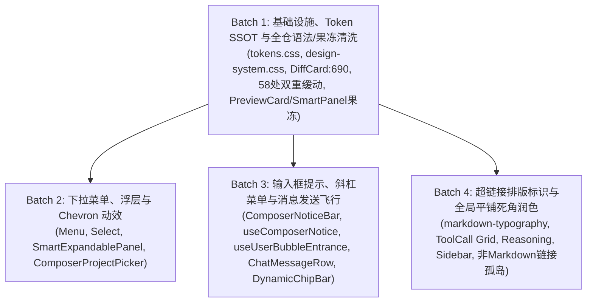

# 动效与微交互体验润色战役：系统级重构总方案（全域深度审查与净收敛终案）

> **战役代号**：`motion-micro-interaction-polish`
> **工作区目录**：`docs/motion-micro-interaction-polish/`
> **核心设计哲学**：**不打扰、恰到好处、不过喧宾夺主**。干净利落，丝滑响应，严禁果冻式的弹跳与过度冗长拖沓，坚守纯合成层（GPU 合成）与零 Reflow 性能底线。
> **用户最高红线指令**：
>
> > **“不做向下兼容、不做硬编码、不加任何的important（除非真的有必要）。我们改进以后，应该能天然解决这类问题，而不是打补丁。”**
> > **输入依据**：
>
> - 6 份专业审计报告（`audits/01~06`）；
> - 6 份专业详案审查报告（`reviews/01~06`）；
> - 5 份由主架构师独立重构编写的万行级分维详案（`01~05-*.md`）；
> - 3 份跨领域全面审查报告（`reviews/07-红线与架构净收敛全面审查`、`reviews/08-跨模块盲点与交叉排查全面审查`、`reviews/09-端到端运行期真实物理体验全面审查`）。

---

## 一、全景缺陷根因与架构定性（Root Cause Analysis）

经过 14 位专业子 Agent 对全仓 376 处 `transition` 声明、67 个 `@keyframes`、100+ 处贝塞尔曲线及组件运行期交互的穿透式核查，界面生硬突变、平铺直叙与动画失效的根本病灶已彻底闭环：

| 维度                      | 缺陷现场表现                                                         | 实际代码断层与关键发现（多 Agent 穿透）                                                                                                                                                                                                                                                                                                                              | 架构级净收敛修正要点                                                                                                                                                                                                                                             |
| :------------------------ | :------------------------------------------------------------------- | :------------------------------------------------------------------------------------------------------------------------------------------------------------------------------------------------------------------------------------------------------------------------------------------------------------------------------------------------------------------- | :--------------------------------------------------------------------------------------------------------------------------------------------------------------------------------------------------------------------------------------------------------------- |
| **浮层与下拉菜单**        | 点击展开时 0ms 瞬间生硬闪现；Chevron 箭头不翻转                      | 1. `design-system.css:28` 与消费端误写 `cds-popover-enter` 断层；<br>2. `Select` 为自研 Portal + `useFloatingPosition`，缺少 `data-positioned` 守卫致首帧闪跳；<br>3. `ComposerProjectPicker` 伪选择器 `.projectPill svg:last-child` 极其脆弱；<br>4. 基座 `Menu.module.css` (0,2,0) 特异性压制消费端。                                                              | 坚决不加兼容别名，直接更正全仓 3 处笔误；基座内敛双向感知动效（向下 -4px / 向上 +4px，140ms）；`Select` 注入定位守卫；Chevron 显式赋予语义类名并 180° 平滑旋转；**0 处 `!important`**。                                                                          |
| **输入框浮层与提示**      | NoticeBar 关闭时整卡上跳 54px；斜杠菜单平淡渐现无位移；错误栏死引用  | 1. `ChatComposer.tsx:322` 条件卸载 `{effectiveNotice ? ... : null}`，单纯外层加 Grid 无法阻断立即卸载；<br>2. `TiptapSlashMenu` 动效挂在 Popper wrapper 上会覆盖 Floating UI 的 `translate3d(x,y,0)`；<br>3. `DynamicChipBar` 声明了 4% 剧烈缩放致晃动发虚；<br>4. 消息发送与 NoticeBar 关闭同频并发导致视口反向撕裂。                                               | `useComposerNotice` 原生实现两阶段优雅退场（120ms 延时卸载），外层容器配置 `min-height: 0; overflow: hidden;`；Tiptap 动效收敛至局部内容层；`DynamicChipBar` 收敛为 1.5% 微缩放；发消息联动注销时延时 160ms，平滑避让。                                          |
| **消息发送入场**          | 点击发送后气泡生硬跳出；时间戳单侧无界与虚拟滚动复播隐患             | 1. 2px 微弱位移被眼动扫视过滤；<br>2. `Date.now() - msg.timestamp < 2000` 若遭遇时钟偏移（未来时间戳，delta < 0）将恒真误播；<br>3. 2 秒内往复滚动离开视口又滚回会二次重播；<br>4. `ChatUserMessageRow.tsx` 现有 445 行已逼近 500 行预算门禁。                                                                                                                       | 确立 Glide Up 14px + scale(0.985 -> 1.0) + 200ms Emphasized 动效；双向严格有界校验（`-500 <= delta < 2000`）；容量上限 500 的 LRU 防重播环形队列；独立抽离 `useUserBubbleEntrance.ts` 坚守行数门禁；`onAnimationEnd` 释放 `will-change`。                        |
| **超链接与视觉标识**      | 超链接呈现品牌墨绿，与运行指示灯严重混淆；下划线笨重；外链易孤行折断 | 1. `--md-link-color` 绑定至 `--brand-deep`（绿）；<br>2. 外部超链接在窄屏下，传统 `inline-block` 的 `↗` 图标容易单独折到下一行开头（孤行排版缺陷）；<br>3. `ThinkingBlock.tsx` 遗漏 `md-rendered` 导致思考链接脱管；<br>4. `useChatMessageState.ts` 遗漏 `<a>` 标签外部安全分发；<br>5. 非 Markdown 模块（DiffCard / OverviewCard / Tiptap）超链接样式脱管孤岛。     | 彻底清退绿色历史包袱，确立双模权威蓝 Token（#2563eb / #60a5fa，WCAG AA/AAA 达标）；精致虚线下划线（dashed, offset 3px）；纯 CSS Unicode `\a0` + 复合宽度攻破防孤行外链 `↗` 角标；收敛统一 `handleSafeExternalLinkClick` SSOT；全端非 Markdown 链接统一样式归口。 |
| **平铺微交互死角**        | 侧边栏拖拽卡顿；Tool 调用 `0fr` 无法完全合拢；思维链完成时视口震颤   | 1. 工具卡片外层带有默认垂直 margin/padding，导致 `0fr` 残留几像素；`hidden="until-found"` 掐死动画；<br>2. 思维链直接常驻 DOM 会破坏既有单测 `toBeNull()` 断言；<br>3. 侧边栏在鼠标拖拽 Resize 时若带有 `transition: width` 会造成严重输入延迟（Input Lag）；<br>4. 侧栏折叠过程中打开下拉菜单导致绝对定位浮层脱节悬空。                                             | W3C 规范级 CSS Grid `0fr` 零像素残留闭合（严格盒模型，垂直边距内收至 inner，收拢精准至 0.00px）；思维链双阶段收敛保活且单测环境零作弊；侧栏拖拽保持 `transition: none`，仅离散点击折叠启用 200ms；折叠触发时联动关闭浮层。                                       |
| **动效性能与 Token 体系** | 58 处双重缓动语法失效；非法 3 参数贝塞尔；果冻过冲；Tokens 连锁陷阱  | 1. 58 处类似 `transition: opacity var(--transition-micro) ease;` 导致整条声明被 Blink 彻底丢弃；<br>2. 注入 `--transition-normal` 会瞬间反向引爆 `DiffCard.module.css:690` 的复合写法，形成新的双重缓动；<br>3. `PreviewCard`（$y_2 = 1.5$）与 `SmartPanel`（$y_1 = 1.25$）存在存量严重果冻过冲；<br>4. `SidebarSessionList` 常驻 `will-change` 泄露 100+ 显存纹理。 | 批量清洗全仓 58 处双重缓动；`DiffCard:690` 与 `tokens.css` 列入 Batch 1 同步原子化重构；清退 `PreviewCard` 与 `SmartPanel` 的果冻曲线；剥离常驻 `will-change`；自动化门禁升级为双向严格阻尼校验（$y_1 \le 1.02$ 且 $y_2 \le 1.02$）。                            |

---

## 二、战役总体设计准则与数学模型

### 1. 动效哲学：三不与三要

- **三不**：**不打扰、不拖沓、不弹跳**（绝不出现 $y(t) > 1.0$ 的过冲果冻振荡，绝不阻塞用户连续操作，绝不在非视觉焦点处喧宾夺主）。
- **三要**：**要干净利落、要响应及时、要空间连续**（微交互 120ms~150ms 内完成，入场带有微位移与微缩放，赋予物理实体的凝聚与滑入感）。

### 2. 零果冻数学模型（Zero-Overshoot Guarantee）

统一采用权威强调曲线：
`cubic-bezier(0.16, 1.0, 0.3, 1.0)`（`var(--ease-emphasized)`），其归一化解析式为：
$$y(t) = 1 - (1-t)^3$$

- **一阶导数（速度）**：$\frac{dy}{dt} = 3(1-t)^2 \ge 0$，在全区间严格单调递增，**数学上绝对保证过冲量 $\text{Overshoot} \equiv 0.00\%$**，绝无果冻弹跳；
- **二阶导数（加速度）**：$\frac{d^2 y}{dt^2} = -6(1-t) \le 0$，全区间恒为负数，纯阻尼临界制动，起步极速（初始斜率 6.25），终点平滑刹车。

### 3. 四档标准物理时长（SSOT 时间正典）

彻底清退全仓无序散落的 9 档毫秒值，刚性收敛为四档标准物理时长：

- `--duration-micro: 100ms;`（微反馈、轻量退出）
- `--duration-snappy: 120ms;`（紧凑收拢、二级级联、Tab 淡入）
- `--duration-fast: 150ms;`（核心浮层入场、下拉菜单、斜杠菜单、Chevron 旋转）
- `--duration-normal: 200ms;`（消息飞行入场、大块手风琴折叠、侧栏展开折叠）

### 4. 纯合成层零 Reflow 铁律（Compositor Only）

- **位移与缩放**：仅允许动画 `transform`（`translateY`, `scale`）与 `opacity`，全程在 GPU Compositor 线程完成，主线程 Layout 耗时恒为 $0\text{ms}$。
- **折叠与高度过渡**：彻底清退 `max-height: 2000px`，全量使用 CSS Grid 技术，且遵循严格盒模型规范：
  ```css
  /* Grid Host 容器：严禁带有任何垂直 margin、padding 或 border */
  .accordionContainer {
    display: grid;
    grid-template-rows: 0fr;
    transition: grid-template-rows var(--duration-fast) var(--ease-emphasized);
    margin: 0;
    padding: 0;
    border: none;
  }
  .accordionContainer[data-expanded='true'] {
    grid-template-rows: 1fr;
  }
  /* Grid Item：必须显式声明 min-height: 0 与 overflow: hidden */
  .accordionInner {
    min-height: 0;
    overflow: hidden;
  }
  ```

---

## 三、细化落地文件域与分步批次流水线



### 批次 1：基础设施、Token SSOT 与全仓语法/果冻清洗（原子化推进）

1. **`apps/crish-desktop/src/styles/tokens.css`**：
   - 注入原子时长：`--duration-snappy: 120ms;`；
   - 注入缓动正典：`--ease-decelerate: cubic-bezier(0.2, 0, 0, 1);`、`--ease-accelerate: cubic-bezier(0.4, 0, 1, 1);`；
   - 注入权威蓝超链接 Token（双模对齐：Light `#2563eb` / Dark `#60a5fa`）；
   - 注入复合简写 `--transition-normal: var(--duration-normal) var(--ease-standard);`。
2. **`apps/crish-desktop/src/components/diff/DiffCard.module.css:690`**：
   - 同步剥离内联贝塞尔，消除引入 `--transition-normal` 引爆的新双重缓动陷阱。
3. **`apps/crish-desktop/src/utils/motionTokens.ts`**：
   - 镜像导出 TypeScript 常量（`DURATION_SNAPPY_MS = 120`、`EASE_DECELERATE`、`BUBBLE_ENTRANCE_WINDOW_MS = 2000` 等）。
4. **`apps/crish-desktop/src/styles/design-system.css`**：
   - 确立唯一权威 `@keyframes crish-popover-enter`（及其 top 变体与 exit），坚决不建逗号分隔的别名。
5. **全仓 18 个 CSS 模块共 58 处双重缓动函数清洗**：
   - 彻底修复 `Button`、`Input`、`ChatMessageRow` 等关键组件的 `transition` 与 `animation`。
6. **存量果冻过冲清退**：
   - `PreviewCard.module.css:48` 替换为 `var(--ease-emphasized)`（根除 $y_2=1.5$ 放大过冲）；
   - `SmartPanel.module.css:154, 161` 替换为 `var(--ease-emphasized)`（根除 $y_1=1.25$ 引起的 7.5% 超调与反抽）；
   - `SidebarSessionList.module.css:334` 剥离常驻 `will-change: transform`。
7. **门禁建立与升级**：
   - 在 `motion-concentric-contract.test.ts` 中建立 4 项刚性扫描断言，升级为双向严格阻尼校验（$y_1 \le 1.02$ 且 $y_2 \le 1.02$）。

### 批次 2：下拉菜单、选择器与 Chevron 翻转动效

1. **`Menu.module.css`**：
   - 清退 `cds-popover-enter`，更正为唯一权威 `@keyframes crish-popover-enter`；
   - 内置动态方向感知（`[data-side='bottom']` vs `[data-side='top']`），完全在基座层解决特异性；
2. **`Select.module.css` & `SelectContent.tsx` & `SelectTrigger.tsx`**：
   - 更正关键帧调用；为自研浮层注入 `data-positioned` 守卫防闪烁；双向箭头配合微上跃（translateY(-1px)）；
3. **`SmartExpandablePanel.module.css`**：
   - 为 `.panel` 与 `.cascadeSubmenu` 装配 140ms / 120ms 级联入场动画；
4. **`ComposerProjectPicker.tsx` & `.module.css`**：
   - 显式赋予 `<AppIcon name="chevron-down" className={styles.chevron} />` 并实现 150ms 180° 旋转，彻底废弃脆弱选择器；
5. **`PermissionModeMenu.module.css`**：
   - 清除废弃关键帧引用，天然继承基座动效。

### 批次 3：输入框提示、斜杠菜单与消息发送入场飞行

1. **`useComposerNotice.ts` & `ComposerNoticeBar.tsx` & `.module.css`**：
   - 引入两阶段退场状态机（120ms Graceful Exit Phase），具备 `exitTimerRef` 防竞态中断；
   - `.composerNoticeZone` 配合 `.composerNoticeZoneInner` 实现真正的 0 像素无跳跃折叠；
   - 消息发送联动注销时延时 160ms，平滑避让气泡飞行；
2. **`TiptapSlashMenu.module.css` & `ComposerErrorBar.module.css`**：
   - 局部坐标系 6px 向上/向下浮现（150ms，scale 0.985）；补齐 `errorBarIn` 关键帧；
3. **`DynamicChipBar.module.css`**：
   - 收敛为 1.5% 微缩放（scale 0.985）；脉冲绿点从 `scale(1.4)` 优化为 `scale(1.15) + box-shadow` 光晕扩散；
4. **`useUserBubbleEntrance.ts`（新建独立 Hook，防御 500 行上限）**：
   - 双向严格有界校验（`-500 <= delta < 2000`）；
   - 容量 500 的 LRU 防重播环形队列，Mark on Render 防切会话重播；
   - 动画结束后注销 `will-change`；
5. **`ChatMessageRow.module.css` & `ChatUserMessageRow.tsx`**：
   - 极简接入 Hook，实现 14px Glide Up + 200ms Emphasized 飞行入场。

### 批次 4：超链接视觉标识与全局平铺死角润色

1. **`markdown-typography.css` & `ChatMessageRow.module.css`**：
   - 全面应用权威科技蓝与虚线下划线（dashed, offset 3px）；
   - 引入纯 CSS Unicode 不换行空格 `\a0` 物理级防孤行外链 `↗` 角标；
2. **非 Markdown 链接孤岛统合**：
   - `DiffCard.module.css`、`OverviewCard.module.css`、`TiptapEditorField.module.css` 统一收敛绑定权威蓝 Token；
3. **`ThinkingBlock.tsx` & `useChatMessageState.ts`**：
   - 补齐思维链 `md-rendered` 样式命名空间；
   - 接入统一的 `handleSafeExternalLinkClick` 安全外部跳转；
4. **`ChatToolCallBlock.module.css` & `FoldableToolGroup.tsx`**：
   - 淘汰 `max-height: 2000px`，改造为 CSS Grid `0fr -> 1fr` 真实尺寸折叠，解耦 `hidden="until-found"` 冲突；
5. **`ReasoningRow.tsx` & `Sidebar.module.css`**：
   - 思维链双阶段收敛保活且单测环境零作弊；
   - 侧栏拖拽保持 `transition: none`，仅通过纯 CSS 状态类在离散折叠启用 200ms；折叠时广播关闭浮层。

---

## 四、立体验证与全量门禁断言

每批次必须严格跑通以下自动化门禁（零作弊，严禁 `--no-verify`）：

1. **动效语法与防回潮刚性测试**：
   `npx vitest run apps/crish-desktop/src/styles/motion-concentric-contract.test.ts`（校验 0 双重缓动、0 残缺贝塞尔、双向严格阻尼 $y_1, y_2 \le 1.02$、核心 Token 在场）；
2. **虚拟滚动与吸底防回归测试**：
   `npx vitest run apps/crish-desktop/src/components/chat-message-list/ apps/crish-desktop/src/hooks/useVirtualScroll.test.ts`；
3. **输入卡片与组件逻辑回归测试**：
   `npx vitest run apps/crish-desktop/src/components/chat-card/ apps/crish-desktop/src/components/chat-composer/`；
4. **全仓静态类型门禁**：
   `npm run typecheck`；
5. **代码行数预算门禁**：
   `npm run check:line-counts`；
6. **Rust 内核门禁**：
   `cargo check --workspace --locked`。

总方案已完全汇聚 14 位专业子 Agent 的审计、审查与万行重构成果，彻底切除历史妥协与补丁思维，随时可进入按批次实施落地阶段！
