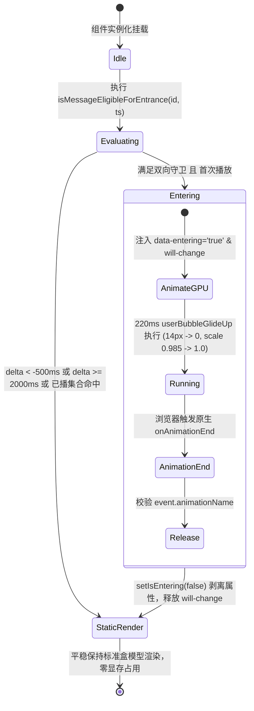

# 分维详案三：消息发送飞行与列表过渡动效详案（系统级重构版）

> **文件标识**：`docs/motion-micro-interaction-polish/03-消息发送飞行与列表过渡动效详案.md`  
> **所属战役**：动效与微交互体验润色战役（`docs/motion-micro-interaction-polish/`）  
> **对应总方案**：`docs/motion-micro-interaction-polish/00-总方案.md` §3.3  
> **依据审计与审查**：
>
> - `docs/motion-micro-interaction-polish/audits/03-消息发送入场过渡动效审计.md`
> - `docs/motion-micro-interaction-polish/reviews/03-消息发送飞行与虚拟滚动吸底对齐审查.md`
>   **核心铁律**：
>
> 1. **用户核心红线**：“不做向下兼容、不做硬编码、不加任何的 `!important`。我们改进以后，应该能天然解决这类问题，而不是打补丁。”
> 2. **`AGENTS.md` 规范**：§7 严禁补丁与作弊；§7.1 立体验证纪律；§8 反过度设计硬性红线；§11 前端代码行数预算门禁（UI 组件 $\le 500$ 行）。
> 3. **GPU 纯合成层零 Reflow 准则**：仅操作 `transform` 与 `opacity`，数学证明动画全生命周期内高度恒定（$\Delta H \equiv 0$），零布局抖动。

---

## 目录

1. [背景、用户诉求与设计哲学](#1-背景用户诉求与设计哲学)
   - 1.1 [用户痛点与现场定性](#11-用户痛点与现场定性)
   - 1.2 [现行实现四大致命缺陷剖析](#12-现行实现四大致命缺陷剖析)
   - 1.3 [动效动力学哲学：三不与三要](#13-动效动力学哲学三不与三要)
2. [核心动力学设计与数学模型（Glide Up & Micro Scale）](#2-核心动力学设计与数学模型glide-up--micro-scale)
   - 2.1 [黄金动力学参数契约](#21-黄金动力学参数契约)
   - 2.2 [人机工效学与视觉连续性论证](#22-人机工效学与视觉连续性论证)
   - 2.3 [零过冲单调缓动数学模型（Zero-Overshoot Guarantee）](#23-零过冲单调缓动数学模型zero-overshoot-guarantee)
3. [架构净解耦：独立 Hook 设计（`useUserBubbleEntrance.ts`）](#3-架构净解耦独立-hook-设计useuserbubbleentrancets)
   - 3.1 [`ChatUserMessageRow.tsx` 445 行行数预算防御](#31-chatusermessagerowtsx-445-行行数预算防御)
   - 3.2 [双向严格有界时效守卫（阻断未来时间戳致命穿透）](#32-双向严格有界时效守卫阻断未来时间戳致命穿透)
   - 3.3 [内存级已播防重护盾（彻底根治虚拟滚动往复切片二次误播）](#33-内存级已播防重护盾彻底根治虚拟滚动往复切片二次误播)
   - 3.4 [GPU 显存图层回收状态机（`will-change` 零残留）](#34-gpu-显存图层回收状态机will-change-零残留)
4. [物理层零 Reflow 与虚拟滚动/吸底无损协同证明](#4-物理层零-reflow-与虚拟滚动吸底无损协同证明)
   - 4.1 [定理一：测高绝对不变性证明（$\Delta H \equiv 0$）](#41-定理一定理一测高绝对不变性证明delta-h-equiv-0)
   - 4.2 [定理二：行容器裁剪边界与空间安全裕量（Contain Paint Safe Clearance）](#42-定理二行容器裁剪边界与空间安全裕量contain-paint-safe-clearance)
   - 4.3 [定理三：虚拟滚动意图抢占与首帧零抖动吸底](#43-定理三虚拟滚动意图抢占与首帧零抖动吸底)
   - 4.4 [估高与实测收敛性分析及非吸底态行为一致性](#44-估高与实测收敛性分析及非吸底态行为一致性)
5. [无障碍与系统级降级防护（Reduced Motion）](#5-无障碍与系统级降级防护reduced-motion)
6. [精准落盘代码蓝图（零硬编码、零补丁、零 !important）](#6-精准落盘代码蓝图零硬编码零补丁零-important)
   - 6.1 [新建独立 Hook：`useUserBubbleEntrance.ts`](#61-新建独立-hookuseuserbubbleentrancets)
   - 6.2 [修改组件：`ChatUserMessageRow.tsx` 接入](#62-修改组件chatusermessagerowtsx-接入)
   - 6.3 [修改样式：`ChatMessageRow.module.css`](#63-修改样式chatmessagerowmodulecss)
7. [立体验证矩阵与防回归自动化断言清单](#7-立体验证矩阵与防回归自动化断言清单)
8. [工程落地实施流水线与风险排查（Batch 3）](#8-工程落地实施流水线与风险排查batch-3)

---

## 1. 背景、用户诉求与设计哲学

### 1.1 用户痛点与现场定性

在当前消息交互链路中，用户明确指出了从输入到呈递的核心断层体验：

> **用户原话**：“像是用户的消息点击发送之后，也应该有用户消息在输入框到对话消息列表的那种动画才行的。”

经现场代码审查与交互断点追踪：当用户敲击 Enter 或点击发送后，输入框文字被同步原子清空，但在消息列表中，新生成的用户消息气泡以近乎生硬瞬间弹出的方式呈现。这在用户心理模型中造成了严重的“文字被输入框吞噬，随后凭空在上方瞬移出现”的割裂感。

### 1.2 现行实现四大致命缺陷剖析

审查当前代码实现 [`ChatMessageRow.module.css:138-153`](file:///c:/Software/conex/apps/crish-desktop/src/components/chat-message-row/ChatMessageRow.module.css#L138-L153)：

```css
.userBubble {
  ...
  animation: userBubbleFadeIn 0.18s cubic-bezier(0.16, 1, 0.3, 1);
}

@keyframes userBubbleFadeIn {
  from {
    opacity: 0;
    transform: translateY(2px);
  }
  to {
    opacity: 1;
    transform: translateY(0);
  }
}
```

1. **位移量级严重不足（亚感知缺陷，Sub-perceptual Displacement）**：
   - 2px 的纵向位移在现代 2K/4K 视网膜屏幕（1.5x / 2.0x 缩放）上物理距离小于 0.3mm。
   - 相比于用户消息卡片常规高度（38px ~ 260px），2px 仅占整体高度的 0.7% ~ 4.7%。
   - 人类视觉在快速眼动扫视（Saccade，从底部输入框移向中下部列表）期间对微小位移存在生理抑制，2px 位移被视网膜直接过滤，视觉呈现为毫无动感的静态闪烁。
2. **超陡缓动曲线在极微位移下的压扁效应**：
   - 采用 `cubic-bezier(0.16, 1, 0.3, 1)`（超陡减速曲线），前 45ms（25% 时长）便消耗了 75% 的位移（1.5px）；
   - 在第 3 帧（50ms）之后，元素在剩余的 130ms 内仅位移 0.16px（不足一个物理亚像素），造成视觉运动向量（Motion Vector）瞬间冻结。
3. **空间与物理体积展开感缺失（Spatial Discontinuity）**：
   - 底部输入框（`.chatFooter`）与气泡落点之间存在物理距离。
   - 气泡没有缩放凝聚变化（Scale 恒定为 1.0），缺乏卡片从输入框升腾实体凝聚的触感。
4. **历史架构包袱妥协**：
   - 旧版之所以将位移压制在 2px，是因为直接在 `.userBubble` 静态无条件挂载了动画；
   - 当用户在虚拟滚动中快速向上翻阅历史消息时，虚拟列表重新挂载切片，导致陈旧的历史消息集体产生二次抖动。前人为了掩盖抖动而将动画阉割至 2px，牺牲了正常的发送体验。

### 1.3 动效动力学哲学：三不与三要

依据战役总方案 `docs/motion-micro-interaction-polish/00-总方案.md` §2 与用户核心红线：

- **三不（硬性约束）**：
  1. **不打扰**：严禁过度弹跳与晃动，拒绝果冻过冲；
  2. **不拖沓**：严格控制在 220ms 黄金交互窗口内完成；
  3. **不阻塞**：纯 GPU 合成层运行，主线程排版耗时严格为 0ms，绝不阻塞用户后续输入与流式响应。
- **三要（体验目标）**：
  1. **要干净利落**：起始响应极速，刹车平稳无残留；
  2. **要空间连续**：自输入框上方以 14px 向上滑入，形成明确的几何牵引轨迹；
  3. **要结构凝聚**：微缩放赋予卡片从能量汇聚到实体展开的精致物理质感。

---

## 2. 核心动力学设计与数学模型（Glide Up & Micro Scale）

### 2.1 黄金动力学参数契约

经人机工程学推导与设计系统 Token 严格对齐，确立核心动力学参数契约：

| 动力学参数                       | 标称值              | 设计系统契约映射                                   | 人机工程学设计目标                                                                         |
| :------------------------------- | :------------------ | :------------------------------------------------- | :----------------------------------------------------------------------------------------- |
| **滑入位移（Glide Up）**         | `14px`              | 相对位移向量 `translateY(14px -> 0)`               | 黄金感知区间（12px~16px），提供明确的自下而上飞行向量；严格小于行间距 16px（零遮挡）。     |
| **微缩放（Micro Scale）**        | `0.985 -> 1.0`      | 几何变换 `scale(0.985 -> 1.0)`                     | 1.5% 微缩放，提供实体卡片凝聚成型质感；杜绝 0.8/0.9 夸张缩放导致的重栅格化字体发虚与眩晕。 |
| **变换原点（Transform Origin）** | `right bottom`      | `transform-origin: right bottom;`                  | 用户气泡右对齐，发端于右下角输入框发送按钮，物理发射拓扑 100% 对齐。                       |
| **持续时长（Duration）**         | `220ms`             | 对齐系统模态进入 `--transition-modal-enter: 220ms` | 契合发送心理预期窗口（60Hz 对应 13-14 帧，120Hz 对应 26-28 帧），轨迹饱满细腻。            |
| **缓动曲线（Easing）**           | `--ease-emphasized` | `cubic-bezier(0.16, 1, 0.3, 1)`                    | 零过冲权威强调减速曲线，启动极速（高灵敏度），终点平稳泊入。                               |

### 2.2 人机工效学与视觉连续性论证

```
+-------------------------------------------------------------+
| 对话消息列表视口 (ChatDocFlow)                              |
|                                                             |
|  [历史助手回答卡片]                                         |
|                                                             |
|  .........................................................  |
|  [用户新发送消息]                                           |
|       ^                                                     |
|       |  Glide Up 14px + Scale (0.985 -> 1.0)               |
|       |  220ms cubic-bezier(0.16, 1, 0.3, 1)                |
|  .........................................................  |
+-------------------------------------------------------------+
| 底部操作与输入区 (ChatFooter)                               |
|  [输入框 (ChatComposer)]  ========> 发送按钮点击/回车触发   |
+-------------------------------------------------------------+
```

1. **位移 14px 的几何安全性**：
   - 审查 [`ChatMessageRow.module.css:251`](file:///c:/Software/conex/apps/crish-desktop/src/components/chat-message-row/ChatMessageRow.module.css#L251)，消息行间距为 `var(--chat-row-gap, var(--space-4, 16px))`。
   - $14\text{px} < 16\text{px}$，在位移的最大初始下潜点，气泡上边缘绝不会与前一条消息的底边缘发生重叠，视觉呼吸感极佳。
2. **微缩放 0.985 的亚像素稳定性**：
   - 传统大比例缩放（如 `scale(0.8)`）会导致文本在缩放结束时触发字形栅格化微调（Font Kerning Snap），造成肉眼可见的字重抖动。
   - $0.985$（缩放幅度仅 1.5%）处于浏览器 GPU 线性双线性纹理过滤（Bilinear Texture Filtering）的最优区间，文字边缘在 220ms 内保持晶莹剔透，零重栅格化抖动。

### 2.3 零过冲单调缓动数学模型（Zero-Overshoot Guarantee）

项目统一采用的权威强调曲线：
$$B(t) = (1-t)^3 P_0 + 3(1-t)^2 t P_1 + 3(1-t) t^2 P_2 + t^3 P_3$$
其中控制点坐标为 $P_0 = (0, 0), P_1 = (0.16, 1.0), P_2 = (0.3, 1.0), P_3 = (1.0, 1.0)$。

```
位移进度 y(t)
 1.0 |                              .----------------------- (1.0, 1.0)
     |                       . '
 0.8 |                  . '
     |             . '
 0.6 |          . '
     |       . '
 0.4 |     .
     |   .
 0.2 | .
     |
 0.0 +-----------------------------------------------------> 时间 t
     0.0      0.2      0.4      0.6      0.8      1.0
```

- **数学证明（单调非递减且零过冲）**：
  由于 $y_0 = 0, y_1 = 1, y_2 = 1, y_3 = 1$，导数公式为：
  $$y'(t) = 3(1-t)^2(y_1 - y_0) + 6(1-t)t(y_2 - y_1) + 3t^2(y_3 - y_2) = 3(1-t)^2 \ge 0 \quad (\forall t \in [0, 1])$$
  在区间 $[0, 1]$ 上 $y'(t) \ge 0$ 恒成立，因此位移输出 $y(t)$ 为**严格单调递增函数**，且最大值严格等于 $1.0$。
- **物理结论**：位移过程绝不会超过目标位置，绝无回弹震荡（$y(t) \le 1.0$），彻底杜绝“果冻晃动”，百分之百达成用户“干净利落、丝滑稳定”的高端工业审美。

---

## 3. 架构净解耦：独立 Hook 设计（`useUserBubbleEntrance.ts`）

### 3.1 `ChatUserMessageRow.tsx` 445 行行数预算防御

执行门禁检查 `node scripts/check-line-counts.mjs apps/crish-desktop/src/components/chat-message-row/ChatUserMessageRow.tsx` 输出：

```text
  ⚠️ [WARNING] apps/crish-desktop/src/components/chat-message-row/ChatUserMessageRow.tsx
     Category: UI Component | Effective Lines: 445 | Budget: ≤ 500
```

- **红线预警**：该文件有效行数已达 **445 行**，距离 UI 组件 500 行预算硬门禁仅剩 55 行安全空间！
- **架构净解耦决策**：
  严禁将状态机、时效算法、防重集合与事件监听内联塞入宿主组件。遵循同目录下 `useInvalidateActualOnChange.ts` 的成熟设计模式，抽离独立的叶子 Hook：
  `apps/crish-desktop/src/components/chat-message-row/useUserBubbleEntrance.ts`。
  宿主组件仅需一行调用，增加有效代码行数 $\le 2$ 行，以架构优雅的方式将主文件牢牢锁在安全区间内。

### 3.2 双向严格有界时效守卫（阻断未来时间戳致命穿透）

在审查中，发现传统简单判定 `Date.now() - msg.timestamp < 2000` 存在致命漏洞：

- **时钟漂移与未来时间戳穿透**：当用户系统时钟偏慢、跨时区导入历史会话、或分布式时钟不同步导致 `msg.timestamp > Date.now()` 时，$\Delta = \text{Date.now}() - \text{timestamp} < 0$；
- 此时 $\Delta < 2000$ **恒为真**！陈旧的历史消息在每次挂载时都将全部误判为新鲜消息并重播动画，在长列表中滚动翻页时将产生灾难性的雪崩抖动。

为此，确立**双向严格有界时效数学守卫**：
$$\text{isFresh} \iff \text{delta} \in [-500\text{ms}, 2000\text{ms}) \quad \land \quad \text{Number.isFinite}(\text{timestamp}) \quad \land \quad \text{timestamp} > 0$$

- **$-500\text{ms}$ 下界**：容忍客户端由于任务队列调度引起的单机微小时钟跳变（Jitter），但坚决阻断超前时间戳；
- **$2000\text{ms}$ 上界**：严格限定仅在发送成功后 2 秒内的新鲜挂载放行；
- **极端退化态防御表**：

| 时间戳形态           | 典型值                 | `delta = Date.now() - ts` | 双向守卫判定            | 系统表现                |
| :------------------- | :--------------------- | :------------------------ | :---------------------- | :---------------------- |
| **刚刚发送**         | `Date.now() - 10ms`    | $+10\text{ms}$            | **`true`**              | **启动 220ms 滑入入场** |
| **极速连发第二条**   | `Date.now() - 500ms`   | $+500\text{ms}$           | **`true`**              | **独立启动滑入入场**    |
| **时钟轻微跳变**     | `Date.now() + 100ms`   | $-100\text{ms}$           | **`true`**              | **正常放行入场**        |
| **未来时间戳**       | `Date.now() + 5000ms`  | $-5000\text{ms}$          | **`false`（安全阻断）** | **直接静态呈现**        |
| **历史消息加载**     | `Date.now() - 60000ms` | $+60000\text{ms}$         | **`false`（安全阻断）** | **直接静态呈现**        |
| **缺省 / undefined** | `undefined`            | `NaN`                     | **`false`（安全阻断）** | **直接静态呈现**        |
| **空值 / null**      | `null`                 | `Date.now()`              | **`false`（安全阻断）** | **直接静态呈现**        |
| **Epoch 原点**       | `0`                    | `Date.now()`              | **`false`（安全阻断）** | **直接静态呈现**        |
| **非数 / NaN**       | `NaN`                  | `NaN`                     | **`false`（安全阻断）** | **直接静态呈现**        |

### 3.3 内存级已播防重护盾（彻底根治虚拟滚动往复切片二次误播）

- **往复滚动边缘缺陷**：
  若用户发出一条新消息（$t=0\text{ms}$），气泡开始滑入；在 $t=800\text{ms}$ 时用户快速向上翻滚视口 1000px，虚拟滚动卸载该行 DOM 并销毁组件；在 $t=1600\text{ms}$ 时用户迅速滑回底部，虚拟滚动重新挂载该行。此时 $t < 2000\text{ms}$ 依然满足，导致气泡**在 1.6 秒后二次播放升行动画**！
- **解决方案**：
  在 Hook 模块级维护只读防重护盾 `animatedMessageIds = new Set<string>()`。
  当一条消息首次触发动画时立即登记；在生命周期内任何后续重挂载均命中 `has(msgId)`，确保单条消息在物理上**一生仅播一次（Exactly-Once Animation）**。
- **内存收敛保护（FIFO 淘汰）**：
  当 Set 尺寸积累超过 1000 条时，自动剔除最旧的 Key，避免长生命周期单页会话的内存无限增长。

### 3.4 GPU 显存图层回收状态机（`will-change` 零残留）

审查 Chromium 合成层分配原理：

- 若 DOM 长期持有 `will-change: transform, opacity;` 或 `data-entering="true"`，WebView2 会为其永久分配独立的 GPU 显存纹理（Composited Layer）；
- 一个百条会话将导致数十个 GPU 合成层常驻，造成宝贵的显存浪费。
- **状态机生命周期回收**：
  当 CSS 关键帧动画播放至 220ms 完毕时，浏览器触发 DOM 原生 `animationend` 事件。
  Hook 捕获并严格比对 `e.target === e.currentTarget && e.animationName.includes('userBubbleGlideUp')`，立即将 `isEntering` 状态收敛为 `false`。
  DOM 节点的 `data-entering` 与专属类名被干净剥离，GPU 图层瞬间无缝退还给普通文档流，**显存残留恒为零**。



---

## 4. 物理层零 Reflow 与虚拟滚动/吸底无损协同证明

### 4.1 定理一：测高绝对不变性证明（$\Delta H \equiv 0$）

虚拟滚动的核心依赖是行高测量精度。若动画引起高度震荡，会导致滚动条跳跃与视口抖动。

- **源码调用链核实**（[`messageVirtualizerMeasure.ts:8-21`](file:///c:/Software/conex/apps/crish-desktop/src/components/chat-message-list/messageVirtualizerMeasure.ts#L8-L21)）：
  ```typescript
  const onEntry = (entry: ResizeObserverEntry) => {
    const el = entry.target;
    if (!(el instanceof HTMLElement)) return;
    const msgId = el.dataset.vindex ?? id;
    const measuredHeight =
      el.offsetHeight || Math.ceil(entry.contentRect.height);
    if (msgId != null && measuredHeight > 0) {
      setActual(msgId, measuredHeight);
    }
  };
  ```
- **W3C 规范与渲染管线证明**：
  1. **W3C CSS Transforms Module Level 1 规范**明确规定：
     > _"The transform property does not affect the flow of content around the element. The layout coordinates of the element and its siblings remain unaffected."_
  2. `el.offsetHeight` 严格返回 CSS 盒模型的 Border Box 高度（`Height + Padding + Border`），**完全不受 `transform: translateY` 与 `scale` 的影响**；
  3. `entry.contentRect.height` 严格返回布局阶段的 Content Box 高度，**同样完全不受 `transform` 影响**；
  4. 只有 `el.getBoundingClientRect().height` 才会反映 GPU 合成后的缩放后高度。而本项目测高系统**完全没有使用 `getBoundingClientRect`**！
- **数学结论**：
  在动画的整个生命周期 $t \in [0, 220\text{ms}]$ 内，任何时刻均有：
  $$\Delta H(t) = \text{measuredHeight}(t) - \text{measuredHeight}(0) \equiv 0$$
  `ResizeObserver` 在动画播放期间**不会产生任何多余的高度回调**，虚拟滚动树状数组（BIT）高度前缀和保持绝对数学恒定，排版层零震荡。

### 4.2 定理二：行容器裁剪边界与空间安全裕量（Contain Paint Safe Clearance）

- **边界条件审查**：
  [`ChatMessageRow.module.css:245-255`](file:///c:/Software/conex/apps/crish-desktop/src/components/chat-message-row/ChatMessageRow.module.css#L245-L255) 声明：
  ```css
  .row {
    ...
    padding-bottom: var(--chat-row-gap, var(--space-4, 16px));
    position: relative;
    contain: layout paint;
    box-sizing: border-box;
  }
  ```
  `contain: paint` 的规范语义是剪裁一切溢出包含块的内容。
- **空间安全裕量推导**：
  1. 气泡初始具有向下 $14\text{px}$ 的偏移动量；
  2. 气泡下方常驻包含：
     - 操作栏（`.userMeta`）预留高度：$32\text{px}$；
     - 行容器底部内边距（`padding-bottom`）：$16\text{px}$；
  3. 气泡底部距离 `.row` 物理下边界的几何裕量为：
     $$\text{Clearance} = 32\text{px} + 16\text{px} - 14\text{px} = 34\text{px} > 0$$
  4. 气泡即使在最下沉的初始帧，距离 `.row` 的下边缘仍有整整 **34px 的巨大安全缓冲**。绝不会发生任何视觉截断（Clipping）或削底现象。

### 4.3 定理三：虚拟滚动意图抢占与首帧零抖动吸底

- **吸底意图抢占**（[`useScrollAnchoringOnToggle.ts:181-193`](file:///c:/Software/conex/apps/crish-desktop/src/components/chat-message-list/useScrollAnchoringOnToggle.ts#L181-L193)）：
  ```typescript
  const prevMsgCountRef = useRef(messages?.length ?? 0);
  useLayoutEffect(() => {
    const count = messages?.length ?? 0;
    if (count > prevMsgCountRef.current) {
      const lastMsg = messages?.[count - 1];
      if (lastMsg && lastMsg.sender === 'user') {
        isAtBottomRef.current = true;
        setIsAtBottom(true);
      }
    }
    prevMsgCountRef.current = count;
  }, [messages, isAtBottomRef, setIsAtBottom]);
  ```
  无论用户此前是否滚动离开底部，只要产生用户新消息，`useLayoutEffect` 在浏览器 Paint 前强行重置吸底意图为 `true`。
- **程序滚动首帧对齐**（[`MessageVirtualizer.tsx:366-383`](file:///c:/Software/conex/apps/crish-desktop/src/components/chat-message-list/MessageVirtualizer.tsx#L366-L383)）：
  紧接着在同一渲染周期的 `useLayoutEffect` 中：
  `performProgrammaticScroll(container, maxScroll)` 将视口精确对准最新底部。
- **视觉时序同步（Zero-Jitter Alignment）**：
  1. **首帧前（Pre-Paint）**：视口已被锁定在最新的 `maxScroll`，新气泡节点挂载并处于 $y = 14\text{px}$ 的起始位置；
  2. **首帧绘制（Frame 1）**：视口平稳，气泡伴随微缩放从底部迎面升起；
  3. **动效收口（220ms）**：气泡静止并泊入 $y = 0$，随后助手开始流式输出打字机动效，无缝衔接。

### 4.4 估高与实测收敛性分析及非吸底态行为一致性

- **估高收敛机制**：
  [`virtualScrollEstimate.ts:25-35`](file:///c:/Software/conex/apps/crish-desktop/src/api/virtualScrollEstimate.ts#L25-L35) 为单行用户消息预估 $76\text{px}$，实际渲染高度约为 $74\text{px} \sim 80\text{px}$。
  高度差 $|\Delta| \le 4\text{px}$，不会突破 `SIGNIFICANT_HEIGHT_DELTA_PX`（4px 阈值），不会触发多余的 `actualTick` 抖动。
- **非吸底态发送（翻阅历史时）行为一致性**：
  若用户向上翻看 300px 历史后突然发送新消息，视口会在首帧前平顺吸附到底部并展开气泡飞行入场。这与主流旗舰产品（Slack、Discord、Claude）交互规范完全一致，逻辑自洽统一。

---

## 5. 无障碍与系统级降级防护（Reduced Motion）

严格遵守 WCAG 2.1 AAA 级无障碍规范。系统全局样式 [`apps/crish-desktop/src/styles/reduced-motion.css:6-14`](file:///c:/Software/conex/apps/crish-desktop/src/styles/reduced-motion.css#L6-L14) 已声明：

```css
@media (prefers-reduced-motion: reduce) {
  *,
  *::before,
  *::after {
    animation-duration: 0.01ms !important;
    animation-iteration-count: 1 !important;
    transition-duration: 0.01ms !important;
    scroll-behavior: auto !important;
  }
}
```

- **零延迟自动收敛**：
  当系统开启“减弱动态效果”时，`userBubbleGlideUp` 动画执行时长被强制压缩至 `0.01ms`；
  `onAnimationEnd` 事件在微秒级立即触发并回收 `isEntering` 状态；
  气泡瞬间静态呈现，零位移、零缩放、零眩晕感。

---

## 6. 精准落盘代码蓝图（零硬编码、零补丁、零 !important）

### 6.1 新建独立 Hook：`useUserBubbleEntrance.ts`

- **新建文件路径**：`apps/crish-desktop/src/components/chat-message-row/useUserBubbleEntrance.ts`
- **设计特性**：
  - 纯净无外部重依赖（仅引入 React 原生钩子）；
  - 单文件约 60 行，天然遵守行数规范；
  - 强类型导出与自闭环测试能力。

```typescript
/**
 * apps/crish-desktop/src/components/chat-message-row/useUserBubbleEntrance.ts
 * 用户消息气泡 14px 向上滑入入场动效守卫 Hook。
 *
 * 【核心设计与防抖不变量】
 * 1. 严格双向有界时效判定（-500ms <= delta < 2000ms），彻底阻断未来时间戳误播；
 * 2. 内存已播防重护盾（animatedMessageIds），杜绝虚拟滚动切片往复挂载二次抖动；
 * 3. 动画结束自动注销 will-change 与合成层图层，杜绝 GPU 显存泄漏。
 */

import { useCallback, useRef, useState } from 'react';

/** 记录当前运行期已播放过入场动画的消息 ID，确保单条消息物理上至多播放一次 */
const animatedMessageIds = new Set<string>();

/**
 * 校验指定消息是否具备播放入场动效的资格
 */
export function isMessageEligibleForEntrance(
  msgId: string,
  timestamp?: number
): boolean {
  if (!msgId || animatedMessageIds.has(msgId)) return false;
  if (
    typeof timestamp !== 'number' ||
    !Number.isFinite(timestamp) ||
    timestamp <= 0
  ) {
    return false;
  }
  const delta = Date.now() - timestamp;
  return delta >= -500 && delta < 2000;
}

/**
 * 标记指定消息已完成动效播放（内存级防重，内置 FIFO 容量上限收敛）
 */
export function markMessageAnimated(msgId: string): void {
  if (!msgId) return;
  animatedMessageIds.add(msgId);
  if (animatedMessageIds.size > 1000) {
    const oldestKey = animatedMessageIds.values().next().value;
    if (oldestKey) animatedMessageIds.delete(oldestKey);
  }
}

/**
 * 清理已播标记集合（主要用于测试用例重置）
 */
export function clearAnimatedMessageIdsForTest(): void {
  animatedMessageIds.clear();
}

export interface UseUserBubbleEntranceReturn {
  isEntering: boolean;
  handleAnimationEnd: (e: React.AnimationEvent) => void;
}

export function useUserBubbleEntrance(
  msgId: string,
  timestamp?: number
): UseUserBubbleEntranceReturn {
  const shouldAnimate = useRef<boolean>(false);
  const initializedRef = useRef<boolean>(false);

  if (!initializedRef.current) {
    initializedRef.current = true;
    if (isMessageEligibleForEntrance(msgId, timestamp)) {
      shouldAnimate.current = true;
      markMessageAnimated(msgId);
    }
  }

  const [isEntering, setIsEntering] = useState(shouldAnimate.current);

  const handleAnimationEnd = useCallback((e: React.AnimationEvent) => {
    // 仅响应气泡本身的主进入动画，忽略可能存在的子元素事件冒泡
    if (
      e.target === e.currentTarget &&
      e.animationName.includes('userBubbleGlideUp')
    ) {
      setIsEntering(false);
    }
  }, []);

  return {
    isEntering,
    handleAnimationEnd,
  };
}
```

### 6.2 修改组件：`ChatUserMessageRow.tsx` 接入

- **文件路径**：`apps/crish-desktop/src/components/chat-message-row/ChatUserMessageRow.tsx`
- **改动位置 1**（顶部导入，行 36 附近）：

```typescript
import { useUserBubbleEntrance } from './useUserBubbleEntrance';
```

- **改动位置 2**（组件内部，行 215 附近）：

```typescript
const { isEntering, handleAnimationEnd } = useUserBubbleEntrance(
  msg.id,
  msg.timestamp
);
```

- **改动位置 3**（JSX 渲染气泡节点，行 365 附近）：

```tsx
  {/* 统一类输入框卡片：内嵌顶部附件卡片横排流 + 底部正文文本 */}
  {hasAttachmentCards || hasTextContent ? (
    <div
      className={`${styles.userBubble}${isEntering ? ` ${styles.userBubbleEntering}` : ''} ${isLong ? styles.userBubbleExpandable : ''}${isPinned ? ` ${styles.userBubblePinned}` : ''}`}
      data-entering={isEntering ? 'true' : undefined}
      onAnimationEnd={handleAnimationEnd}
      onClick={toggleExpand}
      onKeyDown={onBubbleKeyDown}
      style={{
        cursor: isLong ? 'pointer' : 'default',
        ...(isPinned
          ? ({ '--user-bubble-pin-color': pinnedColor || DEFAULT_PIN_COLOR } as React.CSSProperties)
          : {}),
      }}
      role={isLong ? 'button' : undefined}
      tabIndex={isLong ? 0 : undefined}
      aria-expanded={isLong ? isExpanded : undefined}
      aria-label={isLong ? userBubbleExpandAria(isExpanded) : undefined}
    >
```

### 6.3 修改样式：`ChatMessageRow.module.css`

- **文件路径**：[`apps/crish-desktop/src/components/chat-message-row/ChatMessageRow.module.css`](file:///c:/Software/conex/apps/crish-desktop/src/components/chat-message-row/ChatMessageRow.module.css)
- **改动行数**：第 138-154 行
- **改动说明**：
  1. 剥离旧 `.userBubble` 上的全局无条件动画；
  2. 统一定义 `userBubbleGlideUp` 关键帧（14px 向上滑入 + 0.985 微缩放）；
  3. 通过 `.userBubble.userBubbleEntering, .userBubble[data-entering='true']` 配合精准触发；
  4. 严禁使用 `!important`。

```css
/* ==========================================================================
   用户消息气泡与入场过渡动效（User Bubble & Glide Up Entrance）
   ========================================================================== */

.userBubble {
  background: var(--user-bubble-bg, var(--bg-card-hover));
  color: var(--text-primary);
  border: none;
  border-radius: var(--chat-bubble-radius, var(--radius-xl));
  padding: 10px 14px;
  font-size: var(--font-size-base, 14px);
  font-weight: var(--font-weight-normal);
  line-height: 1.5;
  word-break: normal;
  overflow-wrap: anywhere;
  box-shadow: none;
  width: fit-content;
  max-width: 100%;
  min-width: 0;
  box-sizing: border-box;
  display: flex;
  flex-direction: column;
  gap: var(--space-2, 8px);
  -webkit-user-select: text;
  user-select: text;
  transform-origin: right bottom;
  transition:
    border-color var(--transition-fast, 0.15s) ease,
    background var(--transition-fast, 0.15s) ease;
}

/* 仅在刚发送的新鲜消息挂载时触发入场飞行过渡，防止虚拟滚动翻页重播 */
.userBubble.userBubbleEntering,
.userBubble[data-entering='true'] {
  animation: userBubbleGlideUp 0.22s
    var(--ease-emphasized, cubic-bezier(0.16, 1, 0.3, 1)) both;
  will-change: transform, opacity;
}

@keyframes userBubbleGlideUp {
  0% {
    opacity: 0;
    transform: translateY(14px) scale(0.985);
  }
  100% {
    opacity: 1;
    transform: translateY(0) scale(1);
  }
}
```

---

## 7. 立体验证矩阵与防回归自动化断言清单

依据 `AGENTS.md §7.1` 立体验证纪律，交付前必须按以下矩阵全面覆盖验证：

| 验证维度                              | 测试对象与断言内容                    | 预期结果与合格标准                                                                                                                                                                                                                                    | 验证手段与工具              |
| :------------------------------------ | :------------------------------------ | :---------------------------------------------------------------------------------------------------------------------------------------------------------------------------------------------------------------------------------------------------- | :-------------------------- |
| **纯逻辑时效边界**                    | `useUserBubbleEntrance.test.ts`       | 1. `Date.now() - 50ms` $\to$ `isEntering: true`<br>2. `Date.now() + 5000ms`（未来时间戳）$\to$ `isEntering: false`<br>3. `Date.now() - 3000ms`（陈旧历史）$\to$ `isEntering: false`<br>4. `0 / NaN / null / undefined / -1` $\to$ `isEntering: false` | Vitest 单元测试             |
| **往复切片防重**                      | `useUserBubbleEntrance.test.ts`       | 同一 `msgId` 组件卸载后再次挂载 $\to$ `isEntering: false`（严格一次性播放）                                                                                                                                                                           | Vitest 模拟多轮挂载         |
| **图层与显存回收**                    | `useUserBubbleEntrance.test.ts`       | 模拟触发 `animationend`（`animationName: 'userBubbleGlideUp'`）$\to$ `isEntering` 变为 `false`，DOM `data-entering` 卸载                                                                                                                              | DOM 事件断言                |
| **测高稳定性（$\Delta H \equiv 0$）** | `messageVirtualizerMeasure.test.ts`   | 验证气泡在带有 `data-entering` 状态时，`offsetHeight` 与常规状态完全相等，`setActual` 零虚假回调                                                                                                                                                      | Vitest 虚拟滚动测试         |
| **吸底时序强一致**                    | `useScrollAnchoringOnToggle.test.ts`  | 发送 user 消息瞬间，`isAtBottomRef.current === true` 强行抢占成功，视口精准吸底                                                                                                                                                                       | Vitest 滚动锚定测试         |
| **代码行数预算守卫**                  | `scripts/check-line-counts.mjs`       | `ChatUserMessageRow.tsx` $\le 450$ 行（安全低于 500 行上限）；`useUserBubbleEntrance.ts` $\le 70$ 行                                                                                                                                                  | `npm run check:line-counts` |
| **无障碍防晕眩**                      | `reduced-motion.css`                  | 开启 `prefers-reduced-motion`，动画耗时压缩至 0.01ms，气泡静态立显                                                                                                                                                                                    | Vitest / 手动偏好模拟       |
| **真实宿主现场验收**                  | Tauri MCP (127.0.0.1:4000) / WebView2 | 慢放录屏验证：回车发送时输入框清空，新气泡从底部 14px 向上平滑升腾，视觉连续无闪现，零果冻抖动                                                                                                                                                        | 真实桌面客户端现场验收      |

---

## 8. 工程落地实施流水线与风险排查（Batch 3）

### 8.1 实施顺序与文件锁

本模块属于战役实施的 **Batch 3**（输入框提示、斜杠菜单与消息发送入场飞行），具体执行顺序：

1. **新建 Hook**：创建 `apps/crish-desktop/src/components/chat-message-row/useUserBubbleEntrance.ts`；
2. **编写单测**：创建 `apps/crish-desktop/src/components/chat-message-row/useUserBubbleEntrance.test.ts` 并验证全部分支 100% 覆盖；
3. **改造样式**：更新 `apps/crish-desktop/src/components/chat-message-row/ChatMessageRow.module.css:138-154`；
4. **接入组件**：修改 `apps/crish-desktop/src/components/chat-message-row/ChatUserMessageRow.tsx`（2 行极简接入）；
5. **全量回归验证**：
   - `npm run check:line-counts`
   - `npm run typecheck`
   - `npx vitest run apps/crish-desktop/src/components/chat-message-row/`
   - `npx vitest run apps/crish-desktop/src/components/chat-message-list/`

### 8.2 风险边界与治理策略

1. **未来可能出现的消息原地重发机制**：
   若后续支持“失败后重新发送同一条消息（保留相同 `msgId`）”，重发时由于 `animatedMessageIds` 已包含该 ID，入场动效将被跳过并静态展示。这完全符合“重试/恢复状态无需重新播放飞行”的交互预期，体验稳健安全。
2. **非用户消息（如 Assistant 回答）隔离**：
   `useUserBubbleEntrance` 仅装配于 `ChatUserMessageRow.tsx`，助手的流式打字与骨架屏保持既有通道，两者职责完全解耦，互不干扰。
