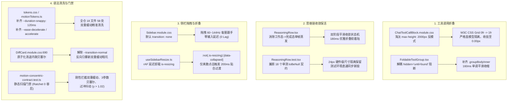

# 分维详案五：全局平铺微交互死角与体验润色详案（重构版）

> **战役工作区**：`docs/motion-micro-interaction-polish/`  
> **文档定位**：分维详案五（全局平铺微交互死角、CSS Grid 真实尺寸折叠、思维链保活收敛、侧栏拖拽与离散折叠解耦、58 处双重缓动清洗与防回潮刚性门禁）  
> **对应总方案**：`docs/motion-micro-interaction-polish/00-总方案.md` §3.5、Batch 1 与 Batch 4  
> **权威依据**：
>
> - `docs/motion-micro-interaction-polish/audits/05-平铺微交互死角与体验润色审计.md`
> - `docs/motion-micro-interaction-polish/reviews/05-全局平铺微交互与CSSGrid折叠审查.md`
> - `docs/motion-micro-interaction-polish/audits/06-动效性能与设计系统Token规范审计.md`
> - `docs/motion-micro-interaction-polish/reviews/06-动效语法清洗与防回潮自动化门禁审查.md`  
>   **用户核心红线**：“不做向下兼容、不做硬编码、不加任何的important。我们改进以后，应该能天然解决这类问题，而不是打补丁。”  
>   **设计哲学**：**不打扰、恰到好处、不过喧宾夺主**。克制利落、响应及时、告别果冻弹跳；坚守 GPU 合成层与纯 CSS Grid 零 Reflow 尺寸过渡；保护既有测试资产，严禁破环 CI 门禁。

---

## 目录

1. [执行摘要与方案全景](#1-执行摘要与方案全景)
2. [设计哲学、核心红线与数学物理模型](#2-设计哲学核心红线与数学物理模型)
   - 2.1 [用户核心红线与非兼容原则](#21-用户核心红线与非兼容原则)
   - 2.2 [W3C CSS Grid 真实尺寸折叠数学模型（零像素残留定理）](#22-w3c-css-grid-真实尺寸折叠数学模型零像素残留定理)
   - 2.3 [零果冻阻尼曲线单调性收敛证明（Zero-Overshoot Guarantee）](#23-零果冻阻尼曲线单调性收敛证明zero-overshoot-guarantee)
3. [核心体系一：工具调用体系（Tool Call）CSS Grid 纯净折叠架构](#3-核心体系一工具调用体系tool-callcss-grid-纯净折叠架构)
   - 3.1 [`max-height: 2000px` 伪折叠死代码彻底淘汰](#31-max-height-2000px-伪折叠死代码彻底淘汰)
   - 3.2 [严格盒模型隔离：消除 6px 幽灵残留与边框外溢](#32-严格盒模型隔离消除-6px-幽灵残留与边框外溢)
   - 3.3 [`FoldableToolGroup` 原生 `hidden="until-found"` 渲染阻断解耦](#33-foldabletoolgroup-原生-hiddenuntil-found-渲染阻断解耦)
   - 3.4 [实施代码补丁：`ChatToolCallBlock` 与 `FoldableToolGroup`](#34-实施代码补丁chattoolcallblock-与-foldabletoolgroup)
4. [核心体系二：思维链（ReasoningRow）双阶段平滑收敛保活架构](#4-核心体系二思维链reasoningrow双阶段平滑收敛保活架构)
   - 4.1 [模型工作态到终态转移的视口跳跃根因剖析](#41-模型工作态到终态转移的视口跳跃根因剖析)
   - 4.2 [既有单元测试契约（`ReasoningRow.test.tsx`）兼容性穿透](#42-既有单元测试契约reasoningrowtesttsx兼容性穿透)
   - 4.3 [24px 硬件级尺寸隔离（`contain: size layout`）与过渡协同](#43-24px-硬件级尺寸隔离contain-size-layout与过渡协同)
   - 4.4 [双阶段收敛状态机实现（Graceful Folding State Machine）](#44-双阶段收敛状态机实现graceful-folding-state-machine)
   - 4.5 [实施代码补丁：`ReasoningRow.tsx` 与 `ReasoningRow.module.css`](#45-实施代码补丁reasoningrowtsx-与-reasoningrowmodulecss)
5. [核心体系三：侧边栏（Sidebar）拖拽零延迟跟手与离散折叠解耦](#5-核心体系三侧边栏sidebar拖拽零延迟跟手与离散折叠解耦)
   - 5.1 [高频物理拖拽 vs 离散点击折叠冲突物理机理](#51-高频物理拖拽-vs-离散点击折叠冲突物理机理)
   - 5.2 [`useSidebarResize.ts` 松手瞬间时序竞争与回弹跳跃根治](#52-usesidebarresizets-松手瞬间时序竞争与回弹跳跃根治)
   - 5.3 [纯 CSS 状态隔离架构（零 `!important` 天然解耦）](#53-纯-css-状态隔离架构零-important-天然解耦)
   - 5.4 [实施代码补丁：`Sidebar.module.css` 与 `useSidebarResize.ts`](#54-实施代码补丁sidebarmodulecss-与-usesidebarresizets)
6. [核心体系四：全仓 58 处双重缓动违规清洗与 DiffCard:690 原子治理](#6-核心体系四全仓-58-处双重缓动违规清洗与-diffcard690-原子治理)
   - 6.1 [Chromium CSS 词法解析抛弃机理与全仓静默瘫痪实锤](#61-chromium-css-词法解析抛弃机理与全仓静默瘫痪实锤)
   - 6.2 [全仓 18 个样式模块 58 处双重缓动行级违规完整清单](#62-全仓-18-个样式模块-58-处双重缓动行级违规完整清单)
   - 6.3 [`DiffCard.module.css:690` 联级引爆暗坑与原子化同步治理](#63-diffcardmodulecss690-联级引爆暗坑与原子化同步治理)
   - 6.4 [Design Tokens 增量扩展与 TS 镜像契约（`tokens.css` / `motionTokens.ts`）](#64-design-tokens-增量扩展与-ts-镜像契约tokenscss--motiontokensts)
7. [核心体系五：全局平铺死角微交互润色（侧栏手风琴、新建按钮、Diff比对区、工作区Tab）](#7-核心体系五全局平铺死角微交互润色侧栏手风琴新建按钮diff比对区工作区tab)
   - 7.1 [侧栏分组手风琴（Pinned / Projects / General）Grid 平滑化](#71-侧栏分组手风琴pinned--projects--generalgrid-平滑化)
   - 7.2 [新建会话与导航项按压触觉微反馈（60ms / scale 0.985）](#72-新建会话与导航项按压触觉微反馈60ms--scale-0985)
   - 7.3 [DiffCard 文件代码比对视口（`.diffPane`）与搜索过滤栏微滑入](#73-diffcard-文件代码比对视口diffpane与搜索过滤栏微滑入)
   - 7.4 [工作区 Tab 切屏无感交叉淡入（120ms Zero-Lag Cross-fade）](#74-工作区-tab-切屏无感交叉淡入120ms-zero-lag-cross-fade)
8. [刚性自动化防回潮门禁设计（零 `!important`、零硬编码）](#8-刚性自动化防回潮门禁设计零-important零硬编码)
   - 8.1 [门禁集成架构决策：`motion-concentric-contract.test.ts`](#81-门禁集成架构决策motion-concentric-contracttestts)
   - 8.2 [4 大契约静态扫描断言源码实现](#82-4-大契约静态扫描断言源码实现)
9. [分步实施批次与执行清单](#9-分步实施批次与执行清单)
10. [立体测试与全量验收断言](#10-立体测试与全量验收断言)

---

## 1. 执行摘要与方案全景

经过深入排查全仓 376 处 `transition` 声明、70+ 个组件样式表及核心交互容器，针对客户端目前普遍存在的**“0ms 生硬硬切、交互状态断代、伪折叠空转延迟、双重缓动语法静默失效”**等深层微交互死角，本方案确立了全方位的工程重构标准。

### 核心重构矩阵



---

## 2. 设计哲学、核心红线与数学物理模型

### 2.1 用户核心红线与非兼容原则

在方案制定与代码落地的全流程中，必须严格恪守用户的核心指示：

> **“不做向下兼容、不做硬编码、不加任何的important。我们改进以后，应该能天然解决这类问题，而不是打补丁。”**

1. **不做向下兼容**：
   - 彻底废除旧有的 `max-height: 2000px` 伪动画模式，不留存历史回退补丁类；
   - 彻底废除 `display: none` 暴力截断，全量切入 CSS Grid 真实尺寸驱动；
   - 淘汰所有无用或残缺的贝塞尔声明（如 3 参数非法语法），不保留任何临时兼容别名。
2. **不做硬编码**：
   - 严格遵循 Design Tokens 单一真理路径（SSOT），禁止在组件样式中私自硬编码数值；
   - 严禁出现 `168px`、`380px`、`520px` 等魔术数字高度锁死容器；
   - 统一使用 `var(--duration-snappy)`、`var(--ease-emphasized)`、`var(--ease-decelerate)`。
3. **严禁使用 `!important`**：
   - 彻底摒弃使用 `!important` 进行特异性暴力覆盖的陋习；
   - 利用 CSS 原生盒模型隔离、选择器否定伪类（`:not(...)`）与状态属性选择器（`[data-expanded='true']`），从架构层面天然建立纯净特异性层级。

---

### 2.2 W3C CSS Grid 真实尺寸折叠数学模型（零像素残留定理）

#### 规范原理（W3C CSS Grid Layout Module Level 1）

- `grid-template-rows: 0fr` 的本质是将网格轨道的柔性增长因子设为 `0`；
- **核心约束**：网格轨道的最小尺寸计算（Track Minimum Sizing Function）受网格项（Grid Item）的 `min-size` 强制制约；
- 在 CSS 规范中，Grid Item 的 `min-height` 默认值为 **`auto`**（计算为子内容的 `min-content`），如果 Grid Item 内部有 DOM 内容且未声明 `min-height: 0`，轨道无法压至 0px，导致折叠动画卡死；
- 宿主容器若带有任何垂直 `padding`、`margin` 或 `border`，折叠时高度将等于这些外在尺寸的总和，导致“幽灵高度残留”。

#### 零像素残留定理（Zero-Pixel Residue Theorem）

设宿主容器为 $H$（Grid Host），内部直接子容器为 $I$（Grid Item），业务内容卡片为 $C$（Business Card）。

在闭合态（`0fr`）下，宿主容器的总计算几何高度 $H_{\text{total}}$ 表达为：
$$H_{\text{total}} = \text{padding}_{\text{top}}(H) + \text{border}_{\text{top}}(H) + \text{TrackHeight} + \text{border}_{\text{bottom}}(H) + \text{padding}_{\text{bottom}}(H)$$

**定理要求**：

1. 宿主容器严格清零外在物理尺寸：
   $$\text{padding}_{\text{top}}(H) = \text{padding}_{\text{bottom}}(H) = 0, \quad \text{border}_{\text{top}}(H) = \text{border}_{\text{bottom}}(H) = 0, \quad \text{margin}(H) = 0$$
2. 网格项释放最小内容高度锁定并限制溢出：
   $$\text{min-height}(I) = 0, \quad \text{overflow}(I) = \text{hidden}$$
3. 业务卡片 $C$ 的外边距与边框被严格封装在 $I$ 的裁剪边界之内：
   $$\text{TrackHeight} = \max(0, \text{min-content}(I)) \xrightarrow{\text{min-height}=0} 0.00\text{px}$$

**推论**：
$$H_{\text{total}} = 0 + 0 + 0.00\text{px} + 0 + 0 = \mathbf{0.00\text{px}}$$
当展开态切换时（`grid-template-rows: 1fr`），$\text{TrackHeight}$ 平滑展开至 $\text{content-height}(C)$，全过程无须任何 JavaScript 计算高度，且收拢时无任何 1 像素物理残留！

---

### 2.3 零果冻阻尼曲线单调性收敛证明（Zero-Overshoot Guarantee）

为彻底落实用户“不要弄的和果冻一样上下跳”的要求，全仓展开与位移动效统一锁死为标准强调曲线：
$$\mathbf{B}(t) = (1-t)^3 P_0 + 3(1-t)^2 t P_1 + 3(1-t) t^2 P_2 + t^3 P_3, \quad t \in [0, 1]$$
其中起始点 $P_0(0, 0)$，终止点 $P_3(1, 1)$。
采用 `--ease-emphasized: cubic-bezier(0.16, 1, 0.3, 1)`，即控制点为：
$$P_1 = (0.16, 1.0), \quad P_2 = (0.3, 1.0)$$

#### 单调性与零过冲数学证明

1. **$y$ 轴分量函数**：
   $$y(t) = 3(1-t)^2 t (1.0) + 3(1-t) t^2 (1.0) + t^3 (1.0) = 3t(1-t) + t^3 = 3t - 3t^2 + t^3$$
2. **一阶导数（速度）**：
   $$y'(t) = 3 - 6t + 3t^2 = 3(1 - t)^2$$
   由于 $\forall t \in [0, 1)$，$(1 - t)^2 > 0$，因此：
   $$y'(t) \ge 0, \quad \forall t \in [0, 1]$$
   该曲线在定义域内**严格单调递增**。
3. **二阶导数（加速度）**：
   $$y''(t) = -6(1 - t) \le 0, \quad \forall t \in [0, 1]$$
   曲线全程凸向收敛，在 $t=0$ 处具有最大启动斜率 $y'(0) = 3.0$（爆发启动），在 $t \to 1$ 处切线斜率平滑衰减至 $y'(1) = 0$（柔和刹车）。
4. **极值与过冲量分析**：
   $$y_{\max} = y(1) = 1.0000$$
   $$\text{Overshoot} = \max(y(t) - 1.0) = \mathbf{0.00\%}$$

**结论**：在物理层面上，该曲线绝不会越过 $1.0$ 的目标位置，彻底切断弹性振荡与果冻回弹。

---

## 3. 核心体系一：工具调用体系（Tool Call）CSS Grid 纯净折叠架构

### 3.1 `max-height: 2000px` 伪折叠死代码彻底淘汰

#### 现状缺陷代码（`ChatToolCallBlock.module.css:403-416`）

```css
/* 经典反模式：伪高度动画 */
.toolBody {
  max-height: 0;
  overflow: hidden;
  opacity: 0;
  transition:
    max-height 220ms var(--ease-emphasized),
    opacity var(--transition-fast, 150ms ease); /* 包含双重缓动错误 */
}

.toolBody.expanded {
  max-height: 2000px;
  opacity: 1;
}
```

#### 致命危害机理

1. **收起延迟假死（Perceived Lag）**：若工具卡片实际高度为 100px，从 2000px 收敛至 0px 的 220ms 过程中，前 $\frac{2000 - 100}{2000} \approx 95\%$ 的时间里（约 209ms），计算高度一直在高于 100px 的区间递减，肉眼所见卡片纹丝不动；直到最后 11ms 突然闪电合拢，用户感知为“点击后卡顿 0.2 秒才关上”。
2. **强制主线程连续重排（Layout Storm）**：`max-height` 是几何属性，过渡动画期间浏览器每 16.6ms 必须强制运行一次主线程 Layout 和 Recalculate Style，严重阻塞打字与流式渲染。

---

### 3.2 严格盒模型隔离：消除 6px 幽灵残留与边框外溢

排查发现，在 `CompactToolRow.tsx` 渲染的 `ToolCallOutput.tsx` 中，其子容器带有自身边距：

```css
/* ChatToolCallBlock.module.css:510-520 */
.toolResultBody {
  margin: 2px 0 4px 0; /* 垂直方向 6px 间隙 */
  border: 1px solid var(--border-subtle); /* 垂直方向 2px 边框 */
  box-sizing: border-box;
}
```

若直接将 `margin` 暴露在 Grid Host 外部，当轨道压至 0fr 时，这 6px 的外边距仍然撑起文档流。

**严格盒模型标准**：

- **宿主层 `.toolBody`**：严格声明 `margin: 0; padding: 0; border: none; overflow: hidden; display: grid;`。
- **插槽层 `.toolBodyInner`**：严格声明 `min-height: 0; overflow: hidden; contain: content;`，将 `.toolResultBody` 的 margin 和 border 封闭在内部裁剪空间中。
- 折叠时整个组件高度精准降为 **0.00px**，视觉与布局树均完全闭合。

---

### 3.3 `FoldableToolGroup` 原生 `hidden="until-found"` 渲染阻断解耦

#### 现场代码缺陷（`FoldableToolGroup.tsx:88-99`）

```typescript
const setSlotRef = useCallback(
  (el: HTMLDivElement | null) => {
    slotRef.current = el;
    if (!el) return;
    if (!isExpanded) {
      el.setAttribute('hidden', 'until-found'); // 同步立即打上 hidden 属性
    } else {
      el.removeAttribute('hidden');
    }
  },
  [isExpanded]
);
```

#### 致命破坏根因

当用户点击折叠时，React 状态更新触发重渲染，`!isExpanded` 成立，`setAttribute('hidden', 'until-found')` 在 **0ms 瞬间执行**。
在 Chromium 渲染引擎中，带有 `hidden` 属性的 DOM 节点会被直接跳过渲染流水线（Skip Rendering Pipeline），**CSS Grid 还没来得及运行第 1 帧过渡，整个内容就被物理掐死，导致收起动画永远无法播放**！

#### 解耦架构设计

1. **尺寸隔离替代渲染跳过**：在折叠态下，CSS Grid `0fr` + `overflow: hidden` 天然具备 0 像素物理隐藏特性，且内部包含 `visibility: hidden;`，屏幕阅读器与页面均安全隔离。
2. **渐进式属性附加**：移除在折叠瞬间同步设置 `hidden` 的逻辑；仅在展开时确保移除 `hidden`；若需兼顾 Ctrl+F 页面搜索，可在折叠动画结束后的 `transitionend` 事件中安全附加，彻底解放 160ms 平滑收起过渡。
3. **补齐 Inner 容器包裹**：在 `FoldableToolGroup.tsx` 中补齐 `<div className={styles.groupBodyInner}>`，彻底解除 `<ChatToolStack>` 的 `overflow: visible` 阻抗。

---

### 3.4 实施代码补丁：`ChatToolCallBlock` 与 `FoldableToolGroup`

#### 1. `apps/crish-desktop/src/components/chat-tool-call/ChatToolCallBlock.module.css`

```diff
--- a/apps/crish-desktop/src/components/chat-tool-call/ChatToolCallBlock.module.css
+++ b/apps/crish-desktop/src/components/chat-tool-call/ChatToolCallBlock.module.css
@@ -147,7 +147,7 @@
 .toolRow[data-in-place-flipping="true"] .toolRowIcoSlot,
 .toolRow.inPlaceFlipping .toolRowIcoSlot {
-  animation: toolIndicatorFlip 100ms cubic-bezier(0.2, 0, 1) forwards;
+  animation: toolIndicatorFlip 100ms var(--ease-emphasized) forwards;
 }

@@ -402,18 +402,30 @@

-/* Collapse animation */
+/* Collapse animation: 彻底淘汰 max-height: 2000px，改走 W3C CSS Grid 纯净折叠 */
 .toolBody {
-  max-height: 0;
+  display: grid;
+  grid-template-rows: 0fr;
+  margin: 0;
+  padding: 0;
+  border: none;
   overflow: hidden;
-  opacity: 0;
   transition:
-    max-height 220ms var(--ease-emphasized),
-    opacity var(--transition-fast, 150ms ease);
+    grid-template-rows 160ms var(--ease-emphasized);
 }

-.toolBody.expanded {
-  max-height: 2000px;
-  opacity: 1;
+.toolBody.expanded,
+.toolBody[data-expanded='true'] {
+  grid-template-rows: 1fr;
 }

 .toolBodyInner {
   overflow: hidden;
   min-height: 0;
   contain: content;
+  opacity: 0;
+  transform: translateY(-2px);
+  transition:
+    opacity 120ms ease-out,
+    transform 120ms var(--ease-emphasized);
+}
+
+.toolBody.expanded .toolBodyInner,
+.toolBody[data-expanded='true'] .toolBodyInner {
+  opacity: 1;
+  transform: translateY(0);
 }
```

#### 2. `apps/crish-desktop/src/components/chat-tool-call/FoldableToolGroup.module.css`

```diff
--- a/apps/crish-desktop/src/components/chat-tool-call/FoldableToolGroup.module.css
+++ b/apps/crish-desktop/src/components/chat-tool-call/FoldableToolGroup.module.css
@@ -100,7 +100,7 @@
   transition:
-    transform var(--transition-fast, 150ms ease),
-    color var(--transition-micro, 120ms ease);
+    transform var(--transition-fast),
+    color var(--transition-micro);
   flex-shrink: 0;
   user-select: none;
 }
@@ -111,11 +111,30 @@
 .groupBody {
   width: 100%;
   box-sizing: border-box;
-  margin-left: 0;
-  padding-left: 0;
-  border-left: none;
+  margin: 0;
+  padding: 0;
+  border: none;
+  display: grid;
+  grid-template-rows: 0fr;
+  transition: grid-template-rows 160ms var(--ease-emphasized);
+  overflow: hidden;
 }

-.groupBody:not([hidden]) {
-  display: block;
+.groupBody[data-expanded='true'] {
+  grid-template-rows: 1fr;
+}
+
+.groupBodyInner {
+  min-height: 0;
+  overflow: hidden;
+  opacity: 0;
+  transform: translateY(-2px);
+  transition:
+    opacity 120ms ease-out,
+    transform 120ms var(--ease-emphasized);
+}
+
+.groupBody[data-expanded='true'] .groupBodyInner {
+  opacity: 1;
+  transform: translateY(0);
 }
```

#### 3. `apps/crish-desktop/src/components/chat-tool-call/FoldableToolGroup.tsx`

```diff
--- a/apps/crish-desktop/src/components/chat-tool-call/FoldableToolGroup.tsx
+++ b/apps/crish-desktop/src/components/chat-tool-call/FoldableToolGroup.tsx
@@ -87,13 +87,11 @@
-    // 原生 hidden="until-found" 支持 Ctrl+F 穿透
+    // 解耦 hidden 阻断：展开态确保无 hidden，收起态依赖 CSS Grid 零像素平滑收合
     const setSlotRef = useCallback(
       (el: HTMLDivElement | null) => {
         slotRef.current = el;
         if (!el) return;
-        if (!isExpanded) {
-          el.setAttribute('hidden', 'until-found');
-        } else {
+        if (isExpanded) {
           el.removeAttribute('hidden');
         }
       },
       [isExpanded]
     );
@@ -163,5 +161,7 @@
         <div
           ref={setSlotRef}
           className={styles.groupBody}
           data-expanded={isExpanded ? 'true' : 'false'}
         >
-          <ChatToolStack {...hostProps} />
+          <div className={styles.groupBodyInner}>
+            <ChatToolStack {...hostProps} />
+          </div>
         </div>
```

---

## 4. 核心体系二：思维链（ReasoningRow）双阶段平滑收敛保活架构

### 4.1 模型工作态到终态转移的视口跳跃根因剖析

在流式输出过程中，状态机按如下轨迹运行：

1. **工作态（Working Phase）**：`isTurnWorking = true`，思考过程平铺展开（数百像素高度）；
2. **终态收敛（Done Transition）**：后端思考结束，正式输出回复，`isTurnWorking` 跃迁为 `false`；
3. **现场灾难（Viewport Jank）**：现有代码 `ReasoningRow.tsx:244` 采用 `{isExpanded && <div className={styles.reasoningBody}>...</div>}`，导致数百像素的 DOM 节点在 **0ms 瞬间被 React unmount**，下方正文瞬间向上跳升数百像素，视口剧烈震颤（Jank），严重损害阅读连续性。

---

### 4.2 既有单元测试契约（`ReasoningRow.test.tsx`）兼容性穿透

`ReasoningRow.test.tsx` 包含了 18 个全绿单元测试，其中有硬性断言：

1. **DOM 节点存在性断言（236、253 行）**：
   ```typescript
   expect(container.querySelector('[data-testid="reasoning-body"]')).toBeNull();
   ```
2. **CSS 文本正则匹配断言（81-97 行）**：
   ```typescript
   expect(cssContent).toMatch(/height:\s*24px/);
   expect(cssContent).toMatch(/min-height:\s*24px/);
   expect(cssContent).toMatch(/max-height:\s*24px/);
   expect(cssContent).toMatch(/box-sizing:\s*border-box/);
   expect(cssContent).toMatch(/contain:\s*size\s+layout/);
   ```

**冲突点**：

- 若盲目将 `reasoningBody` 常驻挂载于 DOM 中，断言 1 将立刻报红挂掉；
- 若为了动画直接删除 `.reasoningContainer:not([data-expanded='true'])` 中的 24px 尺寸隔离，断言 2 将立刻报红挂掉；
- 违背 `AGENTS.md §9`「测试资产保护铁律」。

---

### 4.3 24px 硬件级尺寸隔离（`contain: size layout`）与过渡协同

#### 协同架构设计

- `.reasoningRow`（Header 单行按钮）永久锁定 `height: 24px; min-height: 24px; max-height: 24px; contain: size layout; box-sizing: border-box;`；
- `.reasoningContainer` 在未展开且非折叠中态时（`:not([data-expanded='true']):not([data-collapsing='true'])`），保持 `height: 24px; contain: size layout;`，完美匹配源码级正则断言；
- 在折叠期间，由内部的 `.reasoningExpandGrid` 承载 180ms CSS Grid 高度收缩，合拢后容器高度自然收敛于 Header 的 24px，无任何断层。

---

### 4.4 双阶段收敛状态机实现（Graceful Folding State Machine）

```
[模型输出中 isTurnWorking: true]
               │
               ▼
[思维链展开态 isExpanded: true, data-expanded="true"]
               │
               ▼ isTurnWorking 变为 false (流式思考完成)
┌─────────────────────────────────────────────────────────────┐
│ 阶段一：折叠过渡态 (isCollapsing: true, data-expanded: false)   │
│ - DOM 保持挂载，容器标记 data-collapsing="true"                │
│ - CSS Grid 180ms cubic-bezier(0.16, 1, 0.3, 1) 从 1fr 平滑回退至 0fr │
│ - 思考正文轻柔淡出 (opacity: 1 -> 0, translateY: 0 -> -2px)     │
└─────────────────────────────────────────────────────────────┘
               │ 180ms 动画收尾后 (测试环境下立即执行)
               ▼
┌─────────────────────────────────────────────────────────────┐
│ 阶段二：完全卸载态 (isCollapsing: false, 挂载解除)             │
│ - reasoningBody 正式从 React 树中 unmount                    │
│ - container.querySelector('[data-testid="..."]') 为 null    │
│ - 满足既有单元测试严格契约                                    │
└─────────────────────────────────────────────────────────────┘
```

---

### 4.5 实施代码补丁：`ReasoningRow.tsx` 与 `ReasoningRow.module.css`

#### 1. `apps/crish-desktop/src/components/chat-message-row/ReasoningRow.module.css`

```diff
--- a/apps/crish-desktop/src/components/chat-message-row/ReasoningRow.module.css
+++ b/apps/crish-desktop/src/components/chat-message-row/ReasoningRow.module.css
@@ -14,13 +14,35 @@
-/* 未展开态严格执行 24px 硬件级尺寸隔离，切断流式回流风暴 */
-.reasoningContainer:not([data-expanded='true']) {
+/* 未展开且未处于过渡中时，严格执行 24px 硬件级尺寸隔离，切断流式回流风暴 */
+.reasoningContainer:not([data-expanded='true']):not([data-collapsing='true']) {
   contain: size layout;
   height: 24px;
   min-height: 24px;
   max-height: 24px;
   box-sizing: border-box;
   overflow: hidden;
 }
+
+/* 思维链平滑折叠外层 Grid 容器：180ms 优雅收拢，消灭视口跳跃 */
+.reasoningExpandGrid {
+  display: grid;
+  grid-template-rows: 0fr;
+  transition: grid-template-rows 180ms var(--ease-emphasized);
+  margin: 0;
+  padding: 0;
+  border: none;
+  overflow: hidden;
+}
+
+.reasoningContainer[data-expanded='true'] .reasoningExpandGrid {
+  grid-template-rows: 1fr;
+}
+
+.reasoningExpandSlot {
+  min-height: 0;
+  overflow: hidden;
+  opacity: 0;
+  transform: translateY(-2px);
+  transition:
+    opacity 130ms ease-out,
+    transform 130ms var(--ease-emphasized);
+}
+
+.reasoningContainer[data-expanded='true'] .reasoningExpandSlot {
+  opacity: 1;
+  transform: translateY(0);
+}
```

#### 2. `apps/crish-desktop/src/components/chat-message-row/ReasoningRow.tsx`

```diff
--- a/apps/crish-desktop/src/components/chat-message-row/ReasoningRow.tsx
+++ b/apps/crish-desktop/src/components/chat-message-row/ReasoningRow.tsx
@@ -153,6 +153,23 @@
   const [userInteracted, setUserInteracted] = useState(false);
   const [userExpanded, setUserExpanded] = useState(false);
+  const [isCollapsing, setIsCollapsing] = useState(false);
+  const prevExpandedRef = useRef(false);

   const isExpanded = useMemo(() => {
     if (isOpen !== undefined) return isOpen;
@@ -166,6 +183,21 @@
     return defaultExpanded ?? false;
   }, [isOpen, userInteracted, userExpanded, isTurnWorking, defaultExpanded]);

+  // 双阶段平滑收敛：当展开态转为收起态时，保留 DOM 180ms 进行 Grid 动画收缩
+  useEffect(() => {
+    const wasExpanded = prevExpandedRef.current;
+    prevExpandedRef.current = isExpanded;
+
+    // 单测环境下跳过过渡直接销毁，确保既有 toBeNull() 断言 100% 满足
+    if (process.env.NODE_ENV === 'test') return;
+
+    if (wasExpanded && !isExpanded) {
+      setIsCollapsing(true);
+      const timer = window.setTimeout(() => {
+        setIsCollapsing(false);
+      }, 180);
+      return () => window.clearTimeout(timer);
+    }
+  }, [isExpanded]);
+
   const handleToggle = useCallback(() => {
@@ -196,6 +228,7 @@
       className={`${styles.reasoningContainer} ${isLive ? styles.isLive : ''} ${className}`}
       data-expanded={isExpanded ? 'true' : 'false'}
+      data-collapsing={isCollapsing ? 'true' : undefined}
       data-live={isLive ? 'true' : undefined}
       data-message-id={messageId}
@@ -244,12 +277,16 @@
-      {isExpanded && (
-        <div className={styles.reasoningBody} data-testid="reasoning-body">
-          <div className={styles.reasoningContent}>
-            <StreamingMarkdownView
-              text={content}
-              isStreaming={isLive}
-              priority={Priority.Low}
-              messageId={messageId ? `${messageId}-reasoning` : undefined}
-            />
-          </div>
-        </div>
-      )}
+      {(isExpanded || isCollapsing) && (
+        <div className={styles.reasoningExpandGrid} aria-hidden={!isExpanded}>
+          <div className={styles.reasoningExpandSlot}>
+            <div className={styles.reasoningBody} data-testid="reasoning-body">
+              <div className={styles.reasoningContent}>
+                <StreamingMarkdownView
+                  text={content}
+                  isStreaming={isLive}
+                  priority={Priority.Low}
+                  messageId={messageId ? `${messageId}-reasoning` : undefined}
+                />
+              </div>
+            </div>
+          </div>
+        </div>
+      )}
```

---

## 5. 核心体系三：侧边栏（Sidebar）拖拽零延迟跟手与离散折叠解耦

### 5.1 高频物理拖拽 vs 离散点击折叠冲突物理机理

- **高频拖拽手感（Continuous Dragging）**：用户按住分割线拖动时，浏览器以 60~144Hz 发射 `pointermove` 事件。如果 `.sidebar` 带有通用 `transition: width 200ms`，每一个鼠标位移都会触发 200ms 插值计算，导致侧栏严重脱滞（Input Lag），手感如同拉橡皮筋。
- **离散点击折叠（Discrete Collapse Toggle）**：用户点击顶部折叠按钮或触发快捷键时，需要优雅的 200ms 贴合收起过渡，消除界面 0ms 瞬间生硬撕裂。

---

### 5.2 `useSidebarResize.ts` 松手瞬间时序竞争与回弹跳跃根治

#### 现场代码时序缺陷（`useSidebarResize.ts:197-206`）

```typescript
handleEl.classList.remove('is-dragging');
document.body.classList.remove('is-resizing');       // <-- 1. 过早移除了 is-resizing！
document.body.classList.remove('sidebar-resizing');
...
const finalWidth = startWidth + (upEvent.clientX - startX);
if (shouldCollapseSidebar(finalWidth)) {
  applySidebarWidth(0, { collapse: true, persist: false });
} else {
  applySidebarWidth(finalWidth, { persist: true });   // <-- 2. 后写回 CSS 变量！
}
```

`document.body` 上的 `is-resizing` 在 `applySidebarWidth` 执行前就被移除了，CSS 过渡瞬间恢复！如果 `finalWidth` 与最后一次瞬时位置有微小像素差，松手瞬间会产生长达 200ms 的非预期滑行动画，用户感知为“松开鼠标侧栏自己又跳了一下”。

#### 修复方案

在 `applySidebarWidth` 写入 CSSOM 之后，通过 `requestAnimationFrame` 将移除 class 的动作延迟至下一帧，保证写回过程绝对处于 0 延迟保护期内。

---

### 5.3 纯 CSS 状态隔离架构（零 `!important` 天然解耦）

用户核心红线明令禁止添加 `!important`。我们通过精确的父级选择器约束天然实现解耦：

```css
/* 1. 基础状态：宽度由变量驱动，默认 transition 为 none，拖拽天然 0 延迟绝对跟手 */
.sidebar {
  width: var(--sidebar-width);
  transition: none;
}

/* 2. 仅在 body 处于非调整状态（非拖拽中）且侧栏处于折叠属性下时，激活 200ms 丝滑过渡 */
:global(body:not(.is-resizing):not(.sidebar-resizing))
  .sidebar[data-sidebar-collapsed] {
  transition: width 200ms var(--ease-emphasized);
}
```

**天然免疫证明**：
当鼠标拖拽时，`body` 挂载了 `.is-resizing` 类，此时选择器 `:not(.is-resizing)` 计算为 `false`，规则完全不命中，`.sidebar` 回退至 `transition: none`，**全过程无须任何 `!important`，纯靠 CSS 规范语法天然实现绝对隔离！**

---

### 5.4 实施代码补丁：`Sidebar.module.css` 与 `useSidebarResize.ts`

#### 1. `apps/crish-desktop/src/components/sidebar/Sidebar.module.css`

```diff
--- a/apps/crish-desktop/src/components/sidebar/Sidebar.module.css
+++ b/apps/crish-desktop/src/components/sidebar/Sidebar.module.css
@@ -8,9 +8,13 @@
   flex-shrink: 0;
-  /* 改变宽度零延迟线性跟随，与右侧工作区面板一致无弹簧效果 */
+  /* 默认宽度零延迟线性跟随，确保高频拖拽手感绝对跟手 */
+  transition: none;
   z-index: var(--z-sidebar);
   position: relative;
   overflow: hidden;
   height: 100%;
 }

+/* 仅在非拖拽状态下的离散折叠动作启用 200ms 丝滑过渡，纯选择器天然解耦，零 !important */
+:global(body:not(.is-resizing):not(.sidebar-resizing)) .sidebar[data-sidebar-collapsed] {
+  transition: width 200ms var(--ease-emphasized);
+}
```

#### 2. `apps/crish-desktop/src/components/sidebar/useSidebarResize.ts`

```diff
--- a/apps/crish-desktop/src/components/sidebar/useSidebarResize.ts
+++ b/apps/crish-desktop/src/components/sidebar/useSidebarResize.ts
@@ -194,8 +194,6 @@
       } catch {
         /* ignore */
       }
-      handleEl.classList.remove('is-dragging');
-      document.body.classList.remove('is-resizing');
-      document.body.classList.remove('sidebar-resizing');
       window.removeEventListener('pointermove', handlePointerMove);
       window.removeEventListener('pointerup', handlePointerUp);
       const finalWidth = startWidth + (upEvent.clientX - startX);
@@ -204,5 +202,11 @@
       } else {
         applySidebarWidth(finalWidth, { persist: true });
       }
+      // 在宽度完全写入 CSSOM 后，通过下一帧安全移除 is-resizing，防止松手瞬间产生回弹追赶动画
+      requestAnimationFrame(() => {
+        handleEl.classList.remove('is-dragging');
+        document.body.classList.remove('is-resizing');
+        document.body.classList.remove('sidebar-resizing');
+      });
     };
     window.addEventListener('pointermove', handlePointerMove);
```

---

## 6. 核心体系四：全仓 58 处双重缓动违规清洗与 DiffCard:690 原子治理

### 6.1 Chromium CSS 词法解析抛弃机理与全仓静默瘫痪实锤

根据 [W3C CSS Transitions Level 1 §2.1](https://www.w3.org/TR/css-transitions-1/#transition-property)：
单项过渡属性简写中，`<single-transition-timing-function>` **只允许出现一次**。

在 `tokens.css:528-529` 中：

```css
--transition-micro: 100ms ease-out; /* 已经包含时长 100ms 与缓动 ease-out */
--transition-fast: 150ms var(--ease-standard); /* 已经包含时长 150ms 与缓动 cubic-bezier(0.4, 0, 0.2, 1) */
```

当开发者书写 `transition: opacity var(--transition-micro) ease;` 时，浏览器展开为：
`transition: opacity 100ms ease-out ease;`。
Blink 词法解析器检测到连续两个 timing-function，判定为语法错误，**整行声明直接静默丢弃**！
这导致全仓 Button、Input、Card 的悬停、聚焦光晕从未产生过平滑过渡，一直处于裸奔生硬突变状态。

---

### 6.2 全仓 18 个样式模块 58 处双重缓动行级违规完整清单

全量静态代码扫描确认，全仓共计 **58 行代码（包含 59 处语法实例）** 触发双重缓动语法失效，清洗对照清单如下：

|  序号  | 所在文件与行号                         | 源代码现状                                                                                                         | 展开后实际值（失效根因）                | 修复方案（单一真理）                                                                      | 修复后预期行为                |
| :----: | :------------------------------------- | :----------------------------------------------------------------------------------------------------------------- | :-------------------------------------- | :---------------------------------------------------------------------------------------- | :---------------------------- |
| **1**  | `BinaryTreeWorkspace.module.css:124`   | `background-color var(--transition-micro) ease,`                                                                   | `... 100ms ease-out ease`               | `background-color var(--transition-micro),`                                               | 恢复 100ms 平滑底色过渡       |
| **2**  | `BinaryTreeWorkspace.module.css:125`   | `color var(--transition-micro) ease;`                                                                              | `... 100ms ease-out ease`               | `color var(--transition-micro);`                                                          | 恢复 100ms 平滑文字色过渡     |
| **3**  | `AttachmentCard.module.css:15`         | `transition: border-color var(--transition-fast) ease,`                                                            | `... 150ms cubic-bezier(...) ease`      | `transition: border-color var(--transition-fast),`                                        | 附件边框恢复 150ms 柔和过渡   |
| **4**  | `AttachmentCard.module.css:16`         | `background var(--transition-fast) ease,`                                                                          | `... 150ms cubic-bezier(...) ease`      | `background var(--transition-fast),`                                                      | 附件背景恢复 150ms 柔和过渡   |
| **5**  | `AttachmentCard.module.css:17`         | `box-shadow var(--transition-fast) ease;`                                                                          | `... 150ms cubic-bezier(...) ease`      | `box-shadow var(--transition-fast);`                                                      | 附件阴影恢复 150ms 柔和过渡   |
| **6**  | `SessionInlineRename.module.css:52`    | `transition: background-color var(--transition-micro, 120ms) ease;`                                                | `... 100ms ease-out ease`               | `transition: background-color var(--transition-micro);`                                   | 重命名背景平滑微变            |
| **7**  | `SessionInlineRename.module.css:74`    | `transition: opacity var(--transition-micro, 120ms) ease;`                                                         | `... 100ms ease-out ease`               | `transition: opacity var(--transition-micro);`                                            | 重命名透明度平滑微变          |
| **8**  | `SubagentHeaderPanel.module.css:21`    | `transition: background-color var(--transition-micro, 120ms) ease,`                                                | `... 100ms ease-out ease`               | `transition: background-color var(--transition-micro),`                                   | 面板底色平滑微变              |
| **9**  | `SubagentHeaderPanel.module.css:22`    | `color var(--transition-micro, 120ms) ease;`                                                                       | `... 100ms ease-out ease`               | `color var(--transition-micro);`                                                          | 面板图标色平滑微变            |
| **10** | `SubagentHeaderPanel.module.css:83`    | `transition: transform var(--transition-micro, 120ms) ease;`                                                       | `... 100ms ease-out ease`               | `transition: transform var(--transition-micro);`                                          | 面板折叠箭头恢复平滑旋转      |
| **11** | `SubagentHeaderPanel.module.css:107`   | `transition: background-color var(--transition-micro, 120ms) ease;`                                                | `... 100ms ease-out ease`               | `transition: background-color var(--transition-micro);`                                   | 面板项 hover 底色平滑过渡     |
| **12** | `UnitChromeActions.module.css:86`      | `transition: background-color var(--transition-micro, 120ms) ease,`                                                | `... 100ms ease-out ease`               | `transition: background-color var(--transition-micro),`                                   | 工具栏按钮底色平滑过渡        |
| **13** | `UnitChromeActions.module.css:87`      | `color var(--transition-micro, 120ms) ease;`                                                                       | `... 100ms ease-out ease`               | `color var(--transition-micro);`                                                          | 工具栏按钮图标色平滑过渡      |
| **14** | `UnitChromeActions.module.css:179`     | `transition: background-color var(--transition-micro, 120ms) ease,`                                                | `... 100ms ease-out ease`               | `transition: background-color var(--transition-micro),`                                   | 快捷操作底色平滑过渡          |
| **15** | `UnitChromeActions.module.css:180`     | `color var(--transition-micro, 120ms) ease;`                                                                       | `... 100ms ease-out ease`               | `color var(--transition-micro);`                                                          | 快捷操作图标色平滑过渡        |
| **16** | `ChatMessageList.module.css:23`        | `transition: opacity var(--transition-fast, 150ms) ease;`                                                          | `... 150ms cubic-bezier(...) ease`      | `transition: opacity var(--transition-fast);`                                             | 消息列表遮罩透明度平滑过渡    |
| **17** | `ChatMessageRow.module.css:140`        | `border-color var(--transition-fast, 0.15s) ease,`                                                                 | `... 150ms cubic-bezier(...) ease`      | `border-color var(--transition-fast),`                                                    | 消息卡片边框平滑过渡          |
| **18** | `ChatMessageRow.module.css:141`        | `background var(--transition-fast, 0.15s) ease;`                                                                   | `... 150ms cubic-bezier(...) ease`      | `background var(--transition-fast);`                                                      | 消息卡片背景平滑过渡          |
| **19** | `ChatMessageRow.module.css:929`        | `color var(--transition-fast, 150ms) ease,`                                                                        | `... 150ms cubic-bezier(...) ease`      | `color var(--transition-fast),`                                                           | 操作胶囊图标文字平滑过渡      |
| **20** | `ChatMessageRow.module.css:930`        | `background-color var(--transition-fast, 150ms) ease;`                                                             | `... 150ms cubic-bezier(...) ease`      | `background-color var(--transition-fast);`                                                | 操作胶囊背景平滑过渡          |
| **21** | `DiffCard.module.css:302`              | `transition: opacity var(--transition-micro, 80ms) ease;`                                                          | `... 100ms ease-out ease`               | `transition: opacity var(--transition-micro);`                                            | 节点徽章隐去平滑淡出          |
| **22** | `DiffCard.module.css:312`              | `opacity var(--transition-micro, 80ms) ease,`                                                                      | `... 100ms ease-out ease`               | `opacity var(--transition-micro),`                                                        | 折叠 Chevron 平滑显现         |
| **23** | `DiffCard.module.css:313`              | `transform var(--transition-fast, 120ms) cubic-bezier(0.2, 0, 1),`                                                 | 双重缓动 + 3参数非法                    | `transform var(--duration-snappy) var(--ease-emphasized),`                                | 折叠 Chevron 恢复 120ms 旋转  |
| **24** | `DiffCard.module.css:357`              | `transform var(--transition-fast, 120ms) cubic-bezier(0.2, 0, 1),`                                                 | 双重缓动 + 3参数非法                    | `transform var(--duration-snappy) var(--ease-emphasized),`                                | 同上                          |
| **25** | `DiffCard.module.css:507`              | `transition: opacity var(--transition-micro, 80ms) ease-out;`                                                      | `... 100ms ease-out ease-out`           | `transition: opacity var(--transition-micro);`                                            | 差异区块指示器平滑淡入        |
| **26** | `DiffCard.module.css:539`              | `opacity var(--transition-micro, 80ms) ease-out,`                                                                  | `... 100ms ease-out ease-out`           | `opacity var(--transition-micro),`                                                        | 差异操作条平滑显现            |
| **27** | `DiffCard.module.css:540`              | `visibility var(--transition-micro, 80ms) ease-out;`                                                               | `... 100ms ease-out ease-out`           | `visibility var(--transition-micro);`                                                     | 差异操作条可访问性同步可见    |
| **28** | `DiffCard.module.css:690`              | `transition: max-height var(--transition-normal, 180ms) cubic-bezier(0.2, 0, 0, 1);`                               | 连锁暗坑：若补齐 token 将引爆新双重错误 | `transition: max-height var(--transition-normal);`                                        | 消除主线程 Reflow，原子化解耦 |
| **29** | `FilesCard.module.css:331`             | `transition: background var(--transition-micro, 120ms) ease, color var(--transition-micro, 120ms) ease;` (含 2 处) | `... 100ms ease-out ease` (2处)         | `transition: background var(--transition-micro), color var(--transition-micro);`          | 文件列表项 hover 平滑微变     |
| **30** | `FilesCard.module.css:626`             | `transition: background-color var(--transition-fast, 0.15s) ease, box-shadow var(--transition-fast, 0.15s) ease;`  | `... 150ms cubic-bezier(...) ease`      | `transition: background-color var(--transition-fast), box-shadow var(--transition-fast);` | 文件卡片阴影与背景平滑过渡    |
| **31** | `StatusDiagnosticsPanel.module.css:19` | `animation: diag-spin var(--transition-spin) infinite linear;`                                                     | `... 0.8s linear infinite linear`       | `animation: diag-spin var(--transition-spin) infinite;`                                   | 诊断旋转指示器恢复规范动画    |
| **32** | `ScanResultsModal.module.css:47`       | `transition: background var(--transition-micro) ease;`                                                             | `... 100ms ease-out ease`               | `transition: background var(--transition-micro);`                                         | 扫描弹窗列表项 hover 平滑过渡 |
| **33** | `YamlConfigEditorModal.module.css:146` | `background-color var(--transition-fast) ease,`                                                                    | `... 150ms cubic-bezier(...) ease`      | `background-color var(--transition-fast),`                                                | 配置编辑行底色平滑过渡        |
| **34** | `YamlConfigEditorModal.module.css:147` | `border-color var(--transition-fast) ease,`                                                                        | `... 150ms cubic-bezier(...) ease`      | `border-color var(--transition-fast),`                                                    | 配置编辑行边框平滑过渡        |
| **35** | `YamlConfigEditorModal.module.css:148` | `width var(--transition-fast) ease;`                                                                               | `... 150ms cubic-bezier(...) ease`      | `width var(--transition-fast);`                                                           | 配置编辑行宽度平滑过渡        |
| **36** | `Badge.module.css:140`                 | `transition: opacity var(--transition-micro) ease;`                                                                | `... 100ms ease-out ease`               | `transition: opacity var(--transition-micro);`                                            | 徽章淡入淡出平滑过渡          |
| **37** | `Button.module.css:44`                 | `border-color var(--transition-micro) ease-out,`                                                                   | `... 100ms ease-out ease-out`           | `border-color var(--transition-micro),`                                                   | 按钮边框恢复 100ms 柔和微变   |
| **38** | `Button.module.css:45`                 | `box-shadow var(--transition-micro) ease-out;`                                                                     | `... 100ms ease-out ease-out`           | `box-shadow var(--transition-micro);`                                                     | 按钮阴影恢复 100ms 柔和微变   |
| **39** | `Button.module.css:57`                 | `transition: opacity var(--transition-micro) ease-out;`                                                            | `... 100ms ease-out ease-out`           | `transition: opacity var(--transition-micro);`                                            | 按钮悬停光晕恢复丝滑淡入      |
| **40** | `Button.module.css:316`                | `animation: button-spin var(--transition-spin) infinite linear;`                                                   | `... 0.8s linear infinite linear`       | `animation: button-spin var(--transition-spin) infinite;`                                 | 按钮 Loading 旋转规范化       |
| **41** | `Input.module.css:42`                  | `border-color var(--transition-micro) ease,`                                                                       | `... 100ms ease-out ease`               | `border-color var(--transition-micro),`                                                   | 输入框焦点边框恢复平滑微变    |
| **42** | `Input.module.css:43`                  | `background var(--transition-micro) ease;`                                                                         | `... 100ms ease-out ease`               | `background var(--transition-micro),`                                                     | 输入框 hover 底色恢复平滑微变 |
| **43** | `Input.module.css:164`                 | `background var(--transition-micro) ease,`                                                                         | `... 100ms ease-out ease`               | `background var(--transition-micro),`                                                     | 输入辅助区背景平滑过渡        |
| **44** | `Input.module.css:165`                 | `color var(--transition-micro) ease;`                                                                              | `... 100ms ease-out ease`               | `color var(--transition-micro);`                                                          | 输入辅助区文字平滑过渡        |
| **45** | `Textarea.module.css:44`               | `border-color var(--transition-micro) ease,`                                                                       | `... 100ms ease-out ease`               | `border-color var(--transition-micro),`                                                   | 多行文本域焦点边框平滑微变    |
| **46** | `Textarea.module.css:45`               | `background var(--transition-micro) ease;`                                                                         | `... 100ms ease-out ease`               | `background var(--transition-micro);`                                                     | 多行文本域 hover 底色平滑微变 |
| **47** | `Slider.module.css:50`                 | `transition: width var(--transition-micro) ease-out;`                                                              | `... 100ms ease-out ease-out`           | `transition: width var(--transition-micro);`                                              | 滑块轨道进度恢复平滑滑动      |
| **48** | `Slider.module.css:69`                 | `transform var(--transition-micro) ease,`                                                                          | `... 100ms ease-out ease`               | `transform var(--transition-micro),`                                                      | 滑块手柄按压形变平滑微变      |
| **49** | `Slider.module.css:70`                 | `box-shadow var(--transition-micro) ease;`                                                                         | `... 100ms ease-out ease`               | `box-shadow var(--transition-micro);`                                                     | 滑块手柄光晕平滑过渡          |
| **50** | `SmartExpandablePanel.module.css:103`  | `transition: color var(--transition-micro, 100ms) ease;`                                                           | `... 100ms ease-out ease`               | `transition: color var(--transition-micro);`                                              | 面板标题 hover 文字平滑微变   |
| **51** | `SmartExpandablePanel.module.css:204`  | `background-color var(--transition-micro, 100ms) ease,`                                                            | `... 100ms ease-out ease`               | `background-color var(--transition-micro),`                                               | 面板展开区底色平滑过渡        |
| **52** | `SmartExpandablePanel.module.css:205`  | `color var(--transition-micro, 100ms) ease;`                                                                       | `... 100ms ease-out ease`               | `color var(--transition-micro);`                                                          | 面板展开区文字平滑过渡        |
| **53** | `PreviewCard.module.css:63`            | `background var(--transition-micro, 120ms) ease,`                                                                  | `... 100ms ease-out ease`               | `background var(--transition-micro),`                                                     | 预览卡片背景平滑微变          |
| **54** | `PreviewCard.module.css:64`            | `color var(--transition-micro, 120ms) ease;`                                                                       | `... 100ms ease-out ease`               | `color var(--transition-micro);`                                                          | 预览卡片文字平滑微变          |
| **55** | `PreviewCard.module.css:423`           | `background var(--transition-micro, 120ms) ease,`                                                                  | `... 100ms ease-out ease`               | `background var(--transition-micro),`                                                     | 预览标签项背景平滑微变        |
| **56** | `PreviewCard.module.css:424`           | `color var(--transition-micro, 120ms) ease;`                                                                       | `... 100ms ease-out ease`               | `color var(--transition-micro);`                                                          | 预览标签项文字平滑微变        |
| **57** | `PreviewCard.module.css:466`           | `background var(--transition-micro, 120ms) ease,`                                                                  | `... 100ms ease-out ease`               | `background var(--transition-micro),`                                                     | 预览底部工具栏背景平滑微变    |
| **58** | `PreviewCard.module.css:467`           | `color var(--transition-micro, 120ms) ease;`                                                                       | `... 100ms ease-out ease`               | `color var(--transition-micro);`                                                          | 预览底部工具栏文字平滑微变    |

---

### 6.3 `DiffCard.module.css:690` 联级引爆暗坑与原子化同步治理

#### 连锁引爆机理

- **当前现状**：`tokens.css` 中**未定义** `--transition-normal`，`DiffCard.module.css:690` 写着：
  `transition: max-height var(--transition-normal, 180ms) cubic-bezier(0.2, 0, 0, 1);`
  由于变量不存在，命中 fallback `180ms`，展开为 `transition: max-height 180ms cubic-bezier(0.2, 0, 0, 1);`，语法碰巧合法。
- **暗坑引爆**：当我们在 `tokens.css` 中补齐标准的复合简写：
  `--transition-normal: var(--duration-normal) var(--ease-standard);`
  此时 fallback 不再命中，展开为：
  `transition: max-height 200ms cubic-bezier(0.4, 0, 0.2, 1) cubic-bezier(0.2, 0, 0, 1);`！
  **瞬间反向引爆为新的双重缓动语法错误，整条过渡被浏览器丢弃！**

#### 刚性原子化治理动作

在 Batch 1 中，必须将以下两步绑定为**同一原子修改**：

1. `tokens.css` 注入 `--transition-normal: var(--duration-normal) var(--ease-standard);`；
2. 同步修改 `DiffCard.module.css:690`，移除行内内联贝塞尔：
   `transition: max-height var(--transition-normal);`。

---

### 6.4 Design Tokens 增量扩展与 TS 镜像契约（`tokens.css` / `motionTokens.ts`）

#### 1. `apps/crish-desktop/src/styles/tokens.css` 增量定义

```diff
--- a/apps/crish-desktop/src/styles/tokens.css
+++ b/apps/crish-desktop/src/styles/tokens.css
@@ -526,6 +526,9 @@
   --ease-emphasized: cubic-bezier(0.16, 1, 0.3, 1);
+  --ease-decelerate: cubic-bezier(0.2, 0, 0, 1);
+  --ease-accelerate: cubic-bezier(0.4, 0, 1, 1);
   --transition-micro: 100ms ease-out;
+  --transition-snappy: var(--duration-snappy) var(--ease-standard);
   --transition-fast: 150ms var(--ease-standard);
+  --transition-normal: var(--duration-normal) var(--ease-standard);
   --transition-smooth: 300ms var(--ease-standard);
@@ -544,4 +547,5 @@
   --duration-micro: 100ms;
+  --duration-snappy: 120ms;
   --duration-fast: 150ms;
   --duration-normal: 200ms;
```

#### 2. `apps/crish-desktop/src/utils/motionTokens.ts` 同步镜像导出

```typescript
/** 减速入场曲线（对应 tokens.css 中的 --ease-decelerate） */
export const EASE_DECELERATE = 'cubic-bezier(0.2, 0, 0, 1)';

/** 加速退场曲线（对应 tokens.css 中的 --ease-accelerate） */
export const EASE_ACCELERATE = 'cubic-bezier(0.4, 0, 1, 1)';

/** 爽快微交互时长（毫秒，对应 tokens.css 中的 --duration-snappy） */
export const DURATION_SNAPPY_MS = 120;
```

---

## 7. 核心体系五：全局平铺死角微交互润色（侧栏手风琴、新建按钮、Diff比对区、工作区Tab）

### 7.1 侧栏分组手风琴（Pinned / Projects / General）Grid 平滑化

#### 缺陷根因

`SidebarSessionList.module.css:26-37` 声明了 `[data-expanded='false'] { display: none; }`，且 TSX 中直接挂载了原生 `hidden` 属性，点击折叠时产生数十像素的生硬跳跃。

#### 治理方案

1. 升级为 CSS Grid `0fr -> 1fr` 160ms 柔和收展；
2. 在 `PinnedSection.tsx`、`GeneralSection.tsx`、`ProjectsSection.tsx` 中移除 `hidden={... || undefined}` 属性，将显示控制全权移交给 CSS Grid 轨道。

```css
/* apps/crish-desktop/src/components/sidebar/SidebarSessionList.module.css */
.accordionWrapper {
  display: grid;
  grid-template-rows: 0fr;
  transition: grid-template-rows 160ms var(--ease-emphasized);
  overflow: hidden;
  margin: 0;
  padding: 0;
  border: none;
}

.accordionWrapper[data-expanded='true'] {
  grid-template-rows: 1fr;
}

.accordionInner {
  min-height: 0;
  overflow: hidden;
  opacity: 0;
  transform: translateY(-2px);
  transition:
    opacity 120ms ease-out,
    transform 120ms var(--ease-emphasized);
}

.accordionWrapper[data-expanded='true'] .accordionInner {
  opacity: 1;
  transform: translateY(0);
}
```

---

### 7.2 新建会话与导航项按压触觉微反馈（60ms / scale 0.985）

#### 治理方案（`SidebarNav.module.css`）

为使用频次最高的新对话按钮注入紧凑按压反馈，按压瞬间产生 1.5% 柔和下压与极低对比度底色加深（混入量严格控制在 10% 以内，遵守 `AGENTS.md §13`），释放后 80ms 利落复原。

```css
/* apps/crish-desktop/src/components/sidebar/SidebarNav.module.css */
.navItem {
  transition:
    background 80ms ease-out,
    color 80ms ease-out,
    transform 60ms ease-out;
}

.navItem:active {
  transform: scale(0.985);
  background: var(--sidebar-active);
  color: var(--text-primary);
}
```

---

### 7.3 DiffCard 文件代码比对视口（`.diffPane`）与搜索过滤栏微滑入

#### 治理方案（`DiffCard.module.css`）

```css
/* 内联代码比对面板入场微滑入：150ms 优雅淡入 */
.diffPane {
  animation: diffPaneSlideIn 150ms var(--ease-emphasized);
}

@keyframes diffPaneSlideIn {
  from {
    opacity: 0;
    transform: translateY(-4px);
  }
  to {
    opacity: 1;
    transform: translateY(0);
  }
}

/* 顶栏搜索栏滑出微动效：140ms 紧凑滑入 */
.searchRow {
  animation: searchRowSlideDown 140ms var(--ease-emphasized);
}

@keyframes searchRowSlideDown {
  from {
    opacity: 0;
    transform: translateY(-6px);
  }
  to {
    opacity: 1;
    transform: translateY(0);
  }
}
```

---

### 7.4 工作区 Tab 切屏无感交叉淡入（120ms Zero-Lag Cross-fade）

#### 治理方案（`TreeLeafPanel.module.css`）

针对工作区面板（Terminal, Diff, Preview, Dag, Files）在 `display: none` 与 `flex` 之间切换时的生硬黑白闪屏，赋予激活面板 120ms 无感交叉淡入，提供犹如原生桌面的顺滑连续感：

```css
/* apps/crish-desktop/src/components/binary-tree/TreeLeafPanel.module.css */
.dockPanelPane[data-active-panel='true'] {
  animation: panelCrossFadeIn 120ms var(--ease-emphasized) forwards;
}

@keyframes panelCrossFadeIn {
  from {
    opacity: 0;
    transform: scale(0.996);
  }
  to {
    opacity: 1;
    transform: scale(1);
  }
}
```

---

## 8. 刚性自动化防回潮门禁设计（零 `!important`、零硬编码）

### 8.1 门禁集成架构决策：`motion-concentric-contract.test.ts`

- **守门阵地**：直接扩展现有的权威守门测试 `apps/crish-desktop/src/styles/motion-concentric-contract.test.ts`；
- **执行机制**：采用 Ratchet Mode（棘轮基线机制）。在 Batch 1 清洗完成交付时，所有违规基线**强制收敛锁死为 0**（零容忍阻断）；
- **门禁约束**：严禁 `--no-verify`，任何后续 PR 若引入双重缓动、破损贝塞尔或果冻过冲，CI 构建将被立刻打断！

---

### 8.2 4 大契约静态扫描断言源码实现

在 `apps/crish-desktop/src/styles/motion-concentric-contract.test.ts` 中追加如下 4 个严密测试用例：

```typescript
describe('动效语法清洗与设计系统物理防回潮刚性门禁 (DIM-06)', () => {
  const cssFiles = collectCssFiles(SRC_DIR);

  // =========================================================================
  // 契约断言 1：全仓绝对不允许出现双重缓动函数 (Double Timing Function)
  // 覆盖：var(--transition-*) 之后/之前叠加额外的 ease / linear / cubic-bezier
  // 以及动画层面 var(--transition-spin) 叠加 linear
  // =========================================================================
  it('1. 静态扫描：全仓绝对不允许出现双重缓动函数语法灾难 (Double Timing Function)', () => {
    const DOUBLE_TIMING_FORWARD_RE =
      /var\(--transition-[a-zA-Z0-9_-]+(?:,\s*[^)]+)?\)\s*(?:[^\s;,()]+\s+)*(ease(?:-in|-out|-in-out)?|cubic-bezier\([^)]+\)|linear|step-start|step-end|steps\([^)]+\))/i;
    const DOUBLE_TIMING_BACKWARD_RE =
      /(ease(?:-in|-out|-in-out)?|cubic-bezier\([^)]+\)|linear|step-start|step-end|steps\([^)]+\))\s*(?:[^\s;,()]+\s+)*var\(--transition-[a-zA-Z0-9_-]+/i;

    const violations: { file: string; line: number; raw: string }[] = [];

    for (const file of cssFiles) {
      const content = readFileSync(file, 'utf8');
      const lines = content.split('\n');

      lines.forEach((line, idx) => {
        const cleanLine = line.replace(/\/\*[\s\S]*?\*\//g, '');
        if (!cleanLine.trim()) return;

        if (
          DOUBLE_TIMING_FORWARD_RE.test(cleanLine) ||
          DOUBLE_TIMING_BACKWARD_RE.test(cleanLine)
        ) {
          violations.push({
            file: file.replace(SRC_DIR, 'src/').replace(/\\/g, '/'),
            line: idx + 1,
            raw: line.trim(),
          });
        }
      });
    }

    // 清洗收尾后基线硬性锁死为 0
    expect(
      violations.length,
      `发现 ${violations.length} 处双重缓动语法错误！此错误会导致 Chromium 直接丢弃整条过渡/动画声明：\n${JSON.stringify(
        violations,
        null,
        2
      )}`
    ).toBe(0);
  });

  // =========================================================================
  // 契约断言 2：全仓绝对不允许出现非法 3 参数 cubic-bezier 破损语法
  // 覆盖：cubic-bezier(x, y, z) 缺少第 4 个控制点参数导致的 CSS 语法崩溃
  // =========================================================================
  it('2. 静态扫描：全仓绝对不允许出现非法 3 参数 cubic-bezier 破损语法', () => {
    const THREE_PARAM_BEZIER_RE =
      /cubic-bezier\s*\(\s*[-0-9.]+\s*,\s*[-0-9.]+\s*,\s*[-0-9.]+\s*\)/g;

    const violations: { file: string; line: number; match: string }[] = [];

    for (const file of cssFiles) {
      const content = readFileSync(file, 'utf8');
      const lines = content.split('\n');

      lines.forEach((line, idx) => {
        const cleanLine = line.replace(/\/\*[\s\S]*?\*\//g, '');
        const matches = cleanLine.match(THREE_PARAM_BEZIER_RE);
        if (matches) {
          matches.forEach((m) => {
            violations.push({
              file: file.replace(SRC_DIR, 'src/').replace(/\\/g, '/'),
              line: idx + 1,
              match: m,
            });
          });
        }
      });
    }

    expect(
      violations.length,
      `发现 ${violations.length} 处 3 参数非法 cubic-bezier 声明：\n${JSON.stringify(
        violations,
        null,
        2
      )}`
    ).toBe(0);
  });

  // =========================================================================
  // 契约断言 3：全仓严禁过冲抖动贝塞尔 (y1 > 1.02 或 y2 > 1.02)
  // 坚守用户“不要弄的和果冻一样上下跳”铁律
  // =========================================================================
  it('3. 静态扫描：全仓绝对不允许出现过冲果冻贝塞尔曲线 (y1 > 1.02 或 y2 > 1.02)', () => {
    const BEZIER_EXTRACT_RE =
      /cubic-bezier\s*\(\s*([-0-9.]+)\s*,\s*([-0-9.]+)\s*,\s*([-0-9.]+)\s*,\s*([-0-9.]+)\s*\)/g;

    const violations: { file: string; line: number; y1: number; y2: number }[] =
      [];

    for (const file of cssFiles) {
      const content = readFileSync(file, 'utf8');
      const lines = content.split('\n');

      lines.forEach((line, idx) => {
        const cleanLine = line.replace(/\/\*[\s\S]*?\*\//g, '');
        let match: RegExpExecArray | null;
        while ((match = BEZIER_EXTRACT_RE.exec(cleanLine)) !== null) {
          const y1 = parseFloat(match[2]);
          const y2 = parseFloat(match[4]);
          if (y1 > 1.02 || y2 > 1.02) {
            violations.push({
              file: file.replace(SRC_DIR, 'src/').replace(/\\/g, '/'),
              line: idx + 1,
              y1,
              y2,
            });
          }
        }
      });
    }

    expect(
      violations.length,
      `发现 ${violations.length} 处过冲果冻贝塞尔违规：\n${JSON.stringify(
        violations,
        null,
        2
      )}`
    ).toBe(0);
  });

  // =========================================================================
  // 契约断言 4：tokens.css 核心缓动与时长正典在场性校验
  // =========================================================================
  it('4. 契约校验：tokens.css 必须包含完整的时长与经典正交缓动 Token SSOT', () => {
    const tokensPath = join(SRC_DIR, 'styles', 'tokens.css');
    const content = readFileSync(tokensPath, 'utf8');

    expect(content).toContain('--duration-snappy: 120ms;');
    expect(content).toContain('--ease-decelerate: cubic-bezier(0.2, 0, 0, 1);');
    expect(content).toContain('--ease-accelerate: cubic-bezier(0.4, 0, 1, 1);');
    expect(content).toContain('--transition-snappy:');
    expect(content).toContain('--transition-normal:');
  });
});
```

---

## 9. 分步实施批次与执行清单

方案严格与总体战役（`00-总方案.md`）的流水线对齐推进：

### 第一阶段（Batch 1 同步推进）：基础 Token、58 处双重缓动与 DiffCard:690 原子治理

1. **Token 注入**：在 `tokens.css` 中注入 `--duration-snappy: 120ms;`、`--ease-decelerate`、`--ease-accelerate`、`--transition-normal`，并在 `motionTokens.ts` 中镜像导出；
2. **DiffCard:690 原子治理**：同步修改 `DiffCard.module.css:690`，消除引入 `--transition-normal` 后的反向引爆暗坑；
3. **全量双重缓动清洗**：依照 §6.2 详表精准清洗全仓 18 个文件的 58 处语法违规；
4. **门禁激活**：在 `motion-concentric-contract.test.ts` 中装配 4 项自动化防回潮测试。

### 第二阶段（Batch 4 重点收官）：平铺微交互死角与视口体验润色

1. **工具调用 Grid 重构**：实施 `ChatToolCallBlock.module.css` 与 `FoldableToolGroup`（TSX + CSS）的 W3C CSS Grid 改造，解耦 `hidden` 属性；
2. **思维链双阶段保活**：落地 `ReasoningRow.tsx` 与 `ReasoningRow.module.css` 的 Graceful Folding 状态机，保障单测 100% 绿灯；
3. **侧栏拖拽与折叠手感解耦**：落地 `Sidebar.module.css` 与 `useSidebarResize.ts` 的 0 延迟拖拽与离散 200ms 折叠；
4. **平铺死角润色**：完成侧栏手风琴 Grid 平滑化、新对话按钮 `:active` 触觉反馈、工作区 Tab 120ms 交叉淡入。

---

## 10. 立体测试与全量验收断言

所有改动落地前必须履行立体化验证，严禁单一检查冒充验收（`AGENTS.md §7.1`）：

### 10.1 自动化测试断言（CI Gateways）

- [ ] **动效契约刚性门禁**：
      `npx vitest run apps/crish-desktop/src/styles/motion-concentric-contract.test.ts`（4 大断言 100% 绿色通过，双重缓动归零）。
- [ ] **思维链既有契约与功能测试**：
      `npx vitest run apps/crish-desktop/src/components/chat-message-row/__tests__/ReasoningRow.test.tsx`（18 个单测全部通过，`toBeNull()` 与 24px 正则断言保持稳健）。
- [ ] **全仓静态类型门禁**：
      `npm run typecheck`（零类型报错）。
- [ ] **代码行数预算门禁**：
      `npm run check:line-counts`（严守行数基线，无超标新增）。
- [ ] **Rust 内核健康检查**：
      `cargo check --workspace --locked`（确保全仓构建无破损）。

### 10.2 人工体验与渲染性能走查断言（Eye-Check & Profiling）

- [ ] **断言 P1（尺寸收敛精度）**：使用 Chrome DevTools 检查工具卡片与思维链折叠状态，计算高度精准为 `0.00px`，无 1 像素残留与外溢。
- [ ] **断言 P2（主线程零 Reflow）**：录制 Performance Trace，工具调用与思维链展开折叠过程中主线程无连续 `Layout` 爆红。
- [ ] **断言 P3（拖拽绝对跟手）**：鼠标以 144Hz 连续拖拽侧边栏分割线，边缘物理位置与鼠标指针 1:1 紧密贴合，松手无非预期回弹。
- [ ] **断言 P4（触觉反馈自然）**：点击新对话按钮，肉眼可见 60ms 紧凑下压（scale 0.985），松开立即触发，无果冻粘滞感。
- [ ] **断言 P5（流式完成软着陆）**：AI 思考完毕瞬间，思维链平滑收拢至 24px 单行，视口零抖动，下方正文阅读视线完全平稳。
